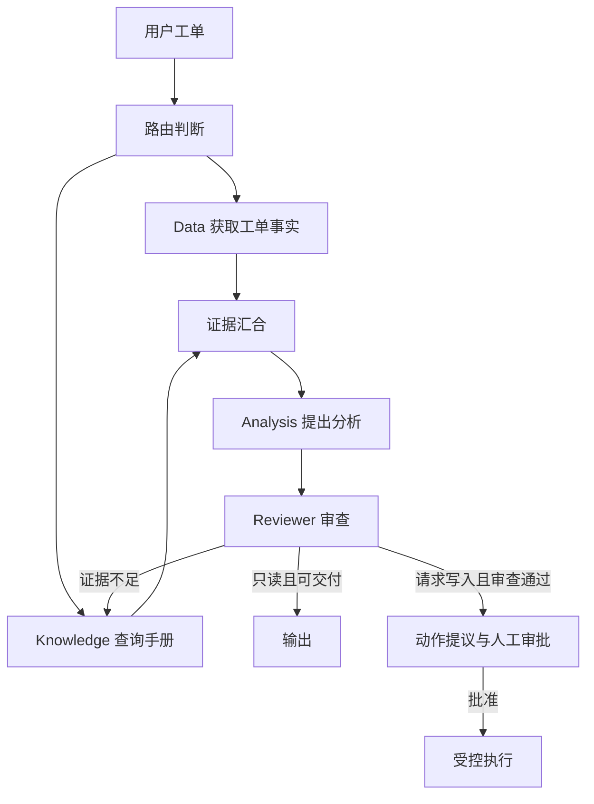
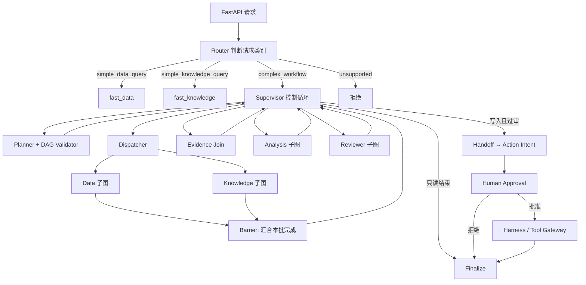
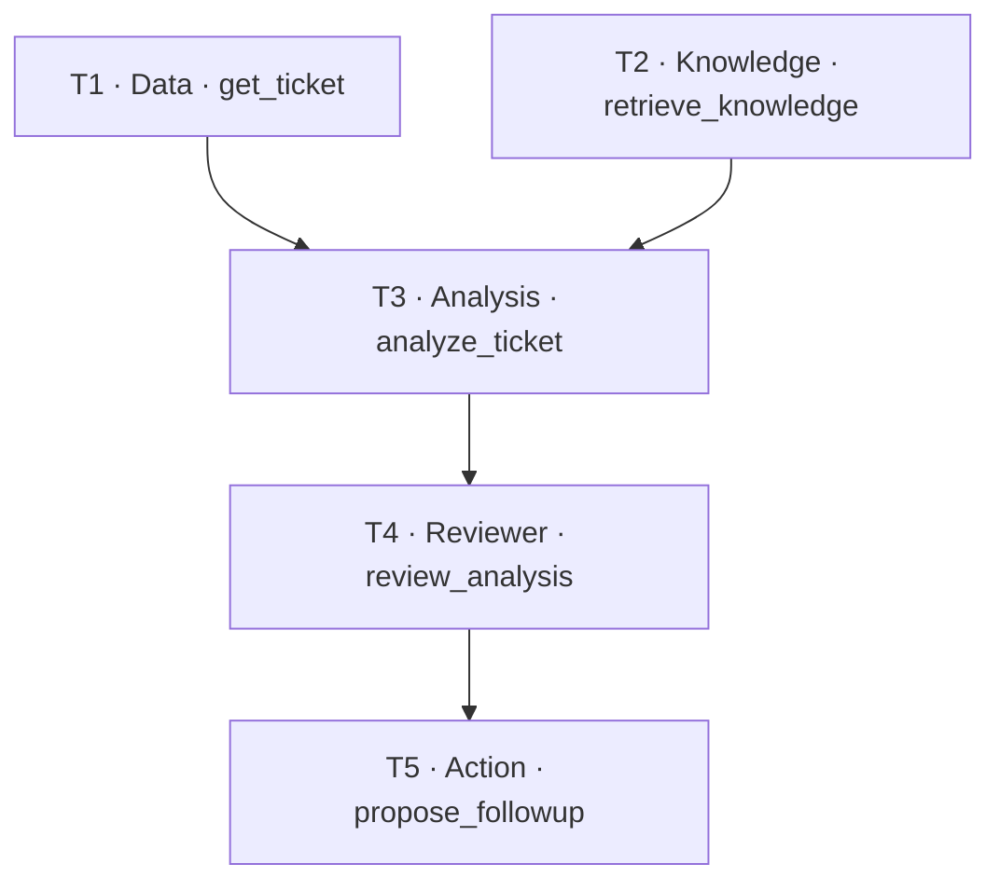

# M10 · Multi-Agent Architecture：从零理解多智能体与 ServiceMind 架构

> [!IMPORTANT] 阅读前约定
> 本篇首先是一份**可以独立学习的教程**，不是源码索引。每个 B 块遵循「**是什么 → 为什么需要 → 如何工作 → 简单例子 → ServiceMind 是怎么做的 → 输入/输出实物 → 源码 → 必要失败边界 → 小结**」。即使你尚未接触 LangGraph，也应能从 B01 开始阅读。难度和历史缺陷留给 SOURCE DEEP / A0–A9 审计层，不在第一次出现术语时堆砌。所有项目结论锁在冻结 SHA；教学示例不伪装成真实运行记录。

## 先弄清这次到底学什么

M10 是 **Multi-Agent Architecture（多智能体架构）**，而不是「逐个 Agent 的所有提示词和每个函数」（属于 M11），也不是「长期记忆完整 CRUD/检索/治理」（属于 M15）。长期记忆会用作理解「Agent 可共享的信息」的通用例子，但不会在 M10 抢先展开 M15 的完整源码。M10 要回答两句核心问题：**为什么采用多个专业 Agent + 一个控制平面？它们之间的权限、任务、数据与执行边界如何真正闭合？**

**主线案例**：租户 Acme，用户提问「分析 GLPI Ticket #5 的 VPN 登录失败；确认信息后给出建议」。首先分析只读路径；只有明确请求添加工单内部跟进（`request_write=true`），才进入动作提议、审批和执行的独立分支。下文中 `T1`–`T5` 是任务 ID，`Run ID` 是一次业务执行 ID，两者不同；示例 UUID、工单内容和演示时间都是假设数据，不代表真实 GLPI 数据库。

**源码事实纪律**：

- `SOURCE FACT`：类、方法、常量实际存在。`WIRED FACT`：沿着真实 caller/constructor/Graph wiring 能追到调用。`RUNTIME OBSERVED`：本轮真实运行验证；**目前没有**。
- `TO VERIFY`：已定位问题或路径，但缺实测、现场配置或某个必须的证据。`UNKNOWN`：本轮没有取得证据、不能下结论。
- 教学图是概念化示意；GitHub `media/agent_architecture.excalidraw` 是**上游 Toolkit 的旧图，并非 ServiceMind ITSM 架构图**，不可拿来背本项目生产拓扑。证据：[README.md L516–549](https://github.com/shark6438/servicemind/blob/19d9a377fb98e1c3f56edc59be40b374013bc08b/README.md#L516-L549)（E5）。

### 建议学习顺序和深度

| 块   | 从零先学的知识                               | 本块最后才对应项目的什么                           | 深度        |
| ---- | -------------------------------------------- | -------------------------------------------------- | ----------- |
| B01  | Agent、LLM、工具、状态和传统程序的关系       | 什么才叫「一个 Agent」                             | MUST KNOW   |
| B02  | 单 Agent、ReAct、多 Agent 与 Workflow 的取舍 | 为什么这里不是自由 ReAct 交接                      | MUST KNOW   |
| B03  | 控制平面、工作平面、治理边界、存储           | ServiceMind 实际 21 节点主 Graph                   | MUST KNOW   |
| B04  | 职责分工与 Agent Contract                    | 5 个专业角色 + Supervisor，不是 6 个 Registry 项   | MUST KNOW   |
| B05  | 路由：哪些请求需要多 Agent                   | 简单路径与复杂路径                                 | MUST KNOW   |
| B06  | 计划、任务、依赖 DAG、编译                   | `PlanProposal → TaskPlan` 完整示例                 | MUST KNOW   |
| B07  | Supervisor 决策及确定性校验                  | `legal_actions → SupervisorDecision → Command`     | MUST KNOW   |
| B08  | 并行调度、扇出、汇合与 Task 状态             | `Send`、`dispatch_barrier`                         | MUST KNOW   |
| B09  | 子图：一个角色内部也有步骤                   | Data/Knowledge/Analysis/Reviewer/Action 的真实形态 | MUST KNOW   |
| B10  | Agent 之间怎样传资料和结果                   | Evidence、Invocation、Result Envelope              | MUST KNOW   |
| B11  | 审查和交接怎么防止越权                       | Reviewer、Handoff、审批、Harness                   | MUST KNOW   |
| B12  | 预算、重试、降级、重规划                     | 有边界的自治而不是无限循环                         | MUST KNOW   |
| B13  | Graph State、Checkpoint、事件与恢复          | 三套记录为何不同                                   | SOURCE DEEP |
| B14  | Registry 契约的真实强度                      | 声明 vs 被验证 vs 被执行                           | MUST KNOW   |
| B15  | 源码视角的完整追踪和架构取舍                 | 从 API 到 Run 终态，可独立画图                     | MUST KNOW   |

---

## B01 · 从最简单的问题开始：Agent 到底是什么？（MUST KNOW）

### 1. 它是什么？先不要想 ServiceMind

**LLM（大语言模型）**可以根据一段输入生成文本、结构化 JSON 或决策建议。模型本身不等于能查数据库、查工单或修改系统的程序。**Tool（工具）**是外部能力的接口，如「读取工单」。**Agent（智能体）**则是围绕目标，把模型能力、允许使用的工具、输入/输出契约和控制步骤结合起来的软件工作单元。

先比较：

- **普通固定程序**：写死 `读取工单 → 查手册 → 按规则输出`，输入差异不会自动重新决定步骤。
- **只调用一次 LLM**：把资料塞进提示词，让模型生成分析；这不是完整的工具工作流。
- **Agent**：可以在其边界内对「下一步做什么 / 如何使用证据」作有限决策；但应由代码决定是否允许做那件事。

最容易误会的是：**用了 LLM 不一定是 Agent；一个 Agent 也不一定每一步都调用 LLM。**

### 2. 为什么需要它？

考虑工单 `#5`：「VPN 登录失败」。只让模型回答，它可能说「建议重置密码」，却不知道这位用户的历史跟进、实际 VPN 手册或 GLPI 数据。给 Agent 限定目标「先取得事实，再形成可引用的分析」，才能把模型推测和真实证据分开。

### 3. 最小例子：同一请求的输入和输出

**输入（业务目标）**：

```json
{"ticket_id": 5, "goal": "分析 VPN 登录失败并给出排查建议", "request_write": false}
```

**内部读取工具的演示结果**（不代表实际调用）：

```json
{"id": 5, "description": "VPN 登录失败", "status": "new"}
```

**期望的 Agent 产物**不是「工具结果原样返回」，而是一个带来源的分析：

```json
{"classification": "vpn_authentication", "reasoning_summary": "先确认 MFA 和身份提供方状况；目前证据不足以直接认定密码错误", "evidence_refs": ["ev-ticket5"]}
```

这段是**概念字段投影**，不是完整 `AnalysisResult`。后面 B10 才会展示完整协议对象与校验方式。先抓住三个动作：**获取事实 → 有边界地判断 → 输出可核对的结果**。

### 3A. 两个接下来一直用到的词：Graph 与 Evidence

**Graph（执行图）** = 一组“节点”和“边”：节点是会运行的步骤，边规定下一步能走向哪里。**子图** = 某个 Agent 自己内部也有几个步骤。Graph 不是给模型看的任意关系图，而是程序执行的控制结构。

**Evidence（证据）** = 为一条结论提供依据的带来源材料。除了“VPN 登录失败”这句内容，项目里的 Evidence 还要记录它来自 GLPI 哪个工单、什么时候取到、内容 Hash、所属租户等。后续 Agent 通过 `evidence_id` 引用它，不是把自然语言凭空当成事实。

例如：

```text
Evidence E1：GLPI Ticket #5 的描述是“VPN 登录失败”
Graph 边：Data 获取 E1 → Analysis 用 E1 形成结论 → Reviewer 检查引用
```

有了这两个概念，就不会把“多 Agent Graph 的节点”“Evidence 数据对象”和“一个 Agent”理解为同一种东西。

### 4. ServiceMind 中哪个部分对应这些概念？

在项目中，`AnalysisAgent` 使用固定的 `draft → check → revise` 子图；`DataAgent` 使用 `plan → execute → normalize` 子图。调用 Agent 的是外层 Supervisor Graph。也就是说，**外层多 Agent 协作和某个 Agent 内部的步骤是两层不同的控制流**。

源码：[analysis.py L90–107](https://github.com/shark6438/servicemind/blob/19d9a377fb98e1c3f56edc59be40b374013bc08b/src/servicemind/agents/analysis.py#L90-L107)、[data.py L119–143](https://github.com/shark6438/servicemind/blob/19d9a377fb98e1c3f56edc59be40b374013bc08b/src/servicemind/agents/data.py#L119-L143)。

### 5. 必要失败边界与源码学习

模型能生成某句话，不意味着它已取得执行授权；输出结构符合 JSON，也不代表分析正确。先学会把 **模型建议、工具返回和经过校验的结果**分开。这里的项目事实来自代码与类定义（E1）；尚未观察运行（没有 E4）。

### 6. 小结（能说出来才算学会）

**Agent 是受程序边界约束的工作单元；模型负责提出内容/建议，工具负责外部能力，程序负责何时调用和如何约束。** 下一块比较单 Agent、多 Agent、ReAct 与 Workflow。

---

## B02 · 为什么不让一个 Agent 做完所有事？ReAct 和多 Agent 有什么区别？（MUST KNOW）

### 1. 先理解四种常见组织方式

**单 Agent + 工具**：一个模型面对多个工具，承担规划、检索、分析与行动，部署简单，但职责混杂。**ReAct** 可以理解为「基于观察，反复决定下一步工具调用/推理」的循环思想，常见流程是模型选择工具 → 工具返回观察 → 模型再决定下一步。**多 Agent** 把不同职责拆成可独立约束的工作者，如 Data、Analysis、Reviewer。**Workflow（工作流）** 规定哪些步骤和条件转换可发生；它可以搭配一个或多个 Agent。

注意：**ReAct 与多 Agent 不是互斥标签**：多个 Agent 内部也可以分别采用 ReAct；固定工作流也可以包含模型决策。核心区分是「谁决定流程边界、谁有何权限」。

### 2. 最简单的反面例子

假设一个「万能 Agent」既能读 Ticket、看手册，又能写入工单：

```text
用户：VPN 无法登录
万能 Agent：我认为应该重置密码 → 调写工具 → 直接修改
```

问题不是模型一定会写错，而是把**推理结论**直接升级为**业务执行权限**。就算把提示词写成「请谨慎」，也不是独立的权限控制。

### 3. 多 Agent 与工作流组合的基本思路



这是**概念逻辑图**，不是 LangGraph 每条实际边：源码主图里每次派发、审查后返回 Supervisor 决策，不能误以为 `Reviewer` 自己直接调用 `Knowledge`。

### 4. ServiceMind 为什么选择固定 Graph + 有限自治？

冻结代码有**固定的主 `StateGraph(Phase3State)`，注册 21 个命名节点**；Planner 可以由模型提出不同任务 DAG，Supervisor 可以由模型提出下一步动作，但最终仍走**已注册的节点**和**代码允许的转换**。因此不能说这是一个任意生成新 Agent、新工具、新 Graph 边的自由 ReAct 多智能体系统。

同时不要否认内部的模型决策：`DynamicPlanner.create_plan()` 通过结构化模型输出 `PlanProposal`；`SupervisorAgent.decide()` 通过模型输出 `SupervisorDecision`；Data 子图的内部工具清单也可以由模型提出。**动态的是建议与任务组合；确定性的是资格、转移和执行边界。**

依据：[supervisor_workflow.py L1837–1906](https://github.com/shark6438/servicemind/blob/19d9a377fb98e1c3f56edc59be40b374013bc08b/src/servicemind/orchestration/supervisor_workflow.py#L1837-L1906)、[dynamic_planner.py L29–70](https://github.com/shark6438/servicemind/blob/19d9a377fb98e1c3f56edc59be40b374013bc08b/src/servicemind/orchestration/dynamic_planner.py#L29-L70)。

### 5. 一个对比表

| 问题           | 自由循环式单 Agent         | ServiceMind 复杂路径                             |
| -------------- | -------------------------- | ------------------------------------------------ |
| 工具范围谁决定 | 常由 Tool List + 模型选择  | Registry + Invocation + Gateway/Harness 多层约束 |
| 谁提出下一步   | 当前模型                   | Supervisor 模型提出，代码校验                    |
| 谁批准写入     | 取决于实现；可能无独立审批 | Reviewer、Handoff、人工 Approval、Harness 分离   |
| 有无动态规划   | 可有                       | `PlanProposal` 可变、`TaskPlan` 受 DAG 规则约束  |
| 出错如何纠正   | 可能继续自由循环           | 预算、重规划次数、确定性失败与终态               |

**取舍**：这样做的代价是实现复杂、延迟和协调开销更高；好处是能对「哪一步发生、谁有权做、为何拒绝」给出可审计解释。这是工程设计取舍，不是「多 Agent 必定优于单 Agent」的实验结论。

### 6. 小结

**ServiceMind 是固定拓扑上的受控多 Agent Workflow，有局部模型自治；不是任意角色相互喊话的群聊，也不是全部决策写死的传统程序。**

---

## B03 · 先画全景地图：谁负责决定，谁负责工作？（MUST KNOW）

### 1. 先认识“平面”这个词

在架构里，「平面」是**职责分类**，不一定是单独的服务器、进程或部署服务。为了便于记忆，本教材把 ServiceMind 分成四种职责平面；这是**教学整理**，不是源码里存在四个同名类。

1. **控制平面**：选择走哪条路径、什么时候规划、下一步派谁做。例如 Router、Planner、Supervisor 和确定性 Policy。
2. **工作平面**：实际执行信息获取、分析和复核的专业角色。例如 Data、Knowledge、Analysis、Reviewer；Action **只编译意图**。
3. **治理/执行边界**：规定证据能否用、工具能否调用、写操作是否获批。例如 Registry/DAG Validator、Invocation、Reviewer、Handoff、受控 Harness。
4. **状态/记录平面**：保存 Run 状态、Graph Checkpoint、事件与审计，支持恢复和解释。

把它们混淆，就会误以为「Supervisor 能决定任务」等于「Supervisor 有权直接写工单」，或者「Graph 有记录」等于「业务数据库一定已有对应行」。

### 2. 一个完整但简化的请求地图



图里为突出主流程，省略了 Replan、RetrieveMore、Escalate、Budget、异常终态节点。Graph 的 21 个节点完整清单在下面。

### 3. 项目“21 节点”具体指什么？

不是 21 个 Agent，而是 **21 个 `graph.add_node()` 注册的执行位置**：

`route`、`fast_data`、`fast_knowledge`、`unsupported`、`supervisor`、`plan`、`dispatch`、`data_task`、`knowledge_task`、`dispatch_barrier`、`join_evidence`、`analysis`、`reviewer`、`retrieve_more`、`replan`、`handoff`、`action`、`approval`、`execute`、`escalate`、`finalize`。

**一个节点 ≠ 一个 Agent**：`dispatch_barrier` 是收集并行任务结果的代码，`approval` 是中断等待人的决策，`finalize` 负责落最终结果。`SupervisorAgent` 是一个模型驱动的控制角色；注册到 `AgentRegistry` 的专业 Agent 只有五个（B04）。

历史课程计划的旧锚点不能覆盖这次冻结源码的重新计数。源码：[supervisor_workflow.py L1837–1906](https://github.com/shark6438/servicemind/blob/19d9a377fb98e1c3f56edc59be40b374013bc08b/src/servicemind/orchestration/supervisor_workflow.py#L1837-L1906)。

### 4. 真正的服务注入长什么样？

`SupervisorRuntimeServices` 是一个 dataclass，用来把“要调用的模块”集中交给 Graph 工厂；核心字段如下：

```python
@dataclass(frozen=True)
class SupervisorRuntimeServices:
    router: FastPathRouter = fast_path_router
    supervisor: SupervisorAgent = supervisor_agent
    planner: DynamicPlanner = dynamic_planner
    policy: SupervisorPolicy = supervisor_policy
    dispatcher: TaskDispatcher = task_dispatcher
    data: DataAgent = data_agent
    knowledge: KnowledgeAgent = knowledge_agent
    analysis: AnalysisAgent = analysis_agent
    reviewer: ReviewerAgent = reviewer_agent
    action: ActionAgent = action_agent
    executor: ControlledActionExecutor = controlled_executor
    repository_factory = ServiceMindRepository
    phase5: Phase5Governance = phase5_governance
```

这是**接线表**，不是它们同时启动了 13 个进程。`build_supervisor_graph()` 通过 `svc.router.route`、`svc.planner.create_plan`、`svc.analysis.run` 等调用实际实例。源码：[supervisor_workflow.py L72–85、L352–375](https://github.com/shark6438/servicemind/blob/19d9a377fb98e1c3f56edc59be40b374013bc08b/src/servicemind/orchestration/supervisor_workflow.py#L72-L85)。

### 5. 必须辨别的旧图与旧 Graph

`media/agent_architecture.excalidraw` 里面写的是「FastAPI Service、LangGraph Agent、LLM Provider、Streamlit App」等，属于旧上游 scaffold 的展示。`src/agents/langgraph_supervisor_agent.py` 仍包含上游 `create_supervisor()` 示例；这**不能证明 ServiceMind ITSM 请求走这个上游例子**。当前业务 `start_run()` 调用的是 `supervisor_graph.ainvoke()`；同时代码中保留独立的 `phase2_graph`（六节点），需区分存在与生产入口。证据：[runtime.py L25–70](https://github.com/shark6438/servicemind/blob/19d9a377fb98e1c3f56edc59be40b374013bc08b/src/servicemind/orchestration/runtime.py#L25-L70)、[workflow.py L166–186](https://github.com/shark6438/servicemind/blob/19d9a377fb98e1c3f56edc59be40b374013bc08b/src/servicemind/orchestration/workflow.py#L166-L186)。

### 6. 小结

**一条 Run 的复杂路径是一个受控 Graph；其中只有若干节点调用专业 Agent，其他节点负责路由、汇合、审批、终止和持久化。**

---

## B04 · 谁负责什么？什么叫 Agent Contract（契约）？（MUST KNOW）

### 1. 先用公司分工理解契约

想象服务台有五类专业岗位：查工单的、找手册的、分析问题的、复核分析的、形成待审批动作的。管理者不能仅凭「你是查资料的人」就相信某个同事绝不会修改工单，还要给他**明确的可用工具、任务类型与交接规则**。

Agent Contract（智能体契约）就是一份**接口与权限声明**。它回答「这个角色叫什么，能接哪些任务，理论上允许哪些工具，输出应是什么形式，异常时如何处理」。但**有声明不等于自动执行**：必须找到代码里的消费者和校验点。

### 2. ServiceMind 真正注册了哪些角色？

| 角色      | 负责什么（先用白话理解）     | 允许的任务类型                                  | 是否独立执行写入     |
| --------- | ---------------------------- | ----------------------------------------------- | -------------------- |
| Data      | 查 GLPI 工单和支持组等事实   | `get_ticket`、`retrieve_more_data`              | 否                   |
| Knowledge | 从运行手册/知识库取得证据    | `retrieve_knowledge`、`retrieve_more_knowledge` | 否                   |
| Analysis  | 根据证据形成分析             | `analyze_ticket`                                | 否                   |
| Reviewer  | 检查分析是否有证据、是否违规 | `review_analysis`                               | 否                   |
| Action    | 把过审结果编译成操作意图     | `propose_followup`                              | 否（不执行 GLPI 写） |

**Supervisor 单独存在**：它属于控制角色，由 `SupervisorContract` 描述，不是 `AgentName` 的第六个值。`AgentRegistry` 的 `names` 恰好是五个专业角色。

### 3. 一个契约到底长什么样？

源码中 Data Agent 的 `AgentContract` 可读取为：

```python
AgentContract(
    name=AgentName.DATA,
    description="Read tenant-scoped GLPI facts and return data evidence.",
    input_schema="DataTaskInput",
    output_schema="list[Evidence]",
    allowed_tools=(
        "glpi.read.ticket",
        "glpi.read.groups",
        "glpi.read.ticket_followups",
    ),
    forbidden_tools=COMMON_FORBIDDEN,
    read_write_scope="read_only",
    timeout_seconds=20,
    error_policy=ErrorPolicy.RETRY,
    task_types=("get_ticket", "retrieve_more_data"),
)
```

词汇解释：`input_schema/output_schema` 是输入/输出形态的**名称字符串**；`allowed_tools` 是许可的工具名；`forbidden_tools` 是禁止清单；`task_types` 指明 Data 可接受的具体任务名；`error_policy` 描述期望的错误策略。

### 4. 契约怎样从“纸面规定”变成“真实约束”？

分三个层次理解：

**层 A：声明**。`AgentRegistry` 保存上面的 dataclass，检查注册名不重复，`get()` 可查询。此时它还没执行任何工具。

**层 B：任务级校验**。`DagValidator._validate_task()` 真的检查 `task.agent` 是否注册、`task.task_type` 是否属于该 Agent 的 `task_types`；还检查依赖不存在、环路与 Reviewer/Action 顺序。

**层 C：运行期授权**。`_invocation()` 把注册的 `allowed_tools` 放入 `AgentInvocationContext.allowed_capabilities`；Data Agent `_compile_plan()` 会调用 `invocation.require_capability()`。真正读 GLPI 还要经过 tenant-scoped read gateway，而动作执行还有专门 Harness。

**不是所有契约字段都被统一执行**：例如 `input_schema="DataTaskInput"` 只是字符串，不能据此声称 Registry 自动校验某个名为 `DataTaskInput` 的 Pydantic 类；`timeout_seconds=20` 也不能仅凭 dataclass 存在就说每个 Agent 自动使用了该值，实际节点有各自显式 `asyncio.timeout(20)` 等逻辑。`forbidden_tools` 同样不等价于已由一个中央函数统一处理：必须核实际调用者与 Gateway。这样的区分是架构审计的重点。

### 5. 一行错误计划的实物示例

```json
{"task_id":"T1", "agent":"data", "task_type":"delete_ticket", "depends_on":[]}
```

模型可以**尝试**提出这段 JSON，但 `delete_ticket` 不在 Data 的 `task_types` 中。`DagValidator` 将拒绝它，抛 `PlanValidationError(code="INVALID_TASK_TYPE", ...)`，而不是去调用一个不存在的删除工具。

反之 `{"task_id":"T1", "agent":"data", "task_type":"get_ticket"}` 符合角色/类型初步配对；但要形成合法 `TaskPlan`，还需要时间、预算、完整 Task 字段及 DAG 其他条件。这就是「局部格式正确 ≠ 整个系统准入通过」。

源码：[registry.py L6–141](https://github.com/shark6438/servicemind/blob/19d9a377fb98e1c3f56edc59be40b374013bc08b/src/servicemind/orchestration/registry.py#L6-L141)、[task_dag.py L51–140](https://github.com/shark6438/servicemind/blob/19d9a377fb98e1c3f56edc59be40b374013bc08b/src/servicemind/orchestration/task_dag.py#L51-L140)、[supervisor_workflow.py L247–265](https://github.com/shark6438/servicemind/blob/19d9a377fb98e1c3f56edc59be40b374013bc08b/src/servicemind/orchestration/supervisor_workflow.py#L247-L265)。

### 6. 小结

**契约是规则的说明书；`DagValidator`、Invocation、具体 Agent 和 Tool Gateway 才是执行这些规则的不同位置。** 下一块先看请求怎么决定要不要使用这一整套多 Agent 流程。

---

## B05 · 请求来了，为什么不是每次都召集所有 Agent？（MUST KNOW）

### 1. 路由是什么？

Router（路由器）先判断「这条请求是查现成事实、查一篇资料、需要推理审查，还是超出范围」，然后决定进入哪条流程。这个阶段解决**成本和风险**：查询一个确定字段不一定需要 5 个 Agent；诊断问题时却不能只把检索到的段落当作结论。

对照简单例子：

- 「工单 #5 当前状态是什么？」→ 可以先读取 GLPI 工单字段。
- 「请找 VPN 操作手册」→ 可以走知识检索。
- 「VPN 报错后我该如何处理？请分析根因」→ 需要结合证据的判断和 Reviewer。
- 「删除整个工单」→ 当前允许动作范围之外，拒绝，而不是试图让模型找个删除工具。

### 2. ServiceMind 的 RouteDecision 长什么样？

`FastPathRouter.route(request, request_write=False)` 按确定性正则、规则顺序返回 `RouteDecision`（Pydantic），包含四个真实字段：`route`、`required_capabilities`、`reason_code`、`confidence`。四种路由类型是 `simple_data_query` / `simple_knowledge_query` / `complex_workflow` / `unsupported`。

假设对「工单 #5 的状态是什么」返回：

```json
{
  "route": "simple_data_query",
  "required_capabilities": ["data"],
  "reason_code": "fact_lookup_only",
  "confidence": 0.97
}
```

若明确 `request_write=true` 且未命中禁止操作，冻结路由返回：

```json
{
  "route": "complex_workflow",
  "required_capabilities": ["data", "knowledge", "analysis", "reviewer", "action"],
  "reason_code": "analysis_or_action_required",
  "confidence": 0.98
}
```

**这里的 `required_capabilities` 是路由层声明需要哪些角色，并不是“此刻五个 Agent 都已经执行”**；实际任务还要由 Planner 产生和 DAG 编译，Graph 再按状态派发。

### 3. 为什么规则顺序会改变答案？

`FastPathRouter` 先查禁止的操作，再看写入请求，然后判断「具体故障＋求解决策」和一般复杂分析，最后考虑知识检索和数据字段的快捷查询。举例：「VPN MFA 无法登录，怎么办？」不能因为含有“怎么办”就变成只返回手册全文；「请找 VPN 操作手册」也不应该因为出现 VPN 症状就强制做一次事故归因。

一个更微妙的现实：**Top-K 检索总能给出某些结果，不代表结果与问题有关**。`fast_knowledge_node` 会评估是否应该拒绝检索式回答；若拒绝，`after_fast_knowledge` 返回 `supervisor` 走更完整的审查流程，而不是一概 `END`。它仍不是「每个查询都调用 Reviewer」。

### 4. 真正接线在哪里？

```python
async def route_node(state):
    decision = svc.router.route(
        state["raw_request"], request_write=state["request_write"]
    )
    return {"route": decision.model_dump(mode="json"), ...}

# 紧接着的 after_route 依据 route 值选择：
# fast_data / fast_knowledge / supervisor / unsupported
```

在复杂路径里路由进入 `supervisor`；简单数据路径在 `fast_data_node` 获取后形成结果，知识快捷路径视相关性成功终结或转入 Supervisor。

源码：[router.py L1–227](https://github.com/shark6438/servicemind/blob/19d9a377fb98e1c3f56edc59be40b374013bc08b/src/servicemind/orchestration/router.py#L1-L227)、[routing.py L7–21](https://github.com/shark6438/servicemind/blob/19d9a377fb98e1c3f56edc59be40b374013bc08b/src/servicemind/domain/routing.py#L7-L21)、[supervisor_workflow.py L375–525](https://github.com/shark6438/servicemind/blob/19d9a377fb98e1c3f56edc59be40b374013bc08b/src/servicemind/orchestration/supervisor_workflow.py#L375-L525)。

### 5. 必要失败边界

规则路由有误分风险，正则置信度不是模型准确率；`simple_data_query` 的结果不是经过 Analysis+Reviewer 的判断；`fast_knowledge` 的拒绝不是「检索报错」，而是拒绝直接拿低相关结果充当答案；路由放行也不赋予写权限。

### 6. 小结

路由回答的是「走哪个流程」，不是「最终答案是什么」。只有复杂路径才需要 B06 的动态规划。

---

## B06 · 什么叫任务规划和 DAG？模型能规划，但为什么不能直接执行它写的计划？（MUST KNOW）

### 1. 先解释 DAG：有向无环图

把做饭想成多个任务：「洗菜」「切菜」「炒菜」。洗菜必须先完成，切菜之后才炒，但洗菜同时可以烧水。任务之间的这种“先后依赖”组成 DAG（Directed Acyclic Graph，**有向无环图**）。

- **有向**：`T1 → T3` 表示 T3 必须等待 T1 完成。
- **无环**：不能出现 `T1 依赖 T2`，又要求 `T2 依赖 T1`，否则永远无法开始。
- **可并行**：没有相互依赖的 T1/T2 可以同时安排，但还要受最大并行数和预算限制。

这与主 `StateGraph` 不同：**Task DAG 是某次 Run 的计划数据；StateGraph 是代码里已经编译的执行图。** 每次模型创建新任务组合，并不会动态新增主 Graph 的 Python 节点。

### 2. 以 Ticket #5 设计一个合法的写请求计划

这里我们使用**另一条明确请求写入的 Run**：用户希望「分析 Ticket #5 并准备内部跟进，经人工批准后才写入」。任务按 `T1`–`T5` 分配：



这里 `T1/T2` 可以并行，`T3` 要等两个都成功；`T4` 必须在分析后；`T5` 只能在 Review 后。**注意：T5 产出的是待审批的 ActionIntent，而不是修改工单。**

### 3. 第一次对象转换：模型只提出 PlanProposal（完整示例）

```json
{
  "rationale_summary": "先收集 Ticket #5 的事实与 VPN 处理手册，再分析、审查并准备待审批内部跟进",
  "tasks": [
    {"task_id":"T1","agent":"data","task_type":"get_ticket","objective":"读取 Ticket #5 事实和可用支持组","depends_on":[]},
    {"task_id":"T2","agent":"knowledge","task_type":"retrieve_knowledge","objective":"检索 VPN 故障排查手册","depends_on":[]},
    {"task_id":"T3","agent":"analysis","task_type":"analyze_ticket","objective":"根据 T1 T2 的证据进行分析","depends_on":["T1","T2"]},
    {"task_id":"T4","agent":"reviewer","task_type":"review_analysis","objective":"审查 T3 的证据与结论","depends_on":["T3"]},
    {"task_id":"T5","agent":"action","task_type":"propose_followup","objective":"准备基于已审查结论的内部跟进意图","depends_on":["T4"]}
  ],
  "max_parallel": 2
}
```

这就是冻结源码 `PlanProposal` 的真实字段：`rationale_summary`、`tasks`、`max_parallel`；每个 `PlanTaskProposal` 只有五项。**它还没有 TaskStatus、预算、deadline 和 plan_id**；这些不应该由模型随意填。

### 4. 第二次转换：代码编译成 TaskPlan（完整示例）

`DynamicPlanner.compile_proposal()` 取每个专业 Agent 在 Registry 的契约，把模型建议改造成 `Task`，注入任务 `error_policy`、`input`、`deadline`；从配置建立 `Budget`；构造 `TaskPlan` 并通过 `DagValidator`。下面是**按照冻结字段结构构造、带固定教学时间的完整输出示例**。实际运行时 `plan_id`、`created_at` 和 `deadline` 会由当时的程序生成，不会使用示例的固定值。

```json
{
  "plan_id":"12345678-1234-4234-8234-123456789abc",
  "goal":"分析 Ticket #5 并准备经过审批的内部跟进",
  "tasks":[
    {"task_id":"T1","agent":"data","task_type":"get_ticket","input":{"objective":"读取 Ticket #5 事实和可用支持组","ticket_id":5},"depends_on":[],"status":"pending","output_ref":null,"attempts":0,"error_policy":"retry","deadline":"2026-10-10T09:05:00Z"},
    {"task_id":"T2","agent":"knowledge","task_type":"retrieve_knowledge","input":{"objective":"检索 VPN 故障排查手册","ticket_id":5},"depends_on":[],"status":"pending","output_ref":null,"attempts":0,"error_policy":"retry","deadline":"2026-10-10T09:05:00Z"},
    {"task_id":"T3","agent":"analysis","task_type":"analyze_ticket","input":{"objective":"根据 T1 T2 的证据进行分析","ticket_id":5},"depends_on":["T1","T2"],"status":"pending","output_ref":null,"attempts":0,"error_policy":"replan","deadline":"2026-10-10T09:05:00Z"},
    {"task_id":"T4","agent":"reviewer","task_type":"review_analysis","input":{"objective":"审查 T3 的证据与结论","ticket_id":5},"depends_on":["T3"],"status":"pending","output_ref":null,"attempts":0,"error_policy":"escalate","deadline":"2026-10-10T09:05:00Z"},
    {"task_id":"T5","agent":"action","task_type":"propose_followup","input":{"objective":"准备基于已审查结论的内部跟进意图","ticket_id":5},"depends_on":["T4"],"status":"pending","output_ref":null,"attempts":0,"error_policy":"fail_fast","deadline":"2026-10-10T09:05:00Z"}
  ],
  "max_parallel":2,
  "max_steps":64,
  "max_replans":2,
  "deadline":"2026-10-10T09:05:00Z",
  "budget":{"max_steps":64,"max_replans":2,"max_model_calls":80,"max_tool_calls":32,"token_budget":null,"cost_budget":null,"deadline":"2026-10-10T09:05:00Z"},
  "created_at":"2026-10-10T08:55:00Z"
}
```

**字段教学**：`status=pending` 表示任务尚未运行；`depends_on` 是依赖；`attempts=0` 还没尝试；`error_policy` 来自 Registry；`input` 对应 Python `Task.task_input` 的 JSON alias。`max_steps=64` 等**不是 `Budget` 类裸默认值**：`compile_proposal()` 实际读取冻结 `settings`：`MAX_STEPS=64`、`MAX_REPLANS=2`、`MAX_MODEL_CALLS=80`、`MAX_TOOL_CALLS=32`、`RUN_DEADLINE_SECONDS=600`。如果把 `Budget` 模型自身的 `24/12/16` 当成运行配置，会教错。

### 5. 为什么必须“模型建议 → 编译器 → 验证器”？

Planner 的 LLM 可以犯四种很自然的错：发明 `delete_ticket` 类型、把 Review 放在 Analysis 前面、给自己引用一个不存在的 Task、让任务形成环。

项目中防线分层：

- `PlanProposal.model_validate()` 验证提案结构；`PlanTaskProposal.agent` 必须是枚举角色。
- `compile_proposal()` 将任务从**建议**转换成**可执行计划**；初次计划如果已包含 Evidence 任务却遗漏 Analysis/Reviewer，`_complete_evidence_pipeline()` 尝试用**确定性代码补全**，而不是让模型猜到刚好所有规则。
- `DagValidator.validate()` 检查角色任务类型匹配、未知依赖、循环、Reviewer 是否有 Analysis 祖先、Action 是否有 Reviewer 祖先、总量/并行/时间。
- 写请求必须出现 Action 任务；如果计划无法合法补齐，最终拒绝该计划，而不是放宽安全规则。

例如，模型建议 `{T1: knowledge}` 一项且无 Analysis、Reviewer，编译器可以补出后两项。但若建议 `T1 → T2 → T1`，它属于环，会被拒绝，不可能「模型觉得有道理所以照做」。

### 6. SOURCE DEEP：重新规划时还有什么约束？

`revise_plan()` 不是随便生成一张全新的图替换旧图。已完成 Task 的 ID、Agent 和 `task_type` 不得被偷偷改掉；预算和 deadline 沿用上一版；新一轮需要增加证据任务和新的 Analysis/Reviewer；若 Review 指定 `RETRIEVE_MORE`，新增任务必须包括 Knowledge；写请求还要求新的 Action。若把 T1–T6 已完成任务重编号为 T1–T4，会触发拒绝。这是**可恢复性和审计连续性**要求，不是 UI 美观问题。

源码：[domain/supervisor.py L32–69](https://github.com/shark6438/servicemind/blob/19d9a377fb98e1c3f56edc59be40b374013bc08b/src/servicemind/domain/supervisor.py#L32-L69)、[dynamic_planner.py L29–127、L339–400](https://github.com/shark6438/servicemind/blob/19d9a377fb98e1c3f56edc59be40b374013bc08b/src/servicemind/orchestration/dynamic_planner.py#L339-L400)、[task_dag.py L38–140](https://github.com/shark6438/servicemind/blob/19d9a377fb98e1c3f56edc59be40b374013bc08b/src/servicemind/orchestration/task_dag.py#L38-L140)、[settings.py L172–200](https://github.com/shark6438/servicemind/blob/19d9a377fb98e1c3f56edc59be40b374013bc08b/src/core/settings.py#L172-L200)。

### 7. 小结

**LLM 决定“我建议做哪些任务”；编译器与验证器决定“这份建议有没有资格成为合法 TaskPlan”。** `PlanProposal` 与 `TaskPlan` 的字段不同，绝不能混用。

---

## B07 · Supervisor 是“调度管理员”，不等于“可以为所欲为的模型”（MUST KNOW）

### 1. 什么是 Supervisor？

Supervisor 是复杂路径的**控制角色**：它观察当前任务状态、Review 结果、预算等，提出**下一步控制动作**，而不是自己读取工单、自己生成全部分析、自己调用写工具。

「下一步」不是一整篇自然语言计划，而是一个结构化 `SupervisorDecision`。它和 B06 的 TaskPlan 含义不同：**Plan 说明整段任务依赖；Decision 只说明此刻在这个状态下做什么。**

### 2. 先用五任务例子走一遍

刚编译好的计划里 T1/T2 都 `pending`，彼此不依赖，剩余并行槽是 2。`SupervisorPolicy.legal_actions(state)` 给出可选动作，类似：

```json
{
  "legal_actions":["dispatch","escalate","replan"],
  "ready_tasks":[
    {"task_id":"T1","agent":"data","task_type":"get_ticket","objective":"读取 Ticket #5 事实和可用支持组"},
    {"task_id":"T2","agent":"knowledge","task_type":"retrieve_knowledge","objective":"检索 VPN 故障排查手册"}
  ],
  "max_parallel":2
}
```

这只是 `supervisor_view()` 中**相关字段投影**；真正返回给模型的 View 还有 goal、plan、control、review、budget 等。模型应选择一次合法动作：

```json
{
  "action":"dispatch",
  "selected_task_ids":["T1","T2"],
  "rationale_summary":"两个证据任务都已就绪且可并行执行",
  "confidence":0.92
}
```

**这是完整的 `SupervisorDecision` 四字段示例**。由于类型被限制，模型不能在 `action` 中随意写 `execute_python` 或 `delete_database`。

### 3. 为什么不能只相信模型产生的 JSON？

假设模型输出：

```json
{
  "action":"analyze",
  "selected_task_ids":["T3"],
  "rationale_summary":"我想直接分析，省一点时间",
  "confidence":0.99
}
```

即便 JSON 完全有效，T3 仍依赖尚未完成的 T1/T2，**在这个状态下不合法**。`SupervisorPolicy.validate()` 将抛 `SupervisorPolicyError`，系统收集拒绝原因后可以要求模型修正，而不是执行错误的转移。`confidence=0.99` 不能越过这条确定性规则。

另一个常见错误是 `dispatch` 选择 T3：虽然 T3 未来可能 ready，但 `DISPATCH` 只用于 Data/Knowledge 批量任务；Analysis 和 Reviewer 是专门的单任务转移，不能把所有节点当成同一种调度模式。

### 4. 从合法决策到 Graph 节点：真实代码

```python
candidate = await svc.supervisor.decide(
    supervisor_view(state), policy_feedback=feedback
)
svc.policy.validate(candidate, state)

# 校验通过后，系统从固定 target 字典中取节点名：
target = {
    SupervisorAction.PLAN: "plan",
    SupervisorAction.DISPATCH: "dispatch",
    SupervisorAction.JOIN_EVIDENCE: "join_evidence",
    SupervisorAction.ANALYZE: "analysis",
    SupervisorAction.REVIEW: "reviewer",
    # 其余动作见源码
}[candidate.action]
return Command(update={"supervisor_decision": candidate.model_dump(mode="json"), ...}, goto=target)
```

这段为强调逻辑而省略了其它 target 项，**不是可直接运行的完整函数**。核心因果是：模型负责候选决策，Policy 负责合法性，Graph 的 `Command(goto=...)` 只允许跳到已经接线的目标。

### 5. 失败时会无限问模型吗？

不会。冻结实现的 `policy_attempts=3`，此前拒绝原因累积进反馈，最多三次政策纠正机会；模型调用自身如果抛异常，会停止这一纠错循环并设置 `supervisor_decision_failure`，而非无休止同样重试；若三次都是非法动作，则终止为 `supervisor_policy_failure`。还受 Run 的总模型调用预算约束。

示例：

```text
第1次：选 analyze，T3 未就绪 → 拒绝理由①
第2次：选 dispatch，却选 T3 → 拒绝理由②
第3次：收到①+②，选择 dispatch(T1,T2) → 接受
```

这个三次序列是**演示**，不意味着每次真实模型都会恰好这样修正。

源码：[supervisor.py L11–63](https://github.com/shark6438/servicemind/blob/19d9a377fb98e1c3f56edc59be40b374013bc08b/src/servicemind/agents/supervisor.py#L11-L63)、[supervisor_policy.py L15–169](https://github.com/shark6438/servicemind/blob/19d9a377fb98e1c3f56edc59be40b374013bc08b/src/servicemind/orchestration/supervisor_policy.py#L15-L169)、[supervisor_workflow.py L527–755](https://github.com/shark6438/servicemind/blob/19d9a377fb98e1c3f56edc59be40b374013bc08b/src/servicemind/orchestration/supervisor_workflow.py#L527-L755)。

### 6. 小结

**Supervisor 的模型给建议，SupervisorPolicy 决定建议能不能走，Graph 才真正跳转。** 这三者都叫“控制”，但不能省成一个函数。

---

## B08 · 为什么 T1、T2 能并行？“扇出”和“汇合”到底在做什么？（MUST KNOW）

### 1. 先解释两个词

**Fan-out（扇出）**：一个调度动作把工作派给多个可并行任务，例如同时派 Data 与 Knowledge。**Barrier（汇合屏障）**：等待并收集当前批次的任务完成记录，把这些结果更新回统一 TaskPlan。不能把「多个任务已被发送」当成「它们已完成」。

类比：餐厅同时安排洗菜和煮汤；经理要等两张回执，才能宣布「食材准备完成」，而不是派单后立刻进入下一步。

### 2. ServiceMind 不是同时执行任意 Agent

`SupervisorPolicy.validate()` 只允许 `DISPATCH` 批量选择 Data/Knowledge，并检查任务 ID 是否就绪、没有重复、数量不超过空闲并行槽和工具预算。`TaskDispatcher.ready_tasks()` 只查依赖是否成功 + 任务尚未开始；`available_slots()` 单独查并行容量。**“任务是否就绪”和“现在能启动几个”是两个不同问题。**

对于 B06 的计划：

```json
{
  "ready_task_ids":["T1","T2"],
  "running_task_ids":[],
  "max_parallel":2,
  "available_slots":2,
  "supervisor_action":"dispatch",
  "selected_task_ids":["T1","T2"]
}
```

这是从 TaskPlan 和策略推出来的**教学状态投影**，不是某个完整 Pydantic 类的 `model_dump()`。

### 3. `Send` 到底传什么？

`dispatch_node()` 为本批生成一个 `dispatch_batch_id`，给每个任务独立保留模型/工具预算。然后把 `Task` 从 `PENDING → READY → RUNNING`，用 LangGraph `Send(node, payload)` 送给 `data_task` 或 `knowledge_task`。

例如发给 Data 的关键载荷投影：

```json
{
  "run_id":"bbbbbbbb-bbbb-4bbb-8bbb-bbbbbbbbbbbb",
  "tenant_id":"11111111-1111-4111-8111-111111111111",
  "ticket_id":5,
  "dispatch_batch_id":"dddddddd-dddd-4ddd-8ddd-dddddddddddd",
  "dispatch_task":{"task_id":"T1","agent":"data","task_type":"get_ticket","status":"running"},
  "invocation_model_budget":2,
  "invocation_tool_budget":6
}
```

实际 `payload` 还携带用户身份、roles、GLPI Entity/Group/Profile ACL、thread_id、目标、完整 TaskPlan、控制状态等，**不能把上述投影误当成源码实际的完整 Send 输入**。完整字段以 [supervisor_workflow.py L820–870](https://github.com/shark6438/servicemind/blob/19d9a377fb98e1c3f56edc59be40b374013bc08b/src/servicemind/orchestration/supervisor_workflow.py#L820-L870) 为准。

### 4. 子任务完成后给 Barrier 的是什么？

假设 Data 得到两条证据，Knowledge 得到一条（都是教学演示）：

```json
[
  {"batch_id":"dddddddd-dddd-4ddd-8ddd-dddddddddddd","task_id":"T1","status":"success","error_type":null,"output_refs":["ev-ticket5","ev-group"],"model_calls":1,"tool_calls":2,"attempts":1,"agent_status":"succeeded"},
  {"batch_id":"dddddddd-dddd-4ddd-8ddd-dddddddddddd","task_id":"T2","status":"success","error_type":null,"output_refs":["ev-runbook"],"model_calls":1,"tool_calls":1,"attempts":1,"agent_status":"succeeded"}
]
```

这组是 **`task_completions` 条目形状** 的可读演示。此处与前一个 `Send` 示例沿用同一个演示批次 UUID，表明两张回执属于**同一批任务**。`batch_id` 保证汇合只消费当前批次结果；`output_refs` 是 Evidence ID 列表，不是把所有正文塞进 Task 的 `output_ref`。

Barrier 检查：

```text
任务 T1 原为 RUNNING + 收到成功 → SUCCESS
任务 T2 原为 RUNNING + 收到成功 → SUCCESS
control.tool_call_count / model_call_count 计入这批已用量
evidence_dirty=True → 让 Supervisor 知道要 JOIN_EVIDENCE
```

**为什么还看 RUNNING？** 权限收窄可能把原任务重新置为 `PENDING`；若旧并发任务晚到，它的 completion 已经属于作废前的一轮，不能错误地恢复到新计划里。

### 5. 与前面哪些源码相连？

- [dispatcher.py L16–101](https://github.com/shark6438/servicemind/blob/19d9a377fb98e1c3f56edc59be40b374013bc08b/src/servicemind/orchestration/dispatcher.py#L16-L101)：就绪、容量、状态转移及失效重开。
- [supervisor_workflow.py L820–870](https://github.com/shark6438/servicemind/blob/19d9a377fb98e1c3f56edc59be40b374013bc08b/src/servicemind/orchestration/supervisor_workflow.py#L820-L870)：`Send` 的真实构建处。
- [supervisor_workflow.py L1089–1143](https://github.com/shark6438/servicemind/blob/19d9a377fb98e1c3f56edc59be40b374013bc08b/src/servicemind/orchestration/supervisor_workflow.py#L1089-L1143)：Barrier 归并和控制计数。
- [state.py L44–105](https://github.com/shark6438/servicemind/blob/19d9a377fb98e1c3f56edc59be40b374013bc08b/src/servicemind/orchestration/state.py#L44-L105)：`task_completions` 使用 `operator.add` 累积；Evidence 通道有专门的 reset/append 语义。

### 6. 必要失败边界

T1/T2 中一个失败，不等于「把失败当空证据继续正常回答」；Barrier 会记录失败，生成 `REPLAN` 类型复核反馈。并行不代表无上限，受 `max_parallel`、工具预算和当前 RUNNING 数控制。完成信号与 Evidence 内容是两条不同的状态通道。

### 7. 小结

**DAG 决定谁依赖谁，Dispatcher 决定此刻谁就绪，Supervisor 选择派哪些，`Send` 分发，Barrier 统一记账。** 现在才可以进入每个子 Agent 内部到底如何工作。

---

## B09 · 一个专业 Agent 自己内部也可以是一张小图吗？（MUST KNOW）

### 1. 先解释“子图”

一个部门被派了一项任务，部门内部还可能按固定步骤处理。主 Graph 只说「现在交给 Data Agent」，Data 内部却有「拟定读取计划 → 执行读取 → 归一化结果」三个步骤。这就是子图的直观理解：**某个专业工作单元有自己的局部状态和内部流程，而不是每个 Agent 都只调用一次 LLM**。

### 2. 五个专业角色的真实形态（不是五个同构大模型）

| 角色      | ServiceMind 源码形态                                         | 最容易误解之处                                               |
| --------- | ------------------------------------------------------------ | ------------------------------------------------------------ |
| Data      | `StateGraph(DataAgentState)`：`plan → execute → normalize`   | 它的 **plan 可调用 LLM**，并非纯 SQL/GLPI 请求包装器         |
| Knowledge | `StateGraph(KnowledgeState)`：`retrieve` 一个节点            | 一个节点也能封装复杂 RAG 检索；不等于每次都调 LLM            |
| Analysis  | `StateGraph(AnalysisAgentState)`：`draft → check → revise` 有条件回边 | 模型草稿不合格可以局部修订，但有预算和降级出口               |
| Reviewer  | `StateGraph(ReviewerAgentState)`：`rule_gate → semantic_judge → adjudicate`；可早停 | 规则门可能先拒绝，不能凭语义评审“推翻”硬约束                 |
| Action    | `ActionAgent` 的确定性 Python 方法                           | **没有自己的 StateGraph、没有 GLPI 写凭据**；生成 ActionIntent |

这说明：**多 Agent 是职责拆分，不代表必须有五个独立进程、五次 LLM 调用或五个相同的 ReAct 循环。** Supervisor 另外使用一次模型选择控制动作，Planner 也能调用模型；不要把“有 LLM 的部件数”误认为“Registry Agent 数”。

### 3. Data 的内部决策：用具体对象讲透

Data 收到 T1，目标「读取 Ticket #5 与支持组」。它可以产生如下真实字段结构的工具计划：

```json
{
  "calls": [
    {"tool_name":"glpi.read.ticket","ticket_id":5,"purpose":"读取当前工单事实"},
    {"tool_name":"glpi.read.groups","ticket_id":5,"purpose":"核实可用支持组"}
  ],
  "rationale_summary":"工单分析至少需要原始事实与支持组信息"
}
```

这是**完整的 `DataAcquisitionPlan` 对象**，内含 `DataToolCall` 列表。`DataAgent._compile_plan()` 会逐条检查：工具名称在允许枚举中、`ticket_id` 必须仍是 Supervisor 选定的 #5、不能超过本次工具预算、必须包含读取工单和支持组、`require_capability()` 必须通过。

**如果模型失败呢？** 不是“没有证据就自己编”：Data 可使用预算约束的确定性最小读取计划，但输出应带 `DEGRADED` / `failure_code`，不能伪装成模型规划成功。工具读取也需要真实 tenant-scoped gateway。相关源码：[data.py L80–170、L196–275、L400–442](https://github.com/shark6438/servicemind/blob/19d9a377fb98e1c3f56edc59be40b374013bc08b/src/servicemind/agents/data.py#L196-L275)。

### 4. Knowledge 究竟是“知识 Agent”还是“RAG”？

通用概念上，Knowledge 的职责是从可信资料中检索内容，不一定全靠生成式模型。ServiceMind `KnowledgeAgent._retrieve_node` 在 `SERVICEMIND_RAG_ENABLED=True` 时构建 `RetrievalPrincipal`（含用户和 Entity/Group/Profile ACL），调用 `EnterpriseRAG.retrieve`，再转成 Evidence；如果关闭，且没有设置 `SERVICEMIND_RAG_REQUIRED=True`，则使用内置 `RUNBOOKS` 的 `_baseline` 备用知识源。

**这意味着默认源码设置 `SERVICEMIND_RAG_ENABLED=False`，不能写成“所有 Knowledge 请求都已经访问生产 OpenSearch”。** 复杂 RAG 检索、索引、GraphRAG 细节属于 M12/M14，不在这一块把入门教程变成召回公式大全。

举例：当 RAG 关闭时，查询包含 VPN/MFA 相关关键词，baseline 可以把 `rb-vpn-mfa` 的短手册整理成 Evidence；它不是现场上传的知识库数据，也不证明真实企业资料已索引。

源码：[knowledge.py L17–45、L59–168](https://github.com/shark6438/servicemind/blob/19d9a377fb98e1c3f56edc59be40b374013bc08b/src/servicemind/agents/knowledge.py#L59-L168)、[settings.py L199–200](https://github.com/shark6438/servicemind/blob/19d9a377fb98e1c3f56edc59be40b374013bc08b/src/core/settings.py#L199-L200)。

### 5. Analysis 和 Reviewer：为什么都要有“检查”？

Analysis 的 `check` 是**同一个生产角色内部的质量修复检查**：检查它刚写的草稿是否符合该角色的输出要求，必要时 `revise` 再问模型。Reviewer 是**独立角色的审核**：既检查结构/证据/政策，也可能进行语义审查，决定是通过、补资料、重规划、升级人工还是弃答。

它们不是重复浪费：**起草人自己改稿不等于独立审稿人认可**。假设 Analysis 的结论引用了不存在的证据 `ev-nothing`，内部检查应尽力修正；若错误流到 Reviewer，Reviewer 仍须拒绝把它认作已验证事实。实际 Reviewer 决策值包括 `passed/retrieve_more/replan/reject/escalate/abstain`，不能把「需要更多证据」和「人工批准写入」混为一谈。

`ReviewerAgent(enable_semantic_review=True)` 是冻结代码创建的默认 singleton，但**静态构造启用语义能力，不等于每条请求都走到语义节点**：规则门可能直接终结。

源码：[analysis.py L90–107、L300–422](https://github.com/shark6438/servicemind/blob/19d9a377fb98e1c3f56edc59be40b374013bc08b/src/servicemind/agents/analysis.py#L90-L107)、[reviewer.py L266–301、L431–726、L1171](https://github.com/shark6438/servicemind/blob/19d9a377fb98e1c3f56edc59be40b374013bc08b/src/servicemind/agents/reviewer.py#L266-L301)。

### 6. Action 是最后一棒，但不能自己执行

Action 读经过 Reviewer 的交接对象，调用 `propose_from_handoff` 编译 `ActionIntent`（目标、参数、风险、Hash、Evidence/Review 摘要等）。它**不调用 GLPI 修改工具**；真正写操作留给经人工批准、验证 Persisted Intent 与当前权限的 Harness（B11）。

源码：[action.py L31–124](https://github.com/shark6438/servicemind/blob/19d9a377fb98e1c3f56edc59be40b374013bc08b/src/servicemind/agents/action.py#L31-L124)。

### 7. 小结

**Agent 不是统一的“一次大模型调用包装类”**：有模型规划的、有纯检索的、有循环修订的、有规则+语义审查的，还有无模型的动作编译器。接口边界一致比内部实现一致更重要。

---

## B10 · 多个 Agent 怎样交流？共享状态、Evidence、Invocation 和 Result Envelope 是什么？（MUST KNOW）

### 1. 先讲几种常见“交流”的方法

两个同事交流，可以直接发聊天消息，也可以把工作成果写入工单，供下一个人读取。在 Agent 系统里对应：

- **消息**：一个 Agent 直接发送自然语言给另一个 Agent；灵活但不容易稳定校验。
- **共享状态**：把结果写到同一 Run 的结构化 State，下一节点从指定 key 读取。
- **契约对象**：调用另一角色时按事先规定的字段传参，返回符合类型的对象。
- **事件**：记录「某件事已经发生」，帮助审计，不一定作为下个 Agent 的直接输入。

ServiceMind 复杂路径主要采用**Graph State + 显式类型对象**，而不是若干 Agent 在无限群聊里发送自由文本。

### 2. Agent 的调用身份证明是什么？

`AgentInvocationContext` 可以理解为「本次把 T3 交给 Analysis 时附带的工作许可证」：不是密码，而是**谁、哪项任务、可调用能力、使用期限与预算**。

假设 T3 的调用输入（完整字段，值为教学数据）：

```json
{
  "run_id":"bbbbbbbb-bbbb-4bbb-8bbb-bbbbbbbbbbbb",
  "tenant_id":"11111111-1111-4111-8111-111111111111",
  "user_id":"analyst-1",
  "task_id":"T3",
  "trace_id":"thread-ticket5-demo",
  "deadline":"2026-10-10T09:05:00Z",
  "allowed_capabilities":[],
  "max_model_calls":2,
  "max_tool_calls":0,
  "prompt_version":"2026-09-05",
  "policy_version":"servicemind-agent-policy-v2"
}
```

`allowed_capabilities=[]` 是因为 Analysis Registry 没有工具权限；数据类子任务则会按契约获得 `glpi.read.ticket` 等读能力。这里的 deadline 与预算不由 Agent 自己随意增加。**`frozen=True` 的 Pydantic 模型使对象不可随意修改，但不能单凭不可变就代替服务端认证。**

源码：[domain/invocation.py L9–40](https://github.com/shark6438/servicemind/blob/19d9a377fb98e1c3f56edc59be40b374013bc08b/src/servicemind/domain/invocation.py#L9-L40)、[supervisor_workflow.py L247–265](https://github.com/shark6438/servicemind/blob/19d9a377fb98e1c3f56edc59be40b374013bc08b/src/servicemind/orchestration/supervisor_workflow.py#L247-L265)。

### 3. Analysis 的完整结果究竟长什么样？

**完整 `AnalysisResult`（18 个顶层字段）**可以像下面这样（值均为教学数据；没有做真实模型预测）：

```json
{
  "classification":"vpn_authentication",
  "impact":3,
  "urgency":3,
  "priority":3,
  "recommended_group":"Identity Team",
  "recurring_incident":false,
  "problem_recommendation":"先核实是否为重复认证故障，再决定是否创建问题单",
  "change_recommendation":"暂不执行生产环境变更",
  "proposed_actions":[],
  "reasoning_summary":"工单说明 VPN 登录失败；需要检查 MFA 绑定和身份提供方状态，暂不能仅据描述断定密码错误",
  "evidence_refs":["ev-f7fe417f1c910cc6"],
  "confidence":0.73,
  "source":"model",
  "status":"model",
  "claims":[
    {
      "claim_id":"C1",
      "claim_type":"incident_fact",
      "statement":"工单 #5 描述 VPN 登录失败",
      "evidence_refs":["ev-f7fe417f1c910cc6"],
      "confidence":0.99,
      "assumptions":[]
    }
  ],
  "alternatives":["MFA 设备重新绑定失败","VPN 网关链路异常"],
  "unresolved_questions":["身份提供方是否正常？","最近是否更换设备？"],
  "validation_feedback":[]
}
```

解释三个首次出现的重要字段：`claims` 是一个个可审计的子结论，每条列出自己引用的 `evidence_refs`；`alternatives` 保存暂未排除的可能解释；`unresolved_questions` 告诉下游证据还欠什么。`AnalysisResult` 的 Pydantic validator 会阻止 Claim 引用一个不在总 `evidence_refs` 中声明的 ID。但**验证引用集合一致不等于被引用证据真的支持结论**，这仍要靠 Reviewer 判断。

这个完整对象与 B01 的三字段概念投影不同：**只看投影容易误以为 AnalysisResult 就三个字段**。源码：[domain/analysis.py L86–135](https://github.com/shark6438/servicemind/blob/19d9a377fb98e1c3f56edc59be40b374013bc08b/src/servicemind/domain/analysis.py#L86-L135)。

### 4. 为什么外面还要套一层 AgentResultEnvelope？

同一个 `AnalysisResult` 是业务结果；Supervisor 还需要知道「哪个任务完成了、是否降级、用了几次模型、错误原因是什么」。所以 `AnalysisAgent.run()` 不直接只返回 AnalysisResult，而是构造 `AgentResultEnvelope[AnalysisResult]`。

**下面是 `AgentResultEnvelope[AnalysisResult]` 的真正完整嵌套实例**，不是“上一段对象见上文”的占位符。注意 `output` 下面是完整 18 字段对象，`metrics` 才是执行元数据（所有值都是教学数据，不是模型实测）：

```json
{
  "agent_name": "analysis",
  "task_id": "T3",
  "status": "succeeded",
  "output": {
    "classification": "vpn_authentication",
    "impact": 3,
    "urgency": 3,
    "priority": 3,
    "recommended_group": "Identity Team",
    "recurring_incident": false,
    "problem_recommendation": "先核实是否为重复认证故障，再决定是否创建问题单",
    "change_recommendation": "暂不执行生产环境变更",
    "proposed_actions": [],
    "reasoning_summary": "工单说明 VPN 登录失败；需要检查 MFA 绑定和身份提供方状态，暂不能仅据描述断定密码错误",
    "evidence_refs": [
      "ev-f7fe417f1c910cc6"
    ],
    "confidence": 0.73,
    "source": "model",
    "status": "model",
    "claims": [
      {
        "claim_id": "C1",
        "claim_type": "incident_fact",
        "statement": "工单 #5 描述 VPN 登录失败",
        "evidence_refs": [
          "ev-f7fe417f1c910cc6"
        ],
        "confidence": 0.99,
        "assumptions": []
      }
    ],
    "alternatives": [
      "MFA 设备重新绑定失败",
      "VPN 网关链路异常"
    ],
    "unresolved_questions": [
      "身份提供方是否正常？",
      "最近是否更换设备？"
    ],
    "validation_feedback": []
  },
  "evidence_refs": [
    "ev-f7fe417f1c910cc6"
  ],
  "metrics": {
    "model_calls": 1,
    "tool_calls": 0,
    "attempts": 1,
    "latency_ms": 180.0
  },
  "model_name": "演示模型名",
  "prompt_version": "2026-09-05",
  "policy_version": "servicemind-agent-policy-v2",
  "failure_code": null,
  "failure_detail": null,
  "tool_invocations": []
}
```

`AgentResultEnvelope` 是**角色执行质量的通用外壳**，`AnalysisResult` / `ReviewResult` / Evidence 列表是其中的**业务输出**。`AgentRun` 是更上层的一次业务 Run，不是这种 Agent 层 Envelope。源码：[runtime/contracts.py L11–52](https://github.com/shark6438/servicemind/blob/19d9a377fb98e1c3f56edc59be40b374013bc08b/src/servicemind/runtime/contracts.py#L11-L52)、[agents/analysis.py L445–482](https://github.com/shark6438/servicemind/blob/19d9a377fb98e1c3f56edc59be40b374013bc08b/src/servicemind/agents/analysis.py#L445-L482)。

### 5. Agent 之间的 Evidence 怎么交接？

Data/Knowledge 生成各自的 Evidence；Graph 将它们放到 `data_evidence`、`knowledge_evidence` 两个 State 通道。`join_node` 将这两路交给 `bounded_join`，得到 `JoinedEvidence`，之后 Analysis 读取它。**不是 Data Agent 直接调用 AnalysisAgent，也不是把 GLPI 客户端交给 Analyst。**

```text
Data output:       Evidence[E1]
Knowledge output:  Evidence[E2]
             → join_node
JoinedEvidence: {tenant_id, items:[E1,E2]}
             → AnalysisAgent.run(evidence=joined, ...)
             → AgentResultEnvelope[AnalysisResult]
             → Graph State.analysis_result
             → Reviewer
```

`ContextEnvelope` 是额外的可选「模型输入选材」边界：Context enabled 时，`build_context()` 可能从证据池中选择部分给模型，并记录实际交付的 Evidence ID。关闭时 `build_context()` 返回 `None`，Agent 走兼容输入，而不是“Agent 没有证据”。不要把 M8 的 `JoinedEvidence`、`ContextEnvelope.items` 和 `model_payload()` 混成同一对象。

源码：[supervisor_workflow.py L1144–1280](https://github.com/shark6438/servicemind/blob/19d9a377fb98e1c3f56edc59be40b374013bc08b/src/servicemind/orchestration/supervisor_workflow.py#L1144-L1280)、[phase5_governance.py L327–399](https://github.com/shark6438/servicemind/blob/19d9a377fb98e1c3f56edc59be40b374013bc08b/src/servicemind/orchestration/phase5_governance.py#L327-L399)。

### 6. 必要失败边界

- `AgentInvocationContext` 有预算与期限，不能因为调用了子 Agent 就凭空得到无限权限。
- `AgentResultEnvelope.status=succeeded` 说明 Agent 的执行结果按其边界完成，不证明该业务答案真实正确；仍要 Review。
- Evidence 引用集合校验不等于语义 grounding 检验。
- ContextBuilder 选材可能裁剪；Reviewer 的审查范围应与 Analyst 实际收到的可引用证据一致，不应暗中扩大到没交付给 Analyst 的条目。

### 7. 小结

**共享状态管“资料在哪”，Invocation 管“谁有资格做”，业务 Pydantic 模型管“输出是什么”，Result Envelope 管“这次任务怎么完成”。** 四者不能随意替换。

---

## B11 · 为什么分析通过也不能直接修改 GLPI？（MUST KNOW）

### 1. 先讲通用的“建议”和“执行”

医生判断需要做检查，不等于医生已经取得患者的每项操作授权。企业 IT 系统也是如此：AI 可以建议追加一条内部说明，但它必须知道**谁提出的、基于什么证据、审核过没有、实际操作是否获得人类许可**。

需要分开四件事：**Analysis 提议**、**Reviewer 核对**、**Action 编译可审批意图**、**Harness 执行有副作用的操作**。它们不是同一方法的四个别名。

### 2. 用 Ticket #5 的写请求走一遍

假设另起一个 `request_write=true` 的 Run（与只读诊断 Run ID 不相同），目标是将诊断结果写为 GLPI 内部 Follow-up：

```text
Analysis: 生成“建议在工单内部记录排查发现”及证据引用
    ↓
Reviewer: ReviewResult.decision == passed
    ↓
Supervisor: HANDOFF_ACTION（必须确有 ready Action 任务）
    ↓
HandoffEnvelope: 锁定允许的动作、证据引用、Review 摘要与时限
    ↓
ActionAgent: 编译 ActionIntent；此刻仍未写 GLPI
    ↓
数据库 ActionIntent: PROPOSED，Run WAITING_APPROVAL
    ↓
Human: approved / rejected
    ↓
Harness: 权限复核、检查已持久化且获批的 Intent、Tool Gateway 执行、回读核验
```

### 3. Handoff（交接）是什么，为什么不是随便传一个字符串？

`HandoffEnvelope` 是一个结构化的“准许移交控制”的证明材料。核心字段包括 `run_id/tenant_id/user_id`、`evidence_refs`、完整 `review_result`、`allowed_operations`、`risk_level`、`remaining_budget`、`idempotency_context`、`handoff_reason`、`policy_version`、`review_digest`、`evidence_digest`、`expires_at`。

它的 validator 要求：Reviewer 的决定必须是 `passed`；允许操作集合严格等于 `{"append_ticket_followup"}`；证据引用必须被 Review 覆盖；Hash 必须与对应内容一致；不能把密码等敏感键混进幂等上下文；过期时间不能超出剩余预算。

**教学实例的关键字段投影**：

```json
{
  "allowed_operations":["append_ticket_followup"],
  "evidence_refs":["ev-f7fe417f1c910cc6"],
  "review_result":{"decision":"passed","risk_level":"low","feedback":"工单事实已核对；允许准备待审批跟进"},
  "idempotency_context":{"run_id":"bbbbbbbb-bbbb-4bbb-8bbb-bbbbbbbbbbbb"},
  "policy_version":"servicemind-action-policy-v2"
}
```

这不是完整 `HandoffEnvelope`，它还需 UUID、完整 `ReviewResult`、deadline 与 digest 等；不能把此投影直接提交给 `HandoffEnvelope.model_validate`。这样先理解语义，后续再读源码的全部字段，避免一上来就给 15 个陌生字段。

### 4. ActionIntent 的实物是什么？

`ActionAgent.propose_from_handoff()` 以已审查的 Analysis 与 Handoff 拼出 GLPI Follow-up 内容，构造类似：

```json
{
  "action_type":"append_ticket_followup",
  "target_id":5,
  "arguments":{"content":"ServiceMind reviewed analysis: ...","is_private":true},
  "requires_approval":true,
  "intent_version":"v2",
  "evidence_refs":["ev-f7fe417f1c910cc6"]
}
```

仍是**操作意图的字段投影**。真实 v2 Intent 还需 Run、Tenant、requested_by、policy_version、review_digest、evidence_digest、expires_at 与可复算 action_hash，且由程序校验。不可以把上面 `content` 的省略号误解为实际允许直接运行的写入正文。

下一步 `action_node` 把 Intent 持久化后使 Run 进入 `WAITING_APPROVAL`。只有得到明确 `approved`，`execute_node` 才会调用 `ControlledActionExecutor`；Executor 会与数据库已批准的 Intent 逐字段比对，做幂等、Tool Gateway、回读确认。**Reviewer 是安全门槛之一，不是最终执行授权人。**

源码：[handoff.py L17–63](https://github.com/shark6438/servicemind/blob/19d9a377fb98e1c3f56edc59be40b374013bc08b/src/servicemind/domain/handoff.py#L17-L63)、[action.py L62–124](https://github.com/shark6438/servicemind/blob/19d9a377fb98e1c3f56edc59be40b374013bc08b/src/servicemind/agents/action.py#L62-L124)、[supervisor_workflow.py L1487–1687](https://github.com/shark6438/servicemind/blob/19d9a377fb98e1c3f56edc59be40b374013bc08b/src/servicemind/orchestration/supervisor_workflow.py#L1487-L1687)、[harness/executor.py L24–166](https://github.com/shark6438/servicemind/blob/19d9a377fb98e1c3f56edc59be40b374013bc08b/src/servicemind/harness/executor.py#L24-L166)。

### 4A. SOURCE DEEP：把完整 Handoff 和 ActionIntent 摆在一起

前面的字段投影只负责让你先懂“为什么存在这些字段”。**完整对象**如下：第一份 `HandoffEnvelope` 中的 `review_result` 是完整嵌套的 `ReviewResult`，还含摘要和时限；第二份 `ActionIntent` 必须和它的证据、Review、安全上下文一致。这两份示例沿用 Ticket #5 **独立写请求 Run**，为固定日期的教学 JSON；摘要是按冻结代码的算法在原始教学数据上计算的，不表示用户现场确实审批/执行了写入。

**完整 HandoffEnvelope：**

```json
{
  "run_id": "bbbbbbbb-bbbb-4bbb-8bbb-bbbbbbbbbbbb",
  "tenant_id": "11111111-1111-4111-8111-111111111111",
  "user_id": "analyst-1",
  "evidence_refs": [
    "ev-f7fe417f1c910cc6",
    "ev-8f3df07bd2cc37b1",
    "ev-2536418804ebf581"
  ],
  "review_result": {
    "decision": "passed",
    "unsupported_claims": [],
    "missing_evidence": [],
    "conflicts": [],
    "policy_issues": [],
    "risk_level": "low",
    "feedback": "证据支持提出一条内部跟进意图；后续仍须审批，不能直接执行。",
    "reviewed_evidence_refs": [
      "ev-f7fe417f1c910cc6",
      "ev-8f3df07bd2cc37b1",
      "ev-2536418804ebf581"
    ],
    "review_id": "eeeeeeee-eeee-4eee-8eee-eeeeeeeeeeee",
    "findings": [],
    "reviewed_claim_ids": [
      "C1"
    ],
    "policy_version": "servicemind-review-policy-v6",
    "reviewer_model": null,
    "confidence": 0.8,
    "degraded": false
  },
  "allowed_operations": [
    "append_ticket_followup"
  ],
  "risk_level": "low",
  "remaining_budget": {
    "remaining_steps": 55,
    "remaining_replans": 2,
    "remaining_model_calls": 72,
    "remaining_tool_calls": 28,
    "deadline": "2026-10-10T09:05:00Z"
  },
  "idempotency_context": {
    "run_id": "bbbbbbbb-bbbb-4bbb-8bbb-bbbbbbbbbbbb"
  },
  "handoff_reason": "证据引用审查通过，允许准备内部跟进内容。",
  "policy_version": "servicemind-action-policy-v2",
  "review_digest": "58a099a77ce0abdf2ce514cdadd677131c354112acaa246b4ffe848d2e479440",
  "evidence_digest": "18ed952585d6117c7ffe31e276fd420cb4b99edd4bdf63263429fab372647187",
  "expires_at": "2026-10-10T09:05:00Z"
}
```

**完整 ActionIntent（持久化前，`id` 允许是 `null`）：**

```json
{
  "id": null,
  "run_id": "bbbbbbbb-bbbb-4bbb-8bbb-bbbbbbbbbbbb",
  "action_type": "append_ticket_followup",
  "target_id": 5,
  "arguments": {
    "content": "ServiceMind reviewed analysis: 工单报告 VPN 登录失败；手册建议核查 MFA、身份提供方与网关，不能直接认定根因。\nClassification: vpn_authentication\nRecommended priority: 3\nRecommended group: Identity Team\nEvidence: ev-f7fe417f1c910cc6, ev-8f3df07bd2cc37b1, ev-2536418804ebf581\nReviewer: 证据支持提出一条内部跟进意图；后续仍须审批，不能直接执行。",
    "is_private": true
  },
  "risk_level": "low",
  "requires_approval": true,
  "action_hash": "9dbaa6291bdd583a304b7102414d16bc38aaf25f117697a3a8f6ac4c19b65cc6",
  "tenant_id": "11111111-1111-4111-8111-111111111111",
  "requested_by": "analyst-1",
  "evidence_refs": [
    "ev-f7fe417f1c910cc6",
    "ev-8f3df07bd2cc37b1",
    "ev-2536418804ebf581"
  ],
  "idempotency_context": {
    "run_id": "bbbbbbbb-bbbb-4bbb-8bbb-bbbbbbbbbbbb"
  },
  "intent_version": "v2",
  "policy_version": "servicemind-action-policy-v2",
  "review_digest": "58a099a77ce0abdf2ce514cdadd677131c354112acaa246b4ffe848d2e479440",
  "evidence_digest": "18ed952585d6117c7ffe31e276fd420cb4b99edd4bdf63263429fab372647187",
  "expires_at": "2026-10-10T09:05:00Z",
  "dry_run_preview": "ServiceMind reviewed analysis: 工单报告 VPN 登录失败；手册建议核查 MFA、身份提供方与网关，不能直接认定根因。\nClassification: vpn_authentication\nRecommended priority: 3\nRecommended group: Identity Team\nEvidence: ev-f7fe417f1c910cc6, ev-8f3df07bd2cc37b1, ev-2536418804ebf581\nReviewer: 证据支持提出一条内部跟进意图；后续仍须审批，不能直接执行。"
}
```

为什么说这两份对象不能直接代表“已写入”？`ActionIntent.id=null` 意味着尚未得到数据库分配的持久化记录 ID；即使后来补上 ID，也必须查 `ActionStatus` 与 `Approval`，并由 Harness 执行、回读验证。这里绝没有调用 GLPI。

### 5. 三种审批后分支（与 M9 相连）

| 情况                                         | Graph 后续流程                                       | 是否立即 GLPI 写入         |
| -------------------------------------------- | ---------------------------------------------------- | -------------------------- |
| `approved`                                   | `approval → execute → finalize`，执行前仍复核权限    | 只有各种执行门通过才可能写 |
| `rejected`                                   | `approval → finalize`，通常以取消结束                | 否                         |
| `voided`（原动作作废，例如审批期间权限收窄） | `approval → supervisor`，旧证据/动作不得直接继续使用 | 否，必须重新派生           |

`voided` 不是用户对新意见投了反对票，而是**原审批对象已经失效**。其余 `ResumeScope` 清除旧派生物的细节已在 M9 展开；M10 只理解这条架构控制权边界。

### 6. 小结

**Review 负责“能否把这个分析作为动作依据”，Handoff 锁定“允许提出什么”，Human 审批“是否批准当前意图”，Harness 才有“执行带副作用操作”的受控通道。**

---

## B12 · 多 Agent 为什么需要统一预算、重试和终止策略？（MUST KNOW）

### 1. 先理解最基本的风险

如果 Reviewer 每次都说“再找一点资料”，Planner 就不断产生新任务；若系统没有任何上限，任务会无限重规划、持续调用模型、花费计算资源，最后甚至不能结束 Run。

所以多 Agent 不仅需要「怎么分工」，还需要一套**谁决定停止**的规则。典型限额包含：总步骤数、模型调用次数、工具调用次数、重规划次数、绝对截止时间以及连续错误次数。

### 2. ServiceMind 的预算分两个层次

- **Run 级预算**：`TaskPlan.budget` 限制整个复杂工作流。冻结配置向新计划填充 `max_steps=64`、`max_replans=2`、`max_model_calls=80`、`max_tool_calls=32`、deadline 为创建时刻 + 600 秒。这些是代码默认设置，**部署环境可以覆盖**。
- **子 Agent 调用预算**：`AgentInvocationContext.max_model_calls/max_tool_calls` 根据注册角色与当前剩余额度被约束；派发并行 Evidence 任务时再次分配给每个分支。某个子 Agent 不能把预算独自放大成 Run 的无限额度。

示例：Run 还剩 8 次工具调用，Data 与 Knowledge 并行时不应每人都获得 8 次而没有任何总体约束；`dispatch_node()` 会按批次保留、分配模型和工具调用额度。

### 3. 超额时会怎样？

`BudgetController.check()` 检查 deadline、总步骤、重规划次数、模型调用、工具调用以及连续错误 3 次的 loop guard。触发时抛带业务 code 的 `BudgetExceeded`；Supervisor 或重规划节点将 `termination_code` 放入 Graph State，转入最终终态逻辑，避免到处放任异常一直扩散。

```json
{
  "control": {
    "total_steps": 64,
    "replan_count": 1,
    "model_call_count": 26,
    "tool_call_count": 12,
    "consecutive_failures": 0
  },
  "budget": {
    "max_steps": 64,
    "max_replans": 2,
    "max_model_calls": 80,
    "max_tool_calls": 32
  }
}
```

这是触发**步骤上限**的一段状态投影，不是 `Budget` / `RuntimeControl` 的完整对象。此时不能继续“模型再多想一步”，应进入定义好的停止分支。

### 4. 分清五个容易混淆的词

| 机制            | 触发场景                           | 和其他机制有什么不同                           |
| --------------- | ---------------------------------- | ---------------------------------------------- |
| `retry`         | 同一操作临时失败，有理由再试一次   | 不一定改变任务计划                             |
| `revise`        | Analysis 草稿不符合质量规则        | 仅在 Analysis 子图内部修稿                     |
| `retrieve_more` | Reviewer 认为缺少证据，需补检索    | 增加 `retrieval_round`，并重做必要下游分析审查 |
| `replan`        | 当前任务组合需要重新设计           | 增加 `replan_count`，生成受约束新 DAG          |
| `escalate`      | 自动流程无法安全继续，需要人工决策 | 人工处理不是模型自己批准写入                   |

`Reviewer` 还有 `abstain`：明确证据不足，终止并向用户表达“当前资料无法支持判断”；它不是 `escalate` 的同义词。一个没有证据的诚实拒答，在冻结 `finalize` 语义里可以是成功履行安全职责，而不应硬说运行崩溃。

### 5. 具体哪一个函数真的控制这些东西？

- `BudgetController.check()` 执行 Run 总预算检查；`snapshot()` 给 Handoff 做剩余额度快照。
- `DynamicPlanner.revise_plan()` 维持 deadline、已有完成任务以及结构约束；Reviewer 要求更多资料时 Knowledge 任务必需新增。
- `supervisor_node()` 的模型提议拒绝有三次上限；`plan_node()` 初始规划尝试上限为两次；`revise_node()` 规划修改最多三次。这些次数是**不同位置的实际代码**，不能说成“统一重试三次”。
- `AnalysisAgent` 的 revision 和 throttle 机制与 Supervisor 重规划不是同一个循环。

源码：[budget.py L1–45](https://github.com/shark6438/servicemind/blob/19d9a377fb98e1c3f56edc59be40b374013bc08b/src/servicemind/orchestration/budget.py#L1-L45)、[dynamic_planner.py L73–126](https://github.com/shark6438/servicemind/blob/19d9a377fb98e1c3f56edc59be40b374013bc08b/src/servicemind/orchestration/dynamic_planner.py#L73-L126)、[supervisor_workflow.py L584–755、L1360–1485](https://github.com/shark6438/servicemind/blob/19d9a377fb98e1c3f56edc59be40b374013bc08b/src/servicemind/orchestration/supervisor_workflow.py#L1360-L1485)。

### 6. 小结

**多 Agent 的自治必须有上限：预算定义运行能消耗多少，错误语义决定应该重试、修订、检索、重规划、升级人工还是终止。** 这些动作不能全叫“重试”。

---

## B13 · Agent 的状态保存在哪里？Graph State、Checkpoint、RunEvent 不是一回事（SOURCE DEEP）

### 1. 为什么执行一半的多 Agent 系统要保存状态？

普通函数从第一行执行到最后一行，失败可能直接丢失中间数据。但一个复杂 Run 可能正在等人审批：证据已经收集、Review 已过、ActionIntent 已生成，等到第二天用户批准时，系统必须知道之前做到哪里，以及是谁发起的。

这就有三种不同的「记录」需求：**当前计算状态**、**能恢复的执行进度**、**能追溯的事件历史**。同样都叫持久化，却不是同一个东西。

### 2. 从零分清三个对象

| 名词                    | 小白解释                         | 典型内容                                                     | 用途                         |
| ----------------------- | -------------------------------- | ------------------------------------------------------------ | ---------------------------- |
| `Phase3State`           | Graph 当前“工作台”               | `task_plan`、`data_evidence`、`analysis_result`、`review_result`、`control` | 告诉下一节点上一步留下什么   |
| Checkpoint              | Graph 在某个时间点保存的执行快照 | thread_id 对应的 State/Graph 执行位置                        | 中断后恢复图状态             |
| `AgentRun` / `RunEvent` | 业务账本及事件流水               | Run 状态/最终结果、`plan.validated`、`review.completed`      | API 查询、运维审计与故障解释 |

再加入第四种：`AgentResultEnvelope` 是**一次专业任务的返回包**，不是 Checkpoint 或 RunEvent。它通常会被展开成 State 中的数据与 `agent.completed` 事件中的元数据（记录时会省去 `output`、`tool_invocations` 等字段），不能因为都关联 Run ID 就认为数据库结构一样。

### 3. 具体数据如何流动？

```text
T1/T2 执行完成
  ↓
State.task_completions 追加两条完成记录
State.data_evidence / knowledge_evidence 追加证据
  ↓
Barrier 更新 State.task_plan 中 T1/T2 的状态
  ↓
Supervisor 读 State，决定 JOIN_EVIDENCE
  ↓
Graph Checkpointer（如果配置）保存图快照
  ↓
Repository 另行写 RunEvent: evidence.joined
最终 finalize 更新 agent_runs.result / status
```

这些步骤的写入位置、事务和时间点**不是一个“万能数据库 save()”同时完成**。不应推断「Graph State 中出现 Evidence」必然意味着 `agent_runs.result` 已经同步存有它：finalize 才组装最终业务结果，过程中另有事件日志。

### 4. Graph State 的真实字段和 reducer 是什么？

`Phase3State` 是 Python `TypedDict(total=False)`，用于声明 Graph State 的字段形状，本身不自动在运行时对每次 dict 更新做 Pydantic 校验。其中：

```python
class Phase3State(TypedDict, total=False):
    task_plan: dict[str, Any]
    joined_evidence: dict[str, Any]
    analysis_result: dict[str, Any]
    review_result: dict[str, Any]
    task_completions: Annotated[list[dict[str, Any]], operator.add]
    data_evidence: Annotated[list[dict[str, Any]], _reset_or_append]
    knowledge_evidence: Annotated[list[dict[str, Any]], _reset_or_append]
    control: dict[str, Any]
```

这是从源码截取的相关字段，不是整个 `Phase3State` 的完整定义。

`operator.add` 代表任务回执用列表追加合并；`_reset_or_append` 则允许 Evidence 通道收到 `None` 时**清空旧证据**。为什么要有这个例外？假设用户的 GLPI Group 权限在人工审批等待期间被收窄，之前查到的资料可能不再允许使用；给一个 `[]` 在普通追加规则下什么也清不掉，用 `None` 作为 reducer 的**重置信号**才能清空，且需重新派任务取得新证据。注意：`None` 是对 reducer 的指令，通道里最终保存的仍是列表。

源码：[state.py L1–105](https://github.com/shark6438/servicemind/blob/19d9a377fb98e1c3f56edc59be40b374013bc08b/src/servicemind/orchestration/state.py#L1-L105)、[runtime.py L94–113、L240–309](https://github.com/shark6438/servicemind/blob/19d9a377fb98e1c3f56edc59be40b374013bc08b/src/servicemind/orchestration/runtime.py#L240-L309)。

### 5. Checkpointer 如何真正接到 Graph？

业务 `start_run()` 调用 `supervisor_graph.ainvoke(state, config=run_config(...))`，`run_config()` 用 `thread_id` 标记 Graph 的执行线程。FastAPI `lifespan` 初始化 saver 后，执行 `configure_supervisor_checkpointer(saver)` 将其挂到主 Graph；也会单独配置 Phase2 Graph。**这证明了在该生命周期里存在接线逻辑，但不能在没有运行环境时断言现场 PostgreSQL Checkpoint 表一定已经有数据。**

还要小心：`initialize_store()` 在上游 scaffold 的 lifespan 中作为长期存储组件存在；它不自动等于 ServiceMind `memory_records` 的业务长期记忆体系。M15 才深入讲这两套存储的边界。

源码：[runtime.py L25–70](https://github.com/shark6438/servicemind/blob/19d9a377fb98e1c3f56edc59be40b374013bc08b/src/servicemind/orchestration/runtime.py#L25-L70)、[service/service.py L116–146](https://github.com/shark6438/servicemind/blob/19d9a377fb98e1c3f56edc59be40b374013bc08b/src/service/service.py#L116-L146)、[supervisor_workflow.py L1905–1913](https://github.com/shark6438/servicemind/blob/19d9a377fb98e1c3f56edc59be40b374013bc08b/src/servicemind/orchestration/supervisor_workflow.py#L1905-L1913)。

### 6. 小结

**State 是工作台；Checkpoint 是可恢复快照；AgentRun/RunEvent 是业务状态和审计流水。** 为避免 M9 那样的术语堆砌，只有理解它们要回答的不同问题后，才需要记具体类名。

---

## B14 · “注册一个 Agent Contract”到底实现了什么，没实现什么？（MUST KNOW + SOURCE DEEP）

### 1. 从一个危险的误区开始

有些教程会告诉你：“我在 Registry 声明了 `read_only`，所以 Agent 不可能写数据库。”这句话不充分。`read_only` 可能只是一个字符串；如果实际工具执行处没有读取它或进行独立权限控制，声明不会自动阻止任何东西。

更严谨的做法是把每条**契约声明**一路追踪到**被谁读取**，再看**最终在哪里强制执行**。

### 2. ServiceMind 的契约落地点对账

| 字段/规则                    | 声明在哪    | 冻结源码实际执行点                                           | 结论                                               |
| ---------------------------- | ----------- | ------------------------------------------------------------ | -------------------------------------------------- |
| `AgentContract.name`         | Registry    | `AgentRegistry.get/contains`、`AgentName` 枚举               | 名称有效性得到代码检查                             |
| `task_types`                 | Registry    | `DagValidator._validate_task()`                              | 任务类型强校验                                     |
| `allowed_tools`              | Registry    | `_invocation()` → `allowed_capabilities`，Data `_compile_plan.require_capability()` | 在对应工作流中得到实际权限约束                     |
| `forbidden_tools`            | Registry    | 只是声明字段；还需查看具体 Gateway/Executor 的独立拒绝逻辑   | **不能声称该字符串自动被执行器逐条解析**           |
| `input_schema/output_schema` | Registry    | 字段值是 `str`，实际 Agent 内另有 Pydantic models、`model_validate` | **不能说 Registry 自己动态解析这些字符串为校验器** |
| `timeout_seconds`            | Registry    | 主 Graph 若干任务节点显式使用 `asyncio.timeout(20)` 等       | **不能说统一自动套用每个角色的 registry timeout**  |
| `error_policy`               | Registry    | `compile_proposal()` 写到 Task；不同异常/分支另有显式处理    | 契约被传递，但不能简化成单一通用调度器解释全部失败 |
| `read_write_scope`           | Registry    | 作为契约和能力目录信息；写操作由 Handoff/Harness/Tool Gateway 等独立限制 | 不是密码学权限凭据                                 |
| `SupervisorContract`         | registry.py | `SupervisorAgent.decide` 返回 `SupervisorDecision`，外层 `SupervisorPolicy.validate` | Supervisor 不是五专业 Agent Registry 项            |

### 3. 同样是“类型检查”，也有不同层次

`TaskPlan` 本身的 Pydantic validator 检查日期和 Budget 的一致性；`DagValidator` 检查任务之间的依赖、循环与控制顺序；`SupervisorPolicy` 检查**当前 State** 下的可达控制动作；`AgentInvocationContext` 约束某个具体任务可以使用的能力与期限；Tool Gateway/Harness 检查**外部工具调用是否真的允许发生**。

例子：「T5 Action 在 DAG 里合法地依赖 T4 Reviewer」只证明**计划结构合法**。还需要 Reviewer 真的 `passed`、Supervisor 此时允许 `HANDOFF_ACTION`、Handoff 验证通过、用户批准、Harness 写前核对等步骤；任何一个前置条件失效都不能跳过。

### 3A. 真实的“声明 → 校验”代码怎么串起来？

例如，`registry.py` 声明 Data 任务只能使用 `get_ticket` / `retrieve_more_data`。这段声明**只有被消费者读取才有约束力**。下列代码分别摘自多个文件，不是同一个函数的可运行拼接：

```python
# task_dag.py：编译计划时拒绝不在白名单的任务类型
contract = self.registry.get(task.agent)
if task.task_type not in contract.task_types:
    raise PlanValidationError(
        "INVALID_TASK_TYPE",
        f"{task.task_type!r} is not allowed for {task.agent.value}",
    )

# supervisor_workflow.py：每个任务取出被允许的工具名
allowed_capabilities=frozenset(contract.allowed_tools)

# agents/data.py：计划中的具体读取动作必须匹配能力
invocation.require_capability(call.tool_name.value)
```

**简单例子**：模型提出 Data 任务 `delete_ticket` 会在第一道计划校验失败；模型提出合法 Data Task，却试图在其内部调用 `glpi.write.ticket`，又会在能力核验环节失败。二者保护的是**不同的边界**，所以不能只说“Registry 已经校验了一切”。源码：[task_dag.py L70–82](https://github.com/shark6438/servicemind/blob/19d9a377fb98e1c3f56edc59be40b374013bc08b/src/servicemind/orchestration/task_dag.py#L70-L82)、[supervisor_workflow.py L247–265](https://github.com/shark6438/servicemind/blob/19d9a377fb98e1c3f56edc59be40b374013bc08b/src/servicemind/orchestration/supervisor_workflow.py#L247-L265)、[data.py L196–215](https://github.com/shark6438/servicemind/blob/19d9a377fb98e1c3f56edc59be40b374013bc08b/src/servicemind/agents/data.py#L196-L215)。

### 4. 为什么这些边界对企业 Agent 很重要？

只靠 Prompt「不许修改工单」属于软约束；只靠 Pydantic 字段让 `action="write"` 不能任意出现，属于类型约束；只靠 DAG 顺序，属于计划约束；真正写入还要租户/身份授权、工具策略、持久化意图一致性和幂等。安全能力来自**多层防线同时成立**，不是某个表格写了 `forbidden_tools` 就万事大吉。

### 5. 不是“一切都验证过了”

本篇只证明**存在的代码路径与接线**，不能凭静态阅读替代 E2E 运行。工具平台的不同配置分支、第三方服务是否实际在线、模型是否真实遵守约束，都需要独立验证。审计附录 A3 把未实测的与未查明的分别放进 `TO VERIFY` 和 `UNKNOWN`。

源码：[registry.py L6–141](https://github.com/shark6438/servicemind/blob/19d9a377fb98e1c3f56edc59be40b374013bc08b/src/servicemind/orchestration/registry.py#L6-L141)、[task_dag.py L61–121](https://github.com/shark6438/servicemind/blob/19d9a377fb98e1c3f56edc59be40b374013bc08b/src/servicemind/orchestration/task_dag.py#L61-L121)、[runtime/contracts.py L36–52](https://github.com/shark6438/servicemind/blob/19d9a377fb98e1c3f56edc59be40b374013bc08b/src/servicemind/runtime/contracts.py#L36-L52)、[harness/executor.py L25–112](https://github.com/shark6438/servicemind/blob/19d9a377fb98e1c3f56edc59be40b374013bc08b/src/servicemind/harness/executor.py#L25-L112)。

### 6. 小结

**契约的一句话不能代替从生产者到消费者的调用链**。对每个字段至少问三个问题：它在哪声明？谁实际读取？哪里真的拒绝违规输入？

---

## B15 · 把 M10 真正学会：从 HTTP 到多 Agent 到结果的完整复述（MUST KNOW）

### 1. 学习目标：不看代码能画出因果链

现在可以把前面所有零散概念组装起来。我们选一个用户请求「分析 Ticket #5 VPN 登录失败，给出排查建议」，**只读**，不需要 Action。它不是简单查询“当前工单状态”，所以预期走复杂路径；Planner 可以只选择部分角色，但如果生成了 Evidence 任务，就必须具备 Analysis 和 Reviewer 组成的审核链。

### 2. 十步时间线：每一步都要知道输入和输出

| 阶段          | 输入                                     | 处理者                                 | 产出 / 下一阶段                              |
| ------------- | ---------------------------------------- | -------------------------------------- | -------------------------------------------- |
| 1. 接入       | `ticket_id=5, goal, request_write=false` | FastAPI + Run Repository               | Run ID、Thread ID、业务记录（M4/M9 详讲）    |
| 2. 开始       | Run + 已验证的租户主体                   | `start_run`                            | `Phase3State`，开始 `supervisor_graph`       |
| 3. 路由       | `raw_request` + `request_write`          | `FastPathRouter`                       | `RouteDecision(complex_workflow)`            |
| 4. 规划       | goal、capabilities                       | `DynamicPlanner` + `DagValidator`      | `TaskPlan`，含依赖/预算/截止时间             |
| 5. 决定下一步 | State 的 legal actions/ready tasks       | `SupervisorAgent` + `SupervisorPolicy` | `SupervisorDecision` + `Command(goto=...)`   |
| 6. 并行检索   | 就绪的 Data/Knowledge Task               | `dispatch`、专业子图、`barrier`        | 两路 Evidence、任务回执、更新后的 TaskPlan   |
| 7. 汇证       | Evidence 列表                            | `join_node` + `bounded_join`           | `JoinedEvidence`，明确保留的 ID              |
| 8. 分析       | `JoinedEvidence`、goal、预算             | `AnalysisAgent`                        | `AnalysisResult`（含引用、结论、替代解释）   |
| 9. 复核       | Analysis + Evidence                      | `ReviewerAgent`                        | `ReviewResult`：通过/补检索/重规划/升级/弃答 |
| 10. 终止      | 最终 State                               | `finalize_node` + Repository           | Run 状态、结果、事件；Graph 执行结束         |

**每一步都不是“模型输出一个自由文本、下个模型自己猜着读”。** 第 4、5、8、9 步有结构化类；检索与审核结果通过 State 键和受控节点传递。

### 3. 如果用户额外要求“写内部跟进”会多什么？

第 9 步 Review `passed` 且有 ready Action Task 后，Supervisor 可进入 `handoff`，由 Action 生成 `ActionIntent`，人工审批，再由 Harness 核对并执行。若用户拒绝→finalize；若待审意图因权限收窄而 `voided`→回到 Supervisor，清空旧派生物并重做证据链。

**重要反例**：「Reviewer passed」不是「AI 已经修改工单」；「ActionIntent 持久化」不是「Follow-up 已创建」；「RouteDecision.required_capabilities 含 Action」不是「写权限已经授权」。

### 4. 用四张小纸条记住核心对象

```text
PlanProposal：模型提议“要哪些任务”
TaskPlan：代码编译并检验“这些任务能不能这样依赖”
SupervisorDecision：在当前 State 下“下一步选什么”
AgentResultEnvelope：专业任务“实际完成如何、结果是什么、用了多少资源”
```

再补一个**不属于这四张但决定写入的**对象：`HandoffEnvelope`（锁定可移交的行动边界）。

### 5. 面试/独立绘图时必须说对的六句话

1. ServiceMind ITSM 的主 Graph 是**21 个固定节点**，不是 21 个 Agent；五个专业 Agent 由 Registry 登记，Supervisor 单列。
2. **Planner 和 Supervisor 可调用 LLM 提建议**，但 DagValidator 和 SupervisorPolicy 分别决定计划与状态转移的合法性。
3. Data/Knowledge 可并行，**ready 不等于 slots**，通过 `Send` 扇出、Barrier 回收本批回执。
4. Analysis 自己有 draft/check/revise；Reviewer 是独立的 rule/semantic/adjudication 门，二者不能合并为「同一个模型自检」。
5. Action 只编译意图，不能直接改 GLPI；人工审批和 Harness 才在执行链上。
6. Graph State、业务 Run/事件、Checkpoint 不等价；功能存在和接线存在也不等于生产实测。

### 6. 本 Master 的学习边界与停点

- **M11** 才逐个角色深挖全部源码/Prompt/25 个追问；**M12/M14** 才讲 RAG/GraphRAG 原理；**M15** 才讲 Memory 存储/查询/治理；**M16–M18** 深入 Tool Platform、MCP、Model Gateway。
- M10 当前仍是 **CANDIDATE**。A0–A9 会给出完整源码证据清单、失败场景、真实 Bug 及未确认点，但**不能替代你逐块教学验收**。

---

# A · M10 源码事实与课程契约审计附录

> [!NOTE] 这部分是 SOURCE DEEP / AUDIT ONLY 层，不是从零学习的起点。如果还说不清 B01–B15 的例子，先返回正文；不要通过背下表的函数名来假装理解架构。

## A0 · 基线、范围、证据分层与审计状态

- **冻结源码**：`shark6438/servicemind@19d9a377fb98e1c3f56edc59be40b374013bc08b`（源码 E1）；本轮读取固定 SHA 的 GitHub Connector 结果，不随 main 后续变化。
- **上游归属对照**：`fe3b2dcc84d41e6f7f345fd5830f2e12a978c10a` 递归树 127 blobs；冻结树 1,388 blobs。`ADDED/UPSTREAM/UPSTREAM-MODIFIED` 只表示相对该祖先路径/Blob 变化，不证明每一行个人作者。
- **检查的主题范围**：M10 的 Agent 角色、Registry、Planner、Task DAG、Graph 路由、Supervisor Policy、Dispatcher、专业子图、Handoff、身份/预算和接线。测试只读定义；M11 的全部逐函数 Agent 源码剖析、M12 RAG 算法、M15 Memory 存储等是后续独立 Master，不误称 M10 已全覆盖。
- **本轮未做**：没有运行该仓库的完整依赖环境、pytest、PostgreSQL/GLPI/模型 E2E、真实线上日志回放；没有查看用户本地 git status。**不能宣称本 Master 已在生产验证通过**。

### E1–E6 分层与事实分类

| 证据层             | 本轮用途                             | 不允许把它误认为         |
| ------------------ | ------------------------------------ | ------------------------ |
| E1 冻结源码        | 类/字段/常量/真实调用/Graph wiring   | 真实部署已配置并执行     |
| E2 冻结配置与迁移  | settings 默认值、数据库建表/约束定义 | 现场开关或 DB 已实际部署 |
| E3 测试**定义**    | 断言预期、测试选择的伪数据/边界      | pytest 已运行并通过      |
| E4 运行实测或评估  | **本轮无**                           | 从源码注释推导出的测量   |
| E5 README/部署说明 | 上游归属、旧图来源及操作说明         | 现场运行时拓扑           |
| E6 历史审计/课程   | 追查疑点和已确认决策                 | 替代本次源码复核         |

**事实性质**：`SOURCE FACT` = 文件定义可证；`WIRED FACT` = 调用链/依赖接线可证；`RUNTIME OBSERVED` = 本轮真实运行（无）；`SOURCE COMMENT CLAIM` = 代码历史注释声称发生过的开发 Bug；`TO VERIFY` = 已定位但需要新证据；`UNKNOWN` = 尚未获得证据。三桶 `已确认 / TO VERIFY / UNKNOWN` 在 A3 分开管理。

### 阅读深度

**MUST KNOW** = 理解主概念/能画流程；**SOURCE DEEP** = 能解释实现、边界、函数；**AUDIT ONLY** = 归属、历史、不影响初学主线的细节。教学正文必须先讲概念而不能直接抛类名。

## A1 · 文件清单：路径、真实行数、三标签、深度等级

> 相对上游祖先 Blob SHA 归属：`SERVICEMIND-ADDED` = 基线不含同路径；`UPSTREAM` = 同路径且 Blob 一致；`UPSTREAM-MODIFIED` = 同路径 Blob 不同。表内为 M10 直接审计/关联文件，并非 M31 全仓完成率。

|    # | 仓库相对路径                                                 | 行数 | 三标签              | 深度        |
| ---: | ------------------------------------------------------------ | ---: | ------------------- | ----------- |
|   01 | [`src/servicemind/agents/__init__.py`](https://github.com/shark6438/servicemind/blob/19d9a377fb98e1c3f56edc59be40b374013bc08b/src/servicemind/agents/__init__.py) |    1 | `SERVICEMIND-ADDED` | AUDIT ONLY  |
|   02 | [`src/servicemind/agents/supervisor.py`](https://github.com/shark6438/servicemind/blob/19d9a377fb98e1c3f56edc59be40b374013bc08b/src/servicemind/agents/supervisor.py) |   63 | `SERVICEMIND-ADDED` | MUST KNOW   |
|   03 | [`src/servicemind/agents/data.py`](https://github.com/shark6438/servicemind/blob/19d9a377fb98e1c3f56edc59be40b374013bc08b/src/servicemind/agents/data.py) |  490 | `SERVICEMIND-ADDED` | MUST KNOW   |
|   04 | [`src/servicemind/agents/knowledge.py`](https://github.com/shark6438/servicemind/blob/19d9a377fb98e1c3f56edc59be40b374013bc08b/src/servicemind/agents/knowledge.py) |  168 | `SERVICEMIND-ADDED` | MUST KNOW   |
|   05 | [`src/servicemind/agents/analysis.py`](https://github.com/shark6438/servicemind/blob/19d9a377fb98e1c3f56edc59be40b374013bc08b/src/servicemind/agents/analysis.py) |  614 | `SERVICEMIND-ADDED` | MUST KNOW   |
|   06 | [`src/servicemind/agents/reviewer.py`](https://github.com/shark6438/servicemind/blob/19d9a377fb98e1c3f56edc59be40b374013bc08b/src/servicemind/agents/reviewer.py) | 1171 | `SERVICEMIND-ADDED` | MUST KNOW   |
|   07 | [`src/servicemind/agents/action.py`](https://github.com/shark6438/servicemind/blob/19d9a377fb98e1c3f56edc59be40b374013bc08b/src/servicemind/agents/action.py) |  124 | `SERVICEMIND-ADDED` | MUST KNOW   |
|   08 | [`src/servicemind/orchestration/registry.py`](https://github.com/shark6438/servicemind/blob/19d9a377fb98e1c3f56edc59be40b374013bc08b/src/servicemind/orchestration/registry.py) |  141 | `SERVICEMIND-ADDED` | MUST KNOW   |
|   09 | [`src/servicemind/orchestration/router.py`](https://github.com/shark6438/servicemind/blob/19d9a377fb98e1c3f56edc59be40b374013bc08b/src/servicemind/orchestration/router.py) |  227 | `SERVICEMIND-ADDED` | MUST KNOW   |
|   10 | [`src/servicemind/orchestration/dynamic_planner.py`](https://github.com/shark6438/servicemind/blob/19d9a377fb98e1c3f56edc59be40b374013bc08b/src/servicemind/orchestration/dynamic_planner.py) |  465 | `SERVICEMIND-ADDED` | MUST KNOW   |
|   11 | [`src/servicemind/orchestration/task_dag.py`](https://github.com/shark6438/servicemind/blob/19d9a377fb98e1c3f56edc59be40b374013bc08b/src/servicemind/orchestration/task_dag.py) |  141 | `SERVICEMIND-ADDED` | MUST KNOW   |
|   12 | [`src/servicemind/orchestration/dispatcher.py`](https://github.com/shark6438/servicemind/blob/19d9a377fb98e1c3f56edc59be40b374013bc08b/src/servicemind/orchestration/dispatcher.py) |  101 | `SERVICEMIND-ADDED` | MUST KNOW   |
|   13 | [`src/servicemind/orchestration/supervisor_policy.py`](https://github.com/shark6438/servicemind/blob/19d9a377fb98e1c3f56edc59be40b374013bc08b/src/servicemind/orchestration/supervisor_policy.py) |  169 | `SERVICEMIND-ADDED` | MUST KNOW   |
|   14 | [`src/servicemind/orchestration/supervisor_workflow.py`](https://github.com/shark6438/servicemind/blob/19d9a377fb98e1c3f56edc59be40b374013bc08b/src/servicemind/orchestration/supervisor_workflow.py) | 1913 | `SERVICEMIND-ADDED` | MUST KNOW   |
|   15 | [`src/servicemind/orchestration/state.py`](https://github.com/shark6438/servicemind/blob/19d9a377fb98e1c3f56edc59be40b374013bc08b/src/servicemind/orchestration/state.py) |  105 | `SERVICEMIND-ADDED` | MUST KNOW   |
|   16 | [`src/servicemind/orchestration/budget.py`](https://github.com/shark6438/servicemind/blob/19d9a377fb98e1c3f56edc59be40b374013bc08b/src/servicemind/orchestration/budget.py) |   45 | `SERVICEMIND-ADDED` | MUST KNOW   |
|   17 | [`src/servicemind/orchestration/runtime.py`](https://github.com/shark6438/servicemind/blob/19d9a377fb98e1c3f56edc59be40b374013bc08b/src/servicemind/orchestration/runtime.py) |  517 | `SERVICEMIND-ADDED` | SOURCE DEEP |
|   18 | [`src/servicemind/orchestration/workflow.py`](https://github.com/shark6438/servicemind/blob/19d9a377fb98e1c3f56edc59be40b374013bc08b/src/servicemind/orchestration/workflow.py) |  186 | `SERVICEMIND-ADDED` | SOURCE DEEP |
|   19 | [`src/servicemind/orchestration/phase5_governance.py`](https://github.com/shark6438/servicemind/blob/19d9a377fb98e1c3f56edc59be40b374013bc08b/src/servicemind/orchestration/phase5_governance.py) |  943 | `SERVICEMIND-ADDED` | SOURCE DEEP |
|   20 | [`src/servicemind/orchestration/recovery.py`](https://github.com/shark6438/servicemind/blob/19d9a377fb98e1c3f56edc59be40b374013bc08b/src/servicemind/orchestration/recovery.py) |  119 | `SERVICEMIND-ADDED` | SOURCE DEEP |
|   21 | [`src/servicemind/domain/task.py`](https://github.com/shark6438/servicemind/blob/19d9a377fb98e1c3f56edc59be40b374013bc08b/src/servicemind/domain/task.py) |  173 | `SERVICEMIND-ADDED` | MUST KNOW   |
|   22 | [`src/servicemind/domain/supervisor.py`](https://github.com/shark6438/servicemind/blob/19d9a377fb98e1c3f56edc59be40b374013bc08b/src/servicemind/domain/supervisor.py) |   69 | `SERVICEMIND-ADDED` | MUST KNOW   |
|   23 | [`src/servicemind/domain/routing.py`](https://github.com/shark6438/servicemind/blob/19d9a377fb98e1c3f56edc59be40b374013bc08b/src/servicemind/domain/routing.py) |   21 | `SERVICEMIND-ADDED` | MUST KNOW   |
|   24 | [`src/servicemind/domain/invocation.py`](https://github.com/shark6438/servicemind/blob/19d9a377fb98e1c3f56edc59be40b374013bc08b/src/servicemind/domain/invocation.py) |   40 | `SERVICEMIND-ADDED` | MUST KNOW   |
|   25 | [`src/servicemind/domain/evidence.py`](https://github.com/shark6438/servicemind/blob/19d9a377fb98e1c3f56edc59be40b374013bc08b/src/servicemind/domain/evidence.py) |  406 | `SERVICEMIND-ADDED` | SOURCE DEEP |
|   26 | [`src/servicemind/domain/analysis.py`](https://github.com/shark6438/servicemind/blob/19d9a377fb98e1c3f56edc59be40b374013bc08b/src/servicemind/domain/analysis.py) |  135 | `SERVICEMIND-ADDED` | MUST KNOW   |
|   27 | [`src/servicemind/domain/review.py`](https://github.com/shark6438/servicemind/blob/19d9a377fb98e1c3f56edc59be40b374013bc08b/src/servicemind/domain/review.py) |   76 | `SERVICEMIND-ADDED` | MUST KNOW   |
|   28 | [`src/servicemind/domain/handoff.py`](https://github.com/shark6438/servicemind/blob/19d9a377fb98e1c3f56edc59be40b374013bc08b/src/servicemind/domain/handoff.py) |   63 | `SERVICEMIND-ADDED` | MUST KNOW   |
|   29 | [`src/servicemind/domain/models.py`](https://github.com/shark6438/servicemind/blob/19d9a377fb98e1c3f56edc59be40b374013bc08b/src/servicemind/domain/models.py) |  158 | `SERVICEMIND-ADDED` | SOURCE DEEP |
|   30 | [`src/servicemind/runtime/contracts.py`](https://github.com/shark6438/servicemind/blob/19d9a377fb98e1c3f56edc59be40b374013bc08b/src/servicemind/runtime/contracts.py) |   52 | `SERVICEMIND-ADDED` | MUST KNOW   |
|   31 | [`src/servicemind/runtime/structured.py`](https://github.com/shark6438/servicemind/blob/19d9a377fb98e1c3f56edc59be40b374013bc08b/src/servicemind/runtime/structured.py) |   23 | `SERVICEMIND-ADDED` | SOURCE DEEP |
|   32 | [`src/servicemind/runtime/tool_gateway.py`](https://github.com/shark6438/servicemind/blob/19d9a377fb98e1c3f56edc59be40b374013bc08b/src/servicemind/runtime/tool_gateway.py) |   72 | `SERVICEMIND-ADDED` | SOURCE DEEP |
|   33 | [`src/servicemind/model_gateway/gateway.py`](https://github.com/shark6438/servicemind/blob/19d9a377fb98e1c3f56edc59be40b374013bc08b/src/servicemind/model_gateway/gateway.py) |  653 | `SERVICEMIND-ADDED` | SOURCE DEEP |
|   34 | [`src/servicemind/harness/executor.py`](https://github.com/shark6438/servicemind/blob/19d9a377fb98e1c3f56edc59be40b374013bc08b/src/servicemind/harness/executor.py) |  166 | `SERVICEMIND-ADDED` | MUST KNOW   |
|   35 | [`src/servicemind/persistence/repository.py`](https://github.com/shark6438/servicemind/blob/19d9a377fb98e1c3f56edc59be40b374013bc08b/src/servicemind/persistence/repository.py) |  580 | `SERVICEMIND-ADDED` | SOURCE DEEP |
|   36 | [`src/servicemind/persistence/models.py`](https://github.com/shark6438/servicemind/blob/19d9a377fb98e1c3f56edc59be40b374013bc08b/src/servicemind/persistence/models.py) |  755 | `SERVICEMIND-ADDED` | SOURCE DEEP |
|   37 | [`src/servicemind/persistence/database.py`](https://github.com/shark6438/servicemind/blob/19d9a377fb98e1c3f56edc59be40b374013bc08b/src/servicemind/persistence/database.py) |   40 | `SERVICEMIND-ADDED` | SOURCE DEEP |
|   38 | [`src/servicemind/api.py`](https://github.com/shark6438/servicemind/blob/19d9a377fb98e1c3f56edc59be40b374013bc08b/src/servicemind/api.py) |  556 | `SERVICEMIND-ADDED` | SOURCE DEEP |
|   39 | [`src/service/service.py`](https://github.com/shark6438/servicemind/blob/19d9a377fb98e1c3f56edc59be40b374013bc08b/src/service/service.py) |  577 | `UPSTREAM-MODIFIED` | SOURCE DEEP |
|   40 | [`src/core/settings.py`](https://github.com/shark6438/servicemind/blob/19d9a377fb98e1c3f56edc59be40b374013bc08b/src/core/settings.py) |  517 | `UPSTREAM-MODIFIED` | SOURCE DEEP |
|   41 | [`src/agents/langgraph_supervisor_agent.py`](https://github.com/shark6438/servicemind/blob/19d9a377fb98e1c3f56edc59be40b374013bc08b/src/agents/langgraph_supervisor_agent.py) |   62 | `UPSTREAM`          | AUDIT ONLY  |
|   42 | [`src/agents/langgraph_supervisor_hierarchy_agent.py`](https://github.com/shark6438/servicemind/blob/19d9a377fb98e1c3f56edc59be40b374013bc08b/src/agents/langgraph_supervisor_hierarchy_agent.py) |   46 | `UPSTREAM`          | AUDIT ONLY  |
|   43 | [`media/agent_architecture.excalidraw`](https://github.com/shark6438/servicemind/blob/19d9a377fb98e1c3f56edc59be40b374013bc08b/media/agent_architecture.excalidraw) | 1033 | `UPSTREAM`          | AUDIT ONLY  |
|   44 | [`README.md`](https://github.com/shark6438/servicemind/blob/19d9a377fb98e1c3f56edc59be40b374013bc08b/README.md) |  553 | `UPSTREAM-MODIFIED` | SOURCE DEEP |
|   45 | [`tests/servicemind/test_phase3_agents.py`](https://github.com/shark6438/servicemind/blob/19d9a377fb98e1c3f56edc59be40b374013bc08b/tests/servicemind/test_phase3_agents.py) |  257 | `SERVICEMIND-ADDED` | SOURCE DEEP |
|   46 | [`tests/servicemind/test_phase3_dag.py`](https://github.com/shark6438/servicemind/blob/19d9a377fb98e1c3f56edc59be40b374013bc08b/tests/servicemind/test_phase3_dag.py) |  136 | `SERVICEMIND-ADDED` | SOURCE DEEP |
|   47 | [`tests/servicemind/test_dynamic_planner.py`](https://github.com/shark6438/servicemind/blob/19d9a377fb98e1c3f56edc59be40b374013bc08b/tests/servicemind/test_dynamic_planner.py) |  679 | `SERVICEMIND-ADDED` | SOURCE DEEP |
|   48 | [`tests/servicemind/test_supervisor_runtime.py`](https://github.com/shark6438/servicemind/blob/19d9a377fb98e1c3f56edc59be40b374013bc08b/tests/servicemind/test_supervisor_runtime.py) | 1618 | `SERVICEMIND-ADDED` | SOURCE DEEP |
|   49 | [`tests/servicemind/test_phase3_router_planner.py`](https://github.com/shark6438/servicemind/blob/19d9a377fb98e1c3f56edc59be40b374013bc08b/tests/servicemind/test_phase3_router_planner.py) |  166 | `SERVICEMIND-ADDED` | SOURCE DEEP |
|   50 | [`tests/servicemind/test_phase3_budget.py`](https://github.com/shark6438/servicemind/blob/19d9a377fb98e1c3f56edc59be40b374013bc08b/tests/servicemind/test_phase3_budget.py) |   75 | `SERVICEMIND-ADDED` | SOURCE DEEP |
|   51 | [`tests/servicemind/test_enterprise_subagents.py`](https://github.com/shark6438/servicemind/blob/19d9a377fb98e1c3f56edc59be40b374013bc08b/tests/servicemind/test_enterprise_subagents.py) | 1075 | `SERVICEMIND-ADDED` | SOURCE DEEP |
|   52 | [`tests/servicemind/test_phase3_contracts.py`](https://github.com/shark6438/servicemind/blob/19d9a377fb98e1c3f56edc59be40b374013bc08b/tests/servicemind/test_phase3_contracts.py) |  156 | `SERVICEMIND-ADDED` | SOURCE DEEP |
|   53 | [`tests/servicemind/test_phase3_security.py`](https://github.com/shark6438/servicemind/blob/19d9a377fb98e1c3f56edc59be40b374013bc08b/tests/servicemind/test_phase3_security.py) |   68 | `SERVICEMIND-ADDED` | SOURCE DEEP |

合计 **53** 个直接/必要关联文件，文件深度按本 Master 相关职责与实际检索结果判定，不能把 `AUDIT ONLY` 误当成“这份文件在项目中无价值”。

## A2 · 逐文件真实职责：谁调用、调谁、失败怎么办

| 文件                                                         | 负责什么                                 | 谁调用它                                  | 它调用什么                                  | 必要失败边界                                      |
| ------------------------------------------------------------ | ---------------------------------------- | ----------------------------------------- | ------------------------------------------- | ------------------------------------------------- |
| [`src/servicemind/agents/__init__.py`](https://github.com/shark6438/servicemind/blob/19d9a377fb98e1c3f56edc59be40b374013bc08b/src/servicemind/agents/__init__.py) | 包说明，无运行逻辑                       | Python 导入包时                           | 无                                          | 不能据此推断 Registry 在这里初始化                |
| [`src/servicemind/agents/supervisor.py`](https://github.com/shark6438/servicemind/blob/19d9a377fb98e1c3f56edc59be40b374013bc08b/src/servicemind/agents/supervisor.py) | Supervisor 模型提出动作                  | supervisor_workflow.supervisor_node       | structured_output(SupervisorDecision)       | 解析/模型异常→受控终止                            |
| [`src/servicemind/agents/data.py`](https://github.com/shark6438/servicemind/blob/19d9a377fb98e1c3f56edc59be40b374013bc08b/src/servicemind/agents/data.py) | Data 局部 plan/execute/normalize 子图    | supervisor_workflow.data_task_node        | TenantGlpiReadGateway、Evidence             | 无预算/非法工具→安全最小计划或失败                |
| [`src/servicemind/agents/knowledge.py`](https://github.com/shark6438/servicemind/blob/19d9a377fb98e1c3f56edc59be40b374013bc08b/src/servicemind/agents/knowledge.py) | Knowledge retrieve 子图与 baseline       | knowledge_task_node / fast_knowledge_node | EnterpriseRAG 或 RUNBOOKS                   | RAG 必需却关闭→异常；证据不相关→不能凭空回答      |
| [`src/servicemind/agents/analysis.py`](https://github.com/shark6438/servicemind/blob/19d9a377fb98e1c3f56edc59be40b374013bc08b/src/servicemind/agents/analysis.py) | Analysis 草稿、质检、修订                | supervisor_workflow.analysis_node         | structured_output、AnalysisResult           | 模型失败/修订崩溃→degraded                        |
| [`src/servicemind/agents/reviewer.py`](https://github.com/shark6438/servicemind/blob/19d9a377fb98e1c3f56edc59be40b374013bc08b/src/servicemind/agents/reviewer.py) | Reviewer 规则+语义+裁决                  | supervisor_workflow.reviewer_node         | ReviewResult                                | 引用/证据/政策问题→不允许默认为 passed            |
| [`src/servicemind/agents/action.py`](https://github.com/shark6438/servicemind/blob/19d9a377fb98e1c3f56edc59be40b374013bc08b/src/servicemind/agents/action.py) | 编译无凭据 ActionIntent                  | supervisor_workflow.action_node           | HandoffEnvelope、ActionIntent               | 未 PASSED/超界→拒绝生成；不直接 GLPI 写           |
| [`src/servicemind/orchestration/registry.py`](https://github.com/shark6438/servicemind/blob/19d9a377fb98e1c3f56edc59be40b374013bc08b/src/servicemind/orchestration/registry.py) | 五专业 Agent 契约/查询                   | DynamicPlanner/DagValidator/_invocation   | AgentContract、AgentName                    | 未知角色/重名→拒绝                                |
| [`src/servicemind/orchestration/router.py`](https://github.com/shark6438/servicemind/blob/19d9a377fb98e1c3f56edc59be40b374013bc08b/src/servicemind/orchestration/router.py) | 规则路由与能力声明                       | supervisor_workflow.route_node            | RouteDecision                               | 可能误分；低相关知识快路另做拒绝升级              |
| [`src/servicemind/orchestration/dynamic_planner.py`](https://github.com/shark6438/servicemind/blob/19d9a377fb98e1c3f56edc59be40b374013bc08b/src/servicemind/orchestration/dynamic_planner.py) | 模型计划→受约束 TaskPlan；修订计划       | supervisor_workflow.plan_node/revise_node | PlanProposal、TaskPlan、DagValidator        | 无效 DAG、改旧 Task、预算矛盾→拒绝                |
| [`src/servicemind/orchestration/task_dag.py`](https://github.com/shark6438/servicemind/blob/19d9a377fb98e1c3f56edc59be40b374013bc08b/src/servicemind/orchestration/task_dag.py) | DAG 依赖、类型、顺序合法性               | DynamicPlanner.compile_proposal           | AgentRegistry、TaskPlan                     | 环/未知依赖/Reviewer 顺序错误→PlanValidationError |
| [`src/servicemind/orchestration/dispatcher.py`](https://github.com/shark6438/servicemind/blob/19d9a377fb98e1c3f56edc59be40b374013bc08b/src/servicemind/orchestration/dispatcher.py) | 任务就绪、并行槽、状态转换               | SupervisorPolicy/dispatch_node/barrier    | TaskStatus、TaskPlan                        | 非法状态转换→ValueError；作废用 invalidate        |
| [`src/servicemind/orchestration/supervisor_policy.py`](https://github.com/shark6438/servicemind/blob/19d9a377fb98e1c3f56edc59be40b374013bc08b/src/servicemind/orchestration/supervisor_policy.py) | 当前状态合法动作及参数验证               | supervisor_workflow.supervisor_node       | TaskDispatcher、ReviewResult                | 非法动作/越预算→SupervisorPolicyError             |
| [`src/servicemind/orchestration/supervisor_workflow.py`](https://github.com/shark6438/servicemind/blob/19d9a377fb98e1c3f56edc59be40b374013bc08b/src/servicemind/orchestration/supervisor_workflow.py) | 主 Graph 21 节点与完整条件边             | orchestration.runtime.start_run           | Agent、Planner、Policy、Repository、Harness | 终止码、审查、权限和预算各有边界                  |
| [`src/servicemind/orchestration/state.py`](https://github.com/shark6438/servicemind/blob/19d9a377fb98e1c3f56edc59be40b374013bc08b/src/servicemind/orchestration/state.py) | Graph State 与 reducer                   | supervisor_graph StateGraph               | Phase3State、_reset_or_append               | 错误 reset 会保留已失效旧 Evidence                |
| [`src/servicemind/orchestration/budget.py`](https://github.com/shark6438/servicemind/blob/19d9a377fb98e1c3f56edc59be40b374013bc08b/src/servicemind/orchestration/budget.py) | Run 预算与快照                           | supervisor_node/revise_node/handoff       | Budget、RuntimeControl                      | 超时/超步/循环→BudgetExceeded                     |
| [`src/servicemind/orchestration/runtime.py`](https://github.com/shark6438/servicemind/blob/19d9a377fb98e1c3f56edc59be40b374013bc08b/src/servicemind/orchestration/runtime.py) | Run 启动、恢复、权限收窄作废             | API / recovery                            | supervisor_graph、TenantContext             | 权限未知→ResumeBlocked；旧派生物作废              |
| [`src/servicemind/orchestration/workflow.py`](https://github.com/shark6438/servicemind/blob/19d9a377fb98e1c3f56edc59be40b374013bc08b/src/servicemind/orchestration/workflow.py) | 另一个 Phase2 六节点 Graph               | 旧 Phase2 接线/初始化                     | phase2_graph                                | 文件存在不等于业务入口调用它                      |
| [`src/servicemind/orchestration/phase5_governance.py`](https://github.com/shark6438/servicemind/blob/19d9a377fb98e1c3f56edc59be40b374013bc08b/src/servicemind/orchestration/phase5_governance.py) | 上下文/Memory/Skills 治理适配            | supervisor_graph                          | ContextBuilder、Sink                        | 特性关闭→None；预算/污点拒绝                      |
| [`src/servicemind/orchestration/recovery.py`](https://github.com/shark6438/servicemind/blob/19d9a377fb98e1c3f56edc59be40b374013bc08b/src/servicemind/orchestration/recovery.py) | 启动阶段扫描可恢复 Run                   | FastAPI lifespan 的后台恢复任务           | Repository、runtime.resume_run              | 权限不可确认/环境失效→暂停/记错                   |
| [`src/servicemind/domain/task.py`](https://github.com/shark6438/servicemind/blob/19d9a377fb98e1c3f56edc59be40b374013bc08b/src/servicemind/domain/task.py) | Task/TaskPlan/Budget/RuntimeControl 定义 | Planner/Dispatcher/Policy                 | Pydantic validators                         | 非法日期、状态范围、预算不一致→校验失败           |
| [`src/servicemind/domain/supervisor.py`](https://github.com/shark6438/servicemind/blob/19d9a377fb98e1c3f56edc59be40b374013bc08b/src/servicemind/domain/supervisor.py) | PlanProposal/SupervisorDecision 结构     | Planner/SupervisorAgent                   | Pydantic schema                             | 非法枚举与字段→拒绝                               |
| [`src/servicemind/domain/routing.py`](https://github.com/shark6438/servicemind/blob/19d9a377fb98e1c3f56edc59be40b374013bc08b/src/servicemind/domain/routing.py) | RouteType/RouteDecision 结构             | FastPathRouter                            | Pydantic schema                             | 非法 route 或 confidence→校验失败                 |
| [`src/servicemind/domain/invocation.py`](https://github.com/shark6438/servicemind/blob/19d9a377fb98e1c3f56edc59be40b374013bc08b/src/servicemind/domain/invocation.py) | Agent 调用上下文能力/预算/期限           | _invocation、Data/Analysis/Reviewer.run   | require_capability/ensure_active            | 工具能力不足/过期→拒绝                            |
| [`src/servicemind/domain/evidence.py`](https://github.com/shark6438/servicemind/blob/19d9a377fb98e1c3f56edc59be40b374013bc08b/src/servicemind/domain/evidence.py) | Evidence/JoinedEvidence 内容与溯源       | Data/Knowledge、join_node                 | EvidenceProvenance、bounded_join            | 跨租户/证据不一致→校验失败                        |
| [`src/servicemind/domain/analysis.py`](https://github.com/shark6438/servicemind/blob/19d9a377fb98e1c3f56edc59be40b374013bc08b/src/servicemind/domain/analysis.py) | AnalysisResult/Claim 与证据引用校验      | AnalysisAgent、Reviewer                   | Pydantic validators                         | Claim 使用未声明 Evidence→拒绝                    |
| [`src/servicemind/domain/review.py`](https://github.com/shark6438/servicemind/blob/19d9a377fb98e1c3f56edc59be40b374013bc08b/src/servicemind/domain/review.py) | ReviewResult/Decision/Findings           | ReviewerAgent、SupervisorPolicy           | Pydantic validators                         | degraded 或 blocker 不能宣称 PASSED               |
| [`src/servicemind/domain/handoff.py`](https://github.com/shark6438/servicemind/blob/19d9a377fb98e1c3f56edc59be40b374013bc08b/src/servicemind/domain/handoff.py) | HandoffEnvelope 受约束交接               | handoff_node、ActionAgent                 | Review/Evidence digest                      | 未过审/非法操作/过期→拒绝                         |
| [`src/servicemind/domain/models.py`](https://github.com/shark6438/servicemind/blob/19d9a377fb98e1c3f56edc59be40b374013bc08b/src/servicemind/domain/models.py) | ActionIntent v1/v2 校验与哈希            | ActionAgent/Harness                       | ActionIntent.calculate_hash                 | 审批后变更意图→完整性检查失败                     |
| [`src/servicemind/runtime/contracts.py`](https://github.com/shark6438/servicemind/blob/19d9a377fb98e1c3f56edc59be40b374013bc08b/src/servicemind/runtime/contracts.py) | AgentResultEnvelope/metrics/工具调用记录 | 专业 Agent.run、Supervisor 记录           | Pydantic                                    | 非法字段或统计→校验失败                           |
| [`src/servicemind/runtime/structured.py`](https://github.com/shark6438/servicemind/blob/19d9a377fb98e1c3f56edc59be40b374013bc08b/src/servicemind/runtime/structured.py) | 结构化输出统一进入 Model Gateway         | Planner/Supervisor/Analysis/Data          | governed_structured_output                  | Gateway 模型/解析错误不可伪装成成功               |
| [`src/servicemind/runtime/tool_gateway.py`](https://github.com/shark6438/servicemind/blob/19d9a377fb98e1c3f56edc59be40b374013bc08b/src/servicemind/runtime/tool_gateway.py) | 租户化 GLPI 读取网关                     | Data Agent                                | ToolCall、tool platform                     | 权限/租户不符→拒绝                                |
| [`src/servicemind/model_gateway/gateway.py`](https://github.com/shark6438/servicemind/blob/19d9a377fb98e1c3f56edc59be40b374013bc08b/src/servicemind/model_gateway/gateway.py) | 模型调用治理、修复与审计接线             | runtime.structured 等                     | ModelCallContext                            | schema/路由/供应商失败走显式策略                  |
| [`src/servicemind/harness/executor.py`](https://github.com/shark6438/servicemind/blob/19d9a377fb98e1c3f56edc59be40b374013bc08b/src/servicemind/harness/executor.py) | 已批准 Action 的外部副作用执行           | supervisor_workflow.execute_node          | persisted Intent、Gateway、幂等             | 未批准/内容不等/权限缺失→拒绝                     |
| [`src/servicemind/persistence/repository.py`](https://github.com/shark6438/servicemind/blob/19d9a377fb98e1c3f56edc59be40b374013bc08b/src/servicemind/persistence/repository.py) | Run/Event/Action/Approval 持久化         | API/Supervisor/Harness                    | SQLAlchemy ORM、tenant_session              | 事务、冲突和锁规则保障一致性                      |
| [`src/servicemind/persistence/models.py`](https://github.com/shark6438/servicemind/blob/19d9a377fb98e1c3f56edc59be40b374013bc08b/src/servicemind/persistence/models.py) | ORM 表与状态/约束                        | Repository/各 Sink                        | SQLAlchemy、PostgreSQL                      | 数据库约束失败，不能凭 ORM 类推断现场有表         |
| [`src/servicemind/persistence/database.py`](https://github.com/shark6438/servicemind/blob/19d9a377fb98e1c3f56edc59be40b374013bc08b/src/servicemind/persistence/database.py) | 租户会话与业务数据库                     | Repository、Context/Model Sink            | SQLAlchemy async session                    | 数据库不可用/租户隔离前提不满足                   |
| [`src/servicemind/api.py`](https://github.com/shark6438/servicemind/blob/19d9a377fb98e1c3f56edc59be40b374013bc08b/src/servicemind/api.py) | Run HTTP 接口和审批/续跑                 | FastAPI 路由                              | Repository、runtime                         | 授权/参数/不存在 Run→HTTP 错误                    |
| [`src/service/service.py`](https://github.com/shark6438/servicemind/blob/19d9a377fb98e1c3f56edc59be40b374013bc08b/src/service/service.py) | FastAPI lifespan、Saver/Store 初始化     | uvicorn/create_app                        | configure_supervisor_checkpointer           | 依赖初始化/配置失败                               |
| [`src/core/settings.py`](https://github.com/shark6438/servicemind/blob/19d9a377fb98e1c3f56edc59be40b374013bc08b/src/core/settings.py) | Feature flags、资源预算默认值            | 各模块读取 settings                       | pydantic settings                           | 错误环境配置/开关改变实际路径                     |
| [`src/agents/langgraph_supervisor_agent.py`](https://github.com/shark6438/servicemind/blob/19d9a377fb98e1c3f56edc59be40b374013bc08b/src/agents/langgraph_supervisor_agent.py) | 上游 toolkit create_supervisor 示例      | 旧 scaffold agent loader                  | langgraph_supervisor                        | 不能当成 ServiceMind ITSM 主 Graph                |
| [`src/agents/langgraph_supervisor_hierarchy_agent.py`](https://github.com/shark6438/servicemind/blob/19d9a377fb98e1c3f56edc59be40b374013bc08b/src/agents/langgraph_supervisor_hierarchy_agent.py) | 上游多层 Supervisor 示例                 | 旧 scaffold agent loader                  | langgraph_supervisor                        | 存在不证明与 ServiceMind 图相连                   |
| [`media/agent_architecture.excalidraw`](https://github.com/shark6438/servicemind/blob/19d9a377fb98e1c3f56edc59be40b374013bc08b/media/agent_architecture.excalidraw) | 上游 FastAPI/Streamlit/LLM 架构旧图      | 文档阅读者                                | Excalidraw 图示                             | 当作 ITSM 产品图会误导                            |
| [`README.md`](https://github.com/shark6438/servicemind/blob/19d9a377fb98e1c3f56edc59be40b374013bc08b/README.md) | 上游出处、旧图说明、产品介绍             | 人工阅读                                  | 部署/归属说明                               | README 不能代替运行观测                           |
| [`tests/servicemind/test_phase3_agents.py`](https://github.com/shark6438/servicemind/blob/19d9a377fb98e1c3f56edc59be40b374013bc08b/tests/servicemind/test_phase3_agents.py) | 检验专业角色/安全降级样例                | pytest                                    | Data/Analysis/Reviewer/Action               | 测试定义≠执行通过                                 |
| [`tests/servicemind/test_phase3_dag.py`](https://github.com/shark6438/servicemind/blob/19d9a377fb98e1c3f56edc59be40b374013bc08b/tests/servicemind/test_phase3_dag.py) | 验证五角色、合法 DAG 和非法依赖          | pytest                                    | Registry/DagValidator                       | 若跑通后断言不符则 pytest fail                    |
| [`tests/servicemind/test_dynamic_planner.py`](https://github.com/shark6438/servicemind/blob/19d9a377fb98e1c3f56edc59be40b374013bc08b/tests/servicemind/test_dynamic_planner.py) | 验证 DAG 补全与重规划保持                | pytest                                    | DynamicPlanner                              | 若跑通后断言不符则 pytest fail                    |
| [`tests/servicemind/test_supervisor_runtime.py`](https://github.com/shark6438/servicemind/blob/19d9a377fb98e1c3f56edc59be40b374013bc08b/tests/servicemind/test_supervisor_runtime.py) | 验证 Supervisor、Handoff、Graph 分支     | pytest                                    | build_supervisor_graph                      | 若跑通后断言不符则 pytest fail                    |
| [`tests/servicemind/test_phase3_router_planner.py`](https://github.com/shark6438/servicemind/blob/19d9a377fb98e1c3f56edc59be40b374013bc08b/tests/servicemind/test_phase3_router_planner.py) | 验证路由与 Dispatcher                    | pytest                                    | FastPathRouter/TaskDispatcher               | 若跑通后断言不符则 pytest fail                    |
| [`tests/servicemind/test_phase3_budget.py`](https://github.com/shark6438/servicemind/blob/19d9a377fb98e1c3f56edc59be40b374013bc08b/tests/servicemind/test_phase3_budget.py) | 验证预算上限和快照                       | pytest                                    | BudgetController                            | 若跑通后断言不符则 pytest fail                    |
| [`tests/servicemind/test_enterprise_subagents.py`](https://github.com/shark6438/servicemind/blob/19d9a377fb98e1c3f56edc59be40b374013bc08b/tests/servicemind/test_enterprise_subagents.py) | 验证工具/子图/Action write gate          | pytest                                    | Data/Analysis/Reviewer/Executor             | 测试定义≠当前依赖均可运行                         |
| [`tests/servicemind/test_phase3_contracts.py`](https://github.com/shark6438/servicemind/blob/19d9a377fb98e1c3f56edc59be40b374013bc08b/tests/servicemind/test_phase3_contracts.py) | 验证证据/交接对象契约                    | pytest                                    | Evidence/Handoff/Task                       | 断言并未在本轮真实执行                            |
| [`tests/servicemind/test_phase3_security.py`](https://github.com/shark6438/servicemind/blob/19d9a377fb98e1c3f56edc59be40b374013bc08b/tests/servicemind/test_phase3_security.py) | 检验安全边界相关约束                     | pytest                                    | Phase3 访问/权限                            | 没有运行环境证据                                  |

A1/A2 是源码学习地图，不能只读表就声称理解调用顺序。真正承重链已在 B05–B15 沿着 `route_node → plan_node → supervisor_node → dispatch → agent.run → barrier → join → review → handoff/finish` 展开。

## A3 · Source Fact Baseline：已确认 / TO VERIFY / UNKNOWN 三桶

### A3.1 已确认事实（冻结源码 E1/E2；测试定义 E3）

| 编号  | 事实与严格作用域                                             | 类型与证据          | 冻结定位                                                     |
| ----- | ------------------------------------------------------------ | ------------------- | ------------------------------------------------------------ |
| SF-01 | `AgentName` 正好列出 Data、Knowledge、Analysis、Reviewer、Action 五个专业角色；不包括 Supervisor | SOURCE FACT · E1    | [domain/task.py L47–60](https://github.com/shark6438/servicemind/blob/19d9a377fb98e1c3f56edc59be40b374013bc08b/src/servicemind/domain/task.py#L47-L60) |
| SF-02 | `AgentRegistry` 对重复名称、未知名称做检查，并提供 `names`   | SOURCE FACT · E1    | [registry.py L37–61](https://github.com/shark6438/servicemind/blob/19d9a377fb98e1c3f56edc59be40b374013bc08b/src/servicemind/orchestration/registry.py#L37-L61) |
| SF-03 | 五个 `AgentContract` 的任务类型、能力、错误策略写为静态 dataclass 字段 | SOURCE FACT · E1    | [registry.py L62–141](https://github.com/shark6438/servicemind/blob/19d9a377fb98e1c3f56edc59be40b374013bc08b/src/servicemind/orchestration/registry.py#L62-L141) |
| SF-04 | `SupervisorContract` 单独定义，不是专业 AgentRegistry 的第六个成员 | SOURCE FACT · E1    | [registry.py L21–34](https://github.com/shark6438/servicemind/blob/19d9a377fb98e1c3f56edc59be40b374013bc08b/src/servicemind/orchestration/registry.py#L21-L34) |
| SF-05 | 业务复杂主 Graph 静态注册 21 个 `add_node()` 节点（源码登记行可数） | WIRED FACT · E1     | [supervisor_workflow.py L1837–1872](https://github.com/shark6438/servicemind/blob/19d9a377fb98e1c3f56edc59be40b374013bc08b/src/servicemind/orchestration/supervisor_workflow.py#L1837-L1872) |
| SF-06 | 主 Graph 通过条件边与 `Command(goto)` 进行跳转，不是模型任意创建边 | WIRED FACT · E1     | [supervisor_workflow.py L584–755、L1873–1906](https://github.com/shark6438/servicemind/blob/19d9a377fb98e1c3f56edc59be40b374013bc08b/src/servicemind/orchestration/supervisor_workflow.py#L1873-L1906) |
| SF-07 | `SupervisorRuntimeServices` 注入真实 Router/Planner/Policy/Agents/Harness/Repository 等对象 | WIRED FACT · E1     | [supervisor_workflow.py L72–85](https://github.com/shark6438/servicemind/blob/19d9a377fb98e1c3f56edc59be40b374013bc08b/src/servicemind/orchestration/supervisor_workflow.py#L72-L85) |
| SF-08 | `FastPathRouter` 是先 forbidden、再 write、incident、complex、knowledge、data 的规则判断 | SOURCE FACT · E1    | [router.py L166–227](https://github.com/shark6438/servicemind/blob/19d9a377fb98e1c3f56edc59be40b374013bc08b/src/servicemind/orchestration/router.py#L166-L227) |
| SF-09 | `RouteDecision` 四字段和四种 RouteType 由 Pydantic 定义      | SOURCE FACT · E1    | [domain/routing.py L1–21](https://github.com/shark6438/servicemind/blob/19d9a377fb98e1c3f56edc59be40b374013bc08b/src/servicemind/domain/routing.py#L1-L21) |
| SF-10 | `after_route` 选择 fast_data / fast_knowledge / supervisor / unsupported | WIRED FACT · E1     | [supervisor_workflow.py L397–409](https://github.com/shark6438/servicemind/blob/19d9a377fb98e1c3f56edc59be40b374013bc08b/src/servicemind/orchestration/supervisor_workflow.py#L397-L409) |
| SF-11 | 低相关的知识 fast path 可 `lookup.declined` 并转完整 Supervisor | WIRED FACT · E1     | [supervisor_workflow.py L430–505](https://github.com/shark6438/servicemind/blob/19d9a377fb98e1c3f56edc59be40b374013bc08b/src/servicemind/orchestration/supervisor_workflow.py#L430-L505) |
| SF-12 | `PlanProposal/PlanTaskProposal` 是模型建议形态，`TaskPlan` 是编译后计划形态 | SOURCE FACT · E1    | [domain/supervisor.py L36–62](https://github.com/shark6438/servicemind/blob/19d9a377fb98e1c3f56edc59be40b374013bc08b/src/servicemind/domain/supervisor.py#L36-L62) |
| SF-13 | DynamicPlanner 使用结构化模型输出 PlanProposal，并用 compile_proposal 编译 | WIRED FACT · E1     | [dynamic_planner.py L29–70、L339–400](https://github.com/shark6438/servicemind/blob/19d9a377fb98e1c3f56edc59be40b374013bc08b/src/servicemind/orchestration/dynamic_planner.py#L339-L400) |
| SF-14 | 编译器从 Registry 获得每个 Task 的 error_policy，给任务注入 ticket_id、deadline | WIRED FACT · E1     | [dynamic_planner.py L339–376](https://github.com/shark6438/servicemind/blob/19d9a377fb98e1c3f56edc59be40b374013bc08b/src/servicemind/orchestration/dynamic_planner.py#L339-L376) |
| SF-15 | Evidence 任务缺 Analysis/Reviewer 时，初始计划经确定性 `_complete_evidence_pipeline` 补齐 | SOURCE FACT · E1    | [dynamic_planner.py L243–324](https://github.com/shark6438/servicemind/blob/19d9a377fb98e1c3f56edc59be40b374013bc08b/src/servicemind/orchestration/dynamic_planner.py#L243-L324) |
| SF-16 | `DagValidator` 检查类型、未定义依赖、环路、Reviewer/Action 控制前驱 | SOURCE FACT · E1    | [task_dag.py L39–140](https://github.com/shark6438/servicemind/blob/19d9a377fb98e1c3f56edc59be40b374013bc08b/src/servicemind/orchestration/task_dag.py#L39-L140) |
| SF-17 | `MAX_PLAN_TASKS=50` 是模型/合同上限；默认实际编译的 `SERVICEMIND_MAX_TASKS=32`，两者不同 | SOURCE FACT · E1+E2 | [task.py L8–17](https://github.com/shark6438/servicemind/blob/19d9a377fb98e1c3f56edc59be40b374013bc08b/src/servicemind/domain/task.py#L8-L17)、[settings.py L165–175](https://github.com/shark6438/servicemind/blob/19d9a377fb98e1c3f56edc59be40b374013bc08b/src/core/settings.py#L165-L175) |
| SF-18 | Planner 构建新 Run 的 Budget 读 settings，不使用 Budget 裸默认值当部署默认 | WIRED FACT · E1+E2  | [dynamic_planner.py L331–350](https://github.com/shark6438/servicemind/blob/19d9a377fb98e1c3f56edc59be40b374013bc08b/src/servicemind/orchestration/dynamic_planner.py#L331-L350) |
| SF-19 | `revise_plan` 保留完成任务身份、继承 deadline/budget 并要求新增证据+Analysis+Reviewer | SOURCE FACT · E1    | [dynamic_planner.py L73–196](https://github.com/shark6438/servicemind/blob/19d9a377fb98e1c3f56edc59be40b374013bc08b/src/servicemind/orchestration/dynamic_planner.py#L73-L196) |
| SF-20 | Supervisor 模型消费 `supervisor_view` 并返回四字段 `SupervisorDecision` | WIRED FACT · E1     | [agents/supervisor.py L11–63](https://github.com/shark6438/servicemind/blob/19d9a377fb98e1c3f56edc59be40b374013bc08b/src/servicemind/agents/supervisor.py#L11-L63) |
| SF-21 | SupervisorPolicy 从 State 计算 `legal_actions`、校验选择的 Task 和 slots | SOURCE FACT · E1    | [supervisor_policy.py L15–169](https://github.com/shark6438/servicemind/blob/19d9a377fb98e1c3f56edc59be40b374013bc08b/src/servicemind/orchestration/supervisor_policy.py#L15-L169) |
| SF-22 | `supervisor_node` 累积政策拒绝理由，最多三次政策纠错，模型异常另行终止 | WIRED FACT · E1     | [supervisor_workflow.py L584–755](https://github.com/shark6438/servicemind/blob/19d9a377fb98e1c3f56edc59be40b374013bc08b/src/servicemind/orchestration/supervisor_workflow.py#L584-L755) |
| SF-23 | TaskDispatcher 就绪判定与容量判定分离；状态转移受显式 allowed 字典约束 | SOURCE FACT · E1    | [dispatcher.py L16–79](https://github.com/shark6438/servicemind/blob/19d9a377fb98e1c3f56edc59be40b374013bc08b/src/servicemind/orchestration/dispatcher.py#L16-L79) |
| SF-24 | `dispatch_node` 为 Data/Knowledge 任务生成 Send，并为每个分支保留预算 | WIRED FACT · E1     | [supervisor_workflow.py L820–870](https://github.com/shark6438/servicemind/blob/19d9a377fb98e1c3f56edc59be40b374013bc08b/src/servicemind/orchestration/supervisor_workflow.py#L820-L870) |
| SF-25 | Barrier 按 `batch_id` 汇合，且只应用仍为 RUNNING 的当前任务完成 | WIRED FACT · E1     | [supervisor_workflow.py L1089–1143](https://github.com/shark6438/servicemind/blob/19d9a377fb98e1c3f56edc59be40b374013bc08b/src/servicemind/orchestration/supervisor_workflow.py#L1089-L1143) |
| SF-26 | DataAgent 实际 `plan → execute → normalize` 三节点局部 Graph | SOURCE FACT · E1    | [agents/data.py L119–143](https://github.com/shark6438/servicemind/blob/19d9a377fb98e1c3f56edc59be40b374013bc08b/src/servicemind/agents/data.py#L119-L143) |
| SF-27 | DataAcquisitionPlan 强制工具无重名，Data `_compile_plan` 强制正确票号、两种基础读工具和 capability | SOURCE FACT · E1    | [agents/data.py L80–100、L196–212](https://github.com/shark6438/servicemind/blob/19d9a377fb98e1c3f56edc59be40b374013bc08b/src/servicemind/agents/data.py#L196-L212) |
| SF-28 | Data 模型计划失败使用受预算约束最小读取计划并标记 DEGRADED   | WIRED FACT · E1     | [agents/data.py L215–275、L400–442](https://github.com/shark6438/servicemind/blob/19d9a377fb98e1c3f56edc59be40b374013bc08b/src/servicemind/agents/data.py#L215-L275) |
| SF-29 | KnowledgeAgent 只有 retrieve 子图节点；是否走 Enterprise RAG 受 feature flag 控制 | WIRED FACT · E1+E2  | [agents/knowledge.py L59–113](https://github.com/shark6438/servicemind/blob/19d9a377fb98e1c3f56edc59be40b374013bc08b/src/servicemind/agents/knowledge.py#L59-L113) |
| SF-30 | 默认 `SERVICEMIND_RAG_ENABLED=False`、`SERVICEMIND_RAG_REQUIRED=False`，可走 RUNBOOKS baseline | SOURCE FACT · E2+E1 | [settings.py L199–201](https://github.com/shark6438/servicemind/blob/19d9a377fb98e1c3f56edc59be40b374013bc08b/src/core/settings.py#L199-L201)、[agents/knowledge.py L76–113](https://github.com/shark6438/servicemind/blob/19d9a377fb98e1c3f56edc59be40b374013bc08b/src/servicemind/agents/knowledge.py#L76-L113) |
| SF-31 | AnalysisAgent 的 draft/check/revise 是独立受限子图           | SOURCE FACT · E1    | [agents/analysis.py L90–107](https://github.com/shark6438/servicemind/blob/19d9a377fb98e1c3f56edc59be40b374013bc08b/src/servicemind/agents/analysis.py#L90-L107) |
| SF-32 | AnalysisResult 完整 18 字段，Claim 引用必须在声明的 evidence_refs 集合中 | SOURCE FACT · E1    | [domain/analysis.py L86–135](https://github.com/shark6438/servicemind/blob/19d9a377fb98e1c3f56edc59be40b374013bc08b/src/servicemind/domain/analysis.py#L86-L135) |
| SF-33 | Reviewer 使用 rule_gate/semantic_judge/adjudicate 子图，且 rule_gate 可早停 | SOURCE FACT · E1    | [agents/reviewer.py L266–301](https://github.com/shark6438/servicemind/blob/19d9a377fb98e1c3f56edc59be40b374013bc08b/src/servicemind/agents/reviewer.py#L266-L301) |
| SF-34 | ReviewResult 的 PASSED 禁止 degraded 或存在 blocking findings | SOURCE FACT · E1    | [domain/review.py L43–76](https://github.com/shark6438/servicemind/blob/19d9a377fb98e1c3f56edc59be40b374013bc08b/src/servicemind/domain/review.py#L43-L76) |
| SF-35 | ActionAgent 只有确定性意图编译方法，生成 ActionIntent 而不持有 GLPI 写工具 | SOURCE FACT · E1    | [agents/action.py L31–124](https://github.com/shark6438/servicemind/blob/19d9a377fb98e1c3f56edc59be40b374013bc08b/src/servicemind/agents/action.py#L31-L124) |
| SF-36 | 只有 Review PASSED + ready Action 才能 HANDOFF；Handoff 仅允许 append_ticket_followup | WIRED FACT · E1     | [supervisor_workflow.py L1487–1527](https://github.com/shark6438/servicemind/blob/19d9a377fb98e1c3f56edc59be40b374013bc08b/src/servicemind/orchestration/supervisor_workflow.py#L1487-L1527)、[domain/handoff.py L34–63](https://github.com/shark6438/servicemind/blob/19d9a377fb98e1c3f56edc59be40b374013bc08b/src/servicemind/domain/handoff.py#L34-L63) |
| SF-37 | ActionIntent 先持久化，Run 置 WAITING_APPROVAL，Graph 在 approval_node interrupt | WIRED FACT · E1     | [supervisor_workflow.py L1529–1630](https://github.com/shark6438/servicemind/blob/19d9a377fb98e1c3f56edc59be40b374013bc08b/src/servicemind/orchestration/supervisor_workflow.py#L1529-L1630) |
| SF-38 | `after_approval` 三路为 execute/finalize/supervisor；voided 返回 supervisor | WIRED FACT · E1     | [supervisor_workflow.py L1604–1634](https://github.com/shark6438/servicemind/blob/19d9a377fb98e1c3f56edc59be40b374013bc08b/src/servicemind/orchestration/supervisor_workflow.py#L1604-L1634) |
| SF-39 | Executor 必须比较已持久化审批 Intent，检查幂等并走工具 Gateway | WIRED FACT · E1     | [harness/executor.py L25–112](https://github.com/shark6438/servicemind/blob/19d9a377fb98e1c3f56edc59be40b374013bc08b/src/servicemind/harness/executor.py#L25-L112) |
| SF-40 | `AgentInvocationContext` 冻结且限定 tenant/run/task/capability/预算/deadline | SOURCE FACT · E1    | [domain/invocation.py L10–40](https://github.com/shark6438/servicemind/blob/19d9a377fb98e1c3f56edc59be40b374013bc08b/src/servicemind/domain/invocation.py#L10-L40) |
| SF-41 | `AgentResultEnvelope` 含角色/Task/状态/业务 output/evidence/metrics/版本和错误信息 | SOURCE FACT · E1    | [runtime/contracts.py L11–52](https://github.com/shark6438/servicemind/blob/19d9a377fb98e1c3f56edc59be40b374013bc08b/src/servicemind/runtime/contracts.py#L11-L52) |
| SF-42 | `Phase3State` 的 task_completions 累积、Evidence reset-or-append 是不同 reducer | SOURCE FACT · E1    | [state.py L1–105](https://github.com/shark6438/servicemind/blob/19d9a377fb98e1c3f56edc59be40b374013bc08b/src/servicemind/orchestration/state.py#L1-L105) |
| SF-43 | `joined_evidence` 经 bounded_join 形成；空 Evidence 进入显式 evidence_unavailable 而非无效空对象 | WIRED FACT · E1     | [supervisor_workflow.py L1144–1194](https://github.com/shark6438/servicemind/blob/19d9a377fb98e1c3f56edc59be40b374013bc08b/src/servicemind/orchestration/supervisor_workflow.py#L1144-L1194) |
| SF-44 | context 特性默认关闭时 build_context 返回 None，不等于 Evidence 不可用 | WIRED FACT · E1+E2  | [settings.py L297](https://github.com/shark6438/servicemind/blob/19d9a377fb98e1c3f56edc59be40b374013bc08b/src/core/settings.py#L297-L297)、[phase5_governance.py L386–395](https://github.com/shark6438/servicemind/blob/19d9a377fb98e1c3f56edc59be40b374013bc08b/src/servicemind/orchestration/phase5_governance.py#L386-L395) |
| SF-45 | Analysis 的实际投递集合 `analysis_evidence_ids` 用于 Reviewer 对齐证据范围 | WIRED FACT · E1     | [supervisor_workflow.py L1250–1278](https://github.com/shark6438/servicemind/blob/19d9a377fb98e1c3f56edc59be40b374013bc08b/src/servicemind/orchestration/supervisor_workflow.py#L1250-L1278) |
| SF-46 | 结构化模型调用统一经过 governed `structured_output` 包装     | WIRED FACT · E1     | [runtime/structured.py L1–23](https://github.com/shark6438/servicemind/blob/19d9a377fb98e1c3f56edc59be40b374013bc08b/src/servicemind/runtime/structured.py#L1-L23) |
| SF-47 | BudgetController 检查 deadline、步骤/模型/工具次数、replan 次数、连续失败次数 | SOURCE FACT · E1    | [budget.py L1–45](https://github.com/shark6438/servicemind/blob/19d9a377fb98e1c3f56edc59be40b374013bc08b/src/servicemind/orchestration/budget.py#L1-L45) |
| SF-48 | `plan_node` 最多两次初始规划提议；`supervisor_node` 最多三次政策纠错；`revise_node` 最多三次改图提议 | WIRED FACT · E1     | [supervisor_workflow.py L584–755、L756–819、L1360–1485](https://github.com/shark6438/servicemind/blob/19d9a377fb98e1c3f56edc59be40b374013bc08b/src/servicemind/orchestration/supervisor_workflow.py#L1360-L1485) |
| SF-49 | `start_run()` 使用 `supervisor_graph.ainvoke()` 并传递 `run.thread_id` | WIRED FACT · E1     | [runtime.py L25–70](https://github.com/shark6438/servicemind/blob/19d9a377fb98e1c3f56edc59be40b374013bc08b/src/servicemind/orchestration/runtime.py#L25-L70) |
| SF-50 | 服务启动的 lifespan 把 Saver 配给 Phase2、Supervisor Graph；业务 Runner 与上游 scaffold 共处进程，但并非同一 Graph | WIRED FACT · E1     | [service/service.py L116–146](https://github.com/shark6438/servicemind/blob/19d9a377fb98e1c3f56edc59be40b374013bc08b/src/service/service.py#L116-L146) |
| SF-51 | `RunEvent` 通过 Repository.append_event 写事件；不等于全量 Graph checkpoint | WIRED FACT · E1     | [persistence/repository.py L179–206](https://github.com/shark6438/servicemind/blob/19d9a377fb98e1c3f56edc59be40b374013bc08b/src/servicemind/persistence/repository.py#L179-L206) |
| SF-52 | 权限收窄时清 Evidence/六类派生对象、重开计划；恢复权限未知时阻止继续 | WIRED FACT · E1     | [runtime.py L94–113、L208–309](https://github.com/shark6438/servicemind/blob/19d9a377fb98e1c3f56edc59be40b374013bc08b/src/servicemind/orchestration/runtime.py#L208-L309) |
| SF-53 | `media/agent_architecture.excalidraw` 和 `src/agents/langgraph_supervisor_agent.py` 属上游 scaffold，不可视为 ITSM 主图 | SOURCE FACT · E1+E5 | [README.md L516–549](https://github.com/shark6438/servicemind/blob/19d9a377fb98e1c3f56edc59be40b374013bc08b/README.md#L516-L549) |
| SF-54 | 冻结测试**定义**覆盖 Registry/DAG、Planner、Supervisor、专业子图和安全交接；本轮未实际执行 | SOURCE FACT · E3    | [test_phase3_dag.py L54–136](https://github.com/shark6438/servicemind/blob/19d9a377fb98e1c3f56edc59be40b374013bc08b/tests/servicemind/test_phase3_dag.py#L54-L136)、[test_supervisor_runtime.py L445–768](https://github.com/shark6438/servicemind/blob/19d9a377fb98e1c3f56edc59be40b374013bc08b/tests/servicemind/test_supervisor_runtime.py#L445-L768) |

### A3.1a TO VERIFY：已有明确目标，但没有本轮运行证据

| ID    | 尚需验证什么                                                 | 需要的证据 / 为什么现在不能声称通过                          |
| ----- | ------------------------------------------------------------ | ------------------------------------------------------------ |
| TV-01 | 实际启动环境加载的模型和默认 Feature Flag 是否被覆盖         | 现场 `.env` / 已脱敏 settings dump；源码默认不等于线上配置   |
| TV-02 | 21 节点主 Graph 在用户部署中的每条实际路径是否跑通           | 真实 HTTP→Graph 轨迹或可复现 pytest/E2E；静态 Graph 不能代替执行 |
| TV-03 | 默认禁 RAG 条件下的 Knowledge 返回如何影响真实审查质量       | 冻结 RAG Flag + 测试语料/实际检索输出，不能凭结构推算 F1     |
| TV-04 | 并发 Send/Barrier 在真实数据库 Checkpointer 下的行为         | 运行测试与 Checkpoint dump；静态 reducer 描述不足以证明无竞态 |
| TV-05 | 现场 Keycloak GLPI 群组/Entity ACL 是否从请求到检索、工具完整生效 | 授权 token、tenant-scoped 工具/检索日志；代码接线不等于配置完成 |
| TV-06 | 使用的 Model Gateway 路由和所有供应商 Structured Output 是否成功 | 审计日志、调用结果、模型版本；`structured_output()` 存在不等于所有模型一致 |
| TV-07 | 人工审批之后权限变化的恢复与 Intent 作废真实数据库状态       | 使用受控测试租户重放 `scope narrowing`、DB 和事件日志        |
| TV-08 | 在真实负载、失败恢复下预算是否足够且终态正确                 | Run/Checkpoint/RunEvent 的联合记录；不能拿默认 64/80/32 推出可靠率 |
| TV-09 | `src/agents` 上游 Loader 在用户现场是否仍加载某些 scaffold Agent | 现场启动日志 / 注册列表；ITSM Graph 入口证据不等于上游例子全不加载 |

### A3.1b UNKNOWN：目前没有足够来源，不编答案

| ID   | 未知项                                                       | 为什么保留 UNKNOWN                                         |
| ---- | ------------------------------------------------------------ | ---------------------------------------------------------- |
| U-01 | 用户当前服务器中实际存在多少业务 Run、真实审计/Checkpoint 行 | 本轮未连接数据库                                           |
| U-02 | 用户当前部署是否用了自定义 Agent、模型替代或环境变量变更     | 没有现场环境配置证据                                       |
| U-03 | 所有第三方系统的可用率、真实吞吐、延迟及模型调用成功率       | 本轮没有采集 E4 运行测量                                   |
| U-04 | 每个保留上游示例在用户实际服务中的入口可达情况               | 除 ITSM 路径和文件读取外，未穷举所有 scaffold 动态加载条件 |

## A4 · 撤回项与不可继承的旧假设

本 Master 不应为了“看起来审计出错了”而捏造一条历史撤回。这里记录**确有旧锚点/旧素材**与本轮必须避免的错误继承：

| ID   | 曾经容易被当成事实的说法                                     | 本轮纠正后的口径                                             | 来源和处理                                                   |
| ---- | ------------------------------------------------------------ | ------------------------------------------------------------ | ------------------------------------------------------------ |
| W-01 | 历史课程锚点称“19 节点主 Graph”，可直接当作 M10 基线         | 冻结 `build_supervisor_graph()` **实际注册 21 个 `add_node()`**；按冻结代码重新计数，不沿用旧数 | [supervisor_workflow.py L1837–1872](https://github.com/shark6438/servicemind/blob/19d9a377fb98e1c3f56edc59be40b374013bc08b/src/servicemind/orchestration/supervisor_workflow.py#L1837-L1872) · E1 |
| W-02 | 计划给了 `media/agent_architecture.excalidraw`，因此它就是 ITSM 多 Agent 图 | README 明确其为上游 Toolkit 旧图，只当归属/比较材料，不据此画 ITSM 数据流 | [README.md L516–549](https://github.com/shark6438/servicemind/blob/19d9a377fb98e1c3f56edc59be40b374013bc08b/README.md#L516-L549) · E5 |
| W-03 | 五个专业 Agent + 一个 Supervisor 就应在 `AgentRegistry` 看到六个 `AgentContract` | `AgentName` 五个；Supervisor 独立 `SupervisorContract` 和 `SupervisorAgent` | [registry.py L21–141](https://github.com/shark6438/servicemind/blob/19d9a377fb98e1c3f56edc59be40b374013bc08b/src/servicemind/orchestration/registry.py#L21-L141) · E1 |
| W-04 | 声明 `timeout_seconds/read_write_scope/input_schema` 就意味着执行端自动全部实现 | 定义和实际消费者必须分别追；本篇 B04/B14 已拆开。**这是纠正易错直觉，不冒称曾有某份源文件说过这一谬误** | [registry.py L6–18](https://github.com/shark6438/servicemind/blob/19d9a377fb98e1c3f56edc59be40b374013bc08b/src/servicemind/orchestration/registry.py#L6-L18) · E1 |

此前对 M9 `FREEZE-READY` 教学质量判断的撤回已经在会话中说明，属于 M9 的教学评审状态，不据此给 M10 虚构业务代码撤回项。**M10 当前自身尚无新的已发布事实需要进一步撤回**，等待逐块审计后维护本表。

---

## A5 · 12 问失败场景：从问题到真实拒绝位置

> [!NOTE] 下表都是用来推理源码行为的**构造用例**，不是本轮真实运行案例。每问应先说预期安全动作，再指出哪个类执行规则；不要只答一个异常名。失败要尽量能落回 Ticket #5。

| 场景                                  | 最小输入/触发条件                                            | 为什么可能失败 / 代码应如何处理                              | 源码落点、面试追问                                           |
| ------------------------------------- | ------------------------------------------------------------ | ------------------------------------------------------------ | ------------------------------------------------------------ |
| F01 路由误分                          | 「MFA 登录失败怎么办？」却被当成 `simple_knowledge_query`    | 固定模式路由可能误把诊断当文档查询；冻结 router 有 INCIDENT 优先级；fast knowledge 对不相干结果可转 Supervisor | [router.py L166–227](https://github.com/shark6438/servicemind/blob/19d9a377fb98e1c3f56edc59be40b374013bc08b/src/servicemind/orchestration/router.py#L166-L227)。追问：为什么 Top-K 不等于有答案？ |
| F02 Planner 乱造任务                  | `{"agent":"data","task_type":"delete_ticket"}`               | Registry/Task DAG 不认可类型，`INVALID_TASK_TYPE`；不能因为模型输出 JSON 合法而执行删除 | [task_dag.py L70–82](https://github.com/shark6438/servicemind/blob/19d9a377fb98e1c3f56edc59be40b374013bc08b/src/servicemind/orchestration/task_dag.py#L70-L82)。追问：结构校验和业务准入分别在哪？ |
| F03 依赖环/控制顺序                   | T1 依赖 T2、T2 依赖 T1；或 T4 Reviewer 不依赖 Analysis       | `_topological_order` / `_validate_control_order` 拒绝；不能让调度器边运行边碰运气 | [task_dag.py L87–137](https://github.com/shark6438/servicemind/blob/19d9a377fb98e1c3f56edc59be40b374013bc08b/src/servicemind/orchestration/task_dag.py#L87-L137)。追问：补全 pipeline 修复环吗？ |
| F04 Supervisor 非法动作               | T1/T2 还没读，Supervisor 输出 `analyze T3`                   | `SupervisorPolicy.validate` 依赖 State 检查就绪和任务类型；收集拒绝原因，最多有限次纠正 | [supervisor_policy.py L95–169](https://github.com/shark6438/servicemind/blob/19d9a377fb98e1c3f56edc59be40b374013bc08b/src/servicemind/orchestration/supervisor_policy.py#L95-L169)。追问：`confidence=1` 能绕过吗？ |
| F05 Dispatcher 超派与晚到回执         | `max_parallel=2` 却选 3 个 Task；作废后的旧 batch 晚到       | 预算/slots 和任务类型校验阻断超派；Barrier 只消费仍 RUNNING 的当前批完成，不能恢复已作废任务 | [supervisor_policy.py L125–169](https://github.com/shark6438/servicemind/blob/19d9a377fb98e1c3f56edc59be40b374013bc08b/src/servicemind/orchestration/supervisor_policy.py#L125-L169)、[supervisor_workflow.py L1089–1110](https://github.com/shark6438/servicemind/blob/19d9a377fb98e1c3f56edc59be40b374013bc08b/src/servicemind/orchestration/supervisor_workflow.py#L1089-L1110)。追问：ready 与 slots 为何分开？ |
| F06 Data 越权读/读错票号              | T1 是 Ticket #5，模型提出 `glpi.read.ticket(ticket_id=999)`  | `_compile_plan` 比较 ticket_id、要求能力；真实 Read Gateway 另验证租户/GLPI 范围。模型不能自行放大访问范围 | [agents/data.py L196–215](https://github.com/shark6438/servicemind/blob/19d9a377fb98e1c3f56edc59be40b374013bc08b/src/servicemind/agents/data.py#L196-L215)。追问：Prompt「只读」和网关拒绝有何不同？ |
| F07 Knowledge RAG 配置冲突/检索无答案 | `RAG_ENABLED=False` 且 `RAG_REQUIRED=True`；或 Top-K 找到不相关材料 | 必需却关闭会抛异常；非必需可 baseline；快检索不相关不能直接伪装已答，应考虑完整审查或 abstain | [agents/knowledge.py L76–113](https://github.com/shark6438/servicemind/blob/19d9a377fb98e1c3f56edc59be40b374013bc08b/src/servicemind/agents/knowledge.py#L76-L113)、[supervisor_workflow.py L430–505](https://github.com/shark6438/servicemind/blob/19d9a377fb98e1c3f56edc59be40b374013bc08b/src/servicemind/orchestration/supervisor_workflow.py#L430-L505)。追问：何时转 Supervisor？ |
| F08 Analysis 引用不存在的 Evidence    | `claims[0].evidence_refs=["ev-nope"]`，总 refs 只有 E1       | `AnalysisResult` 校验 Claim 引用必须在总 declared refs 内；更强语义可信性仍由 Reviewer 判断 | [domain/analysis.py L86–135](https://github.com/shark6438/servicemind/blob/19d9a377fb98e1c3f56edc59be40b374013bc08b/src/servicemind/domain/analysis.py#L86-L135)。追问：引用存在能证明因果吗？ |
| F09 Reviewer 想带伤过审               | `ReviewResult.decision=passed` 但 `degraded=True` 或有 error finding | Pydantic validator 不允许 degraded/blocking 的 PASSED，Graph 不能据此 Handoff | [domain/review.py L43–76](https://github.com/shark6438/servicemind/blob/19d9a377fb98e1c3f56edc59be40b374013bc08b/src/servicemind/domain/review.py#L43-L76)。追问：Analysis 内的自检能否替代它？ |
| F10 跳过审批直接写                    | `ActionIntent` 还在 PROPOSED，就直接请求 Harness 写 Follow-up | Action 只是意图；Executor 要已持久化且状态 APPROVED、数据一致、权限仍有效，工具网关再判定 | [harness/executor.py L25–106](https://github.com/shark6438/servicemind/blob/19d9a377fb98e1c3f56edc59be40b374013bc08b/src/servicemind/harness/executor.py#L25-L106)。追问：Reviewer `passed` 为什么不够？ |
| F11 死循环/预算超额                   | 两轮 Review 都 `retrieve_more`，步骤数或模型额度已耗尽       | BudgetController 检查 steps/model/tools/replan/deadline/连续失败，Graph 应记录终止码并 finalize | [budget.py L1–45](https://github.com/shark6438/servicemind/blob/19d9a377fb98e1c3f56edc59be40b374013bc08b/src/servicemind/orchestration/budget.py#L1-L45)。追问：为什么 RetrieveMore 与 Replan 不能等价？ |
| F12 暂停审批期间权限被撤销            | Run 已等待审批，原用户 Group 权限收窄或不能确定              | 确认收窄→清旧 Evidence/六派生产物、重开 Task/撤回旧动作；身份无法确定→ResumeBlocked，不是复用审批 | [runtime.py L94–113、L208–309](https://github.com/shark6438/servicemind/blob/19d9a377fb98e1c3f56edc59be40b374013bc08b/src/servicemind/orchestration/runtime.py#L208-L309)。追问：voided 与 rejected 有何不同？ |

---

## A6 · 开发期真实 Bug 的源码归因（SOURCE COMMENT CLAIM，不冒充本轮复现）

这部分是**冻结文件里保留的历史注释/用例信息**：能证明「源码作者写过该故障描述和修复理由」（E1 的文本证据），不能仅凭注释说本轮复现了线上事故，更不能偷偷改写数字、日期和样本范围。

| Bug    | 冻结源码注释给出的历史问题                                   | 修复策略与我们学到的设计原理                                 | 证据                                                         |
| ------ | ------------------------------------------------------------ | ------------------------------------------------------------ | ------------------------------------------------------------ |
| BUG-01 | 质量案例 Q-200 中，Planner 在部分模型输出里只给 Knowledge、漏掉 Analysis/Reviewer；注释称当时 8 次中 6 次出现形状缺失 | 初始计划通过 `_complete_evidence_pipeline` 确定性补全，而不是只靠 Prompt 说服 LLM | [dynamic_planner.py L243–324](https://github.com/shark6438/servicemind/blob/19d9a377fb98e1c3f56edc59be40b374013bc08b/src/servicemind/orchestration/dynamic_planner.py#L243-L324) |
| BUG-02 | Supervisor 曾只保留最近一个政策拒绝理由，模型修好前一个却又违反更早一个；源码注释含 ACC-06/Ticket26 的历史案例 | 将拒绝理由编号累积，有限次数重新提议；控制模型不能凭信心绕过 Policy | [supervisor_workflow.py L584–685](https://github.com/shark6438/servicemind/blob/19d9a377fb98e1c3f56edc59be40b374013bc08b/src/servicemind/orchestration/supervisor_workflow.py#L584-L685) |
| BUG-03 | Dispatcher 曾把 ready_tasks 先截断到并行槽，再筛可派发类型，导致某些真正 ready Evidence 被掩盖、走入 Supervisor failure | 就绪集合与并行容量分离；先确定就绪资格，再按实际候选限制 slots | [dispatcher.py L15–47](https://github.com/shark6438/servicemind/blob/19d9a377fb98e1c3f56edc59be40b374013bc08b/src/servicemind/orchestration/dispatcher.py#L15-L47) |
| BUG-04 | 旧权限收窄逻辑写 `data_evidence=[]` 但 reducer 是追加，导致旧证据仍留在 State | `_reset_or_append(None)` 清空，连同 Analysis/Review/Handoff/Intent 作废重派 | [state.py L1–31](https://github.com/shark6438/servicemind/blob/19d9a377fb98e1c3f56edc59be40b374013bc08b/src/servicemind/orchestration/state.py#L1-L31) |
| BUG-05 | 旧 Knowledge Fast Path 对根本不相关的 Top-K passages 也返回成功；注释举了租赁车辆流程问题返回低分段落 | `lookup.declined` 让不相关检索转 Supervisor 审查，不把非零召回当答案 | [supervisor_workflow.py L430–505](https://github.com/shark6438/servicemind/blob/19d9a377fb98e1c3f56edc59be40b374013bc08b/src/servicemind/orchestration/supervisor_workflow.py#L430-L505) |
| BUG-06 | 某次重规划重用了已完成任务编号，导致 `preserved_task_ids` 与新节点冲突 | 重规划继承旧 ID/预算/截止，新增任务编号继续往后并校验身份不变 | [dynamic_planner.py L73–149、L183–212](https://github.com/shark6438/servicemind/blob/19d9a377fb98e1c3f56edc59be40b374013bc08b/src/servicemind/orchestration/dynamic_planner.py#L183-L212) |
| BUG-07 | Analysis 修订阶段模型异常，曾把未修正的 draft 留到 Reviewer，造成「模型解析失败」被错误记录成「证据不支持」 | 修订异常转换为带正确引用的 DEGRADED，保留真实失败种类        | [agents/analysis.py L384–422](https://github.com/shark6438/servicemind/blob/19d9a377fb98e1c3f56edc59be40b374013bc08b/src/servicemind/agents/analysis.py#L384-L422) |
| BUG-08 | Reviewer 可在 Context 剪裁后看到 Analysis 本轮**未获交付**的证据，造成审核标准不对齐；源码注释含 ACC-03 | 写 `analysis_evidence_ids` 并让 Reviewer Context 同步实际交付边界 | [supervisor_workflow.py L1250–1278](https://github.com/shark6438/servicemind/blob/19d9a377fb98e1c3f56edc59be40b374013bc08b/src/servicemind/orchestration/supervisor_workflow.py#L1250-L1278) |
| BUG-09 | 旧 Graph 重规划失败清掉分析/审查结果，失败 Run 反而丢失排障所需已有结论 | 出错仅设置终止码和诊断，不覆盖旧有效 State 产物              | [supervisor_workflow.py L1424–1470](https://github.com/shark6438/servicemind/blob/19d9a377fb98e1c3f56edc59be40b374013bc08b/src/servicemind/orchestration/supervisor_workflow.py#L1424-L1470) |

**阅读方式**：一个 Bug 不需要背每个日期/样本数，但必须能解释“错在什么因果链、为什么单靠模型重问没有解决、代码最终把约束放到了哪里”。本轮没有运行任何历史复现脚本；不提供虚假的「BUG 已复现 PASS」结论。

---

## A7 · Mastery Ledger 增量（M10）

| 技能编号 | 你真正需要掌握的能力                                         | 深度        | 可独立验收的问题                                    |
| -------- | ------------------------------------------------------------ | ----------- | --------------------------------------------------- |
| M10-L01  | 区分模型、工具、Agent、Graph 节点和业务 Run                  | MUST KNOW   | 为什么 21 个节点不是 21 个 Agent？                  |
| M10-L02  | 解释单 Agent、ReAct、多 Agent、Workflow 的关系与取舍         | MUST KNOW   | ServiceMind 哪部分动态、哪部分固定？                |
| M10-L03  | 描绘控制/工作/治理/记录四类职责                              | MUST KNOW   | 谁提议，谁校验，谁真正写工单？                      |
| M10-L04  | 理解五专业 Agent 和 Supervisor 两层架构                      | MUST KNOW   | Registry 为什么只有五个 AgentName？                 |
| M10-L05  | 区分 RouteDecision、PlanProposal、TaskPlan、SupervisorDecision | MUST KNOW   | 四个对象分别回答什么？                              |
| M10-L06  | 理解 DAG、依赖、环、Pipeline 补全与计划编译                  | MUST KNOW   | 模型只给 Knowledge 为什么不能直接交付？             |
| M10-L07  | 解释 SupervisorPolicy 的合法动作和累计拒绝                   | MUST KNOW   | 为什么 JSON 合法仍可能被拒绝？                      |
| M10-L08  | 解释 Send 扇出、Barrier、batch_id 与 task_completions        | MUST KNOW   | 为什么 ready_tasks 不能提前按 slots 截断？          |
| M10-L09  | 解释五种角色的不同内部子图/确定性类                          | MUST KNOW   | Data 为什么可以用 LLM 规划读取？Action 为什么不写？ |
| M10-L10  | 解释 AgentInvocationContext / AgentResultEnvelope / JoinedEvidence | MUST KNOW   | 任务权限、业务数据、任务质量元数据分别在哪？        |
| M10-L11  | 解释 Reviewer/Handoff/Human/Harness 四层写操作边界           | MUST KNOW   | `review=passed` 为什么不能写？                      |
| M10-L12  | 解释超额、重试、局部 revise、replan、retrieve_more、abstain  | MUST KNOW   | 如何防止多 Agent 死循环与无限花费？                 |
| M10-L13  | 解释 State/Checkpoint/AgentRun/RunEvent 的职责               | SOURCE DEEP | 为什么 State 更新不等于 AgentRun.final 结果已落库？ |
| M10-L14  | 审查某个 Contract 字段是否真正接线与执行                     | SOURCE DEEP | `forbidden_tools` 字段本身能防写吗？                |
| M10-L15  | 不被上游旧架构图/旧 create_supervisor 误导                   | AUDIT ONLY  | 什么才是本产品真正的 ITSM 主入口？                  |

**掌握度判断**：教材覆盖不等于你已掌握；真实掌握以闭卷复述、具体对象转换解释、画图与逐块提问为准。M10 不是白板正式检查点（冻结计划固定 M6、M14、M22、M28、M31），但可以在 M10 自测架构图，不提前改白板计划。

---

## A8 · 闭卷题 12 道（严格不给答案，也不夹带解析）

1. 什么条件下一个应用可以被称为 Agent 系统？LLM、工具和 Agent 分别承担什么职责？
2. 多 Agent 与 ReAct 是互斥的吗？为何不能说「用了固定 Graph 就没有任何模型自治」？
3. ServiceMind 的主 Graph 有多少个命名节点？这些节点和五个专业 Agent 是什么关系？
4. 四种 `RouteType` 分别适合什么请求？检索命中很低时为什么不能简单返回 Top-K？
5. 给出一次 `PlanProposal → TaskPlan` 转换，指出哪些字段由模型建议、哪些由代码编译补充。
6. 举出一个合法 DAG 和一个非法 DAG，解释循环、Review 前驱和 Action 前驱分别由谁校验。
7. 如果 Supervisor 在 T1/T2 未完成时输出 `ANALYZE(T3)`，谁拒绝？重试理由如何保留？
8. `TaskDispatcher.ready_tasks()`、`available_slots()`、`dispatch_node()`、`dispatch_barrier_node()` 四者为什么要分开？
9. 用一个例子说明 Data/Knowledge/Analysis/Reviewer/Action 在架构上有哪些内部实现差异，而不是只背角色名称。
10. `AgentInvocationContext`、`AnalysisResult`、`AgentResultEnvelope`、Graph State 和 RunEvent 各保存哪些不同信息？
11. Review PASSED 后还缺哪几道门才能向 GLPI 新增一个内部 Follow-up？如果批准时权限收窄会怎样？
12. `input_schema`、`allowed_tools`、`timeout_seconds`、`read_write_scope` 在 Registry 中哪些是声明、哪些在何处被代码执行？给出证据并说明未知项。

> [!IMPORTANT] A8 为闭卷练习，**不在本文件给出答案**。请先独立写出对象形状/因果链，再回 B 块与源码自查；禁止把前文的段落原样当成作答。

---

## A9 · HR / Interview Extraction、验收清单与停下

### A9.1 技术面试能讲的三段话（源于已经查到的实现，不夸张生产实测）

**30 秒版**：ServiceMind ITSM 的复杂请求不是自由工具调用循环，而是在固定的 LangGraph 主图上运行多 Agent 工作流。模型可以提出任务 DAG 和下一步控制动作，但 Registry、DAG Validator、SupervisorPolicy 和执行 Harness 分别限定角色、依赖、合法转移与带副作用操作；这使证据、分析、Review 和人工审批能被分别审查。

**90 秒版**：请求先经规则 Router 分为数据查询、知识查询、复杂工作流和不支持操作。复杂路径由 Planner 生成 `PlanProposal`，编译为有依赖和预算的 `TaskPlan`；Supervisor 根据当前合法动作选择下一步，Data/Knowledge 可 `Send` 并行派发、Barrier 汇合，再经过 Evidence Join、Analysis、Reviewer。对写请求，Action 只形成已绑定证据/Review 的 Intent，人工审批和 Harness 才允许实际工具写入。业务 Run、Checkpoint 和事件日志相互关联但不是同一张表。

**设计取舍版**：选择固定拓扑 + 有限模型自治是为了让计划可检查、控制权明确、恢复和拒绝可观测。代价是更多交互、预算管理复杂、明确受支持的动作集合，且模型与工具质量需要另行评测。不能仅凭这一设计宣称测试表现比单 Agent 高若干百分点；实测要由 M25 评估和运行证据证明。

### A9.2 本篇候选交付自检（不等于本 Master 已 FROZEN）

| 要求           | 当前可静态核对什么                                           | 尚需做什么                           |
| -------------- | ------------------------------------------------------------ | ------------------------------------ |
| 先原理后项目   | B01–B15 每块从概念和原因开始，有示例、项目映射与源码         | 用户按块试读，指出仍跳跃的部分       |
| 核心流程全覆盖 | Router → Planner/DAG → Supervisor → Dispatch/Barrier → Agent → Review/Handoff → Finalize | 定点核真实运行与编写中的所有示例字段 |
| 真实文件清单   | A1 路径/行数/三标签/学习深度，A2 逐文件职责                  | 按仓库重新抽验，避免历史文件漂移     |
| 事实分桶       | A3 E1–E6，已确认、TO VERIFY、UNKNOWN                         | 未验证项不能消失或被升格             |
| 失败教学       | A5 12 失败场景，A6 源码中历史注释的真实 Bug                  | 课堂逐一推演，运行测试可另排         |
| 交付契约       | A4 撤回、A7 Ledger、A8 不带答案、A9 HR、停下                 | 用户确认是否读懂，不自动 M11         |

### A9.3 源码复核须知

所有固定 SHA 链接均指向 `19d9a377fb98e1c3f56edc59be40b374013bc08b`，不能把此后新 main 改动直接混进本教材。**本稿为 CANDIDATE R0；没有实际 pytest/E2E，不能宣称“zero bugs”“全知识点全仓零遗漏”或“运行证实”**。如后续逐块核验发现教学假数据不符合当前 Pydantic 契约，优先改示例并列出差异，再作定点复核；不为让课件好看而掩盖问题。

### A9.4 STOP：本 Master 在这里停下

至此 M10 已生成候选教材，**不自动进入 M11**。正确的后续是：先审 B01 是否真的能从零讲通；再 B02……B15 逐块读源、验收具体对象与边界；最后修 blocker、定点复审。等你确认教学质量后，再考虑 `FREEZE-READY`，不能靠引用数量代替你真的学会。

