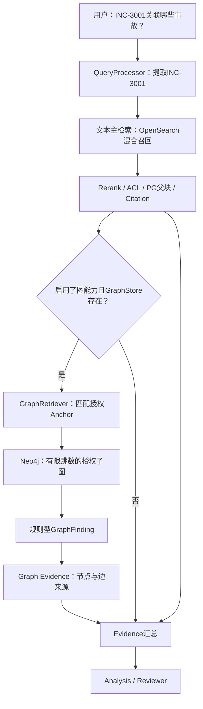

# M14 · GraphRAG：从“查到一篇手册”到“找出事故之间的关系”

> [!IMPORTANT] 这是一份教学教材，不是 API 目录
> 本 Master 每块都先用人话讲清**要解决的问题 → 最小例子 → 技术机制 → ServiceMind 的做法与具体对象 → 必要失败边界 → 源码 → 小结**。不要把类名当成概念解释。所有源码定位都固定在 `shark6438/servicemind@19d9a377fb98e1c3f56edc59be40b374013bc08b`。演示用的 `INC-3001` 等图数据来自冻结仓库的 smoke script 模型，但本文 JSON 是**本地按冻结源码字段构建的教学对象**，不是现场取出的 Neo4j 记录，也不是用户先前的真实 GLPI Ticket #5。
>
> **先说清最重要的现实边界**：ServiceMind 实现的是**有固定 ITSM 节点/边类型的 Graph-RAG 证据旁路**，不是微软式社区摘要 GraphRAG，不是随时让 LLM 生成 Cypher 的通用图问答，也不是默认启用的生产主检索。它在 KnowledgeAgent 已进入完整 RAG 分支后，且 Graph Store 有效接线时，向文本 Evidence 后附加结构化图 Evidence。

## 零基础先看：这门课到底要解决哪个问题？

上一课 M12 已能回答：“VPN MFA 登录失败应该看哪份手册？”本课进一步回答：“**以前有哪些工单也碰到同一 VPN 网关？它们影响哪个业务服务？有没有关联的问题单、修复变更和适用操作手册？**”

这是一个**关系问题**，不能只靠“哪段文本最相似”完成。你需要知道哪些 Ticket 连接到哪个配置项（CI）、哪个 Service、哪个 Problem、哪个 Change 和哪个 Runbook。GraphRAG 的价值，是按已经存储、可追踪的**关系**产生补充线索；它**不天然证明共同根因已被确定，也不会自动授权修改工单**。

### 课程导航

| 块   | 先学会的通用知识                   | 再进入的真实 ServiceMind 实现      | 深度        |
| ---- | ---------------------------------- | ---------------------------------- | ----------- |
| B01  | 普通 RAG 的强项与关系问题的不足    | 文本主线 + 图旁路                  | MUST KNOW   |
| B02  | 节点、边、方向、路径、跳数         | 图基础数据模型                     | MUST KNOW   |
| B03  | 图模式、实体类型、关系类型         | 6 种 NodeKind、7 种 EdgeKind       | MUST KNOW   |
| B04  | 从业务数据提取实体与关系           | IncidentRecord → 投影              | MUST KNOW   |
| B05  | 稳定身份、节点/边属性、幂等        | GraphNode / GraphEdge              | MUST KNOW   |
| B06  | 批量建图与结构约束                 | project_incidents / GraphBatch     | MUST KNOW   |
| B07  | 图存储与 Neo4j/Cypher              | Neo4jGraphStore / MemoryGraphStore | MUST KNOW   |
| B08  | 图匹配为何需要锚点                 | QueryProcessor / KnowledgeQuery    | MUST KNOW   |
| B09  | 从问题找到锚点                     | match_nodes / rank_matches         | MUST KNOW   |
| B10  | 图遍历、1 跳/2 跳、方向            | subgraph / GraphSubgraph           | MUST KNOW   |
| B11  | 从一条路径提炼业务关系             | GraphRetriever / GraphFinding      | MUST KNOW   |
| B12  | 图发现如何变为 Agent 可用证据      | to_graph_evidence / Evidence       | MUST KNOW   |
| B13  | 图里的租户、Entity、Group、Profile | RetrievalPrincipal / Cypher ACL    | MUST KNOW   |
| B14  | GraphRAG 真正在哪个执行路径运行    | Builder/Settings/KnowledgeAgent    | MUST KNOW   |
| B15  | 如何证明图通路真的有效             | 测试、Neo4j demo、ACC-13           | MUST KNOW   |
| B16  | 为什么有边界的 GraphRAG 仍会出错   | 数据新鲜度/复用节点/半事务等       | SOURCE DEEP |
| B17  | GraphRAG 与其它图检索路线如何取舍  | 固定图投影 vs LLM 抽取/社区摘要    | MUST KNOW   |
| B18  | 图检索如何系统评价                 | 关系命中/路径可信/ACL/端到端指标   | MUST KNOW   |
| B19  | M14 白板检查点：完整架构复述       | 四平面 + 六节点类型 + 五角色       | MUST KNOW   |

---

## B01 · 已经会向量检索，为什么还需要 GraphRAG？（MUST KNOW）

### 1. 从问题出发：两种问题的答案长得不一样

问题 A：“VPN MFA Token 失效怎么排查？”——最需要的是**文章中的操作步骤**。M12 的 BM25 + Dense + Rerank 很适合。

问题 B：“INC-3001、INC-3002 为什么可能有关联？谁一起影响了认证服务？”——需要的是**两个事故如何通过同一个设备和业务服务相连**。仅看两段相似文本，有时能猜到联系，却无法可靠列出已登记的关系链。

### 2. 最小例子：相似文本与真实关系

```text
工单 INC-3001：VPN MFA 身份提供方超时
工单 INC-3002：VPN 多名员工无法完成 MFA 注册

关系库里：
INC-3001 ─AFFECTS→ VPN Gateway
INC-3002 ─AFFECTS→ VPN Gateway
VPN Gateway ─DEPENDS_ON→ Authentication Service
```

文字检索能找到两份案例，但**只有明确记录这两条 AFFECTS 边**，我们才有结构化的“同一个 CI”证据。即便如此，也只能说“存在共同配置项，值得调查共同原因”，不能直接断言两个事故具有相同根因。

### 3. RAG 和 GraphRAG 的分工

- **Text RAG**：从文档/段落找到可阅读的文字证据，回答“手册说什么”。
- **Graph-based Retrieval（图检索）**：从类型化实体和关系里沿路径查“谁与谁相关”，回答“有哪些已登记的关联”。
- **组合**：文本交付操作细节，图补充事故/服务拓扑，再由 Analysis/Reviewer 综合。图不代替文本引用、权限和人工审批。

**一个经常混淆的词**：LangGraph 的 Graph 是“程序执行流程图”，GraphRAG 的 Graph 是“企业知识关系图”，HNSW 中的 Graph 又是“向量近邻搜索结构”。**三种 Graph 完全不是一个数据模型**。

### 4. ServiceMind 真实选择

`EnterpriseRAG.graph_evidence()` 是一个**结构化检索旁路**，KnowledgeAgent 先 `rag.retrieve()` 做文本检索、`to_evidence()`，条件满足才追加 `graph_evidence()`。图侧失败时文本结果可继续交付；图成功时也不会自动取代文本。源码：[service.py L574–612](https://github.com/shark6438/servicemind/blob/19d9a377fb98e1c3f56edc59be40b374013bc08b/src/servicemind/rag/service.py#L574-L612)、[knowledge.py L76–105](https://github.com/shark6438/servicemind/blob/19d9a377fb98e1c3f56edc59be40b374013bc08b/src/servicemind/agents/knowledge.py#L76-L105)。

### 5. 失败边界与小结

**没有图关系**不等于不存在关系，可能是图没有被投影/更新；**图关系存在**也不等于因果关系成立。GraphRAG 的任务是补结构性证据，不是替代安全判断。

---

## B02 · 先把“图”这个词真正理解：节点、边、方向、路径、跳数（MUST KNOW）

### 1. 从一个只有三个人的例子开始

张三在 A 组、李四也在 A 组，用一张表可以写三行；如果还要回答“张三认识的人的同组同事是谁”，就需要连续查询几层关系。图的优势是把**实体**与它们之间的**连接**作为一等数据对象。

- **节点 Node**：一个可识别的东西，例如某张 Ticket、某个 VPN 网关。
- **边 Edge**：两个节点之间的一条有类型的联系，例如 `Ticket AFFECTS CI`。
- **方向**：箭头的左右有业务意义。`Ticket → CI` 不等于 `CI → Ticket` 的同一种语义。
- **路径 Path**：从起点沿着边走到终点的关系链。
- **跳数 Hop**：经过了几条边，1 条边=1 跳。

### 2. 一次手算路径

```text
T1 (Ticket) ─AFFECTS→ C1 (CI) ─DEPENDS_ON→ S1 (Service)
```

T1 到 C1 是 **1 跳**，T1 到 S1 是 **2 跳**。假设再有 `T2 ─AFFECTS→ C1`：T1 与 T2 都影响 C1，这叫**共享 CI 的两条路径**，但不是 `T1 ─SIMILAR_TO→ T2` 必然存在。**结构关系与文本相似关系是两类独立事实。**

### 3. “走遍邻居”和“解释箭头”不同

为了搜集周围结构，程序可以把某条边的两个端点都作为搜索邻居；但解释时要恢复业务方向。例如 `CI ←AFFECTS─ Ticket`，从 CI 向后找到 Ticket，并不意味着数据库存了一条 `CI AFFECTS Ticket` 边。

ServiceMind 的 `MemoryGraphStore.subgraph` 搜邻接时可以沿两端扩张；`GraphRetriever._forward/_backward` 则明确匹配源/目标和 EdgeKind，保证最后叙事不反转。`GraphSubgraph.neighbors` 也是有方向意识的：只有 `SIMILAR_TO` 可以反向作为对称邻居。源码：[store.py L209–268](https://github.com/shark6438/servicemind/blob/19d9a377fb98e1c3f56edc59be40b374013bc08b/src/servicemind/graphrag/store.py#L209-L268)、[retrieval.py L136–173](https://github.com/shark6438/servicemind/blob/19d9a377fb98e1c3f56edc59be40b374013bc08b/src/servicemind/graphrag/retrieval.py#L136-L173)、[domain.py L102–134](https://github.com/shark6438/servicemind/blob/19d9a377fb98e1c3f56edc59be40b374013bc08b/src/servicemind/graphrag/domain.py#L102-L134)。

### 4. 失败边界与小结

路径越长，计算和误关联的风险通常越高；Graph 不是“沿任何方向走几步就能证明因果”。**先理解箭头在业务上代表什么，再决定检索时如何走。**

---

## B03 · 如何避免图里的关系“乱连”？先定义 Schema（图模式）（MUST KNOW）

### 1. 先解释 Schema 是什么

Schema 是系统事先约定**允许出现哪些类型的东西，哪些关系可以怎样连接**。如果不定义，可能有人写 `Ticket RESOLVED_BY User`，另一个写 `Ticket fixed_by CI`，业务表达不一致，程序就没法稳定查询。

ServiceMind 采用固定 ITSM 类型的**属性图**：节点拥有属性（key/ref/title/tenant/ACL），边拥有类型、起终点、weight。这与常见 Neo4j 属性图一致。它**没有在此用 LLM 自由抽取任意实体类型**。

### 2. 六种节点，不必死背，先分两组

| 节点      | 人话含义                              | 具体例子                         |
| --------- | ------------------------------------- | -------------------------------- |
| `TICKET`  | 一次故障/工单记录                     | INC-3001：VPN 身份认证超时       |
| `CI`      | Configuration Item，配置项：设备/组件 | ci-vpn-gw：VPN Gateway           |
| `SERVICE` | 用户实际依赖的业务服务                | svc-auth：Authentication Service |
| `PROBLEM` | 对重复/系统性问题的调查对象           | PRB-77：MFA Token 反复失败       |
| `CHANGE`  | 对系统的正式变更记录                  | CHG-88：重新签发令牌             |
| `RUNBOOK` | 故障排查/运维操作手册                 | runbook://rb-vpn-mfa             |

CI 与 Service 为什么分开？**CI 是支撑业务的技术组件**，Service 是业务能力。一个服务可能依赖很多 CI，同一 CI 也可能影响多个服务；因此要记录它们的联系。

### 3. 七种边：每条都用一句话解释

| 源节点 → 边 → 目标节点       | 业务含义                                               | 最小例子                              |
| ---------------------------- | ------------------------------------------------------ | ------------------------------------- |
| Ticket `AFFECTS` CI          | 该事故涉及哪个配置项                                   | INC-3001 → VPN 网关                   |
| CI `DEPENDS_ON` Service      | 冻结 Schema 的关系名称，表示 CI 与该业务服务的支撑关系 | VPN 网关 → 认证服务                   |
| Ticket `SIMILAR_TO` Ticket   | 记录明确提供的事故相似联系                             | INC-3001 ↔ INC-3002（数据以有向边存） |
| Ticket `LINKED_TO` Problem   | 该工单关联到哪个问题调查                               | INC-3001 → PRB-77                     |
| Problem `RESOLVED_BY` Change | 问题对应哪个修复变更                                   | PRB-77 → CHG-88                       |
| Change `MODIFIES` CI         | 变更作用于哪个配置项                                   | CHG-88 → VPN 网关                     |
| CI `HAS_RUNBOOK` Runbook     | 该配置项适用的操作规程                                 | VPN 网关 → MFA 手册                   |

**特别说明 `DEPENDS_ON`**：不要把它擅自改成通常 ITIL 口语的 `Service DEPENDS_ON CI`。冻结代码真实方向是 **`CI → Service`**，图检索按此方向生成影响范围叙事。我们理解它为本项目约定的服务支撑关系即可，不偷偷纠正成另一个 Schema。

### 4. 从类型表到项目源码

`NodeKind` 只有以上 6 值，`EdgeKind` 只有以上 7 值，且二者都用字符串枚举（StrEnum）；后续的 Cypher 关系类型由 EdgeKind 受控映射，不从用户问题拼一个任意类型。源码：[domain.py L10–37](https://github.com/shark6438/servicemind/blob/19d9a377fb98e1c3f56edc59be40b374013bc08b/src/servicemind/graphrag/domain.py#L10-L37)、[projection.py L96–181](https://github.com/shark6438/servicemind/blob/19d9a377fb98e1c3f56edc59be40b374013bc08b/src/servicemind/graphrag/projection.py#L96-L181)。

### 4A. 图类型、真正的约束和业务功能不能混成一件事

先看一个最小反例：你可以构造 `ticket:T1 ─AFFECTS→ service:S1`，只要批里同时有 T1/S1 两个节点，`GraphBatch` 就不会因为这条边的业务方向/类型组合而拒绝它。因为当前模型只校验 EdgeKind 枚举、租户和边的两端 key 是否在本批次中，**没有**另外检查 `AFFECTS` 的源必须是 Ticket、目标必须是 CI。类型约定主要由 `project_incidents()` 的固定投影逻辑保证，不能冒称 GraphBatch 实施了所有业务语义验证。

更重要的是区分**三个阶段**：

```text
① Schema 允许存一条 SIMILAR_TO
② GraphStore 可以把它放进局部子图
③ GraphRetriever 有没有根据它输出相似工单 Finding？
```

冻结实现的第三阶段**没有**直接使用 `SIMILAR_TO`：如果图里只有 `T1 ─SIMILAR_TO→ T2`，没有共同 CI，查询 T1 并不会仅凭这条边生成 `same_ci_incidents`；那是按 `AFFECTS` 的共同 CI 关系生成的。详见 B11。源：[domain.py L79–134](https://github.com/shark6438/servicemind/blob/19d9a377fb98e1c3f56edc59be40b374013bc08b/src/servicemind/graphrag/domain.py#L79-L134)、[retrieval.py L252–611](https://github.com/shark6438/servicemind/blob/19d9a377fb98e1c3f56edc59be40b374013bc08b/src/servicemind/graphrag/retrieval.py#L252-L611)。

### 5. 失败边界与小结

如果业务数据只写 Ticket→CI，而没有 CI→Service，GraphRAG 就不能凭语义猜出受影响的 Service。**图 Schema 保证“关系有明确含义”，并不保证每条关系都齐全或正确。**

---

## B04 · 图上的信息从哪里来？先认识 Projection 与 IncidentRecord（MUST KNOW）

### 1. 先理解 Projection（投影），它不是“神经网络推理”

假设源系统的一条事故记录含字段：ticket ID、标题、相关设备、所属服务、已知问题、关联变更、操作手册。Projection 就是**按事先写好的规则，把这些已有字段变成节点和边**。

```text
源 ITSM 记录：
  ticket_ref = INC-3001
  ci_ref = ci-vpn-gw
  service_ref = svc-auth
  problem_ref = PRB-77
  change_ref = CHG-88
  runbook_ref = runbook://rb-vpn-mfa
       ↓ 固定投影规则
六个实体节点 + 指定方向的关系边
```

这与“让 LLM 从一篇自然语言帖子自动推断实体关系”不同。这里的节点和边来自结构化 `IncidentRecord` 的字段，不是模型自由抽取的三元组。

### 2. 一个完整 IncidentRecord 教学输入

这条值取自冻结 `scripts/verify_phase4_graphrag.py` 的三条 Demo 记录中的第一条；原类型是 Python `@dataclass(frozen=True)`，**不是 Pydantic，也不是 PostgreSQL ORM 表**。下方 JSON 是这个 dataclass 字段的序列化展示。

```json
{
  "ticket_ref": "INC-3001",
  "ticket_title": "VPN MFA identity-provider timeout at branch A",
  "ci_ref": "ci-vpn-gw",
  "ci_title": "VPN Gateway cluster",
  "service_ref": "svc-auth",
  "service_title": "Authentication Service",
  "problem_ref": "PRB-77",
  "problem_title": "Recurring VPN MFA token failures",
  "change_ref": "CHG-88",
  "change_title": "Reissue MFA tokens for affected users",
  "runbook_ref": "runbook://rb-vpn-mfa",
  "runbook_title": "VPN MFA token enrollment runbook",
  "extra": {},
  "entity_ids": [],
  "group_ids": [],
  "profile_ids": []
}
```

如果这条记录**没有** `change_ref/change_title`，投影就不会由它生成 Change 节点和 MODIFIES 边；如果有 `change_ref` 但**没有** `problem_ref`，可以生成 `Change MODIFIES CI`，但不会生成 `Problem RESOLVED_BY Change`。这说明**缺失源字段会限制图能回答的问题**。

### 3. 图来自什么权威？当前项目有自动同步吗？

在概念上，生产系统常从 CMDB/GLPI、变更管理、知识文档中抽取关系，再持续同步到图数据库。**但 ServiceMind 冻结代码证实的 `project_incidents()` 输入只是显式传入的 `IncidentRecord[]`**。已经审过的运行入口包括 `scripts/verify_phase4_graphrag.py` 的 Demo 写入，以及 Phase7 的专用受控图 Fixture；不能由它们推断“GLPI 全量实时图同步管道”已存在。

源码：[projection.py L68–181](https://github.com/shark6438/servicemind/blob/19d9a377fb98e1c3f56edc59be40b374013bc08b/src/servicemind/graphrag/projection.py#L68-L181)、[verify_phase4_graphrag.py L30–91](https://github.com/shark6438/servicemind/blob/19d9a377fb98e1c3f56edc59be40b374013bc08b/scripts/verify_phase4_graphrag.py#L30-L91)、[seed_phase7_acceptance_fixtures.py L317–353](https://github.com/shark6438/servicemind/blob/19d9a377fb98e1c3f56edc59be40b374013bc08b/scripts/seed_phase7_acceptance_fixtures.py#L317-L353)。

### 4. 失败边界与小结

Source 不存在、版本过时、某次导入遗漏一个字段，图都可能缺边。**图投影是对源事实的结构化索引，不能替代源系统本身，也不能把“Demo 图有 8 个节点”当作生产知识库规模。**

---

## B05 · 图节点为什么必须有稳定 ID？GraphNode 和 GraphEdge 到底长什么样？（MUST KNOW）

### 1. 先解决重跑入库会遇到的问题

假设每天都导入 INC-3001，如果每次生成新的随机 Node ID，图里就会出现十个“INC-3001”，它们明明是同一张工单。正确的思路是定义一个**稳定身份**：同一个租户、同一种实体、同一个源引用，再导入就更新而不是无限增加重复实体。

在本项目的 `make_node` 中：`key = f"{kind.value}:{ref}"`。例如工单引用 `INC-3001` → `ticket:INC-3001`；配置项引用 `ci-vpn-gw` → `ci:ci-vpn-gw`。**租户不拼进这个 key 字符串**，但 GraphNode 有独立 `tenant_id`，Neo4j MERGE 使用 `(tenant_id,key)` 作为查找条件；不要把单看 key 唯一理解为全租户统一键空间。

### 2. 什么是节点属性、边属性？

- **节点属性**：它是什么类型、来源引用、标题、属于哪个租户、附加元数据、实体/组/角色限制。
- **边属性**：从哪个节点到哪个节点、关系类型、租户、weight（强度）、附加元数据。

特别注意：`GraphEdge.weight` 不是所有边的同一个真实“置信度模型”。`SIMILAR_TO` 可能用外部提供的文本相似权重，其它结构边默认是 `1.0`。**不能由 weight=1.0 推断“故障根因 100% 确定”。**

### 3. 三个完整的源码契约对象

**GraphNode（工单）：**

```json
{
  "key": "ticket:INC-3001",
  "ref": "INC-3001",
  "kind": "ticket",
  "title": "VPN MFA identity-provider timeout at branch A",
  "tenant_id": "11111111-1111-4111-8111-111111111111",
  "extra": {},
  "entity_ids": [],
  "group_ids": [],
  "profile_ids": []
}
```

**GraphNode（CI）：**

```json
{
  "key": "ci:ci-vpn-gw",
  "ref": "ci-vpn-gw",
  "kind": "ci",
  "title": "VPN Gateway cluster",
  "tenant_id": "11111111-1111-4111-8111-111111111111",
  "extra": {},
  "entity_ids": [],
  "group_ids": [],
  "profile_ids": []
}
```

**GraphEdge（Ticket AFFECTS CI）：**

```json
{
  "source_key": "ticket:INC-3001",
  "target_key": "ci:ci-vpn-gw",
  "kind": "affects",
  "tenant_id": "11111111-1111-4111-8111-111111111111",
  "weight": 1.0,
  "extra": {}
}
```

这三个都是 `pydantic.BaseModel` 的完整教学序列化，没有省略字段。`extra={}` 不表示“系统已经从 GLPI 读取了所有其他信息”，只是该节点的扩展字段为空。

### 3A. `extra` 字段有值，不代表检索就会搜索它

假设保存一个 Ticket：`ref="INC-3001"`、`title="VPN 故障"`、`extra={"error_code":"MFA-42"}`。用户只问 `MFA-42`。直觉上，既然 GraphNode 有 `extra` 就应该查得到，但**冻结匹配函数不是通用属性全文搜索**：MemoryStore 的 `rank_matches` 仅做 `ref` 精确/包含和 `title` 实体词包含；Neo4j 的 Cypher WHERE 也只看 `ref/title`。`MFA-42` 只放在 `extra`，不会因此命中种子节点。

`GraphNode.extra` 的字段注释用了“searchable keyword surface”字样，**这是源码注释声称的意图，不是当前节点匹配实现的事实**。并且 `GraphEdge.extra` 也不等于各 Store 都能往返保真。B07/B16 将对比具体存储实现。源：[domain.py L39–78](https://github.com/shark6438/servicemind/blob/19d9a377fb98e1c3f56edc59be40b374013bc08b/src/servicemind/graphrag/domain.py#L39-L78)、[store.py L118–161](https://github.com/shark6438/servicemind/blob/19d9a377fb98e1c3f56edc59be40b374013bc08b/src/servicemind/graphrag/store.py#L118-L161)、[neo4j.py L144–180](https://github.com/shark6438/servicemind/blob/19d9a377fb98e1c3f56edc59be40b374013bc08b/src/servicemind/graphrag/neo4j.py#L144-L180)。

### 4. 关键约束及失败边界

`GraphNode.key` 最长 500 字符、`ref` 1000、`title` 1000；`GraphEdge.weight` 限定在 `0–1`，类型只能来自 `EdgeKind`。但一个带合法 key 的 GraphNode **并不保证某个真实源系统一定存在该对象**——这是数据一致性/校验的问题。`make_edge()` 接受节点或 key 字符串，若传错来源，GraphBatch 只会做批内存在性检查。

源码：[domain.py L39–78](https://github.com/shark6438/servicemind/blob/19d9a377fb98e1c3f56edc59be40b374013bc08b/src/servicemind/graphrag/domain.py#L39-L78)、[projection.py L17–67](https://github.com/shark6438/servicemind/blob/19d9a377fb98e1c3f56edc59be40b374013bc08b/src/servicemind/graphrag/projection.py#L17-L67)。

### 5. 小结

**节点是可识别实体，边是有方向与类型的关系；稳定身份防重建重复，属性负责表达业务与权限，但它们本身不能证明数据一定可信。**

---

## B06 · 从多条事故记录到整张图：GraphBatch 和投影幂等到底是什么？（MUST KNOW）

### 1. 不要一上来把“批处理”想复杂

你把一条 `IncidentRecord` 映射成节点和边后，可能需要一次处理三条工单。一次 `project_incidents()` 得到的 `GraphBatch` 就是**这一批计划写进图的数据包**：`nodes: list[GraphNode]` 和 `edges: list[GraphEdge]`。先在程序里建好、校验好，再交给 GraphStore 存储。

### 2. 使用冻结 Demo 三条工单手算

三条工单都影响同一个 `ci-vpn-gw`，只有 INC-3001 额外携带 Service、Problem、Change 和 Runbook；Demo 还传入 `similar=[('INC-3001','INC-3002',0.9)]`。于是：

```text
三个 Ticket 节点：INC-3001/3002/3003
一个 CI 节点：ci-vpn-gw
一个 Service：svc-auth
一个 Problem：PRB-77
一个 Change：CHG-88
一个 Runbook：runbook://rb-vpn-mfa
合计 8 个不同节点

三条 AFFECTS
一条 DEPENDS_ON，一条 LINKED_TO，一条 RESOLVED_BY
一条 MODIFIES，一条 HAS_RUNBOOK，一条 SIMILAR_TO
合计 9 条不同边
```

**首次学习先看上面的手算和下面的最小对象；完整的源码契约 JSON 放在本块总结之后，第二遍阅读时再核对字段。**

**最小对象投影（用于理解字段，不是完整 `model_dump()`）：**

```json
{
  "nodes": [
    {"key": "ticket:INC-3001", "kind": "ticket", "ref": "INC-3001"},
    {"key": "ci:ci-vpn-gw", "kind": "ci", "ref": "ci-vpn-gw"},
    {"key": "service:svc-auth", "kind": "service", "ref": "svc-auth"}
  ],
  "edges": [
    {"source_key": "ticket:INC-3001", "target_key": "ci:ci-vpn-gw", "kind": "affects"},
    {"source_key": "ci:ci-vpn-gw", "target_key": "service:svc-auth", "kind": "depends_on"}
  ]
}
```

这里只保留**判断关系需要的字段**，有意省略 `tenant_id`、`title`、ACL 和其它字段，不能拿去直接实例化冻结的 GraphBatch。它让你先看清：**三节点两边**正好表达 Ticket → CI → Service；三条事故合起来才成为上面的 8 节点 9 边。

你要能从每条边读出：为什么存在这条边？它来自记录哪个字段？如果缺失哪个字段，这条边就不会被生成？

### 3. 幂等是怎样实现的？

`project_incidents` 使用两个字典去重：节点用 `nodes[node.key] = node`，边用 `(source,target,kind)` 作为键。相同来源投影多次，不会在此阶段形成重复的 key 条目。`MemoryGraphStore.apply_batch` 按租户/key 更新内存字典；Neo4j 用 `MERGE (node:RAGNode {tenant_id,key})` 以及关系 `MERGE` 尝试保持稳定。**这里的“幂等”指相同输入重复投影/写入的图形状稳定，不等于外部事务 exactly-once。**

### 4. GraphBatch 只能保证什么？

`GraphBatch.edges_reference_batch_nodes()` 校验两项关键规则：不能混入多个 `tenant_id`；每条 Edge 的 `source_key` 和 `target_key` 都必须在该批的 Node keys 集合内。

但它**没有检查**“`AFFECTS` 一定从 Ticket 指向 CI”这样的跨类型严格校验，也没有校验原始事故描述与关系的业务真实性。因此不应把 Pydantic 结构校验误称为“图谱语义已审核”。

### 5. 失败边界：共享节点身份与 ACL 覆盖

**值得特别注意**：三条记录复用一个 CI key 时，`nodes[node.key]=node` 是**后写覆盖前写**。如果它们对这个 CI 声明了不同的 Group 限制，投影不会自动计算“最严格权限交集”，而会保留最后一次覆盖的坐标。这是后面 B16 的源码审计点：重复 key 并不天然等于权限合并正确。不能把“模型字段齐了”教成“合并时权限不会被放宽”。

源码：[projection.py L96–181](https://github.com/shark6438/servicemind/blob/19d9a377fb98e1c3f56edc59be40b374013bc08b/src/servicemind/graphrag/projection.py#L96-L181)、[domain.py L79–100](https://github.com/shark6438/servicemind/blob/19d9a377fb98e1c3f56edc59be40b374013bc08b/src/servicemind/graphrag/domain.py#L79-L100)。

### 6. 小结

**建图分两段：先按字段投影成 GraphBatch，再交给存储端写入。批内去重和 Pydantic 检查解决结构问题；真正的业务可信与 ACL 聚合仍需要额外设计。**

### 完整教学对象：第二遍阅读和源码核对

**完整 GraphBatch JSON（8 节点、9 边）：**

```json
{
  "nodes": [
    {
      "key": "ticket:INC-3001",
      "ref": "INC-3001",
      "kind": "ticket",
      "title": "VPN MFA identity-provider timeout at branch A",
      "tenant_id": "11111111-1111-4111-8111-111111111111",
      "extra": {},
      "entity_ids": [],
      "group_ids": [],
      "profile_ids": []
    },
    {
      "key": "ci:ci-vpn-gw",
      "ref": "ci-vpn-gw",
      "kind": "ci",
      "title": "VPN Gateway cluster",
      "tenant_id": "11111111-1111-4111-8111-111111111111",
      "extra": {},
      "entity_ids": [],
      "group_ids": [],
      "profile_ids": []
    },
    {
      "key": "service:svc-auth",
      "ref": "svc-auth",
      "kind": "service",
      "title": "Authentication Service",
      "tenant_id": "11111111-1111-4111-8111-111111111111",
      "extra": {},
      "entity_ids": [],
      "group_ids": [],
      "profile_ids": []
    },
    {
      "key": "problem:PRB-77",
      "ref": "PRB-77",
      "kind": "problem",
      "title": "Recurring VPN MFA token failures",
      "tenant_id": "11111111-1111-4111-8111-111111111111",
      "extra": {},
      "entity_ids": [],
      "group_ids": [],
      "profile_ids": []
    },
    {
      "key": "change:CHG-88",
      "ref": "CHG-88",
      "kind": "change",
      "title": "Reissue MFA tokens for affected users",
      "tenant_id": "11111111-1111-4111-8111-111111111111",
      "extra": {},
      "entity_ids": [],
      "group_ids": [],
      "profile_ids": []
    },
    {
      "key": "runbook:runbook://rb-vpn-mfa",
      "ref": "runbook://rb-vpn-mfa",
      "kind": "runbook",
      "title": "VPN MFA token enrollment runbook",
      "tenant_id": "11111111-1111-4111-8111-111111111111",
      "extra": {},
      "entity_ids": [],
      "group_ids": [],
      "profile_ids": []
    },
    {
      "key": "ticket:INC-3002",
      "ref": "INC-3002",
      "kind": "ticket",
      "title": "MFA enrollment failures across VPN users",
      "tenant_id": "11111111-1111-4111-8111-111111111111",
      "extra": {},
      "entity_ids": [],
      "group_ids": [],
      "profile_ids": []
    },
    {
      "key": "ticket:INC-3003",
      "ref": "INC-3003",
      "kind": "ticket",
      "title": "Slow VPN reconnects after token rotation",
      "tenant_id": "11111111-1111-4111-8111-111111111111",
      "extra": {},
      "entity_ids": [],
      "group_ids": [],
      "profile_ids": []
    }
  ],
  "edges": [
    {
      "source_key": "ticket:INC-3001",
      "target_key": "ci:ci-vpn-gw",
      "kind": "affects",
      "tenant_id": "11111111-1111-4111-8111-111111111111",
      "weight": 1.0,
      "extra": {}
    },
    {
      "source_key": "ci:ci-vpn-gw",
      "target_key": "service:svc-auth",
      "kind": "depends_on",
      "tenant_id": "11111111-1111-4111-8111-111111111111",
      "weight": 1.0,
      "extra": {}
    },
    {
      "source_key": "ticket:INC-3001",
      "target_key": "problem:PRB-77",
      "kind": "linked_to",
      "tenant_id": "11111111-1111-4111-8111-111111111111",
      "weight": 1.0,
      "extra": {}
    },
    {
      "source_key": "problem:PRB-77",
      "target_key": "change:CHG-88",
      "kind": "resolved_by",
      "tenant_id": "11111111-1111-4111-8111-111111111111",
      "weight": 1.0,
      "extra": {}
    },
    {
      "source_key": "change:CHG-88",
      "target_key": "ci:ci-vpn-gw",
      "kind": "modifies",
      "tenant_id": "11111111-1111-4111-8111-111111111111",
      "weight": 1.0,
      "extra": {}
    },
    {
      "source_key": "ci:ci-vpn-gw",
      "target_key": "runbook:runbook://rb-vpn-mfa",
      "kind": "has_runbook",
      "tenant_id": "11111111-1111-4111-8111-111111111111",
      "weight": 1.0,
      "extra": {}
    },
    {
      "source_key": "ticket:INC-3002",
      "target_key": "ci:ci-vpn-gw",
      "kind": "affects",
      "tenant_id": "11111111-1111-4111-8111-111111111111",
      "weight": 1.0,
      "extra": {}
    },
    {
      "source_key": "ticket:INC-3003",
      "target_key": "ci:ci-vpn-gw",
      "kind": "affects",
      "tenant_id": "11111111-1111-4111-8111-111111111111",
      "weight": 1.0,
      "extra": {}
    },
    {
      "source_key": "ticket:INC-3001",
      "target_key": "ticket:INC-3002",
      "kind": "similar_to",
      "tenant_id": "11111111-1111-4111-8111-111111111111",
      "weight": 0.9,
      "extra": {}
    }
  ]
}
```


---

## B07 · Neo4j 到底存什么？它和 PostgreSQL、OpenSearch、MemoryGraphStore 的区别（MUST KNOW）

### 1. 先解释为什么要单独使用图数据库

M12 的 OpenSearch 适合“哪段话像这个问题”，PostgreSQL 适合“权威文档/工单表有哪些字段”。两者并非不能存关系，但“沿 Ticket → CI → Service / Problem / Change 找多个节点”的查询如果特别频繁，使用专门的**图数据库**可以让边成为直接可遍历的对象。

Neo4j 使用**属性图**：节点（Node）、关系（Relationship）和属性（Property）。查询语言 **Cypher** 可以读作“在一张图里找满足这些模式的节点与边”，例如 `MATCH (t)-[:AFFECTS]->(ci)` 表示查指向 CI 的 AFFECTS 关系。

### 2. 本项目一张图里真正的存储结构

```text
Neo4j：
  (n:RAGNode {tenant_id, key, ref, kind, title,
              entity_ids, group_ids, profile_ids, extra})

  (ticket:RAGNode)-[:AFFECTS {weight:1.0}]->(ci:RAGNode)
  (ci:RAGNode)-[:DEPENDS_ON {weight:1.0}]->(service:RAGNode)
```

这里一个必须纠正的直觉：冻结 Neo4j 代码中所有实体节点共用**标签 `RAGNode`**，通过 `n.kind` 属性区分 `ticket/ci/...`；并不是六种独立的 Neo4j Label。关系种类则是七个固定的 Neo4j Relationship Type。

### 3. 两个 GraphStore 为什么存在？

| 存储               | 目的                                                      | 适合什么时候使用                         |
| ------------------ | --------------------------------------------------------- | ---------------------------------------- |
| `MemoryGraphStore` | 用 Python 字典在内存模拟每个租户的节点/边、ACL 和跳数约束 | 离线测试、小型演示，不需要 Neo4j 容器    |
| `Neo4jGraphStore`  | 用真实 Neo4j AsyncDriver 执行参数化 Cypher、写入和遍历    | 配置允许且 Neo4j 实际可达的部署/集成测试 |

它们遵守同一个 `GraphStore` **Protocol**：`initialize/close/apply_batch/match_nodes/subgraph/delete_tenant`。Protocol 是“调用者要求你提供哪些方法”，不是某张数据库表，也不是自动选择当前 Store 的工厂。

### 4. 先理解 Cypher MERGE，再看源码

```cypher
MERGE (node:RAGNode {tenant_id: $tenant, key: $key})
```

**上面是说明 MERGE 行为的教学片段**；实际代码是用 `UNWIND $nodes AS n` 一次传入多节点，并用 `MERGE (node:RAGNode {tenant_id:n.tenant_id,key:n.key})`，再 ON CREATE/ON MATCH 设置属性。`$tenant/$key` 只是参数化语法示意。实际写边时也按固定 EdgeKind 生成标签，如 `MERGE (a)-[r:AFFECTS]->(b)`。

Neo4j 初始化建三个普通索引：`(tenant_id,key)`、`(tenant_id,ref)`、`(tenant_id,kind)`，**不是源码已经建立 UNIQUE CONSTRAINT 的证据**；并发写唯一性是否充分保障仍需独立评估。

### 5. 存储回读与失败边界

写入 Demo 后，`match_nodes` 可以按查询锚点查匹配节点，`subgraph` 按跳数扩张。默认 Store builder 不主动启动 Neo4j 服务，而且 Driver 是延迟连接：**`build_graph_store()` 返回对象，不证明 Neo4j 网络可达**。

Neo4j 版 `apply_batch` 先在一个写事务中合并节点，再按关系类型分别执行 `session.run`；这**不是整个 GraphBatch 上节点和全部边的一笔统一原子事务**。写入中途失败需要另行恢复/重放，不能只因为使用 MERGE 就宣称图谱批次绝无半写状态。源码：[neo4j.py L52–135](https://github.com/shark6438/servicemind/blob/19d9a377fb98e1c3f56edc59be40b374013bc08b/src/servicemind/graphrag/neo4j.py#L52-L135)、[neo4j.py L340–377](https://github.com/shark6438/servicemind/blob/19d9a377fb98e1c3f56edc59be40b374013bc08b/src/servicemind/graphrag/neo4j.py#L340-L377)、[store.py L53–116](https://github.com/shark6438/servicemind/blob/19d9a377fb98e1c3f56edc59be40b374013bc08b/src/servicemind/graphrag/store.py#L53-L116)。

### 5A. 两个 Store 具有相同接口，不代表能原样保留所有属性

先把 `CREATE` 与 `MERGE` 分开：`CREATE (n)` 每运行一次就可能增加一个新节点；`MERGE (n:RAGNode {tenant_id,key})` 是按给定身份寻找或创建，再用 `ON MATCH SET` 更新已有节点。但 **MERGE 不会自动删除旧边，也不能保证整个 GraphBatch 原子提交**。

再看一个很容易忽视的读写对照：

| 字段              | MemoryGraphStore            | Neo4jGraphStore                                              |
| ----------------- | --------------------------- | ------------------------------------------------------------ |
| `GraphNode.extra` | 内存保存原 Node，遍历可保留 | 写入时转 JSON 字符串，`match_nodes` 会解码；**`subgraph()` 返回的 Node 却没读这个字段，通常变成 `{}`** |
| `GraphEdge.extra` | 在原 Edge 对象上保留        | 当前边写入仅持久化 `weight`，子图回读没有 extra              |
| 节点/边身份       | 用 dict/upsert              | 用节点 `MERGE`、关系按类型 `MERGE`                           |

因此不能把 GraphStore Protocol 的存在解释成两个后端所有字段行为完全相同。**节点匹配不用 extra、字段能否持久化、遍历会否携回 extra，是三个独立问题。** 源：[neo4j.py L144–200](https://github.com/shark6438/servicemind/blob/19d9a377fb98e1c3f56edc59be40b374013bc08b/src/servicemind/graphrag/neo4j.py#L144-L200)、[neo4j.py L226–315](https://github.com/shark6438/servicemind/blob/19d9a377fb98e1c3f56edc59be40b374013bc08b/src/servicemind/graphrag/neo4j.py#L226-L315)、[neo4j.py L340–376](https://github.com/shark6438/servicemind/blob/19d9a377fb98e1c3f56edc59be40b374013bc08b/src/servicemind/graphrag/neo4j.py#L340-L376)。

### 6. 小结

**Neo4j 存结构关系，OpenSearch 检索文字，PostgreSQL 存业务/知识权威；MemoryGraphStore 是同一图接口的测试替身。代码提供写图能力，不等于已经搭建自动、持续、原子化的生产图同步管道。**

---

## B08 · 用户问“INC-3001 怎么和其它事故关联”，系统怎么知道从哪里开始找？（MUST KNOW）

### 1. 图查询首先需要“锚点”，不要上来想路径

图里可能有十万个 Ticket。你不能每次查询都从任意节点开始遍历；需要先找到与问题明确对应的一个或几个节点。这个入口叫 **Anchor（锚点）**，又叫 Seed（种子节点）。

人话例子：“**INC-3001** 有没有类似事故？”→ 先定位 `ticket:INC-3001`，然后沿图找它影响的 CI、同 CI 事故、相关 Problem。

### 2. 为什么先学 M12 QueryProcessor？

实际 GraphRetriever 没有自己调用 Embedding 来做节点向量匹配。它接收 M12 已加工好的 `KnowledgeQuery`，使用里面的：

- `identifiers`：结构化业务编号，例如 `INC-3001/CHG-88/PRB-77`。
- `entities`：问题中的业务实体短语，例如 `Authentication Service`（通常由 QueryProcessor 的模型提案提供，确定性回退未必有）。

**没有 identifiers，也没有 entities 时，GraphRetriever 直接返回空列表。** 这不意味着整个知识库没有答案，只说明“这一轮图侧没有可用锚点”。

### 2A. 即使跳过 M12，也要先看懂 QueryProcessor 的三项输出

```json
{
  "raw_query": "INC-3001 有哪些相关事故？",
  "identifiers": ["INC-3001"],
  "entities": []
}
```

这是**三字段教学投影，不是完整 `KnowledgeQuery`**：`raw_query` 是用户原话，`identifiers` 是识别出的明确业务编号，`entities` 是可用于匹配标题的实体短语。GraphRetriever 的匹配条件依赖后两项；它并不对完整问句随意生成 Cypher。因此即使模型没有提出 entities，只要 `INC-3001` 被确定性提取，图仍有可能查到合法种子。

### 3. 完整 KnowledgeQuery：不把模型改写混成事实

```json
{
  "raw_query": "INC-3001 VPN MFA authentication failure - any similar incidents?",
  "normalized_query": "INC-3001 VPN MFA authentication failure - any similar incidents?",
  "model_normalized_query": null,
  "rewritten_queries": [],
  "identifiers": [
    "INC-3001"
  ],
  "entities": [],
  "intent": "historical_case",
  "language": "en",
  "provenance": "deterministic"
}
```

这份 JSON 特意取 `provenance=deterministic`：源码 smoke script 以 `use_model=False` 处理包含 `INC-3001` 的查询，正则能提取 `INC-3001`。它没有跑 LLM，因而 `model_normalized_query` 为 null，`entities` 空，**仍能以 identifier 做图检索**。

而普通 GLPI 的“Ticket #5”只有裸数字 5：QueryProcessor 的确定性正则未必把这个词形当成 `INC-...` 标识符。Phase7 ACL 验收的 `graph_fixture_reading()` 因此特意直接构造 `KnowledgeQuery(identifiers=['<ticket_id>'])`，让测试只改变授权主体。这不是证明所有真实问法都能被自动锚定。源码：[query.py L50–175](https://github.com/shark6438/servicemind/blob/19d9a377fb98e1c3f56edc59be40b374013bc08b/src/servicemind/rag/query.py#L50-L175)、[graph_probe.py L165–194](https://github.com/shark6438/servicemind/blob/19d9a377fb98e1c3f56edc59be40b374013bc08b/src/servicemind/evaluation/graph_probe.py#L165-L194)。

### 4. 锚点丢失与查询改写风险

模型可以生成 `entities`，但不能自己授权看 Group 7 的节点，也不能把用户的“INC-3001”任意改成“INC-3002”后让系统误以为用户问的是另一个工单。ServiceMind 保留用户原话作为 normalized anchor 并单独保存模型改写；图侧只用结构化 identifier/entities 两个字段，不能从“全文有 VPN”推断 GraphRetriever 必定有锚点。

### 5. 小结

**图检索不是从任意问题自由生成路径：第一道关卡是可验证地找到锚点。没有锚点，安全地返回零图发现比编造关系更好。**

---

## B09 · 有了锚点，系统怎样匹配它？先理解精确匹配与优先级（MUST KNOW）

### 1. 三种不同的匹配强度

用户问 `INC-3001`，图节点 `ref='INC-3001'`，这是很强的精确引用。若只是某个 ref 包含 `INC-3001` 子串，可能是文件名里的一段文本，证据弱一点。若 `entities=['VPN Gateway']` 仅匹配某个节点的标题，更不等同于“ID 完全一致”。

冻结 `rank_matches()` 定义三档：

| tier      | 判断                                                        | 最小例子                                 |
| --------- | ----------------------------------------------------------- | ---------------------------------------- |
| 0：strong | ref 等于 identifier，或以 `/identifier`、`:identifier` 结尾 | `INC-3001` 命中 ref `INC-3001`           |
| 1：weak   | ref 包含 identifier，但不满足 strong                        | `incident://INC-3001/backups`            |
| 2：title  | Node title 包含某个 entities 文本                           | `VPN Gateway cluster` 包含 `VPN Gateway` |

同一档内再按节点类型优先级 `Ticket → Problem → Change → CI → Service → Runbook`，最后按 key 稳定排序。为什么历史事故优先？GraphRetriever 通常先从事件对象寻找关联上下文，防止一个过于笼统的设备节点占满入口。

### 2. ServiceMind 真实两步：先匹配，再选种子

```text
query.identifiers = ["INC-3001"]
  → GraphStore.match_nodes(principal, identifiers, entities)
  → rank_matches(合法节点)
  → 若匹配到 Ticket/Problem/Change，优先保留这些事件类节点
  → 最多取 4 个锚点
```

这里的 `max_seed_anchors=4` 是 GraphRetriever 构造函数的默认值；它不是 OpenSearch 的 `final_k=8`，也不是 Neo4j 的 `LIMIT 500`（Neo4j 匹配读取内部候选上限）。**不能把每个 K 混成“返回 8 条图文档”。**

### 3. 两套 Store 怎样守住一致的匹配口径？

`MemoryGraphStore.match_nodes` 从本租户内存字典取节点、按 Principal ACL 过滤，然后调用共享的 `rank_matches`。`Neo4jGraphStore.match_nodes` 在 Cypher WHERE 里先做 tenant + ACL + 标识符/标题过滤，读回节点后也调用 `rank_matches`。这样不同后端的返回顺序依赖同一函数，但 Neo4j **先 LIMIT 500 再在 Python 中重排**，超大候选集仍有上限差异。

源码：[store.py L118–161](https://github.com/shark6438/servicemind/blob/19d9a377fb98e1c3f56edc59be40b374013bc08b/src/servicemind/graphrag/store.py#L118-L161)、[store.py L196–207](https://github.com/shark6438/servicemind/blob/19d9a377fb98e1c3f56edc59be40b374013bc08b/src/servicemind/graphrag/store.py#L196-L207)、[neo4j.py L136–202](https://github.com/shark6438/servicemind/blob/19d9a377fb98e1c3f56edc59be40b374013bc08b/src/servicemind/graphrag/neo4j.py#L136-L202)、[retrieval.py L217–251](https://github.com/shark6438/servicemind/blob/19d9a377fb98e1c3f56edc59be40b374013bc08b/src/servicemind/graphrag/retrieval.py#L217-L251)。

### 3A. 三档匹配真实使用的字段（与 B05 的 extra 例子对齐）

`strong` 和 `weak` 只匹配 `node.ref`；`title_hit` 只匹配 `node.title`。即使查询里有 `"MFA-42"`，但这串字符只出现在 `node.extra.error_code`，目前 `rank_matches()` 与 Neo4j 的 match Cypher 都不会使用它来召回。这不是“图节点没有 extra”，而是**当前匹配算法没有消费 extra**。

另外 Neo4j 有先执行 SQL/Cypher 的过滤和 `LIMIT 500`、再调用共享 `rank_matches` 的两段式行为；“两 Store 相同排序函数”不能消除所有候选窗口差异。

### 4. 失败边界与小结

标题相同可能是同名 CI，字符串包含并不保证实体身份完全一致；数据没有被投影时零匹配也不代表用户问题是假的。**匹配只负责找可遍历的起点，还没证明任何“问题根因”。**

---

## B10 · “沿关系走两步”到底发生了什么？BFS、方向与返回 GraphSubgraph（MUST KNOW）

### 1. 先理解广度优先（BFS），用手画两个圈

从 INC-3001 出发，第一圈（1 跳）可能遇到：受影响 VPN 网关、关联 Problem、SIMILAR_TO 的另一个 Ticket；第二圈（2 跳）从第一圈的节点再扩张，可能遇到另一个同 CI Ticket、受影响 Service、Runbook、Change。

```text
中心：INC-3001
  第一层：CI、Problem、相似 Ticket
  第二层：其它 Ticket、Service、Runbook、Change
```

BFS = 先访问距离起点近的一层，再访问下一层。图像直觉是水波一圈一圈扩散。

### 2. 先手推两跳，再认识 GraphSubgraph 的四个字段

`GraphRetriever` 默认 `max_hops=2`、`max_nodes=200`、`max_edges=2000`。本教程以 Demo 图从 INC-3001 出发构造两跳 MemoryGraphStore 等价 BFS，得到 8 个节点、9 条边：

**首次学习先看上面的手算和下面的最小对象；完整的源码契约 JSON 放在本块总结之后，第二遍阅读时再核对字段。**

**最小 BFS 路径演示（用于理解遍历，不是完整 `model_dump()`）：**

```text
第 0 层：INC-3001（种子）
第 1 层：ci-vpn-gw、PRB-77、INC-3002（这条是 SIMILAR_TO 邻居）
第 2 层：从 ci-vpn-gw 可遇到 svc-auth、INC-3003、Runbook；
          从 PRB-77 可遇到 CHG-88。
```

上面是一张**教学抽样邻域表**，不是完整 Demo 所有合法第一层/第二层端点的逐一枚举。重点是：BFS 先处理一层的 frontier，再推进到下一层；`AFFECTS` 等有向边在搜索邻居时可以从两端到达，但形成 Finding 时仍按固定方向解释。

再看一个**四字段结构投影**（各列表里的字符串只是阅读用的简化标识，不是完整 Pydantic 对象）：

```json
{
  "tenant_id": "11111111-1111-4111-8111-111111111111",
  "seeds": ["ticket:INC-3001"],
  "nodes": ["ticket:INC-3001", "ci:ci-vpn-gw", "service:svc-auth"],
  "edges": ["ticket:INC-3001 --AFFECTS--> ci:ci-vpn-gw", "ci:ci-vpn-gw --DEPENDS_ON--> service:svc-auth"]
}
```

其中 `tenant_id` 限定租户；`seeds` 说明从哪些节点起步；`nodes` 是当前授权下可看到的节点集合；`edges` 是在所给跳数、数量限制内实际收集的关系集合。**GraphSubgraph 不是一份文章，也不是模型运行的多 Agent DAG**。完整的 8 节点/9 边 Pydantic 对象已移到本块末尾，便于第二遍源码核对。

### 3. 为什么“取到 2 跳子图”不等于“只允许叙述两条边的链”？

跳数限制的是**从种子到节点的最短可达搜索半径**，不是子图中任意两点之间所有可组合路径的最大长度。比如 Change 可能同时经 `INC-3001 → Problem → Change`、也经 `INC-3001 → CI ← Change` 被纳入两跳范围；获取子图后，一条经过它们的关系解释可以包含几条实际存在的边。**这不是偷偷把 BFS 扩成四跳**，是以同一局部子图解释多条已被收集的边。

### 4. 为何不无限向外扩张？

一个共享 VPN 网关可能连着上千事故，无界遍历会把一整租户的图都拉进内存。`max_nodes=200` 与 `max_edges=2000` 分别约束节点数和边数，防止“仅限节点数量，却被几万条关系塞爆”的旧设计问题。`MemoryGraphStore` 与 `Neo4jGraphStore` 都必须尊重 GraphStore Protocol 的上限。注意源码为了包含 seeds，使用 `max(max_nodes, len(seed_keys))`，所以当 caller 提供的 seed 数比上限还大时，**有效限制会抬到 seed 数**；不能生硬断言任何输入下都绝不多于 200 节点。

### 5. 权限和遍历失败边界

如果某个邻居节点不在当前 Principal 的可见集合，遍历**不能通过这条边继续扩张**。Neo4j 读边时同时过滤边的两个端点；MemoryStore 先构建授权节点字典，再沿它走。方向则交给后续语义解释函数 `_forward/_backward`，不会因为广搜走了逆方向就颠倒 Schema。

源码：[store.py L209–268](https://github.com/shark6438/servicemind/blob/19d9a377fb98e1c3f56edc59be40b374013bc08b/src/servicemind/graphrag/store.py#L209-L268)、[neo4j.py L203–315](https://github.com/shark6438/servicemind/blob/19d9a377fb98e1c3f56edc59be40b374013bc08b/src/servicemind/graphrag/neo4j.py#L203-L315)、[retrieval.py L217–250](https://github.com/shark6438/servicemind/blob/19d9a377fb98e1c3f56edc59be40b374013bc08b/src/servicemind/graphrag/retrieval.py#L217-L250)。

### 5A. 一个非常有用的反例：孤立的合法 Ticket

图里只有一个可见 Ticket T0，**没有任何边**。MemoryStore 依据节点字典，可以把 T0 作为 `seeds` 与 `nodes` 返回；Neo4j 当前 `subgraph()` 的查询用 `MATCH (a)-[r]->(b)` 收集节点，没有边就没有记录，可能返回空的 `seeds/nodes`。这不是用户无权访问 T0，而是**子图实现对孤立点的返回语义不同**。

不能一看到 Neo4j 子图为空就断言“节点不存在/ACL 拒绝”，应分别核对 `match_nodes` 是否命中、节点是否孤立、后端遍历查询形状。此差异属于源码级行为，不是本轮在 Neo4j 真实容器复现的运行事故。源：[store.py L209–268](https://github.com/shark6438/servicemind/blob/19d9a377fb98e1c3f56edc59be40b374013bc08b/src/servicemind/graphrag/store.py#L209-L268)、[neo4j.py L203–315](https://github.com/shark6438/servicemind/blob/19d9a377fb98e1c3f56edc59be40b374013bc08b/src/servicemind/graphrag/neo4j.py#L203-L315)。

### 6. 小结

**图检索=已匹配的锚点 + 有限跳数遍历 + 授权的局部子图。** 它返回的是“目前有证据的局部拓扑”，不是自动穷举所有潜在关系。

### 完整教学对象：第二遍阅读和源码核对

```json
{
  "tenant_id": "11111111-1111-4111-8111-111111111111",
  "seeds": [
    {
      "key": "ticket:INC-3001",
      "ref": "INC-3001",
      "kind": "ticket",
      "title": "VPN MFA identity-provider timeout at branch A",
      "tenant_id": "11111111-1111-4111-8111-111111111111",
      "extra": {},
      "entity_ids": [],
      "group_ids": [],
      "profile_ids": []
    }
  ],
  "nodes": [
    {
      "key": "change:CHG-88",
      "ref": "CHG-88",
      "kind": "change",
      "title": "Reissue MFA tokens for affected users",
      "tenant_id": "11111111-1111-4111-8111-111111111111",
      "extra": {},
      "entity_ids": [],
      "group_ids": [],
      "profile_ids": []
    },
    {
      "key": "ticket:INC-3001",
      "ref": "INC-3001",
      "kind": "ticket",
      "title": "VPN MFA identity-provider timeout at branch A",
      "tenant_id": "11111111-1111-4111-8111-111111111111",
      "extra": {},
      "entity_ids": [],
      "group_ids": [],
      "profile_ids": []
    },
    {
      "key": "ticket:INC-3002",
      "ref": "INC-3002",
      "kind": "ticket",
      "title": "MFA enrollment failures across VPN users",
      "tenant_id": "11111111-1111-4111-8111-111111111111",
      "extra": {},
      "entity_ids": [],
      "group_ids": [],
      "profile_ids": []
    },
    {
      "key": "ticket:INC-3003",
      "ref": "INC-3003",
      "kind": "ticket",
      "title": "Slow VPN reconnects after token rotation",
      "tenant_id": "11111111-1111-4111-8111-111111111111",
      "extra": {},
      "entity_ids": [],
      "group_ids": [],
      "profile_ids": []
    },
    {
      "key": "problem:PRB-77",
      "ref": "PRB-77",
      "kind": "problem",
      "title": "Recurring VPN MFA token failures",
      "tenant_id": "11111111-1111-4111-8111-111111111111",
      "extra": {},
      "entity_ids": [],
      "group_ids": [],
      "profile_ids": []
    },
    {
      "key": "ci:ci-vpn-gw",
      "ref": "ci-vpn-gw",
      "kind": "ci",
      "title": "VPN Gateway cluster",
      "tenant_id": "11111111-1111-4111-8111-111111111111",
      "extra": {},
      "entity_ids": [],
      "group_ids": [],
      "profile_ids": []
    },
    {
      "key": "runbook:runbook://rb-vpn-mfa",
      "ref": "runbook://rb-vpn-mfa",
      "kind": "runbook",
      "title": "VPN MFA token enrollment runbook",
      "tenant_id": "11111111-1111-4111-8111-111111111111",
      "extra": {},
      "entity_ids": [],
      "group_ids": [],
      "profile_ids": []
    },
    {
      "key": "service:svc-auth",
      "ref": "svc-auth",
      "kind": "service",
      "title": "Authentication Service",
      "tenant_id": "11111111-1111-4111-8111-111111111111",
      "extra": {},
      "entity_ids": [],
      "group_ids": [],
      "profile_ids": []
    }
  ],
  "edges": [
    {
      "source_key": "change:CHG-88",
      "target_key": "ci:ci-vpn-gw",
      "kind": "modifies",
      "tenant_id": "11111111-1111-4111-8111-111111111111",
      "weight": 1.0,
      "extra": {}
    },
    {
      "source_key": "ci:ci-vpn-gw",
      "target_key": "runbook:runbook://rb-vpn-mfa",
      "kind": "has_runbook",
      "tenant_id": "11111111-1111-4111-8111-111111111111",
      "weight": 1.0,
      "extra": {}
    },
    {
      "source_key": "ci:ci-vpn-gw",
      "target_key": "service:svc-auth",
      "kind": "depends_on",
      "tenant_id": "11111111-1111-4111-8111-111111111111",
      "weight": 1.0,
      "extra": {}
    },
    {
      "source_key": "problem:PRB-77",
      "target_key": "change:CHG-88",
      "kind": "resolved_by",
      "tenant_id": "11111111-1111-4111-8111-111111111111",
      "weight": 1.0,
      "extra": {}
    },
    {
      "source_key": "ticket:INC-3001",
      "target_key": "ci:ci-vpn-gw",
      "kind": "affects",
      "tenant_id": "11111111-1111-4111-8111-111111111111",
      "weight": 1.0,
      "extra": {}
    },
    {
      "source_key": "ticket:INC-3001",
      "target_key": "problem:PRB-77",
      "kind": "linked_to",
      "tenant_id": "11111111-1111-4111-8111-111111111111",
      "weight": 1.0,
      "extra": {}
    },
    {
      "source_key": "ticket:INC-3001",
      "target_key": "ticket:INC-3002",
      "kind": "similar_to",
      "tenant_id": "11111111-1111-4111-8111-111111111111",
      "weight": 0.9,
      "extra": {}
    },
    {
      "source_key": "ticket:INC-3002",
      "target_key": "ci:ci-vpn-gw",
      "kind": "affects",
      "tenant_id": "11111111-1111-4111-8111-111111111111",
      "weight": 1.0,
      "extra": {}
    },
    {
      "source_key": "ticket:INC-3003",
      "target_key": "ci:ci-vpn-gw",
      "kind": "affects",
      "tenant_id": "11111111-1111-4111-8111-111111111111",
      "weight": 1.0,
      "extra": {}
    }
  ]
}
```


---

## B11 · 有了局部图，怎样把它翻译成“业务上有意义的发现”？（MUST KNOW）

### 1. 图关系本身不是给人的答案

前一步返回很多节点与边。业务分析员不想看几十行 `source_key/target_key`，他想知道：“这几条关系说明应该调查什么？”所以需要把**局部结构**加工成 **GraphFinding（图发现）**：指定一个 anchor、一个 relation 名称、可以阅读的 narrative，以及用于核实的节点和边。

**注意区分推理层**：GraphFinding 的叙述是冻结代码依据关系类型**固定模板生成**的，并不是这一步又独立让大模型完成了一次根因分析。模板说“提示共同根因”，不代表根因已被业务事实确认。

### 2. 最简单的同 CI 发现

```text
INC-3001 ─AFFECTS→ ci-vpn-gw
INC-3002 ─AFFECTS→ ci-vpn-gw
INC-3003 ─AFFECTS→ ci-vpn-gw

GraphFinding：same_ci_incidents
含义：另外两张事故也影响相同 CI，建议调查是否存在共同故障来源。
```

**完整 GraphFinding 示例**（与上面的 8 节点、9 边教学图一致）：

```json
{
  "tenant_id": "11111111-1111-4111-8111-111111111111",
  "anchor": {
    "key": "ticket:INC-3001",
    "ref": "INC-3001",
    "kind": "ticket",
    "title": "VPN MFA identity-provider timeout at branch A",
    "tenant_id": "11111111-1111-4111-8111-111111111111",
    "extra": {},
    "entity_ids": [],
    "group_ids": [],
    "profile_ids": []
  },
  "relation": "same_ci_incidents",
  "narrative": "INC-3001 'VPN MFA identity-provider timeout at branch A' affects CI VPN Gateway cluster (ci-vpn-gw); 2 sibling incident(s) hit the same CI: INC-3002 'MFA enrollment failures across VPN users', INC-3003 'Slow VPN reconnects after token rotation'. Same-CI correlation points at a shared root cause rather than an isolated fault.",
  "nodes": [
    {
      "key": "ci:ci-vpn-gw",
      "ref": "ci-vpn-gw",
      "kind": "ci",
      "title": "VPN Gateway cluster",
      "tenant_id": "11111111-1111-4111-8111-111111111111",
      "extra": {},
      "entity_ids": [],
      "group_ids": [],
      "profile_ids": []
    },
    {
      "key": "ticket:INC-3002",
      "ref": "INC-3002",
      "kind": "ticket",
      "title": "MFA enrollment failures across VPN users",
      "tenant_id": "11111111-1111-4111-8111-111111111111",
      "extra": {},
      "entity_ids": [],
      "group_ids": [],
      "profile_ids": []
    },
    {
      "key": "ticket:INC-3003",
      "ref": "INC-3003",
      "kind": "ticket",
      "title": "Slow VPN reconnects after token rotation",
      "tenant_id": "11111111-1111-4111-8111-111111111111",
      "extra": {},
      "entity_ids": [],
      "group_ids": [],
      "profile_ids": []
    }
  ],
  "edges": [
    {
      "source_key": "ticket:INC-3001",
      "target_key": "ci:ci-vpn-gw",
      "kind": "affects",
      "tenant_id": "11111111-1111-4111-8111-111111111111",
      "weight": 1.0,
      "extra": {}
    },
    {
      "source_key": "ticket:INC-3002",
      "target_key": "ci:ci-vpn-gw",
      "kind": "affects",
      "tenant_id": "11111111-1111-4111-8111-111111111111",
      "weight": 1.0,
      "extra": {}
    },
    {
      "source_key": "ticket:INC-3003",
      "target_key": "ci:ci-vpn-gw",
      "kind": "affects",
      "tenant_id": "11111111-1111-4111-8111-111111111111",
      "weight": 1.0,
      "extra": {}
    }
  ],
  "provider": "memory-graph"
}
```

阅读时一定分清：`anchor` 是起点 INC-3001；`nodes` 只列支撑本条发现所引用的相关节点，而不是整个 GraphSubgraph；`edges` 是这条发现**当前实际附带的引用边集合，并不能保证总是涵盖叙述所需的每段关系**；`source_refs` 是由 `anchor` 与 `nodes` 去重得到的来源引用列表（是对象属性，**不是 GraphFinding 的第八个模型字段**）。

### 3. ServiceMind 支持哪些业务发现？

冻结 GraphRetriever 的不同锚点/关系类型可生成以下 **9 类 `relation` 字符串**：

| relation                      | 人话解读                       | 简单例子                      |
| ----------------------------- | ------------------------------ | ----------------------------- |
| `same_ci_incidents`           | 同一 CI 上的其它事故           | 多张 VPN Ticket 共用网关      |
| `affected_service_impact`     | 事故所涉 CI 支撑的服务         | 网关 → 认证服务               |
| `ci_runbook`                  | 该 CI 对应哪份操作手册         | 网关 → MFA Runbook            |
| `known_problem_change_path`   | 已知问题与变更路径             | Ticket → Problem → Change     |
| `ci_incident_history`         | 从 CI 反查相关事故             | 查看该网关的事故历史          |
| `service_configuration_scope` | 某 CI 的业务服务范围           | 这台 CI 关联哪些 Service      |
| `service_incident_history`    | 从服务追溯 CI/事故             | 哪些事故涉及认证服务          |
| `known_change_scope`          | 某变更影响的 CI/问题及关联手册 | CHG-88 关联 PRB-77 和 Runbook |
| `runbook_applicability`       | 一份手册适用于哪些 CI/事故     | MFA Runbook 管哪台网关        |

这不是九种 GraphNode，也不是九种 `EdgeKind`！它们是**把若干底层关系组合成业务叙事后的输出类别**。

### 3A. 重要的源码边界：允许存储 SIMILAR_TO，不代表有对应的发现生成器

如果只有 `T1 ─SIMILAR_TO→ T2`，局部子图可以携带这条边，但**冻结九类业务 Finding 生成器没有一类直接按 SIMILAR_TO 产出「相似 Ticket」的 Finding**。`same_ci_incidents` 的依据是 T1/T2 各自的 `AFFECTS` 边指向**同一个 CI**，与 SIMILAR_TO 是否存在是两回事。不要在面试里说“存了 similarity 边就会自动输出相似事故分析”。源：[projection.py L173–181](https://github.com/shark6438/servicemind/blob/19d9a377fb98e1c3f56edc59be40b374013bc08b/src/servicemind/graphrag/projection.py#L173-L181)、[retrieval.py L252–611](https://github.com/shark6438/servicemind/blob/19d9a377fb98e1c3f56edc59be40b374013bc08b/src/servicemind/graphrag/retrieval.py#L252-L611)。

### 3B. Finding 的叙述可能正确，但随附 `edges` 不一定是完整证明路径

最小例子：

```text
INC-3001 ─AFFECTS→ VPN Gateway ─HAS_RUNBOOK→ MFA Runbook
```

`ci_runbook` 构建 narrative 时知道**两条关系**，但当前 `finding.edges` 只收集 `CI ─HAS_RUNBOOK→ Runbook`，**没有把 Ticket ─AFFECTS→ CI 一起附上**。同类结构证据缺口还出现在：

| Finding 分支                                 | 生成叙述用到的路径        | 未一并放入 `finding.edges` 的关系 |
| -------------------------------------------- | ------------------------- | --------------------------------- |
| `ci_runbook`                                 | Ticket → CI → Runbook     | Ticket `AFFECTS` CI               |
| `known_problem_change_path`（Ticket anchor） | Ticket → Problem → Change | Ticket `LINKED_TO` Problem        |
| `service_incident_history`                   | Ticket → CI → Service     | CI `DEPENDS_ON` Service           |

**如何准确描述这件事？** 不是“关系是幻觉”——生成时确实查到了授权子图中的路径；而是**持久交付给后续 Agent 的 Finding 引用边未必足以单凭 metadata 重新构造完整路径**。GraphFinding 的 `anchor`、`nodes` 和 `edges` 是一个经模板挑选的局部引用，不是原始完整 GraphSubgraph 快照。修复项目代码应另开测试/变更，不应偷偷改冻结源码。源：[retrieval.py L296–343](https://github.com/shark6438/servicemind/blob/19d9a377fb98e1c3f56edc59be40b374013bc08b/src/servicemind/graphrag/retrieval.py#L296-L343)、[retrieval.py L396–422](https://github.com/shark6438/servicemind/blob/19d9a377fb98e1c3f56edc59be40b374013bc08b/src/servicemind/graphrag/retrieval.py#L396-L422)、[retrieval.py L532–590](https://github.com/shark6438/servicemind/blob/19d9a377fb98e1c3f56edc59be40b374013bc08b/src/servicemind/graphrag/retrieval.py#L532-L590)。

### 4. 图发现为什么也要受数量限制？

默认最多 4 个 seed、8 个 GraphFinding。`_CITED_MAX=6` 用于**每个关系生成器里的单类邻居列表截断**，例如同 CI 的 sibling Ticket 最多引用 6 个；**一条 Finding 如果同时包含 Problem、Change、CI、Runbook 等多类节点，最终引用总数可能超过 6**。为什么不是无限列出？一个共享 CI 可能关联几千张工单，把所有标题和节点列表都写进 Evidence，不仅超过 `GraphFinding.narrative` 的 8000 字符上限，还会浪费模型 Context 预算。需要让**摘要提到的节点**和**证据元数据引用的节点**保持一致，否则“正文说了 6 个，元数据却暗中附上 1000 个”的问题会产生错误引用边界。

`GraphRetriever.retrieve` 的排序规则是：先按每条 Finding 包含的边数降序，再按 `relation` 和 `anchor.key` 稳定排序，最后取最多 8 个。**边多是一个确定性的启发式排序，不是模型置信度分数或来源真实性证明。**

源码：[retrieval.py L24–65](https://github.com/shark6438/servicemind/blob/19d9a377fb98e1c3f56edc59be40b374013bc08b/src/servicemind/graphrag/retrieval.py#L24-L65)、[retrieval.py L193–343](https://github.com/shark6438/servicemind/blob/19d9a377fb98e1c3f56edc59be40b374013bc08b/src/servicemind/graphrag/retrieval.py#L193-L343)、[retrieval.py L344–611](https://github.com/shark6438/servicemind/blob/19d9a377fb98e1c3f56edc59be40b374013bc08b/src/servicemind/graphrag/retrieval.py#L344-L611)。

### 4A. “两个相关事故”不等于源系统一共只有两个

`same_ci_incidents` 里的 `len(siblings)` 统计的是**这一轮经过权限和跳数/节点/边上限的局部子图**中的 sibling，`_CITED_MAX=6` 又限制具体列出的节点个数。例如源系统可能有 20 次相关事故，但本轮局部图只可见 8 次、正文最多列出 6 个名称；不能把这句叙述解释为“整个公司该 CI 一共发生 8 次事故”。如果需要全量统计，应从权威源另做受权限约束的统计查询。

### 5. 失败边界与小结

图上两张票共享 CI 是**关联信号**，不是相互因果证明；邻居/发现上限是选择，不能把未返回的节点当不存在。**GraphFinding 的使命是把已存关系转换成可解释的、可核查的候选判断。**

---

## B12 · GraphFinding 怎么变成 LLM 能使用的 Evidence？为什么不能假装它是文档 Citation？（MUST KNOW）

### 1. 从两个“引用”的区别开始

M12 的文本 Evidence 可以说：“来自《VPN 排障手册》第 X 段，引用 ID 是 `cite-...`。”GraphFinding 没有这样的 ParentChunk 文本片段；它只能说：“我经过 INC-3001、ci-vpn-gw、INC-3002 等图节点和 AFFECTS 边得到了这条结构性发现。”

**Graph evidence 的引用对象是实体与关系，而不是可逐字引用的自然语言段落。** 不能把 `source_refs` 当成《操作手册》第几句，也不能把“CI 关联 Runbook”偷换为“已经阅读并验证 Runbook 正文的每一步”。

### 2. 最小变换流程

```text
GraphFinding(relation="same_ci_incidents", anchor=INC-3001, narrative=...)
       ↓ to_graph_evidence(tenant_id, [finding])
Evidence(source_type="graph",
         resource_type="graph_same_ci_incidents",
         content=finding.narrative,
         metadata={anchor, nodes, edges, source_refs, ...})
```

下面这份是**完整 Evidence 模型对象**，包括 `EvidenceProvenance`、确定性 ID 和完整 Graph metadata；时间字段是固定教学时间，不是即时 Neo4j 测量。

```json
{
  "evidence_id": "ev-55ad212fda41cf68",
  "tenant_id": "11111111-1111-4111-8111-111111111111",
  "source_type": "graph",
  "source_ref": "INC-3001",
  "resource_type": "graph_same_ci_incidents",
  "resource_id": "ticket:INC-3001",
  "content": "INC-3001 'VPN MFA identity-provider timeout at branch A' affects CI VPN Gateway cluster (ci-vpn-gw); 2 sibling incident(s) hit the same CI: INC-3002 'MFA enrollment failures across VPN users', INC-3003 'Slow VPN reconnects after token rotation'. Same-CI correlation points at a shared root cause rather than an isolated fault.",
  "provenance": {
    "provider": "memory-graph",
    "retrieval_method": "graph_same_ci_incidents",
    "retrieved_at": "2026-10-10T09:00:00Z",
    "content_hash": "9f5a02b2989bc6596cddd40be32d1b6d686cbb6e704bf4268f0461a088fa4886"
  },
  "created_at": "2026-10-10T09:00:00Z",
  "confidence": null,
  "metadata": {
    "relation": "same_ci_incidents",
    "provider": "memory-graph",
    "anchor": {
      "key": "ticket:INC-3001",
      "kind": "ticket",
      "title": "VPN MFA identity-provider timeout at branch A",
      "ref": "INC-3001"
    },
    "nodes": [
      {
        "key": "ci:ci-vpn-gw",
        "kind": "ci",
        "title": "VPN Gateway cluster",
        "ref": "ci-vpn-gw"
      },
      {
        "key": "ticket:INC-3002",
        "kind": "ticket",
        "title": "MFA enrollment failures across VPN users",
        "ref": "INC-3002"
      },
      {
        "key": "ticket:INC-3003",
        "kind": "ticket",
        "title": "Slow VPN reconnects after token rotation",
        "ref": "INC-3003"
      }
    ],
    "edges": [
      {
        "source_key": "ticket:INC-3001",
        "target_key": "ci:ci-vpn-gw",
        "kind": "affects",
        "weight": 1.0
      },
      {
        "source_key": "ticket:INC-3002",
        "target_key": "ci:ci-vpn-gw",
        "kind": "affects",
        "weight": 1.0
      },
      {
        "source_key": "ticket:INC-3003",
        "target_key": "ci:ci-vpn-gw",
        "kind": "affects",
        "weight": 1.0
      }
    ],
    "source_refs": [
      "INC-3001",
      "ci-vpn-gw",
      "INC-3002",
      "INC-3003"
    ]
  }
}
```

### 3. Evidence ID 为什么能复算？

`Evidence.create` 先对 `content` UTF-8 计算 SHA-256，再把以下六个部分用 `|` 串起来：

```text
tenant_id | source_type | source_ref | resource_type | resource_id | content_hash
```

对该串再算 SHA-256，前 16 位加 `ev-`。这样同租户、同来源、同内容会生成稳定 Evidence ID；如果 narrative 内容变化，指纹可能变化。**稳定指纹不是证据真实性签名，也不是外部 GLPI 的 ID。**

这条样例的 `source_type="graph"`、`provider="memory-graph"`，因为演示是 MemoryGraphStore 类型的镜像结构；历史在线 Neo4j Demo 的 Provider 则为 `neo4j-graph`，不能混淆。

### 4. 为什么 metadata 没有 Query，也没有 Citation？

`to_graph_evidence()` 的签名只有 `tenant_id, findings`，**没有 query 参数**。历史问题是：Reviewer 的反馈经重新检索拼入查询，再被写回 Evidence metadata，导致模型在下一轮把自己的审查意见当成“新取回的事实”。现在 GraphFinding 的 Evidence metadata 只描述 finding 的 anchor/nodes/edges/source_refs。

代码也没有为 Graph Finding 伪造 `Knowledge Citation`；事实上项目测试明确断言 Graph Evidence `metadata` **不含** `citation` 字段。图用于上下文关联，具体处理步骤仍应回到有效的 Runbook/工单证据。

### 5. 一处你一定要会解释的权威性边界

`Evidence` 对 `source_type=GRAPH` 的默认 `authority_level` 映射是 `GLPI_LIVE`，因为该图被设计为 ITSM 源的结构投影。**这个默认排序权重不是对每条投影路径正确性/实时性的认证**：当图来自手动 Demo 或旧数据时，不能因为它在 Context 排序中的权重高就当成实时 GLPI 事实。要追真正 Source、刷新日期和审核结果。

源码：[retrieval.py L66–134](https://github.com/shark6438/servicemind/blob/19d9a377fb98e1c3f56edc59be40b374013bc08b/src/servicemind/graphrag/retrieval.py#L66-L134)、[evidence.py L15–58](https://github.com/shark6438/servicemind/blob/19d9a377fb98e1c3f56edc59be40b374013bc08b/src/servicemind/domain/evidence.py#L15-L58)、[evidence.py L92–176](https://github.com/shark6438/servicemind/blob/19d9a377fb98e1c3f56edc59be40b374013bc08b/src/servicemind/domain/evidence.py#L92-L176)、[test_phase4_graphrag.py L499–514](https://github.com/shark6438/servicemind/blob/19d9a377fb98e1c3f56edc59be40b374013bc08b/tests/servicemind/test_phase4_graphrag.py#L499-L514)。

### 5A. 三次“得到证据”到底有哪些不同的数量？

假设本次 GraphRetriever 生成 3 条 Finding，`to_graph_evidence()` 成功变为 3 条 Graph Evidence；文本检索另外有 4 条 Evidence。`JoinedEvidence` 这时**可能有 7 条**。但如果启用了 Context Governance，Analysis 的可用输入预算只让它看到其中 5 条，**不能说模型已经阅读了所有 7 条**。

| 阶段                                       | 示例数量 | 如何判断                                                     |
| ------------------------------------------ | -------: | ------------------------------------------------------------ |
| `GraphFinding[]`                           |        3 | 图关系模板生成了多少发现                                     |
| `KnowledgeAgent` 的图 Evidence             |        3 | 图发现成功转换成了多少统一 Evidence                          |
| `JoinedEvidence`（此处假设无去重合并损失） |        7 | 文本/图证据总候选数                                          |
| `Analysis ContextEnvelope` 的已选 Evidence |        5 | **模型真正收到的证据集合**，需查看选择结果和 `analysis_evidence_ids` |

这是一组**教学假设数字**，不是冻结报告测出的某次 Run 结果。`SERVICEMIND_CONTEXT_ENABLED=False` 时治理构造函数返回 `None`，Agent 可能沿非 Envelope 的路径直接使用 `JoinedEvidence`；不能说每一次都有 ContextEnvelope 或一定剪掉两条。Reviewer 的 Context 还要与 Analysis **实际投递的 Evidence IDs** 对齐，避免“审稿人看到作者从未看到的证据”。

再提醒一层：`to_graph_evidence()` 会保存 Finding 的 `nodes/edges/source_refs`，但 B11 已证明某些 Finding 的 edges **并非完整叙述路径**。**Evidence ID 与 content_hash 可复算，只能证明这个字符串与身份稳定，不证明推理链完整或根因真实。** 源：[phase5_governance.py L383–397](https://github.com/shark6438/servicemind/blob/19d9a377fb98e1c3f56edc59be40b374013bc08b/src/servicemind/orchestration/phase5_governance.py#L383-L397)、[phase5_governance.py L484–582](https://github.com/shark6438/servicemind/blob/19d9a377fb98e1c3f56edc59be40b374013bc08b/src/servicemind/orchestration/phase5_governance.py#L484-L582)、[analysis.py L130–193](https://github.com/shark6438/servicemind/blob/19d9a377fb98e1c3f56edc59be40b374013bc08b/src/servicemind/agents/analysis.py#L130-L193)。

### 6. 小结

**GraphFinding 是带节点/边证据的结构性结论；Evidence 是多 Agent 都能处理的统一封装；Graph 来源不能冒充可逐字核验的文本 Citation。**

---

## B13 · 图关系会不会绕过文档权限？Tenant、Entity、Group、Profile 必须怎样约束遍历？（MUST KNOW，融合 M20）

### 1. 一份正确的资料为什么可能绝对不能返回？

假设公司同一 VPN Gateway 下有两份 Runbook：一份只能 Group 3 看，另一份只能 Group 4 看。查询者属于 Group 3。如果先从可见的网关一路遍历，再把所有邻居 Runbook 交给模型，“Group 4 专属手册”的**标题和存在性**就泄漏了，即使没有泄漏正文。

**原则：授权必须限制从哪里开始，也必须限制能沿着哪条边走到哪里。** 仅在最后让 LLM 自觉删除非法节点，不是安全边界。

### 2. Principal 与图节点 ACL 怎么比较？

- **Principal**：查询者具有哪些租户、Entity、Group、Profile 身份坐标。
- **GraphNode ACL**：节点声明只允许哪些 Entity、Group、Profile 查看。
- `node_is_visible()`：必须 `node.tenant_id == principal.tenant_id`，且每个非空坐标集合与 Principal 对应集合存在交集。

**多个轴之间 AND，同一轴内 OR（交集非空）**。例如 Node 声明 `entity_ids={2}`、`group_ids={3}`：查询者必须同时属于 Entity 2 和 Group 3；如果节点 `profile_ids=∅`，表示该轴**没有声明限制**，并不表示“任何 Profile 都被禁止”。

### 3. 和源码一致的 Group 3/Group 4 对照对象

先看一份**完整 RetrievalPrincipal**（来自前面 INC-3001 的 Graph Demo，属于另一条独立的教学读请求）：

```json
{
  "tenant_id": "11111111-1111-4111-8111-111111111111",
  "user_id": "graph-smoke",
  "entity_ids": [
    1
  ],
  "group_ids": [],
  "profile_ids": [],
  "query_time": "2026-10-10T09:00:00Z"
}
```

它的 `entity_ids=[1]`、`group_ids=[]` 说明查询者有 Entity 1 权限但没有被授予任何具体 Group；这与下方 Group 3/4 的受控 ACL 例子**不是同一位用户或同一租户**，不要把它们混成一条运行记录。

Phase7 受控评测 Fixture 用一台公共 CI 和两个不同 Group 的 Runbook，让 Group 3 和 Group 4 各自用**同一条检索路径**测正反两个结果；这比仅测试“非法用户得到空结果”更可信：空结果也可能来自图没建好。

```json
{
  "common_ci": {
    "key": "ci:acceptance//vpn-gateway",
    "ref": "acceptance://globex/ci/vpn-gateway",
    "kind": "ci",
    "title": "Globex VPN gateway (acceptance fixture)",
    "tenant_id": "22222222-2222-4222-8222-222222222222",
    "extra": {},
    "entity_ids": [
      2
    ],
    "group_ids": [],
    "profile_ids": []
  },
  "group3_runbook": {
    "key": "runbook::acceptance://globex/KB-GLOBEX-VPN-MFA-G3",
    "ref": "acceptance://globex/KB-GLOBEX-VPN-MFA-G3",
    "kind": "runbook",
    "title": "Runbook KB-GLOBEX-VPN-MFA-G3",
    "tenant_id": "22222222-2222-4222-8222-222222222222",
    "extra": {},
    "entity_ids": [
      2
    ],
    "group_ids": [
      3
    ],
    "profile_ids": []
  },
  "group4_runbook": {
    "key": "runbook::acceptance://globex/KB-GLOBEX-VPN-MFA-G4",
    "ref": "acceptance://globex/KB-GLOBEX-VPN-MFA-G4",
    "kind": "runbook",
    "title": "Runbook KB-GLOBEX-VPN-MFA-G4",
    "tenant_id": "22222222-2222-4222-8222-222222222222",
    "extra": {},
    "entity_ids": [
      2
    ],
    "group_ids": [
      4
    ],
    "profile_ids": []
  },
  "principal_group3": {
    "tenant_id": "22222222-2222-4222-8222-222222222222",
    "user_id": "analyst-G3",
    "entity_ids": [
      2
    ],
    "group_ids": [
      3
    ],
    "profile_ids": [],
    "query_time": "2026-10-10T09:00:00Z"
  },
  "principal_group4": {
    "tenant_id": "22222222-2222-4222-8222-222222222222",
    "user_id": "analyst-G4",
    "entity_ids": [
      2
    ],
    "group_ids": [
      4
    ],
    "profile_ids": [],
    "query_time": "2026-10-10T09:00:00Z"
  }
}
```

这里是把 `evaluation/graph_probe.py` 的 ACL 结构**简化为共同 CI 和两个分组 Runbook 的完整节点/主体对象**，不是原 Module 的全部 Ticket fixture。经过 Group 3 的 Principal，允许看 Group 3 Runbook、拒绝 Group 4；Group 4 则反过来。真正验收流程还在同一 CI 下放入 Ticket 锚点，并调用**真实** `GraphRetriever` 而不是绕过它直接看 Store。

### 4. 三道安全防线分别在哪？

1. **入图时**：`IncidentRecord` 的 `entity_ids/group_ids/profile_ids` 被投影到其派生节点；GraphNode 保存租户与这些坐标。
2. **匹配时**：MemoryStore 先 `node_is_visible()`；Neo4j 的 `match_nodes` 直接用参数化 Cypher `_acl_where('n')` 过滤，任何非法 Node 不应成为 Anchor。
3. **遍历时**：MemoryStore 只从已授权的节点集合向外走；Neo4j 对关系两端同时应用 `_acl_where('a') AND _acl_where('b')`，阻止通过合法种子跳到隐藏邻居。`GraphRetriever` 开头还要求 `store.supports_node_acl=True`；不支持便抛 `GraphAccessError`。

**Neo4j 的这道权限不是 PostgreSQL RLS。** Neo4j Store 通过显式 Cypher tenant 参数和 ACL WHERE 实现过滤；RLS 是 PostgreSQL 的行级机制，不能混称“Neo4j 也有相同的 RLS”。

### 5. 这里绝不能讲成“图 ACL 与文档 ACL 一模一样”

知识文档 `KnowledgeACL` 还含 `user_ids`、`effective_from/effective_to`、`is_active` 等限制；**GraphNode 在冻结源码里只有租户、Entity、Group、Profile，缺用户白名单/时间有效期/文档撤回状态字段**。因此只能断言图端实现了这三种细粒度坐标 + tenant，并不能凭 `node_is_visible()` 推断它完整继承了 M12 文档 ACL 的全部维度。某个仅按“有效期”限制的 Runbook 若被不恰当地投影成永不过期的图节点，会构成需要额外治理的设计风险。

### 6. 失败与审计口径

当 GraphStore **不具备**过滤能力时，抛 `GraphAccessError`，`EnterpriseRAG.graph_evidence()` 记录明确 ERROR 并返回空图结果；普通 Neo4j 不可达时记录异常后返回空图结果。两者都不附图证据，但前者是**安全拒绝**，不能安静地当作“没有检索到关系”。

源码：[domain/knowledge.py L243–296](https://github.com/shark6438/servicemind/blob/19d9a377fb98e1c3f56edc59be40b374013bc08b/src/servicemind/domain/knowledge.py#L243-L296)、[store.py L19–116](https://github.com/shark6438/servicemind/blob/19d9a377fb98e1c3f56edc59be40b374013bc08b/src/servicemind/graphrag/store.py#L19-L116)、[neo4j.py L23–50](https://github.com/shark6438/servicemind/blob/19d9a377fb98e1c3f56edc59be40b374013bc08b/src/servicemind/graphrag/neo4j.py#L23-L50)、[neo4j.py L226–276](https://github.com/shark6438/servicemind/blob/19d9a377fb98e1c3f56edc59be40b374013bc08b/src/servicemind/graphrag/neo4j.py#L226-L276)、[graph_probe.py L31–236](https://github.com/shark6438/servicemind/blob/19d9a377fb98e1c3f56edc59be40b374013bc08b/src/servicemind/evaluation/graph_probe.py#L31-L236)。

### 7. 小结

**同租户不等于同权限；可见 Anchor 不等于所有相邻节点可见；图本身也不自动继承文档所有授权语义。** 真正严谨的 GraphRAG 必须把“权限从源头投影、匹配、遍历和证据交付”视为一条链。

---

## B14 · 代码里实现了 GraphRAG，它就会自动在线工作吗？从开关到真正的调用链（MUST KNOW）

### 1. 先区别四个经常被混用的词

- **Implemented**：仓库里写了类和函数。
- **Constructed**：运行配置允许，工厂返回某个 Store 对象。
- **Wired**：调用方确实把 Store 传进 RAG，并在业务节点中可能调用。
- **Runtime observed**：某次真实运行在指定租户上查到有效图，并产生可复核的结果。

四个不是同义词。尤其“创建 Neo4j Driver 对象”不等于 Neo4j 网络连通、图已填充或某个查询有锚点。

### 2. 冻结源码的实际开关门槛

冻结 `src/core/settings.py` 默认：

```python
SERVICEMIND_RAG_ENABLED = False
SERVICEMIND_GRAPH_RAG_ENABLED = False
NEO4J_URI = "bolt://127.0.0.1:7687"
NEO4J_USER = "neo4j"
NEO4J_PASSWORD = None
```

这一小段是**设置默认值的教学转写**，实际 Settings 类包含 Pydantic 类型注解，并且环境变量可以覆盖它们。GraphStore 仅在 `SERVICEMIND_GRAPH_RAG_ENABLED` 为真、且配置了 `NEO4J_PASSWORD` 时创建；没有配置就返回 `None`。此外即使有图 Store，KnowledgeAgent 仍然要求 `SERVICEMIND_RAG_ENABLED=True` 才走 EnterpriseRAG 检索链，否则它走 baseline / required 的另一条路径。

### 2A. settings 的默认 Bolt 端口为什么与部署示例不同？

冻结 `settings.py` 的 **`NEO4J_URI` 默认**是 `bolt://127.0.0.1:7687`；非秘密 `.env.example` 写的是 `bolt://127.0.0.1:17687`；`deploy/glpi/compose.yaml` 把宿主机默认 `127.0.0.1:17687` 映射到 Neo4j 容器内部 `7687`，并可通过 `SERVICEMIND_NEO4J_BOLT_PORT` 改宿主机端口。这两个数不是错误的两台数据库，而是**从不同网络位置访问同一个容器时使用的端口不同**。

```text
宿主机进程访问 compose 发布的 Neo4j：127.0.0.1:17687（非秘密部署示例）
Neo4j 容器内部 Bolt 监听端口：7687
Settings 类单独运行且没有覆盖时：默认 127.0.0.1:7687
```

**不能仅凭 `.env.example` 证明现场真的用了 17687**，也不能把容器内地址 `127.0.0.1` 误认为宿主机；要看进程运行在哪个网络命名空间，以及最终有效 Settings。只检查样例配置，不读取真实 `.env` 或口令。源：[settings.py L219–227](https://github.com/shark6438/servicemind/blob/19d9a377fb98e1c3f56edc59be40b374013bc08b/src/core/settings.py#L219-L227)、[.env.example L246–253](https://github.com/shark6438/servicemind/blob/19d9a377fb98e1c3f56edc59be40b374013bc08b/.env.example#L246-L253)、[compose.yaml L206–226](https://github.com/shark6438/servicemind/blob/19d9a377fb98e1c3f56edc59be40b374013bc08b/deploy/glpi/compose.yaml#L206-L226)。

### 3. 真正的调用路径：每层都回答“它负责什么”

```text
用户 ITSM 复杂请求
  → Supervisor 分配 Knowledge Task
    → KnowledgeAgent._retrieve_node(state)
      → 检查 SERVICEMIND_RAG_ENABLED
      → EnterpriseRAG.retrieve(...) 取得文本 KnowledgeRAGResult
      → EnterpriseRAG.to_evidence(...) 转文本 Evidence
      → if self.rag.graph_store is not None:
          → EnterpriseRAG.graph_evidence(principal, result)
            → GraphRetriever().retrieve(result.query, principal, graph_store)
            → graph_store.match_nodes(principal, identifiers, entities)
            → graph_store.subgraph(principal, anchors, ...)
            → GraphFinding[] → to_graph_evidence(...)
          → 在文本 Evidence **后面**追加图 Evidence
      → 后续 JoinedEvidence / Analysis / Reviewer
```

**实际顺序是串行的：先成功返回 `rag.retrieve()` 的文本 `KnowledgeRAGResult`，随后才允许调用图侧；不是从 Query 节点并行发两条独立检索后端任务。** 文本主查询本身抛异常时，这条图旁路不会自动独立兜底。

注意图侧使用的是文本检索已经处理好的 `result.query`。**它不是把文本 RAG 的 top8 结果当成图的种子**，也不是每次 GraphRAG 都再生成一条 LLM Prompt。其可用锚点仍依赖 `KnowledgeQuery.identifiers/entities`。即使文本结果 `items` 较少，只要 query 有锚点且图 Store 可用，图侧仍可能产出 Finding；但是这一事实不能升级为“无文本语料时 GraphRAG 一定能回答”。

### 4. Neo4j 配置成功后就一定有图吗？

不一定。`build_graph_store()` 只根据配置创建 Store；实际图记录还需独立执行 `project_incidents + apply_batch` 或其它受控图种子流程。已经查到的写入入口包括 Phase4 `verify_phase4_graphrag.py` Demo 和 Phase7 `seed_phase7_acceptance_fixtures.py` 的受控 ACL 评测图。**仅凭这些入口，不宣称当前系统已经有完整 GLPI 生产自动图同步。**

### 5. 失败边界与小结

Neo4j 不可用、无配置、无锚点、权限拒绝、图为空，是四种不同原因。图侧异常通常只让图 Evidence 消失，文本 RAG 保留，但日志要区分普通故障和 ACL 安全拒绝。源码：[settings.py L198–227](https://github.com/shark6438/servicemind/blob/19d9a377fb98e1c3f56edc59be40b374013bc08b/src/core/settings.py#L198-L227)、[build.py L6–24](https://github.com/shark6438/servicemind/blob/19d9a377fb98e1c3f56edc59be40b374013bc08b/src/servicemind/graphrag/build.py#L6-L24)、[service.py L574–648](https://github.com/shark6438/servicemind/blob/19d9a377fb98e1c3f56edc59be40b374013bc08b/src/servicemind/rag/service.py#L574-L648)、[knowledge.py L70–114](https://github.com/shark6438/servicemind/blob/19d9a377fb98e1c3f56edc59be40b374013bc08b/src/servicemind/agents/knowledge.py#L70-L114)。

---

## B15 · 如何知道 GraphRAG 真的有效？源码测试、离线内存图、Live Neo4j 与业务验收（MUST KNOW）

### 1. 先让“通过”有明确分母

“GraphRAG 测试通过”至少可能指四件事：模型契约能解析、MemoryStore 能按预期遍历、Neo4j 真实容器能执行 Cypher、真实业务问题端到端获得有用证据。**不能拿其中一件的 PASS 代表全部。**

### 2. 冻结 Demo 真正测了什么？

`verify_phase4_graphrag.py` 将 `INC-3001/3002/3003` 作为 Demo 输入；明确构造 `project_incidents(TENANT,... similar=[('INC-3001','INC-3002',0.9)])`；使用 `query_processor.process(...,use_model=False)`；在 Neo4j 中查回 GraphFinding → Evidence；结束后 `delete_tenant(TENANT)` 清理测试图。

仓库里的 `evaluation/reports/phase4_graphrag_live.json` 记录了**一次历史** `status=passed`、`store=neo4j`、`evidence=5`，关系集合包括 `same_ci_incidents`、`affected_service_impact`、`ci_runbook`、`known_change_scope`、`known_problem_change_path`，并检查 `runbook://rb-vpn-mfa`。**这证明冻结仓库保留了这样一份 Live Smoke 报告，不代表本轮真实连到 Neo4j 重跑，也不等于企业多轮问题质量认证。**

### 3. 三层测试的差别：一个简单对照

| 层                     | 最小例子                                                     | 能证明的                                     | 不能证明的                            |
| ---------------------- | ------------------------------------------------------------ | -------------------------------------------- | ------------------------------------- |
| 领域/内存单测          | GraphBatch 拒绝 dangling edge；MemoryStore Group3 能看到 Group3 节点 | Python 契约、内存实现行为                    | Neo4j 查询一定正确                    |
| Neo4j Docker-gated     | 真实 Driver apply_batch → match_nodes → subgraph             | 有正确容器/凭据时 Neo4j 的读写和 Cypher 行为 | 线上任意版本/部署都已通过             |
| Phase4 Live Smoke 报告 | 3 Demo incidents → 5 graph Evidence                          | 历史指定样本上的结构关系覆盖                 | 真实租户大规模 RAG 精度或根因诊断能力 |
| Phase7 图权限验收      | 公共 CI + Group3/Group4 Runbook，同样的 ticket 查询分别测试  | 正向+反向对照下 ACL 不越权                   | 所有外部文档 User/时间权限已被图支持  |

`GraphRetriever` 还对未支持 node ACL 的 Store 直接拒绝，并为 Neo4j 的 match 和 subgraph 两条 Cypher 读路径分别编写测试。**单元测试存在只是 E3 测试定义**，只有 frozen report 中记录的历史执行才算 E5 历史观测；本轮没有 pytest 执行观测。

### 3A. 一次非常典型的历史 Bug：全绿，但真正的 Neo4j 根本没有测到

冻结测试 `test_phase4_graphrag.py` 的 `_live_graph_driver()` docstring 描述了早期的失败：测试以前用 `os.environ.get("NEO4J_PASSWORD")` 判断是否配置了 Neo4j，但应用配置实际上可能来自 **Pydantic Settings 读取的 `.env`**，不一定写进进程 `os.environ`。因此真实 Neo4j 已配置、可达，测试却以“没有密码”为由 `pytest.skip`，其余测试全绿，造成**静默假绿**。这不是本轮重现的事故，属于 `SOURCE COMMENT CLAIM`。当前代码改为读取 `settings.NEO4J_PASSWORD`，与生产构建 Graph Store 使用相同的配置来源。

**一个不会泄露秘密的验证思路**：检查测试收集数、`passed/skipped/failed` 以及是否有 `test_neo4j_store_live_projection_lifecycle` 真正执行的记录；可用 `pytest -ra` 或测试框架的结构化结果查看 skip 原因。不要打印 `NEO4J_PASSWORD` 的值，也不要通过 `grep -rn "NEO4J" deploy/` 扫描可能含秘密的 `.env`。**“所有已执行测试 passed”不等于“目标 Live 测试已经执行”。** 源：[test_phase4_graphrag.py L711–741](https://github.com/shark6438/servicemind/blob/19d9a377fb98e1c3f56edc59be40b374013bc08b/tests/servicemind/test_phase4_graphrag.py#L711-L741)。

### 4. 一个关键业务约束：同一张图两个用户看到不同 Runbook

Phase7 的 Graph Fixture 把 G3 与 G4 两份受限 Runbook 都挂在**同一个 CI** 上。这样两个查询的图拓扑完全一致，只改变 Principal 的 Group：

```text
Graph：Ticket → 同一个 CI → Runbook G3 (group 3)
                           → Runbook G4 (group 4)

Group 3 访问 → 只应拿到 G3
Group 4 访问 → 只应拿到 G4
```

为什么还要**正向控制**？如果某个 Store 对所有 Principal 都返回空，它虽然通过“未泄漏”的负向断言，却根本不能检索。必须要求合法 Group 能拿到对应 Runbook。

源码：[verify_phase4_graphrag.py L30–138](https://github.com/shark6438/servicemind/blob/19d9a377fb98e1c3f56edc59be40b374013bc08b/scripts/verify_phase4_graphrag.py#L30-L138)、[phase4_graphrag_live.json L1–34](https://github.com/shark6438/servicemind/blob/19d9a377fb98e1c3f56edc59be40b374013bc08b/evaluation/reports/phase4_graphrag_live.json#L1-L34)、[test_phase4_graphrag.py L259–400](https://github.com/shark6438/servicemind/blob/19d9a377fb98e1c3f56edc59be40b374013bc08b/tests/servicemind/test_phase4_graphrag.py#L259-L400)、[test_phase4_graphrag.py L735–872](https://github.com/shark6438/servicemind/blob/19d9a377fb98e1c3f56edc59be40b374013bc08b/tests/servicemind/test_phase4_graphrag.py#L735-L872)、[graph_probe.py L27–236](https://github.com/shark6438/servicemind/blob/19d9a377fb98e1c3f56edc59be40b374013bc08b/src/servicemind/evaluation/graph_probe.py#L27-L236)。

### 5. 小结

**结构发现“存在”与“可信、授权且帮助用户解决真实问题”是三个层次。评测必须把数据集、执行环境、权限主体和结果分母说清楚。**

---

## B16 · 把技术真正用于企业之前，还要检查哪些隐藏的边界？（SOURCE DEEP）

### 1. 先理解：图也有“脏数据”和“缓存过期”

像 M12 的 OpenSearch 一样，Neo4j 里的图是对外部业务数据的**投影**。管理员今天把 INC-3001 的相关 CI 改了，旧图如果不随之更新，GraphRetriever 仍会推导“它影响原 VPN 网关”。因此**图能检索 ≠ 图是当前权威事实**。GraphRAG 同样需要同步策略、重建、失效处理、引用回查和时间一致性。

### 2. 一个直观的过期关系例子

```text
昨天 GLPI：INC-3001 AFFECTS VPN Gateway A
今天 GLPI：INC-3001 更正为 AFFECTS VPN Gateway B
Neo4j 如果没有重投影，仍保存 Ticket → Gateway A
```

这时图证据里的结构可能是**曾经正确、现在不正确**。本项目已读的投影脚本和 `GraphStore.apply_batch` 提供写入能力，但没有因此证明存在**自动订阅 GLPI 变化、按版本删除过期关系**的完整生产机制。特别是 `MERGE` 只能保证新给定的边被合并或更新；不会因为某次输入**少了一条边**就自动删除原先已保存的旧关系。

### 3. 一个更隐蔽的权限合并问题：同一 CI 多来源

假设同一个 CI 在两个 IncidentRecord 中出现：第一条源事故只允许 Group 7，第二条源事故没有 Group 限制。它们投影后**共用** `key='ci:ci-shared'`。

```text
先处理 R1（Group7）：nodes['ci:ci-shared'].group_ids = {7}
再处理 R2（无限制）：nodes['ci:ci-shared'].group_ids = {}
```

冻结 `project_incidents` 使用 `nodes[node.key] = node`，**相同 key 后一条覆盖前一条**，不会自动做权限交集或合并。同样的覆盖语义也存在 MemoryStore 字典 upsert 及 Neo4j 的 `ON MATCH SET node.group_ids=n.group_ids`。这说明**节点授权到底代表设备自己的可见性，还是某条源事故衍生出来的可见性**，必须有明确产品规则，否则共享实体容易出现授权漂移。

**重要的结论作用域**：这是可由源码直接推导并用本地源等价小例子验证的**权限聚合设计风险**，不是本轮有真实客户数据被泄漏的运行事故。下列完整三对象 JSON 仅用于证明“覆盖”这条赋值语义：

```json
{
  "first_record_CI": {
    "key": "ci:ci-shared",
    "ref": "ci-shared",
    "kind": "ci",
    "title": "Shared CI",
    "tenant_id": "11111111-1111-4111-8111-111111111111",
    "extra": {},
    "entity_ids": [],
    "group_ids": [
      7
    ],
    "profile_ids": []
  },
  "second_record_same_key_CI": {
    "key": "ci:ci-shared",
    "ref": "ci-shared",
    "kind": "ci",
    "title": "Shared CI",
    "tenant_id": "11111111-1111-4111-8111-111111111111",
    "extra": {},
    "entity_ids": [],
    "group_ids": [],
    "profile_ids": []
  },
  "after_projection_last_write_node": {
    "key": "ci:ci-shared",
    "ref": "ci-shared",
    "kind": "ci",
    "title": "Shared CI",
    "tenant_id": "11111111-1111-4111-8111-111111111111",
    "extra": {},
    "entity_ids": [],
    "group_ids": [],
    "profile_ids": []
  }
}
```

### 4. 四类容易混淆的边界，放到一张表里

| 设计边界   | 当前源码确认的机制                                       | 仍需确认/改进的问题                                          |
| ---------- | -------------------------------------------------------- | ------------------------------------------------------------ |
| 数据更新   | 同 key 用 MERGE/字典 upsert                              | 旧边如何删除、Source 版本如何核验？                          |
| 权限继承   | 记录投影带 Entity/Group/Profile，读取时两端过滤          | 多记录共享同 key 的 ACL 应如何聚合？文档 user/时间限制如何继承？ |
| 批次事务   | Node `execute_write`，各 EdgeKind 之后分别 `session.run` | 中途失败时如何恢复完整批次，而非仅部分关系？                 |
| 后端一致性 | Memory/Neo4j 共用 GraphStore 协议和 `rank_matches`       | 返回计数、孤立 seed、extra 属性是否严格一致？需定点测试      |

实际源码还有一个**计数口径差异**：`MemoryGraphStore.apply_batch()` 只统计“本次新出现的边”，重复写第二次可能返回 0；Neo4j 写边语句 `RETURN count(r) AS written` 统计匹配的关系，重复写可仍返回边数。不能拿这两个数字当“相同数据必相同写入量”的可移植指标。源码：[store.py L163–195](https://github.com/shark6438/servicemind/blob/19d9a377fb98e1c3f56edc59be40b374013bc08b/src/servicemind/graphrag/store.py#L163-L195)、[neo4j.py L95–135](https://github.com/shark6438/servicemind/blob/19d9a377fb98e1c3f56edc59be40b374013bc08b/src/servicemind/graphrag/neo4j.py#L95-L135)。

### 5. 另一个权限细节：空 ACL 坐标未必天然安全

GraphNode 三个坐标默认空集合，意味着**该轴无访问限制**。这在真正公开的 CI 上合理，但如果某个投影调用方遗漏了源 Group，漏传会使 Node 变成对同租户任何 Group 可见。`make_node()` 的**真实签名**是 `entity_ids=frozenset(), group_ids=frozenset(), profile_ids=frozenset()`，因此调用方确实**可以漏传**。令人警惕的是同一个函数的 docstring 又说“making this a default argument rather than a required one would have been the trap”，与实际签名存在张力：这是作者注释声称的防御意图，**不是 Python 在运行时强制的必填契约**。不能只靠 docstring 说“调用者不会漏传”。**权限字段何时允许空、来源记录是否可信**是投影入口必须审核的契约。

### 5A. 再加两个“实现相同接口但行为不同”的反例

**例一：extra 保真**。Node 的 `extra={"error_code":"MFA-42"}` 写入 Neo4j 后，`match_nodes()` 取回可反序列化；但 `subgraph()` 的 Cypher 没有把 `a.extra/b.extra` 读回来，构造 Node 时会用默认 `extra={}`。MemoryStore 返回的原节点仍有 `extra`。Neo4j 的 Edge 读写当前也仅覆盖 weight 等字段，并不往返保留 `GraphEdge.extra`。因此不能把两后端当成字段完全等价的黑盒。

**例二：孤立合法节点**。MemoryStore 可把一个无任何边的可见 Ticket 放进 `subgraph.seeds/nodes`；Neo4j 版依赖匹配关系 `MATCH (a)-[r]->(b)`，孤立节点没有记录时可能不会出现在子图中。正确的验收测试应该同时检查“有边、无边、extra 非空、ACL 非空”四种形状，不要只跑三张 Ticket 的连通图就宣称两个 Store 完全一致。

以上都是**静态源码行为差异**，不是本轮连接用户 Neo4j 的实际事故。源：[neo4j.py L144–200](https://github.com/shark6438/servicemind/blob/19d9a377fb98e1c3f56edc59be40b374013bc08b/src/servicemind/graphrag/neo4j.py#L144-L200)、[neo4j.py L226–315](https://github.com/shark6438/servicemind/blob/19d9a377fb98e1c3f56edc59be40b374013bc08b/src/servicemind/graphrag/neo4j.py#L226-L315)、[store.py L209–268](https://github.com/shark6438/servicemind/blob/19d9a377fb98e1c3f56edc59be40b374013bc08b/src/servicemind/graphrag/store.py#L209-L268)。

### 6. 小结

**GraphRAG 做好 ACL 过滤只是必要条件。图里的边是否新鲜、共享节点如何确定授权、失效关系怎样撤回，同样决定最终证据能否可信。** 不应把这些高阶问题提前塞进 B01，但深入源码必须掌握。

---

## B17 · GraphRAG 是不是只有 Neo4j 这一种做法？从常见路线看项目的选型（MUST KNOW）

### 1. “图增强”是一组方法，不是只有一种统一算法

我们已经看到了 ServiceMind：把结构化 ITSM 关系投影到 Neo4j，找到锚点后按固定规则遍历。外部一般还有其它路线：从自然语言自动抽取实体关系、先做全局社区聚类与摘要、把图邻域与向量检索交错排序等。理解它们，才能解释**为什么 ServiceMind 没有直接把所有方案都装进去**。

### 2. 最简单的三种问题

- **局部结构查询**：“INC-3001 影响哪个 CI，哪些事故共用该 CI？”→ 按固定 ITSM 边遍历很好解释。
- **跨文档关系**：“这十份事故报告提到的不同系统如何互相依赖？”→ 可能需要实体消歧和关系抽取；如果源里没有登记边，当前投影不会自动凭文段建边。
- **全局主题综述**：“过去一年 IT 故障反复出现哪三类系统性问题？”→ 通常需要跨整个语料的聚类、社区摘要或分析聚合，而不是只从四个工单 ID 向外走两跳。

### 3. 常见技术选项对照

| 路线                    | 核心方法                                   | 优势                             | 难点                                  | ServiceMind M14 的真实情况                              |
| ----------------------- | ------------------------------------------ | -------------------------------- | ------------------------------------- | ------------------------------------------------------- |
| 规则驱动属性图          | 已知字段 → 固定 Node/Edge → 遍历           | 可解释、关系方向明确、较易做 ACL | 依赖业务源字段完整与更新              | **本项目已实现主要路径**                                |
| LLM 实体/关系抽取       | 从 PDF/邮件抽取 (实体,关系,实体)           | 无结构化源时可拓展               | 错实体/幻觉边、消歧、置信度、授权继承 | **不能宣称当前 Graph 投影已这么做**                     |
| 图社区摘要              | 将大型图分社区，生成层次化摘要回答全局问题 | 对全局综述可能更合适             | 建图/聚类/摘要成本与更新复杂          | **本模块未实现此方案**                                  |
| Graph + Vector 联合召回 | 先语义召回再实体链接，或图路径得分回馈排序 | 可覆盖非标准问法                 | 跨存储分数、权限、版本、一致性        | 当前是**文本主链 + 图 Evidence 旁路**，非一个联合重排器 |
| 动态 NL-to-Cypher Agent | LLM 生成 Cypher 查询                       | 问法灵活                         | 语句安全、代价、越权与结果可信度      | **GraphRetriever 使用固定规则，不是动态任意 Cypher**    |

这里说的是**通用技术路线**，不是宣称某篇最新论文已经在冻结仓库落地。不要把“GraphRAG”大写名称都当同一个产品架构。

### 3A. 社区摘要究竟在做什么？一个脱离 ServiceMind 的简单例子

假设我们手里有 10 份历史事故报告，其中 6 份经常提到 VPN 网关、MFA 和身份提供方，4 份集中谈数据库慢查询和连接池。某种通用 GraphRAG 路线可能先从这些文字中抽取实体与关系，再把关系密集的节点划成**VPN/MFA 社区**和**数据库社区**，分别生成摘要；用户问“全年主要发生了哪几类系统性事故”，就先读取各社区摘要而不必从某一个 Ticket 往外仅走两跳。

这是为了讲懂**全局社区问答**的通用构造例子，不是对这 10 份报告做过真实聚类，也**不是 ServiceMind 当前固定 ITSM GraphRetriever 的实现**。社区摘要也要核来源、版本和 ACL，不会天然免除幻觉风险。

### 4. 为什么这套固定图可能是合理的阶段选择？

ServiceMind 面向 ITSM，Ticket、CI、Problem、Change、Runbook 等本来就是比较固定的领域对象。固定 Schema 可以让每条关系有明确语义、每个权限路径可审查、每个 GraphFinding 可溯回节点和边。代价是开放式问答覆盖不足、对实体识别/图同步质量依赖高，以及缺乏社区级全局摘要。**不能在没有独立 A/B 评测时宣称这种选择一定比向量检索高多少百分点。**

### 5. 失败边界与小结

**先定义问题是“查文本”、 “查关系”还是“做全局分析”，再选择工具**。某个方案技术先进，不等于它对你的具体业务值得投入同样的计算与治理成本。ServiceMind 的固定旁路解决的是一类明确的局部 ITSM 关系问题。

---

## B18 · GraphRAG 怎么做 Evaluation？不能只统计“返回了五条 Graph Evidence”（MUST KNOW，融入 M25/M26 前置）

### 1. 先建立不同的评测层次

一套图检索能够**输出五条** Evidence，证明程序有输出，却不说明它们都对、都对当前用户有用、都被授权、都来自最新业务数据。应该从“建图、锚点、路径、交付、最终任务”分别评测。

### 2. 一条可手动算的评测样例

假设人工审核认为对于 `INC-3001` 的主要关系，应该包含：`same_ci_incidents`、`affected_service_impact`、`ci_runbook`。若本次 GraphRetriever 只输出前两类，则按**关系类别覆盖率**：命中 2 / 目标 3 = 2/3。即使还返回 5 条其它不相关关系，覆盖率也不会因条数多而变好。注意这是**构造用例的人工 gold**，不是冻结 Demo 自带的独立人审 GT。

### 2A. 为什么只算 2/3 还不够？再算一次 Precision

假设人工 Gold 是 3 种正确关系：A、B、C；系统实际返回 A、B、X、Y（其中 X/Y 都不在 Gold）。那么 **Recall = 2/3 ≈ 0.667**，但 **Precision = 2/4 = 0.5**。如果系统为了提高 Recall 无限制输出十几条不相关 Finding，Precision 会下降，还可能误导 Analysis。

这里算的是**按 Finding relation 类别匹配的简化集合指标**；真实评测还需区分同一 relation 下不同锚点/CI、实体是否正确、证据边是否完整，并建立专家标注的 Gold。仅凭 Demo 的 5 Evidence 数量无法求真正的 Precision/Recall。

### 3. 推荐的分层 Evaluation 矩阵

| 层           | 测什么                                                  | 必须同时观察的失败模式                    |
| ------------ | ------------------------------------------------------- | ----------------------------------------- |
| 投影质量     | Source 记录到 Node/Edge 的 precision/recall、方向与版本 | 图不存在、误边、过期边、同 key 不一致 ACL |
| 锚点匹配     | 对真实用户问法，Anchor Hit@K / Identifier Resolve Rate  | 裸 Ticket ID 不可识别、同名实体误匹配     |
| 遍历质量     | Path Recall@Hops、无权限路径数、节点/边上限             | 2 跳不足、跨组泄漏、过大邻域截断          |
| GraphFinding | Relation Precision/Recall、引用边是否足以支持 narrative | 模板过度因果化、节点列举与引用不一致      |
| 权限         | 非法主体 0 图引用 + 合法主体正向可见                    | 所有人都返回空造成伪安全 PASS             |
| 融合         | Text-only vs Text+Graph 的任务成功率和延迟              | 额外图证据有时是噪声或使 Context 超限     |
| 最终业务     | 事故关联判断、引用有效性、Reviewer 误通过/正确拒答率    | 有图关系但错误下结论，或错误执行写动作    |

**必须分集**：调试/参数优化集、独立 holdout、真实租户标注样本应分开。特别是 Phase4 Demo 三条工单用来验接线，不应拿它调好规则后再宣称同一三条是独立泛化指标。

### 4. 一条真正有工程意义的 A/B 实验

同一批真实、有权限的 ITSM 问题，固定 Corpus/身份/模型版本/成本预算，比较：

```text
A：只用文本 BM25 + Dense + Cross-Encoder
B：文本主链不变 + 合法 GraphFinding Evidence
```

看**同 CI 关联问题**的正确率、可支持引用率、无答案拒答、ACL 拒绝结果、端到端 latency p95 与 Token 消耗。若 B 的 Recall 稍高，但幻觉关系或延迟明显增加，就不能只看一个正向数字宣布“GraphRAG 已升级”。

### 5. 冻结项目报告的真实结论作用域

`phase4_graphrag_live.json` 只报告 `store=neo4j/status=passed/evidence=5` 和关系/Runbook 覆盖；它自己明确备注：“文本 Recall/MRR 由文本 gold set 单独评估，因为该文本 Gold 语料不带 Incident 拓扑”。因此不能直接从这份 Graph Smoke 报告计算 Text+Graph A/B 的生产 Recall 提升。Phase7 受控 Group3/4 Fixture 的权限结果，也与主 RAG 回答质量评估有不同的分母和目标。

源码/报告：[phase4_graphrag_live.json L1–34](https://github.com/shark6438/servicemind/blob/19d9a377fb98e1c3f56edc59be40b374013bc08b/evaluation/reports/phase4_graphrag_live.json#L1-L34)、[test_phase4_graphrag.py L422–514](https://github.com/shark6438/servicemind/blob/19d9a377fb98e1c3f56edc59be40b374013bc08b/tests/servicemind/test_phase4_graphrag.py#L422-L514)、[graph_probe.py L165–236](https://github.com/shark6438/servicemind/blob/19d9a377fb98e1c3f56edc59be40b374013bc08b/src/servicemind/evaluation/graph_probe.py#L165-L236)。

### 6. 小结

**GraphRAG 评测不该停在“跑通了 Neo4j”。真正有价值的是：可验证的关系被正确找到、按权限返回、帮助最终任务，并且复杂度和成本可接受。**

---

## B19 · M14 白板检查点：你能否独立画清“图、向量、Agent 与治理”四条界线？（MUST KNOW）

### 1. 不背代码，先拿一张空白纸回答问题

用户问：“**INC-3001 是不是和其它 VPN MFA 事故有关？应该先查什么手册？**”这句话同时触发 Text RAG 与 GraphRAG 的价值：文本读“操作说明”，图读“事故—CI—服务—变更的关系”。

先画业务图，再画运行图，不要把 Neo4j 与 LangGraph 混成同一张东西。

### 2. 第一张图：文本主链成功之后，条件性追加图旁路



判断自己是否真懂：为什么图证据不能冒充段落 Citation？为什么无图 Finding 不必使文本证据消失？为什么 `Graph-RAG enabled` 不等于有图？

### 3. 第二张图：回到架构的四个**正式**平面（M14 白板必考）

| Canonical Plane                    | 职责：你在画的是什么                                         | Ticket #5 / GraphRAG 的具体角色                              |
| ---------------------------------- | ------------------------------------------------------------ | ------------------------------------------------------------ |
| **Control Plane（控制平面）**      | Router、Planner、Supervisor、Task DAG、Dispatcher/Barrier 决定**哪一步由谁执行** | Supervisor 把知识检索任务交给 KnowledgeAgent                 |
| **Agent Plane（专业 Agent 平面）** | Data、Knowledge、Analysis、Reviewer、Action 等实际**执行任务**的角色 | KnowledgeAgent 汇总证据，Analysis 提结论，Reviewer 审查，Action 只准备受控意图 |
| **Capability Plane（能力平面）**   | **Text RAG、GraphRAG、Memory、Tool Platform、MCP、Model Gateway、Skills** 等被调用的能力 | Neo4j/GraphRetriever 属于 GraphRAG 能力的后端，不是第六个 Agent |
| **Governance Plane（治理平面）**   | AuthN/AuthZ、Tenant ACL/RLS、Context 治理、Review/Approval、Audit、Idempotency、Budget 等跨层约束 | Group 4 不得通过图侧看到 Group 3 手册；写操作需进一步审批与工具准入 |

要特别记住：**Capability Plane 不能被“记录平面”取代。** PostgreSQL、OpenSearch、Neo4j、Graph Checkpoint、AgentRun/RunEvent 是不同能力、控制与审计机制依赖的数据/运行基础设施；其中审计和持久化记录服务于治理及可观测性，但**记录本身不是原课程指定的独立第四平面**。

**画图的顺序**：先画控制平面的任务调度，指向 Agent Plane 的 KnowledgeAgent；再画它调用 Capability Plane 的文本 RAG 和条件性 GraphRAG；最后用 Governance Plane 的 ACL/预算/审核横向约束这条链。

### 4. 第三张图：哪些是两跳、哪些是算法图？

**HNSW Graph** 的边连向量近邻，用于 ANN；**ITSM Knowledge Graph** 的边是 `AFFECTS/DEPENDS_ON/...`，用于业务关系；**LangGraph** 的边控制程序下一步执行。三者都叫 Graph，但节点、边、可解释性和安全机制不同。

### 5. 白板验收：应该会的五件事

1. 不看代码解释六种节点与七种关系，并画 INC-3001 → CI → Service、Problem → Change、CI → Runbook。
2. 画“源记录 → GraphBatch → Neo4j/Memory → Query/Principal → Anchor → 两跳 Subgraph → Finding → Evidence → Reviewer”。
3. 说明两道核心分流：文本 RAG 为什么先取得文档证据、GraphRAG 何时条件性追加。
4. 解释在图里 Tenant/Group 如何阻断不可见邻居，并指出缺少 User/时间 ACL 维度的风险。
5. 画四个平面、五个专业 Agent，指出“图数据存储”与“程序控制图”绝不能混为一谈。

### 6. 最后一个 Ticket #5 对照，防止学完只记算法

如果用户说的是**真实 GLPI Ticket #5**，但冻结 Demo Graph 中只有 `INC-3001` 等演示记录，那么不能因为你在课堂学会了两跳遍历，就直接说“Ticket #5 已被 Neo4j 索引”。必须先有**Ticket #5 → 某个可识别 GraphNode ref/key 的数据投影**，且查询能提取或解析此锚点。缺了前置条件，这次图检索应该没有可用 Finding，而不是把 Demo 的关系拿来安到 Ticket #5 身上。

### 7. 小结与正式停点

**M14 的白板不仅检查 GraphRAG，而是检查你能不能把图检索、文本检索、五个 Agent 和企业治理放在一张正确的架构因果图里。** 白板题没有标准答案附在本文闭卷区，只有前文足以学习的材料。正文到此，后面 A0–A9 是独立源码审计附录。

---

# A · Source Fact Baseline 与审计附录（不作为零基础首次阅读入口）

## A0 · 审计范围、证据分层与当前学习/冻结状态

**主题**：M14 先讲 GraphRAG 一般原理，再讲冻结 ServiceMind 4.2 这一种具体实现。**绝不能直接把新版 main 或历史计划写错的入口锚点带入本课**；所有函数/Caller/配置/测试重新从主题定位。上游基准 `fe3b2dcc84d41e6f7f345fd5830f2e12a978c10a`，冻结 commit `19d9a377fb98e1c3f56edc59be40b374013bc08b`。本轮 GitHub 递归树显示冻结 1,388 个 blob、祖先 127 个 blob，未截断。

### A0.1 两套分类千万别混用

| 证据级别 | 该等级证明什么                                          | 禁止偷换                                |
| -------- | ------------------------------------------------------- | --------------------------------------- |
| E1       | 固定源码定义、真实函数调用、Provider实现与限制          | 定义≠部署启用；测试代码存在≠测试已跑    |
| E2       | 冻结 Settings/Schema/Manifest/部署配置默认              | 默认≠当前运行环境配置                   |
| E3       | pytest/test_source中的断言与可选Docker/live测试**定义** | 本轮未执行，不填“本轮 PASS”             |
| E4       | 本轮实际调用真实 Neo4j/GLPI/LLM/DB 等服务得到结果       | **本轮没有E4生产/集成运行数据**         |
| E5       | 仓库内历史 Demo 报告、工程验收与设计文档                | 历史通过≠当下实测；旧R6可被更新源码推翻 |
| E6       | 历史课程计划、其它课程的入口线索                        | 先回当前E1/E2核查，不能直接继承         |

`SOURCE FACT` 表示冻结源有明确实现；`WIRED FACT` 表示追到了真实调用方/构造条件；`SOURCE COMMENT CLAIM` 表示冻结作者注释记载的开发历史；`RUNTIME OBSERVED` 本轮没有。`CONFIRMED`、`TO VERIFY`、`UNKNOWN` 在 A3 分开。M14 是第二个正式白板检查点（M6/M14/M22/M28/M31），本篇提供检查题**不表示用户已通过**。**本稿的文档级静态复核已通过，状态为 `FREEZE-READY`；学习者白板验收、独立签署与真实系统测试仍是单独事项。** 用户明确批准之前不得擅自 `FROZEN`。

### A0.2 学习深度

- `MUST KNOW`：解释概念、因果、具体对象与这套项目的主调用链。
- `SOURCE DEEP`：主动检验边界/异常/历史 Bug，不把极端情况提前塞给初学者。
- `AUDIT ONLY`：性能、报告差异、历史设计与待验证风险，停留在审计附录。

---

## A1 · M14 源码清单（路径、真实行数、相对上游三标签、深度）

相对上游的三标签是：`UPSTREAM`（同路径 Blob 相同）；`UPSTREAM-MODIFIED`（同路径 Blob 改动）；`SERVICEMIND-ADDED`（选定上游祖先无此路径）。这不是“作者原创性”判断。本清单是 M14 **主题可达文件范围**，不冒充 M31 的 1,388 文件零遗漏全审。

|    # | 文件路径                                               | 行数 | 三标签              | 学习深度      |
| ---: | ------------------------------------------------------ | ---: | ------------------- | ------------- |
|   01 | `src/servicemind/graphrag/__init__.py`                 |   47 | `SERVICEMIND-ADDED` | `AUDIT ONLY`  |
|   02 | `src/servicemind/graphrag/build.py`                    |   24 | `SERVICEMIND-ADDED` | `MUST KNOW`   |
|   03 | `src/servicemind/graphrag/domain.py`                   |  134 | `SERVICEMIND-ADDED` | `MUST KNOW`   |
|   04 | `src/servicemind/graphrag/projection.py`               |  181 | `SERVICEMIND-ADDED` | `MUST KNOW`   |
|   05 | `src/servicemind/graphrag/store.py`                    |  275 | `SERVICEMIND-ADDED` | `MUST KNOW`   |
|   06 | `src/servicemind/graphrag/neo4j.py`                    |  377 | `SERVICEMIND-ADDED` | `MUST KNOW`   |
|   07 | `src/servicemind/graphrag/retrieval.py`                |  612 | `SERVICEMIND-ADDED` | `MUST KNOW`   |
|   08 | `src/servicemind/evaluation/graph_probe.py`            |  236 | `SERVICEMIND-ADDED` | `SOURCE DEEP` |
|   09 | `src/servicemind/rag/service.py`                       |  648 | `SERVICEMIND-ADDED` | `MUST KNOW`   |
|   10 | `src/servicemind/rag/query.py`                         |  175 | `SERVICEMIND-ADDED` | `MUST KNOW`   |
|   11 | `src/servicemind/agents/knowledge.py`                  |  168 | `SERVICEMIND-ADDED` | `MUST KNOW`   |
|   12 | `src/servicemind/domain/knowledge.py`                  |  369 | `SERVICEMIND-ADDED` | `MUST KNOW`   |
|   13 | `src/servicemind/domain/evidence.py`                   |  406 | `SERVICEMIND-ADDED` | `MUST KNOW`   |
|   14 | `src/core/settings.py`                                 |  517 | `UPSTREAM-MODIFIED` | `MUST KNOW`   |
|   15 | `src/servicemind/orchestration/supervisor_workflow.py` | 1913 | `SERVICEMIND-ADDED` | `SOURCE DEEP` |
|   16 | `src/servicemind/context/builder.py`                   |  339 | `SERVICEMIND-ADDED` | `SOURCE DEEP` |
|   17 | `src/servicemind/context/contracts.py`                 |  166 | `SERVICEMIND-ADDED` | `SOURCE DEEP` |
|   18 | `src/servicemind/agents/analysis.py`                   |  614 | `SERVICEMIND-ADDED` | `SOURCE DEEP` |
|   19 | `src/servicemind/agents/reviewer.py`                   | 1171 | `SERVICEMIND-ADDED` | `SOURCE DEEP` |
|   20 | `src/servicemind/orchestration/phase5_governance.py`   |  943 | `SERVICEMIND-ADDED` | `SOURCE DEEP` |
|   21 | `src/servicemind/security/auth.py`                     |  224 | `SERVICEMIND-ADDED` | `SOURCE DEEP` |
|   22 | `scripts/verify_phase4_graphrag.py`                    |  138 | `SERVICEMIND-ADDED` | `MUST KNOW`   |
|   23 | `scripts/seed_phase7_acceptance_fixtures.py`           |  413 | `SERVICEMIND-ADDED` | `SOURCE DEEP` |
|   24 | `scripts/verify_phase7_acceptance_live.py`             | 2544 | `SERVICEMIND-ADDED` | `SOURCE DEEP` |
|   25 | `tests/servicemind/test_phase4_graphrag.py`            |  872 | `SERVICEMIND-ADDED` | `MUST KNOW`   |
|   26 | `evaluation/reports/phase4_graphrag_live.json`         |   34 | `SERVICEMIND-ADDED` | `MUST KNOW`   |
|   27 | `docs/PHASE4_ENTERPRISE_ACCEPTANCE.md`                 |  277 | `SERVICEMIND-ADDED` | `SOURCE DEEP` |
|   28 | `docs/PHASE4_RAG_TECHNICAL_BASELINE.md`                |  280 | `SERVICEMIND-ADDED` | `AUDIT ONLY`  |
|   29 | `.env.example`                                         |  259 | `UPSTREAM-MODIFIED` | `SOURCE DEEP` |
|   30 | `deploy/glpi/compose.yaml`                             |  274 | `SERVICEMIND-ADDED` | `SOURCE DEEP` |

共 **30 条文件级记录**（原 28 + 2 份非秘密配置示例），均作为本轮 Master 的源码学习/审计范围；其中核心 Graph 模块须逐函数读，关联的上层 Agent/Context 和历史报告只追必要接线与证据边界。

---

## A2 · 逐文件四问：功能、调用者、依赖、失败边界

| 文件                                                   | 它解决的具体职责                                    | 谁调用它                               | 它调用什么                           | 失败/限制                                             |
| ------------------------------------------------------ | --------------------------------------------------- | -------------------------------------- | ------------------------------------ | ----------------------------------------------------- |
| `src/servicemind/graphrag/__init__.py`                 | 图领域公共导出，不是自动任务入口                    | 包导入                                 | GraphNode/Edge/Retriever 等          | 导出不等于生产初始化                                  |
| `src/servicemind/graphrag/build.py`                    | 条件性创建 GraphStore/Neo4jDriver                   | build_enterprise_rag、smoke/Phase7种子 | core.settings、Neo4jGraphStore       | 无flag/口令返回None，Driver惰性连接                   |
| `src/servicemind/graphrag/domain.py`                   | 6 NodeKind/7 EdgeKind/GraphNode/Edge/Batch/Subgraph | Projection、GraphStore、Retriever      | Pydantic 校验                        | 批内悬挂边/混租户拒绝；业务类型语义未全检             |
| `src/servicemind/graphrag/projection.py`               | IncidentRecord/固定 ITSM 图投影                     | Phase4 smoke、指定调用者               | make_node/edge、GraphBatch           | 重复 key 最后覆盖；缺字段不建某类边                   |
| `src/servicemind/graphrag/store.py`                    | GraphStore协议、ACL共用判断、内存实现与匹配排名     | GraphRetriever、tests                  | RetrievalPrincipal.allows_scope      | Memory写入不保留历史版本、图过大限制                  |
| `src/servicemind/graphrag/neo4j.py`                    | Neo4j Cypher写读、索引、租户/节点ACL                | build_graph_store、GraphRetriever      | neo4j AsyncDriver                    | 节点和关系并非全batch原子;参数化 ACL                  |
| `src/servicemind/graphrag/retrieval.py`                | 图锚点→局部子图→九种关系发现→Graph Evidence         | EnterpriseRAG.graph_evidence           | GraphStore、Evidence.create          | 无锚点返回空、容量与字段边界                          |
| `src/servicemind/evaluation/graph_probe.py`            | Phase7受控双组Runbook ACL Fixture与读取             | Phase7 seed/driver                     | GraphRetriever/GraphBatch            | 正反对照；测试显式指定Ticket ID                       |
| `src/servicemind/rag/service.py`                       | 文本RAG主链+图侧条件性证据调用                      | KnowledgeAgent                         | GraphRetriever、build_graph_store    | 图不可用只退图侧；ACL安全拒绝单独记错                 |
| `src/servicemind/rag/query.py`                         | QueryProcessor ID/实体/Query模型改写                | EnterpriseRAG.retrieve                 | KnowledgeQuery                       | 裸Ticket数字在确定性regex中不会变INC标识              |
| `src/servicemind/agents/knowledge.py`                  | RAG启用后文本Evidence+图Evidence追加                | Supervisor Knowledge Task              | EnterpriseRAG                        | 默认关闭时用Runbook baseline                          |
| `src/servicemind/domain/knowledge.py`                  | KnowledgeQuery/RetrievalPrincipal/文档ACL契约       | QueryProcessor、GraphStore             | allows_scope                         | 图ACL只有源对象三轴，不等于文档全部ACL                |
| `src/servicemind/domain/evidence.py`                   | GraphFinding转 Evidence 的来源、Hash、权威等级      | to_graph_evidence                      | Evidence.create                      | Evidence字段比Graph更短，需要截断标识                 |
| `src/core/settings.py`                                 | GraphRAG/RAG开关和Neo4j默认地址/密钥                | build_graph_store、KnowledgeAgent      | Pydantic Settings                    | 默认≠现场运行状态                                     |
| `.env.example`                                         | 公开、非秘密的 Neo4j 开关及宿主机 URI 示例          | 配置编写者                             | Settings 环境加载                    | 示例值不是现场有效配置，禁止读取真实 .env             |
| `deploy/glpi/compose.yaml`                             | 受 profile 控制的 Neo4j 容器与宿主机端口映射        | Compose 部署                           | Neo4j 容器 Bolt 7687                 | 公开 compose 模板不证明服务已启动，禁止展开真实变量值 |
| `src/servicemind/orchestration/supervisor_workflow.py` | KnowledgeTask/Evidence Join/Analysis-Review 容器    | HTTP Runtime                           | KnowledgeAgent、Reviewer             | 图不是独立Graph控制节点                               |
| `src/servicemind/context/builder.py`                   | Evidence进入模型前的再筛选与预算                    | Phase5 Governance/Agents               | ContextEnvelope                      | GRAPH权威排序不保证数据实时                           |
| `src/servicemind/context/contracts.py`                 | Context Envelope/Item模型实际交付结构               | ContextBuilder                         | Pydantic                             | 图检索项不等于完整Prompt输入                          |
| `src/servicemind/agents/analysis.py`                   | 读取Evidence产生可追溯分析                          | Supervisor analysis_node               | ContextEnvelope、LLM                 | 图关联不自动证明根因                                  |
| `src/servicemind/agents/reviewer.py`                   | 审查Claim引用及语义正确性                           | Supervisor reviewer_node               | AnalysisResult/Evidence              | 结构Source refs不能冒充文字引用                       |
| `src/servicemind/orchestration/phase5_governance.py`   | 条件性组装Context与Evidence审计                     | Supervisor Workflow                    | ContextBuilder                       | flag关闭代码不产生相应产物                            |
| `src/servicemind/security/auth.py`                     | OIDC身份获取与TenantContext                         | HTTP API/Auth                          | principal IDs                        | 身份声明不等于模型自称可读                            |
| `scripts/verify_phase4_graphrag.py`                    | Phase4三事故Neo4j Demo写入/检索/报告                | 操作者或回归脚本                       | project_incidents、build_graph_store | 测试结束删除tenant，不能代表生产自动同步              |
| `scripts/seed_phase7_acceptance_fixtures.py`           | Phase7创建受限Graph Fixture与租户语料               | Phase7操作者                           | graph_fixture_batch                  | 仅执行条件满足且非check_only才写图                    |
| `scripts/verify_phase7_acceptance_live.py`             | Phase7受控实例在真实principal下读取图关系           | Phase7评测Driver                       | graph_fixture_reading                | 依赖可用GraphStore/真实主体与图数据                   |
| `tests/servicemind/test_phase4_graphrag.py`            | 图投影/ACL/内存/Neo4j/live的回归测试定义            | pytest（本轮未执行）                   | Memory/Neo4j/GraphRetriever          | 有test不表示当前生产跑通                              |
| `evaluation/reports/phase4_graphrag_live.json`         | 历史Demo图关系覆盖报告（5 Evidence）                | 报告消费者                             | 历史Neo4j smoke                      | 不等于租户域QA提升                                    |
| `docs/PHASE4_ENTERPRISE_ACCEPTANCE.md`                 | 历史工程接线审计与R5/R6旧结论                       | 课程审计                               | E5历史项目记录                       | 冻结最终源码可能已修复报告旧风险                      |
| `docs/PHASE4_RAG_TECHNICAL_BASELINE.md`                | 历史Graph 4.2设计与Text主链关系                     | 技术基线对照                           | E5工程设计                           | 文档意向不等于所有实现都已接通                        |

---

## A3 · SOURCE FACT BASELINE：CONFIRMED / TO VERIFY / UNKNOWN

### A3.1 CONFIRMED（实际检查过的冻结源事实或冻结历史报告）

**下表的“确认”不是 E4 真实部署确认。** 它说明当前固定提交的源码/历史报告存在相应可查证的定义、调用或记录；只在相应证据类别与样本范围内成立。

| ID    | 事实陈述及边界                                               | 事实类型      | 证据级别 | 固定源码/报告定位                                            |
| ----- | ------------------------------------------------------------ | ------------- | -------- | ------------------------------------------------------------ |
| SF-01 | NodeKind 固定六类 Ticket/CI/Service/Problem/Change/Runbook   | `SOURCE FACT` | E1       | [domain.py L10–20](https://github.com/shark6438/servicemind/blob/19d9a377fb98e1c3f56edc59be40b374013bc08b/src/servicemind/graphrag/domain.py#L10-L20) |
| SF-02 | EdgeKind 固定七类 AFFECTS/DEPENDS_ON/SIMILAR_TO/LINKED_TO/RESOLVED_BY/MODIFIES/HAS_RUNBOOK | `SOURCE FACT` | E1       | [domain.py L21–37](https://github.com/shark6438/servicemind/blob/19d9a377fb98e1c3f56edc59be40b374013bc08b/src/servicemind/graphrag/domain.py#L21-L37) |
| SF-03 | GraphNode 带 tenant/key/ref/kind/title/extra 与 Entity/Group/Profile 三种 ACL 坐标 | `SOURCE FACT` | E1       | [domain.py L39–66](https://github.com/shark6438/servicemind/blob/19d9a377fb98e1c3f56edc59be40b374013bc08b/src/servicemind/graphrag/domain.py#L39-L66) |
| SF-04 | GraphEdge 带 source_key/target_key/kind/tenant_id/weight/extra，weight 受 [0,1] 校验 | `SOURCE FACT` | E1       | [domain.py L67–78](https://github.com/shark6438/servicemind/blob/19d9a377fb98e1c3f56edc59be40b374013bc08b/src/servicemind/graphrag/domain.py#L67-L78) |
| SF-05 | GraphBatch 拒绝混租户及批内悬挂 Edge；不额外检查每种 EdgeKind 的 src/target Kind | `SOURCE FACT` | E1       | [domain.py L79–100](https://github.com/shark6438/servicemind/blob/19d9a377fb98e1c3f56edc59be40b374013bc08b/src/servicemind/graphrag/domain.py#L79-L100) |
| SF-06 | GraphSubgraph 有 tenant_id/seeds/nodes/edges，neighbors 反向仅允许 SIMILAR_TO | `SOURCE FACT` | E1       | [domain.py L102–134](https://github.com/shark6438/servicemind/blob/19d9a377fb98e1c3f56edc59be40b374013bc08b/src/servicemind/graphrag/domain.py#L102-L134) |
| SF-07 | make_node key={kind}:{ref}，tenant_id 独立字段               | `SOURCE FACT` | E1       | [projection.py L17–48](https://github.com/shark6438/servicemind/blob/19d9a377fb98e1c3f56edc59be40b374013bc08b/src/servicemind/graphrag/projection.py#L17-L48) |
| SF-08 | make_node ACL 参数有空集默认值，因此调用方遗漏 Group 时默认不限制该轴 | `SOURCE FACT` | E1       | [projection.py L17–48](https://github.com/shark6438/servicemind/blob/19d9a377fb98e1c3f56edc59be40b374013bc08b/src/servicemind/graphrag/projection.py#L17-L48) |
| SF-09 | IncidentRecord 为 frozen dataclass，含 Ticket/CI/Service/Problem/Change/Runbook refs/ACL | `SOURCE FACT` | E1       | [projection.py L68–95](https://github.com/shark6438/servicemind/blob/19d9a377fb98e1c3f56edc59be40b374013bc08b/src/servicemind/graphrag/projection.py#L68-L95) |
| SF-10 | project_incidents 有条件将 Ticket->CI、CI->Service、Ticket->Problem、Problem->Change、Change->CI、CI->Runbook 投影成边 | `WIRED FACT`  | E1       | [projection.py L96–181](https://github.com/shark6438/servicemind/blob/19d9a377fb98e1c3f56edc59be40b374013bc08b/src/servicemind/graphrag/projection.py#L96-L181) |
| SF-11 | SIMILAR_TO 边只来源于传入的 similar 列表，当前投影没有自动训练相似度 | `SOURCE FACT` | E1       | [projection.py L174–181](https://github.com/shark6438/servicemind/blob/19d9a377fb98e1c3f56edc59be40b374013bc08b/src/servicemind/graphrag/projection.py#L174-L181) |
| SF-12 | 节点按 key 去重采用 nodes[node.key]=node：重复键后写覆盖前写 ACL | `SOURCE FACT` | E1       | [projection.py L113–134](https://github.com/shark6438/servicemind/blob/19d9a377fb98e1c3f56edc59be40b374013bc08b/src/servicemind/graphrag/projection.py#L113-L134) |
| SF-13 | 边以 (source,target,kind) 为 key 去重，方向/类型参与身份     | `SOURCE FACT` | E1       | [projection.py L137–145](https://github.com/shark6438/servicemind/blob/19d9a377fb98e1c3f56edc59be40b374013bc08b/src/servicemind/graphrag/projection.py#L137-L145) |
| SF-14 | GraphStore Protocol 要求支持租户/ACL的match_nodes/subgraph和 apply_batch/delete_tenant | `SOURCE FACT` | E1       | [store.py L53–116](https://github.com/shark6438/servicemind/blob/19d9a377fb98e1c3f56edc59be40b374013bc08b/src/servicemind/graphrag/store.py#L53-L116) |
| SF-15 | node_is_visible 先检查 tenant，再复用 RetrievalPrincipal.allows_scope | `SOURCE FACT` | E1       | [store.py L36–51](https://github.com/shark6438/servicemind/blob/19d9a377fb98e1c3f56edc59be40b374013bc08b/src/servicemind/graphrag/store.py#L36-L51) |
| SF-16 | RetrievalPrincipal.allows_scope 按 entity/group/profile 多轴 AND、每轴资源空集无限制 | `SOURCE FACT` | E1       | [knowledge.py L252–296](https://github.com/shark6438/servicemind/blob/19d9a377fb98e1c3f56edc59be40b374013bc08b/src/servicemind/domain/knowledge.py#L252-L296) |
| SF-17 | GraphAccessError 表示 Store 不具备 node ACL，而非普通检索空结果 | `SOURCE FACT` | E1       | [store.py L19–35](https://github.com/shark6438/servicemind/blob/19d9a377fb98e1c3f56edc59be40b374013bc08b/src/servicemind/graphrag/store.py#L19-L35) |
| SF-18 | rank_matches strong/weak/title 分层排序，事件类 kind 排序优先 | `SOURCE FACT` | E1       | [store.py L118–161](https://github.com/shark6438/servicemind/blob/19d9a377fb98e1c3f56edc59be40b374013bc08b/src/servicemind/graphrag/store.py#L118-L161) |
| SF-19 | MemoryGraphStore 用按租户分开的字典作 Node/Edge UPSERT，重复写不增新关系 | `WIRED FACT`  | E1       | [store.py L163–195](https://github.com/shark6438/servicemind/blob/19d9a377fb98e1c3f56edc59be40b374013bc08b/src/servicemind/graphrag/store.py#L163-L195) |
| SF-20 | MemoryGraphStore.match_nodes 先过滤合法节点再统一 rank_matches | `WIRED FACT`  | E1       | [store.py L196–207](https://github.com/shark6438/servicemind/blob/19d9a377fb98e1c3f56edc59be40b374013bc08b/src/servicemind/graphrag/store.py#L196-L207) |
| SF-21 | MemoryGraphStore.subgraph 从授权集合中有限跳扩张，丢弃不可见邻居及关联路径 | `WIRED FACT`  | E1       | [store.py L209–268](https://github.com/shark6438/servicemind/blob/19d9a377fb98e1c3f56edc59be40b374013bc08b/src/servicemind/graphrag/store.py#L209-L268) |
| SF-22 | MemoryGraphStore 的 apply_batch 返回新边数量，重复提交可返回0 | `WIRED FACT`  | E1       | [store.py L183–195](https://github.com/shark6438/servicemind/blob/19d9a377fb98e1c3f56edc59be40b374013bc08b/src/servicemind/graphrag/store.py#L183-L195) |
| SF-23 | Neo4jGraphStore 采用单标签 RAGNode 加 kind 属性，固定 EdgeKind 关系类型 | `SOURCE FACT` | E1       | [neo4j.py L52–67](https://github.com/shark6438/servicemind/blob/19d9a377fb98e1c3f56edc59be40b374013bc08b/src/servicemind/graphrag/neo4j.py#L52-L67) |
| SF-24 | Neo4j 初始化只建 tenant/key、tenant/ref、tenant/kind 普通索引；源码未创建唯一性 constraint | `SOURCE FACT` | E1       | [neo4j.py L73–91](https://github.com/shark6438/servicemind/blob/19d9a377fb98e1c3f56edc59be40b374013bc08b/src/servicemind/graphrag/neo4j.py#L73-L91) |
| SF-25 | Neo4j apply_batch 先 execute_write Nodes，再按 EdgeKind 分组单独 session.run MERGE 关系 | `WIRED FACT`  | E1       | [neo4j.py L95–135](https://github.com/shark6438/servicemind/blob/19d9a377fb98e1c3f56edc59be40b374013bc08b/src/servicemind/graphrag/neo4j.py#L95-L135) |
| SF-26 | Neo4j apply_batch 返回 count(r) AS written，包含已匹配关系，与Memory新边计数口径有差异 | `SOURCE FACT` | E1       | [neo4j.py L112–135](https://github.com/shark6438/servicemind/blob/19d9a377fb98e1c3f56edc59be40b374013bc08b/src/servicemind/graphrag/neo4j.py#L112-L135) |
| SF-27 | Neo4j match_nodes WHERE 先按 tenant 和 ACL/ID/实体文本过滤、LIMIT 500，再共享 rank_matches | `WIRED FACT`  | E1       | [neo4j.py L136–202](https://github.com/shark6438/servicemind/blob/19d9a377fb98e1c3f56edc59be40b374013bc08b/src/servicemind/graphrag/neo4j.py#L136-L202) |
| SF-28 | Neo4j subgraph Cypher 同时过滤关系两端 ACL，设 max_nodes/max_edges/max_hops | `WIRED FACT`  | E1       | [neo4j.py L203–315](https://github.com/shark6438/servicemind/blob/19d9a377fb98e1c3f56edc59be40b374013bc08b/src/servicemind/graphrag/neo4j.py#L203-L315) |
| SF-29 | Neo4j 的 _acl_where 空/缺失属性经 coalesce([],[]) 解释为无限制，不是默认全拒绝 | `SOURCE FACT` | E1       | [neo4j.py L23–50](https://github.com/shark6438/servicemind/blob/19d9a377fb98e1c3f56edc59be40b374013bc08b/src/servicemind/graphrag/neo4j.py#L23-L50) |
| SF-30 | Neo4j 写入 node.extra 为 JSON 字符串，写入 GraphNode 的 Entity/Group/Profile 数组 | `WIRED FACT`  | E1       | [neo4j.py L340–374](https://github.com/shark6438/servicemind/blob/19d9a377fb98e1c3f56edc59be40b374013bc08b/src/servicemind/graphrag/neo4j.py#L340-L374) |
| SF-31 | GraphRetriever 默认 2 hops/4 anchors/8 findings/200 nodes/2000 edges | `SOURCE FACT` | E1       | [retrieval.py L193–215](https://github.com/shark6438/servicemind/blob/19d9a377fb98e1c3f56edc59be40b374013bc08b/src/servicemind/graphrag/retrieval.py#L193-L215) |
| SF-32 | GraphRetriever 无 identifiers 与 entities 则直接返回空，不执行任意语义图问答 | `SOURCE FACT` | E1       | [retrieval.py L217–231](https://github.com/shark6438/servicemind/blob/19d9a377fb98e1c3f56edc59be40b374013bc08b/src/servicemind/graphrag/retrieval.py#L217-L231) |
| SF-33 | GraphRetriever 拒绝 supports_node_acl=False 的Store，优先事件锚点 | `WIRED FACT`  | E1       | [retrieval.py L217–250](https://github.com/shark6438/servicemind/blob/19d9a377fb98e1c3f56edc59be40b374013bc08b/src/servicemind/graphrag/retrieval.py#L217-L250) |
| SF-34 | GraphRetriever 最终 Finding 排序先 -len(edges)、再 relation/anchor.key | `SOURCE FACT` | E1       | [retrieval.py L243–251](https://github.com/shark6438/servicemind/blob/19d9a377fb98e1c3f56edc59be40b374013bc08b/src/servicemind/graphrag/retrieval.py#L243-L251) |
| SF-35 | QueryProcessor 的确定性 identifier Regex 匹配 INC/PRB/CHG/KB + 编号与指定模式，不包含纯数字 Ticket ID | `SOURCE FACT` | E1       | [query.py L50–72](https://github.com/shark6438/servicemind/blob/19d9a377fb98e1c3f56edc59be40b374013bc08b/src/servicemind/rag/query.py#L50-L72) |
| SF-36 | QueryProcessor 对用户 normalized_query 保持原话 anchor，模型改写另存 | `WIRED FACT`  | E1       | [query.py L108–175](https://github.com/shark6438/servicemind/blob/19d9a377fb98e1c3f56edc59be40b374013bc08b/src/servicemind/rag/query.py#L108-L175) |
| SF-37 | GraphFinding 有 anchor/relation/narrative/nodes/edges/provider，source_refs 是计算属性 | `SOURCE FACT` | E1       | [retrieval.py L24–60](https://github.com/shark6438/servicemind/blob/19d9a377fb98e1c3f56edc59be40b374013bc08b/src/servicemind/graphrag/retrieval.py#L24-L60) |
| SF-38 | GraphRetriever 九类 Finding 由固定源码路径模板生成，而不是当场再生成任意 Cypher/LLM 推断 | `SOURCE FACT` | E1       | [retrieval.py L252–611](https://github.com/shark6438/servicemind/blob/19d9a377fb98e1c3f56edc59be40b374013bc08b/src/servicemind/graphrag/retrieval.py#L252-L611) |
| SF-39 | Finding 的各类邻居列表可分别按 _CITED_MAX=6 截断，并非全 Finding 总共限6；Narrative 最长8000字符、单项标签内容限300字符 | `SOURCE FACT` | E1       | [retrieval.py L24–65](https://github.com/shark6438/servicemind/blob/19d9a377fb98e1c3f56edc59be40b374013bc08b/src/servicemind/graphrag/retrieval.py#L24-L65) |
| SF-40 | to_graph_evidence 把Finding转 source_type=graph 的 Evidence，保留边/节点/ref metadata | `WIRED FACT`  | E1       | [retrieval.py L82–134](https://github.com/shark6438/servicemind/blob/19d9a377fb98e1c3f56edc59be40b374013bc08b/src/servicemind/graphrag/retrieval.py#L82-L134) |
| SF-41 | Graph Evidence.metadata 不放 retrieval query，也不伪造知识段落 citation | `SOURCE FACT` | E1       | [retrieval.py L82–134](https://github.com/shark6438/servicemind/blob/19d9a377fb98e1c3f56edc59be40b374013bc08b/src/servicemind/graphrag/retrieval.py#L82-L134) |
| SF-42 | Evidence.create 用 content SHA-256 和六段身份串生成 ev- 前16位 | `SOURCE FACT` | E1       | [evidence.py L92–176](https://github.com/shark6438/servicemind/blob/19d9a377fb98e1c3f56edc59be40b374013bc08b/src/servicemind/domain/evidence.py#L92-L176) |
| SF-43 | EvidenceSourceType.GRAPH 默认 authority=GLPI_LIVE，但这不是新鲜度证明 | `SOURCE FACT` | E1       | [evidence.py L15–58](https://github.com/shark6438/servicemind/blob/19d9a377fb98e1c3f56edc59be40b374013bc08b/src/servicemind/domain/evidence.py#L15-L58) |
| SF-44 | GraphNode ACL 缺文档 user_ids/effective_from/to/is_active，不能等同完整 KnowledgeACL | `SOURCE FACT` | E1       | [domain.py L39–66](https://github.com/shark6438/servicemind/blob/19d9a377fb98e1c3f56edc59be40b374013bc08b/src/servicemind/graphrag/domain.py#L39-L66) |
| SF-45 | Graph Store builder 需要 SERVICEMIND_GRAPH_RAG_ENABLED 且非空 NEO4J_PASSWORD | `WIRED FACT`  | E1+E2    | [build.py L6–24](https://github.com/shark6438/servicemind/blob/19d9a377fb98e1c3f56edc59be40b374013bc08b/src/servicemind/graphrag/build.py#L6-L24) |
| SF-46 | 冻结 RAG 和 GraphRAG 两个 enabled 开关默认均False，Neo4j默认地址 bolt://127.0.0.1:7687 | `SOURCE FACT` | E2       | [settings.py L198–227](https://github.com/shark6438/servicemind/blob/19d9a377fb98e1c3f56edc59be40b374013bc08b/src/core/settings.py#L198-L227) |
| SF-47 | build_enterprise_rag() 条件性注入 graph_store 到 EnterpriseRAG | `WIRED FACT`  | E1       | [service.py L613–648](https://github.com/shark6438/servicemind/blob/19d9a377fb98e1c3f56edc59be40b374013bc08b/src/servicemind/rag/service.py#L613-L648) |
| SF-48 | KnowledgeAgent 必须进入完整RAG分支才可能 append graph_evidence 到文本 Evidence | `WIRED FACT`  | E1       | [knowledge.py L76–105](https://github.com/shark6438/servicemind/blob/19d9a377fb98e1c3f56edc59be40b374013bc08b/src/servicemind/agents/knowledge.py#L76-L105) |
| SF-49 | GraphEvidence 使用 result.query 而非 Text ContextItems作为Anchor来源 | `WIRED FACT`  | E1       | [service.py L574–612](https://github.com/shark6438/servicemind/blob/19d9a377fb98e1c3f56edc59be40b374013bc08b/src/servicemind/rag/service.py#L574-L612) |
| SF-50 | GraphAccessError 与普通Store异常被 graph_evidence 分别记录日志，但均返回空图 Evidence | `WIRED FACT`  | E1       | [service.py L574–612](https://github.com/shark6438/servicemind/blob/19d9a377fb98e1c3f56edc59be40b374013bc08b/src/servicemind/rag/service.py#L574-L612) |
| SF-51 | Phase4 verify 脚本写入三条 Demo records + one similar，经查询读图后 delete_tenant | `WIRED FACT`  | E1       | [verify_phase4_graphrag.py L30–138](https://github.com/shark6438/servicemind/blob/19d9a377fb98e1c3f56edc59be40b374013bc08b/scripts/verify_phase4_graphrag.py#L30-L138) |
| SF-52 | Phase4 frozen graph live report 记录 neo4j passed/5 Evidence/5种 relation/Runbook ref | `SOURCE FACT` | E5       | [phase4_graphrag_live.json L1–34](https://github.com/shark6438/servicemind/blob/19d9a377fb98e1c3f56edc59be40b374013bc08b/evaluation/reports/phase4_graphrag_live.json#L1-L34) |
| SF-53 | Phase7 graph_probe 独立构造公共CI+两个不同 Group 的 Runbook，正反对照 ACL | `WIRED FACT`  | E1       | [graph_probe.py L31–129](https://github.com/shark6438/servicemind/blob/19d9a377fb98e1c3f56edc59be40b374013bc08b/src/servicemind/evaluation/graph_probe.py#L31-L129) |
| SF-54 | Phase7 graph_fixture_reading 直接指定 ticket identifier，不复现自然语言Anchor提取 | `SOURCE FACT` | E1       | [graph_probe.py L165–194](https://github.com/shark6438/servicemind/blob/19d9a377fb98e1c3f56edc59be40b374013bc08b/src/servicemind/evaluation/graph_probe.py#L165-L194) |
| SF-55 | Phase7 seed 脚本条件性写 graph_fixture_batch，读取验收先检查真实图能力 | `WIRED FACT`  | E1       | [seed_phase7_acceptance_fixtures.py L317–353](https://github.com/shark6438/servicemind/blob/19d9a377fb98e1c3f56edc59be40b374013bc08b/scripts/seed_phase7_acceptance_fixtures.py#L317-L353) |
| SF-56 | 图单测覆盖跨租户拒绝、Group/Profile过滤、越权邻居、GraphAccessError | `SOURCE FACT` | E3       | [test_phase4_graphrag.py L259–400](https://github.com/shark6438/servicemind/blob/19d9a377fb98e1c3f56edc59be40b374013bc08b/tests/servicemind/test_phase4_graphrag.py#L259-L400) |
| SF-57 | 图单测定义了 MemoryStore/path方向与Finding/GraphEvidence 合同 | `SOURCE FACT` | E3       | [test_phase4_graphrag.py L400–514](https://github.com/shark6438/servicemind/blob/19d9a377fb98e1c3f56edc59be40b374013bc08b/tests/servicemind/test_phase4_graphrag.py#L400-L514) |
| SF-58 | Neo4j live 测试是 pytest.mark.docker/neo4j gate，未在本轮环境运行 | `SOURCE FACT` | E3       | [test_phase4_graphrag.py L711–810](https://github.com/shark6438/servicemind/blob/19d9a377fb98e1c3f56edc59be40b374013bc08b/tests/servicemind/test_phase4_graphrag.py#L711-L810) |
| SF-59 | 历史 Phase4 验收文档 R5 指出图谱由Demo/投影填充，正式事件自动投影仍为后续任务 | `SOURCE FACT` | E5       | [PHASE4_ENTERPRISE_ACCEPTANCE.md L239–252](https://github.com/shark6438/servicemind/blob/19d9a377fb98e1c3f56edc59be40b374013bc08b/docs/PHASE4_ENTERPRISE_ACCEPTANCE.md#L239-L252) |
| SF-60 | 历史 Phase4 R6 曾称图侧只有 tenant ACL；冻结源码已有 Entity/Group/Profile，需以后者为准 | `SOURCE FACT` | E1+E5    | [PHASE4_ENTERPRISE_ACCEPTANCE.md L239–252](https://github.com/shark6438/servicemind/blob/19d9a377fb98e1c3f56edc59be40b374013bc08b/docs/PHASE4_ENTERPRISE_ACCEPTANCE.md#L239-L252) |
| SF-61 | Graph Batch更新旧边缺失时MERGE不会自动删除该边；图侧源数据同步/撤回需单独实现 | `SOURCE FACT` | E1       | [neo4j.py L95–135](https://github.com/shark6438/servicemind/blob/19d9a377fb98e1c3f56edc59be40b374013bc08b/src/servicemind/graphrag/neo4j.py#L95-L135) |
| SF-62 | 同一共享CI不同source ACL后写覆盖前写风险，可从project_incidents静态赋值推导；非已证明运行泄漏 | `SOURCE FACT` | E1       | [projection.py L113–134](https://github.com/shark6438/servicemind/blob/19d9a377fb98e1c3f56edc59be40b374013bc08b/src/servicemind/graphrag/projection.py#L113-L134) |
| SF-63 | Neo4j node和边分步写使失败窗口不是同一完整原子batch          | `WIRED FACT`  | E1       | [neo4j.py L95–135](https://github.com/shark6438/servicemind/blob/19d9a377fb98e1c3f56edc59be40b374013bc08b/src/servicemind/graphrag/neo4j.py#L95-L135) |

| SF-64 | GraphNode.extra 注释称 searchable，但当前两种 match 的条件仅消费 ref/title，未从 extra 召回 | `SOURCE FACT` | E1 | [store.py L118–161](https://github.com/shark6438/servicemind/blob/19d9a377fb98e1c3f56edc59be40b374013bc08b/src/servicemind/graphrag/store.py#L118-L161)、[neo4j.py L144–180](https://github.com/shark6438/servicemind/blob/19d9a377fb98e1c3f56edc59be40b374013bc08b/src/servicemind/graphrag/neo4j.py#L144-L180) |
| SF-65 | `SIMILAR_TO` 支持图投影和子图存储/可见；现行九类 Finding 生成器没有直接消费此 EdgeKind | `SOURCE FACT` | E1 | [projection.py L173–181](https://github.com/shark6438/servicemind/blob/19d9a377fb98e1c3f56edc59be40b374013bc08b/src/servicemind/graphrag/projection.py#L173-L181)、[retrieval.py L252–611](https://github.com/shark6438/servicemind/blob/19d9a377fb98e1c3f56edc59be40b374013bc08b/src/servicemind/graphrag/retrieval.py#L252-L611) |
| SF-66 | `ci_runbook`、Ticket anchor `known_problem_change_path`、`service_incident_history` 的附带 edges 不能独立覆盖其 narrative 的全部链路 | `SOURCE FACT` | E1 | [retrieval.py L296–343](https://github.com/shark6438/servicemind/blob/19d9a377fb98e1c3f56edc59be40b374013bc08b/src/servicemind/graphrag/retrieval.py#L296-L343)、[retrieval.py L396–422](https://github.com/shark6438/servicemind/blob/19d9a377fb98e1c3f56edc59be40b374013bc08b/src/servicemind/graphrag/retrieval.py#L396-L422)、[retrieval.py L532–590](https://github.com/shark6438/servicemind/blob/19d9a377fb98e1c3f56edc59be40b374013bc08b/src/servicemind/graphrag/retrieval.py#L532-L590) |
| SF-67 | Graph Evidence 生成后须经条件性 Context 包装/预算筛选；`analysis_evidence_ids` 记录实际选到的 Evidence | `WIRED FACT` | E1 | [phase5_governance.py L383–397](https://github.com/shark6438/servicemind/blob/19d9a377fb98e1c3f56edc59be40b374013bc08b/src/servicemind/orchestration/phase5_governance.py#L383-L397)、[phase5_governance.py L484–582](https://github.com/shark6438/servicemind/blob/19d9a377fb98e1c3f56edc59be40b374013bc08b/src/servicemind/orchestration/phase5_governance.py#L484-L582) |
| SF-68 | Neo4j 的 match_nodes 返回 node.extra，subgraph 不返回该字段；edge.extra 在实际 Neo4j 边写/读中未同等保留 | `SOURCE FACT` | E1 | [neo4j.py L144–200](https://github.com/shark6438/servicemind/blob/19d9a377fb98e1c3f56edc59be40b374013bc08b/src/servicemind/graphrag/neo4j.py#L144-L200)、[neo4j.py L226–315](https://github.com/shark6438/servicemind/blob/19d9a377fb98e1c3f56edc59be40b374013bc08b/src/servicemind/graphrag/neo4j.py#L226-L315)、[neo4j.py L340–377](https://github.com/shark6438/servicemind/blob/19d9a377fb98e1c3f56edc59be40b374013bc08b/src/servicemind/graphrag/neo4j.py#L340-L377) |
| SF-69 | 可见孤立 seed 的 MemoryStore 与 Neo4j `subgraph` 返回可能不同；后者只从 MATCH 的边中获得节点 | `SOURCE FACT` | E1 | [store.py L209–268](https://github.com/shark6438/servicemind/blob/19d9a377fb98e1c3f56edc59be40b374013bc08b/src/servicemind/graphrag/store.py#L209-L268)、[neo4j.py L203–315](https://github.com/shark6438/servicemind/blob/19d9a377fb98e1c3f56edc59be40b374013bc08b/src/servicemind/graphrag/neo4j.py#L203-L315) |
| SF-70 | 测试 helper docstring 记录读取 os.environ 导致 Neo4j Live 测试被 skip 的历史假绿；现改读 settings.NEO4J_PASSWORD | `SOURCE COMMENT CLAIM` | E1/E3 | [test_phase4_graphrag.py L711–731](https://github.com/shark6438/servicemind/blob/19d9a377fb98e1c3f56edc59be40b374013bc08b/tests/servicemind/test_phase4_graphrag.py#L711-L731) |
| SF-71 | 非秘密 .env.example 的 Neo4j Bolt Host 示例 17687、compose host 默认 17687→container 7687，settings 默认 URI 为 7687 | `SOURCE FACT` | E2 | [.env.example L246–253](https://github.com/shark6438/servicemind/blob/19d9a377fb98e1c3f56edc59be40b374013bc08b/.env.example#L246-L253)、[compose.yaml L206–226](https://github.com/shark6438/servicemind/blob/19d9a377fb98e1c3f56edc59be40b374013bc08b/deploy/glpi/compose.yaml#L206-L226)、[settings.py L219–227](https://github.com/shark6438/servicemind/blob/19d9a377fb98e1c3f56edc59be40b374013bc08b/src/core/settings.py#L219-L227) |
| SF-72 | 图 Evidence 合并发生在文本 RAG 返回之后的 KnowledgeAgent 分支，Graph 不会在文本检索失败时独立执行 | `WIRED FACT` | E1 | [knowledge.py L76–114](https://github.com/shark6438/servicemind/blob/19d9a377fb98e1c3f56edc59be40b374013bc08b/src/servicemind/agents/knowledge.py#L76-L114) |


### A3.2 TO VERIFY（可指定检验动作，但本轮没有执行）

| ID    | 需要验证的问题                                               | 可接受的最小证据                                          |
| ----- | ------------------------------------------------------------ | --------------------------------------------------------- |
| TV-01 | 真实部署的 RAG/GraphRAG flag、Neo4j URI 与 Secret 当前是什么 | 脱敏 Settings 和服务启动日志，不读取原始密钥              |
| TV-02 | 当前 Neo4j 是否连通，有哪些租户 GraphBatch、节点/边数量与版本 | 带真实Principal的授权读、图同步作业与变更记录             |
| TV-03 | 当前是否有生产 GLPI/CMDB 自动投影、过期边删除与 Source 版本同步 | 真实写入调用链、定时任务及成功/失败日志                   |
| TV-04 | Shared CI 多来源/不同 Group ACL 的真实领域政策及用例         | 独立定义期望权限语义、测试最后覆盖与修复策略              |
| TV-05 | `GraphNode` 未覆盖 `user_ids/effective_to/is_active` 时如何保护带文档级限制的 Runbook | 跨时间/用户/撤回的正反访问验证                            |
| TV-06 | Neo4j `apply_batch` 节点/多关系中途故障的恢复与计数语义      | 真实Docker受控注故障、重复执行及图完整性对账              |
| TV-07 | 同名实体、裸 `Ticket #5` 等自然语言问法在 QueryProcessor 中能否稳定定位锚点 | 真实多语言实体链接 Golden Set、Anchor Hit@K               |
| TV-08 | 真实业务中，Text-only 与 Text+Graph 的有效证据率、误答率与Token/p95 | 独立人工标签、A/B replay、权限消融与成本报告              |
| TV-09 | Live Neo4j 与 MemoryStore 在所有边界（isolated seeds、extra、edge-count）是否行为一致 | 除现有结构测试外的相同输入对照及完整结果diff              |
| TV-10 | GraphEvidence进入 Analysis/Reviewer 的实际模型上下文裁剪情况 | Enabled Context/Trace、实际交付 Evidence ID、审查引用结果 |

### A3.3 UNKNOWN（没有当前运行上下文，不能编造）

| ID   | 未知内容                                                     | 原因                               |
| ---- | ------------------------------------------------------------ | ---------------------------------- |
| U-01 | 用户当前真实 Neo4j 库是否在线、实际账号是否具有 read/write 权限 | 未访问运行环境                     |
| U-02 | 当前所有租户的实时图节点/边总数、数据来源及敏感程度          | 冻结 Demo 报告只有特定测试租户     |
| U-03 | 用户实际业务中的 GLPI Ticket #5 是否有对应 GraphNode/可用 anchor | 未见真实图数据或 Source 映射       |
| U-04 | 融合图证据后真实客户投诉或准确率的改善量                     | 缺独立 tenant qrels 与本轮 E4 结果 |

---

## A4 · 旧假设撤回表：不能让过时工程报告覆盖当前冻结源码

| ID   | 先前材料/常见直觉                                            | 本轮应使用的准确口径                                         | 证据                                                         |
| ---- | ------------------------------------------------------------ | ------------------------------------------------------------ | ------------------------------------------------------------ |
| W-01 | “GraphRAG 只检查租户，不检查 Entity/Group/Profile。”         | 这是历史 Phase4 报告 R6 留下的旧风险记录；**当前冻结源码已在 Node、两种 Store 和 Cypher 查询中实现三轴过滤**。不因此宣称支持文档全部 ACL。 | [PHASE4_ENTERPRISE_ACCEPTANCE.md L239–252](https://github.com/shark6438/servicemind/blob/19d9a377fb98e1c3f56edc59be40b374013bc08b/docs/PHASE4_ENTERPRISE_ACCEPTANCE.md#L239-L252)；[store.py L36–51](https://github.com/shark6438/servicemind/blob/19d9a377fb98e1c3f56edc59be40b374013bc08b/src/servicemind/graphrag/store.py#L36-L51) |
| W-02 | “GraphRAG = 大模型从 PDF 自动建知识图谱。”                   | 本模块实际是 `IncidentRecord` 的固定 ITSM Schema 投影；其它抽取方案仅作技术对照。 | [projection.py L68–181](https://github.com/shark6438/servicemind/blob/19d9a377fb98e1c3f56edc59be40b374013bc08b/src/servicemind/graphrag/projection.py#L68-L181) |
| W-03 | “图里有 Runbook 节点，相当于读到了手册正文。”                | `GraphNode.RUNBOOK` 在项目中保存 ref/title 等结构属性；文本内容与 Knowledge Citation 要回 Text RAG 权威资料核验。 | [domain.py L39–66](https://github.com/shark6438/servicemind/blob/19d9a377fb98e1c3f56edc59be40b374013bc08b/src/servicemind/graphrag/domain.py#L39-L66)、[retrieval.py L82–134](https://github.com/shark6438/servicemind/blob/19d9a377fb98e1c3f56edc59be40b374013bc08b/src/servicemind/graphrag/retrieval.py#L82-L134) |
| W-04 | “图存储代码存在 → 生产正在自动导入所有 GLPI 事故。”          | 证实的是 `project_incidents/apply_batch`、Phase4 Demo、Phase7 受控 Fixture；正式自动同步须另找 E1 caller/E4 运行证据。 | [verify_phase4_graphrag.py L30–91](https://github.com/shark6438/servicemind/blob/19d9a377fb98e1c3f56edc59be40b374013bc08b/scripts/verify_phase4_graphrag.py#L30-L91)、[seed_phase7_acceptance_fixtures.py L317–353](https://github.com/shark6438/servicemind/blob/19d9a377fb98e1c3f56edc59be40b374013bc08b/scripts/seed_phase7_acceptance_fixtures.py#L317-L353) |
| W-05 | “配置了 Neo4j，就自动拥有 GraphRAG。”                        | 必须具备两个启用开关、密码、可达 Driver、已经填充且对 Principal 可见的图，以及可识别 Query 锚点。默认两开关均为 False。 | [settings.py L198–227](https://github.com/shark6438/servicemind/blob/19d9a377fb98e1c3f56edc59be40b374013bc08b/src/core/settings.py#L198-L227)、[build.py L6–24](https://github.com/shark6438/servicemind/blob/19d9a377fb98e1c3f56edc59be40b374013bc08b/src/servicemind/graphrag/build.py#L6-L24) |
| W-06 | “GraphFinding 有 source_refs 就是可逐字引用的 Text Citation。” | 图发现引用的是关系节点/边，不是 KnowledgeRAGResult 的 `Citation`，不能冒充文本逐字出处。 | [retrieval.py L24–60](https://github.com/shark6438/servicemind/blob/19d9a377fb98e1c3f56edc59be40b374013bc08b/src/servicemind/graphrag/retrieval.py#L24-L60)、[test_phase4_graphrag.py L499–514](https://github.com/shark6438/servicemind/blob/19d9a377fb98e1c3f56edc59be40b374013bc08b/tests/servicemind/test_phase4_graphrag.py#L499-L514) |
| W-07 | “Phase4 Neo4j Live PASS / 5 Evidence = 企业级关联推理准确率通过。” | 该报告只证明**指定 Demo 拓扑与探针的关系覆盖**，未提供独立租户域 root cause 标签及 Text+Graph 对照。 | [phase4_graphrag_live.json L1–34](https://github.com/shark6438/servicemind/blob/19d9a377fb98e1c3f56edc59be40b374013bc08b/evaluation/reports/phase4_graphrag_live.json#L1-L34) |

本表“撤回”的对象是与当前冻结 E1 冲突的历史说法或需要纠正的直觉，**不虚构某一位开发者曾公开说过这些话**。历史工程报告必须保持其原始时间语境。

---

## A5 · 12 问失败场景：从原因到真正拒绝位置

> [!NOTE] 全部是根据冻结机制**构造的教学问题**，不是本轮真实生产故障。回答时先解释原理，再指出确切源码和可观测边界。

| 场景               | 输入/现象                                                    | 应发生的事与为什么                                           | 源码追问                                                     |
| ------------------ | ------------------------------------------------------------ | ------------------------------------------------------------ | ------------------------------------------------------------ |
| F01 Node Schema    | 把 `AFFECTS` 边的 source_key 填成一个批里不存在的 key        | GraphBatch 在写入前拒绝 dangling reference；若 source 存在但 Kind 不合法组合，它**没有**做同级严格语义校验 | [domain.py L79–100](https://github.com/shark6438/servicemind/blob/19d9a377fb98e1c3f56edc59be40b374013bc08b/src/servicemind/graphrag/domain.py#L79-L100)；类型正确与业务正确分别在哪？ |
| F02 Tenant         | 一个 batch 混入 Acme 与 Globex Node                          | GraphBatch 应拒绝跨租户写入；匹配与遍历仍必须校验 Principal tenant | [domain.py L88–100](https://github.com/shark6438/servicemind/blob/19d9a377fb98e1c3f56edc59be40b374013bc08b/src/servicemind/graphrag/domain.py#L88-L100)；为什么 Group ID 相同也不能跨租户？ |
| F03 Ingest         | R1 含 `ci_ref`，但未带 `runbook_ref`，又问适用 Runbook       | 投影不会凭空创建 `HAS_RUNBOOK`，不能让 GraphRetriever 伪造一条关系 | [projection.py L164–173](https://github.com/shark6438/servicemind/blob/19d9a377fb98e1c3f56edc59be40b374013bc08b/src/servicemind/graphrag/projection.py#L164-L173)；图缺边能否断言原手册不存在？ |
| F04 Shared ACL     | 同 CI key 先 Group7 后无限制写入                             | `nodes[node.key] = node` 后一条覆盖授权，属于 ACL 聚合风险；需先确定“共享节点权限”的产品规则 | [projection.py L113–134](https://github.com/shark6438/servicemind/blob/19d9a377fb98e1c3f56edc59be40b374013bc08b/src/servicemind/graphrag/projection.py#L113-L134)；幂等能否保证权限不变宽？ |
| F05 Anchor         | 只问“Ticket 5 VPN 故障”，确定性 `KnowledgeQuery.identifiers/entities` 都为空 | `GraphRetriever` 返回空 Finding；文本检索仍可继续，不能把 Demo INC-3001 套给它 | [retrieval.py L217–231](https://github.com/shark6438/servicemind/blob/19d9a377fb98e1c3f56edc59be40b374013bc08b/src/servicemind/graphrag/retrieval.py#L217-L231)；裸数字为什么可能丢锚？ |
| F06 Rank           | 用“VPN”匹配几十个泛设备标题，但明确 Ticket ID 在一个候选里   | strong ref 应先于标题命中排序；当 neo4j 前置 LIMIT 500 时需防候选窗缺关键点 | [store.py L118–161](https://github.com/shark6438/servicemind/blob/19d9a377fb98e1c3f56edc59be40b374013bc08b/src/servicemind/graphrag/store.py#L118-L161)；两次排序各在什么边界？如果关键字只在 extra 而不在 ref/title，会匹配吗？ |
| F07 Hops           | 查询要看第五跳的关系，但 max_hops=2                          | 只返回近邻子图；结论必须限于已遍历关系，不能把未返回的后续当已验证 | [retrieval.py L193–250](https://github.com/shark6438/servicemind/blob/19d9a377fb98e1c3f56edc59be40b374013bc08b/src/servicemind/graphrag/retrieval.py#L193-L250)；跳数和最终 narrative 长度是同一个概念吗？ |
| F08 ACL Seed       | Group4 用户用 Group3 专属 Ticket 作为种子                    | 匹配阶段拒绝非法 Node；MemoryStore 不让它进入 seeds，Neo4j 需匹配 ACL WHERE | [store.py L196–268](https://github.com/shark6438/servicemind/blob/19d9a377fb98e1c3f56edc59be40b374013bc08b/src/servicemind/graphrag/store.py#L196-L268)；只过滤结果末端够吗？ |
| F09 ACL Neighbor   | 公共 CI 连向 Group3/Group4 两份 Runbook，Group3 查询想看到 G4 | 整条遍历在遇到不可见邻居时被过滤，且需要正向 Group3 可见作为对照 | [graph_probe.py L31–236](https://github.com/shark6438/servicemind/blob/19d9a377fb98e1c3f56edc59be40b374013bc08b/src/servicemind/evaluation/graph_probe.py#L31-L236)；两条路径相同为何重要？ |
| F10 Store contract | 自定义 GraphStore 标记 `supports_node_acl=False`             | `GraphRetriever` 抛 `GraphAccessError`，图侧记录拒绝并返回零图证据；绝不能绕过 ACL | [retrieval.py L217–231](https://github.com/shark6438/servicemind/blob/19d9a377fb98e1c3f56edc59be40b374013bc08b/src/servicemind/graphrag/retrieval.py#L217-L231)、[service.py L590–612](https://github.com/shark6438/servicemind/blob/19d9a377fb98e1c3f56edc59be40b374013bc08b/src/servicemind/rag/service.py#L590-L612)；普通 Neo4j 宕机如何记不同日志？ |
| F11 Evidence size  | 外部 GraphNode.ref=900 字符，Evidence.source_ref 上限 500    | `to_graph_evidence` 用 `_bounded` 截断并标出 clipped；不能让整个 Knowledge Task 被 Graph Evidence ValidationError 冲垮 | [retrieval.py L63–134](https://github.com/shark6438/servicemind/blob/19d9a377fb98e1c3f56edc59be40b374013bc08b/src/servicemind/graphrag/retrieval.py#L63-L134)；为什么两个对象的上限会不同？ |
| F12 Quality        | 历史 Demo 输出 5 Graph Evidence，团队宣称“GraphRAG 生产定位准确率 100%” | 没有真实租户 qrels/负向用例/端到端 A/B 与延迟，不能从关系覆盖报告推出准确率 | [phase4_graphrag_live.json L1–34](https://github.com/shark6438/servicemind/blob/19d9a377fb98e1c3f56edc59be40b374013bc08b/evaluation/reports/phase4_graphrag_live.json#L1-L34)；如何建立 proper denominator？如果 pytest 把 Neo4j live 测试 skip 后仍显示绿，如何证明被测功能确实执行？ |

---

## A6 · 源码开发期真实 Bug/历史原因 + 新发现的独立审计风险

这两类**不得混成同一结论**：BUG-01～BUG-09 是**冻结注释明确描述的历史故障/修复动机**，分类 `SOURCE COMMENT CLAIM`；AUDIT-01～AUDIT-08 是本轮静态证据所显示的潜在设计限制，尚未完成用户生产运行复现或业务确认。

| ID     | 冻结文本所载问题或当前风险                                   | 设计修复/边界与为什么                                        | 定位                                                         |
| ------ | ------------------------------------------------------------ | ------------------------------------------------------------ | ------------------------------------------------------------ |
| BUG-01 | 早期 Graph 节点只有 tenant，组限制源投影可以从图结构侧绕开文字通道 ACL | GraphNode 增 Entity/Group/Profile，Store 用统一 `allows_scope` 校验 | [domain.py L39–66](https://github.com/shark6438/servicemind/blob/19d9a377fb98e1c3f56edc59be40b374013bc08b/src/servicemind/graphrag/domain.py#L39-L66) |
| BUG-02 | 早期 GraphStore 只接收 tenant ID，无法表达 caller Group/Entity/Profile | 统一改为 `RetrievalPrincipal` 传入；`supports_node_acl` 失败显式拒绝 | [store.py L19–116](https://github.com/shark6438/servicemind/blob/19d9a377fb98e1c3f56edc59be40b374013bc08b/src/servicemind/graphrag/store.py#L19-L116) |
| BUG-03 | 只过滤 Anchor 不过滤后续边的两端，可能经合法入口到达非法邻居 | Memory 预过滤所有节点；Neo4j `_acl_where(a) AND _acl_where(b)` | [neo4j.py L226–245](https://github.com/shark6438/servicemind/blob/19d9a377fb98e1c3f56edc59be40b374013bc08b/src/servicemind/graphrag/neo4j.py#L226-L245) |
| BUG-04 | 原 GraphStore 只限制节点数，没有限制可返回边数，稠密 CI 会携带过多关系 | `max_edges=2000`，两种 Store 按 Protocol 控制                | [store.py L92–116](https://github.com/shark6438/servicemind/blob/19d9a377fb98e1c3f56edc59be40b374013bc08b/src/servicemind/graphrag/store.py#L92-L116) |
| BUG-05 | 过宽的同 CI 邻域：narrative 只显示前几个，metadata 却引用未显示的大量节点/边，最终图 Evidence 过大或报错 | `_CITED_MAX=6` 一起限制**叙述中的名字**和**引用的节点**      | [retrieval.py L51–65](https://github.com/shark6438/servicemind/blob/19d9a377fb98e1c3f56edc59be40b374013bc08b/src/servicemind/graphrag/retrieval.py#L51-L65) |
| BUG-06 | GraphNode ref/key 长度上限宽于 Evidence source_ref/resource_id，转换时触发 Pydantic ValidationError | `_bounded` 在 Graph→Evidence 边界标记截断，而不是放弃文本主链 | [retrieval.py L63–86](https://github.com/shark6438/servicemind/blob/19d9a377fb98e1c3f56edc59be40b374013bc08b/src/servicemind/graphrag/retrieval.py#L63-L86) |
| BUG-07 | 重检索 Query 拼了 Reviewer 自己的反馈，旧 Graph Evidence metadata 又存这份 Query，下一轮可能把审查意见当取回的事实 | 删除 query 字段；GraphEvidence 只携带真实 Finding 的 source refs | [retrieval.py L82–134](https://github.com/shark6438/servicemind/blob/19d9a377fb98e1c3f56edc59be40b374013bc08b/src/servicemind/graphrag/retrieval.py#L82-L134) |
| BUG-08 | 旧 Neo4j Node 没有 ACL 属性，`size(null)` 令 Cypher 整体谓词无匹配，所有历史旧节点“消失” | `_acl_where` 以 `coalesce(field,[])` 按原本“不声明该轴限制”的语义处理 | [neo4j.py L23–50](https://github.com/shark6438/servicemind/blob/19d9a377fb98e1c3f56edc59be40b374013bc08b/src/servicemind/graphrag/neo4j.py#L23-L50) |
| BUG-09 | 测试 helper 曾直接读取 `os.environ.get("NEO4J_PASSWORD")`，没有读 Pydantic Settings 从 .env 加载的密码，导致已配置 Neo4j 的 Live 测试被 skip，其他测试绿但真正图端未测试 | 现在读取 `settings.NEO4J_PASSWORD`，同时要验证 Live 测试确实执行而不是 skipped；属于源码注释记载的真实开发期问题，本轮未复现 | [test_phase4_graphrag.py L711–731](https://github.com/shark6438/servicemind/blob/19d9a377fb98e1c3f56edc59be40b374013bc08b/tests/servicemind/test_phase4_graphrag.py#L711-L731) |

| AUDIT-01 | 共享 CI 在多源投影时，最后写的 ACL 覆盖先前限制；测试只证明单条源记录继承 ACL，不等于合并语义正确 | 需先定义 CI 自身公共性/限制合成，补重复 key 多组跨来源正反测试 | [projection.py L113–134](https://github.com/shark6438/servicemind/blob/19d9a377fb98e1c3f56edc59be40b374013bc08b/src/servicemind/graphrag/projection.py#L113-L134) |
| AUDIT-02 | Memory `apply_batch` 统计**新边**，Neo4j `RETURN count(r)` 统计本次匹配关系；跨后端数值不等义 | 不将 returned int 作为跨后端共同的“新增边数”；如需统一须显式设计指标 | [store.py L183–195](https://github.com/shark6438/servicemind/blob/19d9a377fb98e1c3f56edc59be40b374013bc08b/src/servicemind/graphrag/store.py#L183-L195)、[neo4j.py L95–135](https://github.com/shark6438/servicemind/blob/19d9a377fb98e1c3f56edc59be40b374013bc08b/src/servicemind/graphrag/neo4j.py#L95-L135) |
| AUDIT-03 | 图节点没有文档级 user_ids/effective_to/is_active，且旧投影 MERGE 不自动删除失效关系 | 源授权粒度与图授权不完全等价，需要定义刷新/撤回/强制回源 | [domain.py L39–66](https://github.com/shark6438/servicemind/blob/19d9a377fb98e1c3f56edc59be40b374013bc08b/src/servicemind/graphrag/domain.py#L39-L66)、[neo4j.py L95–135](https://github.com/shark6438/servicemind/blob/19d9a377fb98e1c3f56edc59be40b374013bc08b/src/servicemind/graphrag/neo4j.py#L95-L135) |
| AUDIT-04 | Neo4j nodes 单事务、edges 另批 session.run，源 Batch 校验通过也可能半写；GraphStore 两后端细节不同 | 设计可恢复的写入重放/一致性核对并单独集成验证 | [neo4j.py L95–135](https://github.com/shark6438/servicemind/blob/19d9a377fb98e1c3f56edc59be40b374013bc08b/src/servicemind/graphrag/neo4j.py#L95-L135) |

| AUDIT-05 | 有些 Finding 的 narrative 使用完整两跳子图关系，但 `edges` metadata 未携带所有必须关系边 | 新增 Finding path provenance 契约测试，至少覆盖 ci_runbook、known_problem_change_path、service_incident_history；当前为静态差异，未跑真实项目测试 | [retrieval.py L296–343](https://github.com/shark6438/servicemind/blob/19d9a377fb98e1c3f56edc59be40b374013bc08b/src/servicemind/graphrag/retrieval.py#L296-L343)、[retrieval.py L396–422](https://github.com/shark6438/servicemind/blob/19d9a377fb98e1c3f56edc59be40b374013bc08b/src/servicemind/graphrag/retrieval.py#L396-L422)、[retrieval.py L532–590](https://github.com/shark6438/servicemind/blob/19d9a377fb98e1c3f56edc59be40b374013bc08b/src/servicemind/graphrag/retrieval.py#L532-L590) |
| AUDIT-06 | SIMILAR_TO 被存储但未直接用于九类 Finding 生成器 | 查询两个只以 SIMILAR_TO 相连的事故，结果应与有共同 CI 的关系区分；这是支持/消费两层的现行实现范围 | [retrieval.py L252–611](https://github.com/shark6438/servicemind/blob/19d9a377fb98e1c3f56edc59be40b374013bc08b/src/servicemind/graphrag/retrieval.py#L252-L611) |
| AUDIT-07 | extra 在搜索、Memory、Neo4j match/subgraph 与 edge 写读中的实际保留程度不同 | 定义跨后端一致性测试，分别覆盖 extra 关键词只在扩展字段、非空 Node/Edge extra | [neo4j.py L144–200](https://github.com/shark6438/servicemind/blob/19d9a377fb98e1c3f56edc59be40b374013bc08b/src/servicemind/graphrag/neo4j.py#L144-L200)、[neo4j.py L226–315](https://github.com/shark6438/servicemind/blob/19d9a377fb98e1c3f56edc59be40b374013bc08b/src/servicemind/graphrag/neo4j.py#L226-L315) |
| AUDIT-08 | 孤立 seed 在 MemoryStore 与 Neo4j subgraph 中可能得到不同的 nodes/seeds | 用零边且 ACL 可见的节点做后端对照，明确空结果属于无边不是一定无权限 | [store.py L209–268](https://github.com/shark6438/servicemind/blob/19d9a377fb98e1c3f56edc59be40b374013bc08b/src/servicemind/graphrag/store.py#L209-L268)、[neo4j.py L203–315](https://github.com/shark6438/servicemind/blob/19d9a377fb98e1c3f56edc59be40b374013bc08b/src/servicemind/graphrag/neo4j.py#L203-L315) |


---

## A7 · Mastery Ledger 增量（M14）

| 编号    | 真正需要掌握的能力                                           | 深度        | 最小验收                                        |
| ------- | ------------------------------------------------------------ | ----------- | ----------------------------------------------- |
| M14-L01 | 区分 Text RAG、ITSM GraphRAG、LangGraph 控制图、HNSW 索引图  | MUST KNOW   | 同叫 Graph，四者的节点/边分别是什么？           |
| M14-L02 | 理解实体、关系、方向、跳数、路径与根因关联区别               | MUST KNOW   | Ticket→CI→Service 为几跳？                      |
| M14-L03 | 六个 NodeKind、七个 EdgeKind 及业务读法                      | MUST KNOW   | 能画一套 VPN ITSM 图谱吗？                      |
| M14-L04 | 从结构化来源构造 IncidentRecord 并解释投影                   | MUST KNOW   | 没有 change_ref 会少哪些边？                    |
| M14-L05 | GraphNode/Edge 完整合同、tenant-local key 与幂等             | MUST KNOW   | 重复投影为什么不应长出重复 Ticket？             |
| M14-L06 | GraphBatch 作用、可验证/不可验证的约束                       | MUST KNOW   | 批内无 dangling edge 证明因果正确吗？           |
| M14-L07 | GraphStore Protocol、Memory/Neo4j、Cypher MERGE 的分工       | MUST KNOW   | 哪些是 Source Fact、哪些是实际部署条件？        |
| M14-L08 | QueryProcessor 的 identifier、entities 与 Graph Anchor       | MUST KNOW   | 为什么 Ticket #5 裸数字可能找不到图锚点？       |
| M14-L09 | match_nodes 三档匹配与最多 4 个 Seed                         | MUST KNOW   | 精确 ref 与标题包含哪个优先？                   |
| M14-L10 | Subgraph 2 hops/200 nodes/2000 edges、方向语义               | MUST KNOW   | 从 CI 反查 Ticket 还是 AFFECTS 正向边吗？       |
| M14-L11 | GraphFinding 九类关系、叙述启发式与各类邻居最多六项的局部截断 | MUST KNOW   | `same_ci_incidents` 是否等于同根因？            |
| M14-L12 | GraphEvidence 的元数据、Hash、`source_refs` 与 Citation 差异 | MUST KNOW   | 图结构 Evidence 能否冒充 Knowledge Citation？   |
| M14-L13 | Tenant/Entity/Group/Profile ACL 在 Seed 和边两端过滤         | MUST KNOW   | Group3/4 的正反测试为什么要挂在同一 CI？        |
| M14-L14 | 设置、Builder、KnowledgeAgent、EnterpriseRAG 的条件性调用链  | MUST KNOW   | 默认为什么不能说在线 Neo4j 正在用？             |
| M14-L15 | 历史 Demo、测试定义、真实部署观测的等级边界                  | MUST KNOW   | 5 Evidence 的 PASS 究竟证明什么？               |
| M14-L16 | 数据新鲜度、重复 key ACL、Batch 半写与两后端差异             | SOURCE DEEP | Graph Store 代码如何可能失去之前的边/ACL 意图？ |
| M14-L17 | 固定图投影与 LLM 抽取/社区摘要/动态图查询的差别              | MUST KNOW   | ServiceMind 实现的是哪一种？                    |
| M14-L18 | GraphRAG 的分层指标、ACL 正反对照与 Text-only A/B            | MUST KNOW   | 怎样证实 Graph Evidence 改善了业务任务？        |
| M14-L19 | 第二次白板：两检索主线 + Control/Agent/Capability/Governance 四平面 + 五 Agent | MUST KNOW   | 不看代码独立画架构并解释所有边界                |

| M14-L20 | 理解 Schema 存储支持、子图遍历与 Finding 消费是三道不同的门 | MUST KNOW | 只有 SIMILAR_TO 没共同 CI 时会发生什么？ |
| M14-L21 | 判断 GraphFinding 的 narrative 与附带关系边是否足以复核 | SOURCE DEEP | 举出 ci_runbook 缺失的 AFFECTS edge |
| M14-L22 | 区分 Finding、Evidence、JoinedEvidence 和 Analysis 实际 Context 交付 | MUST KNOW | Graph Evidence 返回 3 条，模型必然看到 3 条吗？ |
| M14-L23 | 鉴别集成测试 PASSED 与 Live 被跳过的 false green | MUST KNOW | Pydantic Settings 与 os.environ 不一致时如何验证？ |
| M14-L24 | 完成 M14 正式 Control/Agent/Capability/Governance 四平面白板 | MUST KNOW | GraphRAG 归属于哪个平面？GraphRAG 后端算 Agent 吗？ |


**深度分工**：源码事实的知道≠已经掌握，完成本课学习≠ M14 白板已通过。之前暂缓的 M13/M20 权限、资料失败、GraphRAG Evaluation 前置知识已按需嵌入，但那些 Master 不会因为被引用就自动变成已冻结。

---

## A8 · 12 道闭卷题（严格不给答案）

1. 普通 Text RAG 能找文章，为什么仍需要 GraphRAG？用两张共享 CI 的 Ticket 解释“关系”与“相似文本”的不同。
2. 解释四种不同的 Graph：ITSM 知识图、LangGraph 工作流、HNSW 向量近邻图、图数据库本身。它们的节点/边分别是什么？
3. 从零定义 Node、Edge、方向、Path、Hop 和 Schema，然后独立画出 ServiceMind 六节点类型与七关系类型。
4. `IncidentRecord` 和 `GraphBatch` 各是什么？写出从一条 Ticket/CI/Service/Problem/Change/Runbook 记录投影成 Node/Edge 的过程。
5. `make_node` 为什么使用 `key={kind}:{ref}`，而数据库仍必须把 tenant 作为区分维度？一个批里含悬挂边会怎样？
6. `MemoryGraphStore`、`Neo4jGraphStore` 的真正区别是什么？GraphStore Protocol 有哪些方法？为什么不能把两者 `apply_batch` 的返回值无条件直接比较？
7. 用户问 “Ticket #5 VPN 故障”，图检索为什么可能返回空，而“INC-3001”的精确问法能匹配？模型改写会带来什么新风险？
8. 手画一次两跳 BFS，解释为什么“搜索遍历时能逆向沿边走”不意味着原来图里有反方向的业务关系。
9. `GraphFinding`、`source_refs`、`Graph Evidence` 和文本 `Citation` 分别是什么？为什么图的 same_ci 结果不能直接当作根因证据？
10. 同一 CI 挂两份 Group 3/4 专属 Runbook：说明谁在入图、match、traversal、Evidence 各环节保证权限，并指出图 ACL 与文档 ACL 的差异。
11. 冻结 GraphRAG 默认开启吗？Neo4j Live Demo 的 `passed`/5 Evidence 能否证明生产 GraphRAG 的业务收益？需要补什么评测？
12. 在白板上同时画 Text RAG、GraphRAG 与 **Control Plane / Agent Plane / Capability Plane / Governance Plane** 四平面，标出 Data、Knowledge、Analysis、Reviewer、Action 五角色、各自调用的能力及写操作的授权边界。

> [!IMPORTANT] 请先闭卷回答，不在本文件提供 A8 的答案或评分解析。前文已经给过足够学习材料，但白板验收仍要由你亲自复述。

---

## A9 · HR / Interview Extraction、最终静态验收及 STOP

### A9.1 适合面试的三个层次表述

**30 秒**：ServiceMind 的 GraphRAG 是可选的 ITSM 结构性检索旁路，基于 Ticket、CI、Service、Problem、Change、Runbook 六类节点和固定业务边，通过 Neo4j 或 MemoryGraphStore 在租户和 Entity/Group/Profile 范围内做锚点匹配、有限跳数遍历，然后形成 GraphFinding/Evidence，附加在文本 RAG 证据后供 Analysis/Reviewer 使用。

**90 秒**：它把结构化 IncidentRecord 确定性投影成 GraphBatch，Neo4j `MERGE` 按 tenant/key 进行节点关系写入。查询重用 KnowledgeQuery 的 identifier/entity 提取，GraphRetriever 最多四个种子、两跳子图、八个发现，按固定规则生成九类结构性 Finding；Graph Evidence 带节点、边及 Source refs，不伪造文本 Citation。图 Node 与 Cypher 读操作执行租户和 Entity/Group/Profile 限制，普通 Store 故障保留文本主链，ACL 不可执行时显式拒绝并记录日志。

**设计取舍**：这不是微软式社区摘要，也不是 LLM 任意生成 Cypher；阶段目标是安全、可解释地补充局部 ITSM 拓扑证据。代价是图填充/更新需要源关系、实体链接不足会漏锚、权限投影三轴不等于完整知识文档 ACL；历史 Neo4j Smoke 的通过不能当成真实租户准确率。需增加 ACL 正反对照、Graph Evidence A/B 和可恢复图更新的运行验证。

### A9.2 Candidate QA 与下一步审核

| 核查对象      | 本轮可静态确认的范围                                         | 尚缺的独立验收                                          |
| ------------- | ------------------------------------------------------------ | ------------------------------------------------------- |
| B01–B19 教学  | R1 增补最小实例、源码边界、Text→Graph 串行接线和 canonical 四平面；完整对象仍在章内 | 学习者闭卷逐块复述，完成正式 M14 白板考核               |
| A0–A9 契约    | 清单/逐文件四问/事实表/撤回/12 失败/真实历史 Bug/Ledger/闭卷题/HR/STOP | 独立审计修订需有针对性，而非自动冻结                    |
| 真实对象      | `GraphNode/Edge/Batch/Subgraph/Finding/Evidence` 完整 JSON   | 关键字段/算法再次与冻结 Pydantic 对账                   |
| GitHub 引用   | 全部固定 SHA、行界可静态校验                                 | 用户独立抽查核心 E1 结论与链接                          |
| GraphRAG 安全 | Node ACL 和 Cypher match/subgraph 过滤源码事实               | 真实 Group/时间权限 + shared key 多来源演练             |
| GraphRAG 质量 | 冻结 Demo/Phase7 测试定义和历史报告                          | 真 tenant corpus、专家 Gold、text-only 对照与运行 Trace |

### A9.3 必须诚实保留的几个结论边界

- **本轮没有运行冻结 ServiceMind Python 项目、pytest、Neo4j 容器、GLPI 或任何模型服务。** 本地 Pydantic 校验只能证明教学对象符合这次人工抄对的字段契约，不能宣称为源码运行 E4。
- Graph Store 的存在、Neo4j Demo 报告的历史通过、Phase7 Fixture 的测试定义各自属于不同层次。它们不能自动证明此刻所有租户已拥有正确、实时的图谱。
- B16 的共享 CI 后写 ACL 覆盖、Group 范围与文档时间范围不一致、Neo4j Batch 写入半失败等属于**源级风险/待验设计边界**，不要用用户生产事故的语气叙述。
- 文本主链可能因真实设置、来源语料、模型运行而退化；图侧是否参与还需要分别满足 RAG 和 GraphRAG 开关、Neo4j 配置、数据与 Anchor 条件。
- **不能在没有独立复核的情况下承诺“全部知识点和源码零遗漏”。** 当前已覆盖确认的主题内真实核心文件、调用者、测试及失败边界；全仓 1388 文件的完整课程级交叉覆盖是 M31 的职责。

### A9.3A R0 → R1 定点修订、校验与冻结准备度

这轮**不修改冻结仓库代码**，不读取 `.env`、`deploy/glpi/.env` 或任何口令。正文保持 B01–B19 原有主线，但修复了 canonical 四平面、文本主链与图旁路的真实先后关系、SIMILAR_TO/extra 实际使用边界、Finding.edges 的证明覆盖、Graph Evidence 的最后一公里、测试假绿、默认端口与容器映射，并完善跨后端差异/社区摘要/指标反例。完整 8/9 GraphBatch 和 8/9 GraphSubgraph 都保留，只调整到每块概念后，让第一次阅读先理解三节点两边的机制。

新增源码事实 SF-64～SF-72、历史 BUG-09 及新 AUDIT-05～08 都附冻结锚点；这些内容属于 E1/E2/E3/E5，**未冒充现场 E4 实测**。没有以源码注释替代真实函数行为，也没有擅自为项目实施代码修复。


### A9.4 STOP

**当前文档为 M14 `FREEZE-READY`（教材的冻结准备度），不是用户已经批准的 `FROZEN`。** 这轮已经把独立审计提出的事实与教学问题写回正文，逐块检查了实例/源码/失败边界，复算完整 Graph JSON 的内容 Hash、Evidence ID，并静态核验固定 SHA 引用和行号。**个人 M14 白板考核与独立验收仍需由学习者/审计者执行**；本轮没有运行真实 Neo4j、GLPI 或完整项目 pytest，不能将这些未测条件升格为生产已验证。用户明确确认之后方可将这份教材标成 `FROZEN`。**本章结束后不自动进入 M15。**

---

*术语首次出现先教定义；实体关系须以源/图字段支持；不把静态实现写成已经通过全部生产验证。*