# M15 · 企业 Agent 长期记忆：让系统“记得住”，也要“记得对”

> [!IMPORTANT] 课程立场
> **先技术、后项目；先完整因果链、后源码实现。** 本课程不是背 `MemoryWriter` 这些类名，而是学懂长期记忆为什么需要、如何写、何时可信、怎样找回、怎样撤回，最后才能指着冻结源码解释 ServiceMind 的实现。`MUST KNOW` 首次阅读要懂原理和例子，`SOURCE DEEP` 学代码和失败分支，`AUDIT ONLY` 储存历史缺陷与复杂门禁。本课程不修改仓库、不打开真实 `.env`、不运行带副作用的服务和数据库操作。**R2 已按独立审计补全真实开发期缺陷与量化证据；FREEZE-READY 只表示文档可提交冻结签收，不表示本人已通过白板考核，也不代表真实系统已经完成集成测试。**
>
> **源码判据：** 定义存在=`SOURCE FACT`；真正 caller/config/registration 连起来=`WIRED FACT`；冻结测试文件存在=`TEST DEFINITION`；历史存档报告=`HISTORICAL REPORT`；本轮未做生产运行验证，不能自行写成 `RUNTIME OBSERVED`。任何例子中的 Acme、Ticket #5、Ticket #8、UUID、时间、hash 都是教学情景（hash 有精确计算的另作声明）。

## 零基础阅读路线：先看一张全景图

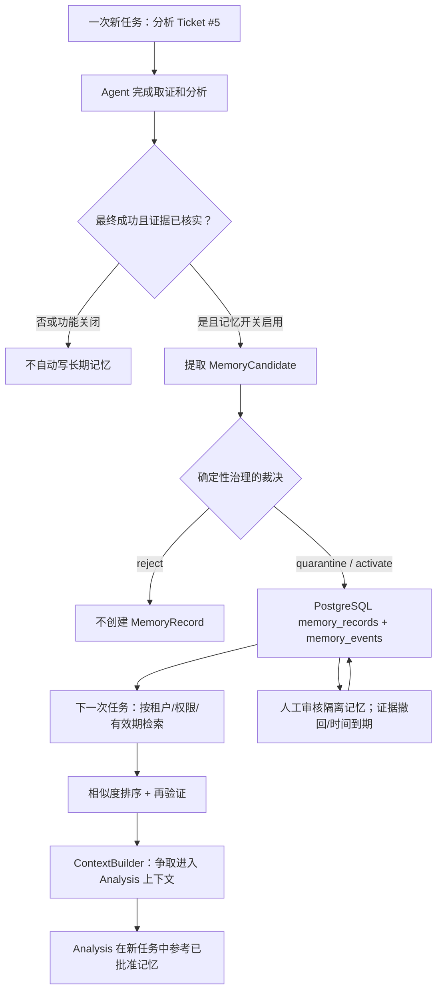

**贯穿例子**：Acme 员工为 VPN MFA 无法登录创建 Ticket #5，Agent 找到证据并给出排障结论；将来另一个 Ticket #8 出现类似问题，系统希望能参考之前被核实的处理经历，但不能把未证实的推测、属于 Group 7 的机密或过期方法直接写进下一次模型提示。

学完 M15，你要能独立画出**写入链和读取链**，讲清类型、权限、状态、版本、检索评分、审批、撤销与 Evaluation。M14 的 GraphRAG 是“找对象关系”，M15 的 Memory 是“保留受治理的历史经验”；同在 Capability Plane，但不是同一种存储，也不互相替代。

---

## B01 · 什么是长期记忆？先从“模型为什么会忘”说起（MUST KNOW）

### 总：它是什么，为什么需要

模型在一次调用中读取当前 Prompt 和上下文；下次运行不一定拥有上次的全部细节。**长期记忆**就是在本次模型调用之外，有选择地持久化那些以后可能有用的信息，并在适当的新任务中检索回来。它不是把所有聊天记录原样塞进数据库：原始对话包含错误判断、过时数据、私人信息和恶意指令，不适合原封不动作为可靠知识复用。

先区分三个动作：**记下（write）→ 管理（govern）→ 找回来使用（retrieve/deliver）**。只做到第一步，后两步缺失，记忆库很快会成为质量不受控的“旧话堆”。

### 正常流程与最小例子

输入：Ticket #5 的分析报告指出“VPN MFA 的 Token 已过期，按规定重注册恢复”；这只是**本次结果**，不是自动确认的永久事实。

```text
本次 Run：Ticket #5 → 经过核实的证据/Reviewer → 提出一条“曾这样处理”的记忆
下次 Run：Ticket #8 → 检索候选记忆 → 检查是否还有效、有没有权限 → 交给 Analysis
输出：模型可以说“此前类似工单采用过 X”，但仍应对 Ticket #8 重新取证。
```

再给一个反例：如果 Ticket #5 的模型曾错误建议“关闭全部 MFA”，保存后直接当系统指令执行，这不是优秀的记忆能力，而是把一次幻觉跨任务传播。

### 关键设计：四个问题必须同时回答

| 问题     | 普通应用可能的做法 | 企业级必须补的机制             |
| -------- | ------------------ | ------------------------------ |
| 写什么   | 保存全部对话       | 候选抽取 + 来源证据 + 类型契约 |
| 相信多少 | 模型说过就记住     | 规则治理、人工审查、可信来源   |
| 谁能用   | 搜到就给模型       | Tenant/Scope/ACL/时间约束      |
| 何时删   | 无限保存           | 到期、更新、证据撤回、审计事件 |

**先澄清一个贯穿本课的动词：“经过核实”不等于“故障已修好”。** 在本课只读的 Ticket #5 中，`result.final_state_verified` 是 Graph 最终结果的标记，Reviewer `passed` 是对分析/证据链的审核；源码写进 Episode 的 `outcome` 实际取自 `analysis.reasoning_summary`，而示例 `execution=null`。因此它能作为“上次 Agent 如何判断和建议”的经历，却不能成为“GLPI 已实际修改 MFA 配置、用户已成功登录”的操作验收证据。后者需本次可核验的外部状态/执行记录。

### 必要失败边界

“存进 PostgreSQL”≠“可信、可见、会被用”。本项目状态为 `QUARANTINE` 的记忆可以存在数据库，**但不能作为普通模型检索结果提供给 Analysis**；即使是 ACTIVE，也可能因 ACL、时间或相关性没进入 Prompt。

### 源码学习

先找到三个实体而非立刻钻 SQL：`MemoryCandidate` 表示**待判断的提案**，`MemoryRecord` 表示**带状态和版本的已存记录**，`MemorySelection` 表示**一次检索候选及其评分**。源码：[`memory/contracts.py L86–210`](https://github.com/shark6438/servicemind/blob/19d9a377fb98e1c3f56edc59be40b374013bc08b/src/servicemind/memory/contracts.py#L86-L210)、[`memory/contracts.py L463–469`](https://github.com/shark6438/servicemind/blob/19d9a377fb98e1c3f56edc59be40b374013bc08b/src/servicemind/memory/contracts.py#L463-L469)。

从 `phase5_governance.py` 的 `post_run()` 和 `build_context()` 分别反追写链与读链，而不是因为两个类存在就直接宣称在线启用。[`orchestration/phase5_governance.py L736–850`](https://github.com/shark6438/servicemind/blob/19d9a377fb98e1c3f56edc59be40b374013bc08b/src/servicemind/orchestration/phase5_governance.py#L736-L850)、[`orchestration/phase5_governance.py L591–637`](https://github.com/shark6438/servicemind/blob/19d9a377fb98e1c3f56edc59be40b374013bc08b/src/servicemind/orchestration/phase5_governance.py#L591-L637)。

### 一图复盘 · B01 的最小因果链

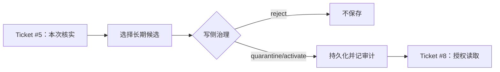

**小结与衔接：** 长期记忆是一条需要治理的跨 Run 数据链。下一块先把它与 Checkpoint、LangGraph Store、RAG、GraphRAG 的概念分清，否则后面一看见“memory”就会混乱。

---

## B02 · 四种常被叫作“记忆”的东西，究竟哪里不同？（MUST KNOW）

### 总：不是所有 memory 都指同一张数据库表

1. **上下文窗口**：模型这一次直接收到的输入，调用完成后本身不是永久记忆。
2. **Checkpoint（短期执行状态）**：保存一次 Graph 的 State 和执行位置，主要回答“这次工作停在哪里，如何恢复”。
3. **LangGraph Store（通用跨线程键值能力）**：LangGraph 的独立存储接口，可供其 Agent 使用。
4. **ServiceMind Governed Memory（本 Master）**：企业长期记忆领域对象，具有 `memory_records`/`memory_events`、状态、权限、证据、版本和审核策略。

项目中确实同时存在 `src/memory/`（scaffold 初始化 LangGraph saver/store）和 `src/servicemind/memory/`（企业记忆治理层），**不能因名字都叫 memory 就把两套系统合并为一个实现**。

### 正常流程与最小例子

同一条 Ticket #5：Graph 在第 5 个 Task 崩溃，恢复时查 **Checkpoint**；下周分析 Ticket #8，需要找此前核实的 MFA 处理经验，查 **Governed Memory**；查询 VPN 操作手册，走 **Text RAG**；查两张事故是否共用 CI，走 **GraphRAG**。

| 用户在问什么                 | 优先相关能力    | 不应说成             |
| ---------------------------- | --------------- | -------------------- |
| “这次 Run 跑到了哪里？”      | Checkpointer    | 历史知识库           |
| “上次发生过什么值得复用？”   | Governed Memory | Graph State 简单重放 |
| “公司手册写了什么？”         | RAG             | 过去 Agent 的总结    |
| “两张工单连着同一个 CI 吗？” | GraphRAG        | 模型自称记得关联     |

### 关键设计：存储和接线要分别追踪

冻结 `src/service/service.py` 的 lifespan 会从 `src/memory/__init__.py` 初始化 `initialize_database()` Saver 和 `initialize_store()` Store，交给原 scaffold 的 Agent；另一方面，M15 的 `Phase5Governance` 构造时默认配置 `memory_repository_factory=PostgresMemoryRepository`。这个 Memory Repository 不是通过“调用 LangGraph store.put”实现的。

`src/memory/postgres.py` 可以提供 LangGraph 的 AsyncPostgresStore，但它没有把 `memory_records` 的所有治理规则自动赋给 LangGraph Store。源码：[`service/service.py L116–160`](https://github.com/shark6438/servicemind/blob/19d9a377fb98e1c3f56edc59be40b374013bc08b/src/service/service.py#L116-L160)、[`memory/__init__.py L1–40`](https://github.com/shark6438/servicemind/blob/19d9a377fb98e1c3f56edc59be40b374013bc08b/src/memory/__init__.py#L1-L40)、[`orchestration/phase5_governance.py L272–299`](https://github.com/shark6438/servicemind/blob/19d9a377fb98e1c3f56edc59be40b374013bc08b/src/servicemind/orchestration/phase5_governance.py#L272-L299)。

### 必要失败边界

Checkpoint 恢复成功不会自动验证上一轮经验是否仍适合新工单。反过来，长期记忆里有一个结论，也不表示当前 Run 可以从那个结论的位置恢复 Graph 运行。**恢复执行**与**复用历史经验**是两件事。

### 源码学习

从 `service.py` 的 saver/store 初始化看“LangGraph 的对象”，再看 `memory/repository.py` 的 `MemoryRepository` **8 个异步方法**（按用途分为 5 组）：①写入 `persist`；②普通检索/权威再校验 `candidates`、`revalidate`；③人工审查 `list_review_queue`、`get_for_review`；④**跨工单程序支撑** `pattern_episodes`；⑤状态迁移/撤证 `transition`、`revoke_by_evidence`。它拥有独立领域契约和 PostgreSQL 权威操作。[`memory/repository.py L35–91`](https://github.com/shark6438/servicemind/blob/19d9a377fb98e1c3f56edc59be40b374013bc08b/src/servicemind/memory/repository.py#L35-L91)。

### 一图复盘 · B02 的最小因果链

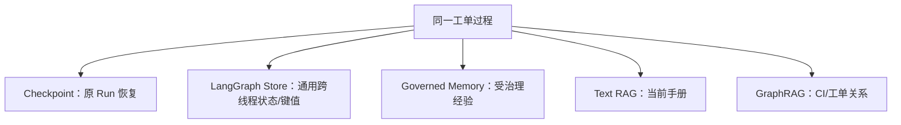

**小结与衔接：** 知道长期记忆的定位后，要理解具体“记住什么”。下一块先认识三种记忆，它们不是按内容长短分类，而是**存储的知识性质不同**。

---

## B03 · Semantic / Episodic / Procedural：三种长期记忆究竟是什么？（MUST KNOW）

### 总：先给直观定义

- **Semantic Memory（语义记忆）**：相对稳定的事实或偏好，如“某用户经明确同意偏好中文沟通”或“当前已核实的团队责任”。
- **Episodic Memory（事件记忆）**：一次**具体历史经历**，如 Ticket #5 某天怎么分析、审核通过后怎样处理。
- **Procedural Memory（程序记忆）**：经验证可复用的**处理方式/步骤**，如同类 VPN 故障先检查哪些依赖，而不是某次工单的私人摘要。

不要把“程序记忆”误认为 `scripts/foo.py` 可执行脚本；这里是供 Agent 分析时参考的**受审核处理经验**，不会自动获取写权限。

### 正常流程与最小例子

| 类型                  | 一条简单内容                                               | 来源要求                                               | ServiceMind 示例状态                                       |
| --------------------- | ---------------------------------------------------------- | ------------------------------------------------------ | ---------------------------------------------------------- |
| Semantic learned_fact | “Acme 当前的 VPN 故障升级组为 ServiceDesk”（须有来源证据） | `semantic_subtype=learned_fact`，至少有 Evidence       | 符合策略才可能 ACTIVE                                      |
| Semantic preference   | “用户 U 希望按中文解释故障”                                | `scope=user:U`，`consent_ref` 必填                     | 个人范围；不能扩散到整个租户                               |
| Episodic              | “Ticket #5 经 Reviewer 核实并形成 MFA 排障结论”            | `source_run_id`、`final_state_verified=true`、Evidence | 自动后运行候选通常由低于 0.9 的 confidence 进入 QUARANTINE |
| Procedural            | “多个独立工单支持同一故障检查程序”                         | 至少 2 个 supporting Episode、Evidence                 | **强制人工审核，不自动激活**                               |

**把两次工单串起来**：Ticket #5 单独完成只能为这一次经历提出 Episodic；Ticket #8 也完成，系统才有机会在满足跨 Ticket、跨 Run、同模式条件时提出 Procedural。它仍然是提案，不是自动认可的 SOP。

### 关键设计：输入类型契约不等于生产自动写入了全部类型

`MemoryType` 只有 `semantic`、`episodic`、`procedural` 三个值；`SemanticSubtype` 只有 `learned_fact`、`preference`。`MemoryCandidate.enforce_type_contract()` 对它们有不同前置要求。**但冻结的 Post-Run 自动提取实现明确构造的是 Episodic，之后独立开关才可能构造 Procedural；不能说三类都由同一条后运行链自动生产。**

**“核实”与“人工审核”是两件事。** `MemoryGovernancePolicy` 可以自动激活符合规则、置信度达到门槛的 Episodic；Procedural 会被策略强制隔离。候选的 `final_state_verified=true`、引用的 `verified=true` 和人的 `human_review_ref` 是三种不同证据，不能混写成“所有 ACTIVE 记录都由人亲自批准”。源码 [`policy.py L25–76`](https://github.com/shark6438/servicemind/blob/19d9a377fb98e1c3f56edc59be40b374013bc08b/src/servicemind/memory/policy.py#L25-L76)。

**业务结果不要偷换：** Episodic 是“某次被核查的分析运行经历”，不是自动证明“用户故障已修复”。举例：Ticket #5 给出了重注册 MFA 的建议，且 Review 通过，但结果 `execution=null`；该 Episode 最多记录此前建议与原因分析，不能对 Ticket #8 承诺之前有真实的重注册成功案例。

### 必要失败边界

- 给 `SEMANTIC/PREFERENCE` 却使用 `scope=tenant` 或缺 `consent_ref`：模型校验失败。
- 给 `EPISODIC` 但没有已核实来源 Run：失败。
- 给 `PROCEDURAL` 只有一条 Episode：失败。
- 给 Procedural 两条 Episode 不代表马上 `ACTIVE`：写侧治理仍强制 `QUARANTINE`，审批时重检支撑链。

### 源码学习

先读类型定义与校验逻辑：[`memory/contracts.py L23–68`](https://github.com/shark6438/servicemind/blob/19d9a377fb98e1c3f56edc59be40b374013bc08b/src/servicemind/memory/contracts.py#L23-L68)、[`memory/contracts.py L86–177`](https://github.com/shark6438/servicemind/blob/19d9a377fb98e1c3f56edc59be40b374013bc08b/src/servicemind/memory/contracts.py#L86-L177)；再读真实自动写入的构造点 [`orchestration/phase5_governance.py L752–826`](https://github.com/shark6438/servicemind/blob/19d9a377fb98e1c3f56edc59be40b374013bc08b/src/servicemind/orchestration/phase5_governance.py#L752-L826)、[`orchestration/phase5_governance.py L904–943`](https://github.com/shark6438/servicemind/blob/19d9a377fb98e1c3f56edc59be40b374013bc08b/src/servicemind/orchestration/phase5_governance.py#L904-L943)。注意字段 `final_state_verified` 属于 Candidate 的前置验证信息，在落成 `MemoryRecord` 时不再作为同名存储字段出现。

### 一图复盘 · B03 的最小因果链

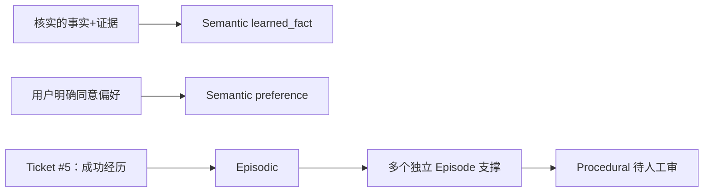

**小结与衔接：** “记忆的种类”解决内容是什么的问题，下一步要解决“谁能看到”——这比相似度高低更早、更重要。

---

## B04 · 租户、Scope、ACL、有效期：记忆为什么不能全公司共享？（MUST KNOW）

### 总：五种 Scope 与两道不同的授权坐标

记忆的一条 `scope` 包含 `scope_type` 与 `scope_id`。ServiceMind 允许 `tenant/user/entity/group/service`。**Scope 是记忆“归属或允许的对象范围”**；而 `provenance.required_entity_ids / required_group_ids` 是额外的 GLPI 可见性条件，要求访问者拥有这些 Entity 和 Group。

这和 M12 的文档 ACL 有相通的“先校验再交给模型”的原则，但不是同一套字段，不能套用它的所有 Profile/User/时间字段。

### 正常流程与最小例子

设一条 Ticket #5 Episodic Memory 的 Scope 是 `tenant`，但 provenance 写着：

```json
{"required_entity_ids":[1],"required_group_ids":[7],"post_run_scope":"tenant_episode_v2"}
```

一个 Acme 的 Group 7 分析员（entity_ids={1}, group_ids={7}）满足条件；另一个同属 Acme 的 Group 9 人即使查询相同文字也**不能**得到这条记忆。为什么？`tenant` 允许考虑整个租户，**并不取消 provenance 所要求的 Group 7**。两道条件是合取，而不是互相替代。

再加时间条件：`valid_from=10月12日`、`expires_at=次年1月10日`，那用户在10月11日查询不能看到“未来生效”的内容；过期以后也不可见。

### 关键设计：不同检查负责不同事情

1. `MemoryScope.require_scoped_id()`：tenant 类型不能填 `scope_id`；其它 Scope 必须填，entity/group 必须是非负十进制数字字符串。
2. `MemoryQuery.allows_scope()`：用户、实体、组、服务各按自身身份集合匹配；tenant scope 本身允许租户内候选。
3. `MemoryQuery.allows_record()`：再检查 Tenant ID、类型、时间、ACTIVE、空污点、provenance 的 required ACL、旧 Post-Run Scope Policy 标记。
4. PostgreSQL `tenant_session()` 通过事务的 `app.tenant_id` 配合 RLS 做**数据库租户行隔离**。RLS 不是 Group 7 的全部判断；这些在 SQL pre-filter 与领域复核中另做。

**第五类 Scope 的真实接线限制：** `MemoryQuery` 的确支持 `service_ids`，但 `Phase5Governance.build_context()` 构造它时只传 tenant、text、user、entity、group，未传 `service_ids`；因此沿这条 Analysis 入口，`service_ids` 沿用空集合，**无法命中需要 service scope ID 的 MemoryRecord**。类似地，人工 Review HTTP 的 `_memory_review_query()` 也没有传 `service_ids`。这是“领域契约支持”与“当前实际 caller 支持”的区别，不能把五种 Scope 都说成已在 UI/Agent 的每个入口完整可达。此结论限定这两条已核实入口，不否定其他显式传入 service_ids 的程序调用可以使用服务作用域。出处：[`phase5_governance.py L595–609`](https://github.com/shark6438/servicemind/blob/19d9a377fb98e1c3f56edc59be40b374013bc08b/src/servicemind/orchestration/phase5_governance.py#L595-L609)、[`memory_review.py L75–94`](https://github.com/shark6438/servicemind/blob/19d9a377fb98e1c3f56edc59be40b374013bc08b/src/servicemind/interfaces/http/memory_review.py#L75-L94)。

### 必要失败边界

`scope=tenant` 并不代表“所有 Acme 员工都能看到”；`group_ids=[]` 不代表“用户自动拥有所有组”，而是无法满足 required Group 7。反过来，如果记忆的来源没有正确写 required_acl，scope 本身也可能过宽，所以自动 Post-Run 写入代码必须带上这两个列表与 `post_run_scope` 标志。

### 源码学习

`MemoryScope` 定义 [`memory/contracts.py L43–67`](https://github.com/shark6438/servicemind/blob/19d9a377fb98e1c3f56edc59be40b374013bc08b/src/servicemind/memory/contracts.py#L43-L67)；领域完整过滤 [`memory/contracts.py L299–347`](https://github.com/shark6438/servicemind/blob/19d9a377fb98e1c3f56edc59be40b374013bc08b/src/servicemind/memory/contracts.py#L299-L347)；数据库预过滤 [`memory/repository.py L770–832`](https://github.com/shark6438/servicemind/blob/19d9a377fb98e1c3f56edc59be40b374013bc08b/src/servicemind/memory/repository.py#L770-L832)；RLS 事务实现 [`persistence/database.py L21–30`](https://github.com/shark6438/servicemind/blob/19d9a377fb98e1c3f56edc59be40b374013bc08b/src/servicemind/persistence/database.py#L21-L30)；写入时 required ACL 实际来源 [`orchestration/phase5_governance.py L788–824`](https://github.com/shark6438/servicemind/blob/19d9a377fb98e1c3f56edc59be40b374013bc08b/src/servicemind/orchestration/phase5_governance.py#L788-L824)。

### 一图复盘 · B04 的最小因果链

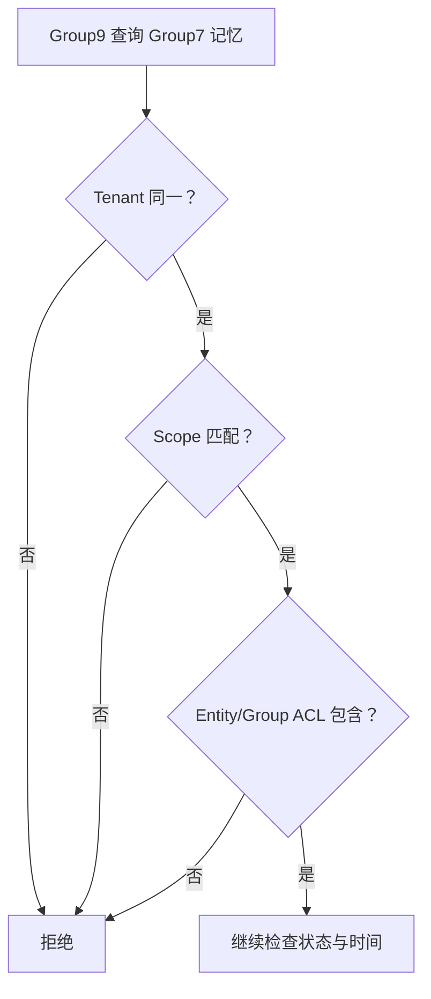

**小结与衔接：** 长期记忆不能先“语义最像”再想“是否有权”；必须先限定可用候选。接下来认识一条真正要进入治理管道的 Candidate 长什么样。

---

## B05 · MemoryCandidate：真正写入之前，系统拿到的是什么？（MUST KNOW）

### 总：Candidate 是提议，不是数据库事实

`MemoryCandidate` 是一份待评估的数据对象，里面不只是一段文字，还要交代：哪个租户、什么类型/Scope、哪个 Run、哪些证据、什么时候有效、可信度、重要性、来源与污点。它会被 `MemoryGovernancePolicy` 判定，然后由 Repository 决定是否存储。**任何字段都不能因为模型给了高 confidence 就自动成为事实。**

### 正常流程与最小例子

输入是 Ticket #5 成功且审核通过后的分析。自动提取器构造一个 Episodic Candidate，关键字段先看简化投影：

```json
{
  "tenant_id":"11111111-1111-4111-8111-111111111111",
  "scope":{"scope_type":"tenant","scope_id":null},
  "memory_type":"episodic",
  "subject_key":"ticket:5:verified_outcome",
  "source_run_id":"aaaaaaaa-aaaa-4aaa-8aaa-aaaaaaaaaaaa",
  "final_state_verified":true,
  "evidence_refs":[{"evidence_id":"ev-1111111111111111","verified":true}],
  "confidence":0.85,
  "importance":0.6,
  "created_by":"post-run-memory-middleware"
}
```

这只是入门**字段投影**：里面的 evidence_ref 实际还需要 `source_ref/content_hash` 等字段。要看完全可校验的数据，第二遍阅读下面的完整对象（演示固定 UUID 和 Evidence Hash 是教学占位；`content_hash` 与 `idempotency_key` 是按源码算法计算）：

```json
{
  "tenant_id": "11111111-1111-4111-8111-111111111111",
  "scope": {
    "scope_type": "tenant",
    "scope_id": null
  },
  "memory_type": "episodic",
  "semantic_subtype": null,
  "subject_key": "ticket:5:verified_outcome",
  "content": "{\"classification\": \"vpn_mfa_timeout\", \"execution\": null, \"outcome\": \"MFA Token expired; reset and re-enroll\", \"priority\": \"high\", \"recommended_group\": \"service_desk\", \"ticket_id\": 5}",
  "source_run_id": "aaaaaaaa-aaaa-4aaa-8aaa-aaaaaaaaaaaa",
  "source_trace_id": "thread-t5",
  "evidence_refs": [
    {
      "evidence_id": "ev-1111111111111111",
      "source_ref": "glpi://tickets/5",
      "content_hash": "aaaaaaaaaaaaaaaaaaaaaaaaaaaaaaaaaaaaaaaaaaaaaaaaaaaaaaaaaaaaaaaa",
      "verified": true
    }
  ],
  "supporting_episode_ids": [],
  "final_state_verified": true,
  "consent_ref": null,
  "confidence": 0.85,
  "importance": 0.6,
  "valid_from": "2026-10-12T10:00:00Z",
  "valid_to": null,
  "expires_at": "2027-01-10T10:00:00Z",
  "provenance": {
    "review_id": "review-t5",
    "review_policy": "phase5",
    "official_knowledge_authority": "rag",
    "post_run_scope": "tenant_episode_v2",
    "source_ticket_id": 5,
    "required_entity_ids": [
      1
    ],
    "required_group_ids": [
      7
    ]
  },
  "taint_labels": [],
  "created_by": "post-run-memory-middleware",
  "content_hash": "f02f7f7fd95d2e203b5109333d21a7e70c458be7e28a4cf0ea926727b4469954",
  "idempotency_key": "64184b5f9ae3ca4605c1f4a3af9056c2e65b1b30e31e7d61bbfd0e18950a468f"
}
```

**逐字段理解：** `subject_key` 代表记忆讨论的主题；`source_run_id` 追踪出自哪个 Run；`evidence_refs` 使后续撤销和验证有抓手；`confidence` 是提案置信度，`importance` 代表长期保留价值；`provenance` 带来源权限和审查信息；`taint_labels` 带未清理的风险标签。

### 关键设计：两个哈希分别在做什么

- `content_hash`：把 content **casefold 并将空白规范化**，然后做 SHA-256；因此某些大小写/空格差异不改变内容身份。
- `idempotency_key`：再把 tenant、scope、memory_type/subtype、subject_key、content_hash、source_run_id 组成排序确定的紧凑 JSON，做 SHA-256；因此**相同正文但不同 scope、subject 或 Run 可能不是同一次写入**。

示例精确计算结果在配套 JSON 中。注意 `idempotency_key` 并不等于 `content_hash`，也不是“相同主题从此不可更新”。版本更新还要看 Repository 如何比较前一版，这在 B07 专讲。

**为什么展示对象里有两条“只读计算字段”？** `content_hash` 和 `idempotency_key` 通过 Pydantic `@computed_field` 从其它字段算出；上面的完整 JSON 是说明 `model_dump(mode="json")` 的**序列化视图**。如果你构造 `MemoryCandidate.model_validate({...})` 的**入参**，应传业务字段、不传这两个计算结果；否则在 `extra="forbid"` 下多出的只读字段可能被当作额外输入拒绝。最短例子：先用 `content="Ticket #5..."` 创建 Candidate，随后读取其 `.content_hash`；不要把一个猜测的哈希写回当作可信来源。源码 [`contracts.py L86–148`](https://github.com/shark6438/servicemind/blob/19d9a377fb98e1c3f56edc59be40b374013bc08b/src/servicemind/memory/contracts.py#L86-L148)。

### 必要失败边界

`source_trace_id` 必须有值；provenance 必须 JSON 可序列化，大小不能超过 16KiB；required_entity_ids/required_group_ids 必须是非负整数列表，`bool` 不得冒充数字；时间窗必须成立。**Pydantic 对象校验只保证契约，不保证故事内容为真**。

### 源码学习

最核心的五处：Candidate 字段 [`memory/contracts.py L86–113`](https://github.com/shark6438/servicemind/blob/19d9a377fb98e1c3f56edc59be40b374013bc08b/src/servicemind/memory/contracts.py#L86-L113)；`validate_provenance()` [`memory/contracts.py L114–129`](https://github.com/shark6438/servicemind/blob/19d9a377fb98e1c3f56edc59be40b374013bc08b/src/servicemind/memory/contracts.py#L114-L129)；内容规范化和哈希 [`memory/contracts.py L78–84`](https://github.com/shark6438/servicemind/blob/19d9a377fb98e1c3f56edc59be40b374013bc08b/src/servicemind/memory/contracts.py#L78-L84)；幂等键精确字段 [`memory/contracts.py L131–148`](https://github.com/shark6438/servicemind/blob/19d9a377fb98e1c3f56edc59be40b374013bc08b/src/servicemind/memory/contracts.py#L131-L148)；类型契约 [`memory/contracts.py L150–177`](https://github.com/shark6438/servicemind/blob/19d9a377fb98e1c3f56edc59be40b374013bc08b/src/servicemind/memory/contracts.py#L150-L177)。自动提取器的 caller 来自 [`orchestration/phase5_governance.py L752–826`](https://github.com/shark6438/servicemind/blob/19d9a377fb98e1c3f56edc59be40b374013bc08b/src/servicemind/orchestration/phase5_governance.py#L752-L826)。

### 一图复盘 · B05 的最小因果链

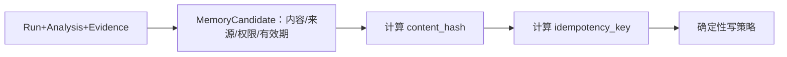

**小结与衔接：** Candidate 只是“我建议把这件事记住”；下一块真正决定它是拒绝、先隔离，还是立即激活。

---

## B06 · 确定性写入治理：谁决定一条记忆能不能被信任？（MUST KNOW）

### 总：为什么不能让 LLM 自己决定“我说的是真的”

如果 LLM 自己写一条“已核实”，再自己评估“已核实”，两步的错误来源可能相同。企业级 Agent 因此需要**与模型生成内容分离的规则判断**。ServiceMind 的 `MemoryGovernancePolicy.assess()` 是一个确定性函数：输入 Candidate，输出 `MemoryWriteDecision(action, reason_codes)`，不去请求 LLM。

三个动作先弄清楚：`reject` = 不入库；`quarantine` = 留存供复核、普通检索不可见；`activate` = 满足规则可直接入 ACTIVE，但仍须通过读侧的时间、权限和安全门。

### 正常流程与最小例子

Ticket #5 的 Candidate 是 `EPISODIC`、重要度 0.6、信心 0.85，Evidence 引用标为 verified。默认自动激活阈值 0.9，输出为：

```json
{"action":"quarantine","reason_codes":["CONFIDENCE_BELOW_AUTO_ACTIVATION"]}
```

把 `confidence` 改为 0.95，若其它安全条件都通过，可输出：

```json
{"action":"activate","reason_codes":["DETERMINISTIC_POLICY_PASSED"]}
```

再把正文改成 `password=demo-only`，即使信心 0.99，也会优先走 `SECRET_DETECTED → reject`。注意这里的字符串仅为教学形式演示，不是实际密钥。

### 关键设计：按真实源码顺序读，不要把规则做成无序清单

| 执行顺序 | 规则                                                         | 对结果的意义                                         |
| -------- | ------------------------------------------------------------ | ---------------------------------------------------- |
| 1        | 在 content、provenance、evidence_refs 的组合序列中扫 SECRET_PATTERN | 命中直接 `REJECT/SECRET_DETECTED`                    |
| 2        | 标记 prompt injection、已有 taint；无同意的 PII              | 收集需隔离的 reason                                  |
| 3        | `importance < 0.4`                                           | 直接 `REJECT/NOT_WORTH_SAVING`，不管前面累计什么理由 |
| 4        | Procedural                                                   | 追加 `PROCEDURAL_REQUIRES_HUMAN_REVIEW`              |
| 5        | 非 Preference 的 Evidence 是否全部 verified                  | 未核实则追加 `EVIDENCE_NOT_VERIFIED`                 |
| 6        | Episodic `final_state_verified`、provenance conflict、confidence 是否低于阈值 | 继续积累隔离理由                                     |
| 7        | 若有任意 reasons → `QUARANTINE`，否则 `ACTIVATE`             | 原因码去重保持顺序                                   |

**一个容易教错的细节：** `MemoryCandidate` 本身要求 Episodic final_state_verified=True，但写策略仍会检查这个标记——这是不同防线，不能混成一个函数。Semantic Preference 因有明确用户 consent，写策略对它的 Evidence 校验条件与其它类型不同；“偏好不一定需要同样的引用”≠“可绕过 consent 或租户隔离”。

**安全门的真正执行位置：** `MemoryWriter.write()` 才先调用 `policy.assess()` 再把 `candidate + decision` 传给 `repository.persist()`；Repository 的公开协议签名本身接收调用者提供的 `MemoryWriteDecision`，而不是对所有直接 `persist` 调用都再次执行完整 Policy。正常 Post-Run 生产接线经过 Writer，但测试/内部直接播种仓储不应被描述为“也自动过了同一写策略”。这是方法契约的作用域，不是已证明存在可从外部 HTTP 利用的绕过。源码 [`memory/service.py L89–96`](https://github.com/shark6438/servicemind/blob/19d9a377fb98e1c3f56edc59be40b374013bc08b/src/servicemind/memory/service.py#L89-L96)、[`repository.py L35–42`](https://github.com/shark6438/servicemind/blob/19d9a377fb98e1c3f56edc59be40b374013bc08b/src/servicemind/memory/repository.py#L35-L42)。

**偏好 Consent 的实际约束强度：** `MemoryCandidate.enforce_type_contract()` 检查 `PREFERENCE` 必须是 USER scope 且含 `consent_ref`；策略中带 consent_ref 的偏好可以绕过普通 PII 隔离理由。但这段冻结记忆代码**没有在此向独立授权/同意登记系统核验 `consent_ref` 的真实性或有效性**。因此“字段里有 consent_ref”并不自动证明法律层面的明示同意；真实同意管理及撤回需要另作接线/流程证据核对。

### 必要失败边界

“`confidence ≥ 0.9`”并不是激活的充分条件。Procedural 永远加 Human Review reason；未核实 Evidence、冲突、PII、污点、注入都可能让 Candidate 留在隔离区。`SECRET_PATTERN` 是启发式正则，不保证覆盖任何形式的秘密；注入检查与读侧还需要再次执行。

### 源码学习

调用链是：`MemoryWriter.write(candidate)` → `self.policy.assess(candidate)` → `repository.persist(candidate, decision)`。真正的“决策”在 [`memory/policy.py L17–76`](https://github.com/shark6438/servicemind/blob/19d9a377fb98e1c3f56edc59be40b374013bc08b/src/servicemind/memory/policy.py#L17-L76)，调用者在 [`memory/service.py L89–96`](https://github.com/shark6438/servicemind/blob/19d9a377fb98e1c3f56edc59be40b374013bc08b/src/servicemind/memory/service.py#L89-L96)。注意直接拒绝时 Repository 返回 `None`，不是创建一条 `status=REJECTED` 的记忆；因为 `MemoryStatus` 根本没有 `REJECTED` 值。`MemoryWriteAction.REJECT` 与 `MemoryStatus.REVOKED` 也不是同一概念。

### 一图复盘 · B06 的最小因果链

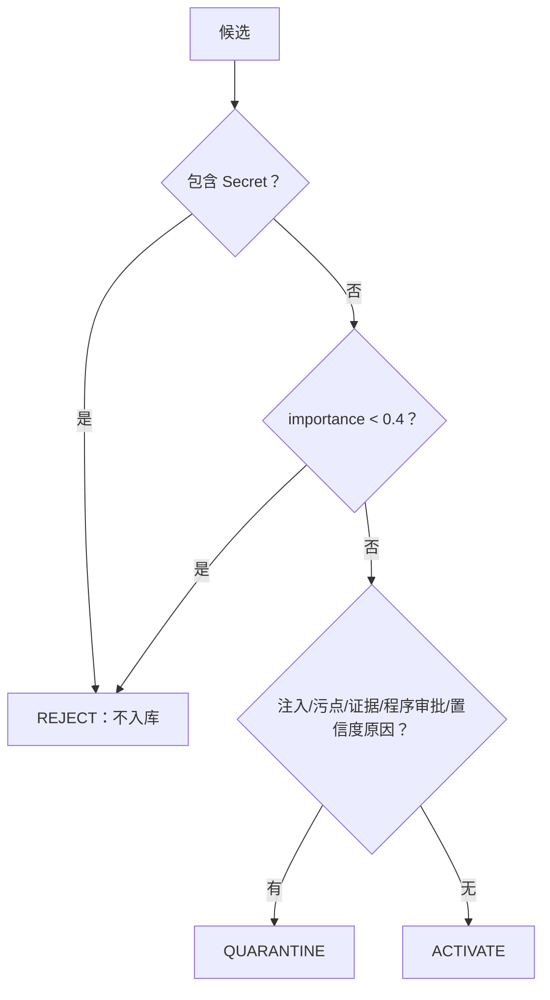

**小结与衔接：** 安全规则决定能不能写、写成什么状态；但它还没解决“同一主题已有一条旧记忆怎么办”。下一块正式讲版本、去重、锁与 PostgreSQL。

---

## B07 · MemoryRecord 的一生：幂等、Lineage、Version 和 PostgreSQL（MUST KNOW）

### 总：一条记忆不是只能覆盖原文

如果昨天的结论是“VPN 首先检查 A”，今天核实的新结论是“先检查 B”，系统不能无痕把旧正文改掉，否则审计者无法知道何时修改、谁批准。ServiceMind 把**主题主线（lineage_id）**、**具体版本（memory_id + version）**与**生命周期状态**分开管理。

先分四个名词：`memory_id` 是这一条版本记录的身份；`lineage_id` 是一组同主题历史版本的关联标记；`version=1/2...` 是主题版本号；`idempotency_key` 用于识别同一次候选写入，**不替代**主题版本控制。

### 正常流程与最小例子

- 第一条 `subject_key="ticket:5:verified_outcome"` 入库 → `version=1, lineage=L, status=QUARANTINE`。
- **完全同一候选**重复提交 → 同 `idempotency_key`，直接取回旧记录，不新建版本。
- **同主题、内容不同、source_run_id 不同** → 新 `version=2, lineage=L`；即使策略本想立即 activate，只要上一版仍 ACTIVE/QUARANTINE，仍强制 `QUARANTINE` 并打 `VERSION_CONFLICT`。
- 人工审批新 v2 后，原 ACTIVE v1 会转 `SUPERSEDED`，这才有明确的替代记录。

入库后真实的 `MemoryRecord` 比 Candidate 多 `memory_id/lineage_id/version/status/created_at/updated_at` 等字段。Ticket #5 的完整教学对象如下，**固定 UUID 是示例身份而非某次数据库实测**：

```json
{
  "tenant_id": "11111111-1111-4111-8111-111111111111",
  "scope": {
    "scope_type": "tenant",
    "scope_id": null
  },
  "memory_type": "episodic",
  "semantic_subtype": null,
  "subject_key": "ticket:5:verified_outcome",
  "content": "{\"classification\": \"vpn_mfa_timeout\", \"execution\": null, \"outcome\": \"MFA Token expired; reset and re-enroll\", \"priority\": \"high\", \"recommended_group\": \"service_desk\", \"ticket_id\": 5}",
  "source_run_id": "aaaaaaaa-aaaa-4aaa-8aaa-aaaaaaaaaaaa",
  "source_trace_id": "thread-t5",
  "evidence_refs": [
    {
      "evidence_id": "ev-1111111111111111",
      "source_ref": "glpi://tickets/5",
      "content_hash": "aaaaaaaaaaaaaaaaaaaaaaaaaaaaaaaaaaaaaaaaaaaaaaaaaaaaaaaaaaaaaaaa",
      "verified": true
    }
  ],
  "supporting_episode_ids": [],
  "consent_ref": null,
  "confidence": 0.85,
  "importance": 0.6,
  "valid_from": "2026-10-12T10:00:00Z",
  "valid_to": null,
  "expires_at": "2027-01-10T10:00:00Z",
  "provenance": {
    "review_id": "review-t5",
    "review_policy": "phase5",
    "official_knowledge_authority": "rag",
    "post_run_scope": "tenant_episode_v2",
    "source_ticket_id": 5,
    "required_entity_ids": [
      1
    ],
    "required_group_ids": [
      7
    ]
  },
  "taint_labels": [],
  "created_by": "post-run-memory-middleware",
  "content_hash": "f02f7f7fd95d2e203b5109333d21a7e70c458be7e28a4cf0ea926727b4469954",
  "idempotency_key": "64184b5f9ae3ca4605c1f4a3af9056c2e65b1b30e31e7d61bbfd0e18950a468f",
  "memory_id": "bbbbbbbb-bbbb-4bbb-8bbb-bbbbbbbbbbbb",
  "lineage_id": "cccccccc-cccc-4ccc-8ccc-cccccccccccc",
  "version": 1,
  "status": "quarantine",
  "activation_reason": null,
  "created_at": "2026-10-12T10:00:00Z",
  "updated_at": "2026-10-12T10:00:00Z"
}
```

### 关键设计：同一写入与同一主题是两层去重

第一层按 `(tenant_id,idempotency_key)` 查，解决网络/调用重复。第二层找 `(tenant_id, scope_type, scope_id, memory_type, subject_key)` 的**最新版本**，比较正文 hash 和状态。

| 前一版状态         | 本次内容 | 决策（假设不是完全相同的幂等键）                     |
| ------------------ | -------- | ---------------------------------------------------- |
| 无前一版           | 任意     | 按 Policy 新写 v1                                    |
| ACTIVE/QUARANTINE  | 同内容   | 复用前一版（不新建）                                 |
| ACTIVE/QUARANTINE  | 不同内容 | 写下一个版本，强制 QUARANTINE + `VERSION_CONFLICT`   |
| REVOKED/SUPERSEDED | 同内容   | **不能静默复活**，重新隔离并标明 resurrection reason |
| EXPIRED            | 同内容   | 可作为新学习，按当次 Policy 判定                     |

> [!WARNING] 精确作用域：上表前提是**没先命中同一个 idempotency_key**。冻结 Repository 先查幂等键；如果被撤销的旧 Candidate 原封不动重发，它可能直接返回已经 REVOKED 的旧行。这不同于“产生一次新的候选学习”（例如来自新 Run 的另一 key）。不要说“任何撤销记忆再次提交都必定生成隔离版本”。

### 两次判断不能混为一谈：VERSION_CONFLICT 与 CONFLICT_DETECTED 的真实修复史

最小案例：旧版 `v1` 仍是 ACTIVE，新写入的 `v2` 对同一 `subject_key` 给出了不同内容。`MemoryWriter` **先**执行一次 `policy.assess(candidate)`；那时 Candidate 还不知道数据库里存在 v1，因此它的 `provenance` **尚无** `conflict_detected` 标志。随后 `Repository.persist()` 才发现**同主题不同内容**，强制新版本进入 QUARANTINE，Reason 中包含 `VERSION_CONFLICT`，并调用 `_mark_subject_conflict()`，将 `provenance["conflict_detected"]=true` 随记录持久化。

```text
第一次 Policy（不知道旧记录）
    ↓
Repository 对比同主题 v1/v2 → VERSION_CONFLICT → QUARANTINE
    ↓
_mark_subject_conflict → provenance.conflict_detected=true
    ↓
人工审核 v2 申请激活
    ↓
_validate_activation 重新构造 Candidate，再次运行 Policy
    ↓
此次 Policy 可看到 CONFLICT_DETECTED
```

**历史真实问题（SOURCE COMMENT CLAIM）**：Policy 已写有 `CONFLICT_DETECTED` 分支，但早期 Repository 从不写 `provenance["conflict_detected"]`，使该分支一度不可达；运维只能看到“处于隔离”，无法凭记录区分**版本冲突**与**低置信度**。现在补上持久标记，既允许审计，也让**后续激活路径的再次 Policy 检查**识别此冲突；`_validate_activation()` 将 `CONFLICT_DETECTED` 从不允许人工覆盖的硬性阻断理由集合中排除，**不等于冲突自动放行**，仍须人工审批、合法迁移和其它安全校验。

源码：[repository.py L307–325](https://github.com/shark6438/servicemind/blob/19d9a377fb98e1c3f56edc59be40b374013bc08b/src/servicemind/memory/repository.py#L307-L325)、[repository.py L205–235](https://github.com/shark6438/servicemind/blob/19d9a377fb98e1c3f56edc59be40b374013bc08b/src/servicemind/memory/repository.py#L205-L235)、[repository.py L928–974](https://github.com/shark6438/servicemind/blob/19d9a377fb98e1c3f56edc59be40b374013bc08b/src/servicemind/memory/repository.py#L928-L974)、[policy.py L44–76](https://github.com/shark6438/servicemind/blob/19d9a377fb98e1c3f56edc59be40b374013bc08b/src/servicemind/memory/policy.py#L44-L76)。

### 为什么还要数据库锁？

两个 Worker 同时给一个主题写 v2：如果都只 `SELECT MAX(version)=1`，两边都可能试图写 v2。PostgreSQL 版使用 `tenant_session()` + 每租户事务 advisory lock + 每主题 advisory lock，**在同一事务里顺序化版本判断与插入**；ORM 有 `(tenant_id, scope_type, scope_id, memory_type, subject_key, version)` 的唯一约束作为最后防线。记住：锁不是用来加密记忆的，Hash 也不能替代锁。

**内容相同究竟指什么？** `same_content` 比较的是规范化后的 `content_hash`，不是原文字节。仅改变大小写或空白可能仍复用旧记录；实际内容变化且 Hash 不同才走版本冲突分支。例如把 "MFA Token" 写成 "mfa  token" 仍可能视作相同；把 "Check A" 改成 "Check B" 则是内容不同。

### 必要失败边界

状态从 QUARANTINE 到 ACTIVE 必须通过人工复核路径；原文只改变一个单词也应产生可审计的版本冲突。相比旧 v1，**新 v2 处于 QUARANTINE 并不代表它已经替换了旧 ACTIVE v1**；直到有效激活时，旧 ACTIVE 才会被 SUPERSEDED。

### 源码学习

幂等键字段来自 [`memory/contracts.py L131–148`](https://github.com/shark6438/servicemind/blob/19d9a377fb98e1c3f56edc59be40b374013bc08b/src/servicemind/memory/contracts.py#L131-L148)；主题决策 `_subject_dedupe_outcome` [`memory/repository.py L124–153`](https://github.com/shark6438/servicemind/blob/19d9a377fb98e1c3f56edc59be40b374013bc08b/src/servicemind/memory/repository.py#L124-L153)；InMemory 实现 [`memory/repository.py L389–462`](https://github.com/shark6438/servicemind/blob/19d9a377fb98e1c3f56edc59be40b374013bc08b/src/servicemind/memory/repository.py#L389-L462)；Postgres 锁与 Persist [`memory/repository.py L756–770`](https://github.com/shark6438/servicemind/blob/19d9a377fb98e1c3f56edc59be40b374013bc08b/src/servicemind/memory/repository.py#L756-L770)、[`memory/repository.py L896–1021`](https://github.com/shark6438/servicemind/blob/19d9a377fb98e1c3f56edc59be40b374013bc08b/src/servicemind/memory/repository.py#L896-L1021)；表约束 [`persistence/models.py L389–472`](https://github.com/shark6438/servicemind/blob/19d9a377fb98e1c3f56edc59be40b374013bc08b/src/servicemind/persistence/models.py#L389-L472)。必要的 `SEMANTIC_DUPLICATE_SUSPECTED` 只是**同主题变更且词面重叠≥0.85 时附加隔离理由**，不是全租户语义向量去重。

### 一图复盘 · B07 的最小因果链

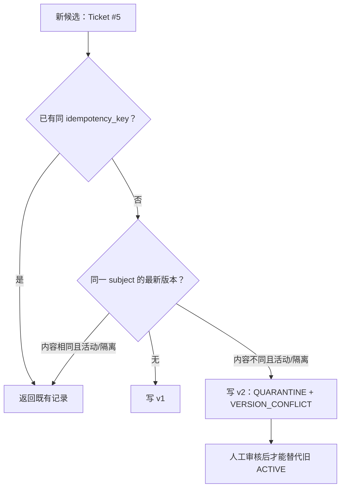

**小结与衔接：** Candidate 的写入策略和 Repository 的主题版本判断是**先后两道不同的门**；`VERSION_CONFLICT` 决定本次隔离，`conflict_detected` 保留理由并服务后续复核。隔离里的记忆还不能给模型。谁来批准？如何防止审批时看到旧版本？下一块讲 Human Review。

---

## B08 · 人工复核：为什么审批的不是“主题”，而是“这一版内容”？（MUST KNOW）

### 总：审核必须绑定看过的具体文本

想象审批人在网页上看见“Ticket #5 建议 A”，点击“激活”之前，另一个 Worker 把正文改成“建议 B”。如果服务只认 `memory_id` 而不验证版本与内容，审批人的决定就会被用到她从没看过的文本上。ServiceMind 要求审批提交带**版本号、正文内容 hash 和预期状态**。

### 正常流程与最小例子

有权限的 Acme approver（Group 7）读取：

```http
GET /v1/servicemind/memories/review-queue?limit=50
Authorization: Bearer <用户令牌占位>
```

返回 `MemoryReviewItem`，里面有 `memory_id / content / content_hash / version / status / evidence_refs / provenance`；浏览器展示内容并要求输入审批依据编号和说明。审批 POST 的完整 JSON 示例：

```json
{
  "decision": "activate",
  "expected_version": 1,
  "expected_content_hash": "f02f7f7fd95d2e203b5109333d21a7e70c458be7e28a4cf0ea926727b4469954",
  "review_ref": "CAB-2026-1012",
  "comment": "Verified episode; activate after reviewing current scope and source"
}
```

**发生什么？** `review_memory()` 先通过 `MemoryReviewQuery` 查询**当前审批人有权看见且仍为 QUARANTINE 的记录**；对 activate 选择 `ACTIVE`，对 reject 选择 `REVOKED`；Repository 锁定该行，检查预期 `version=1`、`content_hash` 一致、`status=QUARANTINE`，再检查安全/证据/TTL/程序支撑条件后落审计事件。

### 关键设计：API/UI/Repository 分工

- FastAPI：通过 `TenantContextDependency` 验证人类身份，`context.require_role("approver")`；不是 Webhook 机器身份自然拥有审批权限。
- `MemoryReviewQuery`：按 Tenant、Entity、Group、Scope、有效期筛选隔离记录；游标 `after_created_at + after_memory_id` 必须同时提供。
- `transition()`：事务/行锁检查快照；激活时重新跑 Policy 的硬理由与支撑条件，并在同一 lineage 上将旧 ACTIVE 置 SUPERSEDED。
- UI：Next.js 复核页面 `/memory` 和另一个 Streamlit `Memory_Review` 页面都消费受授权的后端 API；**前端按钮不是授权边界**。

**一次容易被过度宣传的授权边界：** HTTP `review_memory()` 先使用 `MemoryReviewQuery` 检查审批人能否读取待审记录，然后单独调用 `PostgresMemoryRepository.transition()`；后者确实用事务锁检查目标记录 `version/hash/status`、激活规则和支撑，但它**不接收审批人的 `entity_ids/group_ids/service_ids`**，因此不能声称“同一笔事务内重新取了审批人最新所有角色和范围”。生产权限若恰好在两次调用之间变更，还需要额外的会话/身份一致性测试。这是静态边界与竞态条件的审计建议，并非本轮已重现的越权事故。

### 必要失败边界

未登录或无 approver 角色不应完成审批。记录不存在/超出权限时返回 404，不区分到底是没这个 ID 还是你无权查看。快照过期、安全重验失败等明确 `PermissionError/ValueError` 映射为 409；请求缺少 `review_ref` 或格式错误属于 422 校验范畴。**不要把审批 409 误解释为 GLPI 写操作冲突。**

### 源码学习

完整入站调用链：`api.py` 注册 `memory_review_router` [`api.py L48–55`](https://github.com/shark6438/servicemind/blob/19d9a377fb98e1c3f56edc59be40b374013bc08b/src/servicemind/api.py#L48-L55) → `list_memory_review_queue()/review_memory()` [`interfaces/http/memory_review.py L96–157`](https://github.com/shark6438/servicemind/blob/19d9a377fb98e1c3f56edc59be40b374013bc08b/src/servicemind/interfaces/http/memory_review.py#L96-L157) → `_review_filters` [`memory/repository.py L833–870`](https://github.com/shark6438/servicemind/blob/19d9a377fb98e1c3f56edc59be40b374013bc08b/src/servicemind/memory/repository.py#L833-L870) → `PostgresMemoryRepository.transition()` [`memory/repository.py L1235–1339`](https://github.com/shark6438/servicemind/blob/19d9a377fb98e1c3f56edc59be40b374013bc08b/src/servicemind/memory/repository.py#L1235-L1339)。用户显示字段按 [`interfaces/http/memory_review.py L25–74`](https://github.com/shark6438/servicemind/blob/19d9a377fb98e1c3f56edc59be40b374013bc08b/src/servicemind/interfaces/http/memory_review.py#L25-L74) 核对；Next.js 实际按钮请求 [`frontend/src/app/memory/page.tsx L10–48`](https://github.com/shark6438/servicemind/blob/19d9a377fb98e1c3f56edc59be40b374013bc08b/frontend/src/app/memory/page.tsx#L10-L48)。

### 一图复盘 · B08 的最小因果链

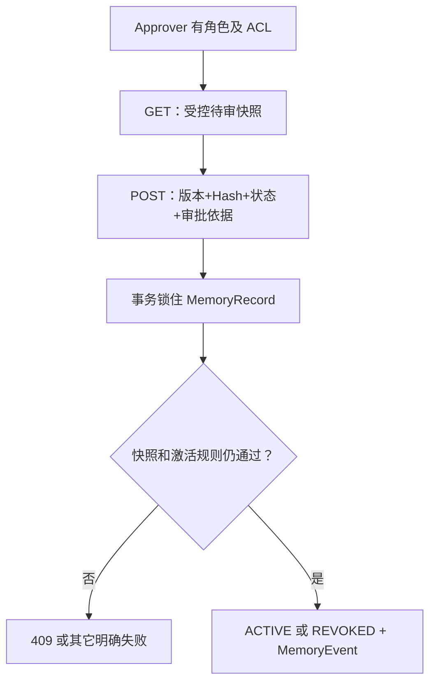

**小结与衔接：** 审批动作不是一次任意状态改写，而是带快照和权限的状态迁移。下一块系统学习所有状态、失效和审计事件。

---

## B09 · 记忆状态机：ACTIVE 不是“永远正确”，REVOKED 也不是“删掉一切”（MUST KNOW）

### 总：为什么需要状态机和审计记录

单纯的 `enabled=true/false` 不够表达“等审核”“历史版本被替换”“证据被撤销”“时间到期”等不同原因。ServiceMind 定义六态：`CANDIDATE / QUARANTINE / ACTIVE / SUPERSEDED / REVOKED / EXPIRED`。**状态机**规定哪些迁移合法；**审计事件**解释谁、因为什么、在什么条件下做过迁移。

### 正常流程与最小例子

```text
Ticket #5 经过后运行提取：Candidate → QUARANTINE
Approver 看到 v1 并批准：QUARANTINE → ACTIVE
后来新版本 v2 审批激活：v1 ACTIVE → SUPERSEDED，v2 QUARANTINE → ACTIVE
另一种情况：Ticket 原始证据撤销：ACTIVE/QUARANTINE → REVOKED
又一种情况：有效期过了：ACTIVE → EXPIRED（懒检查触发状态记录）
```

完整合法迁移表：

| 当前                         | 允许的下一状态                 | 核心用途                                       |
| ---------------------------- | ------------------------------ | ---------------------------------------------- |
| CANDIDATE                    | QUARANTINE / ACTIVE / REVOKED  | 预备状态；正常写入往往直接从决策映射成已存状态 |
| QUARANTINE                   | ACTIVE / REVOKED / EXPIRED     | 等人审；拒绝即撤销                             |
| ACTIVE                       | SUPERSEDED / REVOKED / EXPIRED | 正常可供检索，受时间/ACL/taint 额外约束        |
| SUPERSEDED、REVOKED、EXPIRED | 无                             | 终态，不在原行上重新激活                       |

要留意：`MemoryWriteAction.REJECT` 不会先创建一行 `CANDIDATE`，而是直接不写；所以不能只看枚举里有 Candidate 就说生产每条候选都会先落一行 Candidate 状态。

**读懂一条完整 MemoryEvent（合成的 Ticket #5 例子）**。`event_type` 告诉你发生了什么，`reason_codes` 解释原因；`run_id/trace_id` 指向本次提议它的 Run。TTL 后来的自动到期事件则不应凭空填这个 Run。注意这份领域 Event 没有 `created_at` 字段，PostgreSQL 表会用服务端时间生成它，审计库时间与对象示例应分开：

```json
{
  "tenant_id": "11111111-1111-4111-8111-111111111111",
  "memory_id": "bbbbbbbb-bbbb-4bbb-8bbb-bbbbbbbbbbbb",
  "actor_id": "post-run-memory-middleware",
  "event_type": "memory.quarantine",
  "reason_codes": [
    "CONFIDENCE_BELOW_AUTO_ACTIVATION"
  ],
  "payload": {
    "version": 1,
    "content_hash": "f02f7f7fd95d2e203b5109333d21a7e70c458be7e28a4cf0ea926727b4469954"
  },
  "run_id": "aaaaaaaa-aaaa-4aaa-8aaa-aaaaaaaaaaaa",
  "trace_id": "thread-t5"
}
```

### 关键设计：时间和审计是分开的

`MemoryRecord.visible_at(when)` 同时要求 `status=ACTIVE`、`valid_from <= when`、`valid_to > when`（若有）及 `expires_at > when`（若有）。**TTL 到期后即使 DB 里还短暂停着 ACTIVE，读过滤也不会把它交出来**；Repository 在读/写入口会做 `ACTIVE→EXPIRED` 的懒转移并写 `memory.expired` 事件，无需声称系统有一个每分钟清理 Cron。

`memory_events` 保存 `actor_id/event_type/reason_codes/payload`，有可选 `run_id/trace_id`：自动 Run 提议记忆时记相关 Run；人工审批或 TTL 到期，`run_id=None` 反而是正确的归因。迁移创建该表并开启 RLS + append-only trigger，后续迁移才增加 run_id/trace_id。`MemoryEvent` 不是 `RunEvent`，它们分属不同审计对象。

### 必要失败边界

- EXPIRED 记忆不能简单改回 ACTIVE；要按规则重新学习新版本。
- REVOKED 不意味着底层数据库行一定被物理删除：保留历史是为审计和防复活。若涉及法律保留/彻底删除，当前这段接口不能被说成已实现全链硬删除。
- `memory_events` 的 append-only 限制不代表管理员无法在数据库级绕过一切访问控制；它是当前 Schema 约束，部署权限仍需核实。

### 源码学习

状态定义与 `visible_at`：[`memory/contracts.py L34–42`](https://github.com/shark6438/servicemind/blob/19d9a377fb98e1c3f56edc59be40b374013bc08b/src/servicemind/memory/contracts.py#L34-L42)、[`memory/contracts.py L178–217`](https://github.com/shark6438/servicemind/blob/19d9a377fb98e1c3f56edc59be40b374013bc08b/src/servicemind/memory/contracts.py#L178-L217)。迁移映射：[`memory/repository.py L76–122`](https://github.com/shark6438/servicemind/blob/19d9a377fb98e1c3f56edc59be40b374013bc08b/src/servicemind/memory/repository.py#L76-L122)。懒过期和审计：[`memory/repository.py L463–493`](https://github.com/shark6438/servicemind/blob/19d9a377fb98e1c3f56edc59be40b374013bc08b/src/servicemind/memory/repository.py#L463-L493)、[`memory/repository.py L1022–1074`](https://github.com/shark6438/servicemind/blob/19d9a377fb98e1c3f56edc59be40b374013bc08b/src/servicemind/memory/repository.py#L1022-L1074)。数据库证据：[`migrations/versions/0008_phase5_governance.py L18–100`](https://github.com/shark6438/servicemind/blob/19d9a377fb98e1c3f56edc59be40b374013bc08b/migrations/versions/0008_phase5_governance.py#L18-L100)、[`migrations/versions/0008_phase5_governance.py L167–196`](https://github.com/shark6438/servicemind/blob/19d9a377fb98e1c3f56edc59be40b374013bc08b/migrations/versions/0008_phase5_governance.py#L167-L196)、[`migrations/versions/0014_memory_event_run.py L1–47`](https://github.com/shark6438/servicemind/blob/19d9a377fb98e1c3f56edc59be40b374013bc08b/migrations/versions/0014_memory_event_run.py#L1-L47)。

### 一图复盘 · B09 的最小因果链

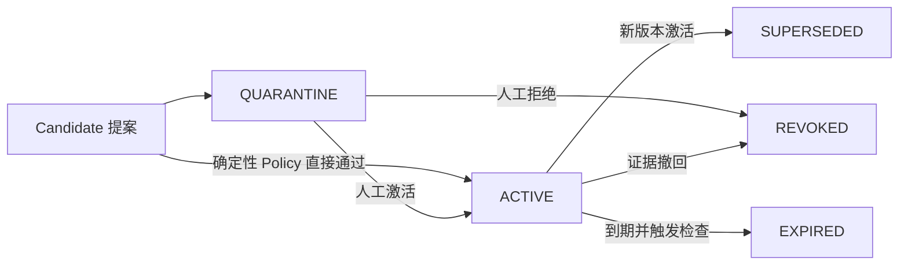

**小结与衔接：** 到这里，你已知道如何手工创建/审查/更新记忆。下一块回到真实 Agent 工作流：ServiceMind 什么时候自动提出一条 Episodic，门槛到底在哪里？

---

## B10 · 自动 Post-Run 写入：不是每次模型回答后都“学习”（MUST KNOW）

### 总：写入触发点在工作流结束，不在每一句话后

长期记忆最危险的做法是边回答边把任何推断固化。ServiceMind 的 Post-Run 入口在主 Graph 的 `finalize` 附近，运行于业务结果落库后，并且有多道成功/核实门槛。它不是 Agent 在聊天过程中随意调用 `memory.put`。

### 正常流程与最小例子

**Ticket #5**：Analysis 给出分类和建议；Reviewer 判定 passed；Graph 终态 `succeeded` 且 `final_state_verified=true`；存在引用的 Evidence；`user_id` 非空；开启 memory。只有这些前提一起满足，才会提出 Episodic Candidate。

```text
Supervisor.finalize
   → 保存 run.result / 业务终态与相应 RunEvent
   → phase5.post_run(state, result, status)
      → 检查开关、终态、验证标志、主体与写操作执行结果
      → extract() 从 Analysis/Review/JoinedEvidence 构造 MemoryCandidate
      → PostRunMemoryMiddleware.process()
      → MemoryWriter.policy.assess() → MemoryRepository.persist()
   → 成功写记录数>0：追加 run_event memory.post_run_completed
      抛异常：记录 run_event memory.post_run_failed（不会简单把已完成业务 Run 视为重跑失败）
```

真实内容不是一句“VPN 已解决”而已。构造的 Episode content 是 JSON 字符串，包含 ticket_id、classification、priority、recommended_group、outcome（Analysis reasoning_summary）、execution。它还设置了 `expires_at=now+90天`、`confidence=min(analysis,review)`、`importance=0.8`（被判 recurring）或 `0.6`、`created_by=POST_RUN_MEMORY_WRITER`，并写入两组 required ACL 与 `post_run_scope=tenant_episode_v2`。

这里还有一条容易被讲错的“核实”边界：自动提取器针对 **JoinedEvidence 中被 Analysis 声明引用的条目**，把 `MemoryEvidenceRef.verified` 设置为 `True`。这是**当前通过的分析/Review 链在内存写入入口上提供的核实标记**，不能扩大成“每一条外部知识文本都经过独立第三方真实性鉴定”。

**准确理解后运行 Episode 的业务语义：** 当前构造的 `content["outcome"]` 来自 `analysis.reasoning_summary`，与示例中 `execution=null` 并不矛盾：这一字段在源码里是“本次分析结果摘要”，**不是对 GLPI/终端实际修复效果的强制确认**。`final_state_verified` 表明运行的最终状态被系统确认，`review.decision="passed"` 表明 Reviewer 审核通过；两者都不能直接推出“员工重新登录已成功”。不能为了让历史记忆显得可靠而把这一点写反。来源 [`phase5_governance.py L752–824`](https://github.com/shark6438/servicemind/blob/19d9a377fb98e1c3f56edc59be40b374013bc08b/src/servicemind/orchestration/phase5_governance.py#L752-L824)。

### 关键设计：三种“通过”不能互换

1. **Graph Run 成功**：`RunStatus.SUCCEEDED`，不表示所有解释内容永远可靠。
2. **Reviewer Passed**：本次 Evidence 与分析有对应关系，才支持形成后运行 Episode；否则 extract 返回空。
3. **Memory Policy Accepted**：经过秘密/污点/证据/置信度等规则后，可能是 ACTIVE、QUARANTINE 或直接不写。

对 `request_write=True` 的 Run，`phase5.post_run` 还要求 `result.execution.verified=true`，不能把未核实写操作“已成功”当记忆；Webhook 机器触发的只读 Run 并不天然产生“已经执行外部写操作”的 Episode。

**一条容易误解的 Evidence 标志：**自动 extractor 从 `JoinedEvidence` 中筛出 Analysis 已声明的引用并赋 `MemoryEvidenceRef.verified=True`。它是这一条当前**内部审查链**的结果，不代表未来原始 GLPI 记录、RAG 文档始终未变化；后续若上游来源失效，必须明确调用撤销/相关重验证路径，不能把这个布尔值当作实时同步的外部权威判定。

**Post-Run 并没有神奇地解决同主题冲突。** 如果 Ticket #5 与后续 Ticket #8 导致对某个相同 Subject 写入不同内容，后运行写入仍然必须经过 B07 的 Repository 版本门槛：原 v1 可能保持 ACTIVE，新 v2 被 QUARANTINE 并标记冲突；`final_state_verified=true` 不授权直接覆盖前一版。见 B07 的 `_mark_subject_conflict` 修复史。

### 必要失败边界

冻结 `settings.py` 中 `SERVICEMIND_MEMORY_ENABLED=False` **默认关闭**；`SERVICEMIND_MEMORY_PROCEDURAL_PROPOSALS_ENABLED=False` 也默认关闭。即使代码有 `post_run`、`MemoryWriter`，不能据此推断当前部署在自动累积长期记忆。`post_run` 出错在 finalize 周围被捕获并写 `memory.post_run_failed`，不应谎称回滚了先前成功的业务 Run 事务。

### 源码学习

实际调用者与事件处理：[`orchestration/supervisor_workflow.py L1792–1837`](https://github.com/shark6438/servicemind/blob/19d9a377fb98e1c3f56edc59be40b374013bc08b/src/servicemind/orchestration/supervisor_workflow.py#L1792-L1837)；完整写入适配器：[`orchestration/phase5_governance.py L736–850`](https://github.com/shark6438/servicemind/blob/19d9a377fb98e1c3f56edc59be40b374013bc08b/src/servicemind/orchestration/phase5_governance.py#L736-L850)；Middleware 自身守门 [`memory/service.py L306–335`](https://github.com/shark6438/servicemind/blob/19d9a377fb98e1c3f56edc59be40b374013bc08b/src/servicemind/memory/service.py#L306-L335)；默认开关 [`core/settings.py L281–301`](https://github.com/shark6438/servicemind/blob/19d9a377fb98e1c3f56edc59be40b374013bc08b/src/core/settings.py#L281-L301)。自动生成的 Candidate 是 `scope=TENANT` + required Entity/Group ACL 的**显式设计**，不是未审查的全租户放行。

### 一图复盘 · B10 的最小因果链

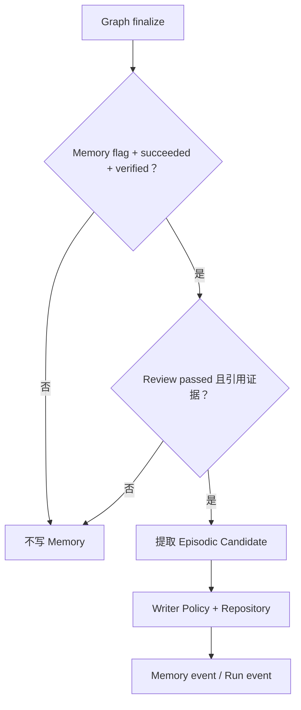

**小结与衔接：** 一次经历形成 Episode；下一块学习为什么两次独立经历才可能归纳出处理程序，并解释为什么“支持材料可在隔离中使用”不等于“隔离内容可给模型阅读”。

---

## B11 · 两张工单怎样形成 Procedural Memory？（MUST KNOW + SOURCE DEEP）

### 总：程序记忆不是“把两句相似的回答合并”

“某次故障曾成功处理”不等于“对所有类似故障都适用”。想归纳 SOP，需要回答：是否是**同一类条件**、是否来自**两次独立已核实的 Run/工单**、支持经历是否仍有效、生成的建议是否经过人工复核。

ServiceMind 对这个归纳采取非常保守的路线：只有 `SERVICEMIND_MEMORY_PROCEDURAL_PROPOSALS_ENABLED=True`，后运行自动 Episodic 写入后，才考虑自动**提出** Procedural Candidate；并不自动激活。

### 正常流程与最小例子

```text
Ticket #5：classification=vpn_mfa_timeout，recommended_group=service_desk，
           problem_recommendation="MFA expiry: inspect token clock and enrollment"
Ticket #8：classification=vpn_mfa_timeout，recommended_group=service_desk，
           problem_recommendation="Check MFA enrollment before gateway changes"
       ↓
形成 procedure_pattern_key（同分类、同责任组、同推荐字段集合）
       ↓
在可见且未过期的 Episode 中找到 Ticket #5 和 #8（不同 ticket ID、不同 run_id）
       ↓
提出一条 PROCEDURAL，scope=tenant，支撑 Episode IDs=[E5,E8]
       ↓
确定性政策打 PROCEDURAL_REQUIRES_HUMAN_REVIEW → QUARANTINE
       ↓
Approver 检查正文、支持经历和安全证据，再决定是否 ACTIVE
```

注意：两次 recommendation **措辞可以不同**。真实 `_procedure_pattern()` 把 `classification + recommended_group + 填写了哪些 recommendation 字段` 规范化后生成 pattern key；不会把自由格式的具体建议正文放进**模式身份哈希**。它仍把建议文字留在**程序正文**里，以便人类审查。这个区别非常重要：同一种处理条件 vs 某次具体观察结果不是一回事。

### 关键设计：三道“两个”的检查

1. **两个支持 Episode ID**：`MemoryCandidate` 类型验证至少要有两个不同 `supporting_episode_ids`。
2. **两个不同 source_run_id**：激活和服务时 `_procedural_support_failure` 重查，至少两个独立 Run；同一次运行产生两条片段不够。
3. **自动提案还要求两个不同 source_ticket_id**：`Phase5Governance.post_run` 收集候选时同时去重 Ticket ID 和 Run ID；由 `CROSS_TICKET_PROCEDURE_POLICY` 标记的程序，之后也通过 policy 所对应的检查重验至少两个 Ticket。

因此“同一个工单重复发送 Webhook 两次”不能轻易算作两次独立支持。

### 隔离 Episode 为什么能作为程序的支撑？

`MemoryRecord.visible_at()` 只允许 ACTIVE 给模型；但 `corroborable_at()` 专门用于**归纳候选的内部支持**，允许 `ACTIVE` 和 `QUARANTINE`，前提是有效期、污点、证据 verified 等不被破坏。原因是：新形成的历史经历很可能因 confidence=0.85 而停在隔离区；若提案系统只看 ACTIVE，两个刚产生的经历永远无法共同提出程序。

**隔离 Episode 被用作内部支持 ≠ 隔离 Episode 已被送给模型阅读。** 从它们归纳出的 PROCEDURAL 自己仍为 QUARANTINE，须审批时再次重验全部支持。

**`pattern_key` 是归类键，不是语义“必然相同”的证明。** 它没有把自由文本推荐的正反含义放入身份，因此 Ticket #5 与 #8 即使分别建议“建 Problem”和“不建 Problem”，在分类、推荐组和字段集合相同时仍能形成一个待审 Procedure。这是有意让人工复核来判定正文适用性，而不是系统已经达成了双工单的操作共识。

### 必要失败边界

- 分类相同但责任组不同：不应生成相同 pattern key。
- 同一 Ticket 重复跑了两个 Run：不能当成跨工单双独立支持。
- 支撑 Episode 被撤销/过期、带污点、缺 verified Evidence：程序激活必须拒绝或已激活程序在后续查询中被撤销。
- 某次模型改变“是否需要创建 Problem”的文字，pattern 仍可能相同，**这并不能证明建议内容已经达成共识**，必须交给人工复核程序正文。

### 源码学习

入口 `_procedure_pattern()` [`orchestration/phase5_governance.py L167–245`](https://github.com/shark6438/servicemind/blob/19d9a377fb98e1c3f56edc59be40b374013bc08b/src/servicemind/orchestration/phase5_governance.py#L167-L245)；两次独立来源、ACL 合并与候选构造 [`orchestration/phase5_governance.py L845–943`](https://github.com/shark6438/servicemind/blob/19d9a377fb98e1c3f56edc59be40b374013bc08b/src/servicemind/orchestration/phase5_governance.py#L845-L943)；`MemoryPatternQuery` 的合法可支撑定义 [`memory/contracts.py L407–450`](https://github.com/shark6438/servicemind/blob/19d9a377fb98e1c3f56edc59be40b374013bc08b/src/servicemind/memory/contracts.py#L407-L450)；服务/激活时统一 `_procedural_support_failure` [`memory/repository.py L155–234`](https://github.com/shark6438/servicemind/blob/19d9a377fb98e1c3f56edc59be40b374013bc08b/src/servicemind/memory/repository.py#L155-L234)；PostgreSQL 预过滤必须同时允许 `active/quarantine` [`memory/repository.py L871–895`](https://github.com/shark6438/servicemind/blob/19d9a377fb98e1c3f56edc59be40b374013bc08b/src/servicemind/memory/repository.py#L871-L895)。这里只学习这条跨工单 Proposer，**不能将任何“反复出现两次”泛化为已认可操作流程**。

### 一图复盘 · B11 的最小因果链

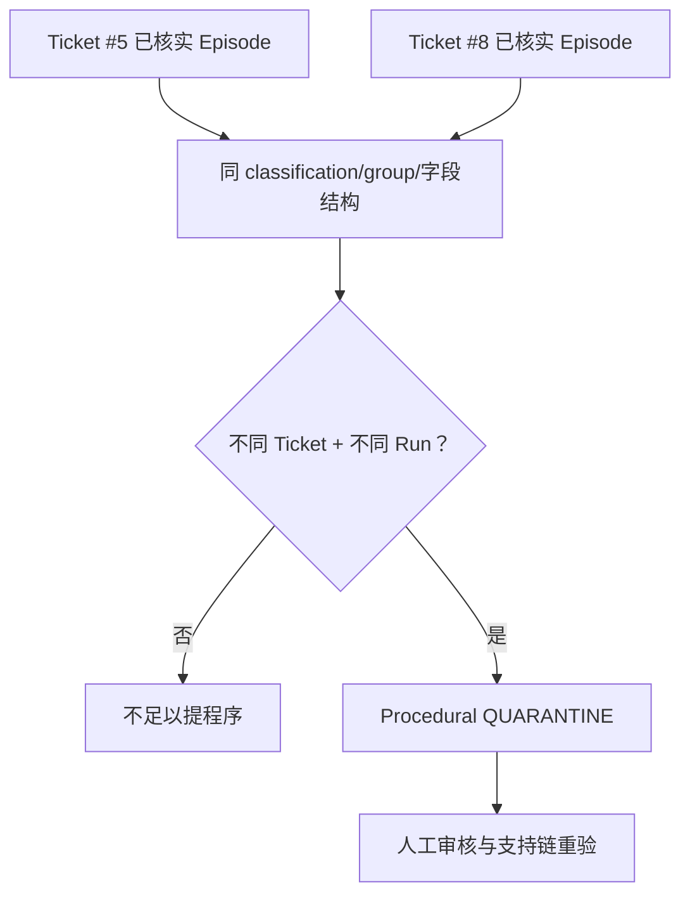

**小结与衔接：** 写入侧已经完整：一次经历 → 合格候选 → 隔离/激活；多次独立经历 → 程序提案 → 人工审查。现在换到下一个工单，从读侧讲“记忆怎么被找出来”。

---

## B12 · MemoryQuery：记忆读取为什么首先不是相似度问题？（MUST KNOW）

### 总：读记忆至少有三类条件

用户问“上次 VPN MFA 怎么处理”，系统当然要找**相关**内容，但这之前必须判定**当前有权读取什么**和**哪些记录仍然有效**。真正的请求对象 `MemoryQuery` 不只有 `text`，还携带租户、用户、实体、群组、服务、要检索的记忆类型、查询时间和结果数量限制。

### 正常流程与最小例子

输入可以是下列完整 `MemoryQuery`：

```json
{
  "tenant_id": "11111111-1111-4111-8111-111111111111",
  "text": "VPN MFA Token expired",
  "user_id": "analyst-7",
  "entity_ids": [
    1
  ],
  "group_ids": [
    7
  ],
  "service_ids": [],
  "memory_types": [
    "semantic",
    "episodic",
    "procedural"
  ],
  "at": "2026-10-13T10:00:00Z",
  "limit": 8
}
```

我们仍用 Group 7 / Group 9 对照：即使问句一样，两个人的 `group_ids` 不同，合法候选列表就可能不同。再观察 B07 的记录：处于 `QUARANTINE` 的 Ticket #5 不会因为相关性非常高而通过 `MemoryQuery.allows_record`。只有审批激活且时间、ACL、taint 等继续满足，才可能进入下一步评分。

### 关键设计：按真实调用顺序拆成几层

```text
MemoryRetriever.retrieve(query)
  → Repository.candidates(query, ceiling)
       → PostgreSQL tenant_session + _read_filters（优先收窄）
       → 转成 MemoryRecord 并再次 query.allows_record
  → 再次 Python allows_record + read-side 注入绊线
  → 词法/语义相似度评分与下限判断
  → 排序
  → Repository.revalidate(query, ranked_ids)（检查检索期间的变化）
  → lineage 去重并最多 query.limit 条返回
```

`allows_record` 包含 `status=ACTIVE`、`valid_from/valid_to/expires_at`、`tenant_id`、`memory_type`、`scope`、没有 taint、required_entity_ids/required_group_ids 完全包含、旧 Post-Run Policy 标记检查；**没有一步是靠 Prompt 要求模型“自行忽略无权内容”**。

### 一条与 M7 的信任边界

Webhook 机器入口不带人类真实登录人的 OIDC 权限；它后续传入的 `user_id/group_ids/entity_ids` 与人工分析员不同。因此不能说“Webhook 自动分析读取的历史记忆和开单者在 UI 手动查询的一模一样”。二者的上下文身份来源与范围不同，具体权限仍须按各自 State 的实际字段核对。

**服务范围的实际结果：**本块完整 `MemoryQuery` 把 `service_ids=[]` 展开用于教学。即使一个程序调用手工传 `service_ids={"vpn"}` 能命中 service-scoped 记忆，也不要代入当前 `Phase5Governance.build_context` 入口；它没有从 Graph State 传入服务 ID，默认空集合对 `MemoryScopeType.SERVICE` 返回 false。人工复核入口也是相同缺口。**不把契约可表达性误当成已接线的业务可达性**。

### 必要失败边界

- `MemoryQuery` 的 `limit` 默认 8，最大 50；这与候选 `ceiling`=100/500 不同。
- `MemoryReviewQuery` 与 `MemoryPatternQuery` **不是普通模型读取的查询契约**：前者读隔离队列，后者读支持程序的 Episode；不能因为它们允许 QUARANTINE 就说普通 Analysis 也能看。
- SQL 中 ACL 预过滤不意味着每个 JSON 字段的异常形状都必被 DB 完整拒绝，因此领域级 `allows_record` 仍是权威复核边界。

### 源码学习

`MemoryQuery` 全部字段与 `allows_record/allows_scope`：[`memory/contracts.py L299–347`](https://github.com/shark6438/servicemind/blob/19d9a377fb98e1c3f56edc59be40b374013bc08b/src/servicemind/memory/contracts.py#L299-L347)；查询协议和候选 Repository 方法 [`memory/repository.py L35–52`](https://github.com/shark6438/servicemind/blob/19d9a377fb98e1c3f56edc59be40b374013bc08b/src/servicemind/memory/repository.py#L35-L52)；PostgreSQL 过滤 [`memory/repository.py L770–832`](https://github.com/shark6438/servicemind/blob/19d9a377fb98e1c3f56edc59be40b374013bc08b/src/servicemind/memory/repository.py#L770-L832)、[`memory/repository.py L1149–1189`](https://github.com/shark6438/servicemind/blob/19d9a377fb98e1c3f56edc59be40b374013bc08b/src/servicemind/memory/repository.py#L1149-L1189)。下一块专看评分，避免“相关性”再次成为一句空话。

### 一图复盘 · B12 的最小因果链

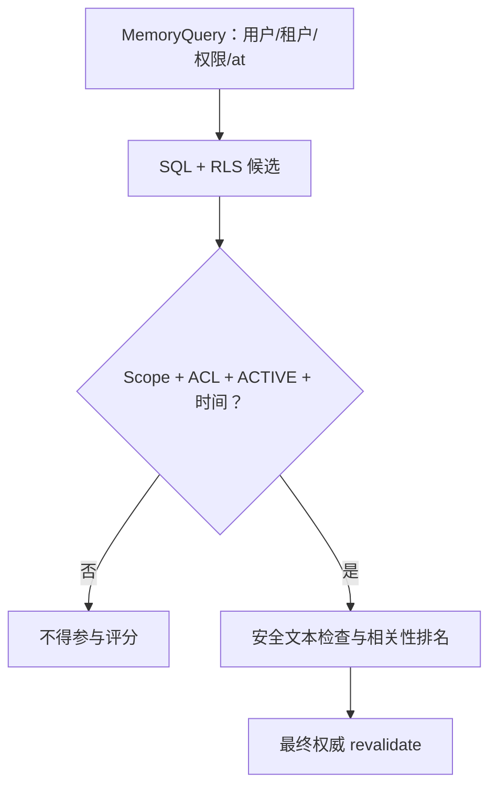

**小结与衔接：** 用户问题只是找记忆的一个输入；可见性属于更早的安全门。下面在**已经通过权限过滤的候选**里，才轮到相关性排名。

---

## B13 · 记忆检索算法：Jaccard、Embedding、余弦、阈值和排序到底做了什么？（MUST KNOW）

### 总：排名既要相关，也要能解释为什么排前面

两种常见检索思路：**Lexical** 看文字词元是否重合；**Embedding** 把句子编码成向量，用余弦相似度衡量语义接近程度。二者不是同一种分数，阈值也不应该混用。ServiceMind 允许没有 Embedding 时使用词法回退，真正提供了 Embedding 时在 Python 中对**候选记忆的文本现场编码后计算余弦**；它不是已经为 memory_records 配置了 pgvector ANN/HNSW 索引。

### 正常流程与手算例子：词法 Jaccard

查询 `"VPN MFA timeout"`，词元集合 `{vpn,mfa,timeout}`；候选记忆文本 `"VPN MFA token expired"`，词元集合 `{vpn,mfa,token,expired}`。交集 2 个，并集 5 个，所以：

\[
J(A,B)=\frac{|A\cap B|}{|A\cup B|}=\frac{2}{5}=0.4
\]

若 `min_lexical_similarity=0.05`，则 0.4 通过词法下限。**注意**这里用的是手算简化英语词元；真实 `TOKEN` 对英文、下划线、连字符及中文单字切分有具体规则，中文语义表现不能从这个英文例子推断。

Embedding 模式把 Query 和候选分别编码成数值向量，例如 `q=[1,0]`，`d=[0.8,0.6]`，余弦为 0.8（两者范数均为 1）；使用默认 `min_semantic_similarity=0.35` 时，它也通过相关性下限。**这里的向量是数学教学样本，不是 BGE-M3 的实际输出**。

### 关键设计：相似度必须先过门槛，metadata 只能帮忙破同分

`memory_relevance_score()` 的真实权重：

\[
Score=0.85\cdot Similarity + 0.15\cdot MetadataQuality
\]

\[
MetadataQuality=0.4\cdot Recency+0.3\cdot Confidence+0.2\cdot Importance+0.1\cdot Provenance
\]

其中 `Recency = exp(-age_days/180)`，`Provenance=1` 表示带 Evidence 引用或 Consent，否则为 0。假设通过下限的候选 `Similarity=0.6`、`Recency=0.8`、`Confidence=0.85`、`Importance=0.6`、`Provenance=1`，那么 metadata = `0.32+0.255+0.12+0.1=0.795`，最终 `0.85*0.6+0.15*0.795=0.62925`。它不是 62.925% 的“正确概率”，而是本检索器用来相对排序的综合分数。

**为何要分开两个 floor？** `min_lexical_similarity` 默认 0.05，`min_semantic_similarity` 默认 0.35；一个 Jaccard 0.1 和一个 Cosine 0.1 不能直接当相同质量。源码先依据当前模式的相似度下限拒绝，再加 metadata；因此新近/重要度高却**完全不相关**的记忆不应只靠 metadata 强行挤上来。

### 一个实际发生过的错误：词法下限曾接近零

`min_lexical_similarity` 为什么必须独立存在？源码注释给出过失败史：早期词法 fallback 把阈值直接内联写为 **`0.000001`**，几乎等于**没有有意义的相关性下限**。假设查询词元集合 `{vpn,mfa,timeout}`，某记忆有 300 个不同词元、只共享 `vpn` 这 1 个，其 Jaccard 大约是 `1/302≈0.00331`：虽然基本不能用于解决 MFA 超时，却会通过旧阈值；如今 `0.00331 < 0.05`，会在 metadata 加分之前被拒绝。

这不是“把 Cosine 阈值 0.35 直接用于 Jaccard”，而是**两种评分量尺分别定自己的 floor**：在本实现中 `min_lexical_similarity=0.05`、`min_semantic_similarity=0.35`。来源：[service.py L165–190](https://github.com/shark6438/servicemind/blob/19d9a377fb98e1c3f56edc59be40b374013bc08b/src/servicemind/memory/service.py#L165-L190)。这里的 300 词例子是教学手算，`0.000001` 则来自冻结源码的**历史修复注释**。

### 候选窗口的隐藏限制：100 与 500 怎么理解

默认 `SERVICEMIND_MEMORY_CANDIDATE_CEILING=100` 只是**词法模式**的候选 ceiling；只要提供 Embedding，冻结 `MemoryRetriever.retrieve` 就使用 `MAX_CANDIDATE_CEILING=500`。原因：Repository 的候选次序主要按词面相关性，假如先取词法 Top 100，再算语义相似度，就可能提前丢掉“完全不共享词、却语义非常接近”的答案。提高到 500 只是减轻问题，**并非无限语义召回**；若真实可见记忆超过 500，词面候选窗口外的最佳语义记忆仍可能永远进不了余弦评分。

**源码注释记录的量化反例（不是本轮新跑的实验）：** 在某次真实语料查询上，**261** 条记忆的 Cosine 高于语义下限，但旧的词法候选排序把其中 **161** 条挡在语义 Ranker 之外；对同一查询的译文，**254** 条中有 **158** 条被挡住；其中最佳语义匹配的 Cosine 达到 **0.754**，却从未进入 Ranker。由此应得出一个明确因果结论：**先用词面排序截断候选，再进行向量评分，会永久失去截断之外的语义相关项**，后续提高权重和重排都无法找回。当前 Vector 路径提高到 500 并在窗口满时 warning，但仍不能把它教成覆盖全库的语义 ANN。来源：[service.py L190–217](https://github.com/shark6438/servicemind/blob/19d9a377fb98e1c3f56edc59be40b374013bc08b/src/servicemind/memory/service.py#L190-L217)。


最后按 `-score, content_hash, idempotency_key` 稳定排序；**不是 memory_id 的随机 UUID 来破同分**。

**词法评分和数据库候选排序不是同一个实现。** `MemoryRetriever` 的 Python 词法最终分数是 `TOKEN` 集合的 Jaccard；PostgreSQL `_lexical_relevance()` 为候选截断使用 `to_tsvector('simple')` / OR 化 `tsquery` / `ts_rank_cd`。因此“SQL 的前 100 条”与“Python Jaccard Top100”没有等价保证，中文分词、标点与长度都可能使两者排序不同；Embedding 模式虽扩到 500，仍不能把数据库候选窗口当成语义 ANN。来源 [`repository.py L276–304`](https://github.com/shark6438/servicemind/blob/19d9a377fb98e1c3f56edc59be40b374013bc08b/src/servicemind/memory/repository.py#L276-L304)。

### 必要失败边界

- Embedding Provider 返回向量数量不匹配、NaN/Inf、长度不一致，会被拒绝，不应静默贴错分数。
- 缓存是**单进程内有界的派生向量缓存**，不是 PostgreSQL 已存的永久向量索引；模型版本变化、进程重启、不同 Worker 缓存不能被描述为全局共享。
- 500 窗口满时会记录警告，不等于之后会自动翻页扫完全部记忆。
- 模型并非每次都用向量：冻结默认 `SERVICEMIND_MEMORY_VECTOR_ENABLED=False`，即使 Memory 开启也可能走词法模式。

### 源码学习

词元/余弦/元数据权重 [`memory/service.py L25–158`](https://github.com/shark6438/servicemind/blob/19d9a377fb98e1c3f56edc59be40b374013bc08b/src/servicemind/memory/service.py#L25-L158)；`retrieve()` 的整个流程 [`memory/service.py L160–303`](https://github.com/shark6438/servicemind/blob/19d9a377fb98e1c3f56edc59be40b374013bc08b/src/servicemind/memory/service.py#L160-L303)；缓存与依赖 Provider [`memory/service.py L32–87`](https://github.com/shark6438/servicemind/blob/19d9a377fb98e1c3f56edc59be40b374013bc08b/src/servicemind/memory/service.py#L32-L87)；TEI Provider 的实际选择条件 [`orchestration/phase5_governance.py L275–299`](https://github.com/shark6438/servicemind/blob/19d9a377fb98e1c3f56edc59be40b374013bc08b/src/servicemind/orchestration/phase5_governance.py#L275-L299)；Postgres 候选初排 OR 化字词而非简单 AND [`memory/repository.py L276–304`](https://github.com/shark6438/servicemind/blob/19d9a377fb98e1c3f56edc59be40b374013bc08b/src/servicemind/memory/repository.py#L276-L304)。这里 `semantic` 是检索模式词，不要误认只检索 `MemoryType.SEMANTIC`：三种 MemoryType 都可成为检索候选。

### 一图复盘 · B13 的最小因果链

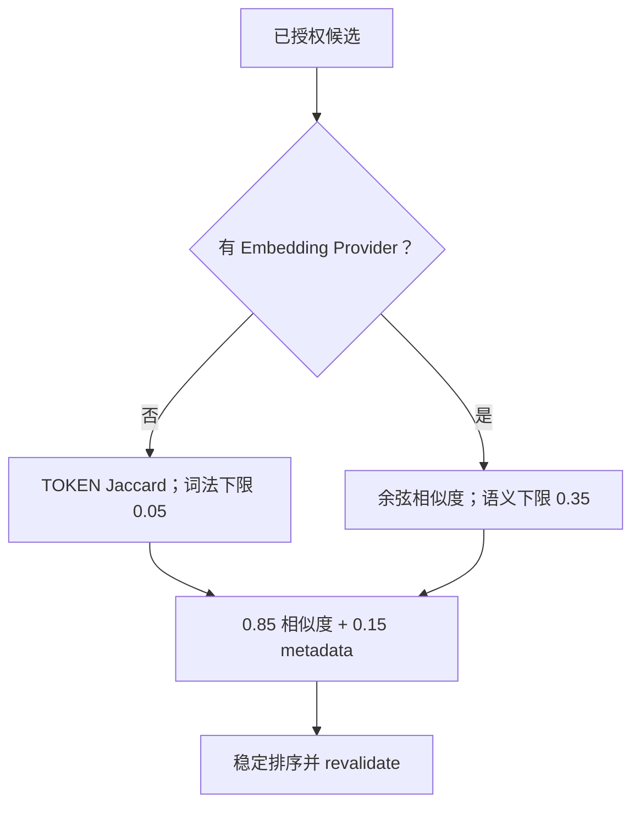

**小结与衔接：** 排序完成仍不代表可以直接返回。为什么？Embedding 是一次 await，期间有人可能撤销或审批记忆。下一块就是“最终再检查一次”的并发时序。

---

## B14 · Read-after-recheck：为什么排完名还要做权威重校验？（MUST KNOW + SOURCE DEEP）

### 总：权限随时间变，异步计算不能拿旧资格当最终资格

假设 10:00 查询者有 Group 7 权限，Memory Retriever 取回 Ticket #5 的 ACTIVE 记录；10:00:01 进入 Embedding 网络调用，10:00:02 管理员撤销原 Evidence，10:00:03 Embedding 才返回相似度分数。如果不再检查，下一次模型提示可能仍收到已经撤销的记录。**这不是相似度算法能解决的问题**。

### 正常流程与最小例子

```text
10:00:00 Repository.candidates → 返回 ACTIVE M5
10:00:01 embed_query/embed_documents → 异步 I/O
10:00:02 revoke_by_evidence(ev-...) → M5 改为 REVOKED，写入审计事件
10:00:03 对旧 M5 计算得分 0.82（只是旧候选的排名）
10:00:04 repository.revalidate(query, [M5,...]) → M5 不在当前可见 ID 集
10:00:05 返回给 Agent 的 selected 列表不含 M5
```

它是**源码允许的并发教学时间线**，不代表本轮在生产环境抓到了该序列。就算曾经检索到，仍可能在复核时因为状态/时间/ACL/污点被拒绝。

### 关键设计：三种“再检查”不要混淆

1. **候选前 SQL ACL 过滤**：缩小可见集合，减少越权数据被提前取进进程。
2. **候选后领域资格/注入检查**：`MemoryQuery.allows_record`、`contains_injection_marker`、相似度 floor。
3. **排完名后 Authority `revalidate`**：在当下时钟用 `max(query.at, now)` 重查，避免时间倒退让已到期内容复活；Repository 还检查已激活的 Procedure 是否失去支撑并自动撤销。

最终还做 **lineage 去重**：同一主题有多个历史版本时，不能让所有版本抢满 Top-K。`query.limit` 是最终结果数，而非初筛扫描的最大条数。

**“按某个过去时刻查询”并不等于完整历史时间旅行。** `MemoryQuery.at` 可表示所问时间，但最终 `revalidate` 使用 `max(query.at, datetime.now(UTC))`；已撤销或当前过期的记录不会因查询早期日期被复活。所以这条链的目标是“现在仍可以合法使用的、满足时间要求的记忆”，不能把它说成可重建某一历史时刻的全部旧可见内容。

### 必要失败边界

读后复核大幅缩小窗口，但**数据库复核成功和模型真正使用之间仍非一个跨网络原子事务**；不能从它推出“任何微秒瞬间均不可能读到变化后的旧内容”。严格实现还需配合 Context 选择和推理前后权限变化处理。本课只承诺冻结源码实际存在的再验证步骤，不夸大为严格的分布式线性一致性保证。

### 源码学习

检索排序与重校验 [`memory/service.py L190–303`](https://github.com/shark6438/servicemind/blob/19d9a377fb98e1c3f56edc59be40b374013bc08b/src/servicemind/memory/service.py#L190-L303)；InMemory 权威读后重验 [`memory/repository.py L532–558`](https://github.com/shark6438/servicemind/blob/19d9a377fb98e1c3f56edc59be40b374013bc08b/src/servicemind/memory/repository.py#L532-L558)；Postgres 权威读后重验 [`memory/repository.py L1149–1189`](https://github.com/shark6438/servicemind/blob/19d9a377fb98e1c3f56edc59be40b374013bc08b/src/servicemind/memory/repository.py#L1149-L1189)；程序支撑失效检查 [`memory/repository.py L1075–1148`](https://github.com/shark6438/servicemind/blob/19d9a377fb98e1c3f56edc59be40b374013bc08b/src/servicemind/memory/repository.py#L1075-L1148)。最值得理解的是：**每条机制回答一个不同的时间或权限问题，不能只找有没有 `filter` 这个词**。

### 一图复盘 · B14 的最小因果链

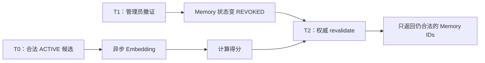

**小结与衔接：** 至此从候选到真正可见的 MemorySelection 已经得出。但你在 M8 学过，检索到不等于模型最终看到了；下面进入 ContextEnvelope 和最后一公里。

---

## B15 · MemorySelection → ContextItem → 模型输入：最终长什么样？（MUST KNOW）

### 总：三个输出对象分别为谁服务

- `MemorySelection` 是检索器的返回值，包含完整 `MemoryRecord`、`score` 与 `score_breakdown`，用于权威选择和解释排名。
- `context.contracts.ContextItem` 是 Context Builder 的一份候选材料，另带来源、可信度、authority、relevance、允许 Agent、taint 等，用于**治理预算和接收者**。
- `ContextEnvelope.model_payload()` 是筛选后给模型使用的结构化上下文，**不必携带 Repository 全部主键/审计元信息**。

不要把 `MemorySelection` 的 score 当成“模型已经读到它”的证据；也不要把 `MemoryRecord` 的 `status=ACTIVE` 当成“本次 Run 已使用这条记录”的证据。

### 正常流程与最小例子

**第一步：MemoryQuery → MemorySelection。** 如果 Ticket #5 已由 approver 激活且 ACL/时效满足，Retriever 可能得到：

```json
{
  "memory": {
    "tenant_id": "11111111-1111-4111-8111-111111111111",
    "scope": {
      "scope_type": "tenant",
      "scope_id": null
    },
    "memory_type": "episodic",
    "semantic_subtype": null,
    "subject_key": "ticket:5:verified_outcome",
    "content": "{\"classification\": \"vpn_mfa_timeout\", \"execution\": null, \"outcome\": \"MFA Token expired; reset and re-enroll\", \"priority\": \"high\", \"recommended_group\": \"service_desk\", \"ticket_id\": 5}",
    "source_run_id": "aaaaaaaa-aaaa-4aaa-8aaa-aaaaaaaaaaaa",
    "source_trace_id": "thread-t5",
    "evidence_refs": [
      {
        "evidence_id": "ev-1111111111111111",
        "source_ref": "glpi://tickets/5",
        "content_hash": "aaaaaaaaaaaaaaaaaaaaaaaaaaaaaaaaaaaaaaaaaaaaaaaaaaaaaaaaaaaaaaaa",
        "verified": true
      }
    ],
    "supporting_episode_ids": [],
    "consent_ref": null,
    "confidence": 0.85,
    "importance": 0.6,
    "valid_from": "2026-10-12T10:00:00Z",
    "valid_to": null,
    "expires_at": "2027-01-10T10:00:00Z",
    "provenance": {
      "review_id": "review-t5",
      "review_policy": "phase5",
      "official_knowledge_authority": "rag",
      "post_run_scope": "tenant_episode_v2",
      "source_ticket_id": 5,
      "required_entity_ids": [
        1
      ],
      "required_group_ids": [
        7
      ],
      "human_review_ref": "CAB-2026-1012"
    },
    "taint_labels": [],
    "created_by": "post-run-memory-middleware",
    "content_hash": "f02f7f7fd95d2e203b5109333d21a7e70c458be7e28a4cf0ea926727b4469954",
    "idempotency_key": "64184b5f9ae3ca4605c1f4a3af9056c2e65b1b30e31e7d61bbfd0e18950a468f",
    "memory_id": "bbbbbbbb-bbbb-4bbb-8bbb-bbbbbbbbbbbb",
    "lineage_id": "cccccccc-cccc-4ccc-8ccc-cccccccccccc",
    "version": 1,
    "status": "active",
    "activation_reason": "HUMAN_REVIEW_ACTIVATE",
    "created_at": "2026-10-12T10:00:00Z",
    "updated_at": "2026-10-12T11:00:00Z"
  },
  "score": 0.27259807108802164,
  "score_breakdown": {
    "semantic": 0.16666666666666666,
    "recency": 0.99469007368925,
    "confidence": 0.85,
    "importance": 0.6,
    "provenance": 1.0,
    "metadata": 0.8728760294757,
    "metadata_weight": 0.15
  }
}
```

这个大对象是**字段完整的合成教学样本**，`score`/`score_breakdown` 全部为数字：本地用冻结 `TOKEN` 正则、Jaccard、`exp(-age/180)` 和 `0.85×similarity+0.15×metadata` 逐项算出，**未调用外部 Embedding、数据库或真实模型**。它展示的是 Ticket #5 在**经过模拟人工激活后**，被一次满足 ACL/时间窗的词法检索选中的结果，不是某个已运行 Run 的实测记录。

**第二步：变成 ContextItem。** 同一个被选择的 MemoryRecord 会构造如下**重点字段投影**：

```json
{
  "item_id": "memory:bbbbbbbb-bbbb-4bbb-8bbb-bbbbbbbbbbbb",
  "source": "memory",
  "content": "{\"memory_type\": \"episodic\", \"semantic_subtype\": null, \"subject_key\": \"ticket:5:verified_outcome\", \"content\": \"{\\\"classification\\\": \\\"vpn_mfa_timeout\\\", \\\"execution\\\": null, \\\"outcome\\\": \\\"MFA Token expired; reset and re-enroll\\\", \\\"priority\\\": \\\"high\\\", \\\"recommended_group\\\": \\\"service_desk\\\", \\\"ticket_id\\\": 5}\", \"confidence\": 0.85, \"importance\": 0.6, \"valid_from\": \"2026-10-12T10:00:00Z\", \"valid_to\": null, \"expires_at\": \"2027-01-10T10:00:00Z\", \"provenance\": {\"review_id\": \"review-t5\", \"review_policy\": \"phase5\", \"official_knowledge_authority\": \"rag\", \"post_run_scope\": \"tenant_episode_v2\", \"source_ticket_id\": 5, \"required_entity_ids\": [1], \"required_group_ids\": [7], \"human_review_ref\": \"CAB-2026-1012\"}, \"consent_ref\": null, \"created_by\": \"post-run-memory-middleware\", \"activation_reason\": \"HUMAN_REVIEW_ACTIVATE\"}",
  "allowed_agents": [
    "analysis"
  ],
  "trust": "verified",
  "authority": 0.7,
  "relevance": 0.27259807108802164,
  "required": false,
  "provenance_ref": "memory://bbbbbbbb-bbbb-4bbb-8bbb-bbbbbbbbbbbb",
  "taint_labels": [],
  "occurred_at": "2026-10-12T11:00:00Z",
  "external_ref": null,
  "content_hash": "7649b28f6af07e179780720546d187ad9d6cdc905943a7b61a7ee00859f65828"
}
```

**这是完整的 `ContextItem.model_dump(mode="json")` 形状的合成实例**：`relevance` 是真实数值而不是描述文字；`content` 是 `_model_visible_memory()` 输出的**一整段 JSON 字符串**；`content_hash` 是对这段 *ContextItem.content* 原始 UTF-8 字节算 SHA-256，**不是** B05 规范化记忆正文算出的 `MemoryRecord.content_hash`。 `allowed_agents=["analysis"]`、`occurred_at` 与 `external_ref=null` 均按冻结代码实际构造方式填充；含全部 13 项声明/计算字段。我们没有声称真正调用过模型或数据库。`authority=0.7` 来自 `AuthorityLevel.TENANT_RESOLVED_CASE/100`，**不是 Memory 的置信度**；`trust=verified` 是当前代码给受治理记忆通道的标签，也不允许 LLM 把记忆正文当系统指令。

**第三步：模拟人工激活后，`MemoryRecord.model_payload()` 究竟保留什么？** 原始 MemoryRecord 可能有几十个内部字段，但交给模型的一整段记忆正文会是下面的完整 JSON 结构（示例值以 B07 为基础，补上模拟的审批激活状态与 review_ref）：

```json
{
  "memory_type": "episodic",
  "semantic_subtype": null,
  "subject_key": "ticket:5:verified_outcome",
  "content": "{\"classification\": \"vpn_mfa_timeout\", \"execution\": null, \"outcome\": \"MFA Token expired; reset and re-enroll\", \"priority\": \"high\", \"recommended_group\": \"service_desk\", \"ticket_id\": 5}",
  "confidence": 0.85,
  "importance": 0.6,
  "valid_from": "2026-10-12T10:00:00Z",
  "valid_to": null,
  "expires_at": "2027-01-10T10:00:00Z",
  "provenance": {
    "review_id": "review-t5",
    "review_policy": "phase5",
    "official_knowledge_authority": "rag",
    "post_run_scope": "tenant_episode_v2",
    "source_ticket_id": 5,
    "required_entity_ids": [
      1
    ],
    "required_group_ids": [
      7
    ],
    "human_review_ref": "CAB-2026-1012"
  },
  "consent_ref": null,
  "created_by": "post-run-memory-middleware",
  "activation_reason": "HUMAN_REVIEW_ACTIVATE"
}
```

你应看到：内容 `content`、记忆类型、`created_by`、`provenance`、有效期、`activation_reason` 等可以帮助模型识别来源；而 `tenant_id/lineage_id/memory_id/idempotency_key/record version/taint_labels` 等留给系统治理，不让模型仅凭正文讨论或重设授权范围。

**第四步：从 ContextItem 到模型可见 `model_payload()`。** `ContextEnvelope` 自己存着完整版 ContextItem、预算和 Selection Manifest；它的 `model_payload()` 只把**已经入选**的材料变成六字段消息（`item_id/source/content/trust/taint_labels/provenance_ref`）。因此完整 ContextItem 的 `score`、`authority`、`allowed_agents` 和 `occurred_at` 用于程序内治理，**不会作为同名字段自动带进模型输入列表**。下面是该记忆被成功选中时的**单条消息**（完整 Envelope 还可能包含 task、policy、本次 Evidence 等其它条目）：

```json
{
  "item_id": "memory:bbbbbbbb-bbbb-4bbb-8bbb-bbbbbbbbbbbb",
  "source": "memory",
  "content": "{\"memory_type\": \"episodic\", \"semantic_subtype\": null, \"subject_key\": \"ticket:5:verified_outcome\", \"content\": \"{\\\"classification\\\": \\\"vpn_mfa_timeout\\\", \\\"execution\\\": null, \\\"outcome\\\": \\\"MFA Token expired; reset and re-enroll\\\", \\\"priority\\\": \\\"high\\\", \\\"recommended_group\\\": \\\"service_desk\\\", \\\"ticket_id\\\": 5}\", \"confidence\": 0.85, \"importance\": 0.6, \"valid_from\": \"2026-10-12T10:00:00Z\", \"valid_to\": null, \"expires_at\": \"2027-01-10T10:00:00Z\", \"provenance\": {\"review_id\": \"review-t5\", \"review_policy\": \"phase5\", \"official_knowledge_authority\": \"rag\", \"post_run_scope\": \"tenant_episode_v2\", \"source_ticket_id\": 5, \"required_entity_ids\": [1], \"required_group_ids\": [7], \"human_review_ref\": \"CAB-2026-1012\"}, \"consent_ref\": null, \"created_by\": \"post-run-memory-middleware\", \"activation_reason\": \"HUMAN_REVIEW_ACTIVATE\"}",
  "trust": "verified",
  "taint_labels": [],
  "provenance_ref": "memory://bbbbbbbb-bbbb-4bbb-8bbb-bbbbbbbbbbbb"
}
```

请思考：如果 Selection Manifest 对它记录 `pruned / token_budget_exceeded`，即使前面的 ContextItem 存在，`model_payload()` 也**不会**列出这条。源码 [`context/contracts.py L125–166`](https://github.com/shark6438/servicemind/blob/19d9a377fb98e1c3f56edc59be40b374013bc08b/src/servicemind/context/contracts.py#L125-L166)。

### 关键设计：两个 Feature Flag、角色权限与 Context Token Budget

冻结默认 `SERVICEMIND_MEMORY_ENABLED=False`，`SERVICEMIND_CONTEXT_ENABLED=False`。记忆进入模型的这条特定路径依赖**构建 Context 时启用记忆和 Context 治理**，且 `Phase5Governance.build_context()` 只在 `agent=ContextAgent.ANALYSIS` 分支查询长期记忆。Reviewer 的工作是核查分析引用的 Evidence，不是拿更多旧记忆来补一个看似漂亮的结论。

`ContextBuilder` 按来源/authority/required/relevance 等排序，可能因为 Token 预算把可选记忆 `pruned`。本项目专门增加 `SERVICEMIND_CONTEXT_EVIDENCE_TOKEN_CAP`，防止大体积 Evidence 挤掉 Memory；这个上限只适用于相应的 Analysis Context 政策，不应泛化为所有 Agent 的同一限制。 **冻结 `settings.py` 的 `SERVICEMIND_CONTEXT_EVIDENCE_TOKEN_CAP` 默认是 `None`（不设 cap）；历史 Phase5 评测记录的是另一个部署配置 `5000`，不能偷换成代码默认值。**

**为什么这个差别实际重要？** `settings.py` 紧挨该设置的开发期注释记载：某次知识饱和 Run，在**可用的 10,720 Token 中记忆通道仅余 238 Token**，小于一篇可用的真实 Runbook；因此即便 Procedure 已通过 Reviewer/人工治理，也可能因为 Evidence 抢占上下文而在最后投递阶段被静默裁剪。这是**源码注释记录的历史测量**，不是本轮当前部署的 p95/Token 实测；`None` 表示代码默认不对 Evidence 设置独立 cap，历史报告的 `5000` 则是另一组明确有上限的评测配置。别把“数据库可检索”误说成“模型见到了记忆”。来源：[settings.py L296–304](https://github.com/shark6438/servicemind/blob/19d9a377fb98e1c3f56edc59be40b374013bc08b/src/core/settings.py#L296-L304)。

**一处跨课程的 Context 修复，不要误归给 Memory**：`Phase5Governance` 对普通 Evidence 的 `authority` 曾给所有来源硬写 `0.95`，导致 Source 自己提供的 Authority Level 没有参与 Context 排序。当前采用 `evidence.authority_level/100`。这属于 **Context/Evidence 交付层**的历史修复，而非 MemoryRetriever 的相似度算法；当前 Memory 的 `authority=0.7` 也只是打包优先级，不代表可信概率。来源：[phase5_governance.py L553–571](https://github.com/shark6438/servicemind/blob/19d9a377fb98e1c3f56edc59be40b374013bc08b/src/servicemind/orchestration/phase5_governance.py#L553-L571)。

**标签的真实强度：** `trust=VERIFIED` 是 `Phase5Governance` 在读已治理 Memory 时设置的通道标签；其中经确定性 Policy 自动 ACTIVE 的 Episode **可能没有 `human_review_ref`**。冻结 `MemoryRecord.model_payload` 的注释用过“was reviewed”之类泛化措辞，但应以实际 Policy、`transition()` 和调用路径为准：不能从这一个 TrustLabel 推断“每一条历史结论都经人工逐条审批”。过去 `outcome` 仍是过去模型整理的内容。

**这条 Episode 在新工单中究竟允许说什么？** 可以说“上一轮 Review 通过的分析摘要建议检查过期 Token 并重注册”；不应只凭这份 Memory 对用户说“Ticket #5 已经实际完成了 MFA 重注册、修复率 100%”。示例 `content` 里的 `outcome` 是旧模型的归纳文本，`execution=null` 没有外部执行成功记录。即使 ContextItem 标记 verified，模型也不能把它自动升格为实时系统事实。

### 必要失败边界

- MEMORY flag 开了但 CONTEXT flag 关着：不等于自动出现 ContextEnvelope。
- `MemoryRetriever` 返回 8 条，并不等于 Context Builder 选中了 8 条，更不等于 Analysis 实际引用了 8 条。
- `authority=0.7` 只是选材优先级，不是“70%可信”的概率。
- `trust=VERIFIED` 不是把过去模型生成的 outcome 改写成“客观事实”，而是表明它通过了当前路径的确定性门禁；模型仍需要本次 Evidence 支撑具体新判断。

### 源码学习

`MemoryRecord.model_payload()` 字段清单 [`memory/contracts.py L250–298`](https://github.com/shark6438/servicemind/blob/19d9a377fb98e1c3f56edc59be40b374013bc08b/src/servicemind/memory/contracts.py#L250-L298)；`_model_visible_memory()` 序列化 [`orchestration/phase5_governance.py L120–126`](https://github.com/shark6438/servicemind/blob/19d9a377fb98e1c3f56edc59be40b374013bc08b/src/servicemind/orchestration/phase5_governance.py#L120-L126)；Analysis 的真实 Memory ContextItem 接线 [`orchestration/phase5_governance.py L591–637`](https://github.com/shark6438/servicemind/blob/19d9a377fb98e1c3f56edc59be40b374013bc08b/src/servicemind/orchestration/phase5_governance.py#L591-L637)；Context Builder 排序/Token 控制 [`context/builder.py L135–319`](https://github.com/shark6438/servicemind/blob/19d9a377fb98e1c3f56edc59be40b374013bc08b/src/servicemind/context/builder.py#L135-L319)；`ContextEnvelope.model_payload()` [`context/contracts.py L125–166`](https://github.com/shark6438/servicemind/blob/19d9a377fb98e1c3f56edc59be40b374013bc08b/src/servicemind/context/contracts.py#L125-L166)。记忆经过的是 **Capability Plane → Agent Plane 输入边界**，不是新增一个 MemoryAgent 自动决策者。

### 一图复盘 · B15 的最小因果链

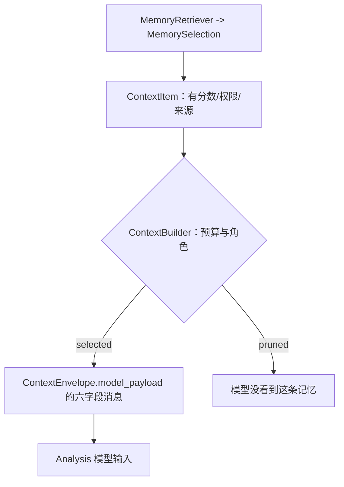

**小结与衔接：** 模型能够参考历史记忆，但它不能靠历史记忆绕过本次 Reviewer、Approval、Action Guard。下一块完整追踪从分析到模型交付的企业 Agent 因果链。

---

## B16 · 在完整 Multi-Agent 里，长期记忆究竟负责哪一段？（MUST KNOW）

### 总：长期记忆是能力，不是能自行审批的 Agent

复习四平面：Control Plane 决定调度，Agent Plane 执行专长任务，Capability Plane 提供 RAG/GraphRAG/Memory 等能力，Governance Plane 横向控制权限/审计/审批。M15 的 Memory 是 **Capability Plane 中的一项被调用能力**；它有写入策略和复核 API，但**没有**因为存储过过去的经验就获得 Planner/Reviewer/Approver 的职责。

### 正常流程与最小例子

我们把 Ticket #8 的新任务与上次 Ticket #5 的记忆连起来：

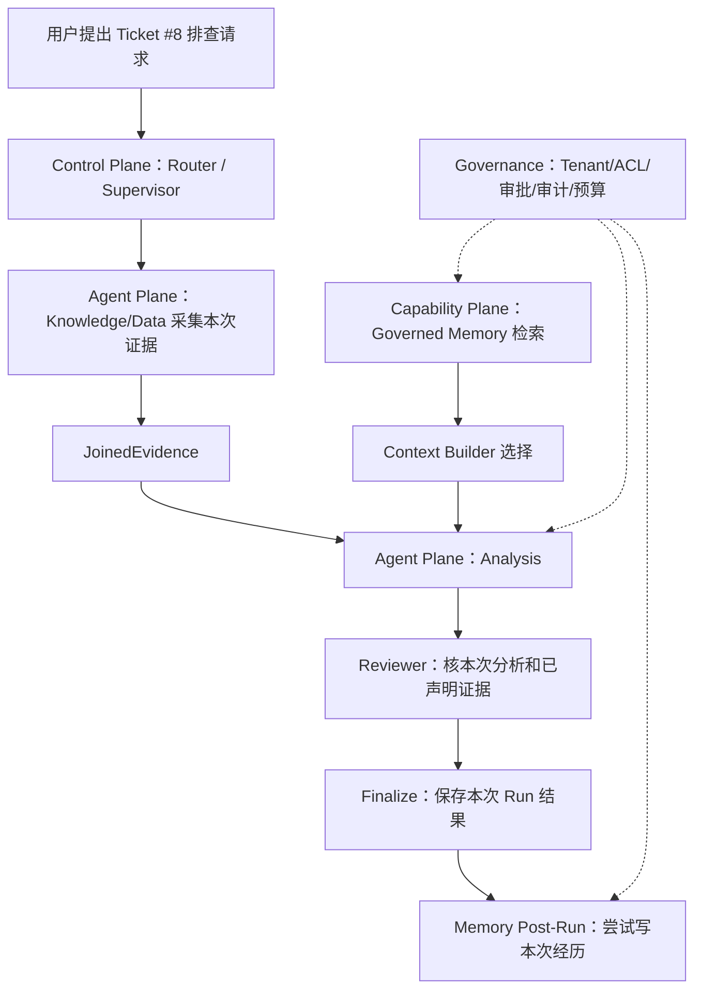

输入：Ticket #8 最新 Evidence + 从 Ticket #5 检索出的合法历史记忆。Analysis 可以把上次处理方法作为背景提示，但仍要确认本次症状和实际 Evidence；Reviewer 核本次声明的证据，而不是把过去的记忆直接视为新事实。Finalize 之后，才可能再提出一条 Episode，形成下一轮经验。

### 关键设计：为何 Reviewer 不吃同一份 Memory？

冻结 `Phase5Governance.build_context` 明确把 Memory 选择限制在 `ContextAgent.ANALYSIS`。Reviewer 验证的是 Analysis 具体 Claim 与其引用的 Evidence 是否匹配；如果 Reviewer 看到比 Analysis 多的背景记忆，再借那份额外背景替它补理由，审核链的因果解释会失真。

Memory 通道的 `trust=VERIFIED` 也并不让它覆盖高权限的 Policy/System 指令。过去模型生成的 `outcome` 被存进 Episode 时会保留 `created_by` 和 provenance，让读者知道“这是前一次已审核流程的总结”，而不是平台硬编码规则或 GLPI 最新状态。

**再分清声明能力与当前调用能力：** `MemoryQuery` 能表达 Service Scope，但这里真实的 `build_context` caller 没填 `service_ids`，故不能说五种 Scope 在 Analysis 自动召回里都覆盖。类似地，Memory 通道设 `TrustLabel.VERIFIED` 并不是“每条均人工审批”：部分 Episode 可以由确定性策略自动激活；Reviewer 也不将 Memory 当作本次 Claim 的直接引用证据。

### 必要失败边界

历史记忆不能直接授权 `ActionAgent` 写 GLPI；后续写操作仍需走 M5/M10 的 Handoff、Intent、人工审批与 Tool Policy。记忆中一句“上次批准过”不等于当前 Request 也已批准。Graph Checkpoint 不会自动替代 Memory 的版本/撤销验证，Memory 也不能保证恢复一个中断中的 Run。

### 源码学习

真实写链在 Supervisor `finalize`：[`orchestration/supervisor_workflow.py L1773–1837`](https://github.com/shark6438/servicemind/blob/19d9a377fb98e1c3f56edc59be40b374013bc08b/src/servicemind/orchestration/supervisor_workflow.py#L1773-L1837)；真实读链在 `Phase5Governance.build_context`：[`orchestration/phase5_governance.py L383–437`](https://github.com/shark6438/servicemind/blob/19d9a377fb98e1c3f56edc59be40b374013bc08b/src/servicemind/orchestration/phase5_governance.py#L383-L437)、[`orchestration/phase5_governance.py L591–637`](https://github.com/shark6438/servicemind/blob/19d9a377fb98e1c3f56edc59be40b374013bc08b/src/servicemind/orchestration/phase5_governance.py#L591-L637)。`ContextSource.MEMORY` 属于 Context contracts 的八种来源之一，[`context/contracts.py L29–47`](https://github.com/shark6438/servicemind/blob/19d9a377fb98e1c3f56edc59be40b374013bc08b/src/servicemind/context/contracts.py#L29-L47)。不要把 `src/agents/knowledge_base_agent.py` 的 scaffold 或 `src/memory/` 的 LangGraph Store 对象当成这条 Governed Memory 的实际 owner。

**小结与衔接：** 记忆已经能被合法使用；下一层安全问题是“过去的证据失效了怎么办，旧经验还能保留吗？”

---

## B17 · 记忆怎样被撤回、失效、遗忘？不要只说“删除数据库记录”（MUST KNOW）

### 总：有三种不同的“不能再用”

1. **过期（Expired）**：时间窗到期，记录不再可见。
2. **撤销（Revoked）**：人类否定或证据撤回，明确不再作为可用结论。
3. **取代（Superseded）**：新版本激活，旧版本保留用于审计但不再作为当前真相。

“遗忘”有多种定义：业务逻辑不再提供、停止继续检索、彻底物理删除、按隐私法规执行保留/清除。**冻结 M15 明确实现了逻辑过期、撤销、版本替代与审计，不能未经证据就宣称实现了所有系统副本的永久物理擦除**。

### 正常流程与最小例子

Acme 的知识库原文 E5 被管理员标记不可靠。它支撑 Ticket #5 的 Episode M5，M5 又是某个 Procedural P 的支持之一：

```text
Evidence E5（被撤回）
  → 直接引用 E5 的 ACTIVE/QUARANTINE Memory M5
  → 以 M5 为 supporting_episode 的 PROCEDURAL P
  → revoke_by_evidence(E5) 形成闭包 {M5, P}
  → M5、P 转为 REVOKED，各记录一条 memory.revoked
  → 下一次正常 Memory Query 不能检索这两条记录
```

这里的“闭包”不是数学炫技：它表示沿依赖关系逐层往外找，直到没有更多由已撤销记忆派生出来的记录。它避免了“直接原因撤了，但间接归纳出的结论还在骗模型”的问题。

### 关键设计：两个撤销触发路径不同

**显式撤证**：`revoke_by_evidence(evidence_id, tenant_id, actor_id, reason)` 找引用该 Evidence 的记录及依赖其 Episode 的 Procedure，撤销仍处于 ACTIVE/QUARANTINE 的受影响记录，写审计事件。

**读时支撑重检**：即使没有显式调用撤证 API，只要某个已激活 Procedure 的两个支持 Episode 中有一个失效（例如过期、已撤销、taint 或 evidence refs 不再全 verified），下一次候选读取/重校验会检测 `_procedural_support_failure`，主动把 Procedure 标为 REVOKED，并写 `PROCEDURAL_SUPPORT_INVALIDATED` 原因码的事件。

### 与 RAG 文档撤回不要混为同一函数

M12 的 `set_document_active(..., is_active=False)` 用来禁用知识文档；M15 的 `revoke_by_evidence` 禁用依赖该 Evidence 的长期记忆。**在不同函数里看到这两个能力，不等于“文档一撤就已经自动级联到所有 Memory”。** 当前代码有 `Phase5Governance._withdraw` 的 RAG 文档停用路径，也有 MemoryRepository 的撤证接口；是否存在所有入口都把两者完整串联、操作时的先后顺序以及历史库已同步撤证，要以真实 caller 或实际审计确认。

**最重要的调用者边界：** `_procedural_support_failure` 检查的是当前存储 Episode 的状态、时间、taint 和 `MemoryEvidenceRef.verified` 标志；它**不会**在每次读取时重新向 GLPI/RAG 查询该条原始 Evidence 是否在外部刚刚被撤回。所以“原始来源已禁用 → Memory 全链路自动同步撤销”不是当前源码可证明的保证。只有 `revoke_by_evidence` 实际被明确调用并找到引用，或者存储支撑状态已经在其它已接线步骤被更改，才能说相应 Memory 被逻辑撤销。

### 必要失败边界

- 没有找到所给 Evidence ID 时，显式撤证可能返回计数 0；不能把“没有异常”解释为“原始文档已经被停用”。
- 内存版与 PostgreSQL 版都有闭包撤销，但具体事务/锁/潜在并发条件不同；不能靠 InMemory test 证明真实 Postgres 在所有竞争窗口都安全。
- MEMORY 查询再校验能防止大部分陈旧结果出现在模型输入，但不等于每个历史副本、日志或已生成答案都物理删除。

### 源码学习

依赖闭包 `_revocation_closure()` [`memory/repository.py L252–268`](https://github.com/shark6438/servicemind/blob/19d9a377fb98e1c3f56edc59be40b374013bc08b/src/servicemind/memory/repository.py#L252-L268)；内存版撤销 [`memory/repository.py L670–713`](https://github.com/shark6438/servicemind/blob/19d9a377fb98e1c3f56edc59be40b374013bc08b/src/servicemind/memory/repository.py#L670-L713)；Postgres 版撤销和事务锁 [`memory/repository.py L1340–1388`](https://github.com/shark6438/servicemind/blob/19d9a377fb98e1c3f56edc59be40b374013bc08b/src/servicemind/memory/repository.py#L1340-L1388)；自动支持失效检查 [`memory/repository.py L155–204`](https://github.com/shark6438/servicemind/blob/19d9a377fb98e1c3f56edc59be40b374013bc08b/src/servicemind/memory/repository.py#L155-L204)、[`memory/repository.py L1075–1148`](https://github.com/shark6438/servicemind/blob/19d9a377fb98e1c3f56edc59be40b374013bc08b/src/servicemind/memory/repository.py#L1075-L1148)；RAG 文档停用接口 [`orchestration/phase5_governance.py L247–317`](https://github.com/shark6438/servicemind/blob/19d9a377fb98e1c3f56edc59be40b374013bc08b/src/servicemind/orchestration/phase5_governance.py#L247-L317)。

### 一图复盘 · B17 的最小因果链

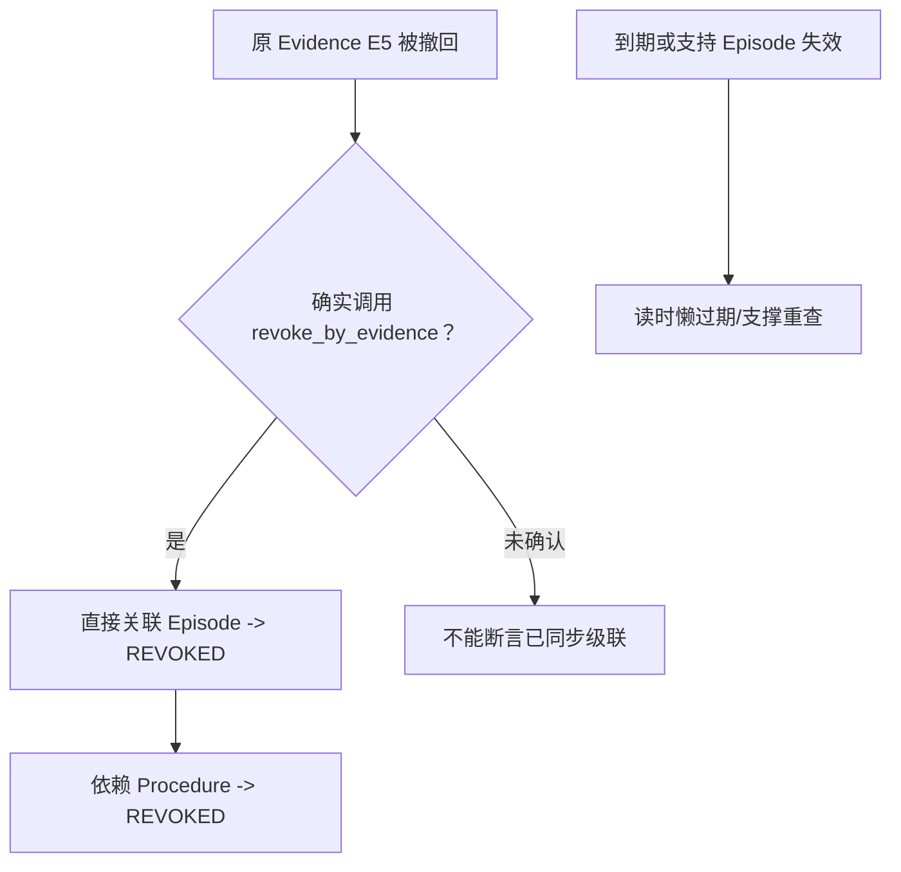

**小结与衔接：** 想让记忆可靠，不只是“会记会找”，还要可撤销、可追踪、可对账。下面看看所有这些状态到底如何落在数据库迁移、RLS、两套存储和 UI 中。

---

## B18 · 数据库与部署：为什么运行代码不等于存储已准备好？（SOURCE DEEP）

### 总：Schema、ORM、Migration、Repository、Runtime 是五层

新手经常看见 `class MemoryRecordRow` 就认为数据库必然有表。其实：ORM 是 Python 对应表的定义；Migration 负责改变数据库结构；Repository 负责用事务增删查改；配置决定是否启动功能；真实部署还需要确认迁移版本、RLS 和权限都已经生效。

### 正常流程与最小例子

假设管理员开启 `SERVICEMIND_MEMORY_ENABLED=True`，但数据库停留在迁移 0007，没有 `memory_records`。Graph 可以照样有 `MemoryWriter` 这个 Python 类，真正执行 PostgreSQL 保存时却会报表不存在。正确排查顺序是：**功能开关 → 业务 DB 连接 → Alembic revision → 表/约束/RLS → 真实调用位置**，不是只查是否安装 LangGraph。

### 关键设计：M15 必须掌握的表

| 表                  | 关键字段和约束                                               | 用途                                                    |
| ------------------- | ------------------------------------------------------------ | ------------------------------------------------------- |
| `memory_records`    | `id/lineage_id/tenant_id/scope_type/scope_id/memory_type/subject_key/version/content/content_hash/status/expires_at`；`(tenant_id,idempotency_key)` 唯一；主题+版本唯一 | 当前和历史记忆的权威版本                                |
| `memory_events`     | `tenant_id/memory_id/actor_id/event_type/reason_codes/payload/created_at`；0014 后有 nullable `run_id/trace_id` | 状态变更的追加式审计                                    |
| `agent_runs`        | `id/tenant_id/status/result` 等                              | 一次 Agent 运行，关联来源 Run，不是记忆表               |
| `context_artifacts` | 选择清单/预算/Hash 等                                        | 可选 Context 交付元数据，不保存完整 Memory Row 作为主表 |

迁移 0008 创建 memory 及其他 Phase5 权威表，启用 FORCE RLS 和 memory_events 的 append-only 触发器；0010 把 `provenance/taint_labels` 改为 JSONB 并隔离老式范围过宽的 Post-Run 记录；0014 为事件表补 `run_id/trace_id`。**0010 的 JSONB 修正直接关系到 `has_key/contained_by` 等 ACL SQL 运算符是否可以编译**，不是微不足道的字段类型选择。

### 为什么不用 LangGraph Store 一张表装完？

ServiceMind 的受治理记忆要实现 lineage 版本、Evidence 引用、状态机、时间窗、审计、租户 RLS、Group/Entity ACL、审批 compare-and-set；这些是明确的领域契约。`src/memory/postgres.py` 的 LangGraph Store 解决通用跨线程 Store 接口，并不会因为同时存在就自动具有上述 M15 规则。两套技术可共存，**不能把它们当作一个表、一个连接池或同一套数据结构**。

**数据库存储≠自动加密正文。** ORM 里的 `memory_records.content` 是 `Text` 列；当前主题源码没有对这列展示 Memory 领域专属的逐字段加密写入调用。因此不能用“用了 PostgreSQL/RLS”推断“记忆正文已应用层加密”或“数据库管理员不可访问”。需要真实部署的磁盘加密、备份、DB 权限与密钥政策才能给出更强保证。

### 必要失败边界

- `memory_events` append-only 触发器防 UPDATE/DELETE，不等于物理保留政策或管理员角色权限已经满足全部合规要求。
- Migration 定义存在不等于已对当前线上 DB 执行。
- `settings` 默认 Memory/Vector/Context 都关闭，不要把 `docs` 里某次 `.env` 已启用的历史叙述，当成当前服务器运行观测。
- 默认 PostgresMemoryRepository 是源代码接线事实，不代表 SQLite/Mongo scaffold 能原样执行 MemoryRepository 的所有功能。

### 源码学习

ORM 实际列/约束 [`persistence/models.py L389–517`](https://github.com/shark6438/servicemind/blob/19d9a377fb98e1c3f56edc59be40b374013bc08b/src/servicemind/persistence/models.py#L389-L517)；0008 [`migrations/versions/0008_phase5_governance.py L18–196`](https://github.com/shark6438/servicemind/blob/19d9a377fb98e1c3f56edc59be40b374013bc08b/migrations/versions/0008_phase5_governance.py#L18-L196)；0010 [`migrations/versions/0010_memory_records_jsonb_acl.py L1–46`](https://github.com/shark6438/servicemind/blob/19d9a377fb98e1c3f56edc59be40b374013bc08b/migrations/versions/0010_memory_records_jsonb_acl.py#L1-L46)；0014 [`migrations/versions/0014_memory_event_run.py L1–47`](https://github.com/shark6438/servicemind/blob/19d9a377fb98e1c3f56edc59be40b374013bc08b/migrations/versions/0014_memory_event_run.py#L1-L47)；`tenant_session` 的事务和 RLS 身份 [`persistence/database.py L17–34`](https://github.com/shark6438/servicemind/blob/19d9a377fb98e1c3f56edc59be40b374013bc08b/src/servicemind/persistence/database.py#L17-L34)；配置 [`core/settings.py L281–305`](https://github.com/shark6438/servicemind/blob/19d9a377fb98e1c3f56edc59be40b374013bc08b/src/core/settings.py#L281-L305)；scaffold saver/store 的区别 [`memory/__init__.py L1–40`](https://github.com/shark6438/servicemind/blob/19d9a377fb98e1c3f56edc59be40b374013bc08b/src/memory/__init__.py#L1-L40)。

### 一图复盘 · B18 的最小因果链

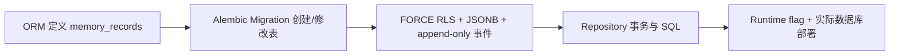

**小结与衔接：** 现在知道架构能保存什么、按什么边界保存。最后还有关键问题：怎么证明一个记忆系统不是“自测一切优秀”而是真正有效？M15 要把写侧、读侧、投递层和真实流量评测分开。

---

## B19 · Memory Evaluation：为什么“召回率高”不等于记忆安全、可用？（MUST KNOW）

### 总：至少四种互不替代的评测

一个记忆系统可能把任何人的记忆都召回来，因此 Recall 极高，但权限完全失效；也可能只返回正确内容、绝不泄漏，却因为预算让模型一条都看不到。**所以不能用一个总分代替四道不同的门禁。**

| 评测层   | 具体问题                                       | 指标或失败标准                                               |
| -------- | ---------------------------------------------- | ------------------------------------------------------------ |
| 写侧策略 | 危险/无价值 Candidate 是否被拒或隔离？         | Action 准确率、Stored 状态、原因码、Unsafe Activation        |
| 读侧安全 | 不该可见的 Group 7 记忆是否进入 Group 9 结果？ | 漏出记录数、leak rate，需正向对照                            |
| 读侧排序 | 应该被召回的记录在哪里？                       | Recall@k、MRR@k、nDCG@k、显式 Max Rank Gate                  |
| 最后投递 | 检索到的必要记忆有没有进入模型上下文？         | Selection Manifest `selected`、Delivery Gate、可用 Token 余量 |

### 正常流程与最小例子

Gold 记录应当是 A、B，检索器输出 `[X,A,B]`。Recall@1 = 0，Recall@3 = 1；首条正确项是 A，MRR = 1/2。若出于安全原因 B 不应被当前用户看到，正确的 `must_not_surface` 检查应同时确认一个**本来有权且相似的正向对照**确实能被召回，避免“检索器因断网返回空列表，因此没有泄漏，测试全绿”。

**最危险的“假绿”**：所有安全 Probe 都返回空，LeakRate=0，但系统完全不能提供服务。Phase5 v2 语料为此新增配对对照与直接播种故意构造 ACTIVE+TAINT 等写策略正常不会产出的记录，用来测试真正的读侧绊线。直接播种不计入写侧准确率，否则会拿“绕过写策略的输入”给写策略打分。

**再手算一项排名指标：** 对 `Gold={A,B}`、结果 `[X,A,B]` 且都合法可见，二元相关性为 `[0,1,1]`，所以 `DCG@3 = 0 + 1/log₂3 + 1/log₂4 ≈ 1.13093`；理想顺序 `[A,B,X]` 的 `IDCG@3 = 1 + 1/log₂3 ≈ 1.63093`，`nDCG@3 ≈ 0.693`。nDCG 考虑**正确结果出现的位置**，不同于只数找到了几条的 Recall。

**授权 Gold 必须先界定。** 若 B 是属于 Group7、当前用户仅 Group9 的私有记忆，B 根本不应放入这个人的 `must_surface` 合法目标集；它应进入 `must_not_surface`，而排序 Gold 应按允许的 A 等重新标注。否则你会因“没有泄漏”错误扣 Recall 分。

### 历史冻结报告究竟证明什么？

冻结 `evaluation/reports/phase5_memory_latest.md`（词法）和 `phase5_memory_tei_latest.md`（Embedding）都记录：**v2 48 个写步骤、45 个读侧 Probe、写侧 Action/Stored/Reason 各 1.0、泄漏率 0.0，29 个显式排名门禁和 4 个显式投递门禁通过**。排序为 30 个必须召回的探针，Recall@1≈0.9444，Recall@3/5/8=1.0；词法与 TEI 使用不同 scorer，不能直接把数字推广为“所有生产记忆问题 100%”。

**注意这是冻结报告的历史结果，不是本轮重跑**：语料为项目自编回归契约，报告已明确不代表任意租户真实记忆分布。尤其 Delivery 使用的是声明的 12000-token Envelope、3 条 × 7000 字符 Evidence 和 Evidence token cap=5000 假设；这能证明**指定载荷下的选择机制**，不能证明当前任何线上 Run 的实际 Memory delivery。 冻结 settings 的该 Evidence Cap 默认仍为 `None`；报告中的 5000 是历史部署假设/记录。 `settings.py` 同时记录过 **10,720 可用 Token 只剩 238 给 Memory** 的开发期测量，直观说明为何要独立的 Delivery Gate；它与 `5000` 的合成评测配置不是同一次观测，也不能用来声称每次无 cap 的 Run 都只剩 238。

### 关键设计：从候选排名走到 Prompt 交付

在无 Evidence cap 的历史反事实中，Evidence 可能占据大部分 Token，记忆虽 Top1 仍被 ContextBuilder 剪裁。修复思路是给高体积 Evidence 设置通道份额，并把“必须交付的 Memory ID 是否 selected”写成单独门禁。

`evaluation/memory/scenarios.v2.json` 把 Write/Transition/Seed/Probe 与 `must_surface/must_not_surface/max_rank/must_deliver` 分成契约字段；`scripts/evaluate_phase5_memory.py --check` 对 leak、unsafe activation、rank gate、delivery gate、missing required 五类 violation 返回非零。这是**可证伪的评测设计**，不是仅生成漂亮表格。

### 必要失败边界

- 测试定义存在 ≠ 本轮运行 passed。
- `Recall@k=1` 仍可能有错误引用、权限泄漏、最终模型未看到、跨租户问题；指标必须按层解释。
- TEI 报告有模型名和 revision，但不能因为有历史 TEI 文件就断言当前部署仍在使用相同模型、索引或门限。
- “无泄漏”必须说明测试的语料、分母、对照、投递边界，不允许用空候选伪造安全性。

### 源码学习

评测 Harness 的契约与四类结果：[`evaluation/memory.py L93–321`](https://github.com/shark6438/servicemind/blob/19d9a377fb98e1c3f56edc59be40b374013bc08b/src/servicemind/evaluation/memory.py#L93-L321)、[`evaluation/memory.py L370–575`](https://github.com/shark6438/servicemind/blob/19d9a377fb98e1c3f56edc59be40b374013bc08b/src/servicemind/evaluation/memory.py#L370-L575)；实际 `evaluate()` + 投递 Envelope [`evaluation/memory.py L600–715`](https://github.com/shark6438/servicemind/blob/19d9a377fb98e1c3f56edc59be40b374013bc08b/src/servicemind/evaluation/memory.py#L600-L715)、[`evaluation/memory.py L787–1107`](https://github.com/shark6438/servicemind/blob/19d9a377fb98e1c3f56edc59be40b374013bc08b/src/servicemind/evaluation/memory.py#L787-L1107)；入口脚本 [`scripts/evaluate_phase5_memory.py L1–140`](https://github.com/shark6438/servicemind/blob/19d9a377fb98e1c3f56edc59be40b374013bc08b/scripts/evaluate_phase5_memory.py#L1-L140)；证伪测试 [`tests/servicemind/test_phase5_memory_evaluation.py L292–802`](https://github.com/shark6438/servicemind/blob/19d9a377fb98e1c3f56edc59be40b374013bc08b/tests/servicemind/test_phase5_memory_evaluation.py#L292-L802)；历史报告 [`evaluation/reports/phase5_memory_latest.md L1–93`](https://github.com/shark6438/servicemind/blob/19d9a377fb98e1c3f56edc59be40b374013bc08b/evaluation/reports/phase5_memory_latest.md#L1-L93)、[`evaluation/reports/phase5_memory_tei_latest.md L1–93`](https://github.com/shark6438/servicemind/blob/19d9a377fb98e1c3f56edc59be40b374013bc08b/evaluation/reports/phase5_memory_tei_latest.md#L1-L93)。

### 一图复盘 · B19 的最小因果链

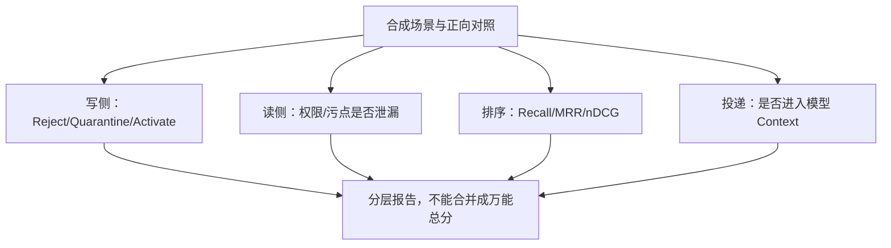

**小结与衔接：** 长期记忆质量必须从“能存/能找”的工程功能走向“有安全边界、有真实指标、有最终投递证据”。最后把所有知识串回一张 Ticket #5→Ticket #8 的因果图，并做本 Master 的最终学习自检。

---

## B20 · 不看代码复述：一条记忆从出现到被撤销，完整经历了什么？（MUST KNOW）

### 总：先用普通话完整复述，后讲函数名

**第一阶段：这条经验从哪里来？** Ticket #5 的工作流成功结束，Reviewer 核对过本次 Evidence。系统选择是否提取为历史经历，不会把未经验证的中间模型猜测直接入库。

**第二阶段：是否值得写、以什么状态写？** Candidate 带主题、来源、Evidence、Scope/ACL、时间、confidence、importance 和 taint。确定性规则先拦秘密、污点、未核实引用；有疑问的经验进入隔离区。PostgreSQL 用事务、幂等、lineage/version 保存并记录审计。

**第三阶段：谁可以激活它？** 人类 Approver 先看到准确的版本与 Hash，通过带身份的复核接口决策；源码会对内容、有效期和支撑材料重验。只有满足所有门禁的记忆才能成为 ACTIVE。

**第四阶段：未来怎样被用？** Ticket #8 来了，Analysis 请求历史记忆。先按租户、Scope/Group/Entity/有效期筛选，再按 Jaccard 或 Embedding 排名，最后重验授权与版本，形成 MemorySelection；ContextBuilder 还要决定是否真的投给模型。

**第五阶段：过时了怎么办？** 新版本需要审批后取代旧版；时效结束进入 EXPIRED；原始 Evidence 被撤回时，须确认有调用 `revoke_by_evidence` 才能保证关联 Episode/Procedure 被显式级联撤销；每步写 MemoryEvent，不能神不知鬼不觉覆盖旧内容。

### 正常流程与可手画的完整时间线

```text
Ticket #5 诊断 → Run SUCCEEDED + final_state_verified
            → MemoryCandidate (EPISODIC, confidence=.85)
            → MemoryGovernancePolicy → QUARANTINE
            → memory_records v1 + memory_events(memory.quarantine)
            → Human Review (expected_version + expected_content_hash)
            → ACTIVE + memory_events(memory.active)
Ticket #8 诊断 → MemoryQuery(tenant, entity=1, group=7, time)
            → SQL/RLS + domain ACL → lexical/cosine → ranking → revalidate
            → MemorySelection → ContextItem → ContextEnvelope selection
            → Analysis 模型参考“过去处理过”，而不是把旧话当本次证明
Ticket #8 完成 → 新 EPISODIC；满足独立来源条件时可提出 PROCEDURAL
            → Procedural QUARANTINE → 人工审核
若 E5 撤销且已调用 MemoryRepository.revoke_by_evidence(E5) → 关联 Episode/Procedure 才被级联 REVOKED → 后续查询不可见
```

**终局时序的必要限定：** 图中 `E5` 撤销之后的级联 REVOKED 是在**业务确实调用** `MemoryRepository.revoke_by_evidence(E5, ...)` 的情况下成立。RAG 自己 `set_document_active(False)` 并不能单凭函数存在推断 Memory 的闭包撤销同步发生；未确认调用时应写“待对账”。

### 关键设计：对照真实文件，各块的 Owner 不是同一个

| 关键环节           | 负责模块                                                     | 记住的具体输入/输出                                 |
| ------------------ | ------------------------------------------------------------ | --------------------------------------------------- |
| POST-RUN 触发/提取 | `supervisor_workflow.finalize` / `phase5_governance.post_run` | `state+result+status → MemoryCandidate[]`           |
| 写侧裁决           | `memory/policy.py`                                           | `MemoryCandidate → MemoryWriteDecision`             |
| 权威版本/审计      | `memory/repository.py`                                       | `candidate+decision → MemoryRecord / memory_events` |
| 审核               | `interfaces/http/memory_review.py`                           | `MemoryReviewRequest → locked transition`           |
| 检索               | `memory/service.py:MemoryRetriever`                          | `MemoryQuery → MemorySelection[]`                   |
| 实际模型投递       | `phase5_governance.build_context` + `ContextBuilder`         | `MemorySelection → ContextItem → selected/pruned`   |
| 撤销/支撑重检      | `memory/repository.py`                                       | `evidence_id / episode support → REVOKED`           |
| Evaluation         | `evaluation/memory.py`                                       | `scenario corpus → 写/读/投递质量报告`              |

**第五个跨块核对句：**“Ticket #5 的 Post-Run Episode 有 `final_state_verified=true`”不意味着“Ticket #5 在 GLPI 中已经处于 resolved 状态”；长期记忆告诉下一次 Analysis 上次**如何诊断**，不替代下一次真实业务状态核查。

### 必要失败边界与微型自检

你现在应该能解释四个容易被混淆的句子：①“我在 memory_records 看到了 QUARANTINE”不等于模型用到了；②“Policy 自动激活某次 Episode”不等于 Procedural 也能自动激活；③“检索返回 MemorySelection”不等于 Context Builder 选中；④“历史报告 Eval 通过”不等于任意当前部署已通过生产质量验收。

**本 Master 不是官方白板节点**（正式白板在 M6/M14/M22/M28/M31）；你可以自行把上述 5 阶段画一遍作为 M15 的学习自检，但不要将其写成 M22 已通过。

### 源码学习

先沿 Caller 一次读通：[`orchestration/supervisor_workflow.py L1773–1837`](https://github.com/shark6438/servicemind/blob/19d9a377fb98e1c3f56edc59be40b374013bc08b/src/servicemind/orchestration/supervisor_workflow.py#L1773-L1837) → [`orchestration/phase5_governance.py L736–943`](https://github.com/shark6438/servicemind/blob/19d9a377fb98e1c3f56edc59be40b374013bc08b/src/servicemind/orchestration/phase5_governance.py#L736-L943) → [`memory/service.py L89–96`](https://github.com/shark6438/servicemind/blob/19d9a377fb98e1c3f56edc59be40b374013bc08b/src/servicemind/memory/service.py#L89-L96) → [`memory/repository.py L896–1021`](https://github.com/shark6438/servicemind/blob/19d9a377fb98e1c3f56edc59be40b374013bc08b/src/servicemind/memory/repository.py#L896-L1021)；再沿 Reader：[`orchestration/phase5_governance.py L591–637`](https://github.com/shark6438/servicemind/blob/19d9a377fb98e1c3f56edc59be40b374013bc08b/src/servicemind/orchestration/phase5_governance.py#L591-L637) → [`memory/service.py L160–303`](https://github.com/shark6438/servicemind/blob/19d9a377fb98e1c3f56edc59be40b374013bc08b/src/servicemind/memory/service.py#L160-L303) → [`context/builder.py L215–319`](https://github.com/shark6438/servicemind/blob/19d9a377fb98e1c3f56edc59be40b374013bc08b/src/servicemind/context/builder.py#L215-L319)。所有异常和边界在上面各块都有定位。

### 一图复盘 · B20 的最小因果链

```mermaid
flowchart TD
  T5["Ticket #5：成功且有 Evidence"] --> CA["Episodic Candidate"]
  CA --> QU{"写策略结果？"}
  QU -->|quarantine| A["授权人工复核"]
  QU -->|activate| AC["ACTIVE 后供合法查询"]
  QU -->|reject| N["不保存"]
  A -->|审核通过| AC
  AC --> T8["Ticket #8：检索、重验、Context 投递"]
  T8 --> PR["跨独立工单提出程序：仍待审批"]
  EV["证据撤回且显式调用撤证"] --> R["相关 Memory/Procedure REVOKED"]
```

**小结：** 记忆的价值不是“让模型看起来越来越懂你”，而是**在恰当权限、时间和质量前提下，把可追溯且可撤销的历史经验用于新任务**。这一点是 M15 最高优先级的掌握目标。

---

# A · 源码审计与验收附录（首遍学习无需逐条死背）

## A0 · 冻结源码、证据等级、三桶、学习深度

### A0.1 Rule 6 适用范围

- 唯一冻结基线 `shark6438/servicemind@19d9a377fb98e1c3f56edc59be40b374013bc08b`。通过 GitHub 连接器只读递归 tree 已核到 **1,388 blobs，非截断**；相对选定祖先 `fe3b2dcc84d41e6f7f345fd5830f2e12a978c10a` 有 127 blobs。没有读取 `.env`、没有重启服务、没有改动 Repo。本轮交付容器中未持有原项目完整代码工作树，因此**不能由当前制作者独立声称亲自执行了 `git status --porcelain`**。**后续独立审计者另行报告**：其本地工作树 HEAD 与冻结 SHA 相同、`git status --porcelain` 仅有 `?? masters/`、tracked 文件计数为 1,388；该观测支持“审计者本地 tracked 工作树与冻结提交一致”，但**来源为审计者的运行报告，不是本轮连接器所返回的 E4 现场生产验证或本容器实际运行 Git 的结果**。连接器当前独立核对了固定提交 1,388 个 blobs；两个证据来源必须分开记录。
- 主体 M15：受治理的长期记忆。跳过 M20 的 ACL/租户边界与 M21 的数据库存储必要知识已在 B04/B12/B18 融合；Evaluation 基础在 B19 融合，**不把其它 Master 自动写成 FROZEN**。保留 M14 规范四平面：Control/Agent/Capability/Governance。
- 本轮从主题出发搜索 core types、caller、ORM、migration、API/UI、tests 和历史报告，不把计划旧入口锚点当已经接线的证明。

### A0.2 E1–E6 证据层

| 层   | 可以证明什么                          | 必须避免的越界                           |
| ---- | ------------------------------------- | ---------------------------------------- |
| E1   | 冻结源码函数、枚举、SQL、真实相互调用 | 定义不是现场正在运行                     |
| E2   | 冻结 Settings、Migration、Manifest    | 默认/SQL 定义不是已部署值                |
| E3   | 固定测试文件与断言的**定义**          | 本轮没有运行 pytest，不写 PASS           |
| E4   | 本轮生产环境真实观察/端到端运行       | **无**；仅本地 Python 教学哈希复算       |
| E5   | 冻结历史实验报告、设计和验收记录      | 必须交代数据集/日期/分母，不冒充当前监测 |
| E6   | 旧 Master、以前的学习笔记和对话线索   | 必须回 E1/E2/E3 核，不单凭记忆作结论     |

**事实分类**：`SOURCE FACT`（源定义）、`WIRED FACT`（真实 caller/config 接线）、`SOURCE COMMENT CLAIM`（源码注释讲述过的开发史）、`HISTORICAL REPORT`（历史报告记录）、`TO VERIFY`（明确待验证）。另设 **CONFIRMED / TO VERIFY / UNKNOWN** 三桶：看过但没证据是 TO VERIFY，完全不知实际现场则是 UNKNOWN，不能混为“都验证过”。

### A0.3 深度等级及审计路径

`MUST KNOW` = 从定义、动机、输入/输出和简单反例解释；`SOURCE DEEP` = 能逐函数查参数、SQL/事务和失败分支；`AUDIT ONLY` = 历史 bug、极端并发、兼容差异和环境风险。

Master 发布流程：Source Fact Baseline → Candidate → B01–B20 逐块教学与代码审计 → blocker 修复 → 定点复核 → FREEZE-READY → 用户明确批准 FROZEN。**本稿完成教学及静态源码审计的定点修复，状态为 FREEZE-READY；用户本人明确批准之前不记为 FROZEN。**

---

## A1 · 完整主题文件清单：路径、真实行数、三标签与深度

三标签相对于指定 127-blob 祖先的**文件差异**：同路径不存在=`SERVICEMIND-ADDED`；存在且 blob 相同=`UPSTREAM`；存在且 SHA 不同=`UPSTREAM-MODIFIED`。这个划分**不证明逐行作者归属**。每个行数来自 GitHub 固定 SHA 的实际文件，不根据旧锚点猜 EOF。

|    # | 文件路径                                               | 真实行数 | 三标签              | 深度          |
| ---: | ------------------------------------------------------ | -------: | ------------------- | ------------- |
|   01 | `src/servicemind/memory/contracts.py`                  |      563 | `SERVICEMIND-ADDED` | `MUST KNOW`   |
|   02 | `src/servicemind/memory/policy.py`                     |       76 | `SERVICEMIND-ADDED` | `MUST KNOW`   |
|   03 | `src/servicemind/memory/service.py`                    |      335 | `SERVICEMIND-ADDED` | `MUST KNOW`   |
|   04 | `src/servicemind/memory/repository.py`                 |     1388 | `SERVICEMIND-ADDED` | `MUST KNOW`   |
|   05 | `src/servicemind/memory/__init__.py`                   |       38 | `SERVICEMIND-ADDED` | `AUDIT ONLY`  |
|   06 | `src/servicemind/orchestration/phase5_governance.py`   |      943 | `SERVICEMIND-ADDED` | `MUST KNOW`   |
|   07 | `src/servicemind/orchestration/supervisor_workflow.py` |     1913 | `SERVICEMIND-ADDED` | `MUST KNOW`   |
|   08 | `src/servicemind/context/builder.py`                   |      339 | `SERVICEMIND-ADDED` | `MUST KNOW`   |
|   09 | `src/servicemind/context/contracts.py`                 |      166 | `SERVICEMIND-ADDED` | `SOURCE DEEP` |
|   10 | `src/servicemind/persistence/models.py`                |      755 | `SERVICEMIND-ADDED` | `SOURCE DEEP` |
|   11 | `src/servicemind/persistence/database.py`              |       40 | `SERVICEMIND-ADDED` | `SOURCE DEEP` |
|   12 | `src/servicemind/interfaces/http/memory_review.py`     |      157 | `SERVICEMIND-ADDED` | `MUST KNOW`   |
|   13 | `src/servicemind/security/auth.py`                     |      224 | `SERVICEMIND-ADDED` | `SOURCE DEEP` |
|   14 | `src/servicemind/api.py`                               |      556 | `SERVICEMIND-ADDED` | `SOURCE DEEP` |
|   15 | `src/service/service.py`                               |      577 | `UPSTREAM-MODIFIED` | `SOURCE DEEP` |
|   16 | `src/memory/__init__.py`                               |       40 | `UPSTREAM`          | `SOURCE DEEP` |
|   17 | `src/memory/postgres.py`                               |      104 | `UPSTREAM-MODIFIED` | `SOURCE DEEP` |
|   18 | `src/memory/sqlite.py`                                 |       40 | `UPSTREAM`          | `AUDIT ONLY`  |
|   19 | `src/core/settings.py`                                 |      517 | `UPSTREAM-MODIFIED` | `MUST KNOW`   |
|   20 | `migrations/versions/0008_phase5_governance.py`        |      196 | `SERVICEMIND-ADDED` | `SOURCE DEEP` |
|   21 | `migrations/versions/0010_memory_records_jsonb_acl.py` |       46 | `SERVICEMIND-ADDED` | `SOURCE DEEP` |
|   22 | `migrations/versions/0014_memory_event_run.py`         |       47 | `SERVICEMIND-ADDED` | `SOURCE DEEP` |
|   23 | `frontend/src/app/memory/page.tsx`                     |       48 | `SERVICEMIND-ADDED` | `SOURCE DEEP` |
|   24 | `src/pages/1_Memory_Review.py`                         |      178 | `SERVICEMIND-ADDED` | `SOURCE DEEP` |
|   25 | `src/servicemind/evaluation/memory.py`                 |     1250 | `SERVICEMIND-ADDED` | `MUST KNOW`   |
|   26 | `evaluation/memory/scenarios.v2.json`                  |     2556 | `SERVICEMIND-ADDED` | `SOURCE DEEP` |
|   27 | `scripts/evaluate_phase5_memory.py`                    |      140 | `SERVICEMIND-ADDED` | `SOURCE DEEP` |
|   28 | `evaluation/reports/phase5_memory_latest.md`           |       93 | `SERVICEMIND-ADDED` | `MUST KNOW`   |
|   29 | `evaluation/reports/phase5_memory_tei_latest.md`       |       93 | `SERVICEMIND-ADDED` | `SOURCE DEEP` |
|   30 | `docs/PHASE5_MEMORY_QUALITY_EVALUATION.md`             |      606 | `SERVICEMIND-ADDED` | `SOURCE DEEP` |
|   31 | `tests/servicemind/test_phase5_governance.py`          |     3818 | `SERVICEMIND-ADDED` | `AUDIT ONLY`  |
|   32 | `tests/servicemind/test_phase5_memory_postgres.py`     |      414 | `SERVICEMIND-ADDED` | `SOURCE DEEP` |
|   33 | `tests/servicemind/test_phase5_memory_recall.py`       |      285 | `SERVICEMIND-ADDED` | `SOURCE DEEP` |
|   34 | `tests/servicemind/test_phase5_memory_evaluation.py`   |      825 | `SERVICEMIND-ADDED` | `MUST KNOW`   |
|   35 | `tests/servicemind/test_phase5_memory_review_api.py`   |      354 | `SERVICEMIND-ADDED` | `SOURCE DEEP` |
|   36 | `tests/servicemind/test_memory_event_correlation.py`   |      387 | `SERVICEMIND-ADDED` | `SOURCE DEEP` |

完整 M15 文件范围共 **36 条**，含真正主链、数据库、审批、评测、测试定义以及与 LangGraph scaffold 的边界；这不是对 1,388 个文件的逐行通读声明。

---

## A2 · 逐文件四问：用途、谁调用、调用谁、失败边界

| 路径                                                   | 它是做什么的                                              | 谁会调用                        | 调谁/依赖谁                             | 最容易学错的边界                                             |
| ------------------------------------------------------ | --------------------------------------------------------- | ------------------------------- | --------------------------------------- | ------------------------------------------------------------ |
| `src/servicemind/memory/contracts.py`                  | 三类型/Scope/Status/Candidate/Record/Query/Event 类型契约 | MemoryWriter/Retriever/HTTP     | Pydantic validators                     | Schema validate != verified fact                             |
| `src/servicemind/memory/policy.py`                     | 确定性拒绝/隔离/激活                                      | MemoryWriter/activation recheck | MemoryWriteDecision                     | Marker checks are heuristic                                  |
| `src/servicemind/memory/service.py`                    | MemoryWriter/Retriever/EmbeddingCache/PostRunMiddleware   | Phase5Governance/eval           | MemoryRepository+EmbeddingProvider      | Writer runs Policy; repository accepts supplied decision; window 500 |
| `src/servicemind/memory/repository.py`                 | InMemory+Postgres 权威状态机/审计/读写资格                | Writer/Retriever/Review API     | tenant_session,ORM                      | Version/evidence concurrency                                 |
| `src/servicemind/memory/__init__.py`                   | ServiceMind Governed Memory 对外符号                      | 模块导入                        | memory/*                                | Import != wiring                                             |
| `src/servicemind/orchestration/phase5_governance.py`   | Workflows 与 Memory 写入/查询/上下文接线                  | Supervisor                      | Phase5Memory/ContextBuilder             | Flags + hard ACL                                             |
| `src/servicemind/orchestration/supervisor_workflow.py` | finalize 调用 memory post_run; analysis context           | Main Graph                      | Phase5Governance                        | Run success != memory success                                |
| `src/servicemind/context/builder.py`                   | 按 authority/budget/source cap 装配 Context               | Phase5Governance                | ContextEnvelope                         | Memory selected might be pruned                              |
| `src/servicemind/context/contracts.py`                 | ContextItem/TrustLabel/ContextEnvelope                    | ContextBuilder                  | model_payload                           | Envelope is not raw memory record                            |
| `src/servicemind/persistence/models.py`                | memory_records/memory_events 的 ORM                       | MemoryRepository                | SQLAlchemy                              | Migration not auto-applied                                   |
| `src/servicemind/persistence/database.py`              | tenant_session 将 tenant 绑定至 PG RLS                    | PostgresMemoryRepository        | set_config app.tenant_id                | DB connection required                                       |
| `src/servicemind/interfaces/http/memory_review.py`     | 审批队列和版本绑定的 Review API                           | FastAPI Router                  | PostgresMemoryRepository.transition     | OIDC role+snapshot conflict                                  |
| `src/servicemind/security/auth.py`                     | TenantContext/approver role 边界                          | Review Router                   | OIDC verifier                           | Identity at API; transition does not take Principal          |
| `src/servicemind/api.py`                               | 把 Memory Review Router 挂到 API                          | FastAPI                         | memory_review router                    | No actual deployment shown                                   |
| `src/service/service.py`                               | 配置 Saver/Store 与主 API lifecycle                       | app startup                     | initialize_database/store               | Scaffold store != governed memory                            |
| `src/memory/__init__.py`                               | LangGraph Saver/Store 初始化                              | Service lifespan                | checkpoint/store backends               | Do not conflate with MemoryRepository                        |
| `src/memory/postgres.py`                               | LangGraph Postgres saver/store adapters                   | initialize_database/store       | langgraph postgres                      | Not memory_records                                           |
| `src/memory/sqlite.py`                                 | scaffold SQLite saver/store                               | initialize_database/store       | LangGraph SQLite                        | Not governed Postgres memory                                 |
| `src/core/settings.py`                                 | Memory/Vector/Context/Procedure 默认开关                  | Phase5Governance                | Pydantic settings                       | Defaults != runtime                                          |
| `migrations/versions/0008_phase5_governance.py`        | 建 memory/context/model 表+RLS+append-only                | Alembic                         | PostgreSQL                              | Definition != applied                                        |
| `migrations/versions/0010_memory_records_jsonb_acl.py` | JSON→JSONB 修复 ACL 运算符和旧宽作用域行                  | Alembic                         | memory_records                          | Historical migrations not current runtime                    |
| `migrations/versions/0014_memory_event_run.py`         | memory_events 加 run_id/trace_id                          | Alembic                         | memory_events                           | Nullable run attribution                                     |
| `frontend/src/app/memory/page.tsx`                     | Next.js 记忆复核页面                                      | Browser                         | Memory Review API                       | UI is not authorization                                      |
| `src/pages/1_Memory_Review.py`                         | Streamlit 记忆复核页                                      | Browser/Streamlit               | Review client                           | UI cannot bypass server ACL                                  |
| `src/servicemind/evaluation/memory.py`                 | 离线评测 Harness、写/读/排名/投递 Gate                    | Evaluation CLI                  | InMemoryMemoryRepository+ContextBuilder | Corpus not production distribution                           |
| `evaluation/memory/scenarios.v2.json`                  | 有标注的 48 writes/7 seeds/3 transitions/45 probes        | Evaluation Harness              | ScenarioCorpus                          | Synthetic regression                                         |
| `scripts/evaluate_phase5_memory.py`                    | 评测 CLI lexical/tei/check                                | Operator/Eval                   | evaluation.memory.evaluate              | TEI needs model endpoint                                     |
| `evaluation/reports/phase5_memory_latest.md`           | lexical 冻结评测快照                                      | User/Audit                      | Metrics                                 | Historical report != present runtime                         |
| `evaluation/reports/phase5_memory_tei_latest.md`       | TEI 冻结评测快照                                          | User/Audit                      | Metrics                                 | Model revision scope                                         |
| `docs/PHASE5_MEMORY_QUALITY_EVALUATION.md`             | 实验方法、假绿缺陷与质量结论边界                          | User/Audit                      | Reports/Tests                           | Narrative is historical                                      |
| `tests/servicemind/test_phase5_governance.py`          | 治理整合/权限/状态/预算测试定义                           | pytest (not run)                | memory service/repository               | Definition != execution                                      |
| `tests/servicemind/test_phase5_memory_postgres.py`     | Postgres 实际持久化条件的测试定义                         | pytest (not run)                | PostgresMemoryRepository                | Needs database service                                       |
| `tests/servicemind/test_phase5_memory_recall.py`       | 记忆召回/向量窗口回归测试                                 | pytest (not run)                | MemoryRetriever                         | No runtime result shown                                      |
| `tests/servicemind/test_phase5_memory_evaluation.py`   | 安全探针有效性/排名/投递证伪测试                          | pytest (not run)                | evaluate()                              | Do not claim test passed this turn                           |
| `tests/servicemind/test_phase5_memory_review_api.py`   | 审批 API Role/ACL/版本冲突测试定义                        | pytest (not run)                | memory_review router                    | Do not infer current Keycloak                                |
| `tests/servicemind/test_memory_event_correlation.py`   | MemoryEvent run/trace 关联测试定义                        | pytest (not run)                | repo/events                             | History not current live log                                 |

---

## A3 · Source Fact Baseline：CONFIRMED / TO VERIFY / UNKNOWN 三桶

### A3.1 CONFIRMED（仅当前实际读到的 E1/E2 源码和 E5 冻结报告）

**读表规则**：E1 的定义与接线用 `SOURCE FACT / WIRED FACT`；某份历史报告自己报告了实验，只能写 `HISTORICAL REPORT`。**没有 E4 在线实测**。

| ID    | 已确认的准确结论                                             | 性质                | 证据层 | 冻结源码/报告                                                |
| ----- | ------------------------------------------------------------ | ------------------- | ------ | ------------------------------------------------------------ |
| SF-01 | MemoryType 三值 semantic/episodic/procedural；SemanticSubtype learned_fact/preference | `SOURCE FACT`       | E1     | [`memory/contracts.py L23–33`](https://github.com/shark6438/servicemind/blob/19d9a377fb98e1c3f56edc59be40b374013bc08b/src/servicemind/memory/contracts.py#L23-L33) |
| SF-02 | MemoryStatus 六态 candidate/quarantine/active/superseded/revoked/expired | `SOURCE FACT`       | E1     | [`memory/contracts.py L34–42`](https://github.com/shark6438/servicemind/blob/19d9a377fb98e1c3f56edc59be40b374013bc08b/src/servicemind/memory/contracts.py#L34-L42) |
| SF-03 | MemoryScope 五类 tenant/user/entity/group/service，非租户 scope_id 必填 | `SOURCE FACT`       | E1     | [`memory/contracts.py L43–67`](https://github.com/shark6438/servicemind/blob/19d9a377fb98e1c3f56edc59be40b374013bc08b/src/servicemind/memory/contracts.py#L43-L67) |
| SF-04 | MemoryEvidenceRef 携 evidence_id/source_ref/content_hash/verified | `SOURCE FACT`       | E1     | [`memory/contracts.py L69–76`](https://github.com/shark6438/servicemind/blob/19d9a377fb98e1c3f56edc59be40b374013bc08b/src/servicemind/memory/contracts.py#L69-L76) |
| SF-05 | content_hash 为 casefold+空白归一后 SHA256                   | `SOURCE FACT`       | E1     | [`memory/contracts.py L78–84`](https://github.com/shark6438/servicemind/blob/19d9a377fb98e1c3f56edc59be40b374013bc08b/src/servicemind/memory/contracts.py#L78-L84) |
| SF-06 | MemoryCandidate provenance 需 JSON 可序列化、≤16KiB、required_acl 为非负整数数组 | `SOURCE FACT`       | E1     | [`memory/contracts.py L86–129`](https://github.com/shark6438/servicemind/blob/19d9a377fb98e1c3f56edc59be40b374013bc08b/src/servicemind/memory/contracts.py#L86-L129) |
| SF-07 | Candidate idempotency_key 由 tenant/scope/type/subtype/subject/content hash/source run 标准 JSON 生成 | `SOURCE FACT`       | E1     | [`memory/contracts.py L131–148`](https://github.com/shark6438/servicemind/blob/19d9a377fb98e1c3f56edc59be40b374013bc08b/src/servicemind/memory/contracts.py#L131-L148) |
| SF-08 | 偏好需 USER scope 与 consent；learned_fact 需 evidence；episode 需核实 run+evidence；procedure 需至少 2 支撑 episode+evidence | `SOURCE FACT`       | E1     | [`memory/contracts.py L150–177`](https://github.com/shark6438/servicemind/blob/19d9a377fb98e1c3f56edc59be40b374013bc08b/src/servicemind/memory/contracts.py#L150-L177) |
| SF-09 | MemoryRecord 存 memory_id/lineage_id/version/status，并区分 visible_at 与 corroborable_at | `SOURCE FACT`       | E1     | [`memory/contracts.py L178–249`](https://github.com/shark6438/servicemind/blob/19d9a377fb98e1c3f56edc59be40b374013bc08b/src/servicemind/memory/contracts.py#L178-L249) |
| SF-10 | 普通模型读取仅 ACTIVE；程序支撑可取 ACTIVE/QUARANTINE 但仍受时间约束 | `SOURCE FACT`       | E1     | [`memory/contracts.py L210–249`](https://github.com/shark6438/servicemind/blob/19d9a377fb98e1c3f56edc59be40b374013bc08b/src/servicemind/memory/contracts.py#L210-L249) |
| SF-11 | model_payload 排除身份/哈希/作用域等内部字段，保留 created_by/provenance/有效期等 | `SOURCE FACT`       | E1     | [`memory/contracts.py L250–298`](https://github.com/shark6438/servicemind/blob/19d9a377fb98e1c3f56edc59be40b374013bc08b/src/servicemind/memory/contracts.py#L250-L298) |
| SF-12 | MemoryQuery 同时判断租户/类型/作用域/有效期/污点/required_acl/旧 post_run 策略标记 | `SOURCE FACT`       | E1     | [`memory/contracts.py L299–347`](https://github.com/shark6438/servicemind/blob/19d9a377fb98e1c3f56edc59be40b374013bc08b/src/servicemind/memory/contracts.py#L299-L347) |
| SF-13 | MemoryReviewQuery 需要合法完整游标及人工可见/QUARANTINE 的约束 | `SOURCE FACT`       | E1     | [`memory/contracts.py L349–406`](https://github.com/shark6438/servicemind/blob/19d9a377fb98e1c3f56edc59be40b374013bc08b/src/servicemind/memory/contracts.py#L349-L406) |
| SF-14 | MemoryPatternQuery 的可支持 Episode 必须 tenant scope、active/quarantine、无 taint、策略标记与精确 pattern key | `SOURCE FACT`       | E1     | [`memory/contracts.py L407–438`](https://github.com/shark6438/servicemind/blob/19d9a377fb98e1c3f56edc59be40b374013bc08b/src/servicemind/memory/contracts.py#L407-L438) |
| SF-15 | MemorySelection 有 memory/score/score_breakdown，MemoryWriteDecision action 是 reject/quarantine/activate | `SOURCE FACT`       | E1     | [`memory/contracts.py L463–482`](https://github.com/shark6438/servicemind/blob/19d9a377fb98e1c3f56edc59be40b374013bc08b/src/servicemind/memory/contracts.py#L463-L482) |
| SF-16 | MemoryEvent 可选 run_id/trace_id，TTL/人工审核不能虚构源 Run | `SOURCE FACT`       | E1     | [`memory/contracts.py L484–544`](https://github.com/shark6438/servicemind/blob/19d9a377fb98e1c3f56edc59be40b374013bc08b/src/servicemind/memory/contracts.py#L484-L544) |
| SF-17 | SECRET_PATTERN/PII_PATTERN 的匹配规则在治理契约里明确        | `SOURCE FACT`       | E1     | [`memory/contracts.py L546–563`](https://github.com/shark6438/servicemind/blob/19d9a377fb98e1c3f56edc59be40b374013bc08b/src/servicemind/memory/contracts.py#L546-L563) |
| SF-18 | 写策略先拒绝秘密、再累积注入/污点/PII reasons、importance<0.4 提前拒绝、再验证 Evidence/置信度 | `SOURCE FACT`       | E1     | [`memory/policy.py L17–76`](https://github.com/shark6438/servicemind/blob/19d9a377fb98e1c3f56edc59be40b374013bc08b/src/servicemind/memory/policy.py#L17-L76) |
| SF-19 | PROCEDURAL 必追加人工复核原因，不会由普通自动 Policy 激活    | `SOURCE FACT`       | E1     | [`memory/policy.py L44–68`](https://github.com/shark6438/servicemind/blob/19d9a377fb98e1c3f56edc59be40b374013bc08b/src/servicemind/memory/policy.py#L44-L68) |
| SF-20 | MemoryWriter 调用 policy.assess，然后交 Repository.persist   | `WIRED FACT`        | E1     | [`memory/service.py L89–96`](https://github.com/shark6438/servicemind/blob/19d9a377fb98e1c3f56edc59be40b374013bc08b/src/servicemind/memory/service.py#L89-L96) |
| SF-21 | CacheMemoryEmbeddingProvider 进程内有界 LRU 按文本 sha256 缓存，无持久索引 | `SOURCE FACT`       | E1     | [`memory/service.py L38–87`](https://github.com/shark6438/servicemind/blob/19d9a377fb98e1c3f56edc59be40b374013bc08b/src/servicemind/memory/service.py#L38-L87) |
| SF-22 | Lexical Jaccard、严格 cosine 与 metadata_weight=0.15/recency exp(-age/180) 实现 | `SOURCE FACT`       | E1     | [`memory/service.py L98–158`](https://github.com/shark6438/servicemind/blob/19d9a377fb98e1c3f56edc59be40b374013bc08b/src/servicemind/memory/service.py#L98-L158) |
| SF-23 | Vector 路径用 500 上限、词法用 candidate_ceiling，embeddings 对查询与候选现算；500 满会 warn | `WIRED FACT`        | E1     | [`memory/service.py L158–229`](https://github.com/shark6438/servicemind/blob/19d9a377fb98e1c3f56edc59be40b374013bc08b/src/servicemind/memory/service.py#L158-L229) |
| SF-24 | 相似度 floor 在 metadata 之前；按 score/content hash/idempotency 稳定排序 | `WIRED FACT`        | E1     | [`memory/service.py L230–288`](https://github.com/shark6438/servicemind/blob/19d9a377fb98e1c3f56edc59be40b374013bc08b/src/servicemind/memory/service.py#L230-L288) |
| SF-25 | 检索后 repository.revalidate，按 lineage 最多取 query.limit  | `WIRED FACT`        | E1     | [`memory/service.py L289–303`](https://github.com/shark6438/servicemind/blob/19d9a377fb98e1c3f56edc59be40b374013bc08b/src/servicemind/memory/service.py#L289-L303) |
| SF-26 | PostRunMemoryMiddleware 仅 status=succeeded 且 final_state_verified，并校验 candidate run/tenant | `WIRED FACT`        | E1     | [`memory/service.py L306–335`](https://github.com/shark6438/servicemind/blob/19d9a377fb98e1c3f56edc59be40b374013bc08b/src/servicemind/memory/service.py#L306-L335) |
| SF-27 | MemoryRepository Protocol 定义 persist/candidates/revalidate/review/pattern/transition/revoke | `SOURCE FACT`       | E1     | [`memory/repository.py L35–74`](https://github.com/shark6438/servicemind/blob/19d9a377fb98e1c3f56edc59be40b374013bc08b/src/servicemind/memory/repository.py#L35-L74) |
| SF-28 | LEGAL_TRANSITIONS 限定从各状态允许的目标，终态不可再迁移     | `SOURCE FACT`       | E1     | [`memory/repository.py L76–107`](https://github.com/shark6438/servicemind/blob/19d9a377fb98e1c3f56edc59be40b374013bc08b/src/servicemind/memory/repository.py#L76-L107) |
| SF-29 | Version 冲突强制 quarantine、 revoked/superseded 同内容重学需隔离，expired 允许新学习 | `SOURCE FACT`       | E1     | [`memory/repository.py L124–153`](https://github.com/shark6438/servicemind/blob/19d9a377fb98e1c3f56edc59be40b374013bc08b/src/servicemind/memory/repository.py#L124-L153) |
| SF-30 | 激活程序、服务程序共用 _procedural_support_failure：验证独立 Run/Ticket/权限时间/证据 | `SOURCE FACT`       | E1     | [`memory/repository.py L155–234`](https://github.com/shark6438/servicemind/blob/19d9a377fb98e1c3f56edc59be40b374013bc08b/src/servicemind/memory/repository.py#L155-L234) |
| SF-31 | 人工激活须 human_review_ref、重新 policy/TTL/Procedure support | `WIRED FACT`        | E1     | [`memory/repository.py L205–234`](https://github.com/shark6438/servicemind/blob/19d9a377fb98e1c3f56edc59be40b374013bc08b/src/servicemind/memory/repository.py#L205-L234) |
| SF-32 | 审批 compare-and-set 检查 expected status/version/content hash | `SOURCE FACT`       | E1     | [`memory/repository.py L236–250`](https://github.com/shark6438/servicemind/blob/19d9a377fb98e1c3f56edc59be40b374013bc08b/src/servicemind/memory/repository.py#L236-L250) |
| SF-33 | 撤证通过直接 Evidence 引用和 supporting Episode 依赖链闭包扩张 | `SOURCE FACT`       | E1     | [`memory/repository.py L252–268`](https://github.com/shark6438/servicemind/blob/19d9a377fb98e1c3f56edc59be40b374013bc08b/src/servicemind/memory/repository.py#L252-L268) |
| SF-34 | Postgres 字词初排由 query lexeme OR 而不是只使用 AND         | `SOURCE FACT`       | E1     | [`memory/repository.py L276–304`](https://github.com/shark6438/servicemind/blob/19d9a377fb98e1c3f56edc59be40b374013bc08b/src/servicemind/memory/repository.py#L276-L304) |
| SF-35 | 同主题冲突通过 provenance.conflict_detected 留审计事实       | `SOURCE FACT`       | E1     | [`memory/repository.py L307–325`](https://github.com/shark6438/servicemind/blob/19d9a377fb98e1c3f56edc59be40b374013bc08b/src/servicemind/memory/repository.py#L307-L325) |
| SF-36 | InMemory 按 async Lock 管 version/事件；不是纯 dict 存储     | `SOURCE FACT`       | E1     | [`memory/repository.py L372–462`](https://github.com/shark6438/servicemind/blob/19d9a377fb98e1c3f56edc59be40b374013bc08b/src/servicemind/memory/repository.py#L372-L462) |
| SF-37 | Memory lazy TTL ACTIVE→EXPIRED 有 memory.expired audit       | `SOURCE FACT`       | E1     | [`memory/repository.py L463–493`](https://github.com/shark6438/servicemind/blob/19d9a377fb98e1c3f56edc59be40b374013bc08b/src/servicemind/memory/repository.py#L463-L493) |
| SF-38 | Postgres tenant-scoped memory-governance 事务 advisory lock + per-subject lock | `WIRED FACT`        | E1     | [`memory/repository.py L756–768`](https://github.com/shark6438/servicemind/blob/19d9a377fb98e1c3f56edc59be40b374013bc08b/src/servicemind/memory/repository.py#L756-L768) |
| SF-39 | Postgres _read_filters 先按 status/time/type/scope/jsonb ACL 收窄 | `WIRED FACT`        | E1     | [`memory/repository.py L770–832`](https://github.com/shark6438/servicemind/blob/19d9a377fb98e1c3f56edc59be40b374013bc08b/src/servicemind/memory/repository.py#L770-L832) |
| SF-40 | Postgres pattern_episodes SQL prefilter 包含 active 与 quarantine，匹配 domain corroborable | `WIRED FACT`        | E1     | [`memory/repository.py L871–895`](https://github.com/shark6438/servicemind/blob/19d9a377fb98e1c3f56edc59be40b374013bc08b/src/servicemind/memory/repository.py#L871-L895) |
| SF-41 | Postgres persist 同一事务写 MemoryRecordRow 与 MemoryEventRecord | `WIRED FACT`        | E1     | [`memory/repository.py L896–1021`](https://github.com/shark6438/servicemind/blob/19d9a377fb98e1c3f56edc59be40b374013bc08b/src/servicemind/memory/repository.py#L896-L1021) |
| SF-42 | Postgres candidates 先懒过期并做 SQL 状态/类型/ACL 候选过滤，候选选出后才检查 Procedure 支撑并二次领域过滤；revalidate 则先过期和支撑复核，再按当前条件 SQL/领域过滤 | `WIRED FACT`        | E1     | [`memory/repository.py L1149–1189`](https://github.com/shark6438/servicemind/blob/19d9a377fb98e1c3f56edc59be40b374013bc08b/src/servicemind/memory/repository.py#L1149-L1189) |
| SF-43 | Postgres transition 锁行后版本/状态重验、旧活动版本 supersede、审计写入 | `WIRED FACT`        | E1     | [`memory/repository.py L1235–1339`](https://github.com/shark6438/servicemind/blob/19d9a377fb98e1c3f56edc59be40b374013bc08b/src/servicemind/memory/repository.py#L1235-L1339) |
| SF-44 | Postgres revoke_by_evidence 在 tenant lock 和行锁内撤销 active/quarantine | `WIRED FACT`        | E1     | [`memory/repository.py L1340–1388`](https://github.com/shark6438/servicemind/blob/19d9a377fb98e1c3f56edc59be40b374013bc08b/src/servicemind/memory/repository.py#L1340-L1388) |
| SF-45 | PostRun automatic Episodic 的 confidence=min(analysis/review) + 90 天 TTL + required ACL | `WIRED FACT`        | E1     | [`orchestration/phase5_governance.py L736–826`](https://github.com/shark6438/servicemind/blob/19d9a377fb98e1c3f56edc59be40b374013bc08b/src/servicemind/orchestration/phase5_governance.py#L736-L826) |
| SF-46 | Procedural proposal 需独立 flag、同 pattern、两个不同 ticket/run，之后强制隔离 | `WIRED FACT`        | E1     | [`orchestration/phase5_governance.py L845–943`](https://github.com/shark6438/servicemind/blob/19d9a377fb98e1c3f56edc59be40b374013bc08b/src/servicemind/orchestration/phase5_governance.py#L845-L943) |
| SF-47 | Pattern identity 由分类/推荐组/有值的推荐字段集合构成，而正文仍包含推荐文字 | `SOURCE FACT`       | E1     | [`orchestration/phase5_governance.py L167–245`](https://github.com/shark6438/servicemind/blob/19d9a377fb98e1c3f56edc59be40b374013bc08b/src/servicemind/orchestration/phase5_governance.py#L167-L245) |
| SF-48 | Phase5Governance memory read 仅在 ANALYSIS、memory flag 条件内构造 Memory ContextItem | `WIRED FACT`        | E1     | [`orchestration/phase5_governance.py L591–637`](https://github.com/shark6438/servicemind/blob/19d9a377fb98e1c3f56edc59be40b374013bc08b/src/servicemind/orchestration/phase5_governance.py#L591-L637) |
| SF-49 | ContextBuilder 可用 token/authority/source caps 裁掉合法 Memory，检索不等于投递 | `WIRED FACT`        | E1     | [`context/builder.py L215–319`](https://github.com/shark6438/servicemind/blob/19d9a377fb98e1c3f56edc59be40b374013bc08b/src/servicemind/context/builder.py#L215-L319) |
| SF-50 | Memory ContextItem 使用 trust=verified、authority TenantResolvedCase/100、content model_payload JSON | `WIRED FACT`        | E1     | [`orchestration/phase5_governance.py L611–637`](https://github.com/shark6438/servicemind/blob/19d9a377fb98e1c3f56edc59be40b374013bc08b/src/servicemind/orchestration/phase5_governance.py#L611-L637) |
| SF-51 | Supervisor finalize 保存 Run 再尝试 post_run，失败追加 memory.post_run_failed | `WIRED FACT`        | E1     | [`orchestration/supervisor_workflow.py L1792–1837`](https://github.com/shark6438/servicemind/blob/19d9a377fb98e1c3f56edc59be40b374013bc08b/src/servicemind/orchestration/supervisor_workflow.py#L1792-L1837) |
| SF-52 | memory_records/memory_events ORM 约束、JSONB、可选 run_id/trace_id | `SOURCE FACT`       | E1     | [`persistence/models.py L389–517`](https://github.com/shark6438/servicemind/blob/19d9a377fb98e1c3f56edc59be40b374013bc08b/src/servicemind/persistence/models.py#L389-L517) |
| SF-53 | 0008 迁移创建记忆表与审计、启用 FORCE RLS 和 append-only 触发器；0010/0014 的独立变更分别见 SF-54/SF-55 | `SOURCE FACT`       | E2     | [`migrations/versions/0008_phase5_governance.py L18–196`](https://github.com/shark6438/servicemind/blob/19d9a377fb98e1c3f56edc59be40b374013bc08b/migrations/versions/0008_phase5_governance.py#L18-L196) |
| SF-54 | 0010 JSONB ACL 运算符修复历史并隔离 post-run 旧行            | `SOURCE FACT`       | E2     | [`migrations/versions/0010_memory_records_jsonb_acl.py L1–46`](https://github.com/shark6438/servicemind/blob/19d9a377fb98e1c3f56edc59be40b374013bc08b/migrations/versions/0010_memory_records_jsonb_acl.py#L1-L46) |
| SF-55 | 0014 事件 run_id/trace_id 允许 NULL，并建立 FK/index         | `SOURCE FACT`       | E2     | [`migrations/versions/0014_memory_event_run.py L1–47`](https://github.com/shark6438/servicemind/blob/19d9a377fb98e1c3f56edc59be40b374013bc08b/migrations/versions/0014_memory_event_run.py#L1-L47) |
| SF-56 | tenant_session 将 app.tenant_id 以事务局部设置作为 RLS 执行身份 | `WIRED FACT`        | E1     | [`persistence/database.py L17–29`](https://github.com/shark6438/servicemind/blob/19d9a377fb98e1c3f56edc59be40b374013bc08b/src/servicemind/persistence/database.py#L17-L29) |
| SF-57 | Memory Review API 先要 approver role 和 ACL；状态/版本/Hash 错误映射 409，超作用域隐藏为404 | `WIRED FACT`        | E1     | [`interfaces/http/memory_review.py L96–157`](https://github.com/shark6438/servicemind/blob/19d9a377fb98e1c3f56edc59be40b374013bc08b/src/servicemind/interfaces/http/memory_review.py#L96-L157) |
| SF-58 | Review Router 经 API phase2_router 注册                      | `WIRED FACT`        | E1     | [`api.py L48–55`](https://github.com/shark6438/servicemind/blob/19d9a377fb98e1c3f56edc59be40b374013bc08b/src/servicemind/api.py#L48-L55) |
| SF-59 | Next.js 页面提交 expected_version/expected_content_hash，绑定后端 | `WIRED FACT`        | E1     | [`frontend/src/app/memory/page.tsx L10–48`](https://github.com/shark6438/servicemind/blob/19d9a377fb98e1c3f56edc59be40b374013bc08b/frontend/src/app/memory/page.tsx#L10-L48) |
| SF-60 | LangGraph Saver/Store 由 src/memory 初始化，与 governed memory_records 独立 | `WIRED FACT`        | E1     | [`memory/__init__.py L1–40`](https://github.com/shark6438/servicemind/blob/19d9a377fb98e1c3f56edc59be40b374013bc08b/src/memory/__init__.py#L1-L40) |
| SF-61 | Memory/Vector/Procedural/Context feature flags 默认 False    | `SOURCE FACT`       | E2     | [`core/settings.py L281–301`](https://github.com/shark6438/servicemind/blob/19d9a377fb98e1c3f56edc59be40b374013bc08b/src/core/settings.py#L281-L301) |
| SF-62 | 历史 Phase5 v2 lexical 48 write、45 probe，读侧 leak=0，rank/delivery 门禁通过 | `HISTORICAL REPORT` | E5     | [`evaluation/reports/phase5_memory_latest.md L1–93`](https://github.com/shark6438/servicemind/blob/19d9a377fb98e1c3f56edc59be40b374013bc08b/evaluation/reports/phase5_memory_latest.md#L1-L93) |
| SF-63 | TEI 冻结报告同样 v2，但明确另一个 scorer/model revision      | `HISTORICAL REPORT` | E5     | [`evaluation/reports/phase5_memory_tei_latest.md L1–93`](https://github.com/shark6438/servicemind/blob/19d9a377fb98e1c3f56edc59be40b374013bc08b/evaluation/reports/phase5_memory_tei_latest.md#L1-L93) |
| SF-64 | Memory Eval 审查 write/probe/rank/delivery 多层门禁，含正向控制/直接播种 | `SOURCE FACT`       | E1     | [`evaluation/memory.py L246–321`](https://github.com/shark6438/servicemind/blob/19d9a377fb98e1c3f56edc59be40b374013bc08b/src/servicemind/evaluation/memory.py#L246-L321) |
| SF-65 | 评测 --check 对 leak、unsafe activation、rank、delivery、missing required 都可返回非零 | `WIRED FACT`        | E1     | [`scripts/evaluate_phase5_memory.py L77–140`](https://github.com/shark6438/servicemind/blob/19d9a377fb98e1c3f56edc59be40b374013bc08b/scripts/evaluate_phase5_memory.py#L77-L140) |
| SF-66 | v2 合成语料非实际租户生产记忆分布，不能替代现场回放          | `HISTORICAL REPORT` | E5     | [`docs/PHASE5_MEMORY_QUALITY_EVALUATION.md L1–99`](https://github.com/shark6438/servicemind/blob/19d9a377fb98e1c3f56edc59be40b374013bc08b/docs/PHASE5_MEMORY_QUALITY_EVALUATION.md#L1-L99) |

| SF-67 | `MemoryQuery` 支持 service_ids，但 Analysis Context 的实际调用不传；当前内置自动读取对 SERVICE scope 不可达 | `WIRED FACT` | E1 | [`phase5_governance.py L595–609`](https://github.com/shark6438/servicemind/blob/19d9a377fb98e1c3f56edc59be40b374013bc08b/src/servicemind/orchestration/phase5_governance.py#L595-L609) |
| SF-68 | Memory Review API 创建 Query 不传 service_ids，服务作用域记忆在该内置队列入口无法被列出 | `WIRED FACT` | E1 | [`memory_review.py L75–94`](https://github.com/shark6438/servicemind/blob/19d9a377fb98e1c3f56edc59be40b374013bc08b/src/servicemind/interfaces/http/memory_review.py#L75-L94) |
| SF-69 | `TrustLabel.VERIFIED` 是 Memory ContextItem 的硬编码标签；Policy 可自动 ACTIVATE 非程序类记忆，故不保证人人工审批 | `WIRED FACT` | E1 | [`phase5_governance.py L611–631`](https://github.com/shark6438/servicemind/blob/19d9a377fb98e1c3f56edc59be40b374013bc08b/src/servicemind/orchestration/phase5_governance.py#L611-L631)、[`policy.py L65–76`](https://github.com/shark6438/servicemind/blob/19d9a377fb98e1c3f56edc59be40b374013bc08b/src/servicemind/memory/policy.py#L65-L76) |
| SF-70 | 审批 HTTP 先按主体读取队列，再调用无 Principal 参数的 PostgreSQL transition；DB 迁移保护状态/版本/Hash，但不在 transition 内重建 ACL | `WIRED FACT` | E1 | [`memory_review.py L128–157`](https://github.com/shark6438/servicemind/blob/19d9a377fb98e1c3f56edc59be40b374013bc08b/src/servicemind/interfaces/http/memory_review.py#L128-L157)、[`repository.py L1235–1270`](https://github.com/shark6438/servicemind/blob/19d9a377fb98e1c3f56edc59be40b374013bc08b/src/servicemind/memory/repository.py#L1235-L1270) |
| SF-71 | 读时 Procedure 支撑重验取已存 Episode 的 status/taints/verified flags，未直接联网复查原始 GLPI/RAG Evidence 当前是否已撤 | `SOURCE FACT` | E1 | [`repository.py L155–204`](https://github.com/shark6438/servicemind/blob/19d9a377fb98e1c3f56edc59be40b374013bc08b/src/servicemind/memory/repository.py#L155-L204) |
| SF-72 | `ContextItem` 与 `ContextEnvelope.model_payload()` 是不同视图：前者有排序/预算等字段，后者只向模型投递选中项的六种字段 | `SOURCE FACT` | E1 | [`context/contracts.py L70–90`](https://github.com/shark6438/servicemind/blob/19d9a377fb98e1c3f56edc59be40b374013bc08b/src/servicemind/context/contracts.py#L70-L90)、[`context/contracts.py L125–166`](https://github.com/shark6438/servicemind/blob/19d9a377fb98e1c3f56edc59be40b374013bc08b/src/servicemind/context/contracts.py#L125-L166) |

| SF-73 | 自动 Episode 的 content.outcome 来自 analysis.reasoning_summary，execution 仅按 result 写入，故成功的 Analysis Run 不证明外部故障真实修复 | `WIRED FACT` | E1 | [`phase5_governance.py L752–786`](https://github.com/shark6438/servicemind/blob/19d9a377fb98e1c3f56edc59be40b374013bc08b/src/servicemind/orchestration/phase5_governance.py#L752-L786) |
| SF-74 | Semantic Preference 的契约要求 USER scope 与非空 consent_ref；本段写入 Policy 做字段/regex 判断，未直接查询权威 Consent Registry | `SOURCE FACT` | E1 | [`contracts.py L150–168`](https://github.com/shark6438/servicemind/blob/19d9a377fb98e1c3f56edc59be40b374013bc08b/src/servicemind/memory/contracts.py#L150-L168)、[`policy.py L25–76`](https://github.com/shark6438/servicemind/blob/19d9a377fb98e1c3f56edc59be40b374013bc08b/src/servicemind/memory/policy.py#L25-L76) |

| SF-75 | MemoryRepository Protocol 共有 8 个方法：persist、candidates、revalidate、list_review_queue、get_for_review、pattern_episodes、transition、revoke_by_evidence | `SOURCE FACT` | E1 | [repository.py L35–74](https://github.com/shark6438/servicemind/blob/19d9a377fb98e1c3f56edc59be40b374013bc08b/src/servicemind/memory/repository.py#L35-L74) |
| SF-76 | _mark_subject_conflict 解决 provenance 标记未写而 CONFLICT_DETECTED 不可达的历史问题；标记在 Repository 发现版本冲突后持久写入，后续激活重评 Policy 可见 | `SOURCE COMMENT CLAIM` | E1 | [repository.py L307–325](https://github.com/shark6438/servicemind/blob/19d9a377fb98e1c3f56edc59be40b374013bc08b/src/servicemind/memory/repository.py#L307-L325)、[repository.py L205–235](https://github.com/shark6438/servicemind/blob/19d9a377fb98e1c3f56edc59be40b374013bc08b/src/servicemind/memory/repository.py#L205-L235) |
| SF-77 | 词法相似度 floor 以前内联 0.000001，现独立 min_lexical_similarity 默认0.05，与 semantic floor0.35 采用不同量尺 | `SOURCE COMMENT CLAIM` | E1 | [service.py L165–190](https://github.com/shark6438/servicemind/blob/19d9a377fb98e1c3f56edc59be40b374013bc08b/src/servicemind/memory/service.py#L165-L190) |
| SF-78 | 冻结源码注释报告候选窗口历史测量：261 中 161、译文254 中158 被词法候选裁剪，最佳 cosine0.754 未进入 Ranker | `SOURCE COMMENT CLAIM` | E1 | [service.py L190–217](https://github.com/shark6438/servicemind/blob/19d9a377fb98e1c3f56edc59be40b374013bc08b/src/servicemind/memory/service.py#L190-L217) |
| SF-79 | Evidence token cap 的冻结 settings **默认值是 None**，即默认不另设 Evidence 来源上限；不能把历史评测的5000当作当前默认 | `SOURCE FACT` | E2 | [settings.py L296–304](https://github.com/shark6438/servicemind/blob/19d9a377fb98e1c3f56edc59be40b374013bc08b/src/core/settings.py#L296-L304) |
| SF-80 | settings 的历史注释报告知识饱和 Run 中 Memory 仅余 **238/10720 Tokens**；这是开发期观测，非本轮实测或 Phase5 cap=5000 的同一次实验 | `SOURCE COMMENT CLAIM` | E1 | [settings.py L296–304](https://github.com/shark6438/servicemind/blob/19d9a377fb98e1c3f56edc59be40b374013bc08b/src/core/settings.py#L296-L304) |
| SF-81 | 源码 D15 涉及 _procedure_pattern 自由文本模式身份和 Postgres _pattern_filters 未覆盖隔离 Episode 的三处一致性修复 | `SOURCE COMMENT CLAIM` | E1 | [phase5_governance.py L167–215](https://github.com/shark6438/servicemind/blob/19d9a377fb98e1c3f56edc59be40b374013bc08b/src/servicemind/orchestration/phase5_governance.py#L167-L215)、[repository.py L871–895](https://github.com/shark6438/servicemind/blob/19d9a377fb98e1c3f56edc59be40b374013bc08b/src/servicemind/memory/repository.py#L871-L895) |

### A3.2 TO VERIFY（提了明确问题，当前没有对应运行证据）

| 编号  | 问题                                                         | 真正需要的证据                                     |
| ----- | ------------------------------------------------------------ | -------------------------------------------------- |
| TV-01 | 当前进程 `MEMORY_ENABLED`、`CONTEXT_ENABLED`、`VECTOR_ENABLED`、`PROCEDURAL_PROPOSALS_ENABLED` 实际值 | 已脱敏有效配置；不读取密码/.env 内容               |
| TV-02 | 当前 PostgreSQL 是否实际迁移到 0014 并启用 FORCE RLS/append-only | 授权环境 schema/version 的只读验证                 |
| TV-03 | 线上 Memory 自动 Post-Run 是否有真实 `memory.post_run_completed` / `memory.post_run_failed` | 指定租户+Run 的授权事件及 memory_events 审计       |
| TV-04 | 当前 TEI Provider 的模型、revision、是否执行了真实向量检索   | 运行依赖健康/trace，不用历史报告替代               |
| TV-05 | 当前 memory_records 的 Tenant/User/Group/Entity/Service 分布及 stale/quarantine 数量 | 有权限的聚合统计，严禁跨租户裸读取                 |
| TV-06 | 文档撤回是否在所有入口都联动 Memory.revoke_by_evidence       | caller 的端到端接线及合法环境撤回对账              |
| TV-07 | 部署中跨 Worker/事务并发激活与证据撤回是否保持门禁           | 受控并发测试、数据库锁与审计时间线                 |
| TV-08 | 现有真实企业 ACL、过期、程序记忆支撑满足度、误拒率           | 数据脱敏的真实 Probe/专家标注与双人复核            |
| TV-09 | Context Builder 中 MEMORY 是否真的被 selected，相关任务 p95/Token 成本 | ContextArtifact/Run trace 的当次交付明细           |
| TV-10 | `PostgresMemoryRepository` 与 `InMemoryMemoryRepository` 特殊分支是否等价 | 同一合法 scenario 在两个后端的差分测试，本轮未运行 |
| TV-11 | 人工 Review UI 当前是否挂载、实际审批人具有 OIDC approver    | 登录权限与页面请求日志的只读验证                   |
| TV-12 | 用户账户相关“忘记/彻底擦除”是否存在跨 DB、日志、备份的正式数据保留作业 | 项目之外合规策略与审计，不得单凭逻辑撤销推断       |

### A3.3 UNKNOWN（本轮没有可靠来源，不可自行填答案）

| 编号 | 无从获知的事实                                               | 为什么不知道                       |
| ---- | ------------------------------------------------------------ | ---------------------------------- |
| U-01 | 当前机器真实 memory_records 数量、哪条文档被读过             | 无在线数据库访问                   |
| U-02 | 当前真实企业 memory 语料的线上精度、召回、泄漏率             | 冻结评测不是企业 live distribution |
| U-03 | 现场是否使用 PgStore、SQLiteStore、GovernedMemory 组合的哪种运行配置 | 只有静态配置与源码                 |
| U-04 | 用户组织的完整数据保留、合规删除和灾备管理授权               | 仓库冻结源码不足以证明             |

---

## A4 · 撤回清单：这些话不能继续作为“项目已经实现”

以下撤回的是**常见误解或旧设计口径**，不冒称历史开发者都曾明确说过每一句；只有冻住的源码、注释或报告能够支持的才写成事实。

| 编号 | 应撤回的说法                                                 | 冻结基线下应改成什么                                         | 对应事实            |
| ---- | ------------------------------------------------------------ | ------------------------------------------------------------ | ------------------- |
| W-01 | “LangGraph Store 就是 M15 受治理长期记忆的 Postgres Memory Repository” | LangGraph scaffold Saver/Store 与 `servicemind/memory` 领域表和治理不同，需各查 caller | SF-52、SF-60        |
| W-02 | “每次 Run 都会自动记住语义事实、偏好与程序”                  | PostRun 只在门控通过时构造 Episodic；Procedure 要独立开关且人工激活；Semantic 类型存在不等于自动生产 | SF-08、SF-45、SF-46 |
| W-03 | “Memory 有向量索引，所以是 ANN 搜索”                         | 目前是候选窗口内调用 EmbeddingProvider 对正文计算余弦；不宣称 pgvector/HNSW Memory 索引 | SF-21、SF-23        |
| W-04 | “confidence≥0.9 就自动可信”                                  | 还需秘密/PII/Injection/Evidence/冲突等规则；Procedure 必需审批 | SF-18、SF-19        |
| W-05 | “QUARANTINE 绝不能用于任何流程”                              | 不得交给普通模型，但可作 Procedure 内部 support，衍生 Procedure 仍待审批 | SF-10、SF-14、SF-30 |
| W-06 | “MemoryRetriever 返回 Top8 就等于 LLM 已看到8条”             | 还要 ContextBuilder 的 source/authority/budget 装填，可能被剪裁 | SF-25、SF-49        |
| W-07 | “一条被撤销的旧 Candidate 重新提交必然会新建并隔离”          | 按相同幂等键会先返回已有行；新学习 key 再走 lineage/复活判定 | SF-07、SF-29、SF-41 |
| W-08 | “历史 v2 报告写 1.0/0.0，所以生产 memory 已经全达标”         | 那是自编场景回归与指定声明负载下的门禁，不是当前租户真实生产结果 | SF-62、SF-63、SF-66 |
| W-09 | “RAG 文档撤回天然已联动所有历史 Memory”                      | RAG disable 与 memory revoke 以不同接口实现，完整联动要实查调用和运行记录 | B17 / TV-06         |

| W-10 | “五种 Memory Scope 在 Analysis/Review 的所有入口均已可达” | Contract 能表示 Service Scope，但当前两条内置入口都没传 service_ids | SF-67、SF-68 |
| W-11 | “ContextItem 的 trust=verified 表示任何 ACTIVE Memory 都是人工审过” | Policy 可自动激活部分非程序类记忆；标签不能替代 reviewer 身份/签名 | SF-69 |
| W-12 | “Approval 只要数据库上锁便等于实时重新验证了全部权限” | API 先鉴权和查询 ACL，transition 只处理状态快照和激活规则，需区分两次检查 | SF-70 |

| W-13 | “上一轮 Analysis 成功并保存 outcome，等于故障在 GLPI/客户端已修复” | 后运行 outcome 为 reasoning_summary；`execution=null` 的例子不支持任何外部修复完成断言 | SF-73 |
| W-14 | “Semantic Preference 填上 consent_ref 就保证合法同意和可撤回性” | 这里只证明字段约束；同意真实性/撤回需权威来源和运行接线证据 | SF-74 |

---

## A5 · 12 个失败场景：每题从输入、失败层、输出和恢复讲起

> [!NOTE] 本表是教学构造的失败输入，不是本轮真实线上事故。按实际冻结规则推理，不对未运行依赖声称已实测。

| ID   | 极简输入与现象                                       | 必须解释的原因、输出和合法处理                               | 源码定位                                                     |
| ---- | ---------------------------------------------------- | ------------------------------------------------------------ | ------------------------------------------------------------ |
| F01  | Candidate 文本含 `password=...`                      | SECRET_PATTERN 命中 → `MemoryWriteAction.REJECT`，Repository 不建新行；不要把它误写成 REVOKED 行 | [`memory/policy.py L25–42`](https://github.com/shark6438/servicemind/blob/19d9a377fb98e1c3f56edc59be40b374013bc08b/src/servicemind/memory/policy.py#L25-L42) |
| F02  | 用户偏好在租户 Scope，没有 consent                   | `MemoryCandidate` 的 PREFERENCE 类型校验拒绝；不是等检索阶段才补个 Role | [`memory/contracts.py L150–165`](https://github.com/shark6438/servicemind/blob/19d9a377fb98e1c3f56edc59be40b374013bc08b/src/servicemind/memory/contracts.py#L150-L165) |
| F03  | Episode 声称成功，但 Run 未 final_state_verified     | Candidate 类型约束与后运行入口阻断；没有来源核实不能成为合格事件记忆 | [`memory/contracts.py L166–175`](https://github.com/shark6438/servicemind/blob/19d9a377fb98e1c3f56edc59be40b374013bc08b/src/servicemind/memory/contracts.py#L166-L175)、[`orchestration/phase5_governance.py L736–754`](https://github.com/shark6438/servicemind/blob/19d9a377fb98e1c3f56edc59be40b374013bc08b/src/servicemind/orchestration/phase5_governance.py#L736-L754) |
| F04  | 同主题 v1 ACTIVE、v2 内容变更且模型信心 0.98         | Policy 的高信心不能越过 Repository 的 `VERSION_CONFLICT`，v2 强制 QUARANTINE | [`memory/repository.py L124–153`](https://github.com/shark6438/servicemind/blob/19d9a377fb98e1c3f56edc59be40b374013bc08b/src/servicemind/memory/repository.py#L124-L153) |
| F05  | 审批界面显示 v2，但提交时数据库已改为 v3             | `expected_version/hash/status` compare-and-set 拒绝，API 可返回 409；不能激活没审过的正文 | [`interfaces/http/memory_review.py L128–157`](https://github.com/shark6438/servicemind/blob/19d9a377fb98e1c3f56edc59be40b374013bc08b/src/servicemind/interfaces/http/memory_review.py#L128-L157) |
| F06  | Group 9 查 required_group_ids=[7] 的 tenant Episode  | RLS 只隔租户，领域 ACL 还会拒绝；即使文本完全匹配也不能入候选 | [`memory/contracts.py L312–347`](https://github.com/shark6438/servicemind/blob/19d9a377fb98e1c3f56edc59be40b374013bc08b/src/servicemind/memory/contracts.py#L312-L347) |
| F07  | 向量检索先用词法 Top100 再做 cosine                  | 冻结源码注释记载 161/261、译文158/254 被早剪，最佳 cosine=0.754 未到 Ranker；当前 embedding 用 500 上限，不能把它误认为全库语义索引 | [`memory/service.py L190–217`](https://github.com/shark6438/servicemind/blob/19d9a377fb98e1c3f56edc59be40b374013bc08b/src/servicemind/memory/service.py#L190-L217) |
| F08  | 排序时 admin 撤回 Evidence E5                        | 通过最终 Repository.revalidate 再查，禁止将已失效 ID 返回    | [`memory/service.py L279–303`](https://github.com/shark6438/servicemind/blob/19d9a377fb98e1c3f56edc59be40b374013bc08b/src/servicemind/memory/service.py#L279-L303) |
| F09  | 两条 Episode 属同一个 ticket/run，试图生成程序       | 自动提案用独立 Ticket+Run 检查，程序激活也重验支撑，不能被“记录条数=2”骗过 | [`orchestration/phase5_governance.py L879–905`](https://github.com/shark6438/servicemind/blob/19d9a377fb98e1c3f56edc59be40b374013bc08b/src/servicemind/orchestration/phase5_governance.py#L879-L905) |
| F10  | 检索到合适 Procedure，Context 的 Evidence 挤满 Token | `ContextBuilder` 可能将 Memory pruned；开发期注释曾测到 10720 可用 Token 中仅余 238 给记忆，须查看 Selection Manifest 和 Evidence cap，而不是只看 Retrieval Top1 | [`context/builder.py L215–319`](https://github.com/shark6438/servicemind/blob/19d9a377fb98e1c3f56edc59be40b374013bc08b/src/servicemind/context/builder.py#L215-L319) |
| F11  | 依赖 Episode 到期但 Procedure 自身 TTL 还有40天      | `_procedural_support_failure` 不通过，已 ACTIVE 程序在下次权威读会 REVOKED | [`memory/repository.py L155–204`](https://github.com/shark6438/servicemind/blob/19d9a377fb98e1c3f56edc59be40b374013bc08b/src/servicemind/memory/repository.py#L155-L204) |
| F12  | 合成语料全部返回空，LeakRate=0                       | 没有 positive-control 就是假绿；要求 `must_surface` 对照、read-side 直接播种与 Delivery Gate | [`docs/PHASE5_MEMORY_QUALITY_EVALUATION.md L29–98`](https://github.com/shark6438/servicemind/blob/19d9a377fb98e1c3f56edc59be40b374013bc08b/docs/PHASE5_MEMORY_QUALITY_EVALUATION.md#L29-L98) |

---

## A6 · 开发期真实注释、质量报告缺陷及专项审计风险

**证据标签纪律**：注释明确说过去出现过的事情记为 `SOURCE COMMENT CLAIM`，报告记为 `HISTORICAL REPORT`；源码推断可能存在的边界记为 `AUDIT FINDING`。没有用这次未执行的 pytest/数据库试验冒充“复现过”。

| ID     | 冻结记录的历史问题                                           | 为什么发生，现行机制怎么防                                   | 证据和性质                                                   |
| ------ | ------------------------------------------------------------ | ------------------------------------------------------------ | ------------------------------------------------------------ |
| BUG-01 | MemoryRow 曾把 provenance/taint 存 generic JSON，使 `.has_key/.contained_by` 预过滤出现 AttributeError | 0010 迁移到 JSONB，并隔离老的宽作用域自动摘要                | [`migrations/versions/0010_memory_records_jsonb_acl.py L1–46`](https://github.com/shark6438/servicemind/blob/19d9a377fb98e1c3f56edc59be40b374013bc08b/migrations/versions/0010_memory_records_jsonb_acl.py#L1-L46) · SOURCE COMMENT CLAIM |
| BUG-02 | 过去 PostRun 摘要扩大到 Tenant Scope 却没有必要 ACL/Scope Policy 标记 | 现写 required Entity/Group 和 tenant_episode_v2；读侧拒绝缺 marker 的旧记录 | [`memory/contracts.py L312–335`](https://github.com/shark6438/servicemind/blob/19d9a377fb98e1c3f56edc59be40b374013bc08b/src/servicemind/memory/contracts.py#L312-L335) · SOURCE COMMENT CLAIM |
| BUG-03 | `MemoryRecord.model_payload` 曾只给模型裸 content，使上次 Run 的模型摘要看似平台事实 | 现保留 `created_by/provenance/activation_reason` 等来源信息，剔除无关存储 ID | [`memory/contracts.py L250–297`](https://github.com/shark6438/servicemind/blob/19d9a377fb98e1c3f56edc59be40b374013bc08b/src/servicemind/memory/contracts.py#L250-L297) · SOURCE COMMENT CLAIM |
| BUG-04 | **源码标记 defect D15**：早期 Procedure 模式身份包含推荐自由文字，两张结构同构但建议极性不同的工单无法归到同一模式 | 现以分类、推荐组、推荐字段**形状**生成 pattern key，正文仍留文字供人工审核 | [`orchestration/phase5_governance.py L167–245`](https://github.com/shark6438/servicemind/blob/19d9a377fb98e1c3f56edc59be40b374013bc08b/src/servicemind/orchestration/phase5_governance.py#L167-L245) · SOURCE COMMENT CLAIM |
| BUG-05 | **源码标记 defect D15 的 SQL/资格分支**：隔离 Episode 不能为 Procedure 提供支持，提案无法凑齐双来源 | Producer gate、MemoryPatternQuery、PG SQL prefilter 一起改用 corroborable_at（允许隔离作内部支撑） | [`memory/contracts.py L218–249`](https://github.com/shark6438/servicemind/blob/19d9a377fb98e1c3f56edc59be40b374013bc08b/src/servicemind/memory/contracts.py#L218-L249)、[`memory/repository.py L871–895`](https://github.com/shark6438/servicemind/blob/19d9a377fb98e1c3f56edc59be40b374013bc08b/src/servicemind/memory/repository.py#L871-L895) · SOURCE COMMENT CLAIM |
| BUG-06 | Semantic Ranker 的候选先由词法 Top100 截断，使跨词强语义候选在 Embedding 前就消失 | 历史实测 261 条合格有161条被挡（译文254中158），cosine=0.754 的最佳项未达 ranker；Embedding 模式现用上限500，仍非全量 ANN | [`memory/service.py L190–217`](https://github.com/shark6438/servicemind/blob/19d9a377fb98e1c3f56edc59be40b374013bc08b/src/servicemind/memory/service.py#L190-L217) · SOURCE COMMENT CLAIM |
| BUG-07 | Metadata 曾占 0.55 权重，过新但低相关记忆排过正确旧经验      | 现相关性 0.85、metadata 0.15，并先过 similarity floor        | [`memory/service.py L120–156`](https://github.com/shark6438/servicemind/blob/19d9a377fb98e1c3f56edc59be40b374013bc08b/src/servicemind/memory/service.py#L120-L156) · SOURCE COMMENT CLAIM |
| BUG-08 | Embedding Cache 批量长度超过容量时先前已算的向量可能被淘汰，导致这一批无法完整还原 | 现保留 `resolved` 的请求局部结果，返回时不依赖全量都留在 LRU | [`memory/service.py L53–86`](https://github.com/shark6438/servicemind/blob/19d9a377fb98e1c3f56edc59be40b374013bc08b/src/servicemind/memory/service.py#L53-L86) · SOURCE COMMENT CLAIM |
| BUG-09 | 用随机 memory_id 打破同分，使同一语料重建后的结果顺序变化    | 现按 score/content_hash/idempotency_key 稳定排序             | [`memory/service.py L270–288`](https://github.com/shark6438/servicemind/blob/19d9a377fb98e1c3f56edc59be40b374013bc08b/src/servicemind/memory/service.py#L270-L288) · SOURCE COMMENT CLAIM |
| BUG-10 | InMemory authority 过去不记录 transition/revoke 的事件，单元测试验证不到审计完整性 | 现在与 PostgreSQL 共用 `memory_event` 事件字段构造           | [`memory/repository.py L372–389`](https://github.com/shark6438/servicemind/blob/19d9a377fb98e1c3f56edc59be40b374013bc08b/src/servicemind/memory/repository.py#L372-L389) · SOURCE COMMENT CLAIM |
| BUG-11 | 旧 Context 把 Memory 排最后，Evidence 大量占 Token，Recall 测试绿但模型没有看到程序记忆 | Source cap、第二轮回收和独立 Delivery Gate；须分开报告 selected 和 retrieved | [`context/builder.py L238–319`](https://github.com/shark6438/servicemind/blob/19d9a377fb98e1c3f56edc59be40b374013bc08b/src/servicemind/context/builder.py#L238-L319)、[`docs/PHASE5_MEMORY_QUALITY_EVALUATION.md L15–45`](https://github.com/shark6438/servicemind/blob/19d9a377fb98e1c3f56edc59be40b374013bc08b/docs/PHASE5_MEMORY_QUALITY_EVALUATION.md#L15-L45) · HISTORICAL REPORT |
| BUG-12 | v1 污点与 Injection Probe 没真正到达目标过滤器，也会出现泄漏率 0.0 | v2 加同条件正向对照、直接播种、独立排名和投递门禁            | [`docs/PHASE5_MEMORY_QUALITY_EVALUATION.md L28–97`](https://github.com/shark6438/servicemind/blob/19d9a377fb98e1c3f56edc59be40b374013bc08b/docs/PHASE5_MEMORY_QUALITY_EVALUATION.md#L28-L97) · HISTORICAL REPORT |

| BUG-13 | **同主题冲突的 reason code 曾不可达**：Policy 读取 `provenance.conflict_detected`，但 Repository 早期从未设置该键；冲突与低置信度在持久记录上难区分 | `_mark_subject_conflict` 在 VERSION_CONFLICT 时将 true 存入 provenance，后续人工激活会重新运行 Policy，得以识别 `CONFLICT_DETECTED`；不能说最初 Writer assess 已看到未来版本冲突 | [repository.py L307–325](https://github.com/shark6438/servicemind/blob/19d9a377fb98e1c3f56edc59be40b374013bc08b/src/servicemind/memory/repository.py#L307-L325)、[repository.py L205–235](https://github.com/shark6438/servicemind/blob/19d9a377fb98e1c3f56edc59be40b374013bc08b/src/servicemind/memory/repository.py#L205-L235) · SOURCE COMMENT CLAIM |
| BUG-14 | **词法检索曾使用几乎无效的内联 floor 0.000001**：任何共享 token 都可能被送入后续提示上下文 | 词法路径独立命名为 `min_lexical_similarity`（默认0.05），余弦路径独立 `min_semantic_similarity`（默认0.35）；防止 metadata 对几乎不相关项加分后放行 | [service.py L165–190](https://github.com/shark6438/servicemind/blob/19d9a377fb98e1c3f56edc59be40b374013bc08b/src/servicemind/memory/service.py#L165-L190) · SOURCE COMMENT CLAIM |


### A6.1 不冒充已复现的静态风险

| ID       | 当前源码可见的限制或待测行为                                 | 不能夸大的结论                                               |
| -------- | ------------------------------------------------------------ | ------------------------------------------------------------ |
| AUDIT-01 | 同 idempotency_key 的撤销记录再次写入会先返回旧行，版本“同内容撤后重学”逻辑要换新输入身份才可达 | 这是精确分支优先级，不声称线上发生“记忆丢失”事故             |
| AUDIT-02 | Embedding 路径候选仍受 lexical order 的前500限制；源码注释给出旧窗口下161/261、译文158/254被挡及最佳 cosine0.754 被遗漏的历史实测 | 不保证全库 ANN 语义最佳项必到 Ranker；历史观测不是每次新部署都精确出现相同比例 |
| AUDIT-03 | RAG 文档 withdraw 与 Memory revoke_by_evidence 分属不同接口  | 未完成全部 caller/运行对账之前不能声称撤文档已级联清掉所有 Memory |
| AUDIT-04 | 同租户 Reviewer/USER/机器发起的 group_ids 可能不同，记忆 Context 可见性会不同 | 这是权限分化的正常边界，不是自动的“泄漏”证据                 |
| AUDIT-05 | InMemoryRepository 与 PostgresRepository 的 SQL/锁/失效扫描行为实现各异 | 用 InMemory 测试不等于真实 Postgres 已通过复杂并发           |

| AUDIT-06 | SERVICE Scope 存在于 MemoryScope/MemoryQuery，但实际 Analysis 与 Review adapter 均未传 `service_ids` | 不能宣称本内置入口五种 Scope 均生产可达；需要明确接线改进或显式调用验证 |
| AUDIT-07 | Review 首次用 ACL 范围预查询；最终 `transition` 只保护锁与状态/版本/Hash，没有接收 Principal | 不能夸大为提交事务内刷新全部 OIDC/Group 权限；需受控竞争测试 |
| AUDIT-08 | 记忆 Context 直接标 `VERIFIED`，而规则可自动激活高置信度非程序类记录 | 这是标签契约与“人人工审过”之间的差别，不能将通道标签当人员签名 |
| AUDIT-09 | `_procedural_support_failure` 不重新查询 GLPI/RAG 的当前 Evidence 原文或禁用状态 | 显式撤证和上游知识文档禁用是否全部联动，必须有 caller/实测，不能声称默认级联 |

| AUDIT-10 | `final_state_verified`、Review `passed` 和 Episode `outcome` 可证明的只是运行与分析审查，不是工单外部修复事实 | 不能在演示/面试中把 read-only 分析建议写成用户实际 MFA 重新注册成功 |
| AUDIT-11 | PREFERENCE 的 `consent_ref` 仅在 Candidate 契约/策略处被检查存在，未在已读写入链看到独立 Consent Registry 验真 | 不应由字段非空推出已完成法律同意核对或同意撤回同步 |

---

## A7 · M15 Mastery Ledger 增量（必须独立解释，而不是背函数）

| 掌握项                                                      | 深度        | 不看教材要能答出什么                            |
| ----------------------------------------------------------- | ----------- | ----------------------------------------------- |
| M15-L01 长期记忆的目的和失败风险                            | MUST KNOW   | 为什么把全部聊天日志放数据库不等于治理？        |
| M15-L02 Checkpoint / LangGraph Store / GovernedMemory / RAG | MUST KNOW   | 哪个负责恢复状态、哪个负责存经验？              |
| M15-L03 三记忆类型与来源                                    | MUST KNOW   | Episode 和 Procedure 的根本区别？               |
| M15-L04 五种 Scope 与 ACL 合取                              | MUST KNOW   | tenant scope 的 Group7 记忆能让 Group9 看到吗？ |
| M15-L05 完整 MemoryCandidate 字段与 Hash                    | MUST KNOW   | content_hash 与 idempotency_key 为什么不同？    |
| M15-L06 确定性写策略顺序与 reason_codes                     | MUST KNOW   | 高 confidence 但带秘密会发生什么？              |
| M15-L07 lineage/version/idempotency/subject                 | MUST KNOW   | 两个 Run 并发给同一主题写 v2 怎么办？           |
| M15-L08 人工审批版本/Hash/状态三重快照                      | MUST KNOW   | 为什么只传 memory_id 不安全？                   |
| M15-L09 六状态和 TTL/审计事件                               | MUST KNOW   | EXPIRED、REVOKED、SUPERSEDED 有何不同？         |
| M15-L10 PostRun 自动提取实际门控                            | MUST KNOW   | Review 未通过是否会产生 Episode？               |
| M15-L11 跨 Ticket 程序提案和 quarantine 支撑                | MUST KNOW   | 为什么两次相似输出还不够？                      |
| M15-L12 MemoryQuery 的多层资格检查                          | MUST KNOW   | 为什么先 ACL 再语义评分？                       |
| M15-L13 Jaccard / cosine / metadata 算分                    | MUST KNOW   | 手算 0.85/0.15 综合得分并解释它不是概率         |
| M15-L14 候选窗口 100/500 与 recall caveat                   | MUST KNOW   | 语义最相关的结果为何被提前截掉？                |
| M15-L15 检索再验证与 lineage 去重                           | MUST KNOW   | Embedding 期间撤销如何不进入结果？              |
| M15-L16 Selection / ContextItem / model_payload             | MUST KNOW   | 为什么检索 Top1 仍可能没有被 LLM 看到？         |
| M15-L17 Memory 与四平面/Reviewer 边界                       | MUST KNOW   | Memory 是否可以自己授权 Action 写 GLPI？        |
| M15-L18 Evidence 撤销与依赖闭包                             | MUST KNOW   | Procedure 为什么会随 Episode 失效而撤销？       |
| M15-L19 PG RLS/JSONB/append-only/迁移                       | SOURCE DEEP | ORM 存在为什么不代表当前 DB 已迁移？            |
| M15-L20 评测写/安全/排名/投递与 false-green                 | MUST KNOW   | 如何证明一个安全 Probe 真的检验到了过滤器？     |
| M15-L21 InMemory/Postgres 分支和事件 run/trace              | SOURCE DEEP | 哪些审计变化可以归到 Run，哪些不应该？          |
| M15-L22 审核冻结 SHA 的 SOURCE/WIRED/E4                     | AUDIT ONLY  | 为什么测试定义和历史报告不等于现在生产通过？    |

| M15-L23 契约支持 vs caller 可达 | MUST KNOW | 为什么 `MemoryScope.SERVICE` 存在但内置 Analysis/Review 仍可能永远读不到？ |
| M15-L24 可信标签 vs 人工审批 | MUST KNOW | Memory Context 中 `trust=VERIFIED` 能否证明 `human_review_ref` 一定存在？ |
| M15-L25 审批 ACL 检查的 TOCTOU 边界 | SOURCE DEEP | 首次查队列与 transition 加锁具体分别保护什么，未保护什么？ |
| M15-L26 显式撤证与支持记录重校验 | MUST KNOW | RAG 文档被停用后，哪些条件才足以推出 Memory 同步 REVOKED？ |

| M15-L27 Run/Review 已核实 vs 外部业务已修复 | MUST KNOW | Ticket #5 只有 reasoning_summary 且 execution=null，能否称为已修复真实案例？ |
| M15-L28 Consent Ref 与真实同意证明 | SOURCE DEEP | Candidate 的 consent_ref 非空，是否自动意味着官方同意记录已签发并仍有效？ |

| M15-L29 同主题冲突检测的两次策略调用 | MUST KNOW | 为什么 `CONFLICT_DETECTED` 最初不可达，为什么补写 provenance 后主要影响后续激活复核？ |
| M15-L30 词法 floor 的量尺与真实历史反例 | MUST KNOW | `0.000001` 为什么近似没设下限？用 Jaccard 算一个会被旧策略错收的候选 |
| M15-L31 提前截断导致永不可召回与 Context Token 竞争 | MUST KNOW | 161/261 与 238/10720 分别发生在哪个阶段，为什么换 Ranker 无法修补两者？ |


M15 不是已确定的正式白板节点；冻结白板检查点仍为 M6、M14、M22、M28、M31。M15 自检不替代后续 M22 的数据库可靠性白板。

---

## A8 · 12 道闭卷题（严格不给答案）

1. 用 Ticket #5 → Ticket #8 解释长期记忆是什么，为什么不能把历史对话直接作为永久可信知识。
2. 对比 LangGraph Checkpoint、LangGraph Store、ServiceMind MemoryRepository、Text RAG 和 GraphRAG，分别解决什么问题。
3. 各举一例 Semantic learned_fact、Preference、Episodic、Procedural；说明每一类必须有哪些证明或同意信息。
4. 一条 tenant-scope Episode 带 `required_group_ids=[7]`；分析员属于 Group9。解释 RLS、Scope、provenance ACL 各在何处起作用。
5. 写出完整 MemoryCandidate 的最小必需字段和 `content_hash/idempotency_key` 的计算输入。为什么同主题不同 Run 不必等于同一个幂等 Key？
6. Candidate confidence=0.97、importance=0.8，但正文有 secret；另一条是 Procedural 且证据都 verified。两者写策略应有什么不同？
7. 同主题 v1 ACTIVE，新 Run 提出不同正文 v2，为什么必须隔离？审批激活后旧版会发生什么？
8. Approver 浏览器显示 v2，后台已更新为 v3。为什么 ReviewRequest 要带 expected_version、expected_content_hash、expected_status？
9. 不看源码描述 Supervisor.finalize → post_run → Candidate → Repository 的真实调用链。为什么不是每次 Run 都能留下长期记忆？
10. 如何由 Ticket #5 和 #8 的独立 Episode 提出 Procedural？为什么 QUARANTINE Episode 可以用于归纳，但它自己不能被 Analysis 直接读？
11. 计算 Jaccard=2/5 的简单例子，再用 0.85/0.15 混合评分解释 metadata 的作用；Embedding 下为何候选窗口改为 500？
12. 已激活的 Procedure 因一条支持 Episode 被撤销而失效，接着某次新任务检索到 MemorySelection，却在 Context Builder 被 pruned。分别应该从哪几类审计记录/条件定位这两个问题？历史 v2 评测通过能否代替当前生产验收？

> [!IMPORTANT] 本文件不附答案、不嵌入解析提示。学完后应先独立回答“为什么”与“一个输入输出案例”，再追源码，不能只默写名词表。

---

## A9 · HR / Interview Extraction、验收清单与 STOP

### A9.1 面试 30 秒版（不夸大线上质量）

ServiceMind 的长期记忆不是简单聊天摘要，它使用 PostgreSQL 中的 `memory_records/memory_events` 维护 Semantic/Episodic/Procedural 三类记录。一次已核实的 Run 可以按配置提出 Episode，经确定性治理进入 ACTIVE 或 QUARANTINE；跨工单程序候选需要双独立支撑并由人审批。读取时先做 Tenant/Scope/ACL/时间与污点检查，再做词法或 Embedding 排名，最后权威重验和 Context Token 装填；过期或撤证可以撤销记忆并留下审计事件。

### A9.2 面试 90 秒版：突出你知道“最后一公里”

我把长期记忆分成五个独立边界：**候选产生、写侧治理、权威版本与审计、读侧安全排序、模型实际投递**。记忆不是模型一句话就自动写：`MemoryCandidate` 必须满足 Evidence/Scope/Run/有效期契约，`MemoryGovernancePolicy` 拒绝秘密、污点并隔离低置信度和 Procedure；Postgres 用事务 advisory lock、lineage/version、compare-and-set Review 维护一致性。`MemoryRetriever` 用资格过滤、相关性 floor、0.85 相似度 + 0.15 metadata 评分、时效/撤销重验；Context Builder 仍可能按预算裁剪。项目还保留了多层 Evaluation，不能把 Recall 满分读成“生产安全已认证”。

### A9.3 交付物完整性检查

| 检查项                                | 本稿位置                            | 能证明 / 不能证明                                          |
| ------------------------------------- | ----------------------------------- | ---------------------------------------------------------- |
| 先原理后代码，所有 B 块有最小例子     | B01–B20                             | 教材结构完整，但不能替代学习者理解                         |
| 全对象和字节级哈希                    | B05/B07/B08/B12/B13/B15 + 附带 JSON | 样例哈希可复算，UUID/Evidence 为合成                       |
| 源码库存/祖先三标签/逐文件四问        | A1/A2                               | 主题范围完整清单，不是全仓所有文件已审计                   |
| E1–E6、CONFIRMED/TO VERIFY/UNKNOWN    | A0/A3                               | E4 本轮没有现场运行                                        |
| 旧口径撤回、12 失败场景、历史 Bug     | A4–A6                               | 不把模拟场景说成生产事故                                   |
| 掌握度、12 闭卷题（无答案）、面试提取 | A7–A9                               | 学习任务的检查依据                                         |
| 可追溯配置/测试/历史报告              | A3/ B18/B19                         | 测试存在和报告冻结不等于本轮已跑                           |
| 跨块一致性和引用/JSON 校验            | 随交付 QA 文件                      | 本轮逐块修复并经静态复核，不等于真实集成验证或学员掌握证明 |

### A9.3A R0 → R1 全文审计修订清单（定点修而不另起新课）

| 类型                   | 牵涉块                  | 本轮结论与处理                                               |
| ---------------------- | ----------------------- | ------------------------------------------------------------ |
| F1 真实 caller 可达性  | B04/B12/B16             | SERVICE scope 契约存在，内置 Analysis/Review 未传 service_ids；补了双端定位，取消“五种全部已接线”的过度表述 |
| F2 trust 语义          | B03/B15/B16             | `VERIFIED` 通道标签不等于所有 ACTIVE 记忆经过人工审核，加入自动激活反例 |
| F3 审批事务作用域      | B08                     | API 读资格和 transition 锁定快照分开，不暗示同事务刷新 ACL   |
| F4 证据级联条件        | B10/B17/B20             | 显式撤证需要真实调用；Procedure 支撑重验只看已存记录，不能自动感知外部 Evidence 任意变化 |
| F5 模型实际投递对象    | B15                     | 去掉字符串假数值，新增完整数值 ContextItem、独立内容 hash 与完整六字段模型消息 |
| F6 源码执行顺序与引用  | A3/A4                   | SF-42 校正 SQL→支撑复核的顺序；修正撤回项指向与混合迁移证据  |
| F7 评测分母            | B19                     | 补 nDCG 手算与“授权 Gold 先过滤”，避免安全通过反被算 Recall 失败 |
| F8 语义/安全不变量     | B05–B07、B13–B14、B18   | 补只读计算字段、Repository 非自动再执行策略、归一化哈希、SQL 初排与 Python 最终打分区别、历史 as-of 边界、加密边界 |
| F9 教学图与总结        | B01–B20                 | 20 块均保留正常流程、具体 Ticket 例子、必要失败、源码和总结，补/保留 Mermaid 因果图，图按各块真实数据边界绘制 |
| F10 业务核实与 Consent | B01/B03/B06/B10/B15/B20 | 纠正“成功分析=故障已修复”的误解，明确 consent_ref 字段约束不能代替外部真实同意证明 |

**质量承诺作用域：** 逐块人工源码核对 + 机械校验不是零风险的数学证明；本轮没有执行真实数据库、模型或线上流量。现行潜在实现限制已在 A3/A6 分桶记录，不冒充已修复系统源码。

### A9.3B R1 → R2：独立审计反馈的定点补全

| 核验项                              | 修改位置                                  | 正确口径                                                     |
| ----------------------------------- | ----------------------------------------- | ------------------------------------------------------------ |
| Repository API 方法总数             | B02、A3 SF-75                             | **8 个真实异步方法**，增加 `pattern_episodes`，用途分五组    |
| 同主题冲突的不可达原因              | B07、B10、A3 SF-76、A6 BUG-13             | 初次 Writer 策略在先；Repository 冲突标记在后，后续激活复评可读 |
| 词法阈值失败史                      | B13、A3 SF-77、A6 BUG-14                  | 历史内联 `0.000001` vs 当前独立 floor 0.05                   |
| 候选窗口量化观测                    | B13、A3 SF-78、A5 F07、A6 BUG-06/AUDIT-02 | 161/261、译文 158/254、最佳 cosine 0.754；历史注释，不冒充当下实测 |
| Evidence/Memory 预算量化观测        | B15/B19、A3 SF-79/SF-80、A5 F10           | 历史 238/10720；当前 Evidence cap 默认 None，历史 5000 是另一实验配置 |
| 缺陷 ID                             | A6 BUG-04/BUG-05、A3 SF-81                | 源码正式标记 `defect D15`，涉及 Producer/Query/PG SQL 多点修复 |
| Next.js 真实路径                    | B08、A3 SF-59                             | `frontend/src/app/memory/page.tsx`，URL 不变                 |
| 本地工作树来源                      | A0.1                                      | 仅按用户提供的**独立审计者** HEAD/status 观察记录；本容器未亲自执行 Git 工作树核验 |
| Context Evidence authority 交叉引用 | B15                                       | 历史常量0.95问题属于 Context/Evidence，当前读取 `evidence.authority_level/100`，不误归因 Memory 相似度 |

上述修订只修改教材/附件，不改变源码、真实 `.env` 或运行时配置。本文的完整对象、哈希、评分、12 道无答案闭卷题仍保持原 R1 契约。


### A9.4 冻结作用域与状态

本文件是 **M15 `FREEZE-READY R2`（教材级冻结就绪，非用户已批准的 FROZEN）**。已完成 B01–B20 的全文教学/源码对照、修复关键作用域错误，并复核 JSON/Hash/Mermaid/Markdown/固定源码引用。最终是否标为 FROZEN 仍由用户明确批准；教材自检不能取代学员的闭卷/白板掌握度，也不等于本次执行过真实 PostgreSQL/TEI/Keycloak/GLPI 集成测试。本轮不执行真实数据库、Neo4j、GLPI、Keycloak 或 TEI 实测；不修改项目代码、`.env` 或仓库 Master 文件。M16 不自动开始。

**STOP：留在 M15。** 以本章教会“长期记忆从哪里来、为什么可信、谁能读、何时失效、怎么证明质量”作为下一轮验收目标。