# M17 · MCP：Agent 如何用统一协议连接外部工具？

> [!important] 学习约定
> 本教材只以 `shark6438/servicemind@19d9a377fb98e1c3f56edc59be40b374013bc08b` 的冻结源码作项目事实依据。每一块先解释**它是什么、为什么需要、不用会怎样**，再跟着 Acme 的 GLPI Ticket #5（以及只读 CMDB 依赖查询）做一个简单输入→处理→输出实例，然后讲设计、失败边界、真实函数的 Caller/参数/结果，最后用 Mermaid 和小结连到下一块。示例 UUID、票据、摘要均为**教学构造**，不属于现役环境数据。
>
> **证据纪律**：`SOURCE FACT`=函数/契约本身；`WIRED FACT`=路由、创建者与调用关系；`TEST DEFINITION`=测试在仓库，不等于本轮执行；`HISTORICAL REPORT`=冻结报告记载以前实际做过什么，不等于今天系统状态；`TO VERIFY`=当前配置/活体运行缺证。不要把接口存在当作生产可达、把任务完成当成外部 exactly-once。

## 先看全局：这一课究竟学什么？

**一句话：MCP 是连接的“共同语言”；M16 的 Tool Platform 是“怎样授权并安全执行”。** MCP 不负责让模型变聪明、也不自动代替数据库事务和人工审批。

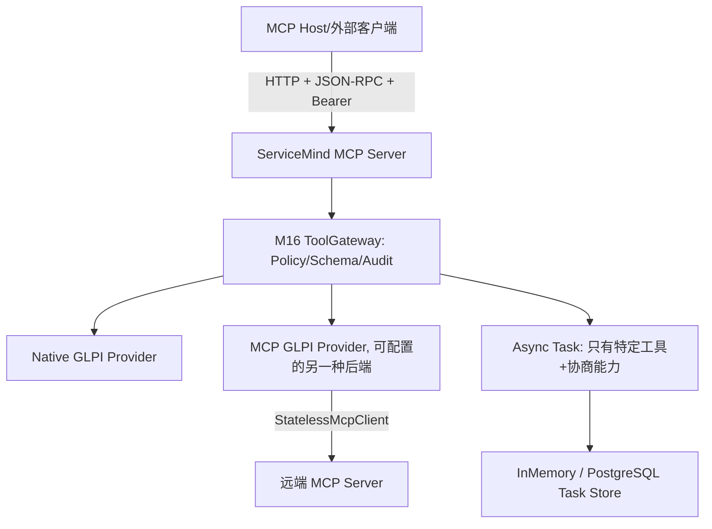

本教材按 **B01–B18** 连贯学习；M16 讲工具治理，**M17 专讲 MCP Server、MCP Client、资源、协议、身份、异步 Tasks、接线与信任边界**；M18 的模型网关（模型路由、结构化输出、成本与模型调用策略）和 M19 的 Skills 不会在这里冒充已经学完。M20 安全常识只融合 MCP 需要的部分。

| 一开始只要认识         | 通俗理解                            | 本课位置 |
| ---------------------- | ----------------------------------- | -------- |
| Tool                   | 能调用的一个业务功能                | B01/B06  |
| MCP                    | 两个软件说同一种工具语言            | B01–B03  |
| Host / Client / Server | 使用者程序 / 连接代理 / 提供工具者  | B02      |
| JSON-RPC               | 消息里写“要做什么”和“这次请求编号”  | B03      |
| OAuth/OIDC             | 告诉服务“你是谁”                    | B04      |
| Resources              | 提供一个可以按 URI 读取的数据资源   | B08      |
| Receipt                | 远端声称“这次结果是什么，校验怎样”  | B09–B11  |
| Task / Lease           | 较慢调用的领取单 / 谁暂时拥有执行权 | B12–B14  |

---

## B01 · MCP 是什么？为什么只会 Function Calling 不够？（MUST KNOW）

### 总：先看一个工作场景

公司里有 GLPI、GitHub、日志系统和 CMDB。假设每个 Agent 都写一套独有的 `requests.get(...)`：每增加一个服务，就重写登录、参数、返回解析、失败处理。**MCP 想统一的是“如何说明工具及如何请求工具”**，不是承诺所有服务都有同样业务含义。

- **模型 Function Calling / Tool Calling**：模型产生调用意图，例如“调用 `search_tickets`，参数是什么”。这不是已经访问外部软件。
- **MCP**：客户端/服务端用标准形状发布工具描述、读取资源、发送调用和接收结果。
- **M16 Tool Platform**：校验参数、主体、角色、审批、限流、幂等和结果；MCP 返回的数据仍须经过这些门。
- **Skills（M19）**：复用工作步骤/操作说明，不等于 MCP 网络协议；**Model Gateway（M18）**：治理模型调用，而不是代替 MCP 的远端工具传输。

### 正常流程与最小例子

用户问：“Ticket #5 的 VPN 故障关联什么系统？”模型给出的意图只是 `query_cmdb_dependencies(identifier="VPN", max_hops=1)`；客户端可以通过 MCP 请求 ServiceMind；最终结果可能是节点与边。模型不是自己拿着 GLPI 令牌随意访问生产系统。

| 阶段      | 输入                        | 输出                       | 负责者                   |
| --------- | --------------------------- | -------------------------- | ------------------------ |
| 意图      | “查询 VPN 依赖”             | 工具名与参数               | Agent/模型               |
| 协议      | 工具名与参数                | `tools/call` JSON-RPC 消息 | MCP Client               |
| 鉴权/治理 | Bearer、tenant、role、scope | 允许/拒绝、验证结果        | MCP Server + ToolGateway |
| 业务执行  | 已授权调用                  | GLPI/CMDB 数据             | Provider                 |
| 结果      | 结构化数据与收据            | 模型可解释的事实           | MCP Client / Agent       |

### 关键设计：MCP 统一的和没有统一的

MCP 使 **工具发现、方法名称、结构化请求/响应**有共同契约；它不会统一所有工具的审批规则。ServiceMind 甚至同时实现 **Server**（对外暴露 GLPI 工具）与 **Client/Provider**（可向另一个 MCP Server 发请求）。两者不是重复造 Gateway，而是两侧对同一协议的实现。


### 必要失败边界

**“模型决定调用”不等于“有权限执行”；“MCP tool 已列出”不等于“配置了有效 Provider”；“MCP 结果有 verified”不等于“用户已批准外部写操作”。** 第一讲记住三个“不等于”，暂时不用背协议版本号。

### 源码学习：先找到谁是客户端、谁是服务端

- [`src/servicemind/mcp/server.py L24–49`](https://github.com/shark6438/servicemind/blob/19d9a377fb98e1c3f56edc59be40b374013bc08b/src/servicemind/mcp/server.py#L24-L49)：MCP Server 路由与全局 Gateway 接入点。
- [`src/servicemind/tool_platform/mcp_transport.py L23–45`](https://github.com/shark6438/servicemind/blob/19d9a377fb98e1c3f56edc59be40b374013bc08b/src/servicemind/tool_platform/mcp_transport.py#L23-L45)：客户端 `StatelessMcpClient`。
- [`src/servicemind/tool_platform/runtime.py L19–41`](https://github.com/shark6438/servicemind/blob/19d9a377fb98e1c3f56edc59be40b374013bc08b/src/servicemind/tool_platform/runtime.py#L19-L41)：Provider 选择。注意默认 `native_glpi`，不能假定 MCP Client 分支已经打开。

**小结与衔接：** 先有“模型提出需求”和“协议表达请求”，再有真正能处理请求的**客户端与服务端**。下一块分清三个角色。

---

## B02 · Host、Client、Server：三个人各干什么？（MUST KNOW）

### 总：把它想成餐厅点餐

**Host 是顾客所在的 App，Client 是负责沟通的服务员，Server 是提供菜品的厨房。** 顾客不直接指挥厨房内部机器，服务员按规定格式点单。ServiceMind MCP Server 是厨房；ServiceMind 可选的 `StatelessMcpClient` 在另一条路径中也能当服务员。一个项目可同时拥有这两种身份。

### 正常流程与最小例子

**方向 A：外部客户端访问 ServiceMind。** Acme 分析员的 MCP Host 提出“查 VPN 相关工单”；Client 带用户 Bearer POST `/v1/servicemind/mcp`；ServiceMind Server 将 JSON-RPC 转为 `ToolCall`，再调用 Gateway。

**方向 B：ServiceMind 自己访问远端 MCP。** ServiceMind 的 Gateway 选中 `McpGlpiProvider`；它通过 `StatelessMcpClient` 把相同 ToolCall 封装成远端 HTTP 请求；远端返回结构化数据与 Receipt，Provider 把它变回 `ProviderResult`。**这个方向必须显式把 `SERVICEMIND_TOOL_PROVIDER` 改为 `mcp_glpi` 并有远端 URL/服务 Token**，不能把它视为默认生产调用链。

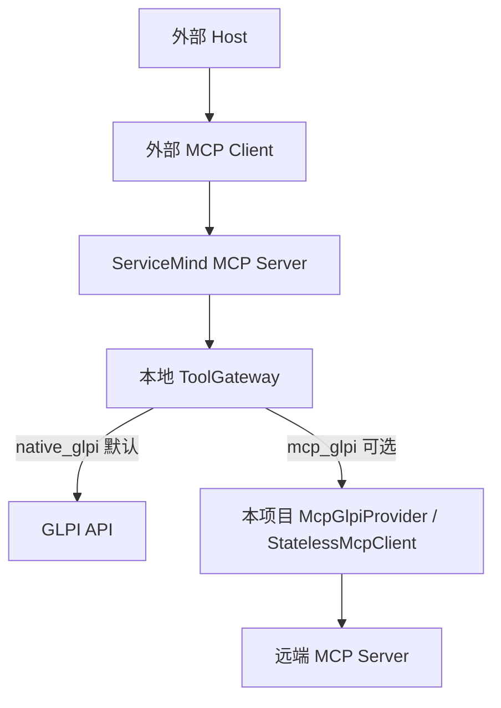

### 关键设计

区分两个软件对象：`src/servicemind/mcp/server.py` 是接收网络请求的服务器；`src/servicemind/tool_platform/mcp_transport.py` 是发网络请求的客户端实现。`src/servicemind/mcp/transport.py` 仅为**兼容性重导出**，并不是第三套 MCP 网络实现。

### 必要失败边界

`McpGlpiProvider` 可以和本机 MCP Server 配合做 parity test，但若部署时把**自己同一个 MCP Server**配置成 `mcp_glpi` 的后端，而没有明确隔离调用方向，就有循环转发/递归配置风险；冻结代码没有声明一种“自动禁止自调用环”的通用守卫。必须把这种风险列为配置审计，而不能假定所有 `mcp_glpi` URL 都正确。

### 源码学习

- `mcp/server.py:mcp_request()` 是网络接收端：由 `service.py:create_app` 把 `mcp_router` 注册到 FastAPI。
- `tool_platform/mcp_transport.py:StatelessMcpClient.request()` 是出站 Client：由 `McpGlpiProvider.execute()` 调用。
- `tool_platform/runtime.py:build_tool_gateway()` 选 `native_glpi` 或 `mcp_glpi`，再向 Gateway 注册 Provider。

对应冻结位置：[`service.py L569–574`](https://github.com/shark6438/servicemind/blob/19d9a377fb98e1c3f56edc59be40b374013bc08b/src/service/service.py#L569-L574)、[`mcp/transport.py L1–14`](https://github.com/shark6438/servicemind/blob/19d9a377fb98e1c3f56edc59be40b374013bc08b/src/servicemind/mcp/transport.py#L1-L14)。

**小结与衔接：** Host 发起、Client 传话、Server 接待；下一块才解释**传话时信封长什么样**。

---

## B03 · 一封 MCP 消息的真实外形：HTTP、JSON-RPC 和 Header（MUST KNOW）

### 总：先理解快递的“面单 + 箱内订单”

网络上不是“调用 Python 函数”四个字就结束。**HTTP Header 像面单**，说版本与方法；**JSON-RPC Body 像订单**，说请求编号、方法和参数。同一次请求里两处方法必须一致，防止一边检查 A、另一边执行 B。

### 正常流程与最小例子

ServiceMind 固定协议常量 `MCP_PROTOCOL_VERSION = "2026-07-28"`，接收 `POST /v1/servicemind/mcp`。下面是**完整形状示例**，其中 Bearer 字符串是占位符、不是令牌：

```http
POST /v1/servicemind/mcp HTTP/1.1
Authorization: Bearer <valid-user-token>
Mcp-Protocol-Version: 2026-07-28
Mcp-Method: tools/call
Mcp-Name: search_tickets
Content-Type: application/json

{"jsonrpc":"2.0","id":7,"method":"tools/call","params":{"name":"search_tickets","arguments":{"query":"VPN","limit":2},"_meta":{"io.modelcontextprotocol/protocolVersion":"2026-07-28","io.modelcontextprotocol/clientCapabilities":{"extensions":{}}}}}
```

逐项看：`jsonrpc="2.0"` 是消息格式；`id=7` 匹配响应（**不等于 AgentRun ID，也不等于幂等 ID**）；`method=tools/call` 选业务操作；`params.name` 指工具；`_meta` 是协议级声明。JSON-RPC 的 `id` 在这个端点必须是整数或字符串，`params` 必须是对象——冻结 `JsonRpcRequest` 禁止多余顶层字段。

### 关键设计：MCP 头和 JSON-RPC 是双向核对

接收器先验证必填 `Mcp-Protocol-Version`，再校验 JSON-RPC Schema，再检查 `Mcp-Method == body.method`，再验证 `params._meta` 的协议版本与 `Mcp-Protocol-Version` 相同；`tools/call` 或 `resources/read` 还要求 `Mcp-Name` 与参数内的工具名/URI 一致。`clientInfo` 可缺省；如出现，`name` 与 `version` 必须有效。**clientCapabilities 对象必须出现**，即使 `extensions` 为空。

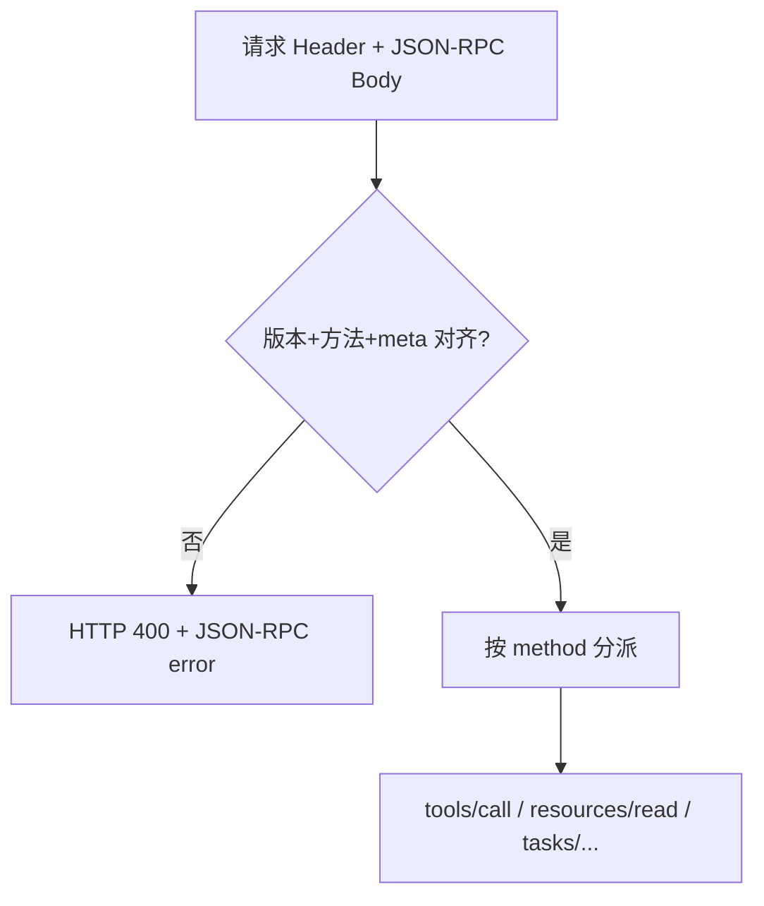

### 必要失败边界

- 没有 `Mcp-Protocol-Version` → HTTP 400 / `-32020`；版本不受支持 → HTTP 400 / `-32022`。
- `Mcp-Method` 不匹配 → HTTP 400 / `-32020`；未知 RPC 方法 → HTTP 404 / `-32601`。
- `tools/call` 的 `Mcp-Name` 错误 → HTTP 400 / `-32020`。
- **HTTP 状态与 JSON-RPC error 不是同一层**；工具调用出现业务策略拒绝时可能返回 HTTP 200 但 `result.isError=true`，不能只检查 HTTP 200 就算业务成功。

### 源码学习

[`server.py L63–85`](https://github.com/shark6438/servicemind/blob/19d9a377fb98e1c3f56edc59be40b374013bc08b/src/servicemind/mcp/server.py#L63-L85) 是 `JsonRpcRequest` 与 Header 输出，[`L145–211`](https://github.com/shark6438/servicemind/blob/19d9a377fb98e1c3f56edc59be40b374013bc08b/src/servicemind/mcp/server.py#L145-L211) 是入口顺序，[`L368–388`](https://github.com/shark6438/servicemind/blob/19d9a377fb98e1c3f56edc59be40b374013bc08b/src/servicemind/mcp/server.py#L368-L388) 是对名称的第二次核对。这里不要把服务端的 `_request_meta` 与 Client 的 `request()` 混成一个函数。

**小结与衔接：** 消息形状可以验证了，但任何人都能写一份 JSON；下一块解释“谁可以发送”。

---

## B04 · MCP 的身份：为什么知道 URL 不够？（MUST KNOW）

### 总：可以知道前台地址，不代表拥有公司工牌

ServiceMind MCP Server 不靠 `tenant_id` 这种任意 JSON 字段识别人。这里 HTTP 请求携带**用户 Bearer JWT**，服务从身份系统验证它的签发者、有效期、受众和权限。租户、用户与 Entity/Group Scope 来自验证后的 `TenantContext`，而不是让模型在工具参数里随意填。

### 正常流程与最小例子

Acme 分析员请求 `tools/list` 时，先经过 FastAPI 的 `TenantContextDependency`。未带 Token，MCP 入口会在处理 JSON-RPC 方法前以 **HTTP 401** 拒绝，并设置含 `resource_metadata=.../.well-known/oauth-protected-resource/v1/servicemind/mcp` 的 `WWW-Authenticate` 提示。MCP Client 可以先访问 **RFC 9728 Protected Resource Metadata** 发现应向哪个授权服务器获取 Token；元数据包含 `resource`、`authorization_servers`、`bearer_methods_supported`，不是发给客户端的密钥。

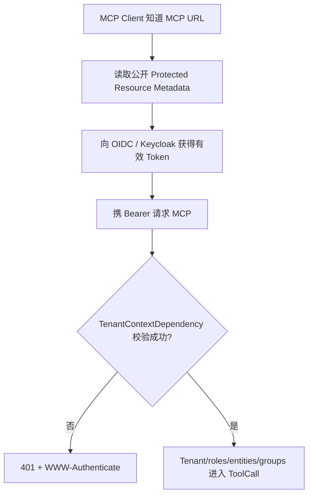

### 关键设计：认证与授权不是一回事

- **AuthN 认证**：JWT 真实有效，证明当前主体；它不代表该用户可用全部工具。
- **AuthZ 授权**：`registry.visible` 用角色/Entity 缩小**可发现**工具；`ToolGateway.policy.decide` 再核验具体 ToolCall 的能力与作用域。**能看到工具也不自动获得执行权限**。
- 当未配置 OIDC issuer，`mcp_protected_resource_metadata` 仍可返回不含授权服务器的说明，但**MCP 请求本身不会因此放开 OIDC**：`OIDCVerifier` 配置不完整时验证拒绝（fail closed）。

### 必要失败边界

OAuth 的 Metadata 端点公开不是漏洞，它只告诉客户端去哪里登录；若把这个公开接口误解成无需 JWT 的业务入口，就会错误推断安全边界。`SERVICEMIND_MCP_PUBLIC_URL` 可覆盖对外 Resource URL，但设置此值不是证书、Token 或部署真实连通性的证明。

### 源码学习

`get_tenant_context()` 由 FastAPI 注入 `mcp_request` 的 `context` 参数：[`security/auth.py L148–189`](https://github.com/shark6438/servicemind/blob/19d9a377fb98e1c3f56edc59be40b374013bc08b/src/servicemind/security/auth.py#L148-L189)。Metadata 路由：[`mcp/server.py L91–121`](https://github.com/shark6438/servicemind/blob/19d9a377fb98e1c3f56edc59be40b374013bc08b/src/servicemind/mcp/server.py#L91-L121)。它们在 [`service.py L569–574`](https://github.com/shark6438/servicemind/blob/19d9a377fb98e1c3f56edc59be40b374013bc08b/src/service/service.py#L569-L574) 被分别注册。

**小结与衔接：** 先证明你是谁，再讨论想用什么；下一块开始“发现工具”。

---

## B05 · 发现与能力协商：Server 需要先告诉 Client 什么？（MUST KNOW）

### 总：先看餐馆菜单和厨房声明

客户端第一次来，并不知道有哪些工具、是否可以异步查、有没有额外交接能力。`server/discover` 类似店门口的营业说明，`tools/list` 才像给这个人的菜单。**“Server 支持”不是“当前这个 Client 已声明支持”**。

### 正常流程与最小例子

`server/discover` 响应包含：`supportedVersions=["2026-07-28"]`、`capabilities.tools/resources`、两个扩展名称 `io.modelcontextprotocol/tasks` 和 `com.servicemind/governed-execution`、`ttlMs=60000`、`cacheScope=public`、instructions 说明禁止直接 GLPI mutation。JSON-RPC 外层 resultType 为 `complete`。

标准 Acme 客户端 `_meta.clientCapabilities.extensions={}` 不表示支持 Tasks，也没有受管执行扩展；因此它随后通过 `tools/list` 只能发现通用可见读工具，见 B06。客户端明确声明扩展也不能绕过 JWT 角色。

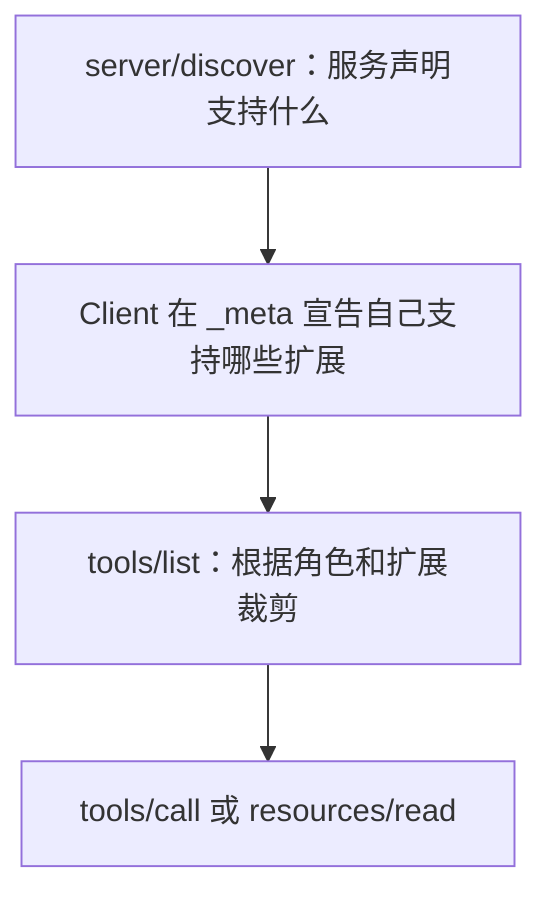

### 关键设计：两个扩展不是同一件事

- `io.modelcontextprotocol/tasks`：客户端表示可以接受工具返回 Task 对象，然后轮询 `/tasks/get`。
- `com.servicemind/governed-execution`：ServiceMind 自定义扩展；**仅允许发现/申请提交 ActionIntent 的那一类受管工具**，不是给外部 Client 直接“写 GLPI”的通行证。

### 必要失败边界

`clientInfo` 可省略；**clientCapabilities 是必需的**。声明 Tasks 扩展不是强迫所有工具走异步；只有 `TASK_AUGMENTED_TOOLS` 中工具符合条件时才创建 Task。发现能力 `ttlMs=60000` 是发现缓存建议，不是 Task 结果保存期限（Task 是 3600000 ms，后面 B12）。

### 源码学习

[`mcp/server.py L123–177`](https://github.com/shark6438/servicemind/blob/19d9a377fb98e1c3f56edc59be40b374013bc08b/src/servicemind/mcp/server.py#L123-L177) 讲 Metadata/扩展判断；[`L216–260`](https://github.com/shark6438/servicemind/blob/19d9a377fb98e1c3f56edc59be40b374013bc08b/src/servicemind/mcp/server.py#L216-L260) 是 discover 和 tools/list 分支。注意 **Server 的“capabilities”与 Client 的“clientCapabilities”不是同一个字段**。

**小结与衔接：** 服务端公布能做什么，客户端声明会处理什么，二者交集加上用户权限才决定菜单。下一块讲哪些工具真会上菜单。

---

## B06 · Tool Registry 与菜单：为什么 10 个已注册，外部只看到 4 个？（MUST KNOW）

### 总：仓库里有机器，不代表顾客可以按每个按钮

比如餐厅有收银后台、仓库钥匙和菜单，**不能把仓库后台所有按钮都放在顾客点餐界面**。工具注册表（Registry）保存完整 `ToolDefinition`；可发现（discoverable）只是**对外展示的第一层过滤**，真正执行还有角色、能力与策略控制。

### 正常流程与最小例子

冻结 `glpi_tool_definitions()` 共注册 10 个工具。其中四个只读业务功能在普通 MCP Client 的 `tools/list` 中可见：

| MCP 对外名字              | Registry 真正名字              | Ticket #5 上的用途               |
| ------------------------- | ------------------------------ | -------------------------------- |
| `search_tickets`          | `glpi.search_tickets`          | 搜索 VPN 工单                    |
| `get_ticket_context`      | `glpi.get_ticket_context`      | 获取 Ticket + Followups + Groups |
| `search_knowledge`        | `glpi.search_knowledge`        | 搜索知识材料                     |
| `query_cmdb_dependencies` | `glpi.query_cmdb_dependencies` | 查受影响的依赖关系               |

第五个 `submit_action_intent` 在角色满足 `analyst` 且 Client 声明 `com.servicemind/governed-execution` 后**才可在可发现列表中出现**。其余包括 `glpi.read.ticket`、`glpi.read.groups`、`glpi.read.ticket_followups`、`glpi.read_resource`、`glpi.append_ticket_followup` 都有 `discoverable=False`。特别是最后一个**真正侧写 GLPI 的工具**不能被模型通过菜单发现，调用它仍受 M16 审批链的服务内部限制。

### 关键设计：三种“看不见”不能混为一谈

`registry.visible(roles, entity_ids)` 是静态菜单过滤：active、discoverable、角色交集、若定义允许的 Entity 列表非空再查 Entity 交集；`tools/list` 另按 Client 是否支持 governed execution 隐藏 `submit_action_intent`；`ToolGateway.execute` 才是权威执行边界。**隐藏不等于授权，授权不等于可见**。

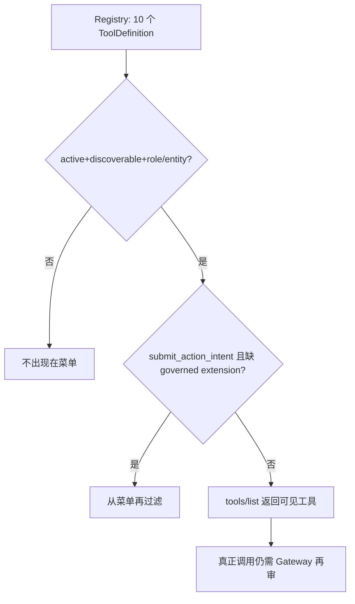

### 必要失败边界

不要说“4 个 read tools”就宣称 MCP 服务器只能处理这四种请求：`resources/read` 还可使用隐藏的 `glpi.read_resource`，由专用代码受控构造；也不要说“能发现 `submit_action_intent` 就一定能写 GLPI”。另外 `allowed_entities` 在当前 10 工具中没有设为非空，不能把这层注册表静态过滤夸大成已覆盖所有 GLPI 细粒度实体控制。

### 源码学习

[`tool_platform/catalog.py L31–273`](https://github.com/shark6438/servicemind/blob/19d9a377fb98e1c3f56edc59be40b374013bc08b/src/servicemind/tool_platform/catalog.py#L31-L273) 是十工具全目录；[`registry.py L29–42`](https://github.com/shark6438/servicemind/blob/19d9a377fb98e1c3f56edc59be40b374013bc08b/src/servicemind/tool_platform/registry.py#L29-L42) 是可见性过滤；[`server.py L245–278`](https://github.com/shark6438/servicemind/blob/19d9a377fb98e1c3f56edc59be40b374013bc08b/src/servicemind/mcp/server.py#L245-L278) 是协议响应的转换，包括移除 `glpi.` 前缀、`inputSchema`、`outputSchema`、`readOnlyHint`、版本与风险 `_meta`。

**小结与衔接：** 客户端看到了菜单，下一步它真正点击 `search_tickets` 时，Server 如何把网络消息变成内部 `ToolCall`？

---

## B07 · 一次 tools/call 怎样真正变成 ToolCall？（MUST KNOW）

### 总：先区分“网络单据”与“内部任务单据”

外部客户端递交的是 MCP JSON，内部执行器只认识 `ToolCall`。好比用户填网页表单，后台把它整理成一张有**本人身份、公司、授权范围、工单号、截止时间**的内部工单。绝不能因为 JSON 里写“我是管理员”就直接复制成权限。

### 正常流程与最小例子

沿用 B03 的 `search_tickets`，Server 检查 `Mcp-Name=search_tickets`，内部转换成 `glpi.search_tickets`，把 `arguments={"query":"VPN","limit":2}` 放入 `ToolCall`。身份取自已经验证的 `TenantContext`（Acme、`analyst`、Entity 1、允许的 Group），而**非工具参数**。

**示例：最终进入 Gateway 的一个 ToolCall 字段投影**（UUID、deadline 均为假设数据；这里只展示字段内容，完整字段类型在源 Pydantic 契约）：

```json
{
  "request_id": "aaaaaaaa-aaaa-4aaa-8aaa-aaaaaaaaaaaa",
  "tenant_id": "11111111-1111-4111-8111-111111111111",
  "run_id": "bbbbbbbb-bbbb-4bbb-8bbb-bbbbbbbbbbbb",
  "task_id": "mcp-ticket-5",
  "user_id": "acme-analyst",
  "roles": ["analyst"],
  "entity_ids": [1],
  "group_ids": [],
  "capabilities": ["glpi.search_tickets", "glpi.get_ticket_context", "glpi.search_knowledge", "glpi.query_cmdb_dependencies"],
  "tool_name": "glpi.search_tickets",
  "tool_version": "1.0.0",
  "arguments": {"query": "VPN", "limit": 2},
  "taint_labels": [],
  "approval_ref": null,
  "approval_binding": null,
  "deadline": "2026-10-13T09:00:00+00:00"
}
```

上面 `request_id/run_id/task_id` 只是为了说明模型形状；若 MCP 请求**没有**提供 `com.servicemind/execution`，冻结实现会**另外创建一条只读 AgentRun**，把随机 UUID 作为 `request_id`，并自动计算 `deadline=now+tool.timeout+5s`；因此上面的具体 ID 不能被当成“真实调用捕获”。`argument_hash` 在 `ToolCall` 中是**计算属性**，不是外部 JSON 可随意输入的字段。Server 将 Gateway `ToolExecutionResult` 变成工具响应。

### 关键设计：两条分支理解 Run 关联

- **有 `com.servicemind/execution`**：Client 给 `requestId/runId/taskId/deadline`，Pydantic 校验成 `ServiceMindExecutionMeta`。若 Gateway 使用 `PostgresToolAuditSink`，Server 还检查该 `runId` 是否属于当前已认证租户；测试的 InMemory Audit 则没有这道持久 Run 检查。这是明确的**配置相关接线分支**。
- **没有 execution 元数据**：Server 根据工具参数尝试提取 ticket ID（不是整数会回落0），调用租户 Repository 创建 `request_write=False` 的只读 AgentRun，再生成请求 ID 和任务 ID。不能把 JSON-RPC `id=7` 当作数据库 Run ID。
- **例外：`submit_action_intent`**：服务要求已声明受管扩展且携带 execution 元数据，否则参数被拒绝，不会按普通无元数据读取自动建 Run 后放行。

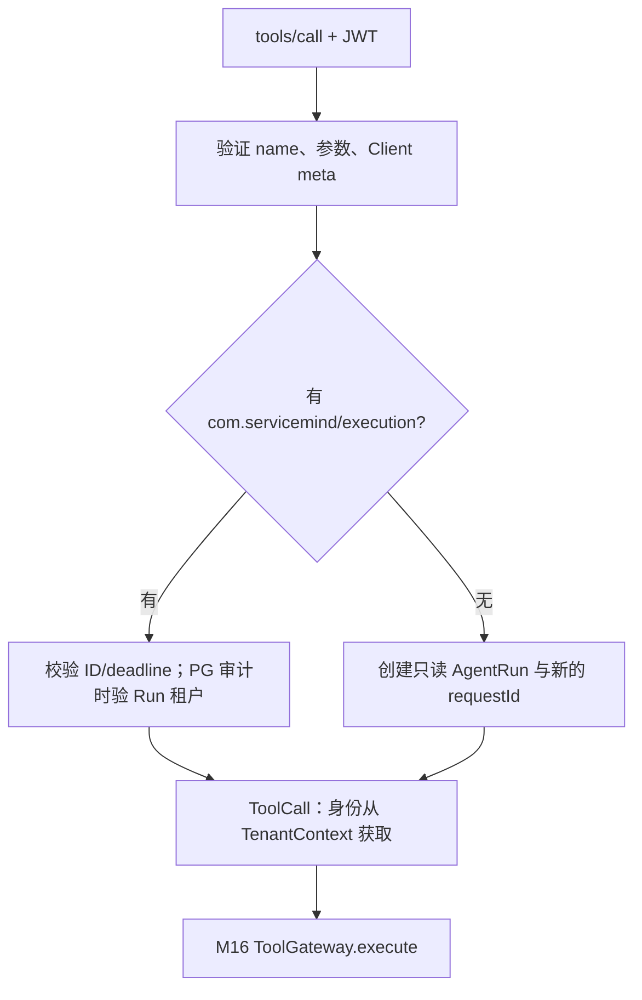

### 必要失败边界

- JSON 参数类型不对、工具名与 Header 不匹配，不能因为 JWT 合法就跳过解析。
- 已认证的工具菜单仍只提供“候选可见性”；ToolCall 的 `capabilities` 使用 `visible` 计算，不直接等于 `user.roles`。
- `requestId` 稳定性影响 Gateway/Task 幂等；**无 execution 元数据时重新生成的 ID 意味着重发同一业务参数未必认作相同请求**。
- **凭用户 JWT 发起**不等于用“用户身份”去调用下游 GLPI；Provider 另有服务身份/授权实现，后者也必须被限制与审计。

### 源码学习：依次追踪三个函数

1. [`mcp/server.py L339–366`](https://github.com/shark6438/servicemind/blob/19d9a377fb98e1c3f56edc59be40b374013bc08b/src/servicemind/mcp/server.py#L339-L366)：路由把已构造的 `call` 交给 `_gateway.execute()` 并捕获不同类别异常。
2. [`mcp/server.py L368–443`](https://github.com/shark6438/servicemind/blob/19d9a377fb98e1c3f56edc59be40b374013bc08b/src/servicemind/mcp/server.py#L368-L443)：`_tool_call()` 把 params、Header、TenantContext、execution 元数据变成完整 `ToolCall`。
3. [`tool_platform/contracts.py L76–131`](https://github.com/shark6438/servicemind/blob/19d9a377fb98e1c3f56edc59be40b374013bc08b/src/servicemind/tool_platform/contracts.py#L76-L131)：ToolCall 所有字段与 `argument_hash/approval_digest` 计算属性。

**小结与衔接：** JSON-RPC 的网络 ID 不等于业务 ID；Server 用真实主体建 `ToolCall`。下一块看另一种 MCP 能力：不“调用工具”，只按 URI **读取资源**。

---

## B08 · MCP Resources：为什么既有 Tool，也有 URI 资源？（MUST KNOW）

### 总：工具像“按按钮”，资源像“翻资料卡片”

查询 Ticket #5 可以写成调用 `get_ticket_context(ticket_id=5)`；也可以用 `glpi://tickets/5` 表达“我要这一条资源”。URI 不是操作系统的文件路径，也不是让服务端任意访问用户提供的 URL。**服务器要先把 URI 白名单解析为受控参数**。

### 正常流程与最小例子

第一次列资源：`resources/list` 返回**空数组**。这不等于“服务没有资源能力”；`resources/templates/list` 给出五类模板：

| 模板                     | 实例                   | 转换为内部参数                          |
| ------------------------ | ---------------------- | --------------------------------------- |
| `glpi://tickets/{id}`    | `glpi://tickets/5`     | `resource_type=ticket`, `resource_id=5` |
| `glpi://problems/{id}`   | `glpi://problems/8`    | problem / 8                             |
| `glpi://changes/{id}`    | `glpi://changes/3`     | change / 3                              |
| `glpi://cmdb/items/{id}` | `glpi://cmdb/items/12` | cmdb / 12                               |
| `glpi://knowledge/{id}`  | `glpi://knowledge/9`   | knowledge / 9                           |

当 Client 发 `resources/read` 并设置 `Mcp-Name: glpi://tickets/5`，Server 精确解析 URI 前缀与正整数，构造 `tool_name="glpi.read_resource"` 和 `arguments={"resource_type":"ticket","resource_id":5}`，通过 Gateway 执行。返回 `contents:[{"uri":...,"mimeType":"application/json","text":"..."}]`，还可能包含 `com.servicemind/receipt`。

### 关键设计：不把 URI 当任意远端访问目标

`_resource_arguments()` 只接受固定 `glpi://` 前缀与 `suffix.isdecimal() && id>0`；不支持 `file:///etc/passwd`、`https://other.example`、`../../` 等路径，也不能因 URI 像链接就用普通 HTTP Client 发往它所指的任意地址。`glpi.read_resource` 即使没有在普通菜单中展示，也由服务端**受控白名单分支**加入 `capabilities`，然后仍由 Gateway 做角色、Tenant 与参数校验。

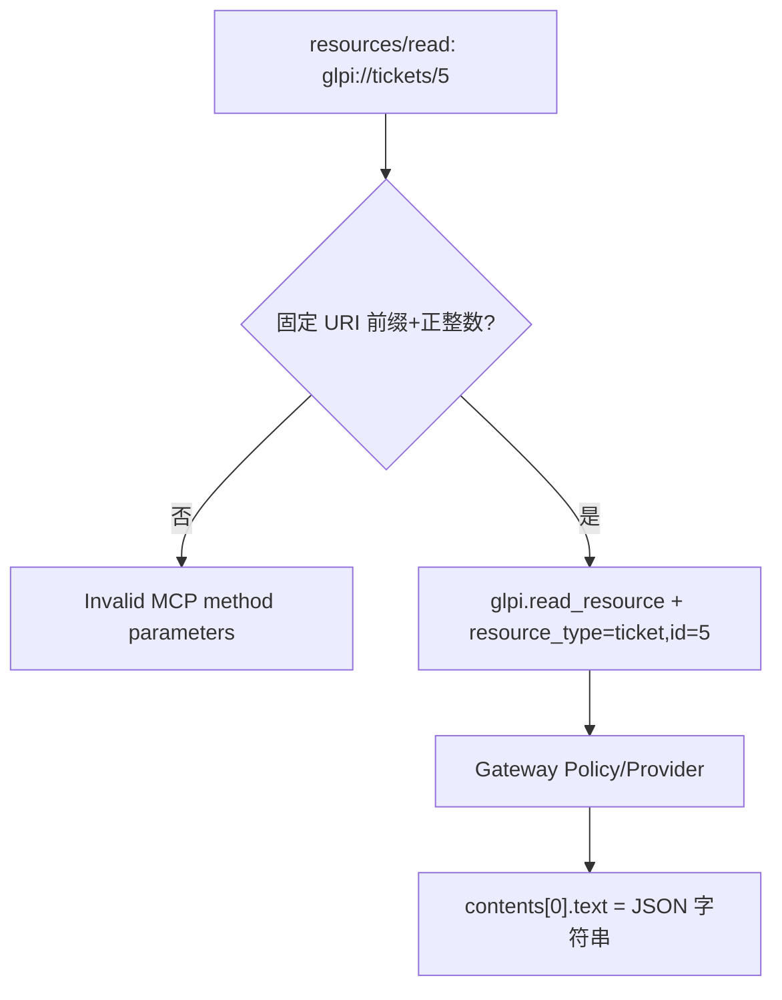

### 必要失败边界

- `resources/list=[]` 不是无资源的证明，它返回的是当前**固定资源枚举**为空，模板可用。
- `glpi://tickets/0`、`glpi://tickets/../../etc/passwd`、任意 `https://` 都不合契约。
- URI 中 ID 合法，也要继续检查这条真实 GLPI 数据是否属于当前用户的有效租户/Entity/Group 范围；URI 本身不是授权票据。

### 源码学习

[`mcp/server.py L278–303`](https://github.com/shark6438/servicemind/blob/19d9a377fb98e1c3f56edc59be40b374013bc08b/src/servicemind/mcp/server.py#L278-L303)：列资源与模板；[`L352–365`](https://github.com/shark6438/servicemind/blob/19d9a377fb98e1c3f56edc59be40b374013bc08b/src/servicemind/mcp/server.py#L352-L365)：`resources/read` 结果投影；[`L571–584`](https://github.com/shark6438/servicemind/blob/19d9a377fb98e1c3f56edc59be40b374013bc08b/src/servicemind/mcp/server.py#L571-L584)：资源白名单解析。

**小结与衔接：** Tool 是提交操作请求，Resource 是受限的“按 URI 读数据”。两者执行后都要回答“谁能相信结果”？下一块拆开 Tool Result 与 Receipt。

---

## B09 · 结果究竟长什么样？`structuredContent`、`isError` 与 Receipt（MUST KNOW）

### 总：快递签收单和包裹内容是两回事

`ToolExecutionResult` 是内部治理后的执行记录；MCP 响应则要把这份数据变成其他 Client 能理解的**网络格式**。`structuredContent` 是包裹内容，`content` 是文本表示，`receipt` 是远端服务给出的“此结果与哪次请求绑定”的元数据。三者职责不同。

### 正常流程与最小例子

假设 Ticket 搜索没有命中，Gateway 返回 `output={"tickets":[]}` 且 `verified=True`。下面展示服务端 `tools/call` 响应完整**结构示意**。`outputHash` 必须由 `sha256(json.dumps(output, ensure_ascii=False, sort_keys=True, separators=(",", ":")))` 计算，而不是随便填写一个像 hash 的字符串；本教材附带 JSON 文件含可复算值。

```json
{
  "jsonrpc": "2.0",
  "id": 7,
  "result": {
    "resultType": "complete",
    "content": [{"type": "text", "text": "{\"tickets\":[]}"}],
    "structuredContent": {"tickets": []},
    "isError": false,
    "_meta": {
      "io.modelcontextprotocol/serverInfo": {"name": "servicemind-glpi", "version": "1.0.0"},
      "com.servicemind/receipt": {
        "requestId": "aaaaaaaa-aaaa-4aaa-8aaa-aaaaaaaaaaaa",
        "outputHash": "5cf29510f28f698d44b4ed1d0f4a4f259d24c88287dd9acc6be010387a829585",
        "verified": true
      }
    }
  }
}
```

**读对象的顺序**：最外层 `id=7` 用于协议请求配对；`result.structuredContent` 是业务数据；`content[0].text` 是它的紧凑 JSON 文本；`receipt.requestId` 对应**内部 ToolCall.request_id**，不是外层 JSON-RPC `id`；`verified` 表示服务端经 Provider 验证流程返回 True。后面 B11 还会让客户端独立重算输出 Hash。

### 关键设计：错误也分两层

- 工具**业务层失败**（如 Policy 拒绝）在 `tools/call` 路径往往返回 `result.isError=true`，文本如 `Tool policy denied the request`，不一定是 HTTP 4xx。
- RPC 请求**语法/方法错误**则是 JSON-RPC `error={code,message}`；Header 不匹配往往同时设置 HTTP 400。
- `_receipts` 是 MCP Server 的**有界进程内 OrderedDict 缓存（2048）**，用于记住有限数量的 request→outputHash；它不是 PostgreSQL 审计、不等于可验证的远端签名，也不替代 ToolGateway 的持久审计记录。

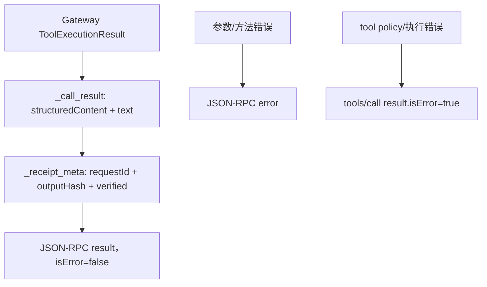

### 必要失败边界

不能把 `receipt.verified=true` 讲成“外部 GLPI 更改已被同一个事务提交”；这只是 ToolGateway 所报告的 Provider 检验结果。在 Reader 类工具中通常是 read-back/contract 核验；Side effect 类工具必须独立核查批准链，见 B15。更不能把 `outputHash` 当成 HMAC：SHA-256 无密钥，它保证本地重算能检测内容变化，但没有单凭 Hash 认证远端身份的能力。

### 源码学习

[`mcp/server.py L445–480`](https://github.com/shark6438/servicemind/blob/19d9a377fb98e1c3f56edc59be40b374013bc08b/src/servicemind/mcp/server.py#L445-L480) 给出结果三块对象；[`tool_platform/contracts.py L151–186`](https://github.com/shark6438/servicemind/blob/19d9a377fb98e1c3f56edc59be40b374013bc08b/src/servicemind/tool_platform/contracts.py#L151-L186) 给出 `ToolExecutionResult` 与 `output_hash` 精确公式。

**小结与衔接：** 现在知道结果长什么样了，下一块从**客户端视角**问：它凭什么相信收到的响应确实来自期望 MCP Server？

---

## B10 · 出站 MCP Client 的安全信任边界（MUST KNOW）

### 总：发请求前要先看地址，收回复前要看发件人

你让服务员去取一份公司内部工单，不能允许他被一个假网页重定向到陌生域名，也不能接受对方写个“我是正确服务器”就完成认证。`StatelessMcpClient` 的作用是**尽量限制传输路线并检查远端身份标识**，不是发一个 POST 就算成功。

### 正常流程与最小例子

在显式启用 `mcp_glpi` 的部署里，`McpGlpiProvider.execute()` 调用 `StatelessMcpClient.request("tools/call", name="search_tickets", params=...)`。Client 先由 `token_provider()` 获取一个服务 Token，再填 `Authorization: Bearer`、`Mcp-Protocol-Version`、`Mcp-Method`、`Mcp-Name`，正文使用 `jsonrpc=2.0`、随机消息 ID、`_meta`（版本、clientInfo 和 Tasks 扩展）。收到响应后核验：非预期重定向、会话 Header、Issuer、协议版本均拒绝；还要求结果是对象并含 `resultType`。

### 关键设计：四个非装饰性的控制

| 控制                     | 代码行为                                               | 防什么                     |
| ------------------------ | ------------------------------------------------------ | -------------------------- |
| 远程 HTTPS               | 除 `localhost` / `127.0.0.1` 外非 HTTPS URL 构造时拒绝 | 明文远端窃听               |
| `follow_redirects=False` | 收到重定向抛 `PermissionError`                         | Token 随重定向去非预期地点 |
| `trust_env=False`        | HTTP Client 不自动采用主机代理环境                     | 非预期代理路径             |
| Issuer pin               | `Mcp-Server-Issuer` 必须等于配置 `expected_issuer`     | 错误服务器/配置漂移        |

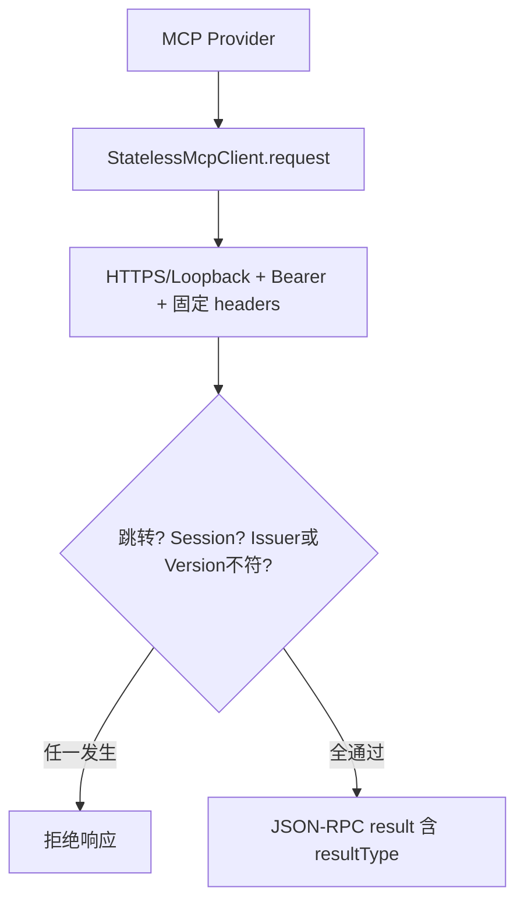

### 必要失败边界

Issuer Header 不是数字签名；它在**TLS 与正确证书/连接配置**的基础上增加一层响应标识检查，不能单独抵御恶意端点。`SERVICEMIND_MCP_SERVICE_TOKEN` 是**出站客户端凭证**，与入站用户的 OIDC Bearer JWT 不应混同。`httpx` 请求也有 `timeout_seconds`，但这只是网络请求级别控制，不代替 Graph 的运行预算。

### 源码学习

[`tool_platform/mcp_transport.py L23–112`](https://github.com/shark6438/servicemind/blob/19d9a377fb98e1c3f56edc59be40b374013bc08b/src/servicemind/tool_platform/mcp_transport.py#L23-L112) 给出完整 Client；`runtime.py:25–41` 将带 SecretStr 的设置变成 `token_provider` 并注入 Client。**函数调用顺序**是 `build_tool_gateway → McpGlpiProvider(StatelessMcpClient) → request → response validation`。

**小结与衔接：** Client 对远端信任是“来源和协议格式”的问题。下一块进一步问：远端说 `verified=true`，本地 Provider 是否真的核了内容？

---

## B11 · McpGlpiProvider：为什么 Native/MCP 不能随便声称同等可信？（SOURCE DEEP）

### 总：服务员说“货到了”，仓库还要数一遍

同一个 `ToolGateway` 可以调用 Native Provider 或 MCP Provider，但它不要求二者内部 HTTP 细节完全相同：Native 直接访问 GLPI；MCP 访问**远端被治理工具服务器**。Provider 要把不同后端结果转成统一的 `ProviderResult`，让 Gateway 能用同一套 Schema/Policy/Audit/Verification。

### 正常流程与最小例子

`McpGlpiProvider.execute(definition, call)` 发送 `tools/call`，并附 `com.servicemind/execution={requestId,runId,taskId,deadline}`。若立即返回结果，就读取 `structuredContent` 与 `_meta.com.servicemind/receipt`；若返回 `resultType=task`，先进入 B12 介绍的轮询，到完成才读取内层结果。`ProviderResult.provider_request_id` 被编码成三段：

```text
<requestId>:<receipt.outputHash>:<1 if receipt.verified is True else 0>
```

然后 `McpGlpiProvider.verify()` 不只是看字符串是否存在；它重新计算 **`output_hash(result.output)`**，要求 requestId 与 `call.request_id` 一致、hash 与当前结构化结果完全一致、最后的 verified 位必须是 `1`。通过后才返回 True 给 Gateway。

### 关键设计：本地重算保证绑定，不是多一次 GLPI 读回

| 谁做了什么                                    | 证据意味着什么                                 | 不能推断什么                     |
| --------------------------------------------- | ---------------------------------------------- | -------------------------------- |
| 远端 ToolGateway / Provider `verified=True`   | 远端声称完成某种 read-back 或一致性校验        | 这一定是独立第三方证明           |
| MCP Receipt 中携 requestId/outputHash         | 结果和一次远端请求绑定                         | 具备离线可验数字签名             |
| 本地 MCP Provider 重算 Hash 并检查 `verified` | 收到的 `structuredContent` 与远端 Receipt 一致 | 本地又亲自请求 GLPI 再核查了一遍 |
| TLS + Issuer pin                              | 有限定的传输身份边界                           | 把恶意远端数据变成系统指令       |

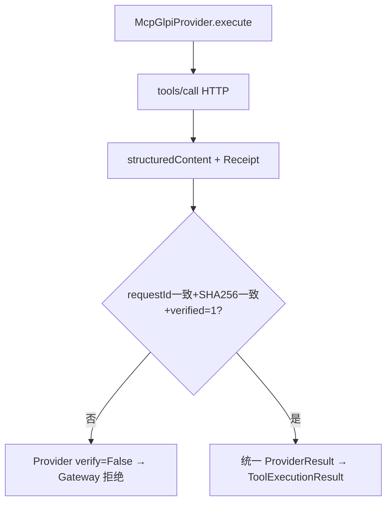

### 必要失败边界

`_await_task` 在 `input_required` 时明确抛错——**当前 Client 不支持交互式任务补问**。若远端 Client/Server Protocol 版本不匹配、没有 Receipt、`Receipt` Hash 不对、或对端自行撒谎称 `verified=true`，分别涉及不同边界。**代码校验 Receipt 一致，不等于证明远端逻辑永远可信；安全结论必须限定到受信任服务器与 TLS 设置。**

### 源码学习

[`mcp_transport.py L113–188`](https://github.com/shark6438/servicemind/blob/19d9a377fb98e1c3f56edc59be40b374013bc08b/src/servicemind/tool_platform/mcp_transport.py#L113-L188)，[`gateway.py L217–254`](https://github.com/shark6438/servicemind/blob/19d9a377fb98e1c3f56edc59be40b374013bc08b/src/servicemind/tool_platform/gateway.py#L217-L254)。服务端真正的 Receipt 编码在 `mcp/server.py:445–461`。测试里的 Native/MCP Parity **定义**见 [`test_phase6_tool_platform.py L354–430`](https://github.com/shark6438/servicemind/blob/19d9a377fb98e1c3f56edc59be40b374013bc08b/tests/servicemind/test_phase6_tool_platform.py#L354-L430)，不把存在测试定义冒充本轮执行。

**小结与衔接：** Native/MCP 可以统一契约，不代表网络、身份和读回语义完全相同。现在进入 MCP 最特殊的一环：有些工具调用不能一秒钟完成，怎么交付进度？

---

## B12 · MCP Tasks：为什么慢查询要先给“领取单”？（MUST KNOW）

### 总：在线办证不是每次都在窗口等到办完

查询一个 Ticket 很快，可以直接返回；查询一大片 CMDB 依赖可能需要较长时间。如果 HTTP 请求一直占着连接，客户端很难确认超时后到底有没有受理。**Task 扩展允许先返回 Task ID，让客户端之后轮询结果**。它是协议上的异步办理方式，**不是所有工具统一变异步，更不是“离线持久队列一定能自动重跑”**。

### 正常流程与最小例子

ServiceMind 冻结 Server 的 `TASK_AUGMENTED_TOOLS=frozenset({"glpi.query_cmdb_dependencies"})`。只有同时满足：`method=tools/call`、工具在集合里、请求 `_meta.clientCapabilities.extensions` 含 `io.modelcontextprotocol/tasks`，才走 Task 分支。第一次响应大体如下（时间与 ID 均为教学示例）：

```json
{
  "jsonrpc": "2.0",
  "id": 8,
  "result": {
    "resultType": "task",
    "taskId": "cccccccc-cccc-4ccc-8ccc-cccccccccccc",
    "status": "working",
    "createdAt": "2026-10-13T09:00:00+00:00",
    "lastUpdatedAt": "2026-10-13T09:00:00+00:00",
    "ttlMs": 3600000,
    "pollIntervalMs": 1000,
    "_meta": {"io.modelcontextprotocol/serverInfo": {"name": "servicemind-glpi", "version": "1.0.0"}}
  }
}
```

客户端每隔 `pollIntervalMs=1000` ms 调 `tasks/get`；完成后回 `status=completed` 且 `result` 是 **B09 的 `_call_result` 对象**，不是直接裸 `nodes/edges`；失败时回 `error.code=-32603`；取消时为 `status=cancelled`，不会伪造成功结果。

### 关键设计：先分清五个不同标识或时间

- JSON-RPC `id`：这一次 HTTP/RPC 调用编号。
- 内部 `ToolCall.request_id`：工具请求幂等身份。
- `StoredMcpTask.task_id`：可被 `tasks/get` 使用的 Task UUID；与 `ToolCall.task_id`（workflow_task_id）**不是同一个字段**。
- `ttlMs=3600000`：Task 保留可查询 1 小时（从 `created_at` 算），**不是单次调用可以执行1小时的超时**。
- `pollIntervalMs=1000`：建议轮询间隔，既不是 Lease 30 秒，也不是 Gateway 超时。

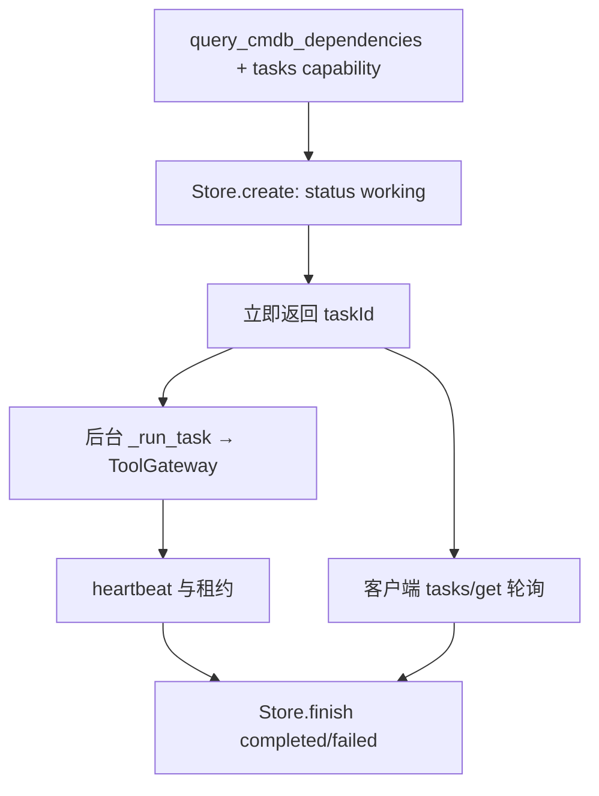

### 必要失败边界

- `search_tickets` 即使声明 Tasks 扩展也不会自动进 `_task_store`。
- 不声明 Tasks 扩展时，`query_cmdb_dependencies` **直接同步走 Gateway**；能力协商限制的是 Task 返回方式。
- `tasks/get/update/cancel` 需要客户端声明 Tasks 扩展并提供匹配 `Mcp-Name=taskId`；`tasks/update` **明确拒绝**，因为实现不允许客户端伪造某个任务的最终结果。
- 服务器任务后台使用 `asyncio.create_task`，Postgres 状态虽可恢复/判定中断，**它不是会自动重新排队执行原工具的持久作业队列**。

### 源码学习

[`mcp/server.py L304–335`](https://github.com/shark6438/servicemind/blob/19d9a377fb98e1c3f56edc59be40b374013bc08b/src/servicemind/mcp/server.py#L304-L335) 创建任务；[`L482–569`](https://github.com/shark6438/servicemind/blob/19d9a377fb98e1c3f56edc59be40b374013bc08b/src/servicemind/mcp/server.py#L482-L569) 查询、取消与后台执行；[`mcp/tasks.py L16–39`](https://github.com/shark6438/servicemind/blob/19d9a377fb98e1c3f56edc59be40b374013bc08b/src/servicemind/mcp/tasks.py#L16-L39) 定义 TTL、`StoredMcpTask` 真正的八个字段。

**小结与衔接：** Task 先回答“这件事已受理，现在是什么状态”，但**状态存哪里**、服务重启后又怎么处理，下一块详细拆开。

---

## B13 · Task 存储：内存还是 PostgreSQL，差别在哪？（MUST KNOW）

### 总：写在便利贴和写进数据库不是一回事

假设你在窗口领了一张 Task #A 的领取单：如果只贴在服务员桌上，服务重启后可能找不到；如果写入 PostgreSQL，就能在不同进程间找到。但即使有数据库，**找到“之前执行到一半”的记录，也不意味着外部网络任务可以从原来那行代码自动继续**。

### 正常流程与最小例子

ServiceMind 将两种实现统一在 `McpTaskStore` Protocol 下，定义 `recover_interrupted/heartbeat/create/get/finish/cancel` 六个方法；输入包括 `tenant_id` 和真正的 `task_id`。在启用 Tool Platform 的 FastAPI lifespan 中：若 `DATABASE_TYPE.value == "postgres"`，创建 **`PostgresMcpTaskStore`**；否则创建 **`InMemoryMcpTaskStore`**。之后会调用 `recover_interrupted()` 并传给 `configure_mcp_gateway()`。**这是一条有条件的 WIRED FACT**，而不是“Task 永远落 PostgreSQL”。

| 对比         | InMemoryMcpTaskStore                               | PostgresMcpTaskStore                              |
| ------------ | -------------------------------------------------- | ------------------------------------------------- |
| 存在哪里     | 进程的 `values/requests` 两个字典                  | `mcp_tasks` 表，Tenant RLS 会话                   |
| 幂等请求身份 | `(tenant_id,request_id)` + 四元 immutable identity | `UNIQUE(tenant_id,request_id)` + 读取后比四元身份 |
| 结果         | 进程内完整对象                                     | `output_ciphertext`，读回解密                     |
| 重启         | 进程丢失内存数据                                   | 数据行仍在，可查到状态                            |
| 执行所有权   | 当前进程的 asyncio.Task                            | `lease_owner`/`lease_expires_at`（默认30秒）      |
| 超时结果     | 读时清理到期 Task 及 request 映射                  | `get` 拒绝已过 TTL，启动恢复时清理过期行          |

### 关键设计：为什么即使有数据库仍需 Lease？

多副本部署时，A 与 B 都能看到 Task 行，但**不能都当执行者写结果**。`PostgresMcpTaskStore.worker_id` 是实例唯一的 `mcp-{uuid4()}`，`heartbeat()` 只有 `status=working 且 lease_owner=self.worker_id` 才能续租；`finish()` 也只允许这个 Lease Owner 更新 working 行。这叫“租约确认写入权”，不等于操作外部系统的全局互斥锁。

**完整 StoredMcpTask 的八字段教学例子：**

```json
{
  "task_id": "cccccccc-cccc-4ccc-8ccc-cccccccccccc",
  "status": "working",
  "output": null,
  "output_hash": null,
  "error_code": null,
  "cancellation_requested": false,
  "created_at": "2026-10-13T09:00:00+00:00",
  "updated_at": "2026-10-13T09:00:00+00:00"
}
```

这是 `StoredMcpTask` 完整 Pydantic 字段形状，非完整数据库 `McpTaskRecord` 列集合。`McpTaskRecord` 还存 tenant/run/request/workflow_task、工具名、`argument_hash`、Lease、密文、唯一约束及时间戳；从数据库返回给客户端时不暴露密文。

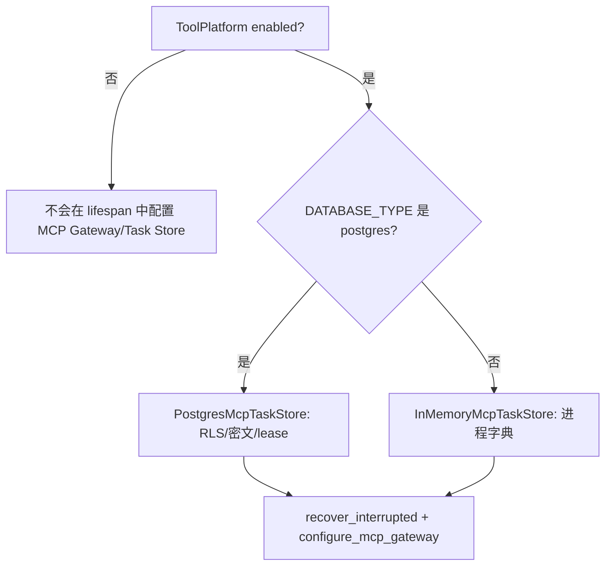

### 必要失败边界

- `InMemory` 内的 `recover_interrupted()` 能把**当前仍保有的 working 对象**标记 failed，但不能恢复一个进程已经丢掉的旧字典。
- Postgres 在启动恢复时只将**Lease 过期**的 working 置 failed；健康副本仍持 Lease 的任务不应被另一副本随意宣告中断。恢复**不会重做 GLPI 查询**，只记录失败/清理保留时间。
- 输出密文使用 `CredentialCipher`，这是保护数据库静态结果，不等于传输 TLS，也不等于带角色粒度的授权；RLS 控制按租户可见行。
- `TASK_TTL_MS=3600000` 且基于 `created_at`，不是最后心跳时刻。对超过时限的 `get()` 返回 `None`，不能以“数据库还在”继续展示过期结果。

### 源码学习

[`mcp/tasks.py L16–76`](https://github.com/shark6438/servicemind/blob/19d9a377fb98e1c3f56edc59be40b374013bc08b/src/servicemind/mcp/tasks.py#L16-L76) 是 Task Protocol 与对象；[`L77–196`](https://github.com/shark6438/servicemind/blob/19d9a377fb98e1c3f56edc59be40b374013bc08b/src/servicemind/mcp/tasks.py#L77-L196) 是 InMemory 的两个映射；[`L198–366`](https://github.com/shark6438/servicemind/blob/19d9a377fb98e1c3f56edc59be40b374013bc08b/src/servicemind/mcp/tasks.py#L198-L366) 是 PostgreSQL 实现；启动接线见 [`service.py L124–139`](https://github.com/shark6438/servicemind/blob/19d9a377fb98e1c3f56edc59be40b374013bc08b/src/service/service.py#L124-L139)。

**小结与衔接：** 内存存“当前进程知道什么”，Postgres 保存“数据库知道什么”，Lease 定义“谁当前可更新”。下一块把重试、取消与崩溃窗口分清。

---

## B14 · 幂等、Lease、取消与恢复：哪些承诺做得到？（SOURCE DEEP）

### 总：快递重复敲门，不应该生成两张新的委托单

客户端网络超时后可能再发同一请求。Task 层需要把重复请求映射回同一个 Task；但如果 Client 每次产生新的内部 `requestId`，服务器无从知道是同一笔业务。**幂等 key 的稳定性来自调用方，与“工具参数看起来一样”不是同一件事。**

### 正常流程与最小例子

设 Acme 第一次使用 `requestId=aaaaaaaa-...`，请求 `run_id=R, workflow_task_id=T3, tool=glpi.query_cmdb_dependencies, argument_hash=H`。服务器创建 `mcpTaskId=C`，存两层标识。再次以**同 tenant、同 request ID 和相同四元身份**调用，会获得已有 Task `C`；若相同 request ID 但把 `argument_hash` 换为 `H2`，两种 Store 均抛 `ValueError("MCP request ID was reused with different task content")`，不会偷偷复用 C。

**重试与恢复时间线：**

```text
首次 tools/call → create working C → _run_task 进行中
  ├─ 同一 requestId/相同内容重投 → 读回 C，不能起第二个后台_task
  ├─ 同一 requestId/换内容 → 报幂等冲突
  ├─ tasks/cancel → 标记 cancelled，并尝试 cancel 本进程 asyncio task
  ├─ completed → finish 只允许原 working + owner 更新
  └─ 进程异常退出 → 下次启动 recover_interrupted 对到期 Lease 标 failed
```

### 关键设计：三种取消都不是“撤销已发生副作用”

1. **取消请求**：`tasks/cancel` 先按 tenant/taskId 查 Store；本机 `_running_tasks` 若存在则调用 `task.cancel()`；再对 Store `cancel()`。
2. **取消协程**：`_run_task` 捕获 `CancelledError`，取消包着的 `execution_task`；如果它已执行外部调用，网络取消不能把对方数据库已经提交的事实反转。
3. **持久状态**：Task Store 只允许从 working 改为 terminal，`finish()` 在 Lease Owner/状态检查不符时不会把 `cancelled` 重新涂成 `completed`。这保证**状态写回不被晚到结果复活**，不是外部 exactly-once。

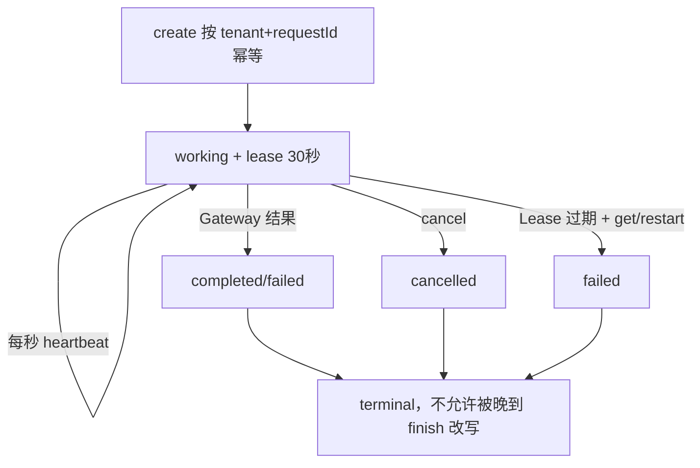

### 必要失败边界：最该背的两个时窗

- **HTTP 已返回 taskId，异步工作进程随后死掉**：PG 行保留，后续恢复能查出过期 Lease/标 failed，但默认不会自动再投递同一外部调用。
- **工具已产生外部效果，结果保存前崩溃**：Task 的状态可能 failed，而外部世界已变化。由于当前 Task 异步增强工具是只读 `query_cmdb_dependencies`，不能拿它证明所有写任务跨系统 exactly-once；M16 的 GLPI Follow-up 另用审批约束和 marker/read-back 解决写路径。

**TTL 的历史 Bug（SOURCE COMMENT CLAIM）**：`mcp/tasks.py:16–23` 明言早期 Client 收到 TTL=1h 承诺，而 InMemory store 却既不清结果、也不清幂等映射，导致内存长期增长；后续 `_forget_expired()` 同时删除值与 request 映射，避免“记录仍指向已删除任务”造成 KeyError。请把这个当源注释记载的开发史，不当本轮重新观测的内存故障。

### 源码学习

- [`tasks.py L81–149`](https://github.com/shark6438/servicemind/blob/19d9a377fb98e1c3f56edc59be40b374013bc08b/src/servicemind/mcp/tasks.py#L81-L149)：InMemory cleanup、幂等身份、create。
- [`tasks.py L204–337`](https://github.com/shark6438/servicemind/blob/19d9a377fb98e1c3f56edc59be40b374013bc08b/src/servicemind/mcp/tasks.py#L204-L337)：PG recover、heartbeat、create、get、finish。
- [`server.py L482–569`](https://github.com/shark6438/servicemind/blob/19d9a377fb98e1c3f56edc59be40b374013bc08b/src/servicemind/mcp/server.py#L482-L569)：为什么 `tasks/update` 被拒与 `tasks/cancel` 的执行位置。

**小结与衔接：** Task 层能守住单个委托的 ID、状态和租约，但不直接授权 GLPI 写入。下一块解释受管 MCP 的 `submit_action_intent` 究竟能做什么。

---

## B15 · 受管写入：`submit_action_intent` 为什么不等于修改 GLPI？（MUST KNOW）

### 总：提出付款申请和财务打款是两件事

员工可以提交报销申请，但不能因为系统回了“申请已创建”，就说钱已经打出去了。`submit_action_intent` 就是**把一个待审业务意图保存为正式对象**。真正追加 GLPI Follow-up 还须独立的 Reviewer、审批、权限续查、Controller/Executor 和读回验证。这是 M5/M16 与 M17 的连接点。

### 正常流程与最小例子

Ticket #5 VPN 排查结束，分析员希望添加 Follow-up：“建议检查 MFA 网络链路”。受管客户端必须同时满足：分析员角色、已声明 `com.servicemind/governed-execution`、提供 `com.servicemind/execution`（含 `runId/requestId/...`）、`ActionIntent` JSON 通过完整 Schema 和 `verify_integrity()`、Tenant/Run/Requester 与**认证主体**一致。`ProductionGlpiBackend.invoke("glpi.submit_action_intent",...)` 最终调用 `ServiceMindRepository.save_action_intent(...)`，返回示意：

```json
{
  "intent_id": "dddddddd-dddd-4ddd-8ddd-dddddddddddd",
  "action_hash": "__SYNTHETIC_64_HEX_COMPUTED_BY_ACTIONINTENT__",
  "status": "proposed"
}
```

这是**业务输出示意**，不是可直接拿去调用的 ActionIntent 入参；真实参数必须使用 `ActionIntent.model_json_schema()` 定义的全部字段并通过其中 Hash/Review/Evidence 约束。即使拿到 `proposed`，GLPI 里仍没有新增 Follow-up。


#### 完整 v2 ActionIntent 的入参长什么样？

下面展示的是真实 `ActionIntent` Pydantic **全部18个顶层字段**的教学入参，不是可以直接获批的凭证。它按冻结 `calculate_hash` 算出 `action_hash`，并按 `stable_digest(sorted(evidence_refs))` 算出 `evidence_digest`；但 `review_digest` 的重复 `1` **只是符合64位形状的教学替身**，没有 Reviewer 审核记录或对应身份，因此**绝不可拿它申请真实写操作**。

```json
{
  "id": null,
  "run_id": "bbbbbbbb-bbbb-4bbb-8bbb-bbbbbbbbbbbb",
  "action_type": "append_ticket_followup",
  "target_id": 5,
  "arguments": {
    "content": "建议检查 MFA 网络链路",
    "is_private": true
  },
  "risk_level": "medium",
  "requires_approval": true,
  "action_hash": "aa69bb931eddbbe847ffa4ddfa94a09775e8be16906259c07448280b68ed94e2",
  "tenant_id": "11111111-1111-4111-8111-111111111111",
  "requested_by": "acme-analyst",
  "evidence_refs": [
    "ev-ticket-5"
  ],
  "idempotency_context": {
    "source": "m17-training"
  },
  "intent_version": "v2",
  "policy_version": "m17-policy-training",
  "review_digest": "1111111111111111111111111111111111111111111111111111111111111111",
  "evidence_digest": "969aaf2bc09df951ed4abd8531b5d19279ed45e5efeb3b41c9e27df9278b4f2c",
  "expires_at": "2026-10-13T10:00:00+00:00",
  "dry_run_preview": "教学预览：拟追加一条 VPN 检查建议"
}
```

注意 `expires_at` 的 `+00:00`：冻结 `verify_integrity()` 在计算安全哈希时使用 Python `datetime.isoformat()`，会将 UTC 表示为这个字符串；不要在重算时擅自改成 `Z` 再声称原 Hash 应保持不变。此处的 `action_hash` 验证的是字段完整性，**不能代替已通过的 Reviewer/Human 审批或数据库中的 ActionIntent 状态**。源码：[`domain/models.py L51–144`](https://github.com/shark6438/servicemind/blob/19d9a377fb98e1c3f56edc59be40b374013bc08b/src/servicemind/domain/models.py#L51-L144)、[`domain/integrity.py L10–16`](https://github.com/shark6438/servicemind/blob/19d9a377fb98e1c3f56edc59be40b374013bc08b/src/servicemind/domain/integrity.py#L10-L16)。

### 关键设计：三道防线分属不同组件

- **MCP Server**：标准客户端菜单隐藏此工具；声明受管扩展后还必须提供 execution 元数据，否则失败。
- **ToolGateway**：M16 的 Schema、Policy、Capabilities、Audit、Provider 验证仍执行；不能靠“客户说支持扩展”直接绕过 Role/Scope。
- **业务 Repository**：验证 `ActionIntent.verify_integrity()`、Tenant/Run/Requester 相同，再存 `ActionIntent`，只到 `proposed`。后续批准和 GLPI 实际写操作由受控 ActionExecutor 另行执行；**`glpi.append_ticket_followup` 对 MCP 普通菜单不可发现，且 Provider 会要求持久的 Approved ActionIntent 和正文/目标/私密性/Marker 全匹配**。

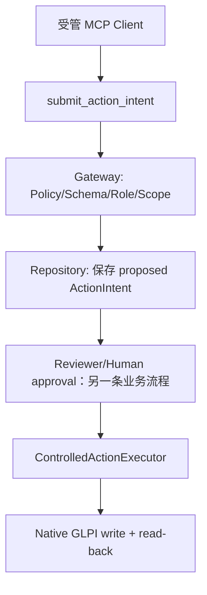

### 必要失败边界

`governed-execution` 是 Client 自报能力，不是人类审批。`ActionIntent.action_hash` 也不是**授权凭据本身**：它约束内容一致性，真正执行还需要查持久审批行。MCP Server 发布的 `server/discover.instructions` 直接声明“Direct GLPI mutation is unavailable”；不能为了演示 MCP 写入而把这个限制取消。

### 源码学习

[`server.py L245–278`](https://github.com/shark6438/servicemind/blob/19d9a377fb98e1c3f56edc59be40b374013bc08b/src/servicemind/mcp/server.py#L245-L278) 菜单过滤；[`L389–410`](https://github.com/shark6438/servicemind/blob/19d9a377fb98e1c3f56edc59be40b374013bc08b/src/servicemind/mcp/server.py#L389-L410) 强制 governed metadata；[`catalog.py L199–267`](https://github.com/shark6438/servicemind/blob/19d9a377fb98e1c3f56edc59be40b374013bc08b/src/servicemind/tool_platform/catalog.py#L199-L267) submit 和隐藏 Write 定义；[`providers.py L203–239`](https://github.com/shark6438/servicemind/blob/19d9a377fb98e1c3f56edc59be40b374013bc08b/src/servicemind/tool_platform/providers.py#L203-L239) 持久提案；[`providers.py L87–172`](https://github.com/shark6438/servicemind/blob/19d9a377fb98e1c3f56edc59be40b374013bc08b/src/servicemind/tool_platform/providers.py#L87-L172) 是**另一条被批准后的写与复核链**。

**小结与衔接：** MCP 管“怎么交付请求”，不替人批准，也不绕过持久化业务权限。下一块整理真实部署：这套能力默认就上线了吗？

---

## B16 · 配置与生产接线：Server 有函数，是否已经在线？（MUST KNOW）

### 总：建筑图上画了门，不证明门已经打开

程序有 MCP Router 和 Task Store 类，只说明“它能这么做”；要看**谁在启动时构造 Gateway、选哪种 Provider、注册什么依赖、OIDC 真实能否认证**，才能判断一个实际部署中哪个功能可达。这里把前十五块组装为一条闭合的配置链。

### 正常流程与最小例子

冻结 `service.py:create_app()` **总是注册** `mcp_router` 与 `mcp_metadata_router`；但 `service.py:126–139` 只在 `SERVICEMIND_TOOL_PLATFORM_ENABLED=True` 时**构造 Task Store、恢复中断、配置 `_gateway`**。因此在新进程且 Flag 关闭的情况下，端点 URL 可以存在、OIDC 仍可能要求 Token，但真正通过认证并走到 `_gateway is None` 会返回 HTTP 503。**路由注册不代表业务可用**。

| 配置                                | 冻结默认/条件            | 影响                                           | 结论作用域                 |
| ----------------------------------- | ------------------------ | ---------------------------------------------- | -------------------------- |
| `SERVICEMIND_TOOL_PLATFORM_ENABLED` | `False`                  | 是否在 lifespan 配置 MCP Gateway 与 Task Store | 静态默认，非部署值         |
| `SERVICEMIND_TOOL_PROVIDER`         | `native_glpi`            | Native 直连还是 `mcp_glpi` 远端 Provider       | 必须确认运行配置           |
| `SERVICEMIND_MCP_GLPI_URL`          | `None`                   | 出站 MCP Client 地址                           | 不能凭类存在认为已可用     |
| `SERVICEMIND_MCP_SERVICE_TOKEN`     | `None`                   | 出站服务 Token（SecretStr）                    | 不读/不打印 `.env`         |
| `SERVICEMIND_MCP_EXPECTED_ISSUER`   | `servicemind://glpi-mcp` | 出站 Issuer pin                                | Header 必须匹配            |
| `SERVICEMIND_MCP_PUBLIC_URL`        | `None`                   | 对外 OAuth resource metadata URL 覆盖          | 不证明公网域名可达         |
| `DATABASE_TYPE=postgres`            | 依部署                   | Postgres Task Store + PG Audit / Run scope     | 不等于当前部署已迁移       |
| `SERVICEMIND_TOOL_POLICY_MODE`      | `local`                  | 可以另配置 `opa` 策略                          | OPA 服务定义不等于默认使用 |

### 关键设计：读写工具的两层网关不要形成“无限循环”

当外部 MCP Client→本项目 MCP Server→本地 Gateway，默认 Provider 是 Native GLPI。**如果部署改为 `mcp_glpi`**，就变成服务发起第二次出站 MCP；必须确认 `SERVICEMIND_MCP_GLPI_URL` 指向真正期望的独立远端，而不是“自己调用自己”，以及服务 Token 的 Tenant/Role/Entity/Group Scope 是否符合业务授权。当前源码没有自动解出一个**唯一正确部署拓扑**。

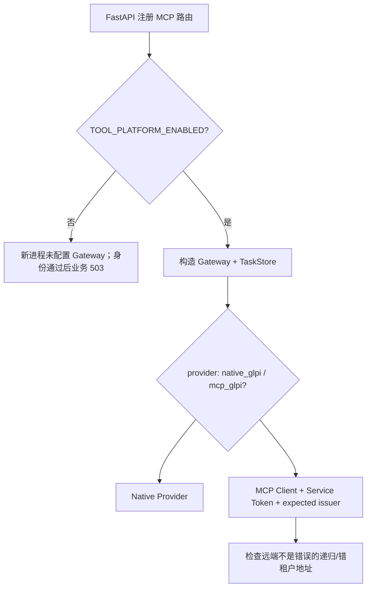

### 必要失败边界

- `build_tool_gateway` 有 `@lru_cache(maxsize=1)`，配置在进程启动后变更不意味着即时重建组件；运行配置验收不能用“文件已编辑”替代当前对象实例检查。
- `mcp_router` 已注册不证明 `MCP Server` 实际受理有效业务：身份验证、Flag、数据库和 Provider 分别是独立门。
- 出站 MCP Client 的 service token 不应使用人类 JWT 的“同一身份”假设；远端会从**它收到的 Token**建立 TenantContext，不能凭 Client 的 `com.servicemind/execution` 声称远端继承全部用户原始授权。
- 仓库的 `scripts/verify_phase6_mcp_http.py` 会读取 `deploy/glpi/.env` 获取演示密码。**本次只读脚本源码、没有执行它，更没有读取任何 `.env`**。

### 源码学习

[`service.py L124–139`](https://github.com/shark6438/servicemind/blob/19d9a377fb98e1c3f56edc59be40b374013bc08b/src/service/service.py#L124-L139)、[`L569–574`](https://github.com/shark6438/servicemind/blob/19d9a377fb98e1c3f56edc59be40b374013bc08b/src/service/service.py#L569-L574)；[`runtime.py L19–88`](https://github.com/shark6438/servicemind/blob/19d9a377fb98e1c3f56edc59be40b374013bc08b/src/servicemind/tool_platform/runtime.py#L19-L88)；[`settings.py L322–337`](https://github.com/shark6438/servicemind/blob/19d9a377fb98e1c3f56edc59be40b374013bc08b/src/core/settings.py#L322-L337)。

**小结与衔接：** 正确结论要写成“代码定义了 X，配置为 Y 时接线，现场是否真的开启仍待实测”。接下来讨论项目报告、测试与产线观测，不把它们混在一个桶里。

---

## B17 · 测试与验收：绿色数字证明到了哪一步？（SOURCE DEEP）

### 总：试卷满分不等于每一道现实场景都发生过

企业项目可以有单元测试、集成测试、协议 Conformance，以及历史验收报告。**“测试文件有 assert”只是测试定义；“冻结报告记载曾执行 422 passed”是历史报告；“今天服务器正在通过同一测试”需要本轮真实执行证据**。把三件事混写就会生成假绿结论。

### 正常流程与最小例子

`tests/servicemind/test_phase6_tool_platform.py` 定义：Native/MCP parity；拒绝错误 Issuer、Mcp-Session-Id；JSON-RPC Header/ClientCapabilities；OAuth Protected Resource 401；严格 URI；Task 保留期和 request-id 幂等。在测试中 Client 常使用 `httpx.ASGITransport(app=...)` 和 `app.dependency_overrides[get_tenant_context]`，这验证**应用内协议行为**，不能冒充真实 Keycloak 登录。

`docs/PHASE6_ENTERPRISE_ACCEPTANCE.md` 则记载 **2026-09-14 的历史验收**：全仓 422 passed、6 skipped；Phase6 专项 15 passed；Phase4–6 联合 89 passed、1 skipped；conformance 的 server-stateless 有 21 SUCCESS、5 SKIPPED、4 NOT TESTABLE；说明支持面验收，不等于 conformance 所有未支持项都完成。**此处只是引用冻结报告，不是本轮运行所得**。

### 关键设计：一次验收最少需要四个分母

| 证据                      | 能支持什么                 | 不该说什么                    |
| ------------------------- | -------------------------- | ----------------------------- |
| 代码中定义了 Test         | 设计者计划覆盖此行为       | 该测试现在已经通过            |
| 静态检查源码与 Schema     | 符号、字段、调用关系可复核 | 服务已部署且可达              |
| 历史 Phase6 报告          | 那次验收的范围与具体数字   | 今天所有环境仍相同            |
| 本轮现场 HTTP/DB/Keycloak | 现役路径的受控运行观测     | 未来永久无故障或 exactly-once |

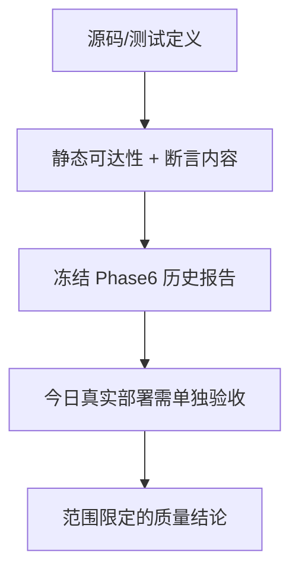

### 必要失败边界：历史缺陷与当前已修复机制也要分桶

**历史 TTL Bug**：Task 宣告可查询1小时，但最早的 InMemory 实现没按 TTL 清值/幂等映射；现补 `_forget_expired`，源码注释可证。**历史安全修正**：Client 不接受 MCP 会话 Header/错误 Issuer，相关测试验证该拒绝行为。**不要把“当前代码有拒绝”写成“现实曾遭受攻击”**。

> [!warning] 对协议覆盖范围的限定
> 项目固定 `MCP_PROTOCOL_VERSION="2026-07-28"`，该实现的 `server/discover`、无会话 HTTP JSON-RPC、Tasks 与扩展遵循**冻结版的特定契约**；不要把它自动宣称适配所有历史 MCP SDK、全部 SSE/initialize 路径。测试明确拒绝 `initialize` 未支持的方法，也不为凑 Conformance 数字凭空暴露诊断工具。

### 源码学习

[`tests/test_phase6_tool_platform.py L354–430`](https://github.com/shark6438/servicemind/blob/19d9a377fb98e1c3f56edc59be40b374013bc08b/tests/servicemind/test_phase6_tool_platform.py#L354-L430)、[`L488–718`](https://github.com/shark6438/servicemind/blob/19d9a377fb98e1c3f56edc59be40b374013bc08b/tests/servicemind/test_phase6_tool_platform.py#L488-L718)、[`L719–875`](https://github.com/shark6438/servicemind/blob/19d9a377fb98e1c3f56edc59be40b374013bc08b/tests/servicemind/test_phase6_tool_platform.py#L719-L875)。冻结历史报告 [`docs/PHASE6_ENTERPRISE_ACCEPTANCE.md L1–74`](https://github.com/shark6438/servicemind/blob/19d9a377fb98e1c3f56edc59be40b374013bc08b/docs/PHASE6_ENTERPRISE_ACCEPTANCE.md#L1-L74)。

**小结与衔接：** 源码可以证明设计、测试定义证明测试的目标、冻结报告记载旧结果；当前部署需要新的观测。最后将所有模块连成一条完整的、能面试复述的故事。

---

## B18 · 一张白板复述 MCP：从用户提问到结果，完整走十步（MUST KNOW）

### 总：讲架构不是背名词，而是能说出“每一步把什么交给谁”

你在面试里说“我们用了 MCP、ToolGateway、OAuth 和 PostgreSQL Task”，如果不能解释**谁把什么输入交给什么函数，得到什么对象**，这些词就没有技术含量。现在只用 Acme Ticket #5，先讲一个**同步读**，再讲一个**异步 CMDB 读**，最后指出“写”不能从 MCP 绕过审批。

### 正常流程与最小例子：两条读路径

**同步 Ticket 搜索（默认 Native 后端、ToolPlatform Flag 已显式启用的前提）**：

1. 用户在 MCP Host 提问“找 VPN 工单”，Host 将工具意图交给 MCP Client。
2. Client 知道资源地址，发现 OIDC Issuer，并用合法 Bearer 调 `tools/list`。
3. `mcp_request` 经 `TenantContextDependency` 验证 JWT，建立 Acme+analyst+Entity1。
4. `tools/list` 按可见/role/extension 返回 `search_tickets`。
5. `tools/call` Header+JSON-RPC 双向一致；`_tool_call` 将 MCP 名称改为 `glpi.search_tickets` 并构造 `ToolCall`。
6. `ToolGateway.execute` 做输入 Schema、Policy、能力、限流、熔断、幂等、Provider、输出 Schema、verify、审计。
7. `NativeGlpiProvider` 访问 GLPI；返回 `{"tickets":[...]}`，经过 Gateway 验证形成 `ToolExecutionResult`。
8. `_call_result` 形成 `structuredContent`/文本及 Receipt；Client/Host 再决定怎样给用户讲结果。

**异步依赖查询（额外声明 Task 扩展）**：

9. `query_cmdb_dependencies` 才走 `_task_store.create()`，返回 `taskId/working`；客户端隔一秒 `tasks/get`，后台 `_run_task` 执行 Gateway 并持续 heartbeat。
10. 成功后 Task Store 返回 `completed + result`；失败/取消/Lease 过期则按已知状态返回。Task 可查询 1h，不能把“已返回 Task”认成“依赖关系查询已经完成”。

### 关键设计：四平面画法与 M16/M18/M19 边界

- **Control Plane**：何时调用哪个 Agent/Task、LangGraph Run 生命周期（M6/M10）。
- **Agent Plane**：Analysis/Reviewer 等业务推理与需求表达。
- **Capability Plane**：ToolGateway、MCP Server/Client、RAG、Memory、Skills、Model Gateway 都属于这里的能力，但具体职责分别落在 M16/M17/M18/M19。
- **Governance Plane**：身份、权限、审批、RLS/ACL、审计、幂等边界。MCP **复用治理平面，不创造第二套免审特权**。

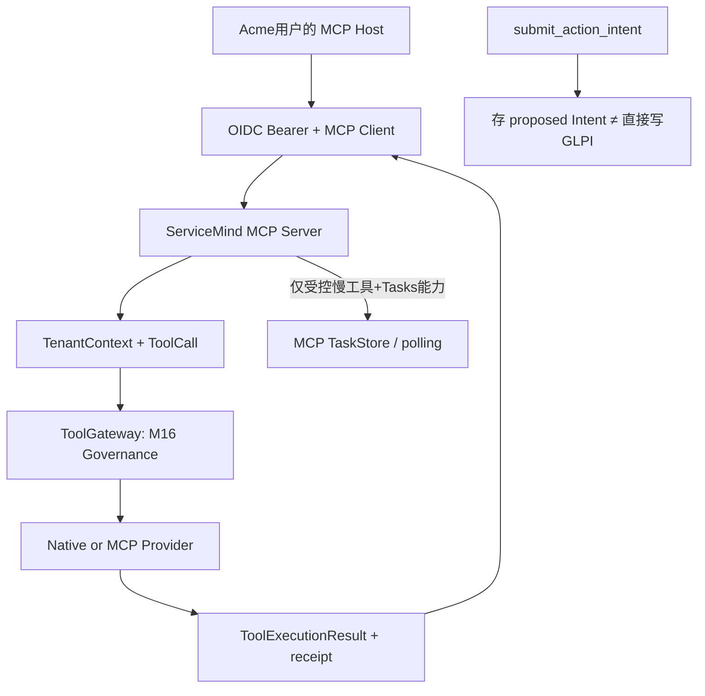

### 必要失败边界：你绝不能说的五句话

1. “MCP 自己就是大模型。”——错误，它是连接工具/资源的通信协议。
2. “发现了工具就已经授权执行。”——错误，Menu 可见与 Gateway Policy 是两层。
3. “MCP verified 是独立签名并证明 GLPI 修改成功。”——错误，它是有条件的 Receipt/Provider 绑定。
4. “有 Postgres Task 就保证崩溃后自动续跑、exactly-once。”——错误，当前 Lease 过期主要是标 failed，副作用不可自动撤销。
5. “代码已实现就是今天上线。”——错误，Flag、OIDC、Provider URL、实际部署和历史报告要分别验。

### 源码学习：按实际 Caller 顺序复习

`service.py:create_app` 注册路由 → `mcp_request` → `_tool_call` → `ToolGateway.execute` → Provider → `_call_result`；慢工具另外 `_task_store.create` / `_run_task` / `tasks/get`；出站时 `McpGlpiProvider` → `StatelessMcpClient` → 远端 MCP Server。主要锚点 [`service.py L124–139`](https://github.com/shark6438/servicemind/blob/19d9a377fb98e1c3f56edc59be40b374013bc08b/src/service/service.py#L124-L139)、[`server.py L178–367`](https://github.com/shark6438/servicemind/blob/19d9a377fb98e1c3f56edc59be40b374013bc08b/src/servicemind/mcp/server.py#L178-L367)、[`gateway.py L117–278`](https://github.com/shark6438/servicemind/blob/19d9a377fb98e1c3f56edc59be40b374013bc08b/src/servicemind/tool_platform/gateway.py#L117-L278)、[`mcp_transport.py L113–188`](https://github.com/shark6438/servicemind/blob/19d9a377fb98e1c3f56edc59be40b374013bc08b/src/servicemind/tool_platform/mcp_transport.py#L113-L188)。

**小结：** **MCP 负责共同语言；M16 Gateway 负责治理；Agent/Graph 负责决定什么时候需要能力；数据库/RLS/审批负责业务可信边界。** 面试复述时永远从“这个数据谁生成、谁校验、传给谁、最终落在哪里”开始。

---

# A · M17 源码基线、逐文件审计与冻结验收（A0–A9）

## A0 · Rule 6、证据标准与主题边界

### A0.1 冻结输入与可重现范围

| 门禁                     | 当前静态来源                                                 | 结论                                                       |
| ------------------------ | ------------------------------------------------------------ | ---------------------------------------------------------- |
| GitHub repo              | `shark6438/servicemind`                                      | 仅分析该仓库                                               |
| Commit                   | `19d9a377fb98e1c3f56edc59be40b374013bc08b`                   | 所有 GitHub 链接使用完整 SHA                               |
| Tree                     | GitHub 固定 SHA `git/trees/...?...recursive=1`               | 1,388 blob + 128 tree，共 1,516，`truncated=false`         |
| 相对祖先                 | `fe3b2dcc84d41e6f7f345fd5830f2e12a978c10a`                   | 对相同路径比较 blob SHA 得三标签；**不是证明作者原创归属** |
| 工作树 `HEAD`、porcelain | 本轮并没有本地完整源码工作树，也未运行 `git status`          | `UNKNOWN`；不能声称本轮本地 clean                          |
| 真实环境                 | 本轮未读 `.env`、未连接生产 PostgreSQL/GLPI/Keycloak/OPA、未启动服务 | 无新增 `RUNTIME OBSERVED`                                  |
| 之前验收                 | 冻结 `docs/PHASE6_ENTERPRISE_ACCEPTANCE.md` 与 `evaluation/reports/phase6_acceptance_latest.json` | `HISTORICAL REPORT`，不得自动升级为本轮运行证据            |

证据层 E1–E6：**E1** 冻结源代码；**E2** Settings/契约；**E3** Migration/DB Model；**E4** 当前受控活体观测（**本轮无**）；**E5** 冻结历史报告；**E6** 明示的静态推演与教学构造。跨层引用应保留来源性质，不得把历史报告的 PASS 写成现役生产 PASS。

### A0.2 知识边界（不吞并下一 Master）

- M16 已经教 ToolGateway、Policy、Provider、Schema、审计、写入验证；M17 必须解释**这些如何通过 MCP 网络协议连接**，不再为 M16 重写整套课程。
- M17 必须教 Client/Server、JSON-RPC、发现/工具/资源、OAuth、结果收据、MCP Tasks 与真实 Caller；但不宣称覆盖所有 MCP 上游可选协议功能。
- M18 的模型 Gateway/结构化生成、M19 的 Skills 工作流程、M20 的通用安全只引入作为前置的少量必要概念。精简主线中被跳过的 Master 仍为 DEFERRED，不等于其完整内容已自动完成。

## A1 · 逐文件目录：真实路径、行数、来源标签和学习深度

> 标签只相对于祖先 `fe3b2dcc...` 比较路径与 blob SHA：`UPSTREAM`=路径存在且内容相同；`UPSTREAM-MODIFIED`=路径存在而 blob SHA 不同；`SERVICEMIND-ADDED`=祖先没有此路径。此表属于相对 Git 历史分类，不证明个人代码原创归属。表内行数按冻结文件换行计。

| 编号 | 路径                                                    | 行数 | 三标签            | 深度与用途                                                   |
| ---- | ------------------------------------------------------- | ---: | ----------------- | ------------------------------------------------------------ |
| 01   | `src/servicemind/mcp/server.py`                         |  584 | SERVICEMIND-ADDED | **DEEP** · 入站 JSON-RPC、Tool/Resource/Task 分派            |
| 02   | `src/servicemind/mcp/tasks.py`                          |  366 | SERVICEMIND-ADDED | **DEEP** · 两种 TaskStore、租约/密文/TTL                     |
| 03   | `src/servicemind/mcp/transport.py`                      |   14 | SERVICEMIND-ADDED | AWARE · 兼容重导出，不是第三种实现                           |
| 04   | `src/servicemind/mcp/__init__.py`                       |    5 | SERVICEMIND-ADDED | AWARE · 包导出                                               |
| 05   | `src/servicemind/tool_platform/mcp_transport.py`        |  189 | SERVICEMIND-ADDED | **DEEP** · 出站 StatelessMcpClient 与 McpGlpiProvider        |
| 06   | `src/servicemind/tool_platform/contracts.py`            |  186 | SERVICEMIND-ADDED | **DEEP** · ToolDefinition/Call/ExecutionResult 字段          |
| 07   | `src/servicemind/tool_platform/catalog.py`              |  273 | SERVICEMIND-ADDED | **DEEP** · 10 工具具体 Schema/角色/隐藏标记                  |
| 08   | `src/servicemind/tool_platform/registry.py`             |   42 | SERVICEMIND-ADDED | **DEEP** · Registry.visible                                  |
| 09   | `src/servicemind/tool_platform/policy.py`               |  135 | SERVICEMIND-ADDED | SOURCE · 决策，M16 已主讲                                    |
| 10   | `src/servicemind/tool_platform/gateway.py`              |  313 | SERVICEMIND-ADDED | **DEEP** · MCP 到统一执行边界的真实转换                      |
| 11   | `src/servicemind/tool_platform/providers.py`            |  375 | SERVICEMIND-ADDED | **DEEP** · GLPI 真实执行与 ActionIntent 分隔                 |
| 12   | `src/servicemind/tool_platform/runtime.py`              |   88 | SERVICEMIND-ADDED | **DEEP** · Native/MCP provider 的配置选择                    |
| 13   | `src/servicemind/tool_platform/audit.py`                |  122 | SERVICEMIND-ADDED | SOURCE · Run 校验分支中的 PostgreSQL Audit Sink              |
| 14   | `src/servicemind/security/auth.py`                      |  224 | SERVICEMIND-ADDED | **DEEP** · JWT→TenantContext、401 resource_metadata          |
| 15   | `src/servicemind/security/crypto.py`                    |   21 | SERVICEMIND-ADDED | SOURCE · 持久 Task 输出的 Fernet 加解密                      |
| 16   | `src/servicemind/persistence/models.py`                 |  755 | SERVICEMIND-ADDED | **DEEP** · McpTaskRecord、约束/RLS 底层模型                  |
| 17   | `src/servicemind/persistence/database.py`               |   40 | SERVICEMIND-ADDED | SOURCE · tenant_session 与全局会话                           |
| 18   | `src/service/service.py`                                |  577 | UPSTREAM-MODIFIED | **DEEP** · MCP Router / Gateway / TaskStore 的生产启动接线   |
| 19   | `src/core/settings.py`                                  |  517 | UPSTREAM-MODIFIED | **DEEP** · MCP/Provider/Task 相关默认参数                    |
| 20   | `migrations/versions/0011_phase6_tool_platform.py`      |  177 | SERVICEMIND-ADDED | **DEEP** · 首次建立 mcp_tasks/RLS                            |
| 21   | `migrations/versions/0012_mcp_task_leases.py`           |   38 | SERVICEMIND-ADDED | **DEEP** · lease owner/expiration 与索引                     |
| 22   | `migrations/versions/0013_phase6_hash_guards.py`        |   40 | SERVICEMIND-ADDED | SOURCE · Task Hash/Tool Invoke CHECK                         |
| 23   | `tests/servicemind/test_phase6_tool_platform.py`        |  875 | SERVICEMIND-ADDED | SOURCE · 协议、Parity、TTL、Resources/OAuth 断言             |
| 24   | `scripts/verify_phase6_mcp_http.py`                     |  226 | SERVICEMIND-ADDED | AUDIT · 历史 live 验证脚本；**不可执行，脚本含读取 .env 的逻辑** |
| 25   | `docs/PHASE6_ENTERPRISE_ACCEPTANCE.md`                  |   74 | SERVICEMIND-ADDED | AUDIT · 2026-09-14 历史验收报告                              |
| 26   | `evaluation/reports/phase6_acceptance_latest.json`      |  155 | SERVICEMIND-ADDED | AUDIT · 历史机器可读验收结果                                 |
| 27   | `tests/servicemind/test_phase7_principal_invariants.py` | 1597 | SERVICEMIND-ADDED | AUDIT · 相关跨租户/权限防线、避免过度授权                    |
| 28   | `src/servicemind/domain/models.py`                      |  158 | SERVICEMIND-ADDED | **DEEP** · ActionIntent 全字段与哈希/Review 约束             |
| 29   | `src/servicemind/domain/integrity.py`                   |   67 | SERVICEMIND-ADDED | SOURCE · `stable_digest` Canonical JSON 与注入标记共有定义   |

## A2 · 符号、Caller、依赖、输出：如何确认生产接线而不只“找到类”？

### A2.1 实际调用入口的逆向索引

| 从哪里来（Caller）                       | 目标函数/对象                                             | 输入                                     | 输出/下一跳                                 | 分类                 |
| ---------------------------------------- | --------------------------------------------------------- | ---------------------------------------- | ------------------------------------------- | -------------------- |
| `service.py:create_app`                  | `include_router(mcp_router/mcp_metadata_router)`          | FastAPI app                              | HTTP `/v1/servicemind/mcp` 与 `.well-known` | WIRED FACT           |
| `service.py:lifespan`（Flag true）       | `build_tool_gateway` + `PostgresMcpTaskStore` 或 InMemory | Settings / DB type                       | `configure_mcp_gateway(gateway, store)`     | WIRED FACT（条件式） |
| FastAPI + `TenantContextDependency`      | `mcp_request`                                             | JSON-RPC Body、Headers、已验证 principal | discover/list/call/resource/task            | WIRED FACT           |
| `mcp_request`                            | `_tool_call`                                              | params、Mcp-Name、TenantContext          | `ToolCall`                                  | SOURCE FACT          |
| `_tool_call`（无 execution meta）        | `Repository.create_run`                                   | tenant,user,ticket,goal                  | 只读 AgentRun                               | WIRED FACT           |
| `mcp_request`                            | `ToolGateway.execute`                                     | ToolCall                                 | ToolExecutionResult/异常                    | WIRED FACT           |
| `mcp_request`（eligible task）           | `_task_store.create` + `_run_task`                        | Task identity + ToolCall                 | Task 状态/后台执行                          | WIRED FACT           |
| `_run_task`                              | `store.heartbeat / store.finish`                          | tenant,taskId,结果                       | 工作期租约与 terminal 状态                  | SOURCE FACT          |
| `ToolGateway`（provider=`mcp_glpi`）     | `McpGlpiProvider.execute/verify`                          | ToolDefinition, ToolCall                 | ProviderResult / bool                       | WIRED FACT（配置式） |
| `McpGlpiProvider.execute`                | `StatelessMcpClient.request`                              | HTTP Bearer/JSON-RPC                     | 远端结果/Receipt                            | SOURCE FACT          |
| `McpGlpiProvider.execute`（Task result） | `_await_task`                                             | taskId,deadline                          | tasks/get 轮询/取消                         | SOURCE FACT          |
| `ProductionGlpiBackend.invoke`           | `save_action_intent`                                      | 受管完整 Intent                          | `proposed`，没有 GLPI mutation              | SOURCE FACT          |

### A2.2 MCP 源码的公开符号一览（避免知识盲区）

**`mcp/server.py`**：常量 `MCP_PROTOCOL_VERSION`、`MCP_SERVER_ISSUER`、`TASK_EXTENSION`、`GOVERNED_EXECUTION_EXTENSION`、`SERVER_INFO`、`TASK_POLL_INTERVAL_MS`、`TASK_AUGMENTED_TOOLS`；路由 `mcp_router`/`mcp_metadata_router`；`configure_mcp_gateway`、`shutdown_mcp_tasks`；`JsonRpcRequest`、`ServiceMindExecutionMeta`、`HeaderMismatchError`； `_headers`、`_public_resource_url`、`mcp_protected_resource_metadata`、`_meta`、`_result`、`_error`、`_request_meta`、`_supports_tasks`、`_supports_governed_execution`、`mcp_request`、`_tool_call`、`_receipt_meta`、`_call_result`、`_call_error_result`、`_task_request`、`_task_payload`、`_run_task`、`_resource_arguments`。

**`mcp/tasks.py`**：`TASK_TTL_MS`、`StoredMcpTask`、`_expired`、`McpTaskStore` 六方法协议；`InMemoryMcpTaskStore`（`_forget_expired`, `recover_interrupted`,`heartbeat`,`create`,`get`,`finish`,`cancel`）；`PostgresMcpTaskStore` 同六方法；`_record_expired`、`_to_task`。

**`tool_platform/mcp_transport.py`**：`MCP_PROTOCOL_VERSION`、`TASK_EXTENSION`、`StatelessMcpClient.__init__` / `.request`、`McpGlpiProvider.execute / _await_task / verify`。**`mcp/transport.py` 仅重导出**。

**契约链**：`ToolDefinition`→`ToolCall.argument_hash`→`ToolPolicyDecision`→`ProviderResult`→`ToolExecutionResult.output_hash`。`JsonRpcRequest.id`、`ToolCall.request_id`、`StoredMcpTask.task_id`、`McpTaskRecord.run_id` 不是同一种标识；B07/B12 的完整 JSON 已把三个粒度分开。

### A2.3 已确认生产/配置接线与不可达声明

1. **入站 MCP Router**：始终注册在 `create_app()`；不代表 Flag 关闭时已初始化 Gateway。
2. **Gateway 初始化**：仅在 `SERVICEMIND_TOOL_PLATFORM_ENABLED` 时由 lifespan 接线；而 `McpGlpiProvider` **额外**要求 `SERVICEMIND_TOOL_PROVIDER=mcp_glpi`、URL、Token。
3. **标准用户菜单**：Registry 真定义10工具，经 discoverable/roles/entity 等过滤仅普通四个读工具对标准 Client 可见；`submit_action_intent` 另需 governed extension；直接写工具不在菜单。
4. **Task Store**：PG 时用 `mcp_tasks` + migration 0011/0012/0013，非 PG 用 InMemory；测试存在不能替代当前迁移实况。
5. **旧/标准会话路径**：本实现并未把传统 SSE/stateful session、`initialize` 等方法纳入所支持面；`Mcp-Session-Id` 视为需要拒绝的响应 Header，参见客户端。

## A3 · Source Fact Baseline：CONFIRMED / TO VERIFY / UNKNOWN 三桶

### A3.1 已确认事实（每条单独提供冻结源码）

| ID    | 已确认的结论（不超过证据作用域）                             | 类型                   | 冻结证据                                                     |
| ----- | ------------------------------------------------------------ | ---------------------- | ------------------------------------------------------------ |
| SF-01 | MCP 固定协议版本字符串 `2026-07-28`，Server issuer 固定为 `servicemind://glpi-mcp`。 | `SOURCE FACT`          | [`src/servicemind/mcp/server.py:29–34`](https://github.com/shark6438/servicemind/blob/19d9a377fb98e1c3f56edc59be40b374013bc08b/src/servicemind/mcp/server.py#L29-L34) |
| SF-02 | MCP Server 路由固定 `/v1/servicemind/mcp`，Metadata 路由独立。 | `SOURCE FACT`          | [`src/servicemind/mcp/server.py:32–44`](https://github.com/shark6438/servicemind/blob/19d9a377fb98e1c3f56edc59be40b374013bc08b/src/servicemind/mcp/server.py#L32-L44) |
| SF-03 | `configure_mcp_gateway` 装配 Gateway 与可选 TaskStore。      | `SOURCE FACT`          | [`src/servicemind/mcp/server.py:47–51`](https://github.com/shark6438/servicemind/blob/19d9a377fb98e1c3f56edc59be40b374013bc08b/src/servicemind/mcp/server.py#L47-L51) |
| SF-04 | 关闭 Service 时 `shutdown_mcp_tasks` 会取消并 await 当前登记的异步 Task。 | `SOURCE FACT`          | [`src/servicemind/mcp/server.py:54–60`](https://github.com/shark6438/servicemind/blob/19d9a377fb98e1c3f56edc59be40b374013bc08b/src/servicemind/mcp/server.py#L54-L60) |
| SF-05 | 入站 JsonRpcRequest 禁止多余字段、只接受 JSON-RPC 2.0、ID 整数/字符串、params 对象。 | `SOURCE FACT`          | [`src/servicemind/mcp/server.py:63–70`](https://github.com/shark6438/servicemind/blob/19d9a377fb98e1c3f56edc59be40b374013bc08b/src/servicemind/mcp/server.py#L63-L70) |
| SF-06 | execution 扩展需要 requestId、runId、taskId、deadline，Pydantic 拒多余键。 | `SOURCE FACT`          | [`src/servicemind/mcp/server.py:72–79`](https://github.com/shark6438/servicemind/blob/19d9a377fb98e1c3f56edc59be40b374013bc08b/src/servicemind/mcp/server.py#L72-L79) |
| SF-07 | MCP 响应设置 Protocol Version/Server Issuer/Cache-Control no-store。 | `SOURCE FACT`          | [`src/servicemind/mcp/server.py:85–89`](https://github.com/shark6438/servicemind/blob/19d9a377fb98e1c3f56edc59be40b374013bc08b/src/servicemind/mcp/server.py#L85-L89) |
| SF-08 | RFC9728 Metadata 有两个公开路径；无 OIDC Issuer 时返回空授权服务器列表。 | `SOURCE FACT`          | [`src/servicemind/mcp/server.py:91–121`](https://github.com/shark6438/servicemind/blob/19d9a377fb98e1c3f56edc59be40b374013bc08b/src/servicemind/mcp/server.py#L91-L121) |
| SF-09 | 请求 `_meta` 必须包含协议版本和 clientCapabilities；clientInfo 可省略，有则校验 name/version。 | `SOURCE FACT`          | [`src/servicemind/mcp/server.py:145–165`](https://github.com/shark6438/servicemind/blob/19d9a377fb98e1c3f56edc59be40b374013bc08b/src/servicemind/mcp/server.py#L145-L165) |
| SF-10 | Tasks 与 governed-execution 是两个独立的 clientCapabilities extension 标识。 | `SOURCE FACT`          | [`src/servicemind/mcp/server.py:167–176`](https://github.com/shark6438/servicemind/blob/19d9a377fb98e1c3f56edc59be40b374013bc08b/src/servicemind/mcp/server.py#L167-L176) |
| SF-11 | MCP HTTP 缺协议 Header 会 400/-32020，版本错误 400/-32022。  | `SOURCE FACT`          | [`src/servicemind/mcp/server.py:178–200`](https://github.com/shark6438/servicemind/blob/19d9a377fb98e1c3f56edc59be40b374013bc08b/src/servicemind/mcp/server.py#L178-L200) |
| SF-12 | Mcp-Method 与 JSON-RPC method 不同会 400/-32020，版本 meta 不一致同样拒绝。 | `SOURCE FACT`          | [`src/servicemind/mcp/server.py:202–215`](https://github.com/shark6438/servicemind/blob/19d9a377fb98e1c3f56edc59be40b374013bc08b/src/servicemind/mcp/server.py#L202-L215) |
| SF-13 | 未配置 MCP Gateway 时业务返回 HTTP503/-32603（在认证/元数据校验之后）。 | `SOURCE FACT`          | [`src/servicemind/mcp/server.py:216–222`](https://github.com/shark6438/servicemind/blob/19d9a377fb98e1c3f56edc59be40b374013bc08b/src/servicemind/mcp/server.py#L216-L222) |
| SF-14 | server/discover 返回工具/资源与 Tasks、受管执行扩展声明，不暴露直接 GLPI mutation。 | `SOURCE FACT`          | [`src/servicemind/mcp/server.py:223–244`](https://github.com/shark6438/servicemind/blob/19d9a377fb98e1c3f56edc59be40b374013bc08b/src/servicemind/mcp/server.py#L223-L244) |
| SF-15 | tools/list 先用 Registry.visible，再按 governed extension 隐藏 submit_action_intent。 | `SOURCE FACT`          | [`src/servicemind/mcp/server.py:245–264`](https://github.com/shark6438/servicemind/blob/19d9a377fb98e1c3f56edc59be40b374013bc08b/src/servicemind/mcp/server.py#L245-L264) |
| SF-16 | 工具列表映射输入/输出 JSON Schema、只读 annotation、tool version/risk。 | `SOURCE FACT`          | [`src/servicemind/mcp/server.py:262–278`](https://github.com/shark6438/servicemind/blob/19d9a377fb98e1c3f56edc59be40b374013bc08b/src/servicemind/mcp/server.py#L262-L278) |
| SF-17 | resources/list 目前返回空列表；模板列表提供五类 glpi:// URI。 | `SOURCE FACT`          | [`src/servicemind/mcp/server.py:278–302`](https://github.com/shark6438/servicemind/blob/19d9a377fb98e1c3f56edc59be40b374013bc08b/src/servicemind/mcp/server.py#L278-L302) |
| SF-18 | tasks/get/update/cancel 为独立的方法分派，其他未知方法不视为可用 Tool。 | `SOURCE FACT`          | [`src/servicemind/mcp/server.py:304–309`](https://github.com/shark6438/servicemind/blob/19d9a377fb98e1c3f56edc59be40b374013bc08b/src/servicemind/mcp/server.py#L304-L309) |
| SF-19 | 只有 query_cmdb_dependencies 且 Client 声明 Tasks 时创建 Task；其他 tools/call 同步。 | `SOURCE FACT`          | [`src/servicemind/mcp/server.py:317–336`](https://github.com/shark6438/servicemind/blob/19d9a377fb98e1c3f56edc59be40b374013bc08b/src/servicemind/mcp/server.py#L317-L336) |
| SF-20 | 新创建 Task 才启动 asyncio.create_task；同 request-id 的已存在 Task 不起第二个后台任务。 | `SOURCE FACT`          | [`src/servicemind/mcp/server.py:318–334`](https://github.com/shark6438/servicemind/blob/19d9a377fb98e1c3f56edc59be40b374013bc08b/src/servicemind/mcp/server.py#L318-L334) |
| SF-21 | tools/call 的策略拒绝可表示为 `result.isError=true` 而不把 HTTP 业务错误统一为 4xx。 | `SOURCE FACT`          | [`src/servicemind/mcp/server.py:339–351`](https://github.com/shark6438/servicemind/blob/19d9a377fb98e1c3f56edc59be40b374013bc08b/src/servicemind/mcp/server.py#L339-L351) |
| SF-22 | resources/read 把验证后的业务资源投影到 contents 数组且附 Receipt。 | `SOURCE FACT`          | [`src/servicemind/mcp/server.py:352–366`](https://github.com/shark6438/servicemind/blob/19d9a377fb98e1c3f56edc59be40b374013bc08b/src/servicemind/mcp/server.py#L352-L366) |
| SF-23 | Tool name 与 Mcp-Name 比对，工具名内部加 glpi. 前缀；resources/read 解析 URI。 | `SOURCE FACT`          | [`src/servicemind/mcp/server.py:368–389`](https://github.com/shark6438/servicemind/blob/19d9a377fb98e1c3f56edc59be40b374013bc08b/src/servicemind/mcp/server.py#L368-L389) |
| SF-24 | MCP ToolCall 的角色、Tenant、Entity、Group 从可信 TenantContext 构造，不从普通 arguments 相信自称。 | `SOURCE FACT`          | [`src/servicemind/mcp/server.py:413–442`](https://github.com/shark6438/servicemind/blob/19d9a377fb98e1c3f56edc59be40b374013bc08b/src/servicemind/mcp/server.py#L413-L442) |
| SF-25 | PG Audit Sink 路径下先检查 execution.runId 属于认证租户。    | `WIRED FACT`           | [`src/servicemind/mcp/server.py:398–412`](https://github.com/shark6438/servicemind/blob/19d9a377fb98e1c3f56edc59be40b374013bc08b/src/servicemind/mcp/server.py#L398-L412) |
| SF-26 | 无 execution meta 时创建 request_write=False 的业务 Run 和新的 request ID、deadline。 | `WIRED FACT`           | [`src/servicemind/mcp/server.py:414–442`](https://github.com/shark6438/servicemind/blob/19d9a377fb98e1c3f56edc59be40b374013bc08b/src/servicemind/mcp/server.py#L414-L442) |
| SF-27 | submit_action_intent 没有 governed extension 或 execution metadata 会被拒。 | `SOURCE FACT`          | [`src/servicemind/mcp/server.py:390–398`](https://github.com/shark6438/servicemind/blob/19d9a377fb98e1c3f56edc59be40b374013bc08b/src/servicemind/mcp/server.py#L390-L398) |
| SF-28 | Receipt 缓存是有界进程 OrderedDict，容量 2048。              | `SOURCE FACT`          | [`src/servicemind/mcp/server.py:42–46`](https://github.com/shark6438/servicemind/blob/19d9a377fb98e1c3f56edc59be40b374013bc08b/src/servicemind/mcp/server.py#L42-L46)、[`src/servicemind/mcp/server.py:445–460`](https://github.com/shark6438/servicemind/blob/19d9a377fb98e1c3f56edc59be40b374013bc08b/src/servicemind/mcp/server.py#L445-L460) |
| SF-29 | ToolResult 同时包含结构化内容、紧凑文本和 Receipt；正常返回 isError=false。 | `SOURCE FACT`          | [`src/servicemind/mcp/server.py:461–473`](https://github.com/shark6438/servicemind/blob/19d9a377fb98e1c3f56edc59be40b374013bc08b/src/servicemind/mcp/server.py#L461-L473) |
| SF-30 | tasks/get/update/cancel 需要 Tasks Client Extension、UUID 和匹配的 Mcp-Name。 | `SOURCE FACT`          | [`src/servicemind/mcp/server.py:482–504`](https://github.com/shark6438/servicemind/blob/19d9a377fb98e1c3f56edc59be40b374013bc08b/src/servicemind/mcp/server.py#L482-L504) |
| SF-31 | tasks/update 明确拒绝外部客户端伪造终态结果；cancel 尝试取消本地后台协程。 | `SOURCE FACT`          | [`src/servicemind/mcp/server.py:505–517`](https://github.com/shark6438/servicemind/blob/19d9a377fb98e1c3f56edc59be40b374013bc08b/src/servicemind/mcp/server.py#L505-L517) |
| SF-32 | Task payload 的 resultType 初次创建为 task，后续为 complete，TTL1小时/轮询1000ms。 | `SOURCE FACT`          | [`src/servicemind/mcp/server.py:519–534`](https://github.com/shark6438/servicemind/blob/19d9a377fb98e1c3f56edc59be40b374013bc08b/src/servicemind/mcp/server.py#L519-L534)、[`src/servicemind/mcp/tasks.py:16–24`](https://github.com/shark6438/servicemind/blob/19d9a377fb98e1c3f56edc59be40b374013bc08b/src/servicemind/mcp/tasks.py#L16-L24) |
| SF-33 | `_run_task` 定期 heartbeat，ToolGateway 输出最终由 store.finish 记录；Cancellation 会 cancel 内层执行协程。 | `SOURCE FACT`          | [`src/servicemind/mcp/server.py:536–569`](https://github.com/shark6438/servicemind/blob/19d9a377fb98e1c3f56edc59be40b374013bc08b/src/servicemind/mcp/server.py#L536-L569) |
| SF-34 | URI 白名单只允许五个固定 glpi:// 前缀与大于零的十进制 ID。   | `SOURCE FACT`          | [`src/servicemind/mcp/server.py:571–584`](https://github.com/shark6438/servicemind/blob/19d9a377fb98e1c3f56edc59be40b374013bc08b/src/servicemind/mcp/server.py#L571-L584) |
| SF-35 | Stated MCP TaskStore 协议定义 recover_interrupted/heartbeat/create/get/finish/cancel 六方法。 | `SOURCE FACT`          | [`src/servicemind/mcp/tasks.py:44–75`](https://github.com/shark6438/servicemind/blob/19d9a377fb98e1c3f56edc59be40b374013bc08b/src/servicemind/mcp/tasks.py#L44-L75) |
| SF-36 | StoredMcpTask 八字段包含 TaskUUID、状态、结果/Hash、错误、取消标志和两个时间戳。 | `SOURCE FACT`          | [`src/servicemind/mcp/tasks.py:27–38`](https://github.com/shark6438/servicemind/blob/19d9a377fb98e1c3f56edc59be40b374013bc08b/src/servicemind/mcp/tasks.py#L27-L38) |
| SF-37 | InMemory Store 将 task 值与 (tenant,requestId) identity 分为两个映射。 | `SOURCE FACT`          | [`src/servicemind/mcp/tasks.py:77–84`](https://github.com/shark6438/servicemind/blob/19d9a377fb98e1c3f56edc59be40b374013bc08b/src/servicemind/mcp/tasks.py#L77-L84) |
| SF-38 | InMemory 过期清理同时释放 Task 与请求幂等映射，以免残留悬空 Request ID。 | `SOURCE COMMENT CLAIM` | [`src/servicemind/mcp/tasks.py:82–97`](https://github.com/shark6438/servicemind/blob/19d9a377fb98e1c3f56edc59be40b374013bc08b/src/servicemind/mcp/tasks.py#L82-L97) |
| SF-39 | InMemory Store 同一 requestId/tenant 若四元 immutable identity 不同则 ValueError。 | `SOURCE FACT`          | [`src/servicemind/mcp/tasks.py:120–149`](https://github.com/shark6438/servicemind/blob/19d9a377fb98e1c3f56edc59be40b374013bc08b/src/servicemind/mcp/tasks.py#L120-L149) |
| SF-40 | InMemory finish/cancel 只对 working 修改终态，不重写已终结 Task。 | `SOURCE FACT`          | [`src/servicemind/mcp/tasks.py:154–196`](https://github.com/shark6438/servicemind/blob/19d9a377fb98e1c3f56edc59be40b374013bc08b/src/servicemind/mcp/tasks.py#L154-L196) |
| SF-41 | Postgres store recover_interrupted 仅将 Lease 已过期的 working 标 failed，同时清理 TTL 过期行。 | `SOURCE FACT`          | [`src/servicemind/mcp/tasks.py:204–236`](https://github.com/shark6438/servicemind/blob/19d9a377fb98e1c3f56edc59be40b374013bc08b/src/servicemind/mcp/tasks.py#L204-L236) |
| SF-42 | Postgres heartbeat 仅对 owner 匹配的 working 更新 Lease，默认30秒。 | `SOURCE FACT`          | [`src/servicemind/mcp/tasks.py:198–251`](https://github.com/shark6438/servicemind/blob/19d9a377fb98e1c3f56edc59be40b374013bc08b/src/servicemind/mcp/tasks.py#L198-L251) |
| SF-43 | Postgres create 在 (tenantId,requestId) 冲突时读回并比对 runId/workflowTaskId/tool/argumentHash。 | `SOURCE FACT`          | [`src/servicemind/mcp/tasks.py:252–284`](https://github.com/shark6438/servicemind/blob/19d9a377fb98e1c3f56edc59be40b374013bc08b/src/servicemind/mcp/tasks.py#L252-L284) |
| SF-44 | Postgres get 发现超过 TTL 时拒绝返回；发现 Lease 过期 working 时标 failed。 | `SOURCE FACT`          | [`src/servicemind/mcp/tasks.py:286–301`](https://github.com/shark6438/servicemind/blob/19d9a377fb98e1c3f56edc59be40b374013bc08b/src/servicemind/mcp/tasks.py#L286-L301) |
| SF-45 | Postgres finish 使用 CredentialCipher 加密输出，并只允许当前 Lease Owner 更新 working 行。 | `SOURCE FACT`          | [`src/servicemind/mcp/tasks.py:303–337`](https://github.com/shark6438/servicemind/blob/19d9a377fb98e1c3f56edc59be40b374013bc08b/src/servicemind/mcp/tasks.py#L303-L337) |
| SF-46 | Postgres cancel 将 working 置 cancelled/cancellation_requested，不保证撤销外部副作用。 | `SOURCE FACT`          | [`src/servicemind/mcp/tasks.py:338–349`](https://github.com/shark6438/servicemind/blob/19d9a377fb98e1c3f56edc59be40b374013bc08b/src/servicemind/mcp/tasks.py#L338-L349) |
| SF-47 | McpTaskRecord 的唯一键为 (tenant,taskId)/(tenant,requestId)，有状态/Hash CHECK。 | `SOURCE FACT`          | [`src/servicemind/persistence/models.py:708–744`](https://github.com/shark6438/servicemind/blob/19d9a377fb98e1c3f56edc59be40b374013bc08b/src/servicemind/persistence/models.py#L708-L744) |
| SF-48 | 迁移 0011 建 mcp_tasks 与 RLS，0012 增 lease 列/索引，0013 增 Task Hash CHECK。 | `SOURCE FACT`          | [`migrations/versions/0011_phase6_tool_platform.py:113–168`](https://github.com/shark6438/servicemind/blob/19d9a377fb98e1c3f56edc59be40b374013bc08b/migrations/versions/0011_phase6_tool_platform.py#L113-L168)、[`migrations/versions/0012_mcp_task_leases.py:1–38`](https://github.com/shark6438/servicemind/blob/19d9a377fb98e1c3f56edc59be40b374013bc08b/migrations/versions/0012_mcp_task_leases.py#L1-L38)、[`migrations/versions/0013_phase6_hash_guards.py:23–40`](https://github.com/shark6438/servicemind/blob/19d9a377fb98e1c3f56edc59be40b374013bc08b/migrations/versions/0013_phase6_hash_guards.py#L23-L40) |
| SF-49 | StatelessMcpClient 只允许远程 HTTPS 或 loopback URL，要求 expected issuer。 | `SOURCE FACT`          | [`src/servicemind/tool_platform/mcp_transport.py:23–45`](https://github.com/shark6438/servicemind/blob/19d9a377fb98e1c3f56edc59be40b374013bc08b/src/servicemind/tool_platform/mcp_transport.py#L23-L45) |
| SF-50 | 出站 Client 默认写 protocolVersion/clientInfo/clientCapabilities，含 Tasks extension。 | `SOURCE FACT`          | [`src/servicemind/tool_platform/mcp_transport.py:46–73`](https://github.com/shark6438/servicemind/blob/19d9a377fb98e1c3f56edc59be40b374013bc08b/src/servicemind/tool_platform/mcp_transport.py#L46-L73) |
| SF-51 | 出站 Client HTTP 禁自动代理/重定向，拒绝 Session Header、Issuer/Version 不一致。 | `SOURCE FACT`          | [`src/servicemind/tool_platform/mcp_transport.py:74–104`](https://github.com/shark6438/servicemind/blob/19d9a377fb98e1c3f56edc59be40b374013bc08b/src/servicemind/tool_platform/mcp_transport.py#L74-L104) |
| SF-52 | 出站 Client 拒绝错误结构的 JSON-RPC result，要求 resultType。 | `SOURCE FACT`          | [`src/servicemind/tool_platform/mcp_transport.py:99–111`](https://github.com/shark6438/servicemind/blob/19d9a377fb98e1c3f56edc59be40b374013bc08b/src/servicemind/tool_platform/mcp_transport.py#L99-L111) |
| SF-53 | McpGlpiProvider 出站发送受管 execution meta；Task 响应时进入 _await_task。 | `SOURCE FACT`          | [`src/servicemind/tool_platform/mcp_transport.py:113–151`](https://github.com/shark6438/servicemind/blob/19d9a377fb98e1c3f56edc59be40b374013bc08b/src/servicemind/tool_platform/mcp_transport.py#L113-L151) |
| SF-54 | McpGlpiProvider 自查 requestId/Receipt 长度；verify 复算 output_hash 并要求 receipt.verified 真。 | `SOURCE FACT`          | [`src/servicemind/tool_platform/mcp_transport.py:138–150`](https://github.com/shark6438/servicemind/blob/19d9a377fb98e1c3f56edc59be40b374013bc08b/src/servicemind/tool_platform/mcp_transport.py#L138-L150)、[`src/servicemind/tool_platform/mcp_transport.py:177–189`](https://github.com/shark6438/servicemind/blob/19d9a377fb98e1c3f56edc59be40b374013bc08b/src/servicemind/tool_platform/mcp_transport.py#L177-L189) |
| SF-55 | Task Client poll 发现 failed/cancelled/input_required 会分情况失败；deadline 超时尝试 cancel。 | `SOURCE FACT`          | [`src/servicemind/tool_platform/mcp_transport.py:152–175`](https://github.com/shark6438/servicemind/blob/19d9a377fb98e1c3f56edc59be40b374013bc08b/src/servicemind/tool_platform/mcp_transport.py#L152-L175) |
| SF-56 | mcp/transport.py 是 tool_platform/mcp_transport.py 的兼容导出。 | `SOURCE FACT`          | [`src/servicemind/mcp/transport.py:1–14`](https://github.com/shark6438/servicemind/blob/19d9a377fb98e1c3f56edc59be40b374013bc08b/src/servicemind/mcp/transport.py#L1-L14) |
| SF-57 | ToolDefinition 的 WRITE 强制 requires_approval、单次尝试、幂等策略与验证。 | `SOURCE FACT`          | [`src/servicemind/tool_platform/contracts.py:44–75`](https://github.com/shark6438/servicemind/blob/19d9a377fb98e1c3f56edc59be40b374013bc08b/src/servicemind/tool_platform/contracts.py#L44-L75) |
| SF-58 | ToolCall.argument_hash 对 arguments 做 canonical JSON SHA256，不是 MCP 外层 JSON-RPC id。 | `SOURCE FACT`          | [`src/servicemind/tool_platform/contracts.py:78–132`](https://github.com/shark6438/servicemind/blob/19d9a377fb98e1c3f56edc59be40b374013bc08b/src/servicemind/tool_platform/contracts.py#L78-L132) |
| SF-59 | Registry.visible 只选择 active/discoverable、角色/Entity 条件通过的工具。 | `SOURCE FACT`          | [`src/servicemind/tool_platform/registry.py:25–42`](https://github.com/shark6438/servicemind/blob/19d9a377fb98e1c3f56edc59be40b374013bc08b/src/servicemind/tool_platform/registry.py#L25-L42) |
| SF-60 | Catalog 有十项 GLPI 工具，其中普通 discoverable 四个只读 + 受管的 submit_action_intent。 | `SOURCE FACT`          | [`src/servicemind/tool_platform/catalog.py:31–273`](https://github.com/shark6438/servicemind/blob/19d9a377fb98e1c3f56edc59be40b374013bc08b/src/servicemind/tool_platform/catalog.py#L31-L273) |
| SF-61 | 真正 GLPI append_ticket_followup 工具不可发现且 requires_approval=True。 | `SOURCE FACT`          | [`src/servicemind/tool_platform/catalog.py:224–269`](https://github.com/shark6438/servicemind/blob/19d9a377fb98e1c3f56edc59be40b374013bc08b/src/servicemind/tool_platform/catalog.py#L224-L269) |
| SF-62 | Gateway 在 Provider 之前做 Registry、输入 Schema、Policy/allowed_fields、Rate Limit/Circuit/Idempotency。 | `WIRED FACT`           | [`src/servicemind/tool_platform/gateway.py:117–190`](https://github.com/shark6438/servicemind/blob/19d9a377fb98e1c3f56edc59be40b374013bc08b/src/servicemind/tool_platform/gateway.py#L117-L190) |
| SF-63 | Gateway 只有 Provider 输出 Schema、verify 通过后才构造带 output_hash 的 ToolExecutionResult。 | `SOURCE FACT`          | [`src/servicemind/tool_platform/gateway.py:217–254`](https://github.com/shark6438/servicemind/blob/19d9a377fb98e1c3f56edc59be40b374013bc08b/src/servicemind/tool_platform/gateway.py#L217-L254) |
| SF-64 | ProductionGlpiBackend 的 submit_action_intent 只保存 proposed Intent，不直接写 GLPI。 | `SOURCE FACT`          | [`src/servicemind/tool_platform/providers.py:205–239`](https://github.com/shark6438/servicemind/blob/19d9a377fb98e1c3f56edc59be40b374013bc08b/src/servicemind/tool_platform/providers.py#L205-L239) |
| SF-65 | ProductionGlpiBackend 真正写 GLPI 前检查持久审批 Intent 与正文/目标/可见性/marker。 | `SOURCE FACT`          | [`src/servicemind/tool_platform/providers.py:87–148`](https://github.com/shark6438/servicemind/blob/19d9a377fb98e1c3f56edc59be40b374013bc08b/src/servicemind/tool_platform/providers.py#L87-L148) |
| SF-66 | build_tool_gateway 默认选择 native_glpi，mcp_glpi 需要 URL/Token 与 issuer pin。 | `SOURCE FACT`          | [`src/servicemind/tool_platform/runtime.py:19–41`](https://github.com/shark6438/servicemind/blob/19d9a377fb98e1c3f56edc59be40b374013bc08b/src/servicemind/tool_platform/runtime.py#L19-L41)、[`src/core/settings.py:322–331`](https://github.com/shark6438/servicemind/blob/19d9a377fb98e1c3f56edc59be40b374013bc08b/src/core/settings.py#L322-L331) |
| SF-67 | MCP Router 在 create_app 总是注册；Gateway 仅在 TOOL_PLATFORM_ENABLED 时于 lifespan 构造。 | `WIRED FACT`           | [`src/service/service.py:124–139`](https://github.com/shark6438/servicemind/blob/19d9a377fb98e1c3f56edc59be40b374013bc08b/src/service/service.py#L124-L139)、[`src/service/service.py:569–574`](https://github.com/shark6438/servicemind/blob/19d9a377fb98e1c3f56edc59be40b374013bc08b/src/service/service.py#L569-L574) |
| SF-68 | 启用 ToolPlatform 时 Postgres 配置选 PG TaskStore，否则选 InMemory，并执行启动 recover。 | `WIRED FACT`           | [`src/service/service.py:126–139`](https://github.com/shark6438/servicemind/blob/19d9a377fb98e1c3f56edc59be40b374013bc08b/src/service/service.py#L126-L139) |
| SF-69 | MCP HTTP Bearer 来源为 TenantContextDependency，缺 token 使用带 resource_metadata 的 401 Challenge。 | `WIRED FACT`           | [`src/servicemind/security/auth.py:148–189`](https://github.com/shark6438/servicemind/blob/19d9a377fb98e1c3f56edc59be40b374013bc08b/src/servicemind/security/auth.py#L148-L189) |
| SF-70 | 受保护资源 Metadata 在未配置 OIDC issuer 时不能让真实业务绕过认证。 | `SOURCE FACT`          | [`src/servicemind/mcp/server.py:105–121`](https://github.com/shark6438/servicemind/blob/19d9a377fb98e1c3f56edc59be40b374013bc08b/src/servicemind/mcp/server.py#L105-L121)、[`src/servicemind/security/auth.py:148–178`](https://github.com/shark6438/servicemind/blob/19d9a377fb98e1c3f56edc59be40b374013bc08b/src/servicemind/security/auth.py#L148-L178) |
| SF-71 | 冻结 Phase6 验收报告（2026-09-14）记载 MCP/身份 live、conformance 分母和 422 passed/6 skipped。 | `HISTORICAL REPORT`    | [`docs/PHASE6_ENTERPRISE_ACCEPTANCE.md:1–74`](https://github.com/shark6438/servicemind/blob/19d9a377fb98e1c3f56edc59be40b374013bc08b/docs/PHASE6_ENTERPRISE_ACCEPTANCE.md#L1-L74) |
| SF-72 | Test 定义覆盖 Native/MCP parity、Issuer/Session拒绝、OAuth、资源URI、Task TTL/幂等。 | `TEST DEFINITION`      | [`tests/servicemind/test_phase6_tool_platform.py:354–430`](https://github.com/shark6438/servicemind/blob/19d9a377fb98e1c3f56edc59be40b374013bc08b/tests/servicemind/test_phase6_tool_platform.py#L354-L430)、[`tests/servicemind/test_phase6_tool_platform.py:488–875`](https://github.com/shark6438/servicemind/blob/19d9a377fb98e1c3f56edc59be40b374013bc08b/tests/servicemind/test_phase6_tool_platform.py#L488-L875) |
| SF-73 | verify_phase6_mcp_http.py 真实脚本会读 deploy/glpi/.env，因用户禁止故本轮不执行。 | `SOURCE FACT`          | [`scripts/verify_phase6_mcp_http.py:80–98`](https://github.com/shark6438/servicemind/blob/19d9a377fb98e1c3f56edc59be40b374013bc08b/scripts/verify_phase6_mcp_http.py#L80-L98) |
| SF-74 | ActionIntent v2 要求 Tenant/Requester、Review/Evidence Digest、时效与至少一条 reviewed Evidence，完整性校验将 security_context 纳入 action_hash | `SOURCE FACT`          | [`src/servicemind/domain/models.py:51–144`](https://github.com/shark6438/servicemind/blob/19d9a377fb98e1c3f56edc59be40b374013bc08b/src/servicemind/domain/models.py#L51-L144) |
| SF-75 | `stable_digest` 对按键排序、UTF-8 JSON 紧凑表示计算 SHA256；示例 evidence_digest/hash 属教学计算，不构成审批通过 | `SOURCE FACT`          | [`src/servicemind/domain/integrity.py:10–16`](https://github.com/shark6438/servicemind/blob/19d9a377fb98e1c3f56edc59be40b374013bc08b/src/servicemind/domain/integrity.py#L10-L16) |

该表共 **75** 条事实。`SOURCE COMMENT CLAIM` 只说明冻结注释记录的开发史；`TEST DEFINITION` 只说明测试存在。事实台账不替代 B01–B18 的通俗讲解。

### A3.2 TO VERIFY（有明确现场问题，但本轮没有新运行证据）

| ID    | 需要核实的现场事实                                           | 为何静态源码不能回答                                         |
| ----- | ------------------------------------------------------------ | ------------------------------------------------------------ |
| TV-01 | 当前服务是否启用 `SERVICEMIND_TOOL_PLATFORM_ENABLED=True`    | Settings 默认值不等于当前 `.env` 实值；禁止读取 `.env`       |
| TV-02 | 运行 provider 是 Native 还是 `mcp_glpi`                      | Provider 类存在不等于已选择或装配                            |
| TV-03 | `SERVICEMIND_MCP_PUBLIC_URL` 与 HTTPS/证书对外真实可达       | 静态 URL 不能证明网络                                        |
| TV-04 | OIDC/JWKS 实时可验证且 Tenant/Role/Entity/Group 映射符合真实用户 | 测试中的 dependency override 是假身份                        |
| TV-05 | MCP Server 对外四个读工具、第五个受管工具在当前 JWT 下真实可见 | 定义/静态接线与运行授权不同                                  |
| TV-06 | Provider 所连 GLPI/CMDB 真实资源与用户 ACL 有效              | 不使用真实业务数据及 Token 做验证                            |
| TV-07 | `mcp_tasks` 表的 0011/0012/0013 迁移是否在当前环境全部应用   | Alembic 文件存在不等于迁移已执行                             |
| TV-08 | 生产 PostgreSQL Task 输出是否按预期加密并可按租户读取        | 不连接现役数据库、也不读取解密密钥                           |
| TV-09 | 当前部署 Postgres Task Lease/TTL 清理、取消行为的实测窗口    | 静态逻辑不能替代并发/重启测试                                |
| TV-10 | MCP Client 目标 URL 是否为正确的非递归远端                   | `mcp_glpi` 可配置不同 URL，默认并无此 Provider               |
| TV-11 | Phase6 历史 422/6/15/89 等测试数字能否在当前环境复现         | 历史报告不是今天重跑                                         |
| TV-12 | Redis/Outbox 与受控写入是否存在部署侧额外消费者或自定义路由  | M17 只核这条 MCP Caller；不能由无该类调用推断所有外部服务现况 |

### A3.3 UNKNOWN（没有足够输入或未执行对应发现）

| ID   | 未知项                                                       | 为何不能偷偷补齐                                 |
| ---- | ------------------------------------------------------------ | ------------------------------------------------ |
| U-01 | 用户实际本地 `git status --porcelain`、HEAD 是否与冻结完全一致 | 本轮只读 GitHub 固定 SHA，未拥有本地仓库工作树   |
| U-02 | 当前真实 Token 的 subject/audience/roles、具体 tenant group  | 不获取也不应公开 Token 或密钥                    |
| U-03 | 真实 Service URL/是否做了反向代理，以及现场 TLS 证书细节     | 本轮未做受控生产网络探测                         |
| U-04 | 组织是否已另行部署其他非仓库的 MCP Task Worker               | 本仓库 Caller 搜索不能证明所有外部运行过程不存在 |

### A3.4 从事实到安全结论必须补一层“实际接线”

`McpTaskStore` Protocol 有六个方法（E1）→ `PostgresMcpTaskStore` 有实现（E1）→ `service.py` 在 ToolPlatform enabled + PostgreSQL 选择并实例化它（WIRED）→ **当前环境是否启用且迁移完成（TV-01/07）** → 当前长稳和并发是否满足 SLA（本轮没有 E4）。这个因果链不能删掉任何一层。

## A4 · 撤回台账：这些听起来很合理的话，本项目并不能这么说

| ID   | 需要撤回的绝对化叙述                                         | 冻结源码允许的精确说法                                       |
| ---- | ------------------------------------------------------------ | ------------------------------------------------------------ |
| W-01 | MCP 就是模型 Function Calling                                | MCP 是 Client/Server 的工具与资源协议；模型调用意图属于 Agent 层 |
| W-02 | ServiceMind 只有 MCP Server                                  | 同时有 Server 和可选的 McpGlpiProvider / StatelessMcpClient  |
| W-03 | MCP Server 默认已可使用                                      | Router 常注册，Gateway 只在 feature flag 开启时接线，当前环境需验 |
| W-04 | 授权客户端可以看到 Registry 全部10工具                       | 标准 Client 只看4个读工具，受管扩展与角色下可能见第5个 Intent 工具 |
| W-05 | tools/list 返回就证明该用户有权执行任何参数                  | 菜单过滤不是 Gateway Policy 的最终授权                       |
| W-06 | URI 资源能访问任意文件/网页                                  | `_resource_arguments` 只接受固定 glpi:// 模板及正整数 ID     |
| W-07 | JSON-RPC id 就是 ToolCall.request_id 或数据库 Run ID         | 属不同命名空间、不同生命周期的编号                           |
| W-08 | MCP `receipt.verified=true` 是不可伪造的签名证书             | SHA256 输出绑定 + 请求 ID + 已验证的远端声明；必须有可信传输/Issuer 环境 |
| W-09 | `submit_action_intent` 就完成 GLPI 写                        | 它只保存 proposed，实际写由持久审批与执行器另起受控流程      |
| W-10 | 声明 Tasks extension，所有 Tool 都异步                       | 当前 Task-Augmented 仅 `query_cmdb_dependencies`，且还需 Client 显式声明 |
| W-11 | Postgres Task Store 就能崩溃后自动重跑未完成调用             | expired Lease 主要被标记失败，不自动重演外部工具调用         |
| W-12 | Tasks 的 `cancelled` 能撤回所有已经发生的外部副作用          | 协程取消不等于远端 GLPI 回滚                                 |
| W-13 | MCP Client 可以自动跟随服务器的 HTTP 302                     | `follow_redirects=False` 且明确拒绝重定向                    |
| W-14 | 标准 MCP 服务的全部上游 SDK/legacy initialize/SSE 路线都支持 | 固定 2026-07-28 特定方法集，无 legacy Session/SSE 路线       |
| W-15 | `mcp/transport.py` 是第三套 MCP Transport                    | 该文件仅为兼容导出，真实实现位于 `tool_platform/mcp_transport.py` |
| W-16 | Phase6 报告有 422 passed，就能证明这轮已跑过所有测试         | 仅能按冻结报告范围复述历史成绩，本轮没有运行环境测试         |

## A5 · 12 个失败场景：从正常路径反推哪里会出错（不给结论答案）

| 编号 | Ticket #5 的具体情景                                         | 应追的层/源码                                | 面试必须辨别                               |
| ---- | ------------------------------------------------------------ | -------------------------------------------- | ------------------------------------------ |
| F01  | MCP 请求 Header 协议写 `2025-11-25`，Body meta 写 `2026-07-28` | Server 请求入口 L178–215                     | HTTP、JSON-RPC、协议版本的三层             |
| F02  | 请求 Header `Mcp-Name=search_tickets`，Body `name=get_ticket_context` | `_tool_call` L368–389                        | 名称双向核对                               |
| F03  | Bearer 无效，但 Body 自称 tenant=Acme                        | `get_tenant_context`、OIDC                   | 未认证字段不能授权                         |
| F04  | 普通 Client 想在 tools/list 发现 `submit_action_intent`      | `registry.visible` + governed extension      | 菜单可见性 ≠ 写权限                        |
| F05  | `resources/read` 传 `glpi://tickets/../../etc/passwd`        | `_resource_arguments`                        | 固定 URI 白名单                            |
| F06  | 远端 MCP Header 的 `Mcp-Server-Issuer` 是未知发行者          | `StatelessMcpClient.request`                 | TLS/Issuer/重定向保护                      |
| F07  | Receipt 的 outputHash 与收到的 structuredContent 不匹配      | `McpGlpiProvider.verify`                     | 结果哈希与认证区别                         |
| F08  | 标准 Client 不宣告 Tasks，但调用较慢 CMDB Tool               | `_supports_tasks` + `_gateway.execute`       | 同步调用与异步 Task 分支                   |
| F09  | 原 requestId 原样重发但 arguments 的 Hash 改了               | 两种 TaskStore.create                        | `(tenant,requestId)` 与 immutable identity |
| F10  | 某 Task 长于一小时还未结束，Client 继续 tasks/get            | `TASK_TTL_MS` + `_expired`/`_record_expired` | 保留期与执行 Deadline 不同                 |
| F11  | A 进程领取 Task 后死掉，B 进程也能查 mcp_tasks 行            | lease_owner / heartbeat / recover            | 失败标记、租约与真正重跑区别               |
| F12  | 受管 Client 保存 ActionIntent 得到 proposed，就告诉用户 GLPI 已追加 Follow-up | submit Intent + Harness/Provider Write       | 意图、批准、执行、读回四个阶段             |

## A6 · 开发期历史问题、当前静态边界与不能冒充 Bug 的风险

### A6.1 冻结源码注释确实记载的开发史（SOURCE COMMENT CLAIM）

| BUG    | 源码自述历史                                                 | 修复与需要学习的因果关系                                     | 证据                                                         |
| ------ | ------------------------------------------------------------ | ------------------------------------------------------------ | ------------------------------------------------------------ |
| BUG-01 | `McpTaskStore` 广告 `ttlMs`，但原 InMemory Store **并不清理过期任务和完整结果**，时间一长内存/幂等记录不断增长 | `TASK_TTL_MS=3_600_000`，`_forget_expired()` 在操作前执行；结果与 request 索引一起释放 | [`mcp/tasks.py L16–24`](https://github.com/shark6438/servicemind/blob/19d9a377fb98e1c3f56edc59be40b374013bc08b/src/servicemind/mcp/tasks.py#L16-L24)、[`L82–97`](https://github.com/shark6438/servicemind/blob/19d9a377fb98e1c3f56edc59be40b374013bc08b/src/servicemind/mcp/tasks.py#L82-L97) |
| BUG-02 | **同一 TTL 问题的第二个失败模式**：只删除 Task 值不删幂等 Request 索引，会使后来的请求重试索引一个已删除 Task，抛 `KeyError` | `_forget_expired` 删除 expired `values` 时同步删除 `requests` 里指向它的映射；这是**同一修复的两种后果**，不要包装成两起已复现事故 | [`mcp/tasks.py L82–97`](https://github.com/shark6438/servicemind/blob/19d9a377fb98e1c3f56edc59be40b374013bc08b/src/servicemind/mcp/tasks.py#L82-L97) |

### A6.2 由当前源码可推断的真实限制与潜在风险（AUDIT ONLY，非已发生事故）

| AUDIT    | 可证的设计限制/失败窗口                                      | 不能夸大的地方                                        | 冻结证据                                   |
| -------- | ------------------------------------------------------------ | ----------------------------------------------------- | ------------------------------------------ |
| AUDIT-01 | MCP Router 总注册，但 Gateway 初始化受 Feature Flag 门控     | Router 存在不等于真实可用                             | `service.py:124–139,569–574`               |
| AUDIT-02 | 默认 Provider 为 `native_glpi`，MCP Client/Provider 分支需独立 URL+Token | 类存在不等于已在现场执行远端 MCP                      | `runtime.py:19–41`                         |
| AUDIT-03 | 远端 Issuer pin 依赖 HTTPS/正确目标，且本实现无 `Mcp-Session-Id` 会话路由 | 不写“全协议版本完全兼容”                              | `mcp_transport.py:23–112`                  |
| AUDIT-04 | MCP Receipt 是 RequestID、OutputHash、Verified 组合及进程缓存，不是公钥签名 | 不等于外部审批凭证                                    | `server.py:445–461`                        |
| AUDIT-05 | Client 通过 Receipt 复算 Hash，没有自己再次向 GLPI 做独立读回 | 只能声称验证远端结果绑定，不能替远端担保              | `mcp_transport.py:177–189`                 |
| AUDIT-06 | 外部 Client 若不传 execution meta，Server 创建新的只读 Run 与随机请求 ID | 相同工具参数的重发不必然命中 Task/Tool 幂等           | `server.py:414–442`                        |
| AUDIT-07 | TaskStore TTL 从 created_at 算，与 Lease、PollInterval、工具 deadline 各自独立 | 不能把它们合为一个“统一超时”                          | `tasks.py:16–42`、`server.py:519–533`      |
| AUDIT-08 | Postgres recover 关闭 Lease 过期的 Task，但不自动重调远端 Provider | Durable state 不等于 durable execution/replay         | `tasks.py:204–236`                         |
| AUDIT-09 | Cancel 在 DB 标志、协程中断和外部供应商副作用之间无分布式事务 | cancelled Task 不表示外部世界全回滚                   | `server.py:505–517,536–569`                |
| AUDIT-10 | 服务 Token 与入站用户 Bearer 不是同一凭证，远端重新构建自己的 TenantContext | `com.servicemind/execution` 不能替代远端角色/实体授权 | `runtime.py:25–41`、`server.py:368–442`    |
| AUDIT-11 | 受管 Intent 可以保存 proposed，继续写 GLPI 必须通过另一个持久审批/Executor | 不能把 proposed 理解为 completed write                | `providers.py:87–239`                      |
| AUDIT-12 | 业务 Resource URI 白名单包含 5 类但 resources/list 当前空    | 不等于协议没有资源读取能力                            | `server.py:278–302,571–584`                |
| AUDIT-13 | Source 文件 `mcp/transport.py` 是兼容导出，真实 Transport 放 Tool Platform | 不算两套 MCP Client                                   | `mcp/transport.py:1–14`                    |
| AUDIT-14 | `scripts/verify_phase6_mcp_http.py` 含 `dotenv_values(.../.env)` | 本轮不能执行、读取或者输出真实口令                    | `scripts/verify_phase6_mcp_http.py:80–103` |

### A6.3 为什么只列 2 条历史修复，而不是造 10 条故事？

本 Master 涉及大量防御条件：拒绝非法资源 URI、错误 Issuer、缺少 Client capability、Lease 过期任务、审批拒绝等。但它们**有代码与测试，并非均有历史事故记录**。除明确来自代码 docstring 的 TTL/悬空幂等记录问题外，本文把未重现的可能问题列入 AUDIT 而不是编造成 BUG。跨 Master 已发现的历史缺陷只在与本课事实直接相关时交叉引用，不重写成“本课发生过的事故”。

## A7 · Mastery Ledger 增量：哪些要懂、哪些只需能追源码

| 目标                                                         | 层级        | 达标表现                                               |
| ------------------------------------------------------------ | ----------- | ------------------------------------------------------ |
| M17-L01 MCP/Function Calling/Tool Gateway/Skills/Model Gateway 分层 | MUST KNOW   | 用 Ticket #5 解释“意图、传输、执行、知识/模型”谁管什么 |
| M17-L02 Host/Client/Server                                   | MUST KNOW   | 两个方向各画一条真实调用链                             |
| M17-L03 HTTP Header/JSON-RPC/id/params/meta                  | MUST KNOW   | 能手写一封正确形状的 tools/call                        |
| M17-L04 OAuth 受保护资源、JWT→TenantContext                  | MUST KNOW   | 解释不带 Bearer 401 与公开 .well-known 不矛盾          |
| M17-L05 发现能力与 Client extension                          | MUST KNOW   | 分清 discover 与 tools/list，说明 Tasks 扩展是何用途   |
| M17-L06 10个 Registry 工具与标准4只读菜单                    | MUST KNOW   | 解释“已注册≠可发现≠已授权”                             |
| M17-L07 `_tool_call` 转 ToolCall                             | MUST KNOW   | 解释网络 id 与 ToolCall requestId、RunId 不同          |
| M17-L08 URI resource template/read                           | MUST KNOW   | 解释 `glpi://tickets/5` 怎样变受治理读取               |
| M17-L09 ToolExecutionResult、MCP CallToolResult 与 Receipt   | MUST KNOW   | 画出三层输出，解释 verified 的限制                     |
| M17-L10 StatelessMcpClient 的四个网络边界                    | MUST KNOW   | HTTPS/重定向/Issuer/Session                            |
| M17-L11 Native/MCP Provider 对齐                             | SOURCE DEEP | 能写出 `McpGlpiProvider.verify()` 的请求 ID/Hash 条件  |
| M17-L12 Task extension 的触发条件                            | MUST KNOW   | 说出唯一增强工具 + Client capabilities                 |
| M17-L13 Task vs workflow_task_id vs JSON-RPC id              | MUST KNOW   | 用三个具体 ID 不混淆                                   |
| M17-L14 InMemory vs Postgres TaskStore                       | MUST KNOW   | 解释 TTL/lease/密文/RLS 区别                           |
| M17-L15 `requestId` 幂等与 immutable identity                | MUST KNOW   | 解释同键异 Hash 为什么必须拒绝                         |
| M17-L16 Task cancel、lease expiry 与 exactly-once 边界       | MUST KNOW   | 举出写副作用已发生但任务失败的时间窗                   |
| M17-L17 `submit_action_intent` 与真实 GLPI Write             | MUST KNOW   | 解释 proposed、approved、EXECUTING、read-back 的分界   |
| M17-L18 FeatureFlag/路由/Provider 实际接线                   | MUST KNOW   | 不从类存在推断运行启用                                 |
| M17-L19 MCP `PostgresMcpTaskStore` SQL 与迁移约束            | SOURCE DEEP | 能定位 0011/0012/0013 的职责                           |
| M17-L20 Phase6 report 的有效分母                             | SOURCE DEEP | 区分 frozen historical 与本轮 E4 未执行                |
| M17-L21 Handler 晚到 finish / cancel / lease owner           | SOURCE DEEP | 能解释为何终态不应复活                                 |
| M17-L22 JSON-RPC error vs tools/call isError                 | MUST KNOW   | 用一次策略拒绝说明 HTTP 200 仍可能业务失败             |
| M17-L23 TTL 历史修复                                         | AUDIT ONLY  | 能解释老版本释放不同步导致 KeyError 的因果链           |
| M17-L24 MCP Client 自调用递归配置风险                        | AUDIT ONLY  | 判断为什么 Remote URL 必须另验                         |
| M17-L25 面试四平面快速复述                                   | MUST KNOW   | Control/Agent/Capability/Governance 的正确名称与位置   |

> [!note] 白板节点
> 本课 M17 不是计划中正式白板检查点（M6/M14/M22/M28/M31）。可做自测，不将自测自动记为过关。Mastery Ledger 记录的是**课程要求**，不是学员已掌握的实测分数。

## A8 · 12 道闭卷题（严格不给答案）

1. 从零解释 MCP 是什么、不是什么；用 Ticket #5 讲 Function Calling、MCP、ToolGateway 和 Skills 的区别。
2. 画出 ServiceMind 作为 MCP Server 和作为 MCP Client 的两条路径，并解释默认到底走哪条。
3. 手写一个 `tools/call` 请求：HTTP Headers、JSON-RPC Body、`_meta`、参数、`id`。如果 Header/body method 不同会怎样？
4. 为什么 MCP 的 `.well-known/oauth-protected-resource` 可以公开，而业务 `/v1/servicemind/mcp` 不能匿名？
5. 仓库有十项工具，为什么标准客户端只有四个？`submit_action_intent` 什么条件下才可见？
6. `glpi://tickets/5` 为什么不是直接打开任意网址？它如何被转换成 ToolCall？
7. 同一个业务读取在 JSON-RPC 外层、`ToolCall` 和 `StoredMcpTask` 中分别出现什么 ID？哪个 ID 决定 Task 幂等？
8. 解释 `structuredContent`、`content.text`、Receipt.requestId/outputHash/verified 的不同含义。为什么 Receipt 不是审批凭证？
9. `StatelessMcpClient` 如何防非 HTTPS 远端、错误 Issuer、Session Header、Redirect？它检查的是什么信任？
10. `query_cmdb_dependencies` 何时返回 Task，何时直接同步完成？Task TTL、Lease 和 pollInterval 分别控制什么？
11. 同一 requestId 改了 argument_hash、取消后晚到结果、服务重启后 Lease 超时，这三种情况分别由哪一层处理？哪些无法保证 exactly-once？
12. 在五分钟面试复述中，为什么 `submit_action_intent → proposed` 不等于 GLPI 已写？把受管 MCP 客户端到批准、执行、读回以及当前运行 TO VERIFY 串成一条链。

## A9 · 冻结前验收、面试表达与明确停止点

### A9.1 30 秒复述

MCP 是 Agent 与工具服务之间的标准消息边界。ServiceMind 冻结实现既有对外 MCP Server，也有可选的 MCP Client/Provider。Server 使用 OIDC 身份、JSON-RPC 工具/资源/Task 协议，将请求转给原有 ToolGateway 做授权、验证和审计；默认 Provider 是 Native GLPI。受管客户端可提交 ActionIntent，但不获自动 GLPI 写权限。Postgres Task Store 提供租约、密文和状态恢复判断，不能被讲成外部 exactly-once。

### A9.2 90 秒面试表达（带真实业务）

一个 Acme 分析员用 MCP Host 查询 Ticket #5。MCP Client 持用户 Bearer 调 ServiceMind MCP Server，经过 OIDC 建立 TenantContext；Server 在 `tools/list` 只返回该用户可发现的工具。随后 `tools/call` 由 `_tool_call` 将外部 `search_tickets` 转成内部 `glpi.search_tickets`，补上可信 Tenant/Entity/Group/Role 和独立 requestId/RunId。ToolGateway 完成 Schema、Policy、Capability、限流/幂等、Provider 验证与审计，再把 `ToolExecutionResult` 投影为结构化响应和 Receipt。对于较慢的 `query_cmdb_dependencies`，双方协商 Tasks 扩展后可先领 Task ID，PG 配置下使用 RLS/加密结果、Lease/心跳与 TTL；完成状态与真实副作用不自动等价。要写 GLPI，MCP 只允许在受管扩展中提交 proposed ActionIntent，真正审批和执行仍由独立受控链完成。生产启用情况需核对 Feature Flag、OIDC、Provider URL 和历史验收的范围。

### A9.3 最终交付与机械门禁

- [x] 文件是**完整自包含的** `masters/m17.md`，B01–B18 和 A0–A9 全部在同一文件，不存在指向缺失审计附件的指针。
- [x] 每块按“通俗是什么/为什么/不用会怎样 → 例子输入处理输出 → 关键机制 → 必要失败边界 → 源码 → 小结与衔接”检查。
- [x] 每块至少一个 Mermaid；所有引用使用完整冻结 SHA、真实文件与不越 EOF 的行号。
- [x] A1 所有行数及三标签重新对固定 Git Tree；A3 确认、TO VERIFY、UNKNOWN 三桶并存。
- [x] 所有 JSON 解析通过，示例标明合成；输出 Hash 按冻结 canonical JSON 字节级复算。
- [x] B07 完整 ToolCall、B09 完整 MCP 响应、B12 Task、B13 StoredMcpTask、B15 完整 v2 ActionIntent 的嵌套/Hash/字段来源清楚。
- [x] A5 12 失败情景、A6 历史 Bug/静态风险、A7 Ledger、A8 12 闭卷无答案、A9 面试提取齐全。
- [x] 禁止读取 `.env` 或密钥、执行会修改数据库或业务的操作；没有启动/重启/关闭服务或容器。
- [x] 未运行的项目 pytest/现场 MCP 验证绝不写成“本轮已通过”；冻结历史 Phase6 只作为 E5。
- [x] `FREEZE-READY` 是**教材可以提交签收**，不是 `FROZEN`；用户批准后方可改变正式冻结状态。

### A9.4 仍有必要分辨的文档外事项

**项目现状问题**与**教材质量问题**是两个不同的验收门：生产 MCP 未启用、OIDC 配置不存在、远端 URL 错误或某一租户当前 ACL 不全，都可能是现役部署问题。它们并不会让“这份教材精确教会当前源码究竟能做什么”失效，但必须作为 TV/UNKNOWN 保留，不得美化成已经部署的能力。

**STOP：本教材已完成静态独立复核，状态为 `FREEZE-READY R1`；未执行生产集成测试、未获得用户签署，因此**不是 `FROZEN`**。未经用户明确批准不改冻结状态，也不自动开始 M18。**