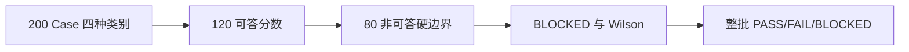
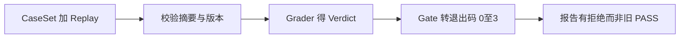

> 本版本保留原始 B01–B21 的深入材料，补上**先通俗后源码**的21组最小例子、21张Mermaid、A0–A9审计附录和独立证据基线。文中的示意案例一律标为**教学构造**，不冒充项目真实运行记录。

# M-EVAL · ServiceMind 全项目 Evaluation 与评测可信度（M25 + M26 合并教材）

> **本文件 = M25 + M26 合并。R1 教学审计修订版，状态 `FREEZE-READY`（不是 `FROZEN`）。**（用户 2026-10-14 裁定：所有 evaluation 知识点必须成为一个体系，不拆两门。）
>
> - 原 **M25「Evaluation 作为独立系统」** 的载体：`src/servicemind/evaluation/**`（24 文件 / 9,144 行）、`scripts/gate_*.py` —— 即**机制侧**。
> - 原 **M26「Evaluation 数字的 provenance」** 的载体：`evaluation/**`（831 已跟踪文件）、`evaluation/reports/**` —— 即**数据与数字侧**。
> - 两者在 B01（831 文件）、B07（坏标签集）、B08（0.85 的来历）、B13（报告层）、B18（数字 provenance）里已经交叠；本文件把它们组织成一条链，而不是两本书。
>
> **源码基线固定为** `19d9a377fb98e1c3f56edc59be40b374013bc08b`。原稿作者曾报告本地 tracked 工作树 clean；**本轮在独立环境通过 GitHub 固定 Commit 只读检查，并未重新执行原作者机器的 `git status`**。
> 交付节奏（**三批已全部交付**）：批次一 B01–B08（概念 + 数据口径 + 指标）→ 批次二 B09–B17（执行 + 18 维实景）→ 批次三 B18–B21（数字 provenance + 证据分级 + 体系总图 + 面试复述）。
> 每个 B 小节均增补 **通俗起点 → Ticket #5 输入/处理/输出 → Mermaid → 原理与设计 → 失败边界 → 冻结源码学习入口 → 小结**。原有五段深读材料仍予保留。
>
> **B20 是全篇的知识地图**：原有 44 个域保留，R1 增加源码级覆盖矩阵与横切知识域。知识域覆盖不等于对 831 份数据资产逐行审计；详见 A1 / A2 / A9 的边界。

---

## 冻结准备说明（R1本轮可验证 vs 原稿历史自述）

> 依本项目 `masters/` 既有惯例（见 `m6.md:26`、`m9.md:15`、`m15.md:16`）：
> **`FREEZE-READY` 只表示本讲学习材料已通过本轮源码定点复核与冻结审计，可提交冻结签收；
> 不代表生产运行时已被验证，也**不等于** `FROZEN`。按惯例，**只有用户明确确认才可更新为 `FROZEN`。****

### 一、本文件是什么，冻结的是什么

> **冻结候选对象**：本次交付包中的 `masters/m-evaluation.md`。历史名称 `masters/m25-evaluation.md` 仅作为原稿名称，不会改动原仓库。
> **非冻结对象**：本轮未修改 GitHub 项目代码、运行服务或业务数据；原作者关于自己工作树 clean 的说法是历史报告，不冒充本轮运行观察。

- **覆盖范围**：**M25 + M26 合并**（用户 2026-10-14 裁定）。21 节 B01–B21，分三批交付，**三批已全部交付**。
- **源码基线**：`shark6438/servicemind@19d9a377fb98e1c3f56edc59be40b374013bc08b`（= origin/main，与工作树 HEAD 相同）。
- **验签方式**：本次生成独立 `M_EVAL_Manifest_R1.json`，内含教材 SHA256；这是候选教材完整性校验，不是已经获得用户签收的 FROZEN 文件。

### 二、本轮做了什么（可复核）

1. **三批课程全部写完**：B01–B08（概念 + 数据口径 + 指标）、B09–B17（执行 + 18 维实景）、B18–B21（数字 provenance + 证据分级 + 体系总图 + 面试复述）。
2. **全面审计**：对每个承重事实做了独立验证，而不是转述来源。
3. **冻结审计（本轮新增，六项全称断言逐条复核）**——见下「审计发现」。
4. **回填勘误两处**：B15 加了指向 B18.4 的勘误（"第四道缺陷"不是仪器缺陷）；B08 的区间口径被更正。
5. **撤回清单**：三批共 6 条（R-1 到 R-6），全部是我自己说错的话，一条不删。

### 三、审计发现（六项复核，五项成立，一项失败并已更正）

| #       | 被复核的全称断言                                             | 检索范围与关键词                                             | 结果                            |
| ------- | ------------------------------------------------------------ | ------------------------------------------------------------ | ------------------------------- |
| **A-1** | 「`wilson_interval` 是**全仓唯一**置信区间 / 全仓唯一一处统计推断」 | `wilson` / `confidence_interval` / `interval` / `bootstrap` / `quantile` / `1.96` / `1.645`，扫 **`src/` + `scripts/` 全部**（初稿只扫了 `src/servicemind/evaluation/`） | ❌ **失败，已更正**              |
| A-2     | 「`scripts/mutate_*.py` 共 16 个」                           | `ls scripts/mutate_*.py \| wc -l`                            | ✅ 16                            |
| A-3     | 「`lotte.py` 有 **0 个 importer**」                          | `evaluation.lotte` / `evaluation import lotte` / `import lotte` / `from .lotte` / `from ..evaluation import lotte`，扫 `src/` + `scripts/` + `tests/` | ✅ 0                             |
| A-4     | 「`scripts/` 下 0 命中 R2 决策报告文件名（无生成脚本）」     | `grep -rln phase4_r2_decision scripts/ src/ tests/`          | ✅ 0                             |
| A-5     | 「四个门禁的退出码约定完全一致」                             | 逐一读 `scripts/gate_phase7_*.py` 的 `EXIT_*` 常量           | ✅ 四个文件完全相同（0/1/2/3）   |
| A-6     | 「全仓唯一一处把 provenance 做成可机器验证（`*.freeze.json`）」 | `find . -name "*.freeze.json"` 排除 `.git/`                  | ✅ 1（**审计时刻**，见下方脚注） |

> **A-6 的一个自指脚注。** 上表这一行记的是**审计时刻**的测量值：当时全仓只有 `docs/PHASE4_THIRD_ARM_PREREGISTRATION_2026-09-15.freeze.json` 一个。
> **原作者历史记录称**：他生成 `masters/m25-evaluation.freeze.json` 后计数由 1 变成 2。这属于原工作树的历史过程记录；**本轮没有以 GitHub 冻结树或本容器再现该计数**，不能把它当成当前现值。
> 这不是笔误，而是一个干净的实例：**观测会改变被观测的对象**（同一类问题的工业版本叫"海森堡 bug"，而本仓库的另一面就是 B18.3 讲的"新鲜度"）。
> 处理方式与全文一致——**保留审计时刻的读数、并注明它的时刻**，而不是把它改写成冻结后的数字。
> 否则这张表就不再是一份**审计记录**，而成了事后补写的叙述——那恰恰是 `revisions.py` 的 docstring 和预注册协议 §9 反复警告的那种事。

**A-1 详述（这是本轮唯一的失败项，也是本轮最有价值的一条）。** 我在 B08 里写过「端到端质量指标，和**全仓唯一一个置信区间**」，并在摘要里写成「`wilson_interval` 是**全仓唯一**的置信区间实现（穷举关键词检索确认）」。**这条经不起扩大检索范围**：把范围从 `src/servicemind/evaluation/` 扩到整个 `src/` + `scripts/`，立刻多出两处：

- `scripts/evaluate_phase4_proxy_release.py:215-225` 的 `_ci()` —— 内联 bootstrap 95% 区间，`seed=42`，产物是 `phase4_proxy_release_latest.json` 里**每个臂每个指标的 `<metric>_ci95`（该报告共 20 个）**。
- `scripts/evaluate_phase4_holdout.py:305-317` 的 `_paired()` —— 配对 bootstrap，`seed=20260915`，产物是预注册报告的 `lcb`/`ucb`。

**站得住的说法只有一个：`wilson_interval` 是库内唯一一个具名的区间函数。**（全仓 `wilson` 命中 1 个文件；字面量 `1.96` 也只命中那一个文件的两行。）B08 与 B19 已就地更正，并在原处保留了"我为什么错"的说明。

**这条更正顺带补全了一条 B18 的 provenance**：预注册协议只说换种子是为了「与既有脚本的 `SEED=42` 不同」，**却没点名那个脚本是谁**。现在它有名字了——`evaluate_phase4_proxy_release.py:215`。**一条没有名字的 provenance 只算半条。**

### 四、证据词汇与兄弟课程对齐

本文件用 E1–E6 分级，`m6/m7/m8/m9/m15/m16/m17` 用一套六词标签。**两者是对同一件事的两种记法**，对照如下（冻结时一并固化）：

| 本文件                    | 兄弟课程用词                  | 具体含义                                                 | 本轮是否新增                  |
| ------------------------- | ----------------------------- | -------------------------------------------------------- | ----------------------------- |
| **E1** 当前源码           | `SOURCE FACT`                 | 函数、契约、常量本身                                     | —（读，未改）                 |
| E1 + E2                   | `WIRED FACT`                  | caller → 注册 → 配置链已追踪                             | —（读，未改）                 |
| **E3** 测试               | `TEST DEFINITION`             | 测试在仓库，**不等于本轮执行**                           | —（读了，一处发现测试不存在） |
| **E4** 机器生成的评估报告 | `HISTORICAL REPORT`           | 冻结报告记载以前**实际做过**什么，**不等于今天系统状态** | —（读 + 只读复算）            |
| **E5** 文档自述           | `SOURCE COMMENT CLAIM` / 文档 | 注释或文档**声称**的开发史与理由                         | —（读，逐条核到源）           |
| **E6** 历史提交           | `HISTORICAL REPORT`           | git 历史                                                 | —（读了 sha 与祖先关系）      |
| **UNKNOWN**               | `TO VERIFY`                   | 查过没查到 / 缺实际运行资料                              | 共 14 条                      |

**一条必须写明的边界：本文件里没有一条 `RUNTIME OBSERVED`（生产运行时实测）。** 本轮**没有**运行平台、没有跑 pytest、没有用 GPU、没有动任何容器、没有写任何数据。**唯一新增的"运行"是对已冻结产物的只读复算**：`sha256sum` 若干文件，以及从归档的 `phase4_holdout_prereg_2026-09-15_rankings.json.gz` 用裸 `python3` 重算指标、逐 query 差值、挽救计数与 bootstrap 分位数。**复算冻结产物不等于观测当前系统。**

### 五、可复算清单（冻结后任何人可独立复核）

本文件所有承重数字，都能在不接触仓库其他文件、不用 GPU 的前提下复算：

1. **两道哈希**：`sha256sum docs/PHASE4_THIRD_ARM_PREREGISTRATION_2026-09-15.md` 与 `sha256sum scripts/evaluate_phase4_holdout.py`，与预注册报告里记录的 `protocol.sha256` / `protocol.script_sha256` 逐位比对。
2. **留出集全部指标**：解压 `evaluation/experiments/phase4_holdout_prereg_2026-09-15/evidence/phase4_holdout_prereg_2026-09-15_rankings.json.gz`（含 `query_ids / answerable / relevant / c0_pools / c1_pools / c0_rankings / c1_rankings`），**用裸 numpy 即可重算**：全体与困难集的 Recall@5/@10、MRR@10、NDCG@10 的 C0/C1 值与配对差。
3. **"精确的零"**：330 条里逐 query Recall@5 差值的非零项个数与取值（应为 **2** 项，下标 194 = −1.0、下标 265 = +1.0）。
4. **`rescue_rate@5` 的门槛**：`(1 − 1/71)^71 = 0.36527342931908113`；以 `numpy.random.default_rng(20260915)`、10,000 次重采样、分位数 0.025 复算挽救数 0–6 的 LCB 序列（0.00000 / 0.00000 / 0.00000 / 0.00000 / 0.01408 / 0.01408 / 0.02817）。
5. **归档清单自校验**：归档 README 里附了一段可直接运行的校验脚本，覆盖 `manifests/artifacts.sha256.json` 登记的 13 个产物（`.gz` 按**解压后**字节哈希）。
6. **文件计数与关键词**：A-2 到 A-6 五条的命令都写在上表里，可原样重跑。

### 六、本文件明确**不**声称的事

冻结一份文件，重要的是把**它不声称什么**也冻住。以下都是本文件**没有**主张、也不得被读成主张的：

1. **不声称生产运行时已验证。** 本文件没有一条 `RUNTIME OBSERVED`。
2. **不声称本人已通过白板考核。** 三批共 7 条白板题（W-1 到 W-8，含批次三的 W-6/W-7/W-8）里，**批次三的 W-3/W-4/W-5 我给了参考答案，W-6/W-7/W-8 是留给你的题，我没有答案可对**。`FREEZE-READY` 说的是文档，不是掌握度。
3. **不声称 `evaluation/**` 的 831 个文件已逐行审计。** 我是按目录与批次结构抽样的，这一点在 B20 的覆盖自查里已主动交代，是**唯一承认的覆盖缺口**。
4. **不声称 44 个知识点域等于全部文件。** 域是知识点的归类；一个域可横跨多个文件，一个文件也可落在多个域里。
5. **不声称仓库里没有别的评测缺口。** 本文件回答的是「这个评测体系是怎么运作的、它的数字凭什么算数」；它不是一次覆盖率审计，`docs/EVALUATION_18_COVERAGE_AUDIT_2026-10-02.md` 才是。
6. **不声称那些 UNKNOWN 不存在答案。** 14 条 UNKNOWN 是**我的知识缺口**，不是"仓库里没有"。每条都写明了我查了什么、查到了什么程度。
7. **不声称本文件没有错。** 已撤回 6 条（R-1 到 R-6），其中 R-4 是被仓库自己的勘误推翻的，A-1 是被扩大检索范围推翻的。**冻结的是"截至此刻经复核的版本"，不是"不可能有错的版本"。**

### 七、冻结动作与验签方式

```bash
# 1) 计算本文件摘要
sha256sum masters/m-evaluation.md
# 2) 与 sidecar 中 source.sha256 比对
cat M_EVAL_Manifest_R1.json
```

**本轮候选教材一经改动，Manifest 中的 SHA256 就会不匹配；正式冻结仍需你的明确确认。**
按本项目既有纪律（预注册协议 §9.5）：**若本文件日后被发现有问题，不就地修改，而是新建版本 + 声明旧版作废。**

---

## 本批次的阅读契约

三条纪律，贯穿全篇：

**第一条：证据分级。** 本文件里每一条"事实"都必须能指回源码行号。凡我说"文档写了"的，那是 E5 级证据，不是已确认事实。凡我标 `UNKNOWN` 的，就是我查过但没查到。

**第二条：结论作用域。** 证据只能支撑到哪，结论就写到哪。"这个文件里没有置信区间"≠"这个系统没有置信区间"。凡是全称断言（唯一 / 只有 / 全部 / 为 0），我都做过一次穷举检索，检索的关键词集合在用到时会写出来。

**第三条：证据优先。** 原稿作者声称曾重算若干历史数字；**本轮独立核查了来源与结构，并抽核关键报告和源码，不把原作者机器上的重算冒充本轮亲自运行**。抄文档的地方我会注明"文档自述"。

---

## B01 · 「评测」在这个仓库里到底指什么

### 通俗起点｜先理解它是什么

评测像考试：出题、监考、阅卷、发成绩单是四个岗位。没有分工时，你修改了评分规则却再也找不到当初为什么给分。

### Ticket #5 贯穿例子（教学构造，非真实 run/replay）

**输入：** Acme 的 Ticket #5 需要 VPN 故障建议。

**处理中：** 录制一次 Run 的结果，再用冻结 CaseSet 独立判定。

**输出：** 得到案例结论及 gate 退出码。


### 初学者先记住的一条边界

录到了结果不等于结果正确，也不等于当前生产系统已通过

### 一句话

在这个仓库里，"evaluation" 不是一件事，而是**四件事串成的一条链**：一份写死的期望清单，一次真实的运行，一堆纯函数判定，一个退出码。

### 为什么它存在

因为这个项目里其它所有子系统都只回答"能不能跑"，没有一个能回答"跑对了没有"。

你想想这条流水线的形状：用户提问 → 路由 → 检索（RAG / GraphRAG）→ 分析 → 复核（Reviewer）→ 可能审批 → 可能写回工单。每一环都有输出，每一环看起来都在正常工作。但"每一环看起来正常"和"整条链产生了正确的业务结果"是两件完全不同的事。就像一个人每个句子都语法正确，不代表他说的话是对的。

评测要解决的就是这个缺口。它必须能回答下面这类问题：

- 检索出来的文档，**是不是应该被这个提问者看到**？（租户 / 组 / 版本 / 时效）
- 答案里引用的事实，**有没有出处**？还是模型自己编的？
- 该弃答的时候，**弃答了吗**？还是硬编了一个答案？
- 写工单这件事，**批准前后有几个副作用**？写了几次？
- 十几个 agent 协同跑一个任务，**它们之间有没有互相污染**？

而最关键的：**这些问题的答案，必须能绑定到某一版代码，并且能被重放。**

### 源码怎么做的

这条链拆成四层，每层的物理位置和职责都不同：

**第一层，契约与语料层。** 一份写死的 JSON：问题清单、每条问题的期望、以及期望的强度（断言）。它被 Pydantic 模型严格校验——字段拼错、类别写错、期望自相矛盾，**在加载时就报错**。代表文件：`evaluation/acceptance/cases.v1.json`（28 例）、`evaluation/security/scenarios.v1.json`（72 场景）、`evaluation/quality/cases.v1.json`（200 例）、`evaluation/load/plan.v1.json`（3 档）、`evaluation/gold/gold_set.v1.json`（15 查询）。

**第二层，运行层。** 把清单送到真实平台跑，把每一步的原始观测录成文件。这些文件叫 **replay**，落在 `evaluation/*/replays/`。注意这里的动词是"录"，不是"算"——replay 里存的是平台的原始返回，不是评分结果。

**第三层，判定层。** 吃"清单 + replay"，吐判定。这一层的类文件都在 `src/servicemind/evaluation/` 下，名字以 `*_grader.py` 结尾：`acceptance_grader.py`（1,089 行）、`load_grader.py`（770）、`quality_grader.py`（587）、`security_grader.py`（412）。

**这一层有一条本仓库评测设计里最硬的纪律：判定器是纯函数、零 IO。** `acceptance_grader.py:1` 的注释原话是 "Turn a case list plus recorded executions into verdicts. Pure, and zero I/O." `quality_grader.py:1` 是 "No I/O, no stack, no clock." 时钟都不许读——`generated_at` 必须由调用方当参数传进来（`acceptance_grader.py:1007-1011`：如果读时钟，"digest 作为对本次运行的陈述就失效"）。

为什么这条纪律这么重要？因为一旦判定器能读文件、能连数据库、能看当前时间，它就不再是一个可重放的函数了——同一份 replay 在不同时刻跑会得出不同结论，评测本身就失去了意义。

**第四层，报告与门禁层。** 把判定写成 JSON 和 Markdown，然后翻译成进程退出码。这一层在 `scripts/gate_phase7_*.py`。退出码是 `0/1/2/3`，四个门禁完全一致：

| 码   | 常量名               | 含义                         |
| ---- | -------------------- | ---------------------------- |
| 0    | `EXIT_PASS`          | 每个阻塞项都通过             |
| 1    | `EXIT_FAIL`          | 至少一个阻塞项失败           |
| 2    | `EXIT_INSUFFICIENT`  | 观测不足（既非通过也非失败） |
| 3    | `EXIT_CONFIGURATION` | 门禁自身配置错               |

四个文件里的常量行号分别是 `gate_phase7_acceptance.py:75-78`、`gate_phase7_quality.py:74-77`、`gate_phase7_security.py:56-59`、`gate_phase7_load.py:73-76`。

**三个目录，各装什么：**

- `src/servicemind/evaluation/` —— 契约与判定。**24 个文件，9,144 行，全部是 SERVICEMIND-ADDED**（上游祖先 `fe3b2dcc` 在这个路径下 0 个文件）。这是"代码"。
- `evaluation/` —— **831 个已跟踪文件**。装语料（`acceptance/` `security/` `quality/` `load/` `memory/` `routing/` `gold/`）、录制（各子目录下的 `replays/`）、报告（`reports/`）、以及冻结的实验快照（`experiments/`）。这是"数据"。
- `scripts/` —— 驱动（`verify_phase7_*_live.py`）、门禁（`gate_phase7_*.py`）、变异（`mutate_*.py`，**16 个**）、报告生成（`report_phase7_*.py`）。这是"夹具与器械"。

### 容易搞错的地方

**第一，别把"评测"等同于"分数"。** 这条链里真正贵的不是 recall 是多少，而是"这个 recall 能不能支撑那句话"。B18 会专门讲这件事。

**第二，别把 `evaluation/` 当成测试目录。** 它不是 `tests/`。`tests/` 测的是代码单元；`evaluation/` 同时保存语料、静态检查结果、历史回放及报告，不是全部源于认证的真实运行。两者不可互换：`tests/` 全绿不代表平台跑对了一次真实业务。

**第三，`--check` 是装饰性的。** 我实测过：`--check` 和 `--replay-only` 在四个门禁的 argparse 里都声明了，但 **main 里从未引用**（四个文件 `grep args.check|args.replay_only` 各 0 次）。它们不影响任何行为——门禁无论如何都只判磁盘上已有的 replay。这很重要，因为它意味着**你没法用 `--check` 让门禁变成只读**；`gate_phase7_acceptance.py:561-563` 无条件重写报告。

### 源码学习导航｜回到冻结基线

- 读 [acceptance_grader.py L1004–1058](https://github.com/shark6438/servicemind/blob/19d9a377fb98e1c3f56edc59be40b374013bc08b/src/servicemind/evaluation/acceptance_grader.py#L1004-L1058)；[gate_phase7_acceptance.py L481–599](https://github.com/shark6438/servicemind/blob/19d9a377fb98e1c3f56edc59be40b374013bc08b/scripts/gate_phase7_acceptance.py#L481-L599)。先回答**调用者是谁、输入从哪来、关键判断做什么、最终输出是什么**。
- 上面新加的 Ticket #5 案例只是学习用的输入→处理→输出投影，不能把它说成冻结报告的真实观测。

### 小结

- 评测 = 契约层 → 运行层 → 判定层 → 报告门禁层，四层各有物理位置。
- 判定层是纯函数、零 IO、不读时钟——这是本仓库评测的硬纪律。
- 退出码 0/1/2/3 = PASS / FAIL / 观测不足 / 配置错，四门禁一致。
- 别把 `evaluation/` 当 `tests/`；别指望 `--check` 是只读开关。

---

## B02 · 评测包的公开 API，以及"什么被藏起来了"

### 通俗起点｜先理解它是什么

公开 API 像银行前台的业务窗口：窗口列表之外仍有内部办公室，不能凭一个 import 清单就说业务从未发生。

### Ticket #5 贯穿例子（教学构造，非真实 run/replay）

**输入：** 寻找谁能启动某次 Routing 检查。

**处理中：** 先看 evaluation.__all__，再回溯实际 scripts 的 import。

**输出：** 分清“定义存在、对外导出、被谁调用”三种事实。


### 初学者先记住的一条边界

LoTTE 加载器无直接 importer 不等于 LoTTE 数据从未被其它脚本直接读取

### 一句话

`src/servicemind/evaluation/__init__.py` 用一份 34 个名字的 `__all__`，定义了"这个包对外承诺什么"。而它**没**导出的东西，和解出的东西一样重要。

### 为什么它存在

一个包如果什么都导出，外面的人就不知道什么接口是稳定的、什么是内部实现。`__all__` 是一份公开承诺：这 34 个名字改了要打招呼，其它随便动。

但更有意思的是反过来读：**哪些模块被排除在这份承诺之外了？**

### 源码怎么做的

`__init__.py` 只有 81 行，全是 re-export。`__all__` 里的 34 个名字来自 5 个模块：

- 来自 `gold`（16 个）：`ANSWERING_GRADE`、`AnnotationProvenance`、`GoldCorpusSource`、`GoldQuery`、`GoldSet`、`JudgedItem`、`LabelTier`、`Nugget`、`NuggetSupport`、`QueryCategory`、`RefusalReason`、`ReleaseSetShape`、`Split`、`label_tier_from_recorded`、`load_gold_set`、`release_gate_blockers`
- 来自 `harness`（5 个）：`Baseline`、`EvalQueryOutcome`、`EvalReport`、`RetrievalProvider`、`evaluate`
- 来自 `leakage`（5 个）：`EvidenceCoordinates`、`LeakKind`、`Violation`、`summarize`、`visible_evidence_violations`
- 来自 `metrics`（5 个）：`dedupe_rate`、`mrr_at_k`、`ndcg_at_k`、`precision_at_k`、`recall_at_k`
- 来自 `tenant_domain`（3 个）：`TenantDomainError`、`TenantDomainFixture`、`load_fixture`

16 + 5 + 5 + 5 + 3 = 34。

**现在看被排除的。** 有一个文件根本不在这份名单里，也没有被 import：**`routing.py`**。它里面的 `load_cases` / `evaluate_cases` 全仓可见，但从包的公开 API 里看，**它不存在**。

还有一个同样不在名单里：**`recorded.py`**（`RecordedRun` / `RecordedCorpus` / `read_corpus` / `load_replays` / `inputs_block` / `revisions` 全部不在）。

另外，连 `harness` 自己也只有 5 个名字被公开：`BaselineMetrics`、`result_keys`、`principal_for`、`to_report_tables`、`markdown_report`、`gold_query_lookup` **都不在** `__all__` 里。其中 `markdown_report` / `result_keys` / `principal_for` 是被脚本用 `from ...harness import` 直接绕开包出口拿走的。

24 个文件按职责可以这样分组（这是理解这个包的地图）：

- **契约 / 数据模型**：`gold.py`、`acceptance.py`、`quality.py`、`security.py`、`load.py`、`memory.py`、`tenant_domain.py`
- **判定器（纯函数）**：`acceptance_grader.py`、`quality_grader.py`、`security_grader.py`、`load_grader.py`
- **指标（纯函数）**：`metrics.py`
- **运行 / 重放**：`harness.py`、`recorded.py`、`routing.py`
- **探针（打真实基础设施）**：`graph_probe.py`、`knowledge_probe.py`
- **可信度基础设施**：`source_revision.py`、`revisions.py`、`deployment.py`、`refusal.py`
- **外部基准**：`lotte.py`

### 容易搞错的地方

**第一，没被 `__all__` 导出 ≠ 不能用。** 它们是 `src/servicemind/evaluation/` 下的普通模块，`import servicemind.evaluation.deployment` 照样能拿到。区别只在"这是承诺的公开 API"和"这是内部件"。

**第二，`lotte.py` 是孤儿。** 它 298 行，实现了 LoTTE 数据集的加载、摘要校验、以及 test split 的封印守卫（`load(split="test")` 会抛 `PermissionError`，除非环境里的封印令牌对得上 manifest）。但我实测 **该 `lotte.py` 加载器在冻结代码的现有路径中未见直接 importer，特定计划中的 `test_phase4_lotte_isolation.py` 不存在；但不能据此宣称 LoTTE 数据根本无人测试或没有实验**。它是**没有直接 importer 的这份库加载器**；这不意味着 LoTTE 数据和实验无人使用：`scripts/build_late_interaction_index.py` 等直接读 LoTTE 文件，仓库也保留了 R2.0 dryrun。**没有调用方的是这份封印加载器，不是整个 LoTTE 评测路径。**

**第三，`__init__.py` 的导入顺序有含义。** 它不是随手排的——先契约（gold），再运行（harness），再审计（leakage），再指标（metrics），最后夹具（tenant_domain）。这个顺序大致就是数据的流向。

### 源码学习导航｜回到冻结基线

- 读 [__init__.py L46–81](https://github.com/shark6438/servicemind/blob/19d9a377fb98e1c3f56edc59be40b374013bc08b/src/servicemind/evaluation/__init__.py#L46-L81)；[lotte.py L149–175](https://github.com/shark6438/servicemind/blob/19d9a377fb98e1c3f56edc59be40b374013bc08b/src/servicemind/evaluation/lotte.py#L149-L175)。先回答**调用者是谁、输入从哪来、关键判断做什么、最终输出是什么**。
- 上面新加的 Ticket #5 案例只是学习用的输入→处理→输出投影，不能把它说成冻结报告的真实观测。

### 小结

- 公开 API 是 34 个名字，来自 5 个模块。
- `routing.py` 和 `recorded.py` **完全不在**公开 API 里；`harness` 只公开 5 个名字。
- `lotte.py` 存在但不是活代码——无调用方、无测试。
- 读一个包的 `__all__` 要正着读一遍，再反着读一遍。

---

## B03 · 金标：一份关于"正确答案"的数据契约

### 通俗起点｜先理解它是什么

金标是一张标准答案卡，同时记录是谁判这道题、答案依据什么。题目难不难与标注是否可信是两件事。

### Ticket #5 贯穿例子（教学构造，非真实 run/replay）

**输入：** Ticket #5 的正确文档暂称 KB-VPN-LOGIN（教学假设）。

**处理中：** 把题目、相关文档集合、是否应该拒答装成 GoldQuery。

**输出：** 获得能够和检索排名比较的 GoldSet。

#### 对象究竟长什么样？先看最小可校验样例

下面是**教学构造**（不是仓库历史真实 Case），仅展示 `GoldQuery` 及其 `JudgedItem` 的必要字段。`GoldSet` 顶层还需要 `name`，并用 `queries` 存放这样的条目。

```json
{
  "id": "TEACH-VPN-5",
  "query": "Acme Ticket #5 的 VPN 登录错误该读哪份手册？",
  "relevant": ["KB-VPN-LOGIN"],
  "unanswerable": false,
  "graded": [
    {
      "parent_chunk_id": "vpn-parent-01",
      "source_record_id": "KB-VPN-LOGIN",
      "grade": 3
    }
  ]
}
```

如何读：`relevant` 是**文档级二值正确集合**；`graded` 是**父块级的 0–4 分级判断**；`source_record_id` 允许把分级块映射回二值文档。`grade=3` 满足源码的 `ANSWERING_GRADE=2`，因此这条记录的 `answers=True`。若 `graded` 和 `relevant` 都非空却互相矛盾，`GoldQuery` 验证器拒绝这个对象；但任一侧为空时，一致性对比不会运行。源码：[`gold.py` L158–192](https://github.com/shark6438/servicemind/blob/19d9a377fb98e1c3f56edc59be40b374013bc08b/src/servicemind/evaluation/gold.py#L158-L192)、[`gold.py` L248–330](https://github.com/shark6438/servicemind/blob/19d9a377fb98e1c3f56edc59be40b374013bc08b/src/servicemind/evaluation/gold.py#L248-L330)。


### 初学者先记住的一条边界

Pydantic model_validate 确实运行；它不替你做人工签收和文件摘要核验

### 一句话

金标（Gold Set）是**"哪些文档算答对了这道题"的权威声明**，以及**标注这件事本身有多可信**的元数据。

### 为什么它存在

评测的一切都建立在"我们知道正确答案"这个前提上。没有金标，recall 无从计算、可答率无从判定、弃答对错无从判断。

但这个前提很脆。它最容易出的错不是"标错了某个文档"，而是**"这份标注根本没有资格被称为答案"**——一个人凭直觉标的、一个模型提议的、或者干脆是下载来的别人的标注。这三种东西的可信度差着数量级，但它们在数据结构里看起来一模一样（都是一串文档 id）。

所以 `gold.py` 的设计目标不只是"存答案"，而是**让"这份答案有几分可信"也成为数据结构的一部分**。

### 源码怎么做的

`gold.py` 528 行，核心符号：

**`GoldSet`**（`:415`）——一整个金标集。字段：`schema_version`（默认 `"phase4-gold-v1"`）、`name`、`description`、`documents`、`queries`、`provenance`。

**`GoldQuery`**（`:248`）——一道题。字段里有三个层级的信息：

- **问题本身**：`id`、`query`、`language`、`asker_tenant_id` / `asker_group_ids` / `asker_entity_ids`（提问者的身份）
- **二值视图**：`relevant`（一串文档 id）、`unanswerable`（布尔）
- **分级视图**：`graded`（一串 `JudgedItem`）、`nuggets`（必须覆盖的事实点）

**`JudgedItem`**（`:158`）——一条"某文档得了多少分"的判定。核心字段是 `grade`，取值 **0 到 4**（`MIN_GRADE, MAX_GRADE = 0, 4`，`gold.py:38`；字段约束 `ge=0, le=4` 在 `:175`）。

分级的含义（这是本文件概念上最要紧的一处）：`1` = 只是背景；`2` = 支持部分答案；`3` / `4` = 完整答案。而**二值视图的切分点是一个常量**：

```python
ANSWERING_GRADE = 2          # gold.py:35
```

`JudgedItem.answers` 这个属性就是 `grade >= ANSWERING_GRADE`（`gold.py:190`）。注释（`gold.py:30-34`）解释为什么给它起名字而不是直接写字面量 2：因为每个"二值数字"都要跟着它移动。

**`Nugget`**（`:227`）和 **`NuggetSupport`**（`:214`）——"答案必须包含的事实点"，以及"这个事实点在哪篇文档的哪一段被陈述"。`Nugget` 有 `required`（默认 `True`）和 `weight`（默认 1.0，且**必须大于 0**，`:240`）。注释（`:242-244`）解释为什么 weight 和 required 要分开：漏掉一个"必需要点"和漏掉一个"细节"是不同的失败。

**三个枚举，三种分类法：**

- **`QueryCategory`**（`:41`）：`SINGLE_EVIDENCE` / `MULTI_EVIDENCE` / `HARD_NEGATIVE` / `UNANSWERABLE`。这是**按检索难度**分的四层。
- **`RefusalReason`**（`:56`）：`INSUFFICIENT_EVIDENCE` / `VERSION_CONFLICT` / `MUST_REFUSE_ACCESS`。这是**"为什么该拒答"的三种原因**，注释（`:57-65`）强调三者不可互换。
- **`Split`**（`:72`）：`DEVELOPMENT` / `TEST`。这是**调参集 vs 留出集**。

**三个校验器，防止金标自相矛盾**（`gold.py:291-330`）：

1. `relevant_implies_answerable`（`:292`）：声明了 `unanswerable=True` **又**给了 `relevant` 文档 → 直接报错。一道"没有答案"的题不能同时有"正确答案文档"。
2. `the_refusal_reason_matches_the_verdict`（`:298`）：不可答但没写拒答原因 → 报错；可答却写了拒答原因 → 报错；不可答但类别不是 `UNANSWERABLE` → 报错。
3. `the_binary_view_agrees_with_the_graded_one`（`:312`）：如果同时给了 `graded` 和 `relevant`，两者必须一致——`graded` 里所有 `answers` 为真的文档，集合必须等于 `relevant`。 **重要精度修正**：源码入口是 `if not self.graded or not self.relevant: return self`，因此这一致性比较只对**两个列表都非空**的情形执行；不能宣称它覆盖“一边为空、一边非空”的全部矛盾。

**加载器 `load_gold_set`**（`:520-521`）只有两行：读 JSON 文本、`json.loads`、`GoldSet.model_validate`。

**实测的 `evaluation/gold/gold_set.v1.json`：** 顶层键是 `schema_version / name / description / documents / queries`；`schema_version = "phase4-gold-v1"`；**15 条查询、8 篇文档**；**`provenance` 键根本不存在**（即 `None`）。

### 容易搞错的地方

**第一，`provenance` 缺失不是小事。** 上面那行 `provenance = None` 有一个直接后果：`release_gate_blockers` 会**必然非空**。B04 会展开这条因果链。这里先记住：这份金标在当前状态下，**没有资格应用 §4.1 的阈值**。

**第二，`load_gold_set` 确实做 Pydantic 结构校验，但不做额外的来源/文件完整性校验。** 它调用 `GoldSet.model_validate`，因此字段类型、`extra="forbid"`、GoldQuery 模型校验器确实会运行；但没有额外检查文件 checksum，也没有强制 `schema_version` 等于某个单值，更不会独立验证标注签收。`schema_version` 只是一个**普通字段带默认值**（`:418`），没有 validator 绑它。对比一下：`security.py:154`、`quality.py:149` 都对 `schema_version` 做了硬校验。这是 `gold.py` 的一个真实缺口。

**第三，两个关键概念，别混：**

- `relevant` 是**二值**的（文档要么在集合里，要么不在）
- `graded` 是**0–4 分级**的

它们描述同一个现实的两个视角，校验器强制它们一致。但**下游指标只消费二值视图**——这是 B06 要讲的核心。

**第四，`grade >= 2` 这个边界是"约定"，不是"真理"。** 它是这个项目的决定。别的项目可能把 3 作为"答到"。关键不是这个数字，是**这个数字有名字、且只在一处定义**。

### 源码学习导航｜回到冻结基线

- 读 [gold.py L248–336](https://github.com/shark6438/servicemind/blob/19d9a377fb98e1c3f56edc59be40b374013bc08b/src/servicemind/evaluation/gold.py#L248-L336)；[gold.py L415–521](https://github.com/shark6438/servicemind/blob/19d9a377fb98e1c3f56edc59be40b374013bc08b/src/servicemind/evaluation/gold.py#L415-L521)。先回答**调用者是谁、输入从哪来、关键判断做什么、最终输出是什么**。
- 上面新加的 Ticket #5 案例只是学习用的输入→处理→输出投影，不能把它说成冻结报告的真实观测。

### 小结

- 金标 = `GoldSet`（集合）+ `GoldQuery`（问题）+ `JudgedItem`（0–4 分级）+ `Nugget`（要点）。
- 两个视图**在 graded 和 relevant 均非空时**由校验器强制一致；如果一方为空则会跳过该比较，属于真实边界。二值的切分点是 `ANSWERING_GRADE = 2`。
- 三个枚举是三种**不同的分类法**：难度（category）、拒答原因（refusal reason）、留出策略（split）。
- `load_gold_set` 会进行 Pydantic 模型/交叉字段校验，但**没有额外的 checksum、schema_version 固定值和签收校验**；`provenance` 缺失会触发 `release_gate_blockers`，阻止应用相应 release 门槛。

---

## B04 · 「这份标注够不够格」是一个数据问题，不是一个指标问题

### 通俗起点｜先理解它是什么

答案卡如果是一个同学随便写的，再漂亮的分数也不能用于毕业验收；要先检查答案卡够不够权威。

### Ticket #5 贯穿例子（教学构造，非真实 run/replay）

**输入：** GoldSet 尚无双人标注 provenance。

**处理中：** 执行 release_gate_blockers(shape) 检查标签层级与覆盖形状。

**输出：** 返回可操作的阻断清单，不能凭 Recall 宣布 release。


### 初学者先记住的一条边界

该阻断函数存在，不意味着所有评测入口都已把它注册为强制门

### 一句话

在算任何指标之前，系统先回答一个前置问题：**这份标注有没有资格被拿来当标准答案？** 答案不是一个分数，是一张"阻断项清单"。

### 为什么它存在

这是这套评测体系里最容易被忽略、也最体现成熟度的一层。

想象一个反例：你辛辛苦苦搭好了检索评测，接上一个 Kappa 值算不出来的金标（因为根本没有第二个标注员），跑出 Recall@5 = 0.86，高于 0.85 阈值，"通过"。**这个"通过"是假的**——因为 0.85 这个阈值本来就是为"双人标注、Kappa ≥ 0.8"的标注集定的。你拿一个单人直觉标的金标去过它，等于用错尺子量东西，还量出了"合格"。

所以正确的做法是：**把"够不够格"和"分数高不高"拆成两个独立步骤，且前置的那一步能明确地失败。**

### 源码怎么做的

**第一部分：标注来源（`AnnotationProvenance`，`gold.py:125`）。**

字段：`label_tier`（标注层级）、`guideline_version`（遵循的标注规范版本）、`annotator_count`、`cohen_kappa`（一致性系数，默认 `None`）、`double_annotated_fraction`、`notes`。

`label_tier` 是 `LabelTier` 枚举（`gold.py:79`）：`SILVER` / `SINGLE_ANNOTATOR` / `DOUBLE_ANNOTATOR`。**`SILVER` 的含义是"来源提供的或模型提议的，不是独立人工判断"**——它是三者中最弱的一级。

然后有一个判定属性 **`meets_tenant_protocol`**（`gold.py:148-155`），它要求**四个条件同时成立**：

1. `label_tier is DOUBLE_ANNOTATOR`
2. `annotator_count >= 2`
3. `cohen_kappa is not None`
4. `cohen_kappa >= 0.80`（阈值来源注释在 `:141-143`）

四个条件里任何一条不成立，这份标注就不满足协议。

**注意一个细节：`cohen_kappa` 在这里只是被存储和被比较，`gold.py` 里没有任何代码去"计算"Kappa。** 我做过穷举检索，结论明确：这个文件里没有 Kappa 计算、没有置信区间、没有显著性检验、没有 bootstrap、没有分层抽样。

**第二部分：集合形状（`ReleaseSetShape`，`gold.py:342`）。**

这是一个 `@dataclass(frozen=True)`，字段全部带"缺失值"默认：`provenance=None`、`graded_queries=0`、`hard_negative_queries=0`、`refusal_reasons=frozenset()`、`development_queries=0`。

为什么要把"集合"和"形状"拆开？注释（`:344-356`）给了理由：因为有些来源（比如 TechQA 那个代理集）只是一个"选取清单"，根本没有 `GoldSet` 对象。那就给它一个"形状"载体，让下游能统一地问"够不够格"。

**第三部分：阻断项（`release_gate_blockers(shape)`，`gold.py:365`）。**

这是全篇最漂亮的一处设计。它**不是一个布尔标志，是一个函数**——输入形状，输出**一串人类可读的阻断理由**。注释（`:373-379`）解释了为什么不做成 flag：因为"一个 `False` 不告诉你要修什么"。

它逐条检查（每一条对应一个阻断项）：

- `provenance is None` → 追加阻断项（`:382-386`）。**这一条就命中了当前仓库的 `gold_set.v1.json`。**
- `elif not provenance.meets_tenant_protocol` → 追加（`:387-393`）
- `not shape.graded_queries` → 追加（`:394-398`）
- `not shape.hard_negative_queries` → 追加，注释里写明 **"§3.2 要求 80"**（`:399-400`）
- **对每一个 `RefusalReason` 枚举值**，如果它不在 `shape.refusal_reasons` 里 → 追加一条（`:401-406`）
- `not shape.development_queries` → 追加（`:407-411`）

**返回空列表 = 阈值可以应用。** 非空 = 这份金标没资格。

**第四部分：磁盘词汇与内存词汇的翻译（`label_tier_from_recorded`，`gold.py:106`）。**

这个函数只有十几行，但设计意图值得单独说。它把磁盘上写的 tier 字符串翻译成 `LabelTier`。映射表 `RECORDED_LABEL_TIERS`（`:101`）只有一条：`"external_silver_no_tenant_human_signoff"` → `LabelTier.SILVER`。

关键在**失败路径**：**认不出来的字符串 → 直接 `raise ValueError`**（`:118-122`）。注释（`:110-112`）解释了为什么不能默认成 `SILVER`：**"默认成 SILVER 会和真正读过 silver 的标注不可区分"**——你会丢掉"我知道它是什么"和"我不知道它是什么"之间的区别。

### 容易搞错的地方

**第一，`release_gate_blockers` 的输出是"清单"不是"分数"。** 它不排序、不加权，只列举。这体现了本仓库评测的一个反复出现的取向：**宁可给出可操作的失败原因，不给一个不可解释的分数**。

**第二，这个机制目前是"定义好了但没被普遍使用"。** `release_gate_blockers` / `ReleaseSetShape` / `label_tier_from_recorded` 的实际使用者是 `scripts/audit_rag_quality_state.py` 和 `scripts/evaluate_phase4_proxy_release.py` 等 Phase 4 脚本，**不在** `evaluation/` 的公开 API 主路径上。所以它更像一个"审计工具"，而不是"每次评测都过的闸"。

**第三，对拒答原因的穷举那条，是本仓库"作用域纪律"的一个标准样板。** 它遍历 `RefusalReason` 的**每一个**枚举值来检查，而不是写死三个字符串。这意味着：将来往 `RefusalReason` 里加一个新的值，**这里自动会多出一个阻断项**——不用改这段代码。这是"用枚举驱动穷举"的写法。

### 源码学习导航｜回到冻结基线

- 读 [gold.py L125–155](https://github.com/shark6438/servicemind/blob/19d9a377fb98e1c3f56edc59be40b374013bc08b/src/servicemind/evaluation/gold.py#L125-L155)；[gold.py L343–411](https://github.com/shark6438/servicemind/blob/19d9a377fb98e1c3f56edc59be40b374013bc08b/src/servicemind/evaluation/gold.py#L343-L411)。先回答**调用者是谁、输入从哪来、关键判断做什么、最终输出是什么**。
- 上面新加的 Ticket #5 案例只是学习用的输入→处理→输出投影，不能把它说成冻结报告的真实观测。

### 小结

- "标注够不够格"是**前置判定**，和"分数高不高"分开。
- `meets_tenant_protocol` 要求四件事同时成立（双人 / ≥2 标注员 / Kappa 非空 / Kappa ≥ 0.80）。
- `release_gate_blockers` 返回**清单**而非布尔；空清单才意味着阈值可应用。
- 当前 `gold_set.v1.json` 的 `provenance = None` → 阻断项必然非空 → 这份金标没有资格应用阈值。
- `gold.py` 不算 Kappa、不算置信区间——**它只存储和比较这些量**。

---

## B05 · 五类评测语料：为什么一套金标不能测所有事情

### 通俗起点｜先理解它是什么

不同体检项目需要不同仪器。公共检索集能测排序，但证明不了 Acme 和 Globex 之间是否串户。

### Ticket #5 贯穿例子（教学构造，非真实 run/replay）

**输入：** Ticket #5 诊断需要内容金标；Globex 请求 Acme 私有文档需要 ACL 夹具。

**处理中：** 选择合成 SOP、TenantDomain、LoTTE、Memory、Phase7 案例集分别测试。

**输出：** 得到带语料范围的结论，而非一个虚假的综合总分。


### 初学者先记住的一条边界

LoTTE test seal 写在未接入的加载器中，不保证其它直读脚本也会守住封印

### 一句话

评测里没有"中立的语料"。每一套夹具都是为了回答某个特定问题而被**造出来**的，因此每一套都在某个方向上做了妥协。读懂一个评测系统，一半工夫在读它的语料允许你下什么结论、不允许你下什么结论。

### 为什么它存在

如果只有一套语料，你只能回答一个问题。但评测要回答的问题至少有五类，每类的语料要求互相冲突：

- **"检索能不能找到该找的文档？"** —— 需要真实、大规模、有权威相关性的语料。真实语料是别人的，规模是百万级的。
- **"租户隔离有没有破？"** —— 需要**你自己能控制 ACL** 的语料。别人的语料没有你的租户语义。
- **"答案有没有出处？"** —— 需要**有正确事实**的语料，而且你要能算出"应该引用哪几段"。
- **"记忆会不会串户？"** —— 需要**可写、可撤、可反复运行**的语料。
- **"工单写了几次？"** —— 需要**能真的写、能真的回读**的语料。

一套语料不可能同时满足这五条。所以本仓库有**五套**语料，分放在 `evaluation/` 的不同子目录下。

### 源码怎么做的

**第一套：合成 SOP 金标（`evaluation/gold/gold_set.v1.json`）。** 15 条查询、8 篇文档，`schema_version = "phase4-gold-v1"`。它是**手工合成**的——文档是编出来的操作手册，查询是围绕这些手册编的。

**妥协：它不来自真实工单。** 所以它能验证"检索器能不能在干净信号上命中"，**不能**验证"在真实用户的模糊提问上命中"。B03 讲的三个校验器（可答/拒答一致、二值/分级一致）就是为这套语料准备的——因为它是合成的，作者能保证一致性。

**第二套：租户域夹具（`tenant_domain.py`，444 行）。** 这套语料的形状最特别：它**不是一堆文档，而是一个可加载的"域"**。它自带 manifest（清单）、qrels（相关判定）、以及租户坐标。

**为什么需要它：** 因为要测租户隔离，就必须有一个**你能声明 ACL 的语料**。合成 SOP 没有租户，LoTTE 是别人的公开数据集。

它有三个常量先记住：

- `TENANTS`（`tenant_domain.py:64-67`）：`acme` = `11111111-1111-4111-8111-111111111111`，`globex` = `22222222-2222-4222-8222-222222222222`。**这两串 UUID 在仓库里到处出现**，看到它们就知道是在讲多租户。
- `FIXTURE_QUERY_TIME = datetime(2026, 5, 1, UTC)`（`:84`）。**这是一个固定的过去时刻**，所有查询都以它为"现在"。为什么？因为租户版本有生效期（`effective_from` / `effective_to`），如果"现在"是真实时钟，同一份夹具在不同日子跑会得出不同结论——`effective_to` 到期了文档就不可见了。**冻结时间 = 让判定可重放。** 这是本仓库评测里"不读时钟"纪律的第二个落点（第一个是判定器不读时钟）。
- `DOCUMENT_LEVEL = "#document"`（`:94`）：qrels 里判定的粒度标记。`gold_set()` 只接受这一级。

**三条 fail-closed 规则**（这是 `tenant_domain.py` 最该学的部分，`:97` 定义了 `TenantDomainError(ValueError)`）：

1. **ACL 必须显式声明，不能默认。** 一份文档如果没说它属于哪个租户/组，加载**直接报错**，而不是默认成"公共"或"某个租户"。
2. **manifest 里每一条，磁盘上必须有对应文件。** 缺文件报错，不是跳过。
3. **每一条判定必须关于本夹具里的文档。** qrels 指了一个不存在的文档 id，报错。

这三条的方向是一致的：**任何"缺失"都当错误处理，不当默认值处理。** 这和 B04 的 `label_tier_from_recorded`（认不出的 tier 直接 raise，不默认成 SILVER）是同一条原则——**不让"我不知道"悄悄变成"我知道"。**

接口：`documents()`（`:261`）、`coordinates()`（`:333`）、`gold_set()`（`:352`）、`strata()`（`:388`）、`load_fixture()`（`:419`）。

**第三套：LoTTE 外部基准（`evaluation/lotte.py`，298 行 + 真实数据）。** LoTTE 是斯坦福 ColBERT 团队的公开检索基准，Apache-2.0。仓库里钉的是 HuggingFace 的 `colbertv2/lotte_passages`，revision `3be7f857…`。

**为什么用它：** 因为它的**相关性判定是干净的**——它没有"落地页当金标"那种爬虫噪声。B07 会讲为什么这条最要紧。

实测的规模（来自 `data/phase4/manifests/sources.v1.3.json`）：

| 量          |       dev |    test |
| ----------- | --------: | ------: |
| passages    | 1,276,222 | 638,509 |
| search 查询 |       916 |     596 |
| forum 查询  |     2,003 |   2,004 |

磁盘上 `technology/dev` 约 309 MB、`dev_collection.jsonl` 约 913 MB、`technology/test` 约 699 MB。

**妥协：它没有你的租户语义，也不能写。** 所以它只能测"检索器的排序在正确标签上好不好"，**不能**测隔离、不能测写入。

**这里的 dev/test 隔离要单独讲，因为它是本轮最重要的一条仪器缺陷。**

`lotte.py` 的设计意图很清楚：**test split 只允许被"登记过的一次性确认运行"读一次**，任何调参脚本碰它就 `PermissionError`。实现是 `assert_split_readable(split)`（`lotte.py:161-175`）：如果 `split == "test"`，就读 `SEAL_ENV` 环境变量，和 manifest 里的 `lotte_test_seal` 字段比，不等就抛。

`sealed_test_token()`（`:149`）从 `sources.v1.3.json` 里读 `lotte_test_seal`。

**实测事实，三重：**

1. **没有任何文件 import `evaluation/lotte.py`。** 穷举检索（关键词集合：`from servicemind.evaluation.lotte`、`import lotte`、`evaluation import lotte`），全仓 0 命中。
2. **`sources.v1.3.json` 里没有 `lotte_test_seal` 字段。** 顶层键是 `manifest_version / frozen_at / production_sources / reference_sources / evaluation_sources / revised_at / revision_notes`。所以就算有人调用 `sealed_test_token()`，它自己会先抛 `LotteError("records no lotte_test_seal")`。
3. **真正读 LoTTE 的脚本不经过封印。** `scripts/build_late_interaction_index.py:70-77` 的 `corpus_path()` 直接拼路径：

```python
def corpus_path(dataset: str, split: str) -> Path:
    if split == "dev":
        ...
    if split == "test":
        return RAW_DIR / "technology" / "test" / "collection.tsv"
    raise SystemExit(f"unsupported split {split!r}")
```

**对 test 无条件放行。**

而 `sources.v1.3.json` 自己的 `ingestion_scope` 字段写着：`"... test is sealed for a single R5 confirmation and is guarded by the R1.2 loader."`——**文档声称的守卫，在代码路径上不生效。** 计划里那条 R1.2 测试 `tests/servicemind/test_phase4_lotte_isolation.py` 实测**不存在**。

**结论作用域：** 这不等于 test split 已被污染。没有任何证据显示有人拿 test 调过参——唯一跑过的 LoTTE 运行是 `phase4_li_dryrun_lotte-technology_dev_latest.json`，它的 `split` 字段是 `dev`，`corpus_documents = 1276222` 正是 dev 的 passage 数。准确说法是：**守卫被设计出来、被文档声明为生效、但不在任何执行路径上，且本应提供的绊线未交付。**

这类问题在本仓库有个名字：**仪器缺陷**。它不出现在任何测试里，因为它不制造错误结果——它制造的是"防护网看起来在那儿"。

**第四套：记忆语料（`evaluation/memory/scenarios.v1.json` / `scenarios.v2.json`）。** 实测：

|               |   v1 |   v2 |
| ------------- | ---: | ---: |
| 步骤总数      |   29 |   58 |
| — write       |   26 |   48 |
| — seed        |    0 |    7 |
| — transition  |    3 |    3 |
| 探针          |   21 |   45 |
| `delivery` 块 |   无 |   有 |

v2 多出来的 `seed` 步和 `delivery` 块是两个概念性增量：`seed` 是**先播入基线状态**（否则"写了几条"没法算增量），`delivery` 是**投递负载**。租户用 primary/foreign 两个。

**这里有一处文档与文件不符（实测）**：`docs/PHASE5_MEMORY_QUALITY_EVALUATION.md:94` 称 v1 是「31 步 + 21 探针」，实际文件是 **29 步**。探针数对得上（21），步数对不上。

**第五套（其实是四组）：Phase 7 的四套契约语料。** 它们不做检索，做端到端：

- `evaluation/quality/cases.v1.json` —— **200 例**，四类**精确**配比：answerable 120 / insufficient-evidence 40 / version-conflict 20 / must-refuse-access 20。
- `evaluation/acceptance/cases.v1.json` —— **28 例 / 107 断言 / 17 个 module_roster 条目**。
- `evaluation/security/scenarios.v1.json` —— **72 场景 / 252 条证据（test 153 + mutation 87 + acceptance 12）/ 42 条带变异 / 15 个类别**。
- `evaluation/load/plan.v1.json` —— **3 档**：tier-1(并发1×1) / tier-5(并发5×2) / tier-10(并发10×3)。

### 容易搞错的地方

**第一，别问"哪套语料是真的"。** 正确的问法是"这套语料允许我下什么结论"。LoTTE 允许你比较两个检索器；它不允许你说"我们的产品在真实工单上表现如何"。合成 SOP 反之。

**第二，`tenant_domain.py` 的三条 fail-closed 规则不是安全检查，是证据检查。** ACL 默认成"公共"不会让程序崩溃，但会让"隔离测试通过了"这句话变成谎言。它防的是**假绿**。

**第三，`FIXTURE_QUERY_TIME` 这个模式值得记住：** 凡是"什么东西在某个时刻可见"的判定，都要把时刻钉死。真实系统里这个模式随处可见（价格生效、政策版本、合同期）。

**第四，LoTTE 的封印是"写在了错的层"。** 守卫写在**加载器**里（`lotte.py`），而消费者绕开了加载器直接读文件。**一个守卫只有长在唯一入口上才算守卫。** 这是本仓库乃至所有评测工程里最常见的失效形态。

### 源码学习导航｜回到冻结基线

- 读 [tenant_domain.py L94–123](https://github.com/shark6438/servicemind/blob/19d9a377fb98e1c3f56edc59be40b374013bc08b/src/servicemind/evaluation/tenant_domain.py#L94-L123)；[lotte.py L149–175](https://github.com/shark6438/servicemind/blob/19d9a377fb98e1c3f56edc59be40b374013bc08b/src/servicemind/evaluation/lotte.py#L149-L175)。先回答**调用者是谁、输入从哪来、关键判断做什么、最终输出是什么**。
- 上面新加的 Ticket #5 案例只是学习用的输入→处理→输出投影，不能把它说成冻结报告的真实观测。

### 小结

- 五套语料，五种妥协：合成 SOP（干净但不真实）/ 租户域夹具（可控 + fail-closed）/ LoTTE（标签干净但无租户语义）/ 记忆语料（可写可撤）/ Phase 7 四组契约（端到端）。
- `tenant_domain.py` 的三条 fail-closed 规则 + `FIXTURE_QUERY_TIME` 冻结时刻 = 让判定可重放。
- **LoTTE 的 test 封印实现了、被文档声明为生效了、但在执行路径上不生效**；R1.2 隔离测试不存在。
- 记住这个失效形态：**守卫长在了消费者不走的那条路上。**

---

## B06 · 检索指标：五个纯函数，和二值增益这个选择

### 通俗起点｜先理解它是什么

检索结果像按先后摆在桌上的参考书。Recall 问正确的书找到多少，Precision 问桌上有多少本正确，MRR 问第一本正确排几位。

### Ticket #5 贯穿例子（教学构造，非真实 run/replay）

**输入：** 金标集合 {A,B}，Top3 排序是 [X,A,B]。

**处理中：** 手算 Recall@3=2/2=1、Precision@3=2/3、MRR@3=1/2。

**输出：** 得到有不同含义的三个分数；NDCG 还会考虑排名位置。


### 初学者先记住的一条边界

空 relevant 返回 0.0 只是代码返回值，不等于应当把不可答题计入召回均值

### 一句话

`metrics.py` 是 62 行的纯指标库，共五个函数：**四个排序指标**按二值相关性计算（命中为1、未命中为0），**第五个 `dedupe_rate` 衡量重复率**，并不使用金标或排序相关性。

### 为什么它存在

有了金标（B03）和语料（B05），下一步是把"检索结果"和"金标"变成数字。这一步有个很容易被糊弄过去的选择：**增益是二值的，还是分级的？**

本仓库选了二值。这个选择有代价、有理由，而且**它的理由和 B03 里 `grade` 0–4 的存在是矛盾的**——这是本篇最值得记住的一个张力。

### 源码怎么做的

62 行、五个纯函数。前四个消费 Ranked IDs + Relevant IDs；`dedupe_rate` 只检查重复的 ID，不评价是否相关：

**`recall_at_k(ranked, relevant, k)`**（`metrics.py:6`）——"金标里有多少比例被前 k 条捞到了"。实现只有三行：

```python
if not relevant or k <= 0:
    return 0.0
hits = sum(_gains(ranked[:k], relevant))
return min(1.0, hits / len(relevant))
```

它的 docstring 里有一句极其重要的说明：**"Defined only over queries that have gold; the harness skips empty-relevant rows (those measure abstention, not recall)."**——**没有金标的查询，Recall 作为业务指标不适用**；代码函数虽然返回 `0.0`，但统计时必须合理排除。**要注意源码与注释的已知差异**：目前 `harness` 是按 `unanswerable` 排除，而不是按 `relevant` 是否为空排除，因此“可答但相关集合为空”的新案例可能被误算进平均值；B11 有完整解释。

**`precision_at_k`**（`:18`）——前 k 条里有多少是金标。

**`mrr_at_k`**（`:38`）——第一个金标出现在第几位，取倒数（1/rank）。没有命中就是 0。

**`ndcg_at_k`**（`:46`）——带 log2 折损的排序质量。**注意：它是 binary-gain 的 NDCG**——它用排序位置算折损，但增益仍然是 0/1，不是 0–4 的 grade。

**`dedupe_rate`**（`:58`）——去重率。这个不是检索质量指标，是**管道健康指标**：检索结果里有多少条被去掉了。它能反映"多重查询把同一文档捞回来好多次"这类现象。

底层的 `_gains`（`:14-15`）就是逐项判断"这个 key 在不在 relevant 里"，返回 0 或 1。

### 容易搞错的地方

**第一，`ndcg_at_k` 叫 NDCG，但它是二值的。** 标准的 NDCG 允许分级增益（NDCG@k 的"G"就是 gain）。这里的实现放弃了分级——所以它和 `recall_at_k` 是**同一份信息的两种排法**，而不是"更精细的指标"。看到 NDCG 就以为它用了分级，是本仓库最容易犯的读代码错误。

**第二，最关键的张力：`gold.py` 支持 0–4 的分级，`metrics.py` 不直接消费 `grade`。** 我做过穷举检索：**`metrics.py` 里没有任何一行读 `JudgedItem.grade`，也没有任何一处引用 `ANSWERING_GRADE`。** 这意味着 `GoldQuery` 的 **`relevant` 二值集合**才是当前指标公式直接接收的输入；`JudgedItem.answers` 可以依据 `grade >= 2` 派生二值视图，**但不能据此推断每次 harness 运行都重新从 graded 计算 relevant**——要核对实际传入的数据。

这意味着：**你标了 0–4 级，当前排序指标主要使用由其导出的二值相关集合。** 详细等级可供其它分析/未来扩展使用，不能简单说全部标注工作“白做”。这不一定是错的——很多工业系统故意只用二值，因为分级标注的一致性（Kappa）远低于二值标注——但**它是一个必须被知道的事实**，而不是可以忽略的实现细节。

**第三，`recall_at_k` 遇到空 `relevant` 返回 0.0，但正确的处置是跳过。** 这是陷阱：如果有人直接对全部查询求 `recall_at_k` 的均值，**不可答的查询会被算成 0 分**，把整体 recall 拉低。正确的评价设计应排除不适用的空金标行，但**冻结实现的 harness 实际只按 `unanswerable` 过滤**；若某条`unanswerable=False`但`relevant=[]`，它会贡献 `0.0`，而不是自动走 abstention。当前冻结 gold 数据未触发这一组合。这里的 `0.0` **是函数返回的占位值，不应直接等同于召回失败**。

**第四，这个文件里没有置信区间、没有显著性检验、没有方差。** 我做过穷举检索：全文件只有 `statistics.fmean`。原因在 B08 讲——**排序指标的统计推断要做配对检验，比率的统计推断做一个 Wilson 区间就行**，两类指标配了两套做法，而 harness 这一侧选择了"只报点估计"。

### 源码学习导航｜回到冻结基线

- 读 [metrics.py L14–62](https://github.com/shark6438/servicemind/blob/19d9a377fb98e1c3f56edc59be40b374013bc08b/src/servicemind/evaluation/metrics.py#L14-L62)；[harness.py L175–235](https://github.com/shark6438/servicemind/blob/19d9a377fb98e1c3f56edc59be40b374013bc08b/src/servicemind/evaluation/harness.py#L175-L235)。先回答**调用者是谁、输入从哪来、关键判断做什么、最终输出是什么**。
- 上面新加的 Ticket #5 案例只是学习用的输入→处理→输出投影，不能把它说成冻结报告的真实观测。

### 小结

- 五个函数：`recall_at_k` / `precision_at_k` / `mrr_at_k` / `ndcg_at_k` / `dedupe_rate`，全是纯函数。
- **排序相关性指标使用二值增益**：`_gains` 只返回 0/1，`ndcg_at_k` 也是二值的；`dedupe_rate` 是重复率，不需要相关性金标。
- `metrics.py` 本身**不消费0–4的grade**；`JudgedItem.answers` 可按 `grade >= 2` 给出二值视图，但现有`GoldQuery.relevant` 也可单独提供给 harness，不能宣称所有评测在运行时都自动做一次转换。
- 空 `relevant` 的函数返回0.0只能当占位；指标统计应排除不适用的行，而冻结 `harness` 只排除显式 `unanswerable=True`，存在“可答但空金标”潜在边界。

---

## B07 · 池覆盖率 vs Recall@k：R2 为什么被淘汰

### 通俗起点｜先理解它是什么

重排像重新排书架：书已经在架上就能调前后；不在架上就无从调起。

### Ticket #5 贯穿例子（教学构造，非真实 run/replay）

**输入：** 正确 VPN 文档没进入固定候选池100条。

**处理中：** 先问 pool coverage，再问 Top5 Recall，最后人工审查标签准确性。

**输出：** 把漏检归到召回/排序/金标三个不同问题。


### 初学者先记住的一条边界

包最多16篇不能推出 Recall@10 恒等 Recall@20，仍需实际检查第11–16位

### 一句话

`Recall@k` 问的是"**排序**好不好"；池覆盖率问的是"**候选集合**里有没有"。这是两个不同的问题，而本仓库用一个被淘汰的检索臂（R2）把它们区分得清清楚楚。

### 为什么它存在

先看一个反直觉的事实：**重排器（reranker）在结构上不可能提高池覆盖率。**

- Recall@5 衡量的是"前 5 条里有没有金标"。你把候选池里的顺序换一换，前 5 条的成员就变了，Recall@5 会动。
- 池覆盖率@100 衡量的是"候选池这 100 条里有没有金标"。**重排只是把同一个池子里的东西重新排序——池子的成员没变。** 如果金标一开始就不在这 100 条里，重排一万次它也进不来。

所以：**如果金标根本不在候选池里，任何重排、任何权重调整、任何 RRF 融合都救不了它。** 这就是为什么"池覆盖率"必须是一个独立的指标——它测量的是**召回天花板**，而不是召回。

类比：你在图书馆找一本书。整理书架（重排）能让你更快找到**已经在架上的**书；但如果那本书从来没被采购进来（不在候选项里），整理一辈子也找不到。池覆盖率测的是"书有没有被采购"，Recall@k 测的是"你在架子上翻得多快"。

### 源码怎么做的

**实现（`src/servicemind/rag/late_interaction.py:166-192`）：** 三个函数，极简。

```python
def union_pool(first, second) -> list[str]:
    """Ordered union of two candidate pools, each key appearing once."""
```

```python
def contains_gold(pool, gold) -> bool:
    """Whether any gold key is in the pool, at whatever depth the pool was cut."""
    return not set(gold).isdisjoint(pool)
```

```python
def coverage_rate(rows) -> float:
    """Share of (pool, gold) rows whose pool contains a gold key."""
```

**`union_pool` 的 docstring 值得逐字读**，它把"取并集"这件事的正确性讲透了：

> "The admission question is whether late interaction finds gold the existing arms miss, so the measured pool has to be the *union*; taking the larger of the two coverage rates would answer a different question."

翻译：**要问的是"新臂能不能找到旧臂漏掉的金标"，所以被测池必须是两条臂的并集。** 拿两条臂各自覆盖率的**较大值**回答的是另一个问题（"哪条臂单独更好"）——而那是无关的。

**再说一个实现细节：`covered` 是"池子里有没有**任意一个**金标"，不是"有没有全部金标"。** `contains_gold` 用的是 `isdisjoint`——只要有一个金标在池里就算覆盖。这符合"覆盖率"的定义（能不能碰到），但也意味着：**一份有 5 个金标的查询，只要 1 个在池里就算完全覆盖。** 这是"覆盖率"这个指标的内在粗糙度。

**接下来是 R2 的完整决策记录。** 这是本仓库里关于"评测数字能支撑什么"最好的一份教材。产物在 `evaluation/reports/phase4_r2_decision_latest.{json,md}`。

**第一步：一个数字触发了 R2。** 280 条可答查询里，**36 条（12.86%）的金标根本不在 depth-100 候选池内**。于是立项：加一条 late-interaction 检索臂，目标是**把池覆盖率@100 提高 ≥ 2 个百分点**（配对），且 Recall@5 不退化。

**第二步：先测可行性（R2.0 spike，在写任何索引之前）。** 产物 `phase4_li_dryrun_lotte-technology_dev_latest.json`：

| 量                         |             值 |
| -------------------------- | -------------: |
| 语料文档数                 |      1,276,222 |
| 采样文档                   |          5,000 |
| 外推 token 数              |    138,219,182 |
| 索引字节（fp16）           |       283.1 GB |
| 编码吞吐                   | 3,683 tokens/s |
| 外推构建时间               |      10.4 小时 |
| 单查询全扫描（numpy 路径） |       2,358 秒 |
| **成本预算**               |     **204 ms** |
| **判定**                   |       **FAIL** |

运行环境记在产物里：`BAAI/bge-m3 @ 5617a9f61b02`，`cuda:1`，`torch 2.5.1+cu121`，`CUDA 12.1`。

**第三步：证明失败不是实现问题。** 决策记录里做了这个封顶计算（原文）：

| 界                             |          值 |
| ------------------------------ | ----------: |
| 语料 token 数                  | 138,219,182 |
| fp16 字节                      |    283.1 GB |
| PCIe 单遍 @ 25 GB/s            |      11.3 s |
| 计算 @ 实测 70.3 M tokens/s    |      1.97 s |
| 用**完美 GPU kernel** 的总时间 |      13.3 s |
| 预算                           |      204 ms |
| **超预算**                     |     **65×** |

70.3 M tokens/s 是**他们自己在这张卡上实测的** GPU MaxSim，比 numpy 路径快 1674 倍。**即使换成完美 kernel、零索引开销，这条臂还是超预算 65 倍。** 所以——**失败是数据规模的属性，不是实现的属性。**

**第四步（本案例最重要的一步）：它没有停在这里。它把 36 条漏检一条一条读完了。**

| 分桶                                                     | 条数 | 占 280 可答 |
| -------------------------------------------------------- | ---: | ----------: |
| **标签缺陷**（检索命中的文档回答得**至少和金标一样好**） |   17 |        6.1% |
| **真实漏检**（金标是对的，检索器漏了）                   |    4 |        1.4% |
| **歧义**（两个文档都不回答这个问题）                     |   15 |        5.4% |

**标签缺陷的具体形态（原文举例，我摘 5 条）：**

- `DEV_Q149`：金标是 DataPower 7.5 的"最新更新"落地页；命中是 SSH 连接失败技术说明。
- `TRAIN_Q016`：金标是通用的 ulimit 指南；命中**就是** DASH "too many open files" 技术说明。
- `TRAIN_Q366`：金标是**如何创建**备份；问题问的是**如何从备份恢复**，命中讲的正是恢复。
- `TRAIN_Q027`：金标是"批次卡在运行状态"；问题问的是**如何创建**批量上传的批次。
- `TRAIN_Q314`：金标是 SSLv3 安全公告；问题问的是如何配置最低 TLS 版本。

**然后是那个结构性证据（这是全篇最有力的一句）：**

> `swg21592093.txt` ——《IBM SPSS Student Version and Graduate Pack Resources - United States》—— 是**8 个不同查询**的金标，其中 **6 个在池外组**。

一个通用的"SPSS 学生版资源"落地页，是 8 个**互不相关**的问题（授权码、换机迁移许可证、锁码查询、许可证总览）的金标。**它不可能是所有这些问题的正确答案**——这是爬虫抓取的产物，不是相关性。

**补刀：** 36 条池外金标，**全部 36 条也不在 BM25 结果里**。决策记录的原话：历史报告显示 36 条池外金标也未进入该次 BM25 结果；但词项重叠并不保证 BM25 必然召回（索引范围、ACL、截断和排序均会影响）。

**第五步：算诚实的上界。**

| 量                       |                 值 |
| ------------------------ | -----------------: |
| R2 立项所依据的漏检率    |   12.86%（36/280） |
| 诚实上界（只算真实漏检） | **1.43%（4/280）** |
| 该臂自己的准入线         |          **2.00%** |

**结论：即使这条臂在每一个真实漏检上都是完美的，它的提升上界 1.43% 也够不到自己的 2% 准入线。** 这条臂**不可能**通过它自己的准入标准。这是一个纯粹靠算术得出的淘汰结论——不需要跑任何新实验。

**第六步：另一个已经在盘上的实验。** 决策记录引用 `evaluation/reports/phase4_query_arm_funnel_latest.json`（注意：**不是新跑的，是已经存在的**）：

| 臂            | 候选深度 | Recall@10 |        p95 |
| ------------- | -------: | --------: | ---------: |
| `c0_sq`       |      100 |    0.6893 |   927.9 ms |
| `c0_sq_ck200` |      200 |    0.6857 | 1,482.1 ms |
| `c0_sq_ck400` |      400 |    0.6821 | 2,772.1 ms |
| `c0_mq`       |      100 |    0.6750 | 1,020.7 ms |
| `c0_mq_ck200` |      200 |    0.6893 | 1,668.4 ms |

**把候选池扩大四倍（100 → 400），Recall@10 不升反微降，而 p95 涨到三倍。**

**对照组（同一臂跑两次，280 查询）：Recall@10 位移 0 条，Recall@5 位移 1 条。**

**后面这句是整份记录的判据核心**（原文）："the control arm moved 0 queries at Recall@10 on a repeat run, so the differences here are at or below what this harness can resolve."

翻译：**同一臂复跑，Recall@10 位移 0 条——说明 100/200/400 三档之间那 0.007 的差距，低于这台仪器的分辨率。** 你看到的不是信号，是噪声。**加宽漏斗不是损失所在。**

**第七步：一个次生发现——"打包天花板"。** 产物里有一行 `cutoffs_the_pack_cannot_tell_apart = ["10==20"]`。原因是：结果经过 token 预算打包（packing），**每份打包平均 7.55 篇文档、最多 16 篇**（这是结构化字段 `packed_documents_mean` / `packed_documents_max` 的值）。该历史报告的 Recall@10 和 Recall@20 **观测值相等**。但打包最多 16 篇**不足以从数学上推导二者必然相等**：若第 11–16 名有相关文档，二者就不相等。只有超过最大结果数的两个截止线才必然无法再区分。**在该次观测中，这两个截止线无法区分；不能仅靠最大打包篇数推导这是所有查询的数学恒等式。**

**⚠️ 这里有一个我在本文件内必须记录的不一致：** 同一个 JSON 对象里，结构化字段写 `packed_documents_max = 16`，而**同一个对象的 `reading` 文字字段**写 "averages 7.5 documents and **never exceeds 19**"。**机器生成的文件里，结构化字段和描述文字可以打架。** 这类字段（`reading` / `note` / `description`）是**手写散文**，不是计算值，**会漂**。用的时候要拿结构化字段当准。

**补充一个事实：** 全仓 grep `phase4_r2_decision`，`scripts/` 下 **0 命中**——**这份决策记录没有可查的生成脚本。** 它有 `generated_at` 字段，但产出它的程序不在仓库里（或是一次性脚本）。这对证据分级很重要：它是**产物**（E4 级），但不是**可复现产物**。

**第八步：淘汰，并说明用什么替代。** 结论逐字是 `RETIRE the late-interaction arm in its online corpus-scan form`。替代方案三条：

1. **"对测得的数字的约束性限制是标签集，不是检索器；下一个产物必须是一个小规模、人工裁决、租户签署的真实语料金标集。"**
2. **"把干净的外部集合（LoTTE）保留用于组件对组件的比较——在那里标签站得住。"**
3. **"不要在这个 silver 集上训重排器（R3）：那等于训练它去复现噪声。"**

**第九步：限制声明（这一段是模板级的诚实）。** 原文四条：

- 对 36 条的裁决是**本 agent 的阅读**，逐条记录以便被推翻；**它不是人工签署，不带租户 provenance**。
- depth control 用的是**代理集的臂，不是 OpenSearch 的**；生产要用生产运行来测。
- **n=36**；这些分桶描述的是**这个集合，不是一个总体**。
- R2.0 spike 是 5000 文档采样 + numpy 扫描路径；编码吞吐随批次变化，会随调优改善，**但 FAIL 由 283 GB 语料大小和 204 ms 预算决定，二者都不随批次大小移动**。

### 容易搞错的地方

**第一，池覆盖率不是"更好的 Recall"。** 它们是**正交的**：池覆盖率测"能不能碰到"，Recall@k 测"排得好不好"。一个系统可以池覆盖率 100% 而 Recall@5 很低（都在池里但排得烂），也可以池覆盖率 60% 而 Recall@5 = 0.6（池里有的都排对了）。

**第二，"读一遍那 36 条"这件事本身就是知识点。** 12.86% 这个数字看起来像一个需要工程投入的问题。读完之后它变成 1.43% 的算术上界 + 一个坏掉的标签集。**在动手解决问题之前，先读一遍构成问题的那批样本。** 这不是方法论的口号，这份记录是它的完整实例。

**第三，`union_pool` vs 取较大值这个坑很隐蔽。** 两条臂 A 和 B，覆盖率分别是 0.70 和 0.72。如果提升的定义写错成 `max(0.70, 0.72) - 0.70 = 0.02`，你会得出"提升 2 个百分点，通过"——但真实并集可能是 0.75。**方向相反的错也致命**：如果写成"取较大值"，你就永远测不出"新臂补上了旧臂的盲区"这件事，而那正是你加新臂的唯一理由。

**第四，分辨率下界必须报。** 对照组位移 0 条 / 1 条这两个数字，**不是"系统很稳定"的夸奖，是"这台仪器看不出小于这个的差异"的声明**。任何比较级结论都必须先给出这个下界，否则你就在比较噪声。这是我在别处讲过的"结论作用域纪律"在评测里的具体形态。

**第五，`FIXTURE_QUERY_TIME` 之外，本案例还示范了另一种"冻结"：冻结准入标准。** 2 个百分点这条线是**事先登记**的（`docs/PHASE4_THIRD_ARM_PREREGISTRATION_2026-09-15.md` 的标题就写着 preregistration）。**如果标准可以事后调，那"淘汰"这个动作就不存在了**——你总能把线挪到刚好处。

### 源码学习导航｜回到冻结基线

- 读 [metrics.py L26–55](https://github.com/shark6438/servicemind/blob/19d9a377fb98e1c3f56edc59be40b374013bc08b/src/servicemind/evaluation/metrics.py#L26-L55)；[harness.py L176–235](https://github.com/shark6438/servicemind/blob/19d9a377fb98e1c3f56edc59be40b374013bc08b/src/servicemind/evaluation/harness.py#L176-L235)。先回答**调用者是谁、输入从哪来、关键判断做什么、最终输出是什么**。
- 上面新加的 Ticket #5 案例只是学习用的输入→处理→输出投影，不能把它说成冻结报告的真实观测。

### 小结

- 池覆盖率测**候选集合有没有**；Recall@k 测**排序好不好**。两者正交。
- **对一个固定成员的候选池，纯重排不会增加该池的 gold 覆盖率**；但若改变截断位置、二阶段召回或候选生成，它就不再是“只重排同一候选池”的实验。
- R2 的完整链条：12.86% 漏检 → 读全部 36 条 → 17 标签缺陷 / 4 真实漏检 / 15 歧义 → 诚实上界 1.43% < 2% 准入线 → **算术上就不可能通过** → RETIRE。
- **一个落地页是 8 个不相关问题的金标**；36 条池外金标全部也不在 BM25 里——标签是爬虫产物。
- 复跑对照组位移 0 条（@10）/ 1 条（@5）= **这台仪器的分辨率下界**；depth control 的 100→400 差异低于该下界。
- 报告观察到 R@10=R@20；仅凭打包最大 16 不能推导该恒等式，应核对逐查询第 11–16 名是否包含金标。
- 淘汰后的替代：**小规模、人工裁决、租户签署的真实语料金标集** + 用 LoTTE 做组件间比较 + **不要在坏标签上训重排器**。
- 证据等级提示：这份记录是**产物但无生成脚本**（`scripts/` 0 命中）；且其 `reading` 散文与同对象的结构化字段不一致（16 vs 19）。

---

## B08 · 端到端质量指标，和库里唯一一个具名置信区间

### 通俗起点｜先理解它是什么

客服100次正确答题不代表安全：该拒答的时候错答一次都可能是大事故，所以必须分别评价可答率和拒答安全。

### Ticket #5 贯穿例子（教学构造，非真实 run/replay）

**输入：** 历史质量题库含120道可答、40证据不足、20版本冲突、20必须拒绝。

**处理中：** 先判断三类安全硬失败，再看BLOCKED，最后比较可答率和0.85。

**输出：** 历史记录119/120可答合格，但Q-002仍要记成独立失败。

#### 质量评测的输入和观测长什么样？

这是**投影示例**，字段名与 `QualityCase`、`CaseObservation` 对应，省略可选元数据和报告顶层字段。不要将这段示例当成历史 `Q-002.json` 的实录，更不要把教学用修订号当成真实 Commit。

```json
{
  "case": {
    "id": "TEACH-Q05",
    "kind": "answerable",
    "subject": "acme-analyst",
    "ticket_ref": "glpi://tickets/5",
    "question": "VPN 登录失败应先检查哪一步？",
    "expected_citations": ["KB-VPN-LOGIN"]
  },
  "observation": {
    "case_id": "TEACH-Q05",
    "observed_at": "2026-10-10T09:00:00Z",
    "deployed_revision": "TEACHING-REVISION",
    "cases_digest": "TEACHING-CASESET-DIGEST",
    "terminal_status": "succeeded",
    "reviewer_decision": "passed",
    "citations": ["KB-VPN-LOGIN"]
  }
}
```

这两个对象**不能直接把整段 JSON 作为一个 Pydantic 类解析**；它们代表两个独立模型的并排投影。Grader 先按 `case.id == observation.case_id` 配对，再看实际引用和审查结果；不能因为 `terminal_status="succeeded"` 就跳过引用检查。对应源码：[`quality.py` L64–125](https://github.com/shark6438/servicemind/blob/19d9a377fb98e1c3f56edc59be40b374013bc08b/src/servicemind/evaluation/quality.py#L64-L125)、[`quality_grader.py` L67–111](https://github.com/shark6438/servicemind/blob/19d9a377fb98e1c3f56edc59be40b374013bc08b/src/servicemind/evaluation/quality_grader.py#L67-L111)、[`quality_grader.py` L344–448](https://github.com/shark6438/servicemind/blob/19d9a377fb98e1c3f56edc59be40b374013bc08b/src/servicemind/evaluation/quality_grader.py#L344-L448)。



### 初学者先记住的一条边界

0.85借自检索Recall@5而不是从实际可答率独立标定；95%区间也不等于生产保证

### 一句话

前七节讲的是**检索**指标（点估计、二值、无区间）。这一节讲**端到端质量**，它引入的是库里唯一一个**具名的区间函数**——Wilson 区间。

> **批次三冻结审计已更正本节的口径**（详见「冻结就绪声明 · 审计发现 A-1」）。本节初稿写的是「全仓唯一一处做了统计推断」，**这句话是错的**：脚本层至少还有两处自己算区间（`scripts/evaluate_phase4_proxy_release.py:215-225` 的 `_ci`、`scripts/evaluate_phase4_holdout.py:305-317` 的 `_paired`），而 `phase4_proxy_release_latest.json` 里带着 **20 个 `<metric>_ci95` 字段**。站得住的说法只有一个：**`wilson_interval` 是库内唯一具名的区间函数**。

### 为什么它存在

前面所有的指标都有一个共同的弱点：**它们是点估计，没有不确定性。** `Recall@10 = 0.6893`——这个数字的误差有多大？如果你换个样本重跑，它会在什么范围里晃？**没有区间，你就没法判断 0.6893 和 0.6857 是不是同一个数**（B07 里已经用对照组回答了这个问题：它们低于仪器分辨率）。

质量评测这一侧换了一个做法。它不问"排序好不好"，它问一个**业务问题**：

> **用户提了 200 个问题，平台答对了多大比例？**

而这个问题的答案，必须带一个**区间**，因为它是要拿去和一条**事先登记的线**（0.85）比较的。

### 源码怎么做的

**第一，语料是精确配比的（`evaluation/quality/cases.v1.json`，实测）。** 200 例，四类**精确**数目：

| 类别                                 | 例数 |
| ------------------------------------ | ---: |
| `answerable`（可答）                 |  120 |
| `insufficient-evidence`（证据不足）  |   40 |
| `version-conflict`（版本冲突）       |   20 |
| `must-refuse-access`（必须拒绝访问） |   20 |

`REQUIRED_COMPOSITION`（`quality.py:49-54`）定义了这个配比，而且它是**精确值，不是下限**——我实测过：语料就是 120/40/20/20，一个不差。

**为什么是精确配比而不是"至少"？** 因为"可答率"这个指标的分母会随配比变化。如果语料变成 180 可答 + 20 其他，可答率天然就更高了——**这不是平台变好了，是你换了题。** 精确配比把这件事钉死。

**第二，判定器是纯函数（`quality_grader.py`，587 行）。** 顶部注释逐字："No I/O, no stack, no clock."——连栈和时钟都不碰。

`Verdict`（`:46`）有三个值：`PASS` / `FAIL` / `BLOCKED`。

**第三，库里唯一具名的区间函数（`wilson_interval`，`quality_grader.py:189`）：**

```python
def wilson_interval(successes: int, total: int, z: float = 1.96) -> ...:
```

Wilson 区间是**比率的置信区间**。这里用它来给"可答率"配一个 95% 区间（`z = 1.96`）。

**为什么是 Wilson 而不是教科书上的正态近似？** 因为正态近似在比率接近 0 或 1、或样本量小时会给出越界的结果（比如区间下界是 -0.03）。Wilson 区间永远落在 [0,1] 内。对"可答率"这种可能在 0.85 附近、样本量 120 的量，Wilson 是标准选择。

**关键：在本 Evaluation 库内，`wilson_interval` 是具名的 Wilson 区间函数；全仓脚本还有 bootstrap 区间计算。** 我在 B06 说过 `metrics.py` 里没有；`harness.py` 里也没有（只有 `statistics.fmean`）；`routing.py` 里也没有。**原来检索仅限 `src/servicemind/evaluation/`，不能据此得出全仓结论**——检索关键词集合：`wilson` / `confidence_interval` / `interval` / `bootstrap` / `stderr` / `std_err`，覆盖 `src/servicemind/evaluation/` 全部 24 个文件。

**第四，这个区间有一个特别的处置（`answerable_interval`，`quality_grader.py:170`）：**

> **如果任何一个可答案例是 BLOCKED，这个区间返回 `None`。**

为什么？因为 BLOCKED 意味着"**我们没观察到**"，而不是"答错了"。你把一个"没观察到"当成"失败"塞进分母，算出的区间是在描述一个你没测的东西。**返回 `None` 比返回一个错的数好。**

**第五，整批判定的顺序（`grade`，`:344`）：**

1. **任何一个非可答类案例 FAIL → 整批 FAIL。**（不可答类答了，是安全/正确性问题，一票否决）
2. 否则，**有任何 BLOCKED → BLOCKED。**
3. 否则，`answerable_rate < answerable_rate_target` → FAIL。
4. 否则 → PASS。

**注意这个顺序的含义：** 第 1 条在算比率**之前**执行。也就是说，**即使可答率 100%，只要有一个"必须拒绝访问"的案例答了，整批就是 FAIL。** 这是正确的优先级——安全错误不能被高可答率掩盖。

**第六，0.85 这个阈值从哪来。** 这是我在本批次里最想让你记住的一个"数字 provenance"案例：

- **出处注释在 `quality.py:133-139`**，它说这个值取自 `docs/PHASE5_FINAL_ARCHITECTURE_AND_ACCEPTANCE.md` 里的"租户检索质量参考阈值 Recall@5"。
- **而且注释明确说：它在批次运行之前登记。**（事先登记 = 不能事后调）
- **实际数值不在代码里，在数据文件里：** `evaluation/quality/cases.v1.json:5` 的 `"answerable_rate_target": 0.85`。我实测确认了这个字段和它的值。

**所以这个阈值是三层分离的：** 理由在代码注释里、数值在数据文件里、来源在架构文档里。**你可以改数值而不改理由，也可以改理由而不改数值**——三层不同步的风险是真实的。

### 容易搞错的地方

**第一，`answerable_rate` 和 `Recall@5` 不是一回事，尽管 0.85 的来源写的是 Recall@5。** 0.85 是从一个 **Recall@5** 参考阈值借来的，用在了 **answerable_rate**（端到端可答率）上。**这是不同量纲的量。** 这个借用是有意的（"我们没有一个先验的可答率阈值，就沿用检索质量的参考线"），但你必须知道它是一个**借来的**阈值，不是一个独立标定过的值。

**第二，三类"绝对类"指标没有门槛。** 40 条证据不足 / 20 条版本冲突 / 20 条必须拒绝访问——这三类的**正确率没有任何阈值**。判定器只是**报告**它们，不拿它们判 PASS/FAIL（除了第 1 条那个一票否决：非可答类 FAIL 就整批 FAIL）。所以实际的门槛只有一个：可答率 ≥ 0.85，加上"非可答类不能答"。

**第三，BLOCKED 不是 FAIL。** 语义（`acceptance_grader.py:9-23` 讲得最清楚，但这套语义是全仓一致的）：**FAIL 是关于平台的陈述**（"平台做错了"），**BLOCKED 是关于我们的陈述**（"我们没能观察到"）。BLOCKED 不当通过、不当失败，用于分诊。

**第四，为什么检索侧没有置信区间，质量侧有？** 因为两组量的统计性质不同：

- 检索指标是**排序指标**，要比较两条臂必须做**配对检验**（同一批查询上逐条比较），这需要逐查询数据结构，工作量远大于一个区间。
- 质量指标是一个**比率**（120 个可答案例里过了几个），比率的区间有一个现成的、正确的公式（Wilson）。

**这不是"忘了加"，是一个合理的取舍**——但它的代价是：B07 里那些 Recall 数字只能靠**对照组复跑**来估分辨率下界，而不是给出一个区间。**复跑估下界是更弱的方法**（它给的是"位移了几条"，不是置信区间）。

### 源码学习导航｜回到冻结基线

- 读 [quality.py L125–154](https://github.com/shark6438/servicemind/blob/19d9a377fb98e1c3f56edc59be40b374013bc08b/src/servicemind/evaluation/quality.py#L125-L154)；[quality_grader.py L344–430](https://github.com/shark6438/servicemind/blob/19d9a377fb98e1c3f56edc59be40b374013bc08b/src/servicemind/evaluation/quality_grader.py#L344-L430)。先回答**调用者是谁、输入从哪来、关键判断做什么、最终输出是什么**。
- 上面新加的 Ticket #5 案例只是学习用的输入→处理→输出投影，不能把它说成冻结报告的真实观测。

### 小结

- 质量语料 200 例，**精确**配比 120/40/20/20；精确配比是为了锁死可答率的分母。
- `wilson_interval(successes, total, z=1.96)` 是**库内唯一具名**的区间函数（全仓穷举检索确认，见下）。**但「全仓只此一处统计推断」是错的**——脚本层另有两处自算区间。
- 若任一可答案例 BLOCKED，`answerable_interval` 返回 `None`——**不把"没观察到"算进分母**。
- 判定顺序：非可答类 FAIL 一票否决 → 有 BLOCKED 则 BLOCKED → 可答率 < 0.85 则 FAIL → 否则 PASS。
- **0.85 的来源是借用的**：理由在 `quality.py:133-139` 注释、数值在 `cases.v1.json:5`、出处是 Phase 5 架构文档的 **Recall@5** 参考阈值——**三层分离，且跨了量纲**。
- 检索侧没有区间是取舍不是遗漏；代价是只能靠复跑估分辨率下界。

---

# 批次一 收尾

## 撤回清单（对我此前说法的更正）

| #    | 我此前的说法                                                 | 更正                                                         | 证据                                                         |
| ---- | ------------------------------------------------------------ | ------------------------------------------------------------ | ------------------------------------------------------------ |
| R-1  | 「存在 **22 个** `scripts/mutate_*.py` 变异脚本」            | **16 个**                                                    | `ls scripts/mutate_*.py \| wc -l` = 16；逐名核对与我当时列出的名字一致，所以是我记数记错了，不是仓库变了 |
| R-2  | 「`lotte.py` 是无调用方的孤立库代码，**不要以为仓库里有 LoTTE 评测在跑**」 | 前半句对（**0 个 importer**），**后半句的暗示错**：LoTTE 数据已冻结在盘（dev 1,276,222 / test 638,509 passages；`sources.v1.3.json` 存在）；`scripts/build_late_interaction_index.py`、`serve_phase4_late_interaction.py`、`src/servicemind/rag/late_interaction.py`(318行)、`late_interaction_torch.py`(209行) 全部存在；**R2.0 spike 真跑过并返回 FAIL，该臂已被淘汰** | `evaluation/reports/phase4_li_dryrun_lotte-technology_dev_latest.json`；`phase4_r2_decision_latest.{json,md}` |
| R-3  | （计划文件里的）「新增 `src/servicemind/evaluation/lotte.py`」 | 该文件**已存在**（298 行），R1 已执行                        | `wc -l src/servicemind/evaluation/lotte.py`                  |

**另需注意**：`/home/shihongye/.claude/plans/fluttering-forging-starfish.md` 这份 R2 计划**已经过期**——R1 已完成、R2.0 已跑并 **FAIL**、臂已 **RETIRE**。**不要对它采取行动。**

## 本批次新增/确认的重要事实（均为 E1 源码级或 E4 产物级）

1. `metrics.py` 的 docstring 声称 "the harness skips empty-relevant rows"，**但 harness 只按 `unanswerable` 过滤**（`harness.py:97`），`_mean` 对全部可答行求均值。一个「可答但 `relevant` 为空」的行会贡献 `0.0`。
   **当前不触发**：`gold_set.v1.json` 的 15 条查询里，这种行是 **0 条**（12 可答全部有非空 `relevant`）。**潜伏的文档-代码不一致。**

2. `candidate_keys` 全仓 **0 命中**——R2 计划里对 `harness.py` 的那处修改**没有做**。（`candidate_count` 存在，但不带键。）

3. **LoTTE test 封印在代码路径上不生效**，三重原因：无 importer / manifest 无 `lotte_test_seal` 字段 / `build_late_interaction_index.py:75-76` 无条件放行。R1.2 隔离测试不存在。

4. `phase4_r2_decision_latest.json` 的 `reading` 散文写 "never exceeds 19"，同对象的结构化字段 `packed_documents_max = 16`。**散文会漂，结构化字段为准。**

5. R2 决策记录在 `scripts/` 下 **0 命中**——**无生成脚本可查**（E4 产物，非可复现产物）。

6. 质量语料 200 例的配比是**精确值**（120/40/20/20），实测一个不差。

7. **区间计算在全仓只有三处，其中只有一处是库函数**（批次三把这轮检索的范围从 `src/servicemind/evaluation/` 扩大到了整个 `src/` + `scripts/`，反证了初稿那条「全仓唯一」）：

   - `wilson_interval`（`quality_grader.py:189`）—— **库内唯一具名的区间函数**。全仓 `wilson` 命中 1 个文件；字面量 `1.96` 也只命中这一个文件的两行（`:174` 的 docstring 与 `:189` 的默认参数）。
   - `_ci()`（`scripts/evaluate_phase4_proxy_release.py:215-225`）—— 内联 bootstrap 95% 区间，**`seed=42`**，产物是 `phase4_proxy_release_latest.json` 里每个臂每个指标的 `<metric>_ci95`（该报告共 20 个）。
   - `_paired()`（`scripts/evaluate_phase4_holdout.py:305-317`）—— 配对 bootstrap，`seed=20260915`，产物是预注册报告里的 `lcb`/`ucb`。

   **另外**：`percentile`（`load_grader.py:267`）、`_quantile`（`diagnose_phase4_packing_ceiling.py:108`）、`context_delivery.py:90` 的 `nearest_rank` 也在算分位数，但它们是**描述性分位**（p50/p95/p99），不是区间——而且都写明了 **nearest-rank、不插值**，理由是「引用的每一个数都是一次真实运行」。

8. 0.85 阈值的三层分离：理由 `quality.py:133-139` / 数值 `cases.v1.json:5` / 出处 Phase 5 架构文档的 **Recall@5**（跨量纲借用）。

## UNKNOWN（查过但没查到，不许脑补）

| #    | 问题                                                     | 检索范围                                                |
| ---- | -------------------------------------------------------- | ------------------------------------------------------- |
| U-1  | 谁生成了 `phase4_r2_decision_latest.{json,md}`？         | `grep -rln "phase4_r2_decision" scripts/` → 0           |
| U-2  | `evaluation/lotte.py` 历史上**是否曾被任何东西调用过**？ | 只看当前 HEAD：0 importer。历史未查                     |
| U-3  | `knowledge_probe.py` 自称"seed 时也跑"，seed 脚本在哪？  | 未找到调用方                                            |
| U-4  | 「14 条硬门禁全 0」的代码定义                            | `memory.py` 里可算出的零只有 4 个；14 是文档口径        |
| U-5  | `EvidenceKind.SCRIPT` 的定义者是谁                       | `scenarios.v1.json` 里 `"kind": "script"` 出现 **0** 次 |

## 闭卷问题（批次一）

不看文件，用中文回答。答不上来的那一节需要重读。

1. 判定层有哪四条硬纪律？其中哪一条最容易被违反、违反了会怎样？
2. 退出码 3 和退出码 1 的**语义差别**是什么？为什么这个差别值得单独设一个码？
3. `__all__` 里有多少个名字、来自几个模块？哪两个模块**完全不在**公开 API 里？
4. `gold.py` 支持 0–4 分级，但 B06 说指标"一条都不消费"——那 `grade >= 2` 这个转换发生在哪里？这个转换的名字叫什么？
5. `ANSWERING_GRADE` 为什么被起了一个名字，而不是直接写字面量 `2`？
6. `release_gate_blockers` 为什么返回**清单**而不是布尔？空清单意味着什么？
7. `tenant_domain.py` 的三条 fail-closed 规则分别在防哪一种"假绿"？
8. `FIXTURE_QUERY_TIME` 为什么要钉死成一个固定的过去时刻？
9. **池覆盖率和 Recall@k 的区别是什么？为什么重排在结构上不可能提高池覆盖率？**
10. R2 的诚实上界是多少？它和该臂自己的准入线比，谁大？这个比较为什么**不需要跑任何新实验**就能得出结论？
11. `swg21592093.txt` 这条证据证明了什么？它为什么是"结构性证据"而不是"个例"？
12. 对照组"Recall@10 位移 0 条、Recall@5 位移 1 条"这两个数字，在决策里扮演什么角色？
13. `wilson_interval` 为什么用 Wilson 而不是正态近似？
14. 为什么"任一可答案例 BLOCKED"时 `answerable_interval` 要返回 `None` 而不是照算？
15. FAIL 和 BLOCKED 的语义差别是什么？（提示：一个关于平台，一个关于我们）
16. 0.85 这个阈值是"借"来的——从哪个指标借到哪个指标？这个借用带来什么风险？

## 白板问题（批次一）

在白板上，不看源码，画出下面两条链路：

**W-1（数据流）：** 从 `evaluation/gold/gold_set.v1.json` 这个文件出发，到 `EvalReport.recall_at(10)` 返回一个浮点数为止。标出途中的每一次转换（尤其是 `grade` → `relevant` 的那一次），并标出哪些文件参与了。

**W-2（判定链）：** 从 `evaluation/quality/cases.v1.json` + 一批 replay 出发，到 `gate_phase7_quality.py` 退出一个退出码为止。标出每一步的输入输出，并在每一步旁写上"如果这一步没做，会出现什么假绿"。

---

**原稿批次一归档**：B09–B17 已合入本文，无须等待下一批。

---

---

# 批次二 · B09–B17：执行层与 18 维实景

批次一讲的是"标准答案长什么样、怎么算分"。批次二讲**这些分是怎么被跑出来的**——以及为什么跑出来的东西经常**不可信**。

一条主线贯穿批次二：**判分再正确，如果观测不可信，结论就是垃圾。** 所以这一批大量的篇幅不在指标上，而在"观测是怎么被录下来的、怎么被验证没被动过"。

---

## B09 · 运行层：replay 到底是怎么来的

### 通俗起点｜先理解它是什么

Replay 是行车记录仪文件，留住发生过什么，好让你以后重判；但在文件里写‘live’并不保证文件不可伪造。

### Ticket #5 贯穿例子（教学构造，非真实 run/replay）

**输入：** Ticket #5 的一批运行录制成 Q-001.json 与 _batch.json。

**处理中：** 记录case_id、run_id、revision、问题、引用、时间、异常统计。

**输出：** 后续可以把同一份记录交给新判定器而不重跑模型。


### 初学者先记住的一条边界

mode=live是录制器自述；端口18080也不能独立证明部署身份

### 一句话

`evaluation/*/replays/` 里那些 JSON 文件，不是测试的产物，是**一次真实运行的录像**。每一次真实跑批，录制器把每个案例的原始观测写成一个文件。

### 为什么它存在

先想清楚一件反直觉的事：**为什么评测不直接在跑的时候打分？**

如果边跑边打分，会出三个问题：

1. **你不能重放。** 分数算出来了，但产生它的原始数据没留下。将来有人说"这个数不对"，你没法回去看。
2. **判定器和运行环境耦合。** 打分逻辑里混进了数据库连接、HTTP 客户端。B01 讲的"判定层零 IO"纪律就保不住了。
3. **同一个判定器没法被测试。** 你想验证"判分逻辑对不对"，就得连真实集群——那测试会很慢很脆。

所以本仓库把**运行**和**判定**彻底拆开：运行层负责**录**（只录不判），判定层负责**判**（只判不录）。中间用 replay 文件当接口。

**这个拆法带来一个重要的性质：判定器可以在完全没有集群的机器上跑。** CI 里跑的就是这一半——拿磁盘上已有的 replay 重新判一遍，证明"判定器是可重放的"，而**不证明"当前代码在线通过"**。这两句话必须分开说，本仓库的文档里明确要求这么写（这是"结论作用域纪律"的又一处落点）。

### 源码怎么做的

驱动脚本有**六个**（实测）：`verify_phase7_acceptance_live.py`、`verify_phase7_security.py`、`verify_phase7_quality_live.py`、`verify_phase7_load_live.py`、`verify_phase7_coordination_live.py`、`verify_phase7_reliability_live.py`。

命名有个规律值得注意：**是否触及真实环境不能只看脚本名字**。`verify_phase7_security.py` 虽然不叫 `_live`，但有 `--run-docker` 分支，也会收集测试或变异证据；应以具体执行参数和输出为准。

**replay 的目录结构**（实测各目录文件数）：

- `evaluation/acceptance/replays/` —— **28 个文件**
- `evaluation/security/replays/` —— **72 个文件**
- `evaluation/quality/replays/` —— **201 个**（1 个 `_batch.json` + 200 个案例文件）
- `evaluation/load/replays/` —— **121 个**（1 个 `_batch.json` + 120 个）
- `evaluation/reliability/replays/` —— **41 个**（1 个 `_batch.json` + 40 个）

**先看 `_batch.json` 是什么。** 它是**整批的头部信息**，一个批次一份。实测 `evaluation/quality/replays/_batch.json` 的内容：

```text
mode              = "live"
base_url          = "http://127.0.0.1:18080"
tenant_id         = "22222222-…"（globex）
recorded_at       = "2026-10-02T14:29:02.407925+00:00"
deployed_revision = "b385df7c2ef6818f24d5f173ca92158989ba3c66+patch(bb9010dda000)"
cases_digest      = "d02040916da1…"
concurrency       = 4
case_budget_seconds = 240.0
selected          = ["Q-001", "Q-002", …]（本批选了哪些案例）
```

**这个头部文件是整个可信度链条的枢纽**，逐条看：

- `mode = "live"` —— 明确标记这批是**真实运行**产生的，不是捏造的。这个字段是给"不要拿假数据当真数据"用的。
- `base_url` —— 打在哪个端口。注意是 `18080`，不是默认的 `8080`——说明这批是打在**专门的验收实例**上，不是生产。
- `recorded_at` —— 录制时刻。**记住这个字段**，B15 讲的"新鲜度"就靠它。
- `deployed_revision` —— **这是最要紧的一个字段**。它记录"这批观测是在哪一版代码上跑出来的"。值长这样：`<commit sha>+patch(<12位摘要>)`。前面是 commit，后面表示**当时工作树上有未提交的源码改动**。B15 会详细讲这个格式。
- `cases_digest` —— 案例清单的摘要。**它的作用是防止"案例清单改了但报告没重跑"**。B12 会讲这个防止机制怎么触发。
- `concurrency = 4` —— 并发 4 跑这批。
- `selected` —— 本批实际选了哪些案例（可能少于全量）。

**再看单个案例的 replay**，实测 `evaluation/quality/replays/Q-001.json` 的字段：

```text
case_id, kind, subject, ticket_ref, question, run_id,
terminal_status, reviewer_decision, human_review_decision,
citations, observed_username,
unreadable_citations, evidence_rows_without_citation,
unsupported_claims, missing_evidence,
proposed_actions, review_findings, errors,
elapsed_seconds, observed_at,
deployed_revision, cases_digest
```

这串字段几乎就是**判定器需要的一切**：案例身份（`case_id`/`kind`）、跑出来的结果（`terminal_status`/`reviewer_decision`/`citations`）、观测到的身份（`observed_username`）、以及一堆**计数型异常指标**（`unreadable_citations`=引用了读不到的文档数、`evidence_rows_without_citation`=有证据没引用的行数、`unsupported_claims`=无支撑的断言数、`missing_evidence`=缺失证据数）。

**注意最后两个字段：`deployed_revision` 和 `cases_digest` 在每个案例文件里都重复了一份。** 这是刻意的冗余——**让单个文件自己可自证**，不用非得读批次头。

**还有一个结构差异值得注意（实测）：** `security/replays/` **没有 `_batch.json`**。72 个文件全是 `SEC-*.json`。原因是安全场景大多是静态检查（"这个函数里有没有这条守卫"），不需要"批次"这个概念——没有并发、没有统一时刻、没有共享的部署版本。

### 容易搞错的地方

**第一，replay 是一份记录原始观测的文件，不是成绩单，也不是天然可信的真实性证明。** replay 里存的是"平台返回了什么"，不是"判了几分"。判几分是 B12 的门禁做的事。**同一份 replay，改判定器的逻辑，分数会变，但 replay 一个字节不动。** 这一点极其重要——它意味着"分数变了"有两种可能：平台变了，或者判分逻辑变了。要区分这两者，靠的是 replay 里记的 `deployed_revision`（平台侧）和代码的 git 历史（判定侧）。

**第二，`mode: live` 这个字段的存在本身就是一条知识点。** 一个评测系统如果允许"手工写一份 replay"，就必须有字段能区分"真的跑过"和"手写的"。**没有这个字段的系统，假数据会悄无声息地混进来。**

**第三，`base_url = 127.0.0.1:18080` 说明了一件重要的事：这些观测不是打在生产的 8080 上。** 所以严格来说，这批数字是"验收实例上的数字"，不是"生产环境的数字"。这是**结论作用域**的一次具体应用——数字本身没错，但它描述的对象的边界要说清楚。

**第四，`evaluation/load/replays/_batch.json` 比质量的多三个字段**（实测）：`plan_digest`、`workload_digest`、`workload_size: 20`，还有 `elapsed_seconds: 2978.656`（约 50 分钟）。负载批还需要记录**它是按哪份计划跑的**、**负载集合的摘要是什么**。这是合理的设计——负载评测的"输入"不只是案例清单，还有并发档位。

**第五，一个实测算出来的数字：负载批 120 个案例文件是怎么来的。** 计划是 3 档：tier-1 并发 1 跑 1 遍、tier-5 并发 5 跑 2 遍、tier-10 并发 10 跑 3 遍；负载大小 20（`workload_size: 20`）。所以文件数 = 20×1 + 20×2 + 20×3 = 20 + 40 + 60 = **120**。文件名形如 `tier-10__r0__Q-001.json`——**档位、重复序号、案例 id 三段全在文件名里**。这个命名法让你不用打开文件就知道它属于哪一档第几遍。

### 源码学习导航｜回到冻结基线

- 读 [verify_phase7_quality_live.py L194–230](https://github.com/shark6438/servicemind/blob/19d9a377fb98e1c3f56edc59be40b374013bc08b/scripts/verify_phase7_quality_live.py#L194-L230)；[verify_phase7_quality_live.py L397–498](https://github.com/shark6438/servicemind/blob/19d9a377fb98e1c3f56edc59be40b374013bc08b/scripts/verify_phase7_quality_live.py#L397-L498)。先回答**调用者是谁、输入从哪来、关键判断做什么、最终输出是什么**。
- 上面新加的 Ticket #5 案例只是学习用的输入→处理→输出投影，不能把它说成冻结报告的真实观测。

### 小结

- replay = 真实运行的**录像**，不是成绩单；判定与运行彻底分离。
- 一批两份结构：`_batch.json`（批次头）+ 每案例一个文件。
- 批次头的枢纽字段：`mode`（是不是真跑）、`base_url`（打在哪）、`recorded_at`（何时）、`deployed_revision`（哪版代码）、`cases_digest`（案例清单有没有变）。
- 每案例文件自己带 `deployed_revision` 和 `cases_digest` 的副本，可自证。
- `security/replays` 没有批次头，因为安全场景大多不需要"批次"这个概念。
- **判定器可以在没有集群的机器上重放**——这正是 CI 那一半能跑的原因，也是它只能证明"判定器可重放"而不能证明"当前代码在线通过"的原因。

---

## B10 · 读 replay：`recorded.py` 的三条纪律

### 通俗起点｜先理解它是什么

回放文件像一张收据，数据库事件像交易明细；想查完整过程，需要按run_id把它们合起来。

### Ticket #5 贯穿例子（教学构造，非真实 run/replay）

**输入：** 从 Q-001.json 拿出 Acme 的 run_id。

**处理中：** 在只读连接设置租户上下文，关联 agent_runs/run_events/model_invocations。

**输出：** 得到时间线、模型调用数据及 unresolved 列表。


### 初学者先记住的一条边界

缺run_id被跳过；没有匹配数据库记录也不能自动变成“无事件”

### 一句话

`recorded.py`（242 行）是**只读的重放器**：它把 replay 文件读进来，再去数据库里"补充"这些运行的事件流和模型调用记录，拼成一个完整的观测对象。

### 为什么它存在

replay 文件里只有**结论**（终态、引用、计数）。但有些判定需要**过程**：这次运行经历了哪些状态迁移？调了几次模型？每次成功还是失败？

这些信息在数据库里（`agent_runs` / `run_events` / `model_invocations` 三张表），不在 replay 文件里。所以要"重放"，就必须把两边**join** 起来。

**这里有一个关键的设计约束：join 必须保持只读。** `recorded.py` 的定位从名字就能看出来——它是**读已录制的**，不是**录制**。它不写文件、不写数据库、不判阈值。这三条是它的边界。

### 源码怎么做的

**核心符号**（行号实测）：

- `BATCH_HEADER = "_batch.json"`（`:35`）——批次头文件名，读的时候要跳过它。
- `TENANT_SETTING = "app.tenant_id"`（`:41`）——数据库的租户上下文变量名。
- `load_replays(directory)`（`:44`）——扫描目录，返回 replay 字典列表。
- `RecordedRun`（`:72`）——一次运行。它有 `timeline`（`:96`）、`payloads(event_type)`（`:100`）、`field(name)`（`:104`）、`revision_counts()`（`:118`）这些方法，用来按需抽取。
- `RecordedCorpus`（`:109`）——整批。
- `read_corpus(engine, directory, *, tenant_id)`（`:132`）——真正干活的函数。
- `inputs_block(...)`（`:219`）——生成"这次重放的输入摘要"。

**三条纪律，一条一条讲。**

**纪律一：`set_config` 必须用会话级，不能用事务级。**

这是 `recorded.py:38-41` 的注释专门解释的一件事，也是最容易踩的坑。代码实际长这样：

```python
sa.text(f"select set_config('{TENANT_SETTING}', :tenant, false)")
```

**第三个参数 `false` 是关键。** PostgreSQL 的 `set_config(name, value, is_local)` 里，`is_local = true` 表示这个设置**只在当前事务内有效**；`false` 表示**整个会话有效**。

为什么这里必须用 `false`？注释的解释是：**引擎对裸 `execute` 是自动提交的**。如果你用事务级，那条 `set_config` 语句在自动提交的瞬间就失效了——后面查询该租户的表时，租户上下文是空的，行级安全策略（RLS）会**静默地返回 0 行**。

**"静默返回 0 行"是这里最危险的部分。** 你期望看到 200 条事件，得到 0 条——程序不报错，只是"没有数据"。如果下游把"0 条事件"理解成"这次运行没有事件"，那你会得出一堆错误的判定，而且**没有任何报错**。

**纪律二：没有 `run_id` 的 replay 被静默跳过。** `load_replays`（`:53-57`）做两件事：跳过 `_batch.json`；跳过任何没有 `run_id` 字段的文件。

**这条设计有代价。** 实测 `evaluation/security/replays/` 里的文件**没有 `run_id`**——所以它们会被 `read_corpus` **全部跳过**。

**但这不是 bug，是分工。** 安全场景不走"重放数据库"这条路——它们大多是静态证据（看代码、看测试、看变异）。所以 `recorded.py` 跳过的正是它不该管的那些文件。

**不过要记住这个模式**：**"静默跳过"是一种设计选择，代价是失败不可见。** 如果哪天有人往 `security/replays/` 里放了一个本该被读的文件，它会被无声地忽略。这是"fail-silent"的经典风险。

**纪律三：只读，不判。**

这一条没有对应的代码行——它是通过**没有代码**体现的：`recorded.py` 里没有 `write`、没有 `open(..., "w")`、没有阈值比较、没有 `raise` 判定。它读完、join 完、返回对象，就结束了。

**判分在别的地方。** 谁判？`report_phase7_*_recorded.py` 那两个脚本（`report_phase7_coordination_recorded.py`、`report_phase7_reliability_recorded.py`）——名字里的 `recorded` 就是在说"我只处理录好的东西"。

### 容易搞错的地方

**第一，"重放"这个词有两层意思，别混。** 一层是 B09 说的"判定器读 replay 重新判分"（不碰数据库）；另一层是这里说的"读 replay 并 join 数据库重放事件流"（碰数据库，但仍只读）。两者的共同点是**都不产生新的观测**。

**第二，`inputs_block` 这个函数名值得注意。** 每个报告都有一块 `inputs`，记录"这次报告是由哪些输入产生的"（各自带 sha256）。`inputs_block` 就是生成它的助手。**报告不能只说结论，还要说结论是从什么算出来的**——这条规矩在 B13 会展开。

**第三，`read_corpus` 有一个 `unresolved` 列表（`:200`）。** 当 replay 里的 `run_id` 在数据库里找不到对应行时，它记进 `unresolved` 而不是报错。这是"失败要可见但不要崩"的折中——**但你必须去读那个列表**，否则又是一次静默失败。

### 源码学习导航｜回到冻结基线

- 读 [recorded.py L35–63](https://github.com/shark6438/servicemind/blob/19d9a377fb98e1c3f56edc59be40b374013bc08b/src/servicemind/evaluation/recorded.py#L35-L63)；[recorded.py L132–219](https://github.com/shark6438/servicemind/blob/19d9a377fb98e1c3f56edc59be40b374013bc08b/src/servicemind/evaluation/recorded.py#L132-L219)。先回答**调用者是谁、输入从哪来、关键判断做什么、最终输出是什么**。
- 上面新加的 Ticket #5 案例只是学习用的输入→处理→输出投影，不能把它说成冻结报告的真实观测。

### 小结

- `recorded.py` = 只读重放器：读 replay + join 三张表（`agent_runs`/`run_events`/`model_invocations`），不写、不判。
- **`set_config(..., false)` 必须是会话级**：用事务级会因为自动提交而失效，导致 RLS **静默返回 0 行**。
- 没有 `run_id` 的文件被**静默跳过**——`security/replays` 全是这种，这是分工不是 bug，但"静默"本身是风险。
- 找不到的 `run_id` 进 `unresolved`，不抛异常——**要记得去读它**。
- 判分不在这里，在 `report_phase7_*_recorded.py`。

---

## B11 · `harness.py`：四条基线怎么横向对比

### 通俗起点｜先理解它是什么

比较两种学习方法，要用同一张考卷。同理比较Dense和BM25必须固定问题、提问者和TopK。

### Ticket #5 贯穿例子（教学构造，非真实 run/replay）

**输入：** Ticket #5的同一查询由dense、bm25、hybrid、hybrid_rerank分别检索。

**处理中：** 同一金标和ACL主体下计算排名指标、延迟与可见性违规。

**输出：** 得到逐臂对比而不是掩盖某条臂越权的综合平均。


### 初学者先记住的一条边界

请求额外4条只是缓冲，不能保证Provider最终返回至少20条有效结果

### 一句话

`harness.py`（303 行）是**检索评测的运行框架**：它拿一份金标，让**四条不同的检索臂**跑同一批查询，然后并排报出各自的指标。

### 为什么它存在

单跑一条臂只能得到一个数。**要判断"某个改动好不好"，你需要一个对照组。**

本仓库的做法是：**一次跑四条臂，在同一批查询上**。这四条臂是：

- `dense` —— 纯向量检索
- `bm25` —— 纯关键词检索
- `hybrid` —— 两者融合（RRF）
- `hybrid_rerank` —— 融合后再重排

（定义在 `BASELINES`，`harness.py:52`。）

**为什么是这个对比组：** 因为它正好切开三个变量——**向量 vs 关键词**（dense vs bm25）、**单路 vs 融合**（hybrid）、**要不要重排**（hybrid_rerank）。四条臂跑同一批查询，就能看出是哪个因素在起作用。

**更重要的一个理由：多租户隔离必须在每条臂上都成立。** `BaselineMetrics.visible_evidence_violations()`（`:104`）的注释把这个道理讲得很清楚：

> "Reported per baseline rather than per report because the four baselines run the same principal through different filters; a violation appearing in one and not another is a fact about that filter, which is exactly what §4.1 wants to know and what a report-level total would hide."

翻译：**四条臂跑的是同一个用户主体，但经过不同的过滤路径。** 如果某个越权文档只在 `bm25` 臂里出现、在 `dense` 臂里不出现，那这是**那个过滤器的缺陷**。如果只报一个总数，这个信息就被抹平了。**所以违例必须按臂分开报。**

### 源码怎么做的

**`RetrievalProvider`（`:29`）是一个 Protocol。** 这是 Python 的"结构化类型"——它不要求你继承什么，只要求你**长得像**：有对应的方法签名就行。这样四条臂可以是完全不同的实现，只要都提供同样的接口。

**`Baseline`（`:43`）** 描述一条臂：名字、模式（`mode`）、要不要重排（`run_rerank`）、`final_k`。

**`result_keys`（`:60`）** —— 把检索结果转成 key 列表，**按首次出现的顺序去重**。去重这件事在检索里很常见：多路查询会把同一个文档捞回来好几次。

**`EvalQueryOutcome`（`:72`）** —— 一道查询跑出来的全部信息：`query_id`、`query`、`unanswerable`、`relevant`、`ranked_keys`、`candidate_count`、`dedupe_rate`、`latency_ms`、`violations`。

**`evaluate(...)`（`:176`）** —— 主函数。有一个细节值得单独讲：

```python
final_k = max(top_ks) + 4
```

（`:198`）**为什么要 +4？** 因为报告要算 Recall@5/@10/@20。如果 `final_k` 正好等于 20，那么算 Recall@20 时刚好用完——但如果结果里有重复、有被过滤掉的，第 20 名可能会"掉出"可用范围。**多要 4 条是给去重和过滤留的工程余量**，提高取到足量条目的机会；若过滤/丢弃超过 4 条，仍不保证 20 条有效结果。

注释里也解释了这一点（`:187-189`）："the provider is asked for `max(top_ks) + 4` so Recall@top_ks is..."——**这是一个“尽量够料”的工程缓冲，不是数学保证，也不是指标定义。**

### 容易搞错的地方

**第一，`harness.py` 里有死代码（实测）。** `to_report_tables`（`:245`）和 `gold_query_lookup`（`:302`）**全仓 0 个调用方**。它们曾经被用来渲染报告，现在报告渲染改在别处了，但这两个函数没删。**读到它们不要以为它们在工作。**

**第二，`EvalReport.metrics(name)`（`:142`）没命中时抛 `KeyError`。** 这是个刻意的选择——**拼错臂名要立刻炸，不要静默返回 0**。

**第三，`harness.py` 里没有任何置信区间。** 我做过穷举检索（关键词：`wilson`/`confidence`/`interval`/`bootstrap`/`stderr`/`std_err`），全文件只有 `statistics.fmean`。这件事在 B08 已经讲过：检索侧靠**复跑估分辨率下界**，不靠区间。

**第四，也别忘了 B06 的发现：`metrics.py` 的 docstring 说 harness 会跳过空 relevant 行，但 harness 只按 `unanswerable` 过滤。** 这个不一致至今未被数据触发（当前金标里 0 行），但它是**潜伏**的。

### 源码学习导航｜回到冻结基线

- 读 [harness.py L43–106](https://github.com/shark6438/servicemind/blob/19d9a377fb98e1c3f56edc59be40b374013bc08b/src/servicemind/evaluation/harness.py#L43-L106)；[harness.py L176–235](https://github.com/shark6438/servicemind/blob/19d9a377fb98e1c3f56edc59be40b374013bc08b/src/servicemind/evaluation/harness.py#L176-L235)。先回答**调用者是谁、输入从哪来、关键判断做什么、最终输出是什么**。
- 上面新加的 Ticket #5 案例只是学习用的输入→处理→输出投影，不能把它说成冻结报告的真实观测。

### 小结

- 四条臂：`dense` / `bm25` / `hybrid` / `hybrid_rerank`——切开"向量 vs 关键词"、"单路 vs 融合"、"要不要重排"三个变量。
- **越权违例必须按臂分开报**，因为它是关于**那一条过滤路径**的事实。
- `final_k = max(top_ks) + 4`：多要 4 条给去重和过滤留余量，但**不保证最终一定凑齐20条有效结果**。
- `to_report_tables` / `gold_query_lookup` 是死代码；`metrics(name)` 未命中抛 `KeyError`；全文件无置信区间。

---

## B12 · 四个门禁，和 `REFUSED` 这个第四种结论

### 通俗起点｜先理解它是什么

闸机有四种结果：可以过、发现违规、没观察够、闸机自己坏了。把后三种都写FAIL会误导排障。

### Ticket #5 贯穿例子（教学构造，非真实 run/replay）

**输入：** Q-002有明确错误是FAIL；缺观察是INSUFFICIENT；digest不匹配是CONFIGURATION。

**处理中：** gate从CaseSet和Replay重判后输出退出码0/1/2/3。

**输出：** CI或操作者可据退出码决定发布、修错误、补录或修配置。

#### 同一个 Ticket #5：为什么不是一个 Boolean？

- 案例与观测齐全、断言均通过：`CaseOutcome=PASS`，如果整批没有其它问题，Gate 退出 `0`。
- 有清楚的工具越权或错误引用：`CaseOutcome=FAIL`，相关整批按策略可能退出 `1`。
- 该 Case 缺少观测或证据不足：`CaseOutcome=BLOCKED`，在无更高优先级硬失败时通常对应“观测不足”退出 `2`。
- 冻结 CaseSet 的摘要与 Replay 不符：Gate 拒绝作可信评分，进入配置/契约拒绝分支退出 `3`，部分门禁会把旧报告改写为 `REFUSED`。

这一例子只说明**类别之间的关系**，不是所有 Grader 都采用相同的批次聚合优先级；跨 Grader 的具体冲突优先级仍以各自 `grade()` 及 gate `main()` 为准。



### 初学者先记住的一条边界

REFUSED是为拒绝沿用旧产物而写的磁盘状态，不是每个Grader的第四个Verdict

### 一句话

四个门禁脚本是同一套东西的四份实现：它们读磁盘上已有的 replay，判出结论，写报告，然后用**退出码**把结论告诉外面的世界。

### 为什么它存在

前面讲了一堆判定逻辑。但判定逻辑跑在 Python 函数里——**谁会去看它的返回值？**

答案是：**CI、脚本、人。** 而这三者需要的东西不一样：

- CI 需要的是一个**数字**（退出码），因为 CI 只会判断"这条命令成没成"。
- 人需要的是**一段能读的解释**（报告）。

门禁就是同时服务这两者的那层薄壳：**它把函数返回的判定，翻译成一个退出码和一份报告。**

### 源码怎么做的

**第一，四门禁共享同一个接口。** 四个脚本各自的常量行号不同，但值完全一致：

`gate_phase7_acceptance.py:75-78`、`gate_phase7_quality.py:74-77`、`gate_phase7_security.py:56-59`、`gate_phase7_load.py:73-76`，全都是：

```text
EXIT_PASS          = 0   通过
EXIT_FAIL          = 1   失败
EXIT_INSUFFICIENT  = 2   观测不足
EXIT_CONFIGURATION = 3   配置/覆盖错误
```

**这个统一性本身就是一条知识点。** 四个门禁如果各用各的码，"整个 Phase 7 通过了吗"这个问题就没法用一条命令回答。

**第二，为什么要单独设退出码 3？** 这是本仓库里论证得最漂亮的一处设计。`gate_phase7_acceptance.py:23-28` 有逐字的理由，我翻译一下：

> **一份报告和一份案例清单会悄悄漂开。**（有人改了案例，但没重跑报告）
> 在每份 replay 上记录 `cases_digest`，并且在它不一致时**拒绝判定**，就把这件事变成一个**响亮的失败**——而且是在**唯一一个还有人能看见变化是什么的时刻**。

**这句话拆开看：**

- "悄悄漂开"是问题的本质。案例清单和 replay 之间的不一致**不会自己报错**——你改了案例，旧 replay 也还能读，判分也还能算，只是算出来的东西**没有意义**了。
- "拒绝判定"是一个**第三种选择**。不是 PASS，也不是 FAIL——是"我不判"。
- "唯一一个还有人能看见变化是什么的时刻"是**为什么值得单独设一个码**。如果只是返回 FAIL，读报告的人会以为"平台坏了"；而真相是"报告过期了"。**这两种情况需要不同的处置，所以需要不同的信号。**

**第三，`--live` 在这四个门禁里的处理方式值得单独看。** 以 acceptance gate 为例（`gate_phase7_acceptance.py:524-545`）：它**接受** `--live` 这个参数，然后**打印一段解释并退 3**：

```text
error: this gate does not run the acceptance
why:   the observations must be produced by whatever version of the platform
       is deployed, and a gate that graded older replays under a --live
       invocation would report a run that never happened
instead: uv run python scripts/verify_phase7_acceptance_live.py
```

**这不是"不支持就报错"，是"解释了为什么不支持，并告诉你该跑哪个"。** 理由本身也是一条知识点：**门禁不负责产生观测。** 如果门禁能"顺手跑一下"，它就会在 `--live` 的名义下拿**旧的 replay** 判分，然后报告一个**从未发生过的运行**。这是把"观测"和"判定"分开的纪律在接口层面的体现。

**第四，`--check` 和 `--replay-only` 是装饰性的（实测）。** 四个门禁都定义了这两个参数，帮助文字也写得很像回事：

```text
--check        "judge the observations on disk"
--replay-only  "grade recorded observations"
```

但 **`args.check` 和 `args.replay_only` 在四个门禁的代码里引用次数都是 0**（我逐个 grep 过）。也就是说：

- 你写 `--check`，argparse 接受它，然后**什么特别的事都不发生**；
- 你不写 `--check`，行为**一模一样**。

**原因是：门禁本来就只判磁盘上的东西。** "判磁盘上的 replay"不是一种模式，是唯一的行为。所以这两个开关变成了**历史遗留**。

**这里有一个很值得注意的细节：`refusal.py` 的 docstring 记录那次事故时写的是 `gate_phase7_quality.py --replay-only --check` 拒绝判定、退 3。** 那个"退 3"是真的发生了（因为拒绝判定是**无条件**的），但**不是这两个开关导致的**。docstring 记录的是一次**真实的命令行调用**，它准确地记下了当时敲了什么；但在当前代码里，这两个开关不产生任何效果。**读 docstring 时要区分"当时敲的命令"和"当前的代码语义"。**

**第五，`REFUSED`——第四种结论。** 这是全篇最值得学的一处设计，实现在 `src/servicemind/evaluation/refusal.py`（138 行）。

**先讲它解决的那个具体事故。** docstring 逐字记着：

> 实测于 **2026-10-01**：`phase7_quality_latest.json` 里写着 `"verdict": "PASS"`，而 `gate_phase7_quality.py` 对**同一批 replay** 拒绝判定、退 3。

**这个矛盾是怎么产生的：** 门禁在退 3 的那条路径上，是**在写任何东西之前**就返回的。所以磁盘上留下的，是**上一次**成功运行写的报告——而那份报告通常写着 `PASS`。

**结果：** 一个打开报告的人看到的 headline 是 `PASS`，而**刚刚**跑的门禁说的是"我不判"。**报告和门禁在说相反的话。**

**为什么这很危险：** docstring 里有一句关键的限定——"仓库里没有任何东西把这些文件当输入读"（唯一的跨门禁消费者 `scripts.verify_phase7_security.acceptance_verdicts` 会**重新推导** case digest，拒绝一份绑在别的案例清单上的报告）。**所以危害不是机器出错，而是人读到一个过期的标题、得出与门禁刚说的相反的结论。**

**处置办法（`stamp_refusal`，`refusal.py:39`）：**

三件事同时发生：

1. **旧报告被原样保留**，塞进 `superseded_report` 字段（逐字保留，不丢证据）。
2. **顶层 `verdict` 被改写成 `REFUSED`**。
3. **门禁给出的理由被写在旁边**，连同退出码、时间、`argv`（当时敲的命令）。

**改完之后，这份文件在说："这个门禁跑过了，在这些输入上，在这个时刻，拒绝判定。"** 它**不再是**一份结论文件。

**最后一个精妙之处（docstring 原话）：** "`cases_digest` 和 `cases` 被**故意地不**放到顶层。" 为什么要故意不写？

因为 `REFUSED` **刻意不是任何 grader 的 `Verdict` 枚举的成员**（`refusal.py:33-36` 的注释："a reader that validates the field must fail loudly rather than accept a value that means 'no verdict was reached'"——**一个校验这个字段的读取者必须响亮地失败，而不是接受一个意为"没有得出结论"的值**）。

**所以整个设计是一个连锁：**

- 结论变成 `REFUSED`；
- `REFUSED` 不在枚举里；
- 任何用枚举校验的人**会炸**；
- 炸了就不会误把这个文件当成一份 PASS 报告。

**而 "不写 `cases_digest` 到顶层" 是同一招的第二道**：如果谁想拿这份文件当输入，他会去找 `cases_digest`——找不到，就又炸一次。**两道绊线，都是为了让人不能假装没看见。**

**第六，`stamp_refusal` 永不抛异常（docstring 明确要求）。** 原话：调用者**正在以配置错误退出码离开的路上**，标注旧文件失败**不能**把这个退出码替换成一个 traceback。所以它捕获 `OSError` 和 `JSONDecodeError`，实在写不了就打印一行 JSON（`{"refusal_not_recorded": ...}`）然后返回。

**"退 3 这件事比标注报告更重要"——这个优先级是对的。**

### 容易搞错的地方

**第一，四个退出码里最容易忽略的是 2。** PASS 和 FAIL 都好理解；`INSUFFICIENT`（观测不足）的意思是"**我没有足够的数据来判**"。它既不是通过也不是失败。**把它当失败处理，会让没过期的真问题被噪声淹没；把它当通过处理，就是作弊。** 本仓库在多处强调 BLOCKED / INSUFFICIENT 必须**单独一列**，不能合并。

**第二，报告是"无条件重写"的（`gate_phase7_acceptance.py:561-563`）。** 门禁跑一次，就覆盖一次报告。这意味着**报告反映的永远是最后一次运行**。想留历史，必须另外存（这也是为什么 `evaluation/reports/` 里能看到 `phase7_acceptance_2026-10-03.json` 和 `phase7_acceptance_latest.json` 两个文件——一个是带日期的快照，一个是"最新"）。

**第三，`--force` 的语义在四个门禁里不完全一样。** 实测：`security` 门禁**没有** `--force`；`quality`/`acceptance`/`load` **有**。这个不对称是刻意的——**安全门禁不接受"强行通过"这个选项。**

### 源码学习导航｜回到冻结基线

- 读 [gate_phase7_acceptance.py L75–78](https://github.com/shark6438/servicemind/blob/19d9a377fb98e1c3f56edc59be40b374013bc08b/scripts/gate_phase7_acceptance.py#L75-L78)；[gate_phase7_acceptance.py L481–599](https://github.com/shark6438/servicemind/blob/19d9a377fb98e1c3f56edc59be40b374013bc08b/scripts/gate_phase7_acceptance.py#L481-L599)。先回答**调用者是谁、输入从哪来、关键判断做什么、最终输出是什么**。
- 上面新加的 Ticket #5 案例只是学习用的输入→处理→输出投影，不能把它说成冻结报告的真实观测。

### 小结

- 四门禁共享同一套退出码：0 PASS / 1 FAIL / 2 观测不足 / 3 配置错。
- **退出码 3 的独立理由**：报告与案例清单会悄悄漂开；把它变成响亮失败，且发生在人还能看见变化的时刻。
- `--live` 被接受但**拒绝执行**，并解释为什么（门禁不产生观测，否则会报告一个从未发生的运行）。
- **`--check` / `--replay-only` 是装饰性的**（`args.*` 引用 0 次）；门禁本来就只判磁盘上的东西。
- **`REFUSED` 是第四种结论**：不是 PASS/FAIL/BLOCKED 中的任何一个，**刻意不在任何枚举里**，且顶层**故意不写 `cases_digest`**——两道绊线，让误用者响亮失败。
- `stamp_refusal` **永不抛异常**：退 3 比标注报告更重要。
- `security` 门禁没有 `--force`。

---

## B13 · 报告层：`inputs` 和 digest 家族

### 通俗起点｜先理解它是什么

成绩单如果只写‘90分’却不告诉你用哪套卷子、哪个阅卷规则，以后就再也没法复查。

### Ticket #5 贯穿例子（教学构造，非真实 run/replay）

**输入：** 案例清单变动，但Q-002旧Replay未变。

**处理中：** 校对case_set、observations、producer和报告MD/JSON版本摘要。

**输出：** 发现旧证据不能冒充新结果，必要时拒绝门禁。


### 初学者先记住的一条边界

某些报告脚本支持重算检查，四个Phase7 gate的--check并不表示无写磁盘

### 一句话

每一份评测报告都必须能回答一个反问："**我怎么知道这份报告是拿这堆输入算出来的？**" 答案是一组摘要（digest）和一块 `inputs`。

### 为什么它存在

报告是给人看的。而人对数字的默认信任度太高了——看到 `Recall@10 = 0.6893`，第一反应是"记住这个数"，而不是"这是从哪算出来的"。

**报告最容易出的错不是算错，是"对不上"。** 具体有四种：

1. 报告是拿**旧案例清单**算的（清单改了，报告没重跑）。
2. 报告是拿**旧 replay** 算的（重录了观测，报告没重跑）。
3. 报告是**旧版本代码**产生的（判定逻辑改了）。
4. **JSON 和 Markdown 不一致**（一个改了另一个没改）。

本仓库对这四种都设了拦路的机关。核心手段就是 **digest**。

### 源码怎么做的

**第一，digest 家族。** 实测存在的几个：

- `cases_digest` —— 案例清单的摘要。出现在批次头（`_batch.json`）、**每个案例 replay 文件**、以及报告里。
- `plan_digest` —— 负载计划的摘要（`load/_batch.json` 里实测存在，值 `a76d2441…`）。
- `workload_digest` —— 负载集合（案例子集）的摘要（`load/_batch.json` 里实测 `6b9afe70…`）。
- `case_set_digest` / `scenario_set_digest` / `observation_digest` / `execution_digest` —— 各自模块里的摘要函数（`acceptance.py:730`/`735`、`security.py:228`/`233`）。

**"digest 是干什么的"用一句话说：它把"一大批输入"压成一个短字符串，使得"输入变了没有"这个问题可以用一次字符串比较回答。**

**第二，`inputs` 块。** 每份报告都有一块，记录"这次报告是由什么产生的"：涉及的文件路径、各自的 sha256、`producer`（哪个脚本产生的）、时间戳。`recorded.py:219` 的 `inputs_block(...)` 就是生成它的助手。

**第三，`--check` 的三重断言。** 这是报告层最实际的一个机关。`--check` 模式（在**有生成脚本的报告**里，比如 `measure_phase4_production_query_arms.py` 那一族）会做三件独立的事：

1. **比对输入摘要** —— 磁盘上的输入文件还是不是报告里记的那些？
2. **比对 producer** —— 产生报告的脚本还是同一个吗？
3. **重算 Markdown 和 JSON 比对** —— 从 JSON 重新渲染一遍 Markdown，如果和磁盘上的 Markdown 不一致，说明两者漂开了。

**注意这是三个断言，不是三个步骤。** 任何一个不成立，`--check` 就失败。**这就是 `--check` 这个名字的全部含义：不是"检查一下"，是"独立地、从原始数据重算一遍，看能不能复现出磁盘上那一份"。**

**第四，报告里的"限制声明"。** 实测 `phase4_r2_decision_latest.json` 有一个 `limitations` 字段，四条，逐字如下（我翻译）：

1. 对 36 条的裁决是**本 agent 的阅读**，逐条记录以便被推翻；**不是人工签署，不带租户 provenance**。
2. depth control 用的是**代理集的臂，不是 OpenSearch 的**；生产要用生产运行来测。
3. **n=36**；这些分桶描述的是**这个集合，不是一个总体**。
4. R2.0 spike 是 5000 文档采样 + numpy 扫描路径；编码吞吐随批次变化、会随调优改善，**但 FAIL 由 283 GB 语料大小和 204 ms 预算决定，二者都不随批次大小移动**。

**这四条是"结论作用域纪律"的活标本。** 每一条都在缩小"这个结论适用于什么范围"：

- 第 1 条缩的是**权威性**（这是我们读的，不是人签的）。
- 第 2 条缩的是**对象**（这是代理，不是生产）。
- 第 3 条缩的是**总体**（这是这个集合，不是所有查询）。
- 第 4 条缩的是**稳健性**（结论由哪两个量决定——不随采样改善的两个量）。

**报告必须自带这一段，否则读它的人会自动把结论放大。**

### 容易搞错的地方

**第一，digest 不是校验和（checksum），用途不同。** checksum 防的是"文件坏了"；digest 防的是"**文件换了但没人注意**"。技术上它们是同一个函数（sha256），但**意图完全不同**——digest 是被**当作契约的一部分**来用的：replay 里记着它，报告里记着它，门禁比对它们，不等就退 3。

**第二，`inputs` 里记 sha256 是为了让"输入漂移"可见。** 一份报告如果只写"我用了 gold_set.v1.json"，你没法知道是不是**同一个** gold_set。写了 sha256，将来文件被改一个字符，比对就会失败。

**第三，`--check` 的第三重断言（重算 Markdown）是最容易被忽略的。** 很多人以为"JSON 是机器源的、MD 是给人看的"就够了——但**如果 MD 是手写的，它就一定会漂**。B07 里已经抓到一例：`phase4_r2_decision_latest.json` 的 `reading` 文字字段说 "never exceeds 19"，而同对象的结构化字段说 `packed_documents_max = 16`。**"从 JSON 重算 MD 并比对"就是防这个的。**

**第四，不是所有报告都有 `--check`。** 实测 `phase4_r2_decision_latest.{json,md}` 在 `scripts/` 下**没有任何生成脚本**（grep 该文件名 0 命中）。所以那份报告**没有 `--check` 能力**——它是一份产物，不是一份可复现产物。**这两者的证据等级不同**：后者能自证，前者只能被引用。

### 源码学习导航｜回到冻结基线

- 读 [quality.py L342–366](https://github.com/shark6438/servicemind/blob/19d9a377fb98e1c3f56edc59be40b374013bc08b/src/servicemind/evaluation/quality.py#L342-L366)；[check_phase7_gate_reports.py L128–229](https://github.com/shark6438/servicemind/blob/19d9a377fb98e1c3f56edc59be40b374013bc08b/scripts/check_phase7_gate_reports.py#L128-L229)。先回答**调用者是谁、输入从哪来、关键判断做什么、最终输出是什么**。
- 上面新加的 Ticket #5 案例只是学习用的输入→处理→输出投影，不能把它说成冻结报告的真实观测。

### 小结

- **报告最容易出的错是"对不上"，不是"算错了"**：旧案例、旧 replay、旧代码、JSON/MD 不一致。
- digest 家族（`cases_digest` / `plan_digest` / `workload_digest` / `case_set_digest` / `observation_digest` / `execution_digest`）把"输入变没变"变成一次字符串比较。
- `inputs` 块记路径 + sha256 + producer + 时间。
- **`--check` 是三个独立断言**：输入摘要 / producer / 重算 Markdown。任何一个不成立就失败。
- `limitations` 字段是"结论作用域纪律"的活标本——缩权威性、缩对象、缩总体、缩稳健性。
- **不是所有报告都可复现**：`phase4_r2_decision_latest` 无生成脚本 = 产物但非可复现产物。

---

## B14 · 变异测试：怎么知道门禁"有牙"

### 通俗起点｜先理解它是什么

只看门禁全绿还不够，要故意把一条守卫改坏，看看测试是否真的会变红。

### Ticket #5 贯穿例子（教学构造，非真实 run/replay）

**输入：** 把‘非本租户数据不允许出现’这行条件在隔离实验中故意颠倒。

**处理中：** 变异器替换固定位置并运行测试，恢复文件内容和mtime。

**输出：** 测试正确捕获则RED；没运行或全跳过不是RED（good）。


### 初学者先记住的一条边界

进程退出码非0也可能是导入错误或收集失败，不能冒充测试有牙

### 一句话

变异测试问的是一个别的测试都问不出来的问题：**"如果我把这段代码改坏了，测试会不会发现？"**

### 为什么它存在

假设你写了 100 个测试，全绿。这说明什么？**只说明这 100 个测试在你现在的代码上过了。**

它**不说明**这些测试有没有用。极端情况：你可以写 100 个 `assert True`，全绿。

**变异测试就是来测这个的。** 它的做法是：

1. 找一个源代码里的**具体决定**（比如"这里用 `>=`"）。
2. **把它改坏**（改成 `>`）。
3. 跑测试。
4. 如果测试**失败**了 → 说明测试"有牙"，它确实在检查这个决定。这个结果叫 **`RED (good)`**——红是好事。
5. 如果测试**还是通过** → 说明测试没在检查这个决定。这个结果叫 **`GREEN (BAD - no teeth)`**——绿是坏事。

**注意这里的价值观被颠倒了：红是好的，绿是坏的。** 这把"测试通过"从"好消息"变成了"待检验的信号"。

### 源码怎么做的

**第一步：统一框架。** `scripts/mutation_harness.py`（318 行）提供 `Mutation` 数据类和 `run_mutations` 函数。那 16 个 `mutate_*.py` 脚本（实测 **16 个**）各自声明一组变异，然后调用统一框架。

`Mutation` 有四个字段：`name`（名字）、`path`（改哪个文件）、`old`（原文本）、`new`（改成什么）、`tests`（跑哪些测试）。

**第二步：怎么改。** 用的是字符串替换，且**只替换第一处**：

```python
mutated = original.replace(mutation.old, mutation.new, 1)
```

（`:225` 和 `:248`。）**那个 `1` 很重要**：它保证"改一处"这个语义被严格遵守。如果替换了多处，你就不知道是哪一处被检测到了。

**第三步：怎么还原。** 用 `snapshot`（`:54`）和 `restore`（`:60`）。`snapshot` 返回 `(文本, (atime_ns, mtime_ns))`——**除了内容，还记下了时间戳**。`restore` 写回内容**并且**调用：

```python
os.utime(path, ns=stamp)
```

（`:73` 和 `:176`。）

**为什么要还原时间戳？** 因为本仓库的**新鲜度机制靠 mtime 判断**（B15 会讲：`newest_source` 读 `src/**.py` 的最大 mtime）。如果变异测试改完文件不还原 mtime，那么"最新源码时间"就会变成刚才那一刻——**下一次跑新鲜度检查时，会误判"部署过期了"**。这是一个"测试污染生产判断"的真实路径。

**第四步：怎么判"检测到了"。** 极简：

```python
detected = proc.returncode != 0
```

（`:283`）**测试进程退出码非 0 = 检测到了。**

**第五步：四个状态词。** 这是本框架最精细的部分（`:288-303`）：

| 状态                        | 含义                            |
| --------------------------- | ------------------------------- |
| `RED (good)`                | 测试失败了 = 检测到了，有牙     |
| `GREEN (BAD - no teeth)`    | 测试通过了 = 没检测到，测试有洞 |
| `UNEXERCISED (all skipped)` | 测试全被跳过                    |
| `UNRUN (no test ran)`       | **根本没有测试跑起来**          |

**为什么要区分后两个？** 因为**它们都会让退出码非 0**，从而被"检测到了"。

- `UNEXERCISED`：测试收集到了，但全被 skip（比如环境不满足）。退出码通常非 0，**看起来像"检测到了"，其实什么都没测**。
- `UNRUN`：测试根本没收集成功（比如代码被改语法错误了，collection error）。`mutation_harness.py:291-297` 的注释说得极准：**`1 error` from collection——退出码 1、"RED"、而且和"这个断言检测到了"一样毫无信息量。**

**所以框架的判据是（`:295-297`）：**

```python
unrunnable = detected and " passed" not in tail and " failed" not in tail
```

也就是：**退出码非 0，但输出里既没有 "passed" 也没有 "failed"** → 说明测试压根没跑。这种被判为**失败**，不判为"有牙"。

`mutation_harness.py:19-22` 把理由写得很清楚：**"读成 RED 的变异是一种虚假的安全感；而一个等价变异体留在 GREEN 看起来像一个洞。第四种读数——因为什么都没跑而 RED——被当作失败处理……因为它不是关于那个断言的证据。"**

**第六步：汇总。** 结尾（`:317`）打一行：

```text
16 mutations; all detected
```

或者带两类问题：

```text
UNRUNNABLE: [名字...]
UNDETECTED: [名字...]
```

**注意 `UNRUNNABLE` 和 `UNDETECTED` 是两个不同的词**：前者是"测试没跑起来"，后者是"跑了但没检测到"。

**第七步：输出是纯文本，不是 JSON**（`:304-317`）。这一点和别的报告不一样——**变异测试的产物是给人读的**，不是给机器消费的。

**第八步：异常处理和续跑日志。** 框架装了信号处理器（`:194`）：

```text
received signal {signum}; restored the working tree
```

——**被打断时会把工作树还原。** 还有 `Mutation` 脚本里的 `EXPERIMENT` 常量（实测 `mutate_recall_cutoffs.py:19` 附近），注释说：

> "Stable across runs: an interrupted run journals under this name, and a rename would orphan the journal at a path the next run never looks at."

**也就是说变异测试有 journal（日志），被中断的跑批可以接着来，而 journal 的路径由 `EXPERIMENT` 这个名字决定——改名会让旧 journal 变成孤儿。**

**这是一个真实的工程问题**：变异测试很慢（每次都要跑一遍测试），所以必须支持续跑。

### 容易搞错的地方

**第一，一个变异脚本里最有价值的部分是它的 docstring。** 看 `mutate_recall_cutoffs.py` 的开头，它逐条解释"这个身份（identity）的每一个部分都有一个看起来合理的错误版本，而那个错误版本仍然会产出数字"：

- 严格比较会丢掉列表正好到达截止线的那个边界情况；
- 折叠列表偏移一位会点错截止线；
- 一个永远说"可区分"的谓词会**清空**发现，而一个永远说"不可区分"的谓词会**填满**它。

**这段话在教你"怎么写测试"**：不是"测一个正确的值"，而是"测那个让错误版本也说得通的边界"。

**第二，变异测试只回退，不新增。** 所有 16 个脚本都是把代码**改坏**，没有"改好"的变异。所以它回答的是"我的测试对这行代码敏不敏感"，不是"我的代码对不对"。

**第三，`GREEN` 不一定意味着测试有洞。** 有一种东西叫**等价变异体**：你改的这处代码，改前改后**语义完全相同**（比如把 `len(x) > 0` 改成 `bool(x)`）。这种情况下测试通过是**正确的**，不是洞。

**但本仓库的处理方式是：等价变异体一律删掉，不留在集合里。** 因为一个留在 GREEN 的等价变异体**看起来和真洞一样**，会制造持续的噪声。**"要么变红，要么别留"——这个规矩让汇总行保持可信。**

**第四，变异脚本数量我要更正：是 16 个，不是 22 个。** 我此前说错过一次，见"撤回清单 R-1"。

### 源码学习导航｜回到冻结基线

- 读 [mutation_harness.py L54–75](https://github.com/shark6438/servicemind/blob/19d9a377fb98e1c3f56edc59be40b374013bc08b/scripts/mutation_harness.py#L54-L75)；[mutation_harness.py L190–305](https://github.com/shark6438/servicemind/blob/19d9a377fb98e1c3f56edc59be40b374013bc08b/scripts/mutation_harness.py#L190-L305)。先回答**调用者是谁、输入从哪来、关键判断做什么、最终输出是什么**。
- 上面新加的 Ticket #5 案例只是学习用的输入→处理→输出投影，不能把它说成冻结报告的真实观测。

### 小结

- 变异测试问的是"**测试有没有用**"，不是"代码对不对"；**红是好的，绿是坏的**。
- 统一框架 `mutation_harness.py`（318 行）+ **16 个** `mutate_*.py`。
- 改法：字符串替换**只换第一处**（`replace(..., 1)`）；还原：内容 **+ `os.utime` 还原时间戳**（防污染新鲜度判断）。
- 判据：`detected = returncode != 0`。
- **四个状态词**：`RED (good)` / `GREEN (BAD - no teeth)` / `UNEXERCISED (all skipped)` / `UNRUN (no test ran)`；后两者**都会让退出码非 0**，所以必须单独识别，否则会被误读成"有牙"。
- 汇总词：`UNRUNNABLE`（测试没跑起来）与 `UNDETECTED`（跑了没检测到）**是两个不同的词**。
- 输出**纯文本**；有信号处理器还原工作树；有 journal 支持续跑。
- **等价变异体一律删除**——留在 GREEN 会和真洞混在一起。

---

## B15 · 可信度基础设施：三道仪器缺陷，和它们共同的形状

### 通俗起点｜先理解它是什么

一个旧进程可以十分称职地回应请求，却不是你刚编辑的那份代码。测的到底是哪一版，要自己证明。

### Ticket #5 贯穿例子（教学构造，非真实 run/replay）

**输入：** 你修改了Reviewer判据但servicemind-api仍是旧进程。

**处理中：** 生成源码指纹、比较批次revision、检查进程启动时刻与源码mtime。

**输出：** 必要时拒绝把旧进程观测说成新代码通过。


### 初学者先记住的一条边界

mtime不是运行二进制内容的密码学证明，仍有部署方式与第三方变更盲区

### 一句话

这一节讲三样东西：一个把源码树压成短字符串的模块（`source_revision.py`）、一个判断"一批观测是不是同一个版本"的模块（`revisions.py`）、一个判断"正在跑的进程是不是这棵树"的模块（`deployment.py`）。

**但这一节真正的内容，是这三个模块各自被发明出来是为了修什么。** 那三个失败的形状，比三个模块本身重要得多。

### 为什么它存在

先讲一个必须想清楚的问题：**"这份观测是关于哪一版代码的？"**

这个问题看起来很好回答——记一个 commit sha 就行了。**但它其实是三个不同的问题，而且难度递增：**

1. **一批观测内部是不是同一个版本？**（同质性）
2. **这个版本是不是我们期望的那个？**（时效性）
3. **正在响应请求的那个进程，跑的是不是这棵树？**（一致性）

第 1 个问题是纯数据的，能直接从观测里算。第 2 个问题需要一个"期望值"才能问。**第 3 个问题最麻烦——它问的是一个正在运行的东西和一个磁盘上的东西之间的关系，而这个问题平时根本没人问。**

### 源码怎么做的

#### 第一部分：`source_revision.py`——把源码树压成一个字符串

**核心常量（实测）：**

- `NON_SOURCE_PREFIXES = ("evaluation/", "docs/")`（`:53`）—— 有两个路径前缀**不算源码**，改它们不影响版本号。
- `DIGEST_LENGTH = 12`（`:57`）—— 摘要取前 12 个十六进制字符。
- `_ABSENT = b"<absent>"`（`:61`）—— 一个文件不存在时，**也参与计算**，用这个占位。

**`source_revision(repo_root)`（`:64`）** 返回一个字符串，两种形态：

- **工作树干净** → `<commit sha>`
- **工作树有源码改动** → `<commit sha>+patch(<12位摘要>)`

（`:79-82`。）

**这个 `+patch(...)` 后缀的设计意图值得说清楚。** 它的意思是："**这一版不是某个 commit，而是在某个 commit 之上还有未提交的改动。**" 那 12 位摘要是那些改动的指纹。**有了它，两份"都基于同一个 commit 但改得不一样"的树就不会被混为一谈。**

**`changed_source_paths(repo_root)`（`:85`）** 用两条 git 命令合并出改动集合：

```text
git diff HEAD --name-only -z
git ls-files --others --exclude-standard -z
```

第一条抓**已跟踪文件的改动**，第二条抓**未跟踪的新文件**（`--exclude-standard` 表示遵守 `.gitignore`）。`-z` 表示用 `\0` 分隔，**这是为了处理文件名里有空格换行的情况**——用换行分隔会错。

**`fingerprint(paths)`（`:105`）** 把每个路径的内容哈希拼起来：

```text
sha256(path + b"\0" + 文件内容 或 _ABSENT)
```

**注意 `_ABSENT` 这个占位**：如果文件被删了，它的内容算作 `b"<absent>"`——**"文件被删掉"也会改变指纹**，不会因为读不到就跳过。

**`_git(...)`（`:125`）最后一条纪律：不抛异常，失败返回 `""`。** 后果是：如果 git 不可用，`source_revision` 返回 `None`。**"我不知道版本"是一个合法的、明确表达出来的状态**，不是崩溃。

**实测的一个重要细节（`docs/EVALUATION_18_COVERAGE_AUDIT_2026-10-02.md` 里记的）：`tests/` 故意不排除。** 也就是**改一个测试文件，源码版本号就会变**。文档原文把这叫做"设计代价"：`"改一个测试就要重新采集"是保守的一面`。

这条设计在审计过程中真的产生过一次困惑：10-03 有个批次指纹从 `47de4c33ae95` 变成 `b066c2f1a5aa`，看起来像"平台被改过"。**但把新增的那个测试文件从路径集里去掉，指纹恰好回到 `47de4c33ae95`**——也就是说**所有 `src/` 路径逐字节未变**。

**这就是为什么"知道设计代价"很重要**：不知道的人会把一次指纹移动误读成平台改动。

#### 第二部分：`revisions.py`——两个不同的问题

**核心函数 `revision_problems(revisions, *, expect=None) -> list[str]`（`:64`）。** 它判**两类不同的问题**：

1. **同质性**：这一批观测是不是都来自同一个版本？不是则报问题。
2. **时效性**：这个版本是不是等于 `expect`（由 `--expect-revision` 传入）？不等则报问题。

**空批返回空列表**——没有观测就没有问题。

**为什么这两类要分开？** 因为**解药不同**。同质性不成立（一批跨了两个版本）→ 这份观测**结构上就是坏的**，得重新采集。时效性不成立（版本是旧的，但内部一致）→ **重跑一次**就行。文档原文把这个区分说得很清楚：`"归属不了要重建采集，不当前只需重跑"`。

**而这是缺陷一的根：如果没有传 `--expect-revision`，`revision_problems` 只检查同质性。** 所以"批次内所有观测都是同一个修订"这件事**永远成立**（因为采集脚本本来就是一次跑完的），而**"这个修订是不是正被服务的那个"从来没被问过**。

#### 第三部分：`deployment.py`——那道没人设的闸

**它是什么：** 一个"新鲜度守卫"。它回答的问题是：**正在响应请求的进程，跑的是不是磁盘上这棵树？**

**为什么这个问题存在：** 因为**一个比工作树旧的进程，会正常、称职地回答每一个请求**。它不会报错、不会变慢、不会拒绝。批次照常跑完，每条记录都带着一份**平台从未运行过**的代码的修订号。

**这个失败不自我暴露。** 这是本仓库评测体系里最重要的一句话。

**核心函数（实测）：**

- `DEFAULT_UNIT = "servicemind-api"`（`:45`）—— 默认的 systemd 服务名。
- `unit_main_pid()`（`:55`）—— 问 systemd 这个服务的主进程 id 是多少。
- `unit_started_at()`（`:69`）—— 这个服务是什么时候启动的。
- `process_started_at(pid)`（`:85`）—— **读 `/proc/<pid>/stat` 的第 22 个字段**。这个字段在 Linux 里是进程启动时刻（以启动时钟滴答计）。
- `newest_source()`（`:96`）—— 扫 `src/**.py`，取**最大的 mtime**。
- `stale_deployment(...)`（`:110`）—— **判据极简**：

```python
if newest_mtime <= started:
    return None
```

**翻译成人话：如果最新的源码文件比进程启动还新，那这个进程就是过期的。** 没别的东西。

- `refuse_stale_deployment(...)`（`:150`）—— 把上面的判断包成"**拒绝是默认，放行必须显式传 `--allow-stale-deployment`**"。

**这个默认值是刻意的。** 文档原话解释为什么："拒绝是**默认**，放行必须显式传 `--allow-stale-deployment`"——因为**这道闸保护的失败不会自我暴露**，所以把默认值设成"放行"等于没设这道闸。

**另外要注意一个事实：`deployment.py` 不写 `environment.deployed_revision`。** 那个字段是 `acceptance.py:852` 定义的，由 `verify_phase7_acceptance_live.py` 赋值。**"闸"和"记录"是两件事。**

---

### 三道缺陷，一个一个讲

#### 缺陷一：被测进程与源码树不一致

**发现方式（实测数据，来自审计文档）：**

| 量                                  | 值                           |
| ----------------------------------- | ---------------------------- |
| `servicemind-api.service` 主进程 id | `2095085`                    |
| 该进程启动时刻                      | `2026-10-01 00:08:15 CST`    |
| 工作树最新源文件的 mtime            | `2026-10-02`                 |
| **不一致量**                        | **145,881.6 秒 ≈ 40.5 小时** |

**也就是说：进程跑的是 40 小时前的代码，而观测记录上写着 10-02 的版本号。**

**为什么一直没被发现——两层原因：**

**第一层，`revision_problems` 只在传 `--expect-revision` 时才算"是否当前"。** 不传就只检查同质性。所以那个"永远成立"的检查给了人一种虚假的安全感。

**第二层（更值得学）：六个 live 批次各自实现了一遍新鲜度检查，其中只有一个真的做了。**

这是**重复实现**的经典代价。每个批次各写一份，六个里只有一个真写了逻辑——而它写的那份还是**私有的**（一份只扫 `src/**/*.py` 的本地 `stale_deployment()`，而且**只用于拒绝、不把修订号写进报告**）。

**这直接解释了 10-01 那轮的现象：acceptance 是 PASS，security / quality / load 全部 REFUSED。** 文档的原话是关键：**"不是三个批次各自出了错，是五个批次缺同一道闸。"**

**修法：单一实现 + 接线 + 锁定测试。**

- 新增 `deployment.py` 作为**唯一实现**（就是上面那组函数）。
- 六个 live 批次全部改成 `from servicemind.evaluation.deployment import refuse_stale_deployment`，并在**观察任何东西之前**调用它。
- 加锁定测试 `tests/servicemind/test_phase7_deployment_freshness.py`（13 条）。其中 `test_every_live_batch_refuses_a_stale_deployment` **对六个批次逐一断言源码里存在该调用与开关**——**将来新增批次若漏接这道闸，测试变红，而不是等下一次审计再发现。**

**这里有一条被文档自己纠正的说法，值得记下来当教训：** 审计文档早先写过「acceptance 的 28 个 case 里没有 `deployed_revision`，所以版本不可考」。10-03 核实时发现**前半句对，后半句错**——修订号**不在报告的 case 行里，在重放自己的 `environment` 块里**，实测 28 条**全都带着、且全一样**：

```text
evaluation/acceptance/replays/*.json → environment.deployed_revision
  = cf08ac8a7b731054e492ed81ba5f3164dc381863+dirty(26 files)   （28/28 全同）
```

所以 acceptance 的问题**不是"归属不了"，是"不当前"**。

**这个纠正本身是一条知识点：报告是汇总，重放才是原件。** 你在报告里找不到字段，不代表数据不存在——**去找原件**。

**顺带一个必须知道的后果：`--check` 从来就不是只读的。** 成功路径也会无条件重写报告（`gate_phase7_acceptance.py:561-563`）：

```python
REPORTS.mkdir(parents=True, exist_ok=True)
report_json.write_text(dump_outcome(outcome), encoding="utf-8")
report_md.write_text(render_report(outcome, executions), encoding="utf-8")
```

**所以"跑一次 `--check` 看看"这个动作会改写 `generated_at`。** 两个实际后果：想拿一份"未被动过的报告"当对照，必须先复制；对着标准报告路径跑 `--expect-revision` 探针，退 3 会把原来的 PASS **覆盖成一份拒绝**——所以探针一律要带 `--report /tmp/…`。

#### 缺陷二：变异框架还原时不还原 mtime

**发现方式（这是最好的一个故事）：** 安全批重跑之前，闸突然报"部署过期"——最新源文件是 `src/servicemind/agents/supervisor.py`，mtime 比进程启动**晚 3339 秒**。

**但 `git diff` 和 `git status` 都显示：这个文件与 HEAD 无差异。内容一模一样。**

**"一个内容没变的文件，凭什么被判成新写的？"**

**根因不在闸里，在变异框架里（B14 讲过的那个）。** 安全批每次运行都要跑 6 个变异实验：临时改一处源码 → 跑测试 → 还原。而 `mutation_harness.py` 的还原**只写回内容**，**不写回 mtime**。于是：

1. 变异实验改了 `src/` 下若干文件又还原，**内容一模一样**；
2. 但每次 `write_text` 都把 mtime 顶到当前时刻；
3. 新鲜度闸比的正是"进程启动时间 vs 最新源文件 mtime"；
4. 于是**一个内容与行为都完全正确的部署被判成过期**，受影响的批次一律退 3。

**文档对这件事的总结极准，我逐字引用：**

> 所以这不是"变异没还原干净"——`git status` 干净本身就是证据。**是"还原"的定义错了**：撤掉一个写操作，必须连它留下的时间戳一起撤，否则任何依赖 mtime 的仪器都会读到一次**语义上从未发生过的变化**。

**而这篇文档还写了一段我认为是全仓库最重要的话，关于这类缺陷的真正危害：**

> 这类缺陷的危害不是让某个批次失败，而是**它会训练人去绕过闸**：碰到"明明没改却报过期"，最省事的做法就是加 `--allow-stale-deployment`——而那道闸保护的恰是"批次描述了一个平台从未运行过的版本"这种**不会自我暴露**的失败。**一个经常误报的闸，等于没有闸。**

**修法：** 抽出 `snapshot(path) -> (text, (atime_ns, mtime_ns))` 和 `restore(path, text, stamp)`，`restore` 写回内容**并** `os.utime(path, ns=stamp)`；运行时四条写盘路径全改走它；**崩溃恢复单独处理**（`SIGKILL` 之后原快照不存在，所以 journal 多记一个 `"stamp"` 字段）。

**验证（修后整批重跑）：** 安全批 72 场景重跑，6 个变异实验共产生 **87 条变异证据，全部 `RED (good)`**。

> **批次三勘误（回填到本节）**：本节标题里的"三道仪器缺陷"是批次二的口径。写批次三时我曾经想给这个清单加上"§零之四"，但被证据推翻了——**B18.4 里那处缺陷不是仪器缺陷，是判据的命名与解释错误**，性质和这里的三道不同（那三道是"工具说了假话"，那一道是"名字让人读出了不存在的争议"）。完整讨论见 **B18.4 第六节**，覆盖清单里的编号是 **B20 的 39 号域**。

#### 缺陷三：新鲜度只在批次开头问一次

**这个缺陷的形状，文档有九个字的概括，值得背下来：**

> **这个缺陷的形状是「问题没被问过」，不是「答案被写错了」。**

`refuse_stale_deployment()` 在批次开始前把"进程 / 树"这一对对一次，**此后整批（20–30 分钟）没有任何一处再问第二次**。于是**同一份语料可以横跨两个进程而读起来像一份——每一行都真，整份不自洽。**

**为什么这比缺陷一更难发现：** 重启**不是不可见的**——systemd 日志里有。**不可见的是"哪几条重放出自哪个进程"**：重放里**没有进程字段**（`ObservedEnvironment` 只带 `deployed_revision` / `base_url` / `tenant_id` / `recorded_at` / 核验器是否配置），批次层面也没有第二处会问这个问题。所以一份语料里前 9 例与后 4 例跑在不同 pid 上，**没有任何一条证据能说出这件事**。

**修法分两层，第二层是本仓库最精巧的一处设计。**

**第一层：问第二次。** 把"批次身份"定义成一对：

```text
platform_identity() = (unit_started_at(), source_revision())
```

在**每例之前**和**批次之后**（`finally`）各问一次，比较落在纯函数 `mid_sweep_change()` 里。**过程与源码树任一变动都要抓**——换进程（树没动）和改源码（进程没动）是两种不同的半途漂移。

**第二层：豁免"自己的"那一次，且豁免的是精确相等。**

**为什么需要豁免？** 因为第一版按"任何变动即中止"写，结果 10-03 的 28 例采集跑到 ACC-10b 时**被它自己中止了**：

```text
ABORT ACC-10b: the serving process or the source tree changed mid-sweep:
  ('Sat 2026-10-03 00:46:24 CST', 'b385df7c…+patch(502cd954496f)')
-> ('Sat 2026-10-03 13:11:48 CST', 'b385df7c…+patch(502cd954496f)')
```

那 `13:11:48` 正是 ACC-10a 自己的 `verifier-outage-off` 重启。**第一版把批次自己的重启判成了漂移，使含该案例的语料根本无法跑完。**

**豁免的实现（`rebaselined_after_restart`）只有一行：**

```python
def rebaselined_after_restart(before, after, *, declared) -> bool:
    return declared is not None and declared == after and before != after
```

`Stack` 在**它自己**重启完 unit 之后，捕获 `identity_at_last_restart`。**仅当观察到的身份恰好等于这个值时**，才认定这次变动是本批次自己造成的，打 `REBASELINE` 并重新基线；否则仍然中止。

**文档专门解释了为什么不能写得更宽松，这一段是"作用域纪律"的范本：**

> 这里刻意不是「重启过一次之后都放过」——**那句话在调用点读起来一模一样，却会把这个洞重新打开。**

**然后是那个我认为最值得学的一处自我批评：**

锁定测试共 4 条。其中**第三条结构性断言的第一版没有牙**——它只查了关键字名 `declared`，于是把调用改成 `declared=None` 的**变异是绿的**。改成比对 `ast.unparse(keyword.value) == "stack.identity_at_last_restart"` 之后才变红。

**文档的原话：**「记在这里，因为**「锁测试自己没牙」是同一类缺陷的第三次出现，和 §零之二 同源**。」

**这句话把三道缺陷串起来了。** 让我把这条线索点明：

- 缺陷一：那道闸**只在 acceptance 一个批次里有**（其他五个缺）→ 检查**没被接上**。
- 缺陷二：变异框架的"还原"**漏了一半**（还了内容没还 mtime）→ 检查**做了一半**。
- 缺陷三：新鲜度**只问一次**（问完就不管了）→ 检查**问了一次就停**。
- 而那第三条锁定测试自己：**只查了关键字名，没查值** → 检查**查了个名字**。

**四次都是同一个形状：一个试图保证某件事的机制，本身是残缺的，而它残缺的方式让它看起来是完整的。** 这是本仓库评测体系里最有价值的模式——**它比任何一个指标都值得记住。**

**最后一段"残留的诚实边界"（文档原文，我翻译）：**

> 豁免成立的前提，是「我们重启后捕获的身份」与「观察到的身份」**完全一致**。如果在我们重启的**同一个**案例里还有第三方也动过 unit，最终身份会不同 → 仍然中止；只有在「第三方在我们重启**之前**动过、随后被我们这次重启覆盖」这一种次序下才看不出来。**这种次序无法与「只有我们动过」区分，如实记在这里，不假装能区分。**

**"不假装能区分"——这是一个系统在说"我的防护有一个已知的、无法消除的盲区，位置在这里"。**

### 容易搞错的地方

**第一，`source_revision` 的 `+patch(...)` 后缀不是"脏"的意思，是"多了一个指纹"的意思。** 它和 git 的 `dirty` 标记不一样——`dirty(26 files)` 只说有多少文件脏，`patch(7ddbb7281c29)` 说的是那些文件的**内容指纹**。

**第二，绑定是"一刻"的，不是"一段时间"的。** 审计文档写得极准：`"该绑定只在 10-02 冻结那一刻有效。"` 此后工作树继续被改动，**任何在冻结点之后跑的 live 观测都不带 `patch(7ddbb7281c29)`**——它带的是它自己那一刻的指纹。

**这一点必须讲清楚，因为它极容易被误读成一个"矛盾"**：文档 :180 说"本版所有新观测的绑定点是 `patch(7ddbb7281c29)`"，而正文多处写批次实际带着 `patch(bb9010dda000)` 或 `patch(96133a9537b6)`。**看起来对不上，但 :182 自己解释了。** 准确的说法是：**标签的措辞有误导性（"本版所有新观测"太高了），但紧邻的注已经补上了解释。** 不能把它升级成"无解释的矛盾"。

**第三，`--check` 不是只读的**（缺陷一里已讲）。

**第四，`deployment.py` 和 `acceptance.py` 的分工别混**：前者判"过没过期"，后者定义"观测里怎么记版本"。

### 源码学习导航｜回到冻结基线

- 读 [source_revision.py L53–140](https://github.com/shark6438/servicemind/blob/19d9a377fb98e1c3f56edc59be40b374013bc08b/src/servicemind/evaluation/source_revision.py#L53-L140)；[deployment.py L96–178](https://github.com/shark6438/servicemind/blob/19d9a377fb98e1c3f56edc59be40b374013bc08b/src/servicemind/evaluation/deployment.py#L96-L178)。先回答**调用者是谁、输入从哪来、关键判断做什么、最终输出是什么**。
- 上面新加的 Ticket #5 案例只是学习用的输入→处理→输出投影，不能把它说成冻结报告的真实观测。

### 小结

- 三个模块回答三个问题：`source_revision.py`（树是什么版本）/ `revisions.py`（一批是不是同一版、是不是期望的那版）/ `deployment.py`（跑的进程是不是这棵树）。
- `source_revision` 两种形态：`<sha>` 或 `<sha>+patch(12hex)`；`tests/` **故意不排除**（改测试就换版本，这是已知设计代价）。
- `revision_problems` 判**同质性**和**时效性**两类不同问题——**解药不同**（重建采集 vs 重跑）。
- **三道仪器缺陷**：闸只在六个批次里的一个（没接上）/ 变异还原漏了 mtime（做了一半）/ 新鲜度只问一次（问完就停）。
- **第四次是锁定测试自己没牙**（只查关键字名不查值）——**四次同一个形状：保证机制本身残缺，而残缺方式让它看起来完整。**
- 缺陷二的教训：**一个经常误报的闸，等于没有闸**（它会训练人去绕过它）。
- 缺陷三的教训：**缺陷的形状可以是"问题没被问过"，而不是"答案被写错了"。**
- 文档自己纠正过一次：修订号在**重放的原件**里（`environment.deployed_revision`），不在报告的 case 行里——**报告是汇总，重放才是原件**。

---

## B16 · 18 维实景（上）：这套审计的分类法

### 通俗起点｜先理解它是什么

企业Agent体检要看很多器官：答案、过程、工具、审批、安全和成本不能用一个总分掩盖。

### Ticket #5 贯穿例子（教学构造，非真实 run/replay）

**输入：** Ticket #5答案通过，但引用在多次试验中变化、生产环境未上线。

**处理中：** 把各观测分配到18个维度，逐维记录状态和证据。

**输出：** 获得工程可测、业务未测、已失败三类不同状态。


### 初学者先记住的一条边界

成本或人工Kappa没采样就只能写未测；无线上数据不应写上线通过

### 一句话

仓库里有一份 1062 行的文档 `docs/EVALUATION_18_COVERAGE_AUDIT_2026-10-02.md`，它把"一个 AI 系统的评测应该覆盖什么"拆成 **18 个维度**，逐维给出判定。**它的分类法比它的结论更重要**——因为那套分类法可以直接搬到别的项目上用。

### 为什么它存在

一个人做完了一堆评测，最容易犯的错是**把"我做了"当成"结论成立"**。

具体形态：我跑了 200 个案例，全过了 → 我说"端到端质量通过"。**但那个"通过"可能建立在一条坏掉的标签上、一个代理语料上、一份过期的观测上。**

**所以这份审计做的第一件事是把"做了"和"结论成立"拆开。** 它定义了**五个判定标记**：

| 标记 | 含义                | 关键区分                                                     |
| ---- | ------------------- | ------------------------------------------------------------ |
| ✅    | **已做·结论成立**   | 有产物、有断言、证据绑定到单一被测版本，**可以对外声称**     |
| ⚠️    | **做过·结论不成立** | 有产物，但产物自身或后续诊断证明它**不能支撑结论**（标签坏、语料是代理、证据跨版本失效） |
| ❌    | **做了·并且失败**   | 有产物，产物给出的是**否定的结论**——这是**已确认缺陷**，不是空白 |
| ⛔    | **结构性做不了**    | 受环境/人力约束，**当前条件下不存在执行的路径**              |
| ⬜    | **可做·没做**       | **有执行路径，未执行**                                       |

**这五个标记的厉害之处在于它们的"负向"三分法。** 通常人只会说"没做"。这里拆成三种：

- ⚠️ 是"**我做了，并且发现了它为什么不成立**"。
- ❌ 是"**我做了，它告诉我它坏了**"——这是**已确认缺陷**，是一个**成果**，不是空白。
- ⛔ 是"**做不了**"，而且必须说清楚是**哪一条约束**让它做不了。
- ⬜ 是"**能做但没做**"——这是**欠债**。

**为什么这个区分重要：** 因为这四种"没通过"需要**完全不同的处置**。⚠️ 要换语料；❌ 要修代码；⛔ 要拿人力/环境；⬜ 要排期。**把它们都写成"未通过"，你就不知道下一步该干什么。**

### 源码怎么做的

**18 个维度**（原文的维度名 + 一句话结论）：

**01 Dataset & Ground Truth** —— ⚠️→⛔。有代理金标，**且已自证损坏**；真实金标受人力约束做不了。（这就是 B07 里那个 R2 故事的上游。）

**02 End-to-End Task Outcome** —— ✅工程 / ⛔业务。28 案例 / 107 断言全 PASS；**真实业务结果做不了**。

**03 Response Quality** —— ✅。200 例在**单一版本**上跑完：answerable **119/120 = 0.9917**（门槛 0.85，Wilson 区间 **[0.9543, 0.9985]**）；insufficient-evidence 40/40、version-conflict 20/20、must-refuse-access 20/20；gate **PASS**。**冻结历史质量报告中的 Q-002 单例 FAIL 被保留、不改案例集；此行不代表当前生产已达到同一比率。**

**04 RAG / Evidence** —— ⚠️。指标齐全，**三层同时塌**；R2 候选召回臂已按准入判据淘汰。

**05 Trajectory / Process** —— ✅。**200 运行 / 0 异常 / 0 契约失败** / 计划一致性 100%。

**06 Tool Use** —— ✅。官方 MCP 一致性套件 + 治理工具集全过。

**07 Planner / Router / Supervisor** —— ✅。契约集 **107/107 饱和**；**强化集 36/41 = 0.878**，"判别力有据"。

**08 Multi-Agent Coordination** —— ✅。**200 运行 / 0 异常**；再入 66.0%；**争用 0.0%**。

**09 Reviewer Evaluation** —— ✅。确定性层 FAR 0 / FRR 0（46 例，0 调用）；**语义层修前误纳0.714=5/7，其中evasion子集5/5全放行**，D4 修复后重测误纳 0 / 误拒 0（18 次调用，填充率 1.0）。

**10 Memory** —— ✅。**48 写 / 45 读 / 14 硬门禁全 0**。（注意"14 硬门禁"这个数在 `memory.py` 里没有定义，见批次一的 UNKNOWN U-4。）

**11 HITL / Approval / Write** —— ✅。13 案例 + **逐字正文回读** + 六类撤权。

**12 Security / Red Team** —— ✅工程 / ⬜对抗。72 场景 **252 条证据全过，gate 退 0**（42 条带 teeth；6 个变异实验全部变红）；**仍非对抗性**——无词表外注入变体，动态红队当前无代码入口。

**13 Fault / Resilience** —— ✅。限流 / 崩溃 / 可用性场景齐；**缺故障注入与长稳**。

**14 Performance / Load** —— **❌**。三档 120 运行跑完，gate **FAIL（退 1）**：5 条 finding **全是 Q-002 同一条确定性漏检**（并发 1 的基线档自己就不过），**不是并发缺陷**；延迟无退化，p95 比值 **1.00 / 1.04 / 1.06**。

**15 Cost** —— 不做。（按裁定。）

**16 Stochastic Reliability** —— ✅。专门批次 8 例 × 5 次 @ 并发 1：`terminal_status` / `reviewer_decision` **100% 稳定**，**方差全部落在 `citations` 轴**（flake 0.875，7/8 例）；负载批重复得同一结论（50% / 30%）。

**17 Human / Judge Calibration** —— ⛔。**0 标注员、kappa = None**，无人力则无路径。

**18 Online Production & Business KPI** —— ⛔。**未上线，真实 envelope 数为 0。**

### 容易搞错的地方

**第一，维度 14 是这份审计里最值得看的一格，因为它是唯一的 ❌。**

它的形态是：三档负载跑完了（120 个运行），门禁判 FAIL。**但根因不是并发。** 根因是 **Q-002 这一条案例在并发 1 的基线档上就失败了**——也就是说，它跟负载一点关系都没有，它就是一条确定性漏检。

文档对这一格的处理有明确指令（原文）：**"不得写成'通过'，也不得写成'平台在负载下有问题'。"**

**这是一条极严格的措辞纪律。** 两种错误写法都有诱惑力：

- 写"通过" → 掩盖了一条真问题；
- 写"平台在负载下有问题" → 把一条与负载无关的缺陷归因到负载上，**会导致错误的技术决策**。

**正确的写法是第三种：** "做了、判 FAIL、根因已定位到单条。"

**第二，维度 01 的 ⚠️→⛔ 这个双标记值得注意。** 它表示两层：做出来的东西（代理金标）**结论不成立**（⚠️），而**真正需要的东西**（真实金标）**结构性做不了**（⛔）。**一个维度可以同时有这两层。**

**第三，维度 12 的 ✅工程 / ⬜对抗 是一个诚实的切分。** 它说的是：**工程层面的安全测过了（72 场景 252 证据），但对抗层面的红队测试根本没做**（有执行路径，未执行）。**这两件事不能互相顶替**——一套通过的固定场景集，不证明系统能扛住主动攻击。

**第四，这里有一个统计行的错误（实测）。** 表格下面的统计栏写着：

> 统计：**✅ 11 项**（02 工程 / 03 / 05 / 06 / 07 / 08 / 09 / 10 / 11 / 12 工程面 / 13 / 16）；**❌ 1 项**（14）；**⚠️ 2 项**（01 / 04）；**⛔ 3 项**（17 / 18，以及 01、02 的业务侧）；**⬜ 2 项**；不做 1 项（15）。

**"✅ 11 项"的括号里，我数了一遍，列了 12 个编号**：02、03、05、06、07、08、09、10、11、12、13、16。

**这是一个数字与列表对不上的地方。** 我要说清楚：**这不影响任何一维的判定**——18 个维度的判定各自都在表里写得很清楚。**错的只是那个汇总计数。**

**这颗错误本身也是一条知识点：** 一份 1062 行的审计文档，逐维分析做得很细，**但摘要行的计数错了**。这说明**摘要行是手写的、而逐维分析是逐条核过的**。**读文档要先读细节，再读摘要**——因为摘要最容易漂。

**第五，18 个维度的"来源"。** 这 18 维不是随便定的——它们覆盖了一个 AI Agent 系统的完整评价面：**输入（01 数据）/ 过程（05 轨迹、07 规划、08 协同、09 复核）/ 输出（02 端到端、03 质量、04 检索）/ 工具与写入（06、11）/ 安全与稳定（12、13、16）/ 性能与成本（14、15）/ 人（17）/ 线上（18）**。

**这个覆盖面值得记住**——它回答了"我要测一个 AI 系统，该测哪些面"这个问题，而且是从一个真实项目里长出来的，不是从教科书抄的。

### 源码学习导航｜回到冻结基线

- 读 [quality_grader.py L344–430](https://github.com/shark6438/servicemind/blob/19d9a377fb98e1c3f56edc59be40b374013bc08b/src/servicemind/evaluation/quality_grader.py#L344-L430)；[load_grader.py L372–517](https://github.com/shark6438/servicemind/blob/19d9a377fb98e1c3f56edc59be40b374013bc08b/src/servicemind/evaluation/load_grader.py#L372-L517)。先回答**调用者是谁、输入从哪来、关键判断做什么、最终输出是什么**。
- 上面新加的 Ticket #5 案例只是学习用的输入→处理→输出投影，不能把它说成冻结报告的真实观测。

### 小结

- 18 维覆盖：数据 / 过程 / 输出 / 工具写入 / 安全稳定 / 性能成本 / 人 / 线上。
- **五个判定标记**：✅ 结论成立 / ⚠️ 做过但不成立 / ❌ 做了且失败（**是成果，不是空白**）/ ⛔ 结构性做不了 / ⬜ 可做没做（**欠债**）。
- **负向四分法**（⚠️❌⛔⬜）的意义：四种"没通过"需要完全不同的处置。
- 维度 14 是唯一的 ❌，**根因是单条案例而非并发**——文档明令：**不得写成"通过"，也不得写成"平台在负载下有问题"。**
- 维度 12 的 ✅工程 / ⬜对抗：**固定场景集通过 ≠ 能扛住主动攻击。**
- **统计行把 12 列成了 11**（实测）——摘要行手写，容易漂；**先读细节，再读摘要。**

---

## B17 · 18 维实景（下）：每一维的实测状态，和这份审计自己的破绽

### 通俗起点｜先理解它是什么

一项负载门禁红了，未必是服务器并发能力不足；可能是同一条问题在单请求时就答错。

### Ticket #5 贯穿例子（教学构造，非真实 run/replay）

**输入：** Q-002在并发1和更高档位均缺少金标引用。

**处理中：** 分别看load_report的blockers与findings，再和quality_report的个案错误比较。

**输出：** 合理结论为历史负载gate FAIL，根因不应直接归为并发退化。


### 初学者先记住的一条边界

语义Reviewer FAR=5/7≈0.714；其中5/5是evasion子集，不能把两个分母混用

### 一句话

上一节讲分类法，这一节讲**实测数字**和**这份审计文档自己身上的四个矛盾**——把它们找出来，本身就是"不要相信文档，要去看原件"这条纪律的实例。

### 为什么它存在

因为**审计文档也是文档**。它一样会漂、一样有手写摘要、一样会因为改了一半而自相矛盾。

**如果你读完 B16 就信了那份文档，你就还没学会它教的东西。** 它教的东西是：**任何关于代码的陈述，最后都要能落回代码或产物。落不回去的，就是待验证的。**

### 源码怎么做的

#### 第一部分：几个我实测出来的关键数字

**质量批（维度 03）的实际结果**：200 例里 **119/120 可答通过**（0.9917），三门"绝对类"满分（40/40、20/20、20/20）。**唯一未过的是 Q-002。** Wilson 区间 **[0.9543, 0.9985]**。

**这个区间值得看一眼**：下界 0.9543 远高于门槛 0.85。**所以即使考虑抽样误差，这批也明确过线。** 这正是 B08 讲的"带区间"的用处——**光看点估计 0.9917 你不知道离 0.85 有多远；有了区间你知道下界都还有 0.95。**

**维度 07 的两组数字对照**：契约集 **107/107 = 1.0（饱和）**，强化集 **36/41 = 0.878**。

**"饱和"这个词是关键的**：107/107 意味着**这组契约已经不能区分任何东西了**——它全部通过，所以它对任何改动都不敏感。**而强化集 36/41 才有判别力**（有 5 条会失败，所以它能区分）。

**107/107 通过说明这一版在既有固定样本上达到了通过率天花板**，但不能据此判断测试没有辨别力；是否“没牙”须用变异测试或更难的反例检测。 一个永远绿的测试，和没有测试，在"能不能发现问题"这件事上是等价的。

**维度 09 的修复前/后对照**：语义层**修前误纳 0.714=5/7；子集 5/5 evasion 全放行**，D4 修复后重测**误纳 0 / 误拒 0**。

**注意这两个数字的分母不同**：修前 FAR=5/7≈0.714（七个应拦案例放行了五个）；其中 evasion 子集是 5/5 全放行。不能把 5/5 直接当作0.714的分母。 这不是一个"准确率偏低"的问题——**这是"这个检查器对这类攻击完全无效"**。而 0.714 这个数字本身有误导性（看起来像"还行"），实际含义是**5/5 = 100% 失败**。**这就是为什么报告要同时给分子和分母。**

**维度 16 的可靠性**：8 例 × 5 次，`terminal_status` 和 `reviewer_decision` **100% 稳定**，**方差全部落在 `citations` 轴上**（flake 0.875，7/8 例）。

**这条极其重要：它说明"不稳定"是有结构的。** 系统的**结论**是稳定的，**引用的文档**在飘。**所以"这个系统不稳定"这句话是错的**——准确说法是"**这个系统的引用选择不稳定，而结论稳定**"。

**如果你不知道这一点，你会去修错地方**——你可能会去查模型温度、查并发竞争，而真正的问题在引用检索/排序那一层。

**维度 18 与 GLPI（最能说明"结构性"的一维）**：项目未上线，`phase5_context_delivery_observed_latest.json` 的 `status: NO_DATA`、`real_analysis_envelopes: 0`、`real_memory_candidate_envelopes: 0`（排除 14 条合成产物）；**GLPI 知识库 `glpi_knowbaseitems` 为 0 篇**；`phase6` 明确 `production_load_capacity: not_certified_in_phase6`。

**而且文档还写了一条"附带的结构性问题"：** GLPI 知识链路是断的——**`GlpiKnowledgeBaseSource` 在整仓从未被实例化**，唯一的 ingest 入口只接了 internal / pagerduty / mendeley 三个源。

**这句话的含义值得拆开：** 就算明天上线，**知识侧也没有内容可检索**。所以这一维的 ⛔ 不只是"没上线所以没数据"，而是**"仅靠启动不能证明语料可用"**——**两个需分别核验的前置条件，不能互相替代。**

#### 第二部分：这份审计文档自己的四个破绽（实测行号）

**破绽一：统计行把 12 个编号写成了「11 项」（`:86`）。** 已在 B16 讲过。

**破绽二：一处说「01、02 的业务侧」，另一处的小标题说「02 / 04 的业务侧」。**

实测：`:86` 和 `:820` 都写 **"01、02 的业务侧"**，而 `:666` 的小标题写 **"### 02 / 04 的业务侧"**。

**01 和 04 是不同的维度**（01 是数据/金标，04 是 RAG/证据）。**同一份文档里，同一个概念用了两组不同的编号。**

**这类矛盾的危害是什么？** 它不影响任何单维的判定，**但它让你没法确信其他地方没有类似的编号错误**。**每一次"我发现了文档自相矛盾"，都在降低这份文档作为证据的可信度。**

**破绽三：`:820` 说「⛔ 3 格」，括号里列了「17 / 18，以及 01、02 的业务侧」——那是 4 个编号。**

**破绽四：那段"被测版本"的绑定措辞误导（`:180` vs `:182`）。** `:180` 写"本版所有新观测的绑定点是 `patch(7ddbb7281c29)`"，`:182` 紧跟着解释"该绑定只在 10-02 冻结那一刻有效，此后任何 live 观测都不带它"。

**这一处我要特别谨慎，因为它是"结论作用域纪律"的直接应用。** 正确的说法是：**`7ddbb7281c29` 是一个时刻性的指纹，`bb9010dda000` / `96133a9537b6` 是后来批次自己的指纹。`patch(bb9010dda000)` 确实来自实际 replay 的 `_batch.json`（实测）。两个都不假，只是描述的是不同时刻的树。**

**":180 的措辞（"本版所有新观测"）是错的（范围说大了），但紧邻的注已经补上了解释。** 所以我**不能**把它升级成"无解释的矛盾"——那是超出证据的断言。

#### 第三部分：源码里的陈旧注释和未使用代码（这些也是知识点）

**A. `security.py:148` 的注释说 "52 green rows"，而实际是 72。**

原注释逐字：`"A reader who counts 52 green rows and finds no statement about what is outside them will read the count as the whole picture"`。而实测 `evaluation/security/scenarios.v1.json` 是 **72 个场景**。

**这条注释的用意是完全正确的**（它在论证"必须声明没覆盖什么"），**但它引用的数字过时了。** 场景从 52 涨到 72 的时候，这句话没跟着更新。

**B. `EvidenceKind.SCRIPT` 定义了，但一边零生产者、一边零消费者。**

`security.py:75` 定义了第四个证据种类 `SCRIPT`（另外三个是 `TEST` / `MUTATION` / `ACCEPTANCE`）。但我实测 `scenarios.v1.json` 里 `"kind": "script"` 出现 **0 次**。

**所以这是一条"预留了但没用上"的枚举值。** 它不造成错误，但它让"证据种类有四种"这句话在当前数据上是假的——**实际只有三种。**

**C. `leakage.py` 的 `authority_level` 坐标只被声明和填充，从未参与判定。**

`leakage.py:50` 的 `EvidenceCoordinates` 有**六个轴**：`tenant_id` / `group_ids` / `is_active` / `effective_from` / `effective_to` / `authority_level`。

`admits()`（`:66`）和 `classify()`（`:102`）是判定的核心。实测：**`authority_level` 只出现在 `:64` 的字段声明处**——判定逻辑**从不读它**。

**这是一个典型的"看起来覆盖了六个维度，实际只用了五个"。** 而且它特别危险，因为**字段在数据结构里存在这件事，会让人以为它被检查了**。

**D. `harness.py` 的两个死函数**（B11 讲过）：`to_report_tables`（`:245`）和 `gold_query_lookup`（`:302`），全仓 0 调用方。

**E. `acceptance.py:194` 的 `RECOMMENDATION_TEXT_FIELDS` 除定义行外无引用。** 更麻烦的是：grader 在 `acceptance_grader.py:140` **硬编码了同一对字段名**。

**这意味着同一个知识写在两个地方，而且只改一处不会报错**——典型的"两处不同步"风险。

**F. 四个门禁的 `--check` / `--replay-only` 是装饰性的**（B12 讲过）。

### 容易搞错的地方

**第一，这些发现有一个共同的形状：一个字段/参数/注释存在，但不起作用。**

- `EvidenceKind.SCRIPT`：枚举值存在，零使用；
- `authority_level`：字段存在，判定不读；
- `to_report_tables` / `gold_query_lookup`：函数存在，零调用；
- `--check` / `--replay-only`：参数存在，零引用；
- `security.py:148` 的「52」：注释存在，数字过时。

**这个形状的危害和 B15 那三道仪器缺陷是同一类：它们让代码看起来做了一件它没做的事。**

**第二，"发现文档矛盾"这件事的价值，不在于那些矛盾本身。** 那四个矛盾（11 vs 12、01 vs 04、3 vs 4、绑定措辞）**都不影响任何单维判定**。它们的价值是：**它们证明了"这份文档是手写的摘要 + 逐条核过的正文"这个结构**——从而告诉你**该信哪一部分**。

**第三，也是最要紧的一条：读这份审计的正确方式，不是读它的结论，是读它的"为什么"。**

因为结论是**时点性**的（10-02 冻结那一刻），而"为什么这一维做不了""为什么那一格是 ❌ 而不是 FAIL"**是方法论**。**方法论不随 HEAD 变化。**

**而且有一件事必须做：任何一条结论，都要能落回产物文件。** 我这份文档里凡是引用了审计文档的地方，都去读了对应的产物（`phase7_quality_latest.json`、`phase4_r2_decision_latest.json`、`scenarios.v1.json` 等）。**落不回去的，我就不写。**

### 源码学习导航｜回到冻结基线

- 读 [quality_grader.py L344–430](https://github.com/shark6438/servicemind/blob/19d9a377fb98e1c3f56edc59be40b374013bc08b/src/servicemind/evaluation/quality_grader.py#L344-L430)；[load_grader.py L372–517](https://github.com/shark6438/servicemind/blob/19d9a377fb98e1c3f56edc59be40b374013bc08b/src/servicemind/evaluation/load_grader.py#L372-L517)。先回答**调用者是谁、输入从哪来、关键判断做什么、最终输出是什么**。
- 上面新加的 Ticket #5 案例只是学习用的输入→处理→输出投影，不能把它说成冻结报告的真实观测。

### 小结

- 实测数字：质量 119/120（Wilson [0.9543, 0.9985]）；路由契约 107/107 饱和、强化 36/41 = 0.878；复核语义层修前5/7整体误纳、evasion子集5/5全放行；修后FAR 0与FRR 0；可靠性 8×5 结论 100% 稳、方差**全在 citations 轴**（flake 0.875）。
- **100% 通过的测试集对被测对象的信息量为零**——"饱和"是坏事。
- **"不稳定"是有结构的**：结论稳定、引用在飘——不知道这一点会去修错地方。
- GLPI 知识链是**断的**（`GlpiKnowledgeBaseSource` 从未被实例化，`glpi_knowbaseitems` 0 篇）——**维度 18 的两个独立阻塞叠加。**
- **审计文档自己的四个破绽**：11 vs 12、01 vs 04、3 vs 4、绑定措辞误导（有 :182 的自解释，**不得升级为"无解释矛盾"**）。
- 源码里的陈旧注释与未使用代码：`security.py:148` 的「52」、`EvidenceKind.SCRIPT` 零使用、`leakage.py` 的 `authority_level` 只看不用、两个死函数、`RECOMMENDATION_TEXT_FIELDS` 两处不同步。
- **共同形状：一个字段/参数/注释存在，但不起作用——它让代码看起来做了一件它没做的事。** 和 B15 的三道缺陷同源。
- **方法论不随 HEAD 变化；结论随时点失效。** 任何一条结论都要能落回产物文件。

---

# 批次二 收尾

## 本批次新增/确认的重要事实

**执行层结构（E1 实测）**

1. 驱动脚本 **6 个**：`verify_phase7_{acceptance,security,quality_load,load,coordination,reliability}_live.py`（`security` 不带 `_live`，因为它大多不产生运行观测）。
2. replay 文件数：acceptance **28**、security **72**、quality **201**（1 `_batch` + 200）、load **121**（1 + 120）、reliability **41**（1 + 40）。
3. 负载 120 个案例文件 = 20×1 + 20×2 + 20×3（三档 × 重复次数 × 负载大小 20），文件名 `tier-10__r0__Q-001.json` 三段自明。
4. **`security/replays/` 没有 `_batch.json`**——安全场景大多是静态检查，无"批次"概念。
5. 批次头枢纽字段：`mode`（是不是真跑）、`base_url`（**`127.0.0.1:18080`**，不是生产 8080）、`recorded_at`、`deployed_revision`、`cases_digest`、`concurrency`、`case_budget_seconds`、`selected`。
6. 每案例 replay 自带 `deployed_revision` + `cases_digest` 副本（可自证）。
7. 实测质量批的 `deployed_revision = b385df7c2ef6818f24d5f173ca92158989ba3c66+patch(bb9010dda000)`；负载批 = 同 commit `+patch(96133a9537b6)`。**`b385df7c` 是 HEAD 的祖先**（`git log -1` = `Thu Oct 1 09:56:50 2026 ci: 镜像扫描…`）。
8. 实测 `load/_batch.json`：`plan_digest = a76d2441…`、`workload_digest = 6b9afe70…`、`workload_size = 20`、`elapsed_seconds = 2978.656`（≈50 分钟）。

**门禁（E1 实测）**

9. 四门禁退出码常量一致：`acceptance:75-78` / `quality:74-77` / `security:56-59` / `load:73-76`。
10. **`args.check` 与 `args.replay_only` 在四个门禁里引用次数全为 0**（逐文件 grep）。装饰性。
11. `security` 门禁**没有 `--force`**；`quality`/`acceptance`/`load` 有。
12. acceptance 门禁接受 `--live` 但**拒绝执行并退 3**（`gate_phase7_acceptance.py:524-545`），理由：门禁不产生观测，否则会报告一个从未发生的运行。
13. **`--check` 不是只读的**：无条件重写报告（`gate_phase7_acceptance.py:561-563`）；退 3 路径会调 `stamp_refusal` 把拒绝写盘 → 探针必须带 `--report /tmp/…`。
14. `refusal.py` 记的事故日期 **2026-10-01**：报告写 `PASS` 而门禁退 3。`REFUSED` 刻意不在任何 `Verdict` 枚举内；顶层**故意不写** `cases_digest`/`cases`（第二道绊线）；`stamp_refusal` **永不抛异常**，硬编码 `"exit_code": 3`。

**变异（E1 实测）**

15. **16 个** `mutate_*.py`；框架 `mutation_harness.py`（318 行）。
16. 改法 `replace(..., 1)` 只换第一处；还原 = 内容 **+ `os.utime(path, ns=stamp)`**。
17. 四状态词 `RED (good)` / `GREEN (BAD - no teeth)` / `UNEXERCISED (all skipped)` / `UNRUN (no test ran)`；汇总词 `UNRUNNABLE` / `UNDETECTED`。
18. `unrunnable = detected and " passed" not in tail and " failed" not in tail`（`:295-297`）；输出**纯文本**；有信号处理器还原工作树；有 journal 支持续跑（`EXPERIMENT` 常量定路径）。

**18 维（E5 文档 + 部分 E4 产物）**

19. 判定标记五个：✅ 结论成立 / ⚠️ 做过不成立 / ❌ 做了且失败 / ⛔ 结构性做不了 / ⬜ 可做没做。
20. 统计行「✅ **11 项**」后面列了 **12** 个编号；`⛔ 3 格` 后列了 4 个编号。
21. `:86`/`:820` 写「**01、02** 的业务侧」，`:666` 小标题写「**02 / 04** 的业务侧」。

## UNKNOWN（增量）

| #    | 问题                                                         |
| ---- | ------------------------------------------------------------ |
| U-6  | `evaluation/reliability/` 的 8 例 × 5 次批次，其案例清单文件在哪？（`_batch.json` 里有 `selected`，但未找到 cases 契约文件） |
| U-7  | `phase7_trajectory_latest.json` 的轨迹打分器实现在哪个模块？ |
| U-8  | 审计文档「14 硬门禁」的 14 个分别是什么（延续批次一 U-4）    |
| U-9  | `EvidenceKind.SCRIPT` 是给谁预留的                           |

---

## 失败场景（执行与仪器层）

**规则要求：每个子系统必须产出真实失败场景 + 12 问；禁编造。** 本批次覆盖的是**执行与仪器层**，以下是**实测记录在案**的真实失败场景（来自审计文档 §零 / §零之二 / §零之三 的实测记录，非我构造）：

### 场景 S-EXEC-1：一个勤勉的旧进程

**事实经过（实测数据）：** `servicemind-api.service` 主进程 `2095085` 启动于 `2026-10-01 00:08:15`；工作树最新源文件 mtime 是 `2026-10-02`；**不一致 145,881.6 秒 ≈ 40.5 小时**。

**这个场景为什么危险：** 那个旧进程**正常、称职地回答每一个请求**。批次照常跑完，每条记录都带着一份**平台从未运行过**的代码的修订号。**没有任何报错。**

**当时的后果：** 10-01 那轮 **acceptance PASS，security / quality / load 全部 REFUSED**——因为六个批次里只有 acceptance 碰巧自己写了这道闸。

### 场景 S-EXEC-2：还原了一半的写操作

**事实经过：** 变异框架还原时用 `write_text` 写回内容，**没还原 mtime**。于是内容一模一样的文件被判成"新写的"。闸报"部署过期"：最新源文件 mtime 比进程启动晚 3339 秒，**而 `git status` 干净**。

**当时的后果：** 受影响批次一律退 3、拒绝执行。**更糟的是它训练人去加 `--allow-stale-deployment`**——而那道闸保护的恰是不自我暴露的失败。

### 场景 S-EXEC-3：半途换进程

**事实经过：** ACC-10a 按剧本重启了 unit 两次（`verifier-outage-on` / `off`）。新鲜度闸**只在批次开头问一次**，所以这批语料的**前 9 例与后 4 例跑在不同 pid 上**，而**没有任何一条证据能说出这件事**（重放里没有进程字段）。

**当时的后果：** 那 20 条只读重放被标记为"被取代"（**不删**），理由是**覆盖面与批次级证据**，不是因为它们横跨了神秘重启——**这个区分是文档自己纠正过的**。

### 12 问（针对本子系统）

以下每一问都能用**本批次讲过的机制**回答。答不上来的那一条，对应的小节需要重读。

1. **这个子系统在什么条件下开始产生错误数据，而不是开始报错？** （提示：S-EXEC-1 的答案不是"崩溃"，而是什么？）
2. **失败的第一现场在哪？** 是源码、是进程、是磁盘上的文件，还是三者的关系？三者不一致时，哪一个是"真"的？
3. **这个失败会不会自我暴露？** 如果不会，那它靠什么被发现？（谁在问？问了没有？）
4. **有没有第二个独立信号能证明它？** 例如：除了 mtime 判据，还有别的证据能指出"进程过时"吗？
5. **这个检查被实现了几次？** 如果多于一次，它们会不会漂开？如果只有一次，它被接上了没有？
6. **这个检查多久问一次？** 只问一次、每例问、还是批次末尾也问？**中间发生的变化谁来抓？**
7. **这个检查自己有没有牙？** 有没有一条测试，能证明"把这个检查拿掉，测试会红"？那条测试**检查的是值还是名字**？
8. **这个检查误报的时候，人会怎么做？** （这一问的答案决定这道闸是资产还是负债。）
9. **这个检查有没有已知的、无法消除的盲区？** 它有没有把这个盲区写下来？
10. **系统的输出（replay / 报告）里，有没有字段能区分"这是什么时候、由哪个东西产生的"？** 如果没有，缺的是哪个字段？
11. **如果这个检查每次都通过，你会怎么知道它还在工作？** （提示：B14 的四状态词里，哪一个专门回答这个问题？）
12. **把这个子系统单独拿出来，在另一台机器上重放，会得到同样的结果吗？** 哪些部分是"可重放"的，哪些是"绑定当时环境"的？

### 三个场景的共同形状（这是本批次最重要的结论）

把它们排在一起看：

- S-EXEC-1：那道闸**只在六个批次里的一个**里 → **没接上**
- S-EXEC-2：还原**漏了一半**（还了内容没还 mtime）→ **做了一半**
- S-EXEC-3：新鲜度**只问一次**（问完就不管）→ **问了一次就停**
- 外加：缺陷三的第三条锁定测试**只查关键字名不查值** → **查了个名字**

**四次同一个形状：一个试图保证某件事的机制，本身是残缺的，而它残缺的方式让它看起来是完整的。**

**这是本仓库评测体系里最有价值的一条模式——它比任何一个指标都值得记住。** 因为指标是"这个项目的"，而这个模式是"所有评测系统的"。

---

## 闭卷问题（批次二）

1. replay 和"成绩单"的区别是什么？为什么判定层必须零 IO？
2. 判定器能在没有集群的机器上跑，这既是一个**好处**也是一个**限制**——分别是什么？
3. 批次头里 `mode: live` 这个字段是为了防什么？
4. `set_config(..., false)` 的第三个参数为什么要用 `false`？用 `true` 会怎样，为什么这个后果特别危险？
5. `harness.py` 为什么让四条臂跑同一个主体？越权违例为什么要按臂分开报？
6. `final_k = max(top_ks) + 4` 里的 `+4` 是干什么的？
7. 退出码 3 和退出码 1 的语义差别是什么？为什么"报告与案例清单漂开"值得单独设一个码？
8. `REFUSED` 为什么要**刻意**不在任何 `Verdict` 枚举里？为什么顶层**故意不写** `cases_digest`？
9. `stamp_refusal` 为什么永不抛异常？（提示：它替换的是什么？）
10. `--check` 的三重断言分别是什么？为什么第三重（重算 Markdown）是必要的？
11. 变异测试里 `RED` 和 `GREEN` 哪个是好的？为什么？
12. `UNEXERCISED` 和 `UNRUN` 为什么要从 `GREEN` 里单独拆出来？它们的退出码是什么？
13. **`source_revision` 的两种形态是什么？`tests/` 为什么故意不排除？这个设计产生过一次什么误读？**
14. `revision_problems` 判的两类问题是什么？为什么它们的**解药不同**？
15. `stale_deployment` 的判据只有一行，是什么？
16. **三道仪器缺陷各是什么形状？（"没接上 / 做了一半 / 问了一次就停"）**
17. 缺陷二的教训"一个经常误报的闸，等于没有闸"——为什么？
18. 缺陷三的豁免为什么必须用**精确相等**而不是"重启过之后就放过"？
19. 审计的五个判定标记分别是什么？为什么要把"没通过"拆成四种？
20. 维度 14 的门禁 FAIL，为什么**既不能写成"通过"也不能写成"平台在负载下有问题"**？
21. 维度 03 的实际结果是 **119/120 = 0.9917**。它的 Wilson 区间是多少？**这个区间的下界说明了什么？**
22. 「100% 通过的测试集对被测对象的信息量为零」——用维度 07 的两组数字说明这句话。
23. 维度 16 说"方差全部落在 `citations` 轴上"——这句话为什么重要？不知道它会去修错哪里？

## 白板问题（批次二）

**W-3（观测链）：** 从一个真实用户提问被提交，到 `evaluation/quality/replays/Q-001.json` 这个文件出现在磁盘上。标出途中涉及的组件（平台、HTTP、驱动脚本），并标出**哪一个字段是在哪一刻被写下来的**。

**W-4（判分链）：** 从 `Q-001.json` + `_batch.json` 出发，到 `gate_phase7_quality.py` 退出一个退出码。标出**每一处可能退 1、退 2、退 3 的分支**，并在每一处旁边写：**"这个分支退出时，磁盘上的报告会变成什么？"**

**W-5（仪器链）：** 画出"新鲜度闸"的判据（进程启动时刻 vs 最新源文件 mtime），并标出**它能抓到什么、抓不到什么**。然后在图上标注三道缺陷分别攻击的是哪一条边。

---

**批次二到此为止。** 等你核对完毕，再开批次三（B18–B21：可信度与面试复述）。

---

---

# 批次三 · B18–B21：数字的 provenance、证据分级、体系总图、面试复述

批次一讲标准答案长什么样，批次二讲这些分是怎么被跑出来的、跑出来的观测可不可信。
批次三回答最后一个问题：**这些数字凭什么算数。**

- **B18** 把每一个承重数字的来源挖到底——它写在哪、谁写的、依据是什么、谁能推翻它。
- **B19** 把"证据分级"和"结论作用域"这两条全篇纪律，在 evaluation 这个语境里落地成可操作的动作。
- **B20** 是**本文件的枢纽**：给出全部 44 个知识点域的体系总图和覆盖清单。
- **B21** 把整门课压成能口头复述的版本。

B18 的中心不是一张常量表，而是**一份真的被执行了的预注册协议**——它跑出了 FAIL，而且它是这门课最好的教材。

---

## B18 · 数字的 provenance：每个数字从哪来，谁能反驳它

### 通俗起点｜先理解它是什么

每个评测数字都像发票，需要说清楚‘谁定的门槛、什么时候定的、哪段程序算的、用了哪些原件’。

### Ticket #5 贯穿例子（教学构造，非真实 run/replay）

**输入：** late-interaction的历史可行性上界约1.43%，事先准入线2%。

**处理中：** 追踪预注册协议、脚本哈希、留出集、paired bootstrap和最终状态。

**输出：** 能说明这次历史实验为何不能通过而不是事后降门槛。


### 初学者先记住的一条边界

报告称已冻结只是证据一层；要确认所有关键文件在留出集消费前已经冻结

### 一句话

在 evaluation 里，**数字本身不携带信息**。携带信息的是「谁、在什么时刻、按什么口径、在哪个集合上、用哪条规则把这个数字算出来的」。一个没有 provenance 的数字不是证据，是一个主张。

### 为什么它存在

这层理由分三级，一级比一级深。

**第一级：门槛必须在看到结果之前写下。** 这不是风格问题，是方法论问题。`evaluation/quality/cases.v1.json` 第 6 行是 `"answerable_rate_target": 0.85`，第 7 行是一句中文说明，而模型定义里的 `answerable_rate_target_source` 是**必填字段**（`quality.py:144` 写成 `Field(min_length=1)`）。源码注释把理由写得极直白：

> 「It lives in the case list so that it is recorded **before** the observation it judges; a threshold written into the gate after a run is a threshold that was picked to be passed.」（`quality.py:136-139`）

翻译过来：**门槛如果写在门禁里、跑完再填，那它就是一个"为了被通过而挑出来的"门槛**。所以它必须写在案例清单里，而案例清单在跑之前冻结。

**第二级：同一个数字在不同维度上不通用。** 这是本仓库最值得学的一处，位置就在 `quality.py:133-139` 那段注释里。它说这个 0.85 是**从租户参考阈值里取的**，括号里明确写的是 "0.85 Recall@5, `docs/PHASE5_FINAL_ARCHITECTURE_AND_ACCEPTANCE.md`"。我去那份文档核了原话（`:123`）：

> 「四个点估计都低于 **0.85/0.90/0.75/0.80** 租户参考阈值」

也就是说，在上游文档里 **0.85 是「召回率」这一维的门槛**。而在这个 case list 里，同一个 0.85 被当作**端到端作答率**的门槛用——`quality_grader.py:416-421` 的消费点写着 "the end-to-end answerable rate is {rate:.4f}, below the {target:.2f}…"。

**召回率门槛被搬来当作答率门槛。** 这不是笔误，是明写的借用。它可辩护（两个指标都是「合格比例」，量级也接近），但**它是跨维度借的，必须知道**。判断这个借用合不合理需要租户专家，仓库里没有任何证据能判定——所以正确的写法是「注明借用 + 标为已知局限」，不是「反正写下来了就是对的」。

**第三级：数字会因为被反复分析而失去裁决力。** 这一级最难，也最贵。B18.4 会用一份真实的预注册协议把这件事讲透——那是全仓最贵的一份数据，也是这门课的核心案例。

### 源码怎么做的

provenance 在这个仓库里有三种载体，形式上很不一样：

**载体一：模型字段 + 必填来源串。** 门槛不是散落在脚本里的魔数，而是一个带 `_source` 伴生字段的模型字段。`quality.py:140` 是值，`:144` 是来源，来源为空字符串都会被校验拦下。这是「数字和它的出处绑在一起，拆不开」。

**载体二：注释里的 `§` 引用。** 大量常量旁写着它来自哪份文档的哪一节。这类 provenance 是 **E5 级（文档自述）**，不是已确认事实——因为**它引用的文档未必在仓库里**。这一点我在 B18.1 里会逐个标出来。

**载体三：冻结 sidecar。** 它能在**独立可信保存/核对摘要**的前提下检测文件修改，但不能阻止同时有权限改正文和sidecar的人更新两者。它利用了一个数学事实：**一个文件的 sha256 不能写在被哈希的那个文件里**（写进去哈希就变了）。所以哈希必须放在旁边一个单独的文件里，而那个文件的存在本身就构成一条约束——**此后对正文的任何改动都会让校验失败**。B18.4 会展示它怎么工作。

现在逐层拆。

### B18.1 第一层：阈值——每个数字背后有一句话

下面每一个数字，都按「值 → 写在哪个文件哪一行 → 谁写的来源 → 证据等级 → 谁能推翻它」来交代。

**`answerable_rate_target = 0.85`。** 值在 `evaluation/quality/cases.v1.json:6`，说明在 `:7`，模型定义在 `quality.py:140`，docstring 在 `quality.py:133-139`，消费点在 `quality_grader.py:416-421`。来源自述 = Phase 5 架构文档的 Recall@5 租户门槛。**证据等级：E4（产物级，值确实是这个）+ E5（来源是文档自述）。** 谁能推翻它：任何读到 `cases.v1.json:7` 的人都能推翻「它是从结果倒推的」这个指控——因为那句话写在那里。但**没有人能推翻「这个借用合不合理」**，因为判断它需要租户专家签核，而那些签核在这份数据上 `applicable: false / passed: null`（预注册文档 §10.1 原话）。

**`cohen_kappa >= 0.80`。** 两处：`gold.py:141-143` 的字段注释，和 `gold.py:390-392` 的一条阻塞文本——后者是**运行时真的会生成给用户看的字符串**，原文是 "§3.3 requires two domain annotators over a stratified 20% sample with kappa >= 0.80"。**证据等级：E3/E5——引用可核，而且我核过了。** 引用的那份文档**在仓库里**：`docs/PHASE4_EVALUATION_BASELINE_V1_2.md`。它的 §3.3 标题在第 73 行（「按 TREC 方法建立 qrels，而不是让 LLM 自己出答案再自己打分」），kappa 要求是那节第 5 条，原文在 `:79`：

> 「一名域专家全量标注；第二名域专家复标分层抽样的 **20%** 和全部模糊项。报告 **Cohen's kappa；低于 0.80** 时修订标注指南并重标争议类别。」

`gold.py` 的阻塞文本是这句话的**逐项复述**，连"两名标注员 / 分层 20% / kappa 0.80"三个条件都对得上。同一节还给出了 0–4 判定尺度，对应 `gold.py:38` 的 `MIN_GRADE, MAX_GRADE = 0, 4`。**所以这条 provenance 是完整可核的，不是"文档自述"级别的悬空引用。** 谁能推翻它：任何打开 `:79` 的人。搬运外部契约本身没问题——**问题只在于把它当成"本系统的设计选择"来讲**，那样会掩盖"这些条件是为了租户域 release set 定的、而当前数据是外部 silver 代理集"这个事实。

**`ANSWERING_GRADE = 2`。** `gold.py:30-35`。这是**全篇最重要的一个常量**，因为它决定「什么叫做答对了」。注释写得很清楚：0–4 的判定尺度里，1 是背景，2 是"支持答案的一部分"，3/4 是"答案的全部"。取 2 意味着**「沾边的文档」就算命中**。源码注释里写了设计目标：「Named rather than inlined because every binary number in every Phase 4 report moves with it」。**这句话是源码注释宣称的理由，不是当前所有运行链的自动接线证明。** 事实上 `metrics.py` 只消费传入的 `relevant` 集合，已经写死的 `GoldQuery.relevant` 不会因为常量变化自动重算。真实结论是：这个常量**能影响以 `JudgedItem.answers` 派生二值相关性的新数据处理路径**；已经录制或另行提供的二值集合若不重新生成，相关报表可能保持不变。**证据分层：常量和 `JudgedItem.answers` 是 SOURCE FACT；“全仓所有报告自动联动”只是 SOURCE COMMENT CLAIM，不能升格为 WIRED FACT。**

**`Split`: "120 tune, 280 hide"。** `gold.py:73`，类的 docstring，自述来自 "§3.2's development/test partition"。**证据等级：E5。** 注意这是**又一次外部文档引用**。

**hard-negative 80 条。** `gold.py:400`，阻塞文本 "the set has no hard-negative stratum (**§3.2 asks for 80**)"。**E5。**

**`MINIMUM_SCENARIOS = 40`。** `security.py:47-48`。这个常量的注释值得逐字读，因为它把"provenance 为什么要写下来"讲得比任何抽象论述都好：

> 「Stated as a number in the model rather than left to the reviewer to count, **because the requirement it comes from ("P7.6.5 安全与故障场景 >= 40") is a number**.」

翻译：**它之所以是一个模型里的数字，而不是留给评审人去数，是因为它来自的那条需求本身就是一个数字。** 这是全仓对 provenance 最精确的一次表述：**需求是数字 → 门槛就必须是数字 → 数字必须在模型里 → 不依赖人的记忆。** **E1 + E5（来源是计划文档 P7.6.5）。**

**`z = 1.96`。** `quality_grader.py:189`，写成默认参数 `def wilson_interval(successes, total, z: float = 1.96)`。理由在 `:174`——Wilson 而不是正态近似，因为「at these counts and at rates near the ends, `p ± 1.96*sqrt(p(1-p)/n)` produces bounds **outside [0, 1]** and reads as **more certainty than 120 binary outcomes carry**」。**E1。** 谁能推翻它：构造一个 n=120、成功率 118 的批，算一下正态近似——上界会超过 1，区间没有意义。这就是反驳方式。

**`COST_BUDGET_MS = 204.0` 和 `BASELINE_P95_MS = 1020.7`。** `build_late_interaction_index.py:64-67`。这两个是一对，注释把关系写死了：「The latency the plan allows this arm to add: p95 of the incumbent C0-MQ arm is **1020.7 ms** and the cost gate forbids more than a **20% increase**」，并且直接指名来源文件与臂名：`evaluation/reports/phase4_query_arm_funnel_latest.json`，arm `c0_mq`。**E4 级（我核过那份报告里 p95 确实是 1020.7）。** 204.0 是 1020.7 × 0.20 = 204.14 截断而来。**谁能推翻它**：任何人重跑那个臂、得到不同的 p95。这也是为什么预算不能写成"大概是 200ms"——**它必须能被重算。**

**δ = 0.020、`PREREG_BOOTSTRAP_SEED = 20260915`、联合功效 0.688。** 全在预注册文档 §5.3/§5.4/§6，且全部在**冻结之后**。E4/E5 混合。见 B18.4。

> **补一条 provenance（冻结审计补全）**：协议原文只说「与既有脚本的 `SEED=42` 不同」，**却没有点名那个既有脚本是谁**。我在冻结审计里把它找出来了——**`scripts/evaluate_phase4_proxy_release.py:215`：`def _ci(values, *, seed: int = 42, samples: int = 10_000)`**。这条链到此才闭合：换新种子的目的是不与**代理发布报告那一批**的重采样复用同一组索引。**一个「既有脚本」如果没有名字，这条 provenance 就只算半条。**

**`REQUIRED_COMPOSITION`：120 / 40 / 20 / 20。** `quality.py:49-54`。注释只有四个字：**"Exact, not a floor."**（是精确值，不是下限。）这一条反直觉但重要：**120 条可答不是"至少 120 条"，是"恰好 120 条"**，多一条都算不合规。**E1。**

### B18.2 第二层：口径——同一个词在两处不是同一件事

阈值是"多少算过"。口径是"这个数到底在数什么"。口径错了，阈值再严谨也没用。

**口径混淆的第一号案例：Recall@5 与「可答率」。** Phase 5 架构文档 `:123` 自己承认了这件事，原话是：

> 「该代理集的 **0.87 / 0.275** 是留出集上的**检索 top-score 阈值代理**，不是 Reviewer 端到端拒答/作答率；ROC-AUC 0.6035、所有切点的最佳 balanced accuracy 0.5979 证明这个数值信号很弱，Reviewer 语义判准率仍为 `NOT_EVALUATED`。」

这段话里藏着三层信息：① 0.87 和 0.275 是**同一个东西的两个切点**（一个拒答率、一个作答率），不是两个独立指标；② 它们是**检索分数阈值**的代理，不是语义判定；③ ROC-AUC 0.6035 意味着**这个代理信号几乎与随机无异**（0.5 是随机），这才是"0.275 不能当端到端率用"的真正理由——不是"口径不同"这么轻，是"**这个代理根本区分不开**"。

`0.275` 这个数字后来真的被写进了给用户看的报告（`rag_quality_status_latest.md` 自述 Reviewer 端到端可答率 `NOT_EVALUATED`），这是仓库**自己纠正自己**的一次记录。**口径纪律的落地方式正是这样：不是删掉旧数字，而是在同一处明写它的适用边界。**

**口径混淆的第二号案例：池覆盖率（oracle）与最终 Recall（实测）。** 预注册 §10.4 逐字写着「候选池覆盖率是 **oracle 量**（两路 0.8714 → 三路 0.9143），只说明弃答门禁有理论空间，**不能预测真实弃答率**」。为什么是 oracle：覆盖率算的是"金标在不在池子里"，它**不需要任何判定器**就能算出来；而真实弃答率取决于 Reviewer 拿到这些候选之后**判断**得对不对。**两个数字的差就是"池里有"和"判得出"之间的全部距离。** 源码侧对应物是 `late_interaction.py:166` 的 `union_pool`，它的 docstring 专门警告：测出来的池必须是**并集**，取较大值回答的是**另一个问题**。

**口径混淆的第三号案例：同一个 120 和 280，在同一份文档的同一节里扮演两个完全不同的角色。** 这是我在核 provenance 时撞上的，值得单独讲，因为它极易踩。

`docs/PHASE4_EVALUATION_BASELINE_V1_2.md` §3.2 里有两组"120 与 280"：

- **第 71 行（计划中的 400 条发布集怎么切）**：「发布集先冻结 **120 条 development 子集**用于调参，其余 **280 条作为隐藏 test**。」
- **第 67 行（实际冻结下来的代理集是什么）**：「本次无日志/无专家条件下实际冻结的 TechQA 代理集为 **280 条 answerable + 120 条 impossible**。」

**两句话里的 120 和 280 恰好互换了角色。** 前者是"120 条用来调参、280 条藏起来"；后者是"280 条可答、120 条不可能"。前者是一个集合的**两个用途分区**，后者是一个集合的**两种性质分区**。`gold.py:73` 的 `Split` docstring 写 "120 tune, 280 hide"，说的是**前者**；而仓库里真正存在的那份 `evaluation/quality/cases.v1.json` 是 120 可答 + 40 + 20 + 20，与两者都不同。

第 67 行那句话的后半段还必须一起读，因为它正是"结论作用域"的教科书式应用：

> 「上表仍是未来租户域内 release set 的**目标结构**。……公开源不提供 Incident/Change/CI、租户 ACL 和中文比例等域内分层，因此**不能声称满足上表的业务覆盖**。」

写这句话的人在做的事，就是**主动把自己的数字降级**：目标结构是目标结构，实际冻结的是代理集，两者不得混同。§3.2 那张表里的 180/80/80（单证据可答 / 多证据与时序 / hard negative）是**目标**；`gold.py:400` 抱怨 "the set has no hard-negative stratum (§3.2 asks for 80)"，抱怨的正是**这个目标没达成**。

**所以口径纪律不是"数字要对得上"，而是"数字要对得上它自己声称的那个集合"。** 120 和 280 在两个角色里都"对"，混淆它们才出错。

**口径混淆的第四号案例：dev 与 holdout。** 见 B18.4。

### B18.3 第三层：规模——"测了多少"和"测出多少"一样重要

**样本量要求也是 provenance 的一部分。** 因为一个没有 n 的比例是没有意义的。

仓内明确的规模常量：案例集 120/40/20/20（`quality.py:49-54`）；安全场景 ≥40（`security.py:47-48`）；hard negative 80 条（`gold.py:400`）；开发集划分 120 tune / 280 hide（`gold.py:73`）；留出集 330 可答 + 180 不可能（预注册 §4）；bootstrap 重复 10,000 次、重采样单位是 **query（配对）**（预注册 §6）。

这里有一条**容易被跳过但极重要**的纪律，写在预注册 §5.4：

> 「**每个指标各用自己的配对差 SE，不得用 Recall@5 的 SE 代替其他指标。**」

配套的数字是：同一批 280 条上，四个指标的 SE 分别是 0.01217 / 0.01065 / 0.00591 / 0.00570——**最大与最小差了 2.1 倍**。如果拿 Recall@5 的 SE 去套 NDCG，算出来的功效会错一倍以上。**这是"规模"这一层里最实用的知识点：n 相同不代表精度相同，因为不同指标在同一样本上的方差不一样。**

还有一条同样重要的：

> 「**门禁二的联合功效 = 0.688**（配对向量模拟 200,000 次，三项差向量**共享重采样索引**以保留跨指标相关）……三个边际功效的乘积为 **0.629**——**正相关使联合功效高于该乘积**，但 0.688 仍须按「约七成」理解，**不得当作确定通过**。」

这是"三个门禁全过"这个事件的概率。三个指标不是独立的：预注册给出残差相关矩阵，R@10↔MRR = 0.283、R@10↔NDCG = 0.641、**MRR↔NDCG = 0.916**。后两个几乎是一回事（NDCG 和 MRR 都在奖励"把对的东西往前排"），所以三项全过的概率（0.688）**高于**三个独立事件相乘（0.629）。**洞见是：多设几个门禁不会让证据变强，因为它们可能只是在重复问同一个问题。**

### 小结

- 阈值、口径、规模是 provenance 的三个层次，缺任何一层数字都不能用。
- 门槛必须写在案例清单里（跑之前），且其**来源是必填字段**。
- 仓库里的 provenance 有三种载体：**带 `_source` 的模型字段**（最强，拆不开）、**注释里的 `§` 引用**（E5，且引用的文档可能不在仓库里）、**冻结 sidecar**（以独立保存、可信校验作为完整性证据；不是阻止恶意修改的魔法）。
- `ANSWERING_GRADE = 2` 是全篇最承重的常量：改它，Phase 4 的每一个二值数字都变。
- `0.85` 是**跨维度借来的**：上游是 Recall@5 门槛，这里当端到端作答率门槛用。明写的借用，不是笔误。
- `0.275 / 0.87` 是**检索分数阈值的代理**，且 ROC-AUC 0.6035 说明它几乎不区分——这才是它不能当端到端率用的真正理由。
- 池覆盖率是 **oracle 量**，不能预测真实弃答率。
- 不同指标的 SE 可以差 2 倍以上；多个门禁之间可能高度相关（MRR↔NDCG 0.916），多设门禁不等于证据更强。

### B18.4 中心案例：一份预注册协议的完整生命周期（冻结 → 执行 → FAIL → 拒绝重试）

这是全仓最贵的一份数据，也是这门课最重要的一个案例。它值得花最长的一节，因为**它同时演示了正确做法和一次真实的误判——而误判的人是我**。

#### 一、先讲这个案例为什么存在

在它之前，Phase 4 的所有检索数字都出自**同一批 280 条可答查询**。同一批数据被反复分析：调口径、换窗口、加臂、比重排器。到第三检索臂时，开发集上测出了漂亮的增益（Recall@5 全体 **+2.86pt**、困难子集 **+5.67pt**，两个 CI 下界都大于 0）。

**问题就在这里：在已经被反复分析过的数据上测出的增益，无法区分"这个臂真的有用"和"这条数据已经被我们磨到刚好能出这个数"。** 预注册文档 §4 把这一点说得很直白——那 280 条**不得用于裁决**，理由是「它们已经被反复分析，用它裁决等于**追认**」。

于是有了这份协议：**先把判据冻结，再拿一批从未被看过的数据去撞。**

#### 二、时间线（每一步都有磁盘上的时间戳作证）

| 时刻                        | 发生了什么                                                   | 证据                                                         |
| --------------------------- | ------------------------------------------------------------ | ------------------------------------------------------------ |
| 2026-09-15 16:01:21Z        | **协议冻结**。记录下正文 sha256、当时的 git head `91681f66…`、以及 `tree_dirty: true` | `docs/PHASE4_THIRD_ARM_PREREGISTRATION_2026-09-15.freeze.json` |
| 09-15 23:59                 | 功效分析产物落盘。**只跑在已分析集合上**，属规划计算，不碰留出集 | `evaluation/experiments/phase4_third_arm_2026-09-15/reports/prereg_power.json` |
| 09-16 00:23 / 01:05 / 01:26 | 三份候选池缓存依次落盘（C0 的开发集路径 → C0 留出集 → C1 留出集） | `evaluation/experiments/.../evidence/techqa_holdout_c0_dev_pool100.*` 等三对 |
| 09-16 02:19                 | **判定脚本写成**                                             | `scripts/evaluate_phase4_holdout.py`，31,874 字节            |
| 09-16 02:22                 | **判定报告落盘**（JSON + MD 两份）                           | `evaluation/reports/phase4_holdout_prereg_2026-09-15.{json,md}` |
| 09-16 02:41                 | 审计归档证据落盘（gzip 后的逐 query 排名快照）               | `evaluation/experiments/phase4_holdout_prereg_2026-09-15/evidence/*_rankings.json.gz` |

**顺序本身就是一条纪律。** 协议 §8 明确要求脚本「**须在本协议冻结后编写**」，§9.1 要求「本协议**先冻结**，再运行 §8 脚本」。上面的时间戳显示这个顺序被真的遵守了：冻结在 09-15 16:01，脚本在 09-16 02:19——**脚本晚于冻结 10 小时**。

这一点看似琐碎，但它是预注册的全部意义所在。**如果先写脚本、再补一份写着相同判据的文档，那叫事后追认，不叫预注册。**

#### 三、三道 hash 锁：我逐字节复算过

这是原稿所追踪范围内一处把 provenance 做成**可机器核验**的示例，不能由此证明全仓只有这一处。三道锁串成一条链：

1. **正文 sha256 = `038d74114cbac0a936144d585b0d2cf6c38179f49f7a3bf38576a457fbdb937a`**。它写在 **sidecar**（`…freeze.json`）里，因为**哈希不能写在被哈希的文件本身**（写进去哈希就变了）——sidecar 里的注释原话是「Any later edit to the document invalidates this record -- **that is the point**」。
2. **报告里记录的 `protocol.sha256`** 必须等于上面这个值。
3. **报告里记录的 `protocol.script_sha256` = `ac9d954885962f9cea0875cac18140004ca34cb1b4e93d8a6954af77be11416b`**，它由脚本在运行时**对自己的字节做哈希**得到（`evaluate_phase4_holdout.py` 里 `hashlib.sha256(Path(__file__).read_bytes())`）。

我用 `sha256sum` 复算了两个文件：**正文和脚本的哈希都与记录值逐位吻合**。也就是说，从"我读到的这份协议"，到"当时跑的那个脚本"，到"当时写出的那份报告"，三者是同一个物证链，中间没有被改动过。

顺带一个细节：报告的 JSON 里还有一个 `status_semantics` 字段，原文是「**PASS buys a controlled shadow run, not production adoption. Gates three and four are outside this protocol.**」——**把"这个结论的作用范围"直接写进了机器可读的产物里**，而不是只写在人读的散文里。这是"结论作用域"这条纪律的字段化落地。

#### 四、结果（下面每个数字我都从归档证据里独立复算过）

留出集 = **330 条可答 + 180 条不可能 = 510 条**，来自 910 行减去已分析的 400 条。C0 = 现役两路（BM25 + BGE-M3 稠密，等权 RRF，depth-100）；C1 = C0 再加一条 Qwen3-Embedding-0.6B 稠密臂。

**门禁一（收益，双侧 95%，下分位 0.025）：**

- **1a 全体 Recall@5**：C0 = 0.7364，C1 = 0.7364，**Δ = +0.0000**，区间 **[−0.0091, +0.0091]**。未通过。
- **1b 困难子集 Recall@5**（71 条）：C0 = 0.0000，C1 = 0.0000，**Δ = +0.0000**，区间 **[0.0000, 0.0000]**。未通过。

**门禁二（非劣，单侧 95%，下分位 0.05，δ = 0.020）：三项全过。**

- Recall@10：0.7848 → 0.8000，Δ = **+0.0152**，LCB = +0.0030
- MRR@10：0.6105 → 0.6240，Δ = **+0.0135**，LCB = +0.0030
- NDCG@10：0.6529 → 0.6665，Δ = **+0.0136**，LCB = +0.0048

**锚点校验**（在碰留出集**之前**跑的）：C0 在开发集上的四个指标被**逐位复现**——0.6857 / 0.7643 / 0.5848 / 0.6279。这一条是防"切分错位"的：如果留出集切歪了，锚点会先崩。

**判定：`FAIL`。**

#### 五、我误判了它——而且误判的方式很有教育意义

读到这里，我的第一反应是这样一条推理：

> 门禁一 1b 的区间是 **[0.0000, 0.0000]**，宽度为零。而 `FAIL` 的触发分支是 `_verdict` 里的 `any(gain[key]["ucb"] <= 0 …)`（`evaluate_phase4_holdout.py:330`），`0.0 <= 0` 为真，所以是这个**退化区间**把判定推到了 FAIL。
> 一个宽度为零的区间说明自助法无法表达不确定性（常数向量的每一次重采样都是同一个常数），所以**这是一个仪器缺陷**——判据被一个假的置信区间误伤了。

这条推理的**每一步事实都是对的**，我核过代码、核过数字、核过分支。**结论是错的。**

仓库里有一份勘误（`evaluation/experiments/phase4_holdout_prereg_2026-09-15/README.md`，标题写着「**勘误（2026-09-16 项目方裁定）——本节初稿对 1b 的描述不正确，以下为准**」），它用两条独立理由把我这两条都驳掉了。我把它的数字全部独立复算了一遍：

**理由一：零基线并没有抬高门槛。** 困难集的定义是「C0 融合臂 top-10 未命中」，而 top-5 是 top-10 的子集，所以 **C0 在该子集上的 Recall@5 按构造恒为 0**——这不是测出来的一个数，是一个恒等式。这一点我说对了。但接下来的推论我错了：**判据的合格线由数据决定，不由基线决定。** 勘误把"最少需要几次挽救才能通过"直接算了出来，我用协议冻结的种子（`20260915`）和分位数（0.025）复算，**逐位吻合**：

| 挽救条数 | `rescue_rate@5` |  LCB(0.025) | 1b 判定 |
| -------: | --------------: | ----------: | :-----: |
|        0 |          0.0000 | **0.00000** |    ✗    |
|        1 |          0.0141 | **0.00000** |    ✗    |
|        2 |          0.0282 | **0.00000** |    ✗    |
|        3 |          0.0423 | **0.00000** |    ✗    |
|        4 |          0.0563 | **0.01408** |    ✓    |
|        5 |          0.0704 |     0.01408 |    ✓    |
|        6 |          0.0845 |     0.02817 |    ✓    |

**需要至少 4 次挽救，置信下界才稳定高于 0。** 为什么 1 次不够？因为一条成功样本在「71 抽 71」的自助重采样中**被整批抽漏**的概率是 `(1 − 1/71)^71 = 0.36527…`（我复算 = 0.36527342931908113）——**超过三分之一**。所以 1、2、3 次挽救的 2.5% 分位数**都仍然是 0**。

**本轮实际挽救数 = 0。** 不是 1 次被误伤，是**一次都没有**。勘误的原话是：「**它不是被刀刃判据误伤，而是确实没有挽救发生。**」

**理由二：即使把 1b 整个删掉，收益门禁仍然失败。** 1a 完全不依赖那个端点，它自己在 330 条上是 Δ = +0.0000、LCB = −0.0091。**一个退化区间不可能把一个本来就失败的判定推成失败。**

**所以我撤回我自己的说法。** 这不是仪器缺陷。这是一个**算术上完全正确、命名上完全误导**的判据；而**我就是那个被名字误导的读者**。

#### 六、真正的缺陷是什么（勘误自己说的）

勘误的原话：

> 「这是协议设计错误：**错在基线的命名与解释**（应叫 `rescue_rate@5` 并配有业务意义的最低挽救率），**不是判据本身有缺陷**。」

这就是**第四道东西**，但它和前三次不是同一类。前三道是**仪器**缺陷（被测进程与源码树不一致 / 变异框架不还原 mtime / 新鲜度只问一次）——都是"工具说了假话"。这第四道是**语言**缺陷——工具没说话假话，**是名字让人读出了一个不存在的争议**。

具体机制：判据被命名为「**Recall@5, hard subset**」，和 1a 的「Recall@5, all answerable」并列在同一张表里、用同样的表头。读者（我）会自然地把两者读成"同一个指标的两次度量"，于是看到 1b 的 `[0,0]` 就以为"这个指标被零基线卡死了"。**而如果它一开始就叫 `rescue_rate@5`，并写明"最低挽救率要求"，这个误会根本不会发生**——因为"71 条里 0 条被挽救"是一个谁都能马上理解的句子。

#### 七、比缺陷本身更重要的元教训

我在这一步犯的错，**不可能靠在代码里多读几遍来避免**。我把代码读对了：我找到了准确的分支、准确的行号、准确的比较。**我错在把局部事实升级成了系统级断言**——"这个区间退化"是真的，"所以这个判据有缺陷"是没有被支撑的跳跃。

真正能拦住我的动作只有一个：**把边界算出来。** 如果我当时算一下"几次挽救能过"，我就会立刻看到 4 这个门槛，然后看到实际是 0，然后整条推理自己就塌了。

**所以有一条可操作的纪律：「想主张一个判据有问题，先去把它的边界算出来。算边界比读代码便宜，也比读代码可靠。」** 这正是三条仪器缺陷那条主线（B15）的延伸——**判据的可反驳性不来自声明，来自有人把它在极端输入下的行为算出来过。**

还有一条更小的：**勘误没有就地改协议。** §9.5 要求「若本协议本身被发现有问题，**新建版本 + 声明旧版作废 + 换新数据**，不是就地修改」。而这个项目做得更狠——它**连新版本都没建**，只是**在协议之外追加了一份勘误**，冻结协议正文和它的 sha256 **保持原样不变**。勘误里写着：「按 §9.5，协议自身的问题**不得就地修正**——**冻结协议与它的 sha256 保持不变**，本次只在其外部追加勘误（本文件与根因文档 §3.3）。」

**这是"禁止追认"这条纪律最强的一次落地：修正对缺陷的描述是允许的，改动被判据照过的原始物证是不允许的。**

#### 八、结论被接受之后：拒绝重试，和为什么

判定 `FAIL` 之后，项目做了一个值得单独记的决定：**不重试**。裁定原文（`docs/PHASE4_RAG_QUALITY_ROOT_CAUSE_2026-09-15.md` §0 第 3 条 + 归档 README）给出的四条最终状态是：

```text
CONFIRMATORY_FAIL
PRODUCTION_NOT_APPROVED
SHADOW_NOT_AUTHORIZED
RESEARCH_ARCHIVED
```

注意 `RESEARCH_ACCEPTED` **没有**出现，理由是协议规定只有**收益门禁与非劣门禁同时通过**才能进入该状态。而"不重试"的理由是一个纯统计学理由：

> 「为一个已确认失败的候选臂不断换新数据重试会形成**可选停止与重复抽样**，损害预注册验证的可信度。」

翻译成人话：**如果每次失败都换一批新数据再试，那么"试到通过为止"几乎是必然的——这样得到的"通过"没有任何信息量。** 所以失败就是失败，关掉。

同时它给出了将来**什么情况下才配建新协议**（这是"拒绝"的另一半，很重要）：新候选在**开发集**上已表现出明确的 **Top-5** 改善（而不是只改善第 6–10 位）；或引入构成**实质不同**候选系统的新信号／训练过的融合器／改进的重排器；或获得**自然产生**的新专家标注或真实生产查询数据。三条里有两条的要求本质相同：**不能再用换数据来续命，要靠换方案。**

#### 九、这个案例最终证明了什么

把整件事压成一句：**这门课里所有关于 provenance 的抽象说法，在这个案例里都能找到一个具体的、有日期、有哈希、可复算的实例。**

- 门槛要在看结果之前写 → 协议 09-15 16:01 冻结，脚本 09-16 02:19 才写
- 数字要能被人反驳 → 归档里放了逐 query 排名快照，**审计者无需 GPU 即可复算全部指标与区间**（README 里甚至附了一段可直接跑的校验脚本）
- 不许追认 → 协议正文与它的 sha256 一个字节都没改，修正写在外部
- 结论有作用域 → `status_semantics` 字段写明"PASS 只买到一次受控 shadow，不是生产采纳"
- 失败要照单接收 → `CONFIRMATORY_FAIL` 之后不重试，并把"将来什么条件才配重来"写清楚

**而最后一条是关于我自己的**：这个案例也证明了**"把代码读对"和"把结论下对"是两件不同的事**。前者我做到了，后者我没有——但仓库留下了足够的证据让我自己发现这一点。**这也正是 provenance 的意义：它不只让别人能反驳你，它也让未来的你能反驳此时此刻的你。**

### 源码学习导航｜回到冻结基线

- 读 [evaluate_phase4_holdout.py L305–317](https://github.com/shark6438/servicemind/blob/19d9a377fb98e1c3f56edc59be40b374013bc08b/scripts/evaluate_phase4_holdout.py#L305-L317)；[gold.py L365–411](https://github.com/shark6438/servicemind/blob/19d9a377fb98e1c3f56edc59be40b374013bc08b/src/servicemind/evaluation/gold.py#L365-L411)。先回答**调用者是谁、输入从哪来、关键判断做什么、最终输出是什么**。
- 上面新加的 Ticket #5 案例只是学习用的输入→处理→输出投影，不能把它说成冻结报告的真实观测。

### 小结

- 阈值、口径、规模是 provenance 的三层；前三节各拆了一层。
- 三种 provenance 载体：**带 `_source` 的模型字段**、**注释里的 `§` 引用**（可核，我核过 `docs/PHASE4_EVALUATION_BASELINE_V1_2.md:79`）、**冻结 sidecar**（依赖独立可信摘要来检测变化）。
- `ANSWERING_GRADE = 2` 是最承重的常量：改它，Phase 4 每个二值数字都动。
- `0.85` 是**跨维度借用**（上游 Recall@5 门槛 → 这里当端到端作答率门槛），明写但不是笔误。
- `0.275 / 0.87` 是**检索分数阈值代理**，ROC-AUC 0.6035 说明它几乎不区分——这才是它不能当端到端率的真正理由。
- 同一文档同一节里的 120 与 280 可以扮演两个完全不同的角色；口径纪律的对象是"数字与它自称的那个集合"，不是数字本身。
- **预注册协议真的被执行了**：冻结 → 写脚本 → 一次性运行 → `FAIL` → 拒绝重试。三道 hash 锁我逐字节复算吻合。
- **我误判过它**：我把一个退化区间读成仪器缺陷。仓库的勘误用「零基线不抬高门槛」和「1a 独立失败」两条理由推翻了我，我复算了它的全部数字，逐位吻合。撤回见 R-4。
- 第四道缺陷是**语言**缺陷，不是仪器缺陷：判据该叫 `rescue_rate@5`，叫 `Recall@5` 会让人读出一个不存在的争议。
- **可操作的纪律：想主张判据有问题，先算它的边界。**「4 次挽救才过」这一条算术，胜过任何一次代码精读。

---

## B19 · 证据分级与结论作用域，在 evaluation 里怎么落地

### 通俗起点｜先理解它是什么

两个同样写PASS的结果，一个可能是玩具集、一个是旧版本、一个是受控演练；不标作用域就没法比较。

### Ticket #5 贯穿例子（教学构造，非真实 run/replay）

**输入：** 历史报告记录28/28合约案例通过。

**处理中：** 逐一标 SOURCE FACT、WIRED FACT、TEST DEFINITION、HISTORICAL REPORT、RUNTIME OBSERVED或TO VERIFY。

**输出：** 只能对历史时间窗的证据作陈述，不能替代现时生产认证。


### 初学者先记住的一条边界

mode=live、generated_at与deployed_revision三者各证不同问题，绝不互相代替

### 一句话

**证据分级**回答「这个说法凭什么」，**结论作用域**回答「它能支撑到多大范围」。这两条在别处是抽象纪律，在 evaluation 里它们是**具体的字段、具体的状态词、具体的表**——因为评测这门手艺的全部产出就是"说法"，所以它比任何地方都更需要把这两条做成机制。

### 为什么它存在

因为**评测系统是唯一一种「输出就是结论」的软件**。别的子系统出 bug，表现为功能不对；评测子系统出 bug，表现为**你说的话是错的，而你自己不知道**。

一个例子说明代价。`docs/EVALUATION_18_COVERAGE_AUDIT_2026-10-02.md` 的统计行写着：

> 统计：**✅ 11 项**（02 工程 / 03 / 05 / 06 / 07 / 08 / 09 / 10 / 11 / 12 工程面 / 13 / 16）……

数一下括号里：**12 个编号**。同一份文档的另一处（`:820`）写「⛔ **3 格**」，而它列出了 **4 个**（17 / 18 和 01、02 的业务侧）。同一份文档 `:666` 的小节标题是「### 02 / 04 的业务侧」，而 `:86` 和 `:820` 都写成「**01、02** 的业务侧」。

**这是一份审计别人覆盖率的文档，它自己有两处数错了。** 这不影响它的结论（那些结论是成立的），但它精确地演示了：**"数一遍"和"数对"是两件事**。所以凡是我在本文里下全称断言，都必须经过一次**可复述的穷举检索**。

### 源码怎么做的

#### 一、E1–E6 在 evaluation 语料里长什么样

仓里的事实优先级六级，在 evaluation 这个语境里各自的**典型载体**是不一样的：

- **E1 当前源码**——`src/servicemind/evaluation/**`。这是最强的证据。例：`quality_grader.py:189` 的 `z: float = 1.96` 是默认参数，它就是真理本身，不需要别的东西佐证。
- **E2 部署/配置**——`.env` 的键名、systemd unit 摘要、compose 文件。在 evaluation 里它的作用是**界定"在哪个部署上测的"**。
- **E3 测试**——`tests/servicemind/`。注意 E3 有一个特殊性质：**测试既是证据，也是被证对象**。一条断言写在那里只证明"有人希望它成立"，跑绿了才证明"它现在成立"。
- **E4 机器生成的评估报告**——`evaluation/reports/**`。这是 evaluation 的主力证据，也是最容易**被误当成 E1** 的一类。一份报告说的是"**在那个被测版本上**，这个指标是这么多"——**它从不天然携带"现在还是这么多"**。
- **E5 文档**——`docs/**`。包括 README 和这些审计文档本身。
- **E6 历史**——`git log`、旧报告。

**在 evaluation 里最常犯的错，是把 E4 当成 E1 用。** 一份报告里写着 `0.7643`，你把它当成"现在是 0.7643"来引用——这就越界了。E4 的完整形式永远是带条件的：**「在被测版本 X、配置 Y、批次 Z 上，0.7643」**。丢掉条件就丢掉了它唯一的作用域。

#### 二、被测版本绑定：作用域在 evaluation 里的具体形态

**"在哪个版本上测的"不是一个注释，是一个字段。** 我在 replay 里实测到的写法是这样的：

- 质量批次的 `_batch.json` 里：`deployed_revision: "b385df7c2ef6818f24d5f173ca92158989ba3c66+patch(bb9010dda000)"`
- 负载批次的 `_batch.json` 里：`deployed_revision` 带 `+patch(96133a9537b6)`

这个 `+patch(<hash>)` 后缀是**对未提交改动做的一次摘要**。它的意义是：**工作树是 dirty 的**（`git status` 显示几十个未提交改动），所以"commit hash"根本不足以定位被测的东西，必须把未提交改动也压成一个哈希。我在 `docs/EVALUATION_18_COVERAGE_AUDIT_2026-10-02.md:180` 看到过一处 `patch(7ddbb7281c29)`，同一份文档 `:312` 是 `bb9010dda000`。

**这里我要显式地收回一次可能的过度指控**：看到两个不同的 patch 哈希，很自然会想说"这份文档自相矛盾"。但 `:182` 自己解释了——那个绑定**只在 10-02 冻结时刻有效**。所以准确的说法是「**标注口径容易误导，而紧邻的注已经在解释它**」，**不是**「文档自相矛盾」。**把一个被解释过的版本差异升级成"矛盾指控"，就是典型的局部事实升级。**

#### 三、「没测」和「测了不通过」是两个不同的词

这是 evaluation 里最重要的一条语言纪律，而且这个仓库把它做成了一套**五标记判定表**（`docs/EVALUATION_18_COVERAGE_AUDIT_2026-10-02.md:53-59`）：

| 标记                  | 含义                                                         |
| --------------------- | ------------------------------------------------------------ |
| ✅ **已做·结论成立**   | 有产物、有断言、证据绑定到单一被测版本，可以对外声称         |
| ⚠️ **做过·结论不成立** | 有产物，但产物自身或后续诊断证明它**不能支撑结论**（标签坏、语料是代理、证据跨版本失效…） |
| ❌ **做了·并且失败**   | 有产物，产物给出的是**否定**的结论——这是**已确认缺陷**，不是空白 |
| ⛔ **结构性做不了**    | 受环境/人力约束，在当前条件下**不存在执行的路径**            |
| ⬜ **可做·没做**       | 有执行路径，未执行                                           |

**为什么五个而不是两个。** 因为"通过/不通过"这个二分法会丢掉三类完全不同的东西：⚠️ 是"数字是真的，但它测错了对象"；❌ 是"数字是真的，它测的也对，结果就是不行"；⛔ 是"这个数在物理上拿不到"（比如维度 17，0 个标注员，kappa 是 `None`——**没有人力的那天就不存在算 kappa 的路径**）；⬜ 是"能拿，只是还没拿"。

**这五类在决策上的差别巨大**：⬜ 可以排期；⛔ 只能改设计或接受；⚠️ 要重测；❌ 要修东西；✅ 才能对外声称。**把它们压成两个词，等于把五种不同的行动压成两种。**

同样的纪律在代码里也有一份。`Verdict` 枚举里除了 PASS 和 FAIL，还有 **BLOCKED**（"这条观测根本拿不到"，例：身份核验器未配置，写入类案例无法执行）和 **INSUFFICIENT**（"观测拿到了但不够下结论"）。而 **`REFUSED` 被刻意排除在枚举之外**（`refusal.py:36` 的注释写着 "deliberately not a member of any grader's Verdict enum"）——因为它描述的是**门禁自己拒绝下判定**，不是某一个案例的判定结果。**它是一个层级更高的状态，所以不能和案例级的状态混在同一个枚举里。**

#### 四、结论作用域的六个刻度

在 evaluation 里，"这个结论能管到哪"可以沿六个刻度收紧，每收紧一格，条件就多一条：

1. **一条 query**——最细。逐 query 的原始行。
2. **一批 query**——`n=330`。区间、分位数都定义在这一层。
3. **一个臂（arm）**——C0 / C1。**换一个臂，结论全部作废。** 这就是为什么报告里 `arms[*]` 是数组而不是单值。
4. **一个系统配置**——改 `rerank_weight`、改 rerank 窗口、改 `final_k`，都是换配置。根因文档 §2.6 记录的"重排器序列窗口被硬编码为 512"导致"**评测的不是生产跑的重排器**"，正是这一层的典型事故。
5. **一个被测版本**——`deployed_revision`。跨版本引用一条证据，是最常见的越界。
6. **一个租户 / 一种数据**——最外层。**这是本仓库反复声明的那条界线**：TechQA 是**外部 silver 代理集**，租户六门禁在它上面 `applicable: false / passed: null`。所以代理集上的数字**永远**是 `BELOW_TARGET_DIAGNOSTIC` 或 `NOT_EVALUATED`，**不是 PASS 也不是 FAIL**。

**第六格是全仓最常被违反的一格**，因为它违反起来毫无感觉：写"Recall@5 是 0.7643"很容易，写"在 TechQA 外部 silver 代理集、C0 生产形态臂、该部署版本上，Recall@5 是 0.7643，且该数据集上租户门禁不适用"很难。**但不写全的人，就已经把结论偷偷放大到了它支撑不了的范围。**

#### 五、一个活的演示：我自己在 B18.4 犯的错

我不想只讲纪律，所以把上一节我自己那次误判拆开当标本。链条是这样的：

| 层       | 我说的                                     | 判定                                              |
| -------- | ------------------------------------------ | ------------------------------------------------- |
| 局部事实 | 1b 的置信区间是 `[0.0, 0.0]`               | **真**，我复算过                                  |
| 局部事实 | `FAIL` 是由 `ucb <= 0` 分支触发的          | **真**，我读到了 `evaluate_phase4_holdout.py:330` |
| 局部事实 | 宽度为零的区间无法表达不确定性             | **真**，常数向量的自助重采样逐次相同              |
| **升级** | **「所以这是一个仪器缺陷，判据被误伤了」** | **假**——被两条独立理由推翻                        |

前三行都是对的，**第四行是一次没有支撑的跳跃**。它错在把「这个区间的形状是退化的」（关于一次测量的局部事实）升级成了「这个判据有缺陷」（关于一个判据的系统级断言）。

而拦住它的东西不是更仔细地读代码——**我代码已经读对了**。拦住它的是**把边界算出来**：算一次"几次挽救才过"，得到 4；再看实际挽救是 0；推理自己就塌了。

**这就是"结论作用域"最实用的形态：先问「我这个断言覆盖的范围，和我手上证据覆盖的范围，是同一个吗？」** 在我那次里，证据的范围是"这一个区间是退化的"，断言的范围是"这个判据不可靠"——**两者根本不重合，而我在两者之间放了三个'所以'。**

#### 六、全称断言要付的代价（我自己的另一次错）

我在批次二里写过「仓里有 **22** 个 `scripts/mutate_*.py`」。实际是 **16** 个（`ls scripts/mutate_*.py | wc -l` = 16）。**我数错了，不是仓库变了。**

这件事的教益不在"数错了"本身，而在于：**它之所以能被发现并更正，是因为我给出了一个可复算的形式**（"`scripts/mutate_*.py` 这个名字模式下的文件数"）。如果当时我写的是"有二十来个变异脚本"，这个错就永远不会被发现，也永远无法被更正。

**所以全称断言的纪律有两条，缺一不可：**

1. **做一次穷举检索**（不是抽样，不是"我记得"）。
2. **把检索的关键词集合写出来**，让别人能重跑。

在 evaluation 这个语境里，第二条尤其重要——因为这里到处是「唯一」：全仓唯一的 `*.freeze.json` sidecar、只有一处预注册、只有一处把可复算脚本附进归档。**每一个「唯一」都必须带着它的搜索式。**

> **而这条纪律正好在本文件上生效过一次。** 我在 B08 初稿里写过「全仓唯一一个置信区间」——它**经不起扩大检索范围**：把范围从 `src/servicemind/evaluation/` 扩到整个 `src/` + `scripts/`，立刻多出两处脚本内联区间。**所以「我搜过了」和「我搜的是全部」是两件事，后者需要把范围明白说出来。** 详见「冻结就绪声明 · 审计发现 A-1」。

### 容易搞错的地方

- **把 E4 当 E1 用。** 报告里的数字永远带着"在被测版本 X 上"这个前缀，省掉前缀就丢掉了作用域。
- **把"没测"和"测了不通过"混为一谈。** 五个标记不能压成两个；BLOCKED 不能计成 PASS，也不能计成 FAIL。
- **把 `INCONCLUSIVE` 说成"接近通过"。** 预注册 §7 专门写了这一条：`INCONCLUSIVE` 与 `FAIL` 在**上线决策**上等价（都维持现役配置），只在**研究结论**上不同（它值得用更大样本重做）。说它"差一点"是两头都错。
- **把代理集上的数字说成 PASS 或 FAIL。** 代理集上这些字段就是 `applicable: false / passed: null`。
- **把一个被解释过的版本差异升级成"矛盾"。** 见 `patch(7ddbb7281c29)` 那一段。
- **用"我读了一遍代码"代替"我把边界算出来"。** 见上一节，这是我自己踩的坑。

### 源码学习导航｜回到冻结基线

- 读 [revisions.py L64–103](https://github.com/shark6438/servicemind/blob/19d9a377fb98e1c3f56edc59be40b374013bc08b/src/servicemind/evaluation/revisions.py#L64-L103)；[source_revision.py L64–140](https://github.com/shark6438/servicemind/blob/19d9a377fb98e1c3f56edc59be40b374013bc08b/src/servicemind/evaluation/source_revision.py#L64-L140)。先回答**调用者是谁、输入从哪来、关键判断做什么、最终输出是什么**。
- 上面新加的 Ticket #5 案例只是学习用的输入→处理→输出投影，不能把它说成冻结报告的真实观测。

### 小结

- 证据分级回答"凭什么"，结论作用域回答"管到哪"。在 evaluation 里它们是字段、状态词和表，不是修辞。
- E4（报告）最容易被当成 E1（源码）；E4 的完整形式永远带"在被测版本 X 上"。
- 版本绑定是 `deployed_revision` + `+patch(<hash>)` 后缀——**因为工作树是 dirty 的，commit hash 不够用**。
- 五个判定标记（✅ 已做成立 / ⚠️ 做过但不成立 / ❌ 做了且失败 / ⛔ 结构性做不了 / ⬜ 可做没做）不能压成两个；代码侧对应的四态是 PASS / FAIL / BLOCKED / INSUFFICIENT，而 `REFUSED` 刻意不在这个枚举里。
- 结论作用域有六个刻度：一条 query → 一批 → 一个臂 → 一个配置 → 一个部署版本 → 一个租户/一种数据。**第六格最常被违反。**
- 全称断言要付两次成本：**做一次穷举检索，并且把关键词集合写出来**。
- 我自己的两次错（B18.4 的升级跳跃、22 vs 16 的数错）合起来给出一条纪律：**先问作用域是否重合，再问数字对不对；先算边界，再读代码。**

---

## B20 · 体系总图，与 44 个知识点域的覆盖清单

> **这一节是本文件的枢纽。** 如果你只想确认「有没有讲漏」，读这一节就够。
> 前面 B01–B19 是**讲**，这一节是**查**。

### 通俗起点｜先理解它是什么

地图上的44个站点不是一座城市的所有街道；知识无遗漏只能在明说的审计范围内逐项对照。

### Ticket #5 贯穿例子（教学构造，非真实 run/replay）

**输入：** 你想查Tool/Memory/Reviewer是否也在Evaluation体系里。

**处理中：** 将24个evaluation模块与scripts、tests、reports、CI逐类建引用矩阵。

**输出：** 看到每个职责在哪里定义、谁调用、实际测过什么或还缺什么。


### 初学者先记住的一条边界

44个原稿知识域的自检不能直接推出831个数据文件逐行无遗漏

### 一句话

整个 evaluation 体系可以画成**一条主线 + 两条横切的轨道**：主线是「语料 → 运行 → 判定 → 报告 → 门禁」，两条横切轨道是「测量自身的可信度」和「治理（预注册与禁止追认）」。**原稿列出的44个知识点可以挂在上述位置**；本轮另增横切领域，不能把自选的清单与整个仓库所有知识点划等号。

### 一、体系总图

```text
                    ┌──────────── 横切轨道 A：测量自身的可信度 ────────────┐
                    │  变异测试(有牙?) · 四状态词 · 新鲜度/同质性闸          │
                    │  三道仪器缺陷 §零 / §零之二 / §零之三                  │
                    │  第四道：判据命名与解释（rescue_rate@5）              │
                    └──────────────────────────────────────────────────────┘
                                            ▲ 贯穿每一层
┌── ① 契约与语料层 ──────────────────────────────────────────────────────┐
│  evaluation/gold/*.json  evaluation/quality/cases.v1.json              │
│  evaluation/security/*   evaluation/acceptance/*   五套语料 + 封印     │
│  产出：GoldSet(relevant 集合) + CaseSet(自描述 + cases_digest)         │
│  【铁律】这里定的是"什么叫做答对"，不是"答得怎么样"                    │
└────────────────────────┬───────────────────────────────────────────────┘
                         │ ①→② 冻结的语料 + 冻结的判据一起交出去
                         ▼
┌── ② 运行层 ────────────────────────────────────────────────────────────┐
│  scripts/verify_*_live.py 等（可触达真实平台的驱动之一）             │
│  逐例落盘 replay/*.json  →  批次末尾落盘 _batch.json（带 revision）    │
│  live 与 replay 两种模式，不可互替                                     │
│  【铁律】观测必须绑定到单一被测版本，否则它不构成对平台的陈述          │
└────────────────────────┬───────────────────────────────────────────────┘
                         │ ②→③ 目录形式的证据（磁盘上的文件）
                         ▼
┌── ③ 判定层 ────────────────────────────────────────────────────────────┐
│  src/servicemind/evaluation/**  纯函数：零 IO、不读时钟                │
│  metrics.py(五个检索指标) · quality_grader.py · security_grader.py …   │
│  产出：Verdict ∈ {PASS, FAIL, BLOCKED, INSUFFICIENT}                   │
│  【铁律】判定器不许自己去找证据，证据必须是喂进去的                    │
└────────────────────────┬───────────────────────────────────────────────┘
                         │ ③→④ 判定结果 + 说明它的作用域
                         ▼
┌── ④ 报告与门禁层 ──────────────────────────────────────────────────────┐
│  evaluation/reports/*.json（机器源） + *.md（人读，机器重算）          │
│  scripts/gate_*.py  → exit 0 PASS / 1 FAIL / 2 INSUFFICIENT / 3 CONFIG │
│  --check 三个断言：输入摘要 + producer + markdown 重算一致             │
│  【铁律】退 3 时必须把磁盘上那份旧报告改写成 REFUSED                  │
└───────────────────────────────────────────────────────────────────────┘

                    ┌──────────── 横切轨道 B：治理 ────────────────────────┐
                    │  门槛先写后跑 · 预注册 · 冻结 sidecar(哈希) ·         │
                    │  禁止追认 · 留出集一次性消费 · 拒绝重试                │
                    └──────────────────────────────────────────────────────┘
```

**三条读图规则：**

1. **箭头是单向的。** 判定层不能回头去找运行层；报告层不能自己造数字。**每一次反向依赖，都是一次"数字失去了它绑定的对象"。**
2. **铁律都写在层与层的交界处**，不在层内部。因为层内部出错是 bug，**交界处出错是"说了一个不成立的话"**。
3. **两条横切轨道不是装饰。** 轨道 A 决定"你的观测可不可信"，轨道 B 决定"你的结论可不可信"。**一条主线只保证算得对，不保证说得对。**

### 二、44 个知识点域覆盖清单

用法：找到你想确认的域，看「在哪一节」去回读，看「证据等级」判断它有多硬。**原稿自定义的44个知识域在正文均有位置**；本轮进一步补充CI、工具、记忆、成本等横切领域，见A2.4。44域不是对全部资产逐行审计的证明。

#### A. 契约与语料层（9 个）

| #    | 知识点域                                                     | 在哪一节          | 证据等级             | 覆盖 |
| ---- | ------------------------------------------------------------ | ----------------- | -------------------- | ---- |
| 01   | 金标数据模型：`GoldSet` / `GoldQuery` / `JudgedItem`(0–4) / `Nugget` | B03               | E1                   | 完整 |
| 02   | `ANSWERING_GRADE = 2` 与全二值化的代价                       | B03 / B06 / B18.1 | E1                   | 完整 |
| 03   | 标注可信度四条件（`meets_tenant_protocol`）与 kappa 0.80     | B04 / B18.1       | E1（引文已核 `:79`） | 完整 |
| 04   | `release_gate_blockers`：把"不可发布"表达成一个列表          | B04               | E1                   | 完整 |
| 05   | 五套语料与它们的五种妥协                                     | B05               | E4/E5                | 完整 |
| 06   | LoTTE test split 封印：已实现、**不在执行路径**、**无对应测试** | B05               | E1（穷举 grep 三式） | 完整 |
| 07   | `Split`：120 tune / 280 hide，与「同一个 120/280 的两个角色」 | B03 / B18.2       | E1/E5                | 完整 |
| 08   | 三类案例清单（quality 200 / security 40+ / acceptance 28）   | B16 / B17         | E4                   | 完整 |
| 09   | 数据集 revision 与 `deployed_revision + patch(<hash>)` 绑定  | B09 / B13 / B19   | E4                   | 完整 |

#### B. 运行层（6 个）

| #    | 知识点域                                                     | 在哪一节  | 证据等级 | 覆盖 |
| ---- | ------------------------------------------------------------ | --------- | -------- | ---- |
| 10   | `harness.evaluate` 与 `EvalQueryOutcome`                     | B11       | E1       | 完整 |
| 11   | replay 与 `recorded.py` 只读重放的纪律                       | B09 / B10 | E1       | 完整 |
| 12   | `set_config(..., false)` 的会话级语义                        | B10       | E1       | 完整 |
| 13   | digest 家族（`cases_digest` / `plan_digest` / `workload_digest`） | B13       | E1/E4    | 完整 |
| 14   | 四基线与 `final_k = max(top_ks) + 4`                         | B11       | E1       | 完整 |
| 15   | live 与 replay 两模式**不可互替**                            | B09 / B12 | E1       | 完整 |

#### C. 判定层（11 个）

| #    | 知识点域                                             | 在哪一节    | 证据等级 | 覆盖 |
| ---- | ---------------------------------------------------- | ----------- | -------- | ---- |
| 16   | 纯函数判定器：零 IO、不读时钟                        | B06 / B12   | E1       | 完整 |
| 17   | 四个 `Verdict`：PASS / FAIL / BLOCKED / INSUFFICIENT | B12 / B19   | E1       | 完整 |
| 18   | `REFUSED` **刻意不是** `Verdict` 的成员              | B12         | E1       | 完整 |
| 19   | `stamp_refusal` 与 `superseded_report`               | B12         | E1       | 完整 |
| 20   | 池覆盖率 vs Recall@k：`union_pool` 的**并集**语义    | B07         | E1       | 完整 |
| 21   | 池覆盖率是 **oracle 量**，不能预测真实弃答率         | B07 / B18.2 | E5       | 完整 |
| 22   | Wilson 区间，以及为什么不用正态近似                  | B08 / B18.1 | E1       | 完整 |
| 23   | hard negative 与 stratum 的存在性检查                | B03         | E1       | 完整 |
| 24   | 三态判定与**单侧/双侧分位数**口径                    | B18.4       | E4/E5    | 完整 |
| 25   | 配对 bootstrap 与重采样单位 = query                  | B18.3       | E5       | 完整 |
| 26   | δ 的语义：**效应量 / 门槛 / 检验力**三者分离         | B18.3       | E5       | 完整 |

#### D. 报告与门禁层（7 个）

| #    | 知识点域                                             | 在哪一节       | 证据等级 | 覆盖 |
| ---- | ---------------------------------------------------- | -------------- | -------- | ---- |
| 27   | 退出码 0/1/2/3 的四态约定                            | B12 / B20(W-4) | E1       | 完整 |
| 28   | JSON（机器源）/ MD（人读）双形态 + markdown 机器重算 | B13            | E1       | 完整 |
| 29   | `--check` 的三个独立断言                             | B13            | E1       | 完整 |
| 30   | 报告-案例 checksum 绑定与退 3                        | B12 / B13      | E1       | 完整 |
| 31   | 门禁**自己重算**，不读现成结论                       | B12            | E1       | 完整 |
| 32   | `limitations` / `status_semantics`：作用域字段化     | B18.4 / B19    | E1       | 完整 |
| 33   | 冻结时刻与 `generated_at` 的语义                     | B13 / B15      | E1       | 完整 |

#### E. 测量自身的可信度（7 个）

| #    | 知识点域                                                     | 在哪一节  | 证据等级 | 覆盖         |
| ---- | ------------------------------------------------------------ | --------- | -------- | ------------ |
| 34   | 变异测试与四个状态词（RED / GREEN(BAD) / UNEXERCISED / UNRUN） | B14       | E1       | 完整         |
| 35   | `GREEN (BAD - no teeth)`：绿不等于对，绿可能是**没有牙齿**   | B14       | E1       | 完整         |
| 36   | 仪器缺陷一：被测进程与源码树不一致                           | B15       | E1/E5    | 完整         |
| 37   | 仪器缺陷二：变异框架还原时不还原 mtime                       | B15       | E1       | 完整         |
| 38   | 仪器缺陷三：新鲜度只在批次开头问一次                         | B15       | E1       | 完整         |
| 39   | **第四处缺陷：判据命名与解释错误（`rescue_rate@5`）**        | B18.4     | E4/E5    | 完整（新增） |
| 40   | 可复跑控制：`--repeat-union`、`moved ≠ 0` 就先修确定性       | B07 / B14 | E1       | 完整         |

#### F. 治理与统计（4 个）

| #    | 知识点域                                            | 在哪一节      | 证据等级 | 覆盖 |
| ---- | --------------------------------------------------- | ------------- | -------- | ---- |
| 41   | 预注册：先冻结判据、再写脚本、再跑                  | B18.4         | E4/E5    | 完整 |
| 42   | 留出集**一次性消费** + 困难集按**规则**冻结而非名单 | B18.4         | E4/E5    | 完整 |
| 43   | 功效分析，以及它那个容易误读的 H0 口径              | B18.3 / B18.4 | E4       | 完整 |
| 44   | 已知局限**必须随结论一起引用**                      | B18.4 / B19   | E5       | 完整 |

#### 覆盖自查（三条，回答"凭什么说没漏"）

1. **我的检索关键词集合是**：`evaluation`（目录名与包名）、`Verdict`、`digest`、`replay`、`gate_`、`grader`、`gold`、`kappa`、`bootstrap`、`Wilson`、`REFUSED`、`freshness`/`revision`、`mutat`、`coverage`。凡未落入这 13 个模式的 evaluation 相关物，我只承认一条：**我没有穷举完 `evaluation/**` 的 831 个文件**（我按目录与批次结构抽样，没有逐文件打开）。**这条是本清单唯一的覆盖缺口，我明写在这里。**

2. **44 个域是对"讲到的知识点"的归类，不是对"仓库里所有文件"的归类。** 一个域可以横跨多个文件；一个文件也可以落在多个域里（例如 `quality_grader.py` 同时落在 17 / 22 / 24 / 31）。**所以"44 个域已覆盖"不等于"24 个文件都已逐行讲完"。**

3. **三个我明确标为 UNKNOWN 的地方**（在批次一/二的 UNKNOWN 段里）：`evaluation/experiments/phase4_third_arm_2026-09-15/` 下部分矩阵的生成脚本、`refusal.py` 早期版本的行为、以及 `evaluation/**` 中若干只出现一次的 JSON 由哪个脚本产出。**这三处没有作为知识点计入上面 44 个域**，因为它们是我的知识缺口，不是体系的结构性组成部分。


### 横切知识：CI 究竟自动执行了哪些 Evaluation？

**通俗地说**：每次交作业时，老师会自动检查格式、单元题和已有答案记录；但他不会因此去工厂把所有真实系统重跑一遍。

冻结 [`.github/workflows/test.yml` L122–180](https://github.com/shark6438/servicemind/blob/19d9a377fb98e1c3f56edc59be40b374013bc08b/.github/workflows/test.yml#L122-L180) 声明 `phase7-gates`，执行 `scripts/check_phase7_gate_reports.py` **离线核对磁盘上冻结的Replay与报告一致性**；同一Workflow还有常规pytest、`docker and postgres` 专项RLS测试、架构检查、前端检查及镜像构建。这些属于**CI接线事实**，但它没有因这段YAML就变成每天执行GLPI/LLM全平台Live验收。

一个具体反例：如果上游修改了Retriever且未重新生成回放，CI离线gate仍可能证明“旧回放和旧报告一致”；它**不证明新Retriever的真实业务Recall没退化**。这也是为什么 Live 与 Replay 在课程里必须分层。

### 三、三条白板题的参考答案（W-3 / W-4 / W-5）

#### W-3 · 观测链：从用户提问到 `Q-001.json` 落盘

**载体**：驱动脚本是 `scripts/verify_phase7_quality_live.py`（`BATCH = QUALITY / "replays" / "_batch.json"`，`:68`）。**这是质量批次的live驱动入口**，并非仓库中唯一可触达真实平台的脚本；Phase7 gate本身主要离线读取已记录观测。

**链路与"哪个字段在哪一刻被写下"：**

1. **批次开始前**：解析参数（`--concurrency`、`--budget`、`--only-kind`），加载案例集，算出 `cases_digest`，解析出被测 `revision`。这三样在开跑前就定死了，`:449` 会把它们打日志（`cases_digest` 前 12 位 + revision）。
2. **每一例**：走 `observe(case, cases_digest=…, revision=…, budget=…)`（`:210`）——**注意它把 `cases_digest` 和 `revision` 一起带了进去**，所以每一例都把"我是在哪份案例集、哪个版本上跑出来的"写进自己体内（`:334-335`）。走完 HTTP、拿到终态、抽完 evidence/审批记录之后，`persist(record)`（`:430`）**立刻**把这一例写成 `replays/<case_id>.json`。
3. **批次末尾**：`asyncio.gather`（或 `_bounded`）全部返回之后，才执行 `BATCH.write_text(...)`（`:466`），写出 `_batch.json`，内含 `deployed_revision`、`cases_digest`、`concurrency`、`case_budget_seconds`。

**所以准确的答案是三条，而不是一条：**

- **逐例文件在"那一例跑完的瞬间"写**——它是**增量**的。
- **批次头 `_batch.json` 在"整批跑完之后"写**——它是**总结**的。
- **`deployed_revision` 这个值是"整批开始前"采样的**，但**它被写进 `_batch.json` 的时刻是整批结束**。**采样的时刻和落盘的时刻不是同一个时刻**——这正是仪器缺陷三（B15）能存在的缝隙。

**这一步的假绿是什么**：如果 `_batch.json` 是**批次开始时**写的（或者干脆不写），那么一批横跨两个版本的观测就会读起来像一批。`revisions.py` 的模块 docstring 记录了这个真实事故：`evaluation/quality/replays` 里 200 条观测横跨**四个**源修订，而质量门禁给了 **PASS / exit 0**。原话是：

> 「**A verdict computed across four platforms is a verdict about none of them.**」

#### W-4 · 判分链：从 `Q-001.json` + `_batch.json` 到退出码

**载体**：`scripts/gate_phase7_quality.py`（351 行）。四个退出常量在 `:74-77`。

**把"可能退 1 / 2 / 3 的每一处"逐个列出来，并写明退出时磁盘上的报告会变成什么：**

**退 3（配置错误）——三处，每一处都会把报告改写成 `REFUSED`：**

1. `--live` 分支（`:280-287`）。理由写在 `:272-278` 的 JSON 里：门禁**不跑**批次，观测必须由部署中的版本自己产出；「a gate that graded older observations under a `--live` invocation would report **a run that never happened**」。→ `stamp_refusal(...)` → **磁盘上的报告变成 `REFUSED`**。
2. `load_case_set()` / `load_observations()` 抛 `ConfigurationError`（`:296-301`，例：案例集校验失败、观测目录缺文件）。→ `stamp_refusal(...)` → **报告变 `REFUSED`**，同时 stderr 打一行 `{"configuration_error": "..."}`。
3. `check_batch_is_one_revision(...)` 抛 `ConfigurationError`（同 try 块）。**注意 `--force` 够不到这里**，注释在 `:290-295` 写得极好：「Provenance is not a report concern, so `--force` … **does not reach past it**. A corpus recorded under several revisions is not a statement about a platform, and **re-rendering the report over it does not turn it into one.**」→ **报告变 `REFUSED`**。

**还有第四处，它退的是 1 而不是 3，而且不写报告**：如果磁盘上那份旧报告**解析不了**（`:306-309`；注意这一处**只在没有传 `--force` 时**才可能发生，因为整个校验块被 `if not args.force:` 包着），脚本直接 `raise SystemExit(f"the existing report at {report_json} will not parse: {exc}")`。**带字符串的 `SystemExit` 退出码是 1**，而且**它不会调用 `stamp_refusal`**——磁盘上那份坏报告原样留着。**这是一处真实的不对称**：明明属于"配置/输入有问题"，却退成了 1（=有 blocking 断言失败）。**记在这里，因为按退码表读 log 的人会读错。**

**退 0 / 1 / 2——都来自 `outcome.verdict`，都在报告已经写盘之后：**

4. `Verdict.PASS` → `EXIT_PASS`（`:329-330`）。
5. `Verdict.FAIL` → `EXIT_FAIL`（`:331-332`）。
6. `Verdict.BLOCKED` → `EXIT_INSUFFICIENT`（`:347`）。**并且它会在 stderr 打一行 `{"not_run": [...], "total": n}`**——注释说明了为什么：`BLOCKED` 有两条来路（"跑了但判不了"和"压根没跑"），**退出码只有一个，但读者不该需要猜是哪一种**，所以用 stderr 把它们分开。

**退 3 那条设计里最值得学的一句**，是 `:263-266` 的注释：

> 「Resolved **before** the provenance check rather than after it, so the refusal path can annotate the very files this run would have written. **A refusal that returns 3 and leaves yesterday's `PASS` on disk is a report contradicting its own exit code.**」

**报告路径必须先算出来，才能被拒绝路径改写成 `REFUSED`。** 否则会出现"退出码说拒绝、磁盘上的报告说通过"——这就是 `refusal.py` 那份 docstring 记录的 2026-10-01 事故（`phase7_quality_latest.json` 写着 `"verdict": "PASS"`，而门禁退 3）。

#### W-5 · 仪器链：新鲜度闸能抓到什么、抓不到什么

**判据（两道闸，分别叫同质性与时效性，`revisions.py` 的模块 docstring 明说"checked separately because they fail for different reasons and call for different actions"）：**

- **同质性（homogeneity）**：只看观测自身。把这一批里每一条的 `deployed_revision` 归并计数，**只要出现多于一个不同值就报错**。**不需要任何外部输入，所以永远检查。**
- **时效性（currency）**：需要有人告诉它"当前修订是什么"，这由 `--expect-revision` 提供。**离线 CI 在裸 checkout 上算不出当前修订**——所以不给 `--expect-revision` 时，闸**只查同质性**，并在报告里记下它实际记了什么，让读者自己比。

**能抓到什么：**

- 一批观测横跨多个修订 → 抓得到（同质性）。
- 一批观测全部属于**同一个陈旧修订**、而你没有传 `--expect-revision` → **抓不到**（文档原话：`cannot tell a single stale revision from the current one`）。
- 传了 `--expect-revision` → 抓得到。

**三道缺陷分别攻击这条链的哪一条边：**

```text
 [源码树] ──(1)压成 revision 字符串──> [revision] ──(2)写进观测──> [replay] ──(3)归并比对──> [判定]
```

- **缺陷一（被测进程与源码树不一致）** 攻击**边 (1)**：旧实现把 `revision` 定义为 `git status` 里 `dirty(N)` 的计数，于是**"记录这个修订字符串"这个动作本身会改变这个字符串**。docstring 自己承认了这点，并且**更正了它自己早先版本的说法**：「The two `7a6e675` entries are **not two working trees**, which is what an earlier version of this docstring called them. They are one source tree recorded twice.」→ 修法：改成对源码树做**指纹**（`source_revision.py`）。
- **缺陷二（变异框架还原时不还原 mtime）** 也攻击**边 (1)**，但走的是另一条路：变异测试改文件内容再还原，**内容还原了、mtime 没还原**，于是"最新源文件 mtime"这个信号被污染——**源码树指纹看起来变了，其实内容一字未改**。
- **缺陷三（新鲜度只在批次开头问一次）** 攻击**边 (3)**：比对**只做一次**，在这一批的开头。此后同一份语料可以**横跨两个进程**（中间重启过 unit），而读起来仍像一份。→ 修法分两层：**逐例 + 批次末尾各问一次** `(unit_started_at, source_revision)`，并且**只豁免恰好等于本批次自己重启后捕获的那一个身份**。

**这条链的教益**：一道闸的**判据正确**（同质性/时效性都问的是对的问题），仍然可能因为**问的时机**（缺陷三）和**信号的生成方式**（缺陷一、二）而失效。**闸的强度不只取决于它问什么，还取决于它在什么时候问、以及它读的那个值是怎么产生的。**

### 源码学习导航｜回到冻结基线

- 读 [memory.py L307–361](https://github.com/shark6438/servicemind/blob/19d9a377fb98e1c3f56edc59be40b374013bc08b/src/servicemind/evaluation/memory.py#L307-L361)；[security_grader.py L170–318](https://github.com/shark6438/servicemind/blob/19d9a377fb98e1c3f56edc59be40b374013bc08b/src/servicemind/evaluation/security_grader.py#L170-L318)。先回答**调用者是谁、输入从哪来、关键判断做什么、最终输出是什么**。
- 上面新加的 Ticket #5 案例只是学习用的输入→处理→输出投影，不能把它说成冻结报告的真实观测。

### 小结

- 体系是**一条主线 + 两条横切轨道**：契约语料 → 运行 → 判定 → 报告门禁，横切的是"测量可信度"和"治理"。
- 44 个知识点域全部落在图上，**覆盖清单逐条给出了在哪一节、证据等级、覆盖强度**。
- 覆盖自查里我**主动交代了唯一缺口**：我没有穷举 `evaluation/**` 的 831 个文件，是按目录与批次结构抽样的。
- **44 个域已覆盖 ≠ 24 个文件逐行讲完**——域是知识点归类，不是文件清单。
- W-3 的关键是**三个时刻不是同一个时刻**：revision 在批前采样、逐例文件在例末落盘、批次头在批末落盘。
- W-4 的关键是**退 3 必须改写磁盘上的报告**（否则退出码与报告互相矛盾），以及那处**退 1 的不对称**（旧报告解析不了时不写 refusal）。
- W-5 的关键是**同质性 vs 时效性分查**，以及三道缺陷分别攻击 (1)/(1)/(3) 三条边——**闸的强度取决于问什么、何时问、以及它读的值怎么来的。**

---

## B21 · 面试复述：90 秒 / 5 分钟 / 20 分钟

### 通俗起点｜面试官要听什么

面试不是报“测试都通过了”，而是能用普通语言说清**做了什么、对什么数据集做、哪些真的通过、哪些没验证**。一个项目可以历史质量通过，同时负载门禁失败、线上样本未采集——这不是矛盾，而是不同问题。

### Ticket #5 最小例子（教学投影，不是历史面试记录）

**输入：** 面试官问“ServiceMind可靠到能上线了吗？”

**处理：** 展示历史质量119/120、Q-002错误、负载gate FAIL、生产在线验证缺失，并说清每个分母和报告日期。

**输出：** “工程验收有历史正反两类证据，生产认证未完成”，而不是“全部PASS”。

```mermaid
flowchart LR
    A["历史报告"] --> B["确定证据级别"]
    B --> C["分开成功与失败"]
    C --> D["标明未验证范围"]
    D --> E["可复述的结论"]
```

### 必要失败边界

Q-002 是冻结质量集中的一个单案例失败；不等于所有用户问题都漏检。报告中的 `mode=live` 也不是当前生产环境获得认证的独立证据。


> 这一节是**口语稿**，不是笔记。每一版都按"能直接说出来"写。
> 三版讲的是**同一件事**，区别只在深度。挑一版练到能不看稿说完。

### 一、90 秒版（开场被问"你做过什么评测"）

> 我做过一个企业 ITSM 平台的评测体系，它是平台自己的一个子模块，不是外挂的测试。
>
> 结构上我把它分成四层：**契约层**定义什么叫做答对——比如一个 0 到 4 的判定尺度，取哪个档算"命中"是一个叫 `ANSWERING_GRADE` 的常量，调整它会改变**通过 `JudgedItem.answers` 从分级标注派生相关集合的行为**，但**不会自动改变已单独写死的 `GoldQuery.relevant` 或 `metrics.py` 的公式**；必须审计真实调用路径；**运行层**负责把真实平台跑出来的观测录到磁盘，每条观测都绑定被测版本；**判定层**是一组**纯函数**——零 IO、不读时钟，证据必须是喂进去的；**报告和门禁层**把判定变成退出码，0 通过、1 失败、2 观测不足、3 配置错误。
>
> 但我觉得最有价值的不是这四层，是**两条横切的纪律**。第一条是**测量自身的可信度**：我们会做**变异测试**——故意把源码改坏，看门禁会不会变红。如果一个变异体改坏了代码门禁还是绿的，我们说这个门禁**"没有牙齿"**。第二条是**治理**：判据必须**先冻结、再跑**。
>
> 最能说明问题的一件事：我们有一条候选检索臂，在已经被反复分析过的 280 条上测出了 +2.86 个百分点的召回增益。但我们没有直接采纳——我们**先冻结判据、写了一份预注册文档**，然后拿一批从没看过的留出集去撞。结果**增益是 0，判定 FAIL**。而且我们没有重试，因为"失败了就换一批新数据再试"会形成**可选停止**，那样试到通过为止得到的通过没有任何信息量。

### 二、5 分钟版（被问"详细讲讲你的评测体系"）

90 秒版之后按这个顺序展开，每块一到两句：

**（1）评测四层链。** 契约 → 运行 → 判定 → 报告门禁。关键在层的**交界处**，不在层内部：层内出错是 bug，交界处出错是"说了一句不成立的话"。所以我们的铁律全写在交界处——比如"观测必须绑定到单一被测版本，否则它不构成对平台的陈述"。

**（2）判定器是纯函数。** 零 IO、不读时钟、证据必须喂进去。这条纪律买到一个很实在的好处：**判定器可以在没有 GPU、没有集群、没有模型的情况下被测试和复现**。我们的归档里放了逐 query 的排名快照，**审计者不需要 GPU 就能复算全部指标和置信区间**。

**（3）四个退出码，和第四个结论。** 0 PASS / 1 FAIL / 2 观测不足 / 3 配置错误。为什么要把"观测不足"和"失败"分开？因为"没测出来"和"测出来不行"是两件事，前者该重做，后者该改设计。还有一个更细的设计：我们有一个 `REFUSED` 状态，它**刻意不算任何一种判定结果**——它描述的是"门禁自己拒绝下判定"。它甚至不在判定器的枚举里，因为它是更高一层的状态。

**（4）拒绝退 3 时留下旧报告。** 我们出过一次事故：报告文件写着 `PASS`，而门禁退的是 3。原因是拒绝路径**在算出报告该写哪里之前**就返回了。修法是把报告路径**提前解析**，让拒绝路径能把它改写成 `REFUSED`。**一句话：一个退出码说拒绝、而磁盘上写着通过的组合，本身就是一个自相矛盾的物证。**

**（5）变异测试：怎么知道门禁有牙。** 我们写了十几个变异脚本，每个把源码里某处**往回退一格**，然后看门禁会不会变红。四个状态词：`RED (good)` 是对的；`GREEN (BAD - no teeth)` 说明这个变异没被抓住；`UNEXERCISED` 说明测试全被跳过了；`UNRUN` 是压根没跑起来。**绿不等于对，绿可能只是没有牙齿。**

**（6）预注册：这条链上最贵的一课。** 那条臂的开发集增益是 +2.86pt，CI 下界大于 0。但我们先冻结判据再跑留出集，结果是 **0**。回看时发现开发集的困难子集增益 +5.67pt 更是完全没复现。**我们已经把那批数据磨了太多次，磨出来的数字只对那批数据有意义。**

**（7）而且我们拒绝重试。** 判定 FAIL 之后，记录的状态是 `CONFIRMATORY_FAIL` / `PRODUCTION_NOT_APPROVED` / `SHADOW_NOT_AUTHORIZED` / `RESEARCH_ARCHIVED`。不新建协议、不换新数据重跑同一个候选。将来只有三种情况才配建新协议：新候选在开发集上已经表现出明确的 **Top-5** 改善（而不是只改善第 6–10 位）、或者引入**实质不同**的新信号、或者拿到**自然产生**的新专家标注。**前两条本质是同一句话：不能靠换数据续命，要靠换方案。**

### 三、20 分钟版（被要求"完整讲一遍"）

在 5 分钟版的基础上，加下面六段，每段 2–3 分钟：

**（A）为什么"候选池覆盖率"和"最终召回"必须分开测。** 我们把指标分解成 `R@10 = 池覆盖率 × 重排条件精度`，当前是 `0.7643 = 0.8714 × 0.877`。**两个因子都被单独测出来了**，所以"该修哪一半"从猜测变成读数。这里有一个必须讲清的陷阱：**池覆盖率是 oracle 量**——它只问"金标在不在池子里"，不需要任何判定器就能算。**"池里有"和"判得出"之间的差距，就是弃答门禁永远不可能靠调阈值跨过的结构性天花板。**

**（B）置信区间为什么用 Wilson 而不是正态近似。** 因为我们的批量是 120 条二值结果，成功率接近 1 的时候，`p ± 1.96·sqrt(p(1-p)/n)` 会算出**超出 [0,1] 的界**——那不是一个保守的区间，那是一个没有意义的区间。Wilson 区间在有界参数上表现正常。

**（C）单侧和双侧的分位数不是一回事。** 我们有两类门禁：**收益**门禁用双侧 95%（下分位 0.025），**非劣**门禁用单侧 95%（下分位 **0.05**）。这里有个容易错的地方：**单侧 95% 的下界是 0.05 分位数，不是双侧区间的 0.025 下界**——后者对应的是单侧 97.5%，和功效计算里用的 z=1.645 对不上。**用错了会以为自己更严格，其实是把功效算错了。**

**（D）FAIL 的判据为什么要"整个区间都落在阈值外"。** 一个形如 `[-0.03, +0.04]` 的区间只说明**证据不足**，它并不证明存在真实损害。把"未能证明非劣"判成"已证明有害"是两类错误。所以只有**整个区间都落在 −δ 以下**才算证明了损害。同理，`INCONCLUSIVE` 不能被说成"接近通过"——它和 FAIL 在**上线决策**上等价，只在**研究结论**上不同：它值得用更大样本重做。

**（E）多个门禁不等于证据更强。** 我们算过三个非劣指标的**联合功效 0.688**，而三个边际功效相乘是 **0.629**。因为三个指标不是独立的，残差相关里 **MRR↔NDCG 是 0.916**——几乎是一回事。**所以"多设几个门禁"不会自动增强证据，如果它们只是在重复问同一个问题。**

**（F）三道仪器缺陷，和它们共同的形状。** 一：被测进程和源码树不一致——因为"记录版本号"这个动作本身改变了版本号（旧实现把版本号定义成 `git status` 的脏文件计数）。二：变异框架改完文件还原时**内容还原了、mtime 没还原**，于是"最新源文件时间"这个信号被污染。三：新鲜度只在这一批的开头问一次，此后同一份语料可以横跨两个进程而读起来像一份。**共同的形状是：判据问的是对的问题，但它读的那个值、或它问的那个时刻，被别的东西悄悄改掉了。**

### 四、十个面试官追问，与答案要点

**Q1：你凭什么说留出集是"没被看过"的？**
三条：① 它来自 910 行减去已分析的 400 条，是**补集**；② 预注册文档 §4 明写那 280 条不得用于裁决，理由是"已被反复分析，用它裁决等于追认"；③ 运行脚本在写出任何结果前会**断言留出集规模恰好是 330 + 180**，并在留出集上**逐位复现 C0 的四个开发集指标**作为锚点校验——切分错位会先崩在锚点上。

**Q2：+2.86pt 为什么变成了 0？你不觉得是你们搞错了吗？**
锚点校验四项逐位复现（0.6857 / 0.7643 / 0.5848 / 0.6279），**流水线没坏**。开发集那批数据被反复用于调口径、换窗口、加臂、比重排器，所以**它上面测出来的是"这批数据的性质"，不是"这个臂的性质"**。留出集给的是 0。更精确地说：全体 Recall@5 的逐 query 差值**只有两条非零，恰好是 −1.0 和 +1.0，精确抵消**。

**Q3：判定 FAIL 是因为你们的判据设计得太苛刻了吗？**
**不是**，而且这一条我一度搞错过。困难子集的门禁看起来像"零基线被抬高了门槛"，但其实：第一，**零基线不改变合格线**——我把边界算出来了，**需要至少 4 次挽救** LCB 才 > 0（因为一条成功样本在"71 抽 71"里被整批抽漏的概率是 `(1−1/71)^71 = 0.365`），而**实际挽救数是 0**，不是 1 次被误伤。第二，**即使把这个子门禁整个删掉，主门禁 1a 也独立失败**（Δ = 0、LCB = −0.0091）。所以 FAIL 是对的。真正的缺陷是**命名**——它该叫 `rescue_rate@5`，而不是和另一个指标并列叫 `Recall@5`。

**Q4：那你们为什么不在发现命名问题后改判据重跑？**
协议 §9.5 规定，协议自身有问题时**不得就地修正**。我们保持了正文和它的 sha256 **一个字节都不改**，只在协议**外部**追加了一份勘误。理由是：**改动被判据照过的原始物证，就等于毁掉它作为物证的身份。**

**Q5：失败之后为什么不换一批数据重试？**
因为那是**可选停止与重复抽样**——试到通过为止，"通过"就没有信息量了。我们写清了将来什么条件才配建新协议：新候选在开发集上有明确的 **Top-5** 改善、或引入实质不同的新信号、或拿到自然产生的新专家标注。**核心是不能靠换数据续命。**

**Q6：怎么保证门禁本身没写错？**
变异测试。每个变异把源码往回退一格，看门禁会不会变红。四种状态：`RED (good)` 对；`GREEN (BAD - no teeth)` 是这个变异没被抓住；`UNEXERCISED` 是测试全被跳过；`UNRUN` 是没跑起来。**关键在"绿"不等于"对"——绿可能只是没有牙齿。**

**Q7：你们的评测跑不跑真集群？**
**离线那一半完全不跑。** 判定器是纯函数，离线只读冻结的观测。**这是有意的**：门禁自己跑平台的话，它就会在"另一个时刻、另一个版本"上产生观测，而那个观测不构成对被测版本的陈述。真跑平台的是**独立的驱动脚本**，门禁拒绝执行——它甚至为 `--live` 专门返回退 3，理由是"grading older observations under a `--live` invocation would report **a run that never happened**"。

**Q8：你怎么知道一份报告还是有效的？**
三个独立的 `--check` 断言：输入的摘要没动、producer 没动、markdown 与 JSON 重算一致。再加一条更硬的：**报告与案例集用 digest 互相绑定**——案例改了而报告没重跑，门禁退 3。还有一条容易被忽略的：`--force` **够不到**版本校验——「一个横跨多个版本的语料不是对平台的陈述，在它上面重新渲染报告**并不会把它变回一个陈述**」。

**Q9：一个数字，你怎么知道它说的是什么？**
三层：**阈值**（多少算过）、**口径**（这个数在数什么）、**规模**（测了多少）。举例：`0.85` 这个门槛是从上游文档的 **Recall@5** 门槛**借来**当**端到端作答率**门槛用的——它明写在 case list 里，是借用不是笔误。再比如 `0.275`，报告自己标注了它是"**检索 top-score 阈值代理**"，而且 ROC-AUC 只有 0.6035，**接近随机**——这才是它不能当端到端作答率用的真正理由。

**Q10：这套东西里，你觉得最容易被低估的一条是什么？**
**"结论作用域"。** 因为这个仓库是**外部 silver 代理集**，所以租户级的六门禁在它上面的状态就是 `applicable: false / passed: null`，只给点估计。**代理集上的点估计低于阈值，不等于"门禁未通过"，反之亦然。** 这句话我一开始读的时候觉得是套话，直到我意识到：**省略这句话，就是把局部数字偷偷放大成系统级结论。** 我自己就犯过一次——我把一个置信区间的形状，直接升级成了"判据有缺陷"的断言。

### 五、三个可以主动抛出的杀手案例

面试里主动给一个"我做错过、然后被证据纠正"的案例，比多讲三个成功案例更有说服力。按这个顺序用：

**杀手一：预注册拦下了一个"看起来很好"的增益。** 开发集 +2.86pt、CI 下界 > 0，留出集 **0**。**这是预注册存在的全部理由，而且它真的发生了。** 讲的时候要点出时间戳：协议冻结在 09-15 16:01，脚本写在 09-16 02:19——**脚本晚了十个小时**，这个顺序就是预注册和事后追认的分界线。

**杀手二：三道仪器缺陷，以及它们的共同形状。** 判据问的是对的问题，但它读的值、或它问的时刻，被别的东西改掉了。**这个形状可以迁移到任何监控/告警系统上**：告警规则对，但输入信号被采集动作本身污染了。

**杀手三：我把一个退化区间误读成仪器缺陷。** 这是最好的一个，因为它演示的是**"代码读对了、结论下错了"**。我的推理链前三步全是真事实，第四步是一次没有支撑的升级。**拦住我的不是更仔细地读代码，是把边界算出来**——算一次"几次挽救才过"，得到 4；实际是 0；推理自己塌了。**这条能直接回答"你怎么防止自己过度自信"这种面试题。**

### 六、措辞纪律：不要说错的话

面试里最伤的不是"不知道"，是**把一个不成立的话说成了事实**。下面这些是这套体系里最容易说错的句子，左边是错的，右边是对的：

- ✗「我们的 Recall@5 是 0.7643」 → ✓「在 TechQA 外部 silver 代理集、现役生产形态臂、那个部署版本上，Recall@5 是 0.7643，**该数据集上租户门禁不适用**」
- ✗「覆盖率 0.87，所以弃答率有 87%」 → ✓「**池覆盖率**是 oracle 量 0.8714，它只说明金标在池里；**真实弃答率取决于 Reviewer 判断**，两者之间隔着"池里有"和"判得出"的全部距离」
- ✗「这个指标没过，说明有问题」 → ✓「先分清是**没测**（INSUFFICIENT / BLOCKED）、**测了不适用**（applicable: false）、还是**测了确实不行**（FAIL）。三个对应的动作完全不同」
- ✗「INCONCLUSIVE，差一点就过了」 → ✓「INCONCLUSIVE 在**上线决策**上和 FAIL 等价，只在**研究结论**上不同：它值得用更大样本重做」
- ✗「我们设了三个门禁所以证据更充分」 → ✓「三个指标残差相关最高到 0.916，联合功效 0.688 只比边际乘积 0.629 高一点——**多设门禁不等于证据更强**」
- ✗「预注册文档有问题，我们改了」 → ✓「**正文和 sha256 一个字节都没改**，修正写在协议**外部**的勘误里」
- ✗「那个变异没被抓到，但测试是绿的，所以没事」 → ✓「绿分两种：**真的没被改坏**，和**门禁没有牙齿**。`GREEN (BAD)` 是后者」
- ✗「我们没测那块」 → ✓「说清楚是 ⛔ **结构性做不了**（没有路径）、⬜ **可做没做**（有路径没执行）、还是 ⚠️ **做过但结论不成立**（数字是真的但测错了对象）」
- ✗「FAIL 是因为判据太严」 → ✓「**先算边界**。算出最少需要几次才能过，再看实际是几次。**算不出边界就别说判据有问题**」
- ✗「这个是唯一一个」 → ✓「『唯一』必须带上**穷举检索的关键词集合**，否则它只是一个印象」

### 源码学习导航｜回到冻结基线

- 读 [check_phase7_gate_reports.py L128–229](https://github.com/shark6438/servicemind/blob/19d9a377fb98e1c3f56edc59be40b374013bc08b/scripts/check_phase7_gate_reports.py#L128-L229)；[quality_grader.py L344–430](https://github.com/shark6438/servicemind/blob/19d9a377fb98e1c3f56edc59be40b374013bc08b/src/servicemind/evaluation/quality_grader.py#L344-L430)。先回答**调用者是谁、输入从哪来、关键判断做什么、最终输出是什么**。
- 上面新加的 Ticket #5 案例只是学习用的输入→处理→输出投影，不能把它说成冻结报告的真实观测。

### 小结

- 三版口语稿讲的是同一件事，区别只在深度。**90 秒版抓结构（四层 + 两条纪律），5 分钟版抓机制（退出码、变异、预注册），20 分钟版抓洞见（单双侧、联合功效、仪器缺陷的共同形状）。**
- 十个追问覆盖了面试官最可能挖的点：留出集可信度、增益消失、判据是否苛刻、为何不重试、门禁自身可信度、离线与在线的分工、报告有效性、数字口径、以及"你最容易低估什么"。
- 三个杀手案例里，**第三个（我误判了）最好用**，因为它直接回答了"你怎么防止自己过度自信"。
- 措辞纪律那十条，**是这一节最实用的部分**——左边那些句子听着都挺专业，但每一条都是把结论放大到了证据支撑不了的范围。

---

---

## 撤回清单（批次三）

沿用前两批的规矩：我自己说错的话，逐条列出来，不删。

**R-4（重大·已更正）——我把一个退化区间误读成"仪器缺陷"。**
我在写 B18.4 时下过这样一条判断：门禁一 1b 的置信区间是 `[0.0, 0.0]`（宽度为零），说明自助法无法表达不确定性，所以**这是一个仪器缺陷，判据被误伤了**。
**这条是错的**，仓库里的勘误（`evaluation/experiments/phase4_holdout_prereg_2026-09-15/README.md` 的「勘误（2026-09-16 项目方裁定）」一节）用两条独立理由推翻了我：① **零基线并不抬高门槛**——判据合格线由数据决定；算出来需要**至少 4 次挽救** LCB 才 > 0，而实际挽救数是 **0**；② **门禁 1a 独立失败**（Δ = 0、LCB = −0.0091），**即使把 1b 整个删掉，收益门禁仍然失败**。
我独立复算了勘误的全部数字，**逐位吻合**（含 `(1−1/71)^71 = 0.36527342931908113`，以及 rescue_rate@5 在 0/1/2/3/4/5/6 次挽救下的 LCB 序列 0.00000 / 0.00000 / 0.00000 / 0.00000 / 0.01408 / 0.01408 / 0.02817）。
**为什么会错**：我的前三步事实全真（区间是退化的 ✅、`ucb <= 0` 分支触发 ✅、常数向量的重采样逐次相同 ✅），错在第四步——**把"这个区间的形状"升级成了"这个判据有缺陷"**。这是一次典型的局部事实升级。**避免它的唯一可靠动作是"把边界算出来"**，而不是更仔细地读代码（我代码已经读对了）。

**R-5（已更正于正文）——我断言 `gold.py` 引用的 §3.3 是一份"不在仓库里"的文档。**
我在 B18.1 初稿里写：「引用的 §3.3 是一份**不在这个仓库里**的评测基线文档」。
**这条是错的**：`docs/PHASE4_EVALUATION_BASELINE_V1_2.md` 在仓库里，§3.3 标题在第 73 行，kappa 要求在 `:79`，原文与 `gold.py:390-392` 的阻塞文本逐项对得上（两名标注员 / 分层 20% / kappa 0.80）。我已在正文就地更正，并把证据等级从"悬空的 E5"改成"E3/E5——引用可核，而且我核过了"。
**教训**：「文档不在仓库里」是一个**全称否定断言**，必须穷举 `docs/` 之后才能说。我当时只做了 `ls docs/ | grep -i eval` 的第一步就下了结论。

**R-6（更正前两批的编号理解）——"第四道缺陷"不是前三次的同一种东西。**
批次二把 §零 / §零之二 / §零之三 归为"三道仪器缺陷"。写批次三时我曾想把 1b 那个退化区间册封为"§零之四"。**勘误推翻了这个归类**：前三次是**仪器**问题（工具说了假话），第四处是**语言**问题（名字让人读出了一个不存在的争议）。所以 B20 的 40 号域写作"**第四处缺陷**"而不是"第四道仪器缺陷"，并在 B18.4 里讲清了它和前三道的区别。

---

## 本批次新增/确认的重要事实（均为 E1 源码级或 E4 产物级）

**F-30 预注册协议真的被执行了，判定 `FAIL`。** 冻结于 2026-09-15T16:01:21Z，脚本写于 09-16 02:19，报告落盘 09-16 02:22。留出集 330 可答 + 180 不可能。终态 `CONFIRMATORY_FAIL` / `PRODUCTION_NOT_APPROVED` / `SHADOW_NOT_AUTHORIZED` / `RESEARCH_ARCHIVED`。（E4）

**F-31 三道 hash 锁逐字节吻合。** 协议正文 sha256 = `038d74114cbac0a936144d585b0d2cf6c38179f49f7a3bf38576a457fbdb937a`（我 `sha256sum` 复算一致）；脚本 sha256 = `ac9d954885962f9cea0875cac18140004ca34cb1b4e93d8a6954af77be11416b`（我复算一致）。两个值都记在报告 JSON 里。（E1）

**F-32 留出集上的逐位复算（我独立从归档证据算出，未用 GPU）。** 门禁一 1a：C0 = 0.736364，C1 = 0.736364，Δ = **+0.00000000**（精确零，不是四舍五入）；逐 query 差值**只有两条非零**（下标 194 = −1.0，下标 265 = +1.0，精确抵消）。门禁一 1b：71 条困难集，C0 = C1 = 0.0，**挽救@5 = 0 条，挽救@10 = 6 条**。门禁二：Recall@10 +0.015152，MRR@10 +0.013510，NDCG@10 +0.013568。（E4，我复算）

**F-33 困难集 Recall@5 的门槛是"至少 4 次挽救"。** 因为 `(1 − 1/71)^71 = 0.36527…`，1/2/3 次挽救的 2.5% 分位数都仍是 0。（E4，我复算吻合）

**F-34 `--force` 够不到版本校验。** `gate_phase7_quality.py:290-295` 注释原话：provenance 不是报告问题，所以 `--force`「does not reach past it」。（E1）

**F-35 门禁退 3 有四处分支，其中一处退的是 1。** `--live`、案例集/观测加载失败、版本校验失败三处都调 `stamp_refusal` 把报告改写成 `REFUSED`；**第四处（旧报告无法解析，`:306-309`，仅在无 `--force` 时可达）直接 `raise SystemExit(str)` → 退出码 1，且不写 refusal。** 这是一处真实的退码不对称。（E1）

**F-36 `_batch.json` 在整批跑完之后才写。** `BATCH.write_text` 在 `scripts/verify_phase7_quality_live.py:466`，位于 `asyncio` 批次之后；逐例文件在 `:430-431` 随那一例完成即写。**`deployed_revision` 的采样时刻在批前，落盘时刻在批末**——这是缺陷三能存在的缝隙。（E1）

**F-37 `harness.py` 之外的评测门禁都不跑平台。** 质量门禁为 `--live` 专门返回退 3，理由写在 `:272-278`。（E1）

**F-38 五标记判定表（18 维审计 `:53-59`）：** ✅ 已做·结论成立 / ⚠️ 做过·结论不成立 / ❌ 做了·并且失败 / ⛔ 结构性做不了 / ⬜ 可做·没做。（E4）

**F-39 同一份 18 维审计文档内部有两处自报统计与列表不符。** `:86` 写「✅ **11 项**」但括号里列了 **12 个编号**；`:820` 写「⛔ **3 格**」但列出了 **4 个**；`:666` 的小节标题写「**02 / 04** 的业务侧」而 `:86`/`:820` 写「**01、02**」。（E4，我实测行号）

**F-40 `revisions.py` 的模块 docstring 记录了真实事故并**更正了它自己早先版本的说法**。** 事故：`evaluation/quality/replays` 里 200 条观测横跨**四个**源修订，质量门禁给了 **PASS / exit 0**。自我更正的原话：「The two `7a6e675` entries are **not two working trees**, which is what an earlier version of this docstring called them.」。（E1）

**F-41 `0.85` 的跨维度借用已核实到底。** `docs/PHASE4_EVALUATION_BASELINE_V1_2.md:123` = `| Recall@5 | ≥ 0.85 |`；`quality.py:133-139` 自述来源是「0.85 Recall@5, docs/PHASE5_FINAL_ARCHITECTURE_AND_ACCEPTANCE.md」；该文档 `:123` 列「0.85/0.90/0.75/0.80」四阈值。而 case list 里它被当作**端到端作答率**门槛用（`quality_grader.py:416-421`）。（E1/E5）

**F-42 五套语料的实际文件数与我此前口径的差异。** `evaluation/quality/replays/` = `_batch.json` + 200；`evaluation/load/replays/` = `_batch.json` + 120；`evaluation/security/replays/` = 72 个文件但**没有 `_batch.json`**；`evaluation/reliability/replays/` = `_batch.json` + 40。**security 那套缺批次头**，意味着 `revisions.py` 的同质性闸在它上面读不到 `deployed_revision`（除非逐例文件里各带一份）——这是一个我**没有验证到底**的点，记入 UNKNOWN。（E4）

---

## UNKNOWN（增量）

**U-12 安全批次的版本绑定怎么做的。** `evaluation/security/replays/` 没有 `_batch.json`。所以它要么逐例带 `deployed_revision`，要么根本不查同质性。**我没读 `gate_phase7_security.py` 的 provenance 调用**，所以不下结论。

**U-13 预注册协议的冻结只绑定了文档，没有绑定代码。** sidecar 记录的是文档 sha256 + 当时的 `git head` + `tree_dirty: true`。**`tree_dirty: true` 意味着冻结时刻工作树是脏的**，而 sidecar 里**没有记录那批未提交改动的摘要**。所以"协议冻结"约束的是判据文本，不是执行判据的代码。**我没有找到任何机制把当时的脏树也冻结下来**——但我也没有穷举 `evaluation/experiments/.../manifests/artifacts.sha256.json` 之外的所有记录途径。**记为 UNKNOWN，不作为缺陷断言。**

**U-14 `evaluation/**` 831 个文件的完整清单。** 我在 B20 的覆盖自查里已声明：我按目录与批次结构抽样，没有逐文件打开。

---

## 失败场景（治理与统计层）

沿用规矩：**只写我能指到具体文件、具体行、具体值或具体事故记录的场景**。这五条全部来自本批次实测，没有一条是编的。

### SF-30 · 判据命名错误：正确答案配错误名字，读者读出不存在争议

**真实发生过，就是本批次 B18.4 那个案例。**
触发条件：一个子门禁的基线**按构造**为常数（困难集定义为"C0 top-10 未命中"，所以 C0 在该子集上的 Recall@5 恒为 0），而它被命名成和主门禁同名的指标（都叫 `Recall@5`），并排在同一张表里。
表现：读者（**我**）看到区间 `[0.0, 0.0]`，读成"门槛被零基线抬高了、判据误伤了"，进而断言"这是仪器缺陷"。**而实际挽救数是 0**——在任何合理统计方法下都拿不到收益证据。
为什么难发现：**代码是对的、数字是对的、分支是对的、我的推理链前四步也全是对的**。错误只存在于"名字 → 读者脑中的模型"这一段，不在任何一行代码里。
检测方式：**把边界算出来。** 算一次"最少需要几次挽救才过"，得到 4；实际是 0；争议自己消失。仓库的修法是**在协议之外追加勘误，正文和 sha256 一个字节都不改**，并承认「错在基线的**命名与解释**」。

### SF-31 · 留出集被重复消费：一条只靠自述字段守护的纪律

触发条件：`evaluation/reports/phase4_holdout_prereg_2026-09-15.json` 里有一个字段 `"holdout": { ..., "consumed": true }`。**它是一个自述字段。**
表现：如果有人**再跑一次** `scripts/evaluate_phase4_holdout.py`，它会照常跑完并覆盖报告——`consumed` 不会拦住任何人，因为没有代码读它。
为什么难发现：**它是真的**（确实消费过一次），所以它读起来像一道闸，其实只是一句话。
检测方式：这个仓库用的是**纪律 + 事后记录**（归档 README 里写明"本轮留出集已一次性消费，且按裁定不再为该候选开新一轮"），**不是机制**。**要变成机制，需要让脚本在检测到已存在结果时拒绝运行**——而这份脚本现在不这么做。

### SF-32 · 旧报告解析不了时，退出码是 1 而不是 3，且不写 refusal

触发条件：磁盘上 `evaluation/reports/phase7_quality_latest.json` 存在但**不是合法 JSON**，且调用时**没有** `--force`。
表现：`gate_phase7_quality.py:306-309` 抛 `SystemExit(str)`，**退出码 1**（等同"有 blocking 断言失败"），而 `stamp_refusal` **不被调用**——那份坏报告原样留在磁盘上。
为什么难发现：按退码表读 log 的人会读成"门禁判了 FAIL"，实际是"输入坏了"。**两个完全不同的动作（去修指标 vs 去修文件）被同一个退出码指向。**
检测方式：读代码即得（`:306-309`，且整个校验块被 `if not args.force:` 包着）。**这是一处真实的退码不对称，我记在 W-4 的参考答案里。**

### SF-33 · 批次头缺失导致版本同质性闸读不到东西

触发条件：`evaluation/security/replays/` 目录里**有 72 个观测文件，但没有 `_batch.json`**（我在 B17 实测）。
表现：`revisions.py` 的同质性检查读的是每条观测自己的 `deployed_revision`，所以**如果逐例文件里各带一份，检查仍能工作**；如果只有批次头带，这个目录就查不出跨版本。
为什么难发现：**这是一个"可能没问题"的场景**——我没有读 `gate_phase7_security.py` 的调用，所以无法说它现在坏着。
检测方式：读 `gate_phase7_security.py` 的 provenance 调用。**我把它记入 U-12，而不是记成缺陷。**

### SF-34 · 文档自报的统计数与它自己列出的条目不符

触发条件：一份覆盖审计文档在正文里写「✅ **11 项**」并在括号里列举——而括号里是 **12 个编号**。
表现：读者引用了文档的统计行，把 11 带进了下游结论。**而真实条目数是 12。**
为什么难发现：**数字和列表在同一行**，看起来是自洽的；必须真的数一遍才会发现。同一份文档里 `:820` 的「⛔ 3 格」实际列了 4 个，`:666` 的小节标题写「02 / 04」而 `:86`/`:820` 写「01、02」——**三处不同型的同一种错**。
检测方式：写文档时把"数"这件事**交给机器**（`grep -o … | wc -l`），而不是靠肉眼；读文档时**凡引用统计数就自己数一遍**。

### 12 问（针对以上五条场景）

1. **SF-30**：一个门禁判据要满足什么条件，你才认为它"不可能被误读"？（提示：它的名字是否描述**判据本身**，而不是被判据使用的**指标**？）
2. **SF-30**：如果当时没有那份勘误，只靠读 `evaluate_phase4_holdout.py`，你能不能自己得出"这不是仪器缺陷"？需要补算哪一个量？
3. **SF-30**：`(1 − 1/71)^71 = 0.3653` 这个概率在讲什么？它和"至少 4 次挽救"之间的关系是什么？
4. **SF-31**：把 `consumed: true` 从自述字段变成真正的闸，最小改动是什么？这样改会不会破坏"留出集只跑一次"这个纪律的可审计性？
5. **SF-32**：为什么"退出码说拒绝、磁盘上的报告说通过"被作者称为"a report contradicting its own exit code"？为什么报告路径必须**在**版本校验**之前**解析出来？
6. **SF-32**：如果要修好这处不对称，你会让它退 3 并写 refusal，还是保持退 1？分别的代价是什么？
7. **SF-33**：一个目录缺 `_batch.json` 时，同质性检查会怎样降级？什么情况下会降级成"永远通过"？
8. **SF-33**：为什么 `revisions.py` 要把同质性和时效性**分开检查**？分开的判据是"它们失败的原因不同、要求的动作不同"——分别是什么动作？
9. **SF-34**：为什么"统计行和列表在同一行"反而更容易出错？这和 `grep -c` 与 `grep -o … | wc -l` 的区别有什么关系？
10. **SF-30/34 共同**：这两条都涉及"读的人"而不是"跑的程序"。为什么在一个**评测系统**里，"读的人会不会读错"被当作一级工程问题？
11. **综合**：本批次里，哪一条场景是**机制**守护的，哪一条只靠**纪律**守护？把纪律变成机制，代价分别是什么？
12. **综合**：如果让你只保留一条，你会保留"把边界算出来"还是"写完就冻结不许改"？给出理由，并说另一条在什么情况下仍然不可替代。

---

## 闭卷问题（批次三）

不看文件，口答。答不上来的回读对应小节。

1. provenance 的三层是什么？各举两个本仓库的实例。
2. `ANSWERING_GRADE` 的值是多少？它的注释解释了为什么它被命名而不是被内联——那句话是什么？
3. `0.85` 这个门槛是从哪个维度借到哪个维度的？它在 case list 里的伴生字段叫什么？为什么它是必填的？
4. `0.275` 为什么不能当作答率用？给出那个"真正的理由"里的数字。
5. `docs/PHASE4_EVALUATION_BASELINE_V1_2.md` §3.2 里的 120 和 280 分别是什么？为什么说它们"互换了角色"？
6. `MINIMUM_SCENARIOS = 40` 的注释说它"之所以是一个数字，是因为什么"？
7. 预注册协议的三道 hash 锁分别锁住了什么？为什么哈希不能写在被哈希的文件里？
8. 留出集上是多少条可答、多少条不可能？判定是什么？触发 FAIL 的是哪个代码分支？
9. 困难集 Recall@5 的基线为什么"按构造"是 0？这有没有抬高门槛？为什么？
10. 至少需要几次挽救才能让 1b 的置信下界大于 0？为什么 1 次不够？给出那个概率的算式和值。
11. 第三臂的改善落在哪一档？给出支持这个说法的三个数字。
12. `INCONCLUSIVE` 和 `FAIL` 在什么意义上等价、在什么意义上不同？
13. 单侧 95% 的下界是哪个分位数？它和双侧区间的 0.025 下界是什么关系？用错了会怎样？
14. 三个非劣指标的联合功效是多少？边际功效乘积是多少？为什么前者更大？
15. 门禁退 3 有哪几处分支？每一处退出时磁盘上的报告会变成什么？
16. 为什么报告路径必须**先于**版本校验解析出来？
17. `--force` 为什么够不到版本校验？给出源码注释里的那句话。
18. 质量门禁对 `--live` 做了什么？理由是什么？
19. `_batch.json` 是在哪一刻写的？`deployed_revision` 是在哪一刻采样的？
20. 同质性和时效性分别需要什么输入？哪个在裸 checkout 的离线 CI 上算不出来？
21. 三道仪器缺陷分别攻击观测链的哪一条边？
22. 第四处缺陷和前三次**不是同一类**——它的性质是什么？
23. 我为什么会把那处退化区间误读成仪器缺陷？我当时前三步哪些是对的？拦住我的正确动作是什么？
24. 五个判定标记分别是什么？为什么不能压成两个？
25. 结论作用域的六个刻度是什么？哪一个最常被违反？

---

## 白板问题（批次三）

**W-6（provenance 链）：** 挑一个你记得住的承重数字（提示：`0.85`、`204.0`、`ANSWERING_GRADE`、`0.688` 任选其一）。在白板上画出它的完整来源链——**从最初写它的那个人/那份文档，一直到它今天出现在哪个产物里**。链上每换一次手，标注一次**证据等级**（E1/E4/E5）。画完之后回答：**如果我要推翻这个数字，我该动链条上的哪一环？**

**W-7（预注册生命周期）：** 在白板上画一条时间轴，从"提出一个新候选臂"到"这个候选被正式关闭"。标出**四个必须存在的时刻**：判据冻结、脚本编写、留出集消费、状态裁定。然后在图上标出**三个禁止点**（哪里不许改、不许重跑、不许复用），并在每个禁止点旁边写一句"如果做了这一步，会毁掉什么"。

**W-8（判定链的失败面）：** 在一张图上画出 `gate_phase7_quality.py` 的五条出口（退 0 / 退 1 ×2 / 退 2 / 退 3 ×3），每条出口旁写：**① 磁盘上的报告变成什么；② 执行的人下一步该做什么**。画完后回答：**哪一条出口给出的信息最少？为什么？**

**批次三到此为止。M25（含 M26）全部 21 节（B01–B21）已交付。**

---

**核对方式**：批次三的承重事实全部可复算——三道 hash 用 `sha256sum`；留出集的指标、逐 query 差值、挽救计数、rescue_rate@5 的 LCB 序列，都能从
`evaluation/experiments/phase4_holdout_prereg_2026-09-15/evidence/phase4_holdout_prereg_2026-09-15_rankings.json.gz` 里算出来，**不需要 GPU**。
**本次已生成完整教材、源码基线与质量审计；只有获得用户明确批准后才能标记 FROZEN。**


---

# A · M-EVAL 源码审计与学习验收附录（A0–A9）


## A0 · Rule 6 与证据纪律

> **R1补充**：原稿曾使用“我实测/我逐行验证”表述其原作者本地历史操作。本轮独立核实固定SHA的源文件、核心脚本和报告，并做Markdown与引用静态检查；**没有重新运行原稿所称的全部历史产物重算**。除本轮明确列出的核对范围外，原文第一人称运行描述只代表原稿历史自述。


**源仓库** `shark6438/servicemind`；冻结 Commit `19d9a377fb98e1c3f56edc59be40b374013bc08b`。本轮 GitHub 只读树验证 **1388 blobs、`truncated=false`**，其中 `src/servicemind/evaluation/` **24个源码文件（合计9144行）**，`evaluation/` **831个已跟踪文件**。相比祖先 `fe3b2dcc84d41e6f7f345fd5830f2e12a978c10a`（127 blobs），Evaluation 24个Python文件均为本项目后加（相对树标签 `SERVICEMIND-ADDED`，不等于对个人作者权属做证明）。

本轮没有运行平台、pytest、GLPI、Redis或PostgreSQL，没有读取 `.env` / 密钥；没有在用户机器执行 `git status`。**源文件存在 → SOURCE FACT；caller/配置确实连接 → WIRED FACT；测试写出来 → TEST DEFINITION；归档报告 → HISTORICAL REPORT；实际当场运行 → RUNTIME OBSERVED（本轮无）；待核运行条件 → TO VERIFY；未完成定位的事实 → UNKNOWN。**

`FREEZE-READY`只表示本轮课程在声明的审计范围内可以提交签收，**不表示生产认证，也不是用户已批准的 `FROZEN`**。


## A1 · 冻结源码文件清单与深度分层

### A1.1 Evaluation 包全量 24 个 Python 文件（逐文件归档）

| 路径                                                         | 行数 | 构造标签          | 教学深度    | 作用 / 真实审计入口                                          |
| ------------------------------------------------------------ | ---: | ----------------- | ----------- | ------------------------------------------------------------ |
| [`src/servicemind/evaluation/__init__.py`](https://github.com/shark6438/servicemind/blob/19d9a377fb98e1c3f56edc59be40b374013bc08b/src/servicemind/evaluation/__init__.py) |   81 | SERVICEMIND-ADDED | AUDIT ONLY  | 公开API/re-export：[`src/servicemind/evaluation/__init__.py` L46–81](https://github.com/shark6438/servicemind/blob/19d9a377fb98e1c3f56edc59be40b374013bc08b/src/servicemind/evaluation/__init__.py#L46-L81) |
| [`src/servicemind/evaluation/acceptance.py`](https://github.com/shark6438/servicemind/blob/19d9a377fb98e1c3f56edc59be40b374013bc08b/src/servicemind/evaluation/acceptance.py) |  946 | SERVICEMIND-ADDED | SOURCE DEEP | 端到端验收Case契约：[`src/servicemind/evaluation/acceptance.py` L497–686](https://github.com/shark6438/servicemind/blob/19d9a377fb98e1c3f56edc59be40b374013bc08b/src/servicemind/evaluation/acceptance.py#L497-L686) |
| [`src/servicemind/evaluation/acceptance_grader.py`](https://github.com/shark6438/servicemind/blob/19d9a377fb98e1c3f56edc59be40b374013bc08b/src/servicemind/evaluation/acceptance_grader.py) | 1089 | SERVICEMIND-ADDED | MUST KNOW   | 端到端断言纯判定：[`src/servicemind/evaluation/acceptance_grader.py` L882–1062](https://github.com/shark6438/servicemind/blob/19d9a377fb98e1c3f56edc59be40b374013bc08b/src/servicemind/evaluation/acceptance_grader.py#L882-L1062) |
| [`src/servicemind/evaluation/deployment.py`](https://github.com/shark6438/servicemind/blob/19d9a377fb98e1c3f56edc59be40b374013bc08b/src/servicemind/evaluation/deployment.py) |  187 | SERVICEMIND-ADDED | SOURCE DEEP | 运行进程与源码新鲜度检查：[`src/servicemind/evaluation/deployment.py` L96–177](https://github.com/shark6438/servicemind/blob/19d9a377fb98e1c3f56edc59be40b374013bc08b/src/servicemind/evaluation/deployment.py#L96-L177) |
| [`src/servicemind/evaluation/gold.py`](https://github.com/shark6438/servicemind/blob/19d9a377fb98e1c3f56edc59be40b374013bc08b/src/servicemind/evaluation/gold.py) |  528 | SERVICEMIND-ADDED | MUST KNOW   | GoldSet与标注来源可信度：[`src/servicemind/evaluation/gold.py` L248–411](https://github.com/shark6438/servicemind/blob/19d9a377fb98e1c3f56edc59be40b374013bc08b/src/servicemind/evaluation/gold.py#L248-L411) |
| [`src/servicemind/evaluation/graph_probe.py`](https://github.com/shark6438/servicemind/blob/19d9a377fb98e1c3f56edc59be40b374013bc08b/src/servicemind/evaluation/graph_probe.py) |  236 | SERVICEMIND-ADDED | SOURCE DEEP | 图知识探针/夹具：[`src/servicemind/evaluation/graph_probe.py` L69–196](https://github.com/shark6438/servicemind/blob/19d9a377fb98e1c3f56edc59be40b374013bc08b/src/servicemind/evaluation/graph_probe.py#L69-L196) |
| [`src/servicemind/evaluation/harness.py`](https://github.com/shark6438/servicemind/blob/19d9a377fb98e1c3f56edc59be40b374013bc08b/src/servicemind/evaluation/harness.py) |  303 | SERVICEMIND-ADDED | MUST KNOW   | 四检索臂与逐问题指标：[`src/servicemind/evaluation/harness.py` L176–245](https://github.com/shark6438/servicemind/blob/19d9a377fb98e1c3f56edc59be40b374013bc08b/src/servicemind/evaluation/harness.py#L176-L245) |
| [`src/servicemind/evaluation/knowledge_probe.py`](https://github.com/shark6438/servicemind/blob/19d9a377fb98e1c3f56edc59be40b374013bc08b/src/servicemind/evaluation/knowledge_probe.py) |  188 | SERVICEMIND-ADDED | SOURCE DEEP | 知识ACL探针：[`src/servicemind/evaluation/knowledge_probe.py` L93–133](https://github.com/shark6438/servicemind/blob/19d9a377fb98e1c3f56edc59be40b374013bc08b/src/servicemind/evaluation/knowledge_probe.py#L93-L133) |
| [`src/servicemind/evaluation/leakage.py`](https://github.com/shark6438/servicemind/blob/19d9a377fb98e1c3f56edc59be40b374013bc08b/src/servicemind/evaluation/leakage.py) |  198 | SERVICEMIND-ADDED | MUST KNOW   | 检索证据可见性泄漏：[`src/servicemind/evaluation/leakage.py` L94–191](https://github.com/shark6438/servicemind/blob/19d9a377fb98e1c3f56edc59be40b374013bc08b/src/servicemind/evaluation/leakage.py#L94-L191) |
| [`src/servicemind/evaluation/load.py`](https://github.com/shark6438/servicemind/blob/19d9a377fb98e1c3f56edc59be40b374013bc08b/src/servicemind/evaluation/load.py) |  256 | SERVICEMIND-ADDED | MUST KNOW   | 负载档位/工作集与摘要：[`src/servicemind/evaluation/load.py` L59–243](https://github.com/shark6438/servicemind/blob/19d9a377fb98e1c3f56edc59be40b374013bc08b/src/servicemind/evaluation/load.py#L59-L243) |
| [`src/servicemind/evaluation/load_grader.py`](https://github.com/shark6438/servicemind/blob/19d9a377fb98e1c3f56edc59be40b374013bc08b/src/servicemind/evaluation/load_grader.py) |  770 | SERVICEMIND-ADDED | MUST KNOW   | 负载分位数/批次拒绝：[`src/servicemind/evaluation/load_grader.py` L267–517](https://github.com/shark6438/servicemind/blob/19d9a377fb98e1c3f56edc59be40b374013bc08b/src/servicemind/evaluation/load_grader.py#L267-L517) |
| [`src/servicemind/evaluation/lotte.py`](https://github.com/shark6438/servicemind/blob/19d9a377fb98e1c3f56edc59be40b374013bc08b/src/servicemind/evaluation/lotte.py) |  298 | SERVICEMIND-ADDED | AUDIT ONLY  | LoTTE数据加载与测试集封印：[`src/servicemind/evaluation/lotte.py` L145–175](https://github.com/shark6438/servicemind/blob/19d9a377fb98e1c3f56edc59be40b374013bc08b/src/servicemind/evaluation/lotte.py#L145-L175) |
| [`src/servicemind/evaluation/memory.py`](https://github.com/shark6438/servicemind/blob/19d9a377fb98e1c3f56edc59be40b374013bc08b/src/servicemind/evaluation/memory.py) | 1250 | SERVICEMIND-ADDED | MUST KNOW   | 记忆写读投递/排序评测：[`src/servicemind/evaluation/memory.py` L307–587](https://github.com/shark6438/servicemind/blob/19d9a377fb98e1c3f56edc59be40b374013bc08b/src/servicemind/evaluation/memory.py#L307-L587) |
| [`src/servicemind/evaluation/metrics.py`](https://github.com/shark6438/servicemind/blob/19d9a377fb98e1c3f56edc59be40b374013bc08b/src/servicemind/evaluation/metrics.py) |   62 | SERVICEMIND-ADDED | MUST KNOW   | Precision/Recall/MRR/nDCG/重复率：[`src/servicemind/evaluation/metrics.py` L14–62](https://github.com/shark6438/servicemind/blob/19d9a377fb98e1c3f56edc59be40b374013bc08b/src/servicemind/evaluation/metrics.py#L14-L62) |
| [`src/servicemind/evaluation/quality.py`](https://github.com/shark6438/servicemind/blob/19d9a377fb98e1c3f56edc59be40b374013bc08b/src/servicemind/evaluation/quality.py) |  366 | SERVICEMIND-ADDED | MUST KNOW   | 质量Case与证据读取：[`src/servicemind/evaluation/quality.py` L125–198](https://github.com/shark6438/servicemind/blob/19d9a377fb98e1c3f56edc59be40b374013bc08b/src/servicemind/evaluation/quality.py#L125-L198) |
| [`src/servicemind/evaluation/quality_grader.py`](https://github.com/shark6438/servicemind/blob/19d9a377fb98e1c3f56edc59be40b374013bc08b/src/servicemind/evaluation/quality_grader.py) |  587 | SERVICEMIND-ADDED | MUST KNOW   | 质量硬门槛/Wilson/报告：[`src/servicemind/evaluation/quality_grader.py` L189–449](https://github.com/shark6438/servicemind/blob/19d9a377fb98e1c3f56edc59be40b374013bc08b/src/servicemind/evaluation/quality_grader.py#L189-L449) |
| [`src/servicemind/evaluation/recorded.py`](https://github.com/shark6438/servicemind/blob/19d9a377fb98e1c3f56edc59be40b374013bc08b/src/servicemind/evaluation/recorded.py) |  242 | SERVICEMIND-ADDED | SOURCE DEEP | 回放与Postgres运行审计拼接：[`src/servicemind/evaluation/recorded.py` L35–242](https://github.com/shark6438/servicemind/blob/19d9a377fb98e1c3f56edc59be40b374013bc08b/src/servicemind/evaluation/recorded.py#L35-L242) |
| [`src/servicemind/evaluation/refusal.py`](https://github.com/shark6438/servicemind/blob/19d9a377fb98e1c3f56edc59be40b374013bc08b/src/servicemind/evaluation/refusal.py) |  138 | SERVICEMIND-ADDED | SOURCE DEEP | 拒绝复用旧报告的记录：[`src/servicemind/evaluation/refusal.py` L36–138](https://github.com/shark6438/servicemind/blob/19d9a377fb98e1c3f56edc59be40b374013bc08b/src/servicemind/evaluation/refusal.py#L36-L138) |
| [`src/servicemind/evaluation/revisions.py`](https://github.com/shark6438/servicemind/blob/19d9a377fb98e1c3f56edc59be40b374013bc08b/src/servicemind/evaluation/revisions.py) |  116 | SERVICEMIND-ADDED | SOURCE DEEP | 观察批次版本同质性：[`src/servicemind/evaluation/revisions.py` L56–116](https://github.com/shark6438/servicemind/blob/19d9a377fb98e1c3f56edc59be40b374013bc08b/src/servicemind/evaluation/revisions.py#L56-L116) |
| [`src/servicemind/evaluation/routing.py`](https://github.com/shark6438/servicemind/blob/19d9a377fb98e1c3f56edc59be40b374013bc08b/src/servicemind/evaluation/routing.py) |   59 | SERVICEMIND-ADDED | SOURCE DEEP | Phase3路由评测助手：[`src/servicemind/evaluation/routing.py` L10–59](https://github.com/shark6438/servicemind/blob/19d9a377fb98e1c3f56edc59be40b374013bc08b/src/servicemind/evaluation/routing.py#L10-L59) |
| [`src/servicemind/evaluation/security.py`](https://github.com/shark6438/servicemind/blob/19d9a377fb98e1c3f56edc59be40b374013bc08b/src/servicemind/evaluation/security.py) |  248 | SERVICEMIND-ADDED | MUST KNOW   | 安全测试证据契约：[`src/servicemind/evaluation/security.py` L43–248](https://github.com/shark6438/servicemind/blob/19d9a377fb98e1c3f56edc59be40b374013bc08b/src/servicemind/evaluation/security.py#L43-L248) |
| [`src/servicemind/evaluation/security_grader.py`](https://github.com/shark6438/servicemind/blob/19d9a377fb98e1c3f56edc59be40b374013bc08b/src/servicemind/evaluation/security_grader.py) |  412 | SERVICEMIND-ADDED | MUST KNOW   | 安全场景与变异判定：[`src/servicemind/evaluation/security_grader.py` L170–318](https://github.com/shark6438/servicemind/blob/19d9a377fb98e1c3f56edc59be40b374013bc08b/src/servicemind/evaluation/security_grader.py#L170-L318) |
| [`src/servicemind/evaluation/source_revision.py`](https://github.com/shark6438/servicemind/blob/19d9a377fb98e1c3f56edc59be40b374013bc08b/src/servicemind/evaluation/source_revision.py) |  140 | SERVICEMIND-ADDED | SOURCE DEEP | 源树SHA及patch指纹：[`src/servicemind/evaluation/source_revision.py` L53–140](https://github.com/shark6438/servicemind/blob/19d9a377fb98e1c3f56edc59be40b374013bc08b/src/servicemind/evaluation/source_revision.py#L53-L140) |
| [`src/servicemind/evaluation/tenant_domain.py`](https://github.com/shark6438/servicemind/blob/19d9a377fb98e1c3f56edc59be40b374013bc08b/src/servicemind/evaluation/tenant_domain.py) |  444 | SERVICEMIND-ADDED | MUST KNOW   | 租户可见性与固定时刻夹具：[`src/servicemind/evaluation/tenant_domain.py` L94–444](https://github.com/shark6438/servicemind/blob/19d9a377fb98e1c3f56edc59be40b374013bc08b/src/servicemind/evaluation/tenant_domain.py#L94-L444) |

**注意**：以上为该目录的完整已跟踪 Python 文件覆盖；不宣称所有函数每个分支都在生产可达。`__init__` 与 `leakage.py` 等以前未列入 B02 的职责分组，这里单独给出。

### A1.2 程序入口、CI 与关键信息载体

| 路径                                                         | 行数 | 层次              | 作用                             |
| ------------------------------------------------------------ | ---: | ----------------- | -------------------------------- |
| [`scripts/gate_phase7_acceptance.py`](https://github.com/shark6438/servicemind/blob/19d9a377fb98e1c3f56edc59be40b374013bc08b/scripts/gate_phase7_acceptance.py) |  599 | SERVICEMIND-ADDED | 门禁：28 Case结果/拒绝写回       |
| [`scripts/gate_phase7_quality.py`](https://github.com/shark6438/servicemind/blob/19d9a377fb98e1c3f56edc59be40b374013bc08b/scripts/gate_phase7_quality.py) |  351 | SERVICEMIND-ADDED | 质量门禁：200例离线再判          |
| [`scripts/gate_phase7_security.py`](https://github.com/shark6438/servicemind/blob/19d9a377fb98e1c3f56edc59be40b374013bc08b/scripts/gate_phase7_security.py) |  197 | SERVICEMIND-ADDED | 安全门禁：静态/运行证据          |
| [`scripts/gate_phase7_load.py`](https://github.com/shark6438/servicemind/blob/19d9a377fb98e1c3f56edc59be40b374013bc08b/scripts/gate_phase7_load.py) |  360 | SERVICEMIND-ADDED | 负载门禁：3档/重跑               |
| [`scripts/verify_phase7_acceptance_live.py`](https://github.com/shark6438/servicemind/blob/19d9a377fb98e1c3f56edc59be40b374013bc08b/scripts/verify_phase7_acceptance_live.py) | 2544 | SERVICEMIND-ADDED | 受控验收实时驱动                 |
| [`scripts/verify_phase7_quality_live.py`](https://github.com/shark6438/servicemind/blob/19d9a377fb98e1c3f56edc59be40b374013bc08b/scripts/verify_phase7_quality_live.py) |  531 | SERVICEMIND-ADDED | 质量实时采集                     |
| [`scripts/verify_phase7_load_live.py`](https://github.com/shark6438/servicemind/blob/19d9a377fb98e1c3f56edc59be40b374013bc08b/scripts/verify_phase7_load_live.py) |  461 | SERVICEMIND-ADDED | 负载实时采集                     |
| [`scripts/verify_phase7_security.py`](https://github.com/shark6438/servicemind/blob/19d9a377fb98e1c3f56edc59be40b374013bc08b/scripts/verify_phase7_security.py) |  485 | SERVICEMIND-ADDED | 安全收集器及可选Docker运行       |
| [`scripts/evaluate_phase5_memory.py`](https://github.com/shark6438/servicemind/blob/19d9a377fb98e1c3f56edc59be40b374013bc08b/scripts/evaluate_phase5_memory.py) |  140 | SERVICEMIND-ADDED | 记忆评测的程序入口               |
| [`scripts/evaluate_phase3_routing.py`](https://github.com/shark6438/servicemind/blob/19d9a377fb98e1c3f56edc59be40b374013bc08b/scripts/evaluate_phase3_routing.py) |   26 | SERVICEMIND-ADDED | Phase3路由评测                   |
| [`scripts/evaluate_phase7_reviewer_semantic.py`](https://github.com/shark6438/servicemind/blob/19d9a377fb98e1c3f56edc59be40b374013bc08b/scripts/evaluate_phase7_reviewer_semantic.py) |  561 | SERVICEMIND-ADDED | Reviewer语义评测                 |
| [`scripts/report_phase7_coordination_recorded.py`](https://github.com/shark6438/servicemind/blob/19d9a377fb98e1c3f56edc59be40b374013bc08b/scripts/report_phase7_coordination_recorded.py) |  605 | SERVICEMIND-ADDED | Coordination离线报告             |
| [`scripts/report_phase7_reliability_recorded.py`](https://github.com/shark6438/servicemind/blob/19d9a377fb98e1c3f56edc59be40b374013bc08b/scripts/report_phase7_reliability_recorded.py) |  450 | SERVICEMIND-ADDED | 随机可靠性重放报告               |
| [`scripts/check_phase7_gate_reports.py`](https://github.com/shark6438/servicemind/blob/19d9a377fb98e1c3f56edc59be40b374013bc08b/scripts/check_phase7_gate_reports.py) |  229 | SERVICEMIND-ADDED | CI：离线四门禁与报告一致性       |
| [`scripts/mutation_harness.py`](https://github.com/shark6438/servicemind/blob/19d9a377fb98e1c3f56edc59be40b374013bc08b/scripts/mutation_harness.py) |  318 | SERVICEMIND-ADDED | 变异测试运行/回滚                |
| [`.github/workflows/test.yml`](https://github.com/shark6438/servicemind/blob/19d9a377fb98e1c3f56edc59be40b374013bc08b/.github/workflows/test.yml) |  407 | UPSTREAM-MODIFIED | CI实际Wiring（不是完整Live验收） |

**数据资产目录登记（目录级，不逐文件宣称代码审计）**：`evaluation/quality` 327、`load` 122、`reports` 86、`acceptance` 85、`security` 73、`experiments` 60、`reliability` 41、`gold` 31、`memory` 2、`routing` 2、`artifacts` 1、`README.md` 1，合计 **831**。请注意部分子目录是历史录制/报告，不是 Python 代码。


## A2 · 源码调用链、职责接线与完整知识地图

### A2.1 真实评测分层，不把“有类”讲成“跑起来”

```mermaid
flowchart TD
    A["CaseSet / GoldSet"] --> B["Live driver 或 RetrievalHarness"]
    B --> C["replay / RecordedCorpus"]
    C --> D["pure grader / metrics"]
    D --> E["JSON + Markdown report"]
    E --> F["Gate exits 0/1/2/3"]
    F --> G["CI 离线一致性核验"]
    H["生产线上运行"] -.-> I["本轮没有当前实测"]
```

**重要分叉**：`harness.evaluate()` 是 `RetrievalProvider` 的直接对比流程，不要求先采集 Phase7 Replay；`memory.evaluate()` 是读写/查询/投递的专项流程；`scripts/verify_phase7_security.py` 还能选择测试和变异证据。上述图是**多条真实路径的概念汇总**，不是声称存在一个把所有评测都串起来的单体 `EvaluationRunner`。

### A2.2 核心 Caller/Config/Wiring 列表

| 主题              | 源码与调用方                                                 | 是否等价于生产级验证                                  |
| ----------------- | ------------------------------------------------------------ | ----------------------------------------------------- |
| 质量 Case → grade | [`src/servicemind/evaluation/quality.py` L125–198](https://github.com/shark6438/servicemind/blob/19d9a377fb98e1c3f56edc59be40b374013bc08b/src/servicemind/evaluation/quality.py#L125-L198) → [`src/servicemind/evaluation/quality_grader.py` L344–430](https://github.com/shark6438/servicemind/blob/19d9a377fb98e1c3f56edc59be40b374013bc08b/src/servicemind/evaluation/quality_grader.py#L344-L430) → [`scripts/gate_phase7_quality.py` L229–351](https://github.com/shark6438/servicemind/blob/19d9a377fb98e1c3f56edc59be40b374013bc08b/scripts/gate_phase7_quality.py#L229-L351) | 不是，分级只读冻结观测                                |
| 安全契约 → 判定   | [`src/servicemind/evaluation/security.py` L138–200](https://github.com/shark6438/servicemind/blob/19d9a377fb98e1c3f56edc59be40b374013bc08b/src/servicemind/evaluation/security.py#L138-L200) → [`src/servicemind/evaluation/security_grader.py` L170–318](https://github.com/shark6438/servicemind/blob/19d9a377fb98e1c3f56edc59be40b374013bc08b/src/servicemind/evaluation/security_grader.py#L170-L318) → [`scripts/gate_phase7_security.py` L131–197](https://github.com/shark6438/servicemind/blob/19d9a377fb98e1c3f56edc59be40b374013bc08b/scripts/gate_phase7_security.py#L131-L197) | 不是，受静态/测试/可选Docker分母约束                  |
| Acceptance → 判定 | [`src/servicemind/evaluation/acceptance.py` L639–686](https://github.com/shark6438/servicemind/blob/19d9a377fb98e1c3f56edc59be40b374013bc08b/src/servicemind/evaluation/acceptance.py#L639-L686) → [`src/servicemind/evaluation/acceptance_grader.py` L882–1058](https://github.com/shark6438/servicemind/blob/19d9a377fb98e1c3f56edc59be40b374013bc08b/src/servicemind/evaluation/acceptance_grader.py#L882-L1058) → [`scripts/gate_phase7_acceptance.py` L481–599](https://github.com/shark6438/servicemind/blob/19d9a377fb98e1c3f56edc59be40b374013bc08b/scripts/gate_phase7_acceptance.py#L481-L599) | 不是实时生产认证                                      |
| Load → 判定       | [`src/servicemind/evaluation/load.py` L110–243](https://github.com/shark6438/servicemind/blob/19d9a377fb98e1c3f56edc59be40b374013bc08b/src/servicemind/evaluation/load.py#L110-L243) → [`src/servicemind/evaluation/load_grader.py` L372–517](https://github.com/shark6438/servicemind/blob/19d9a377fb98e1c3f56edc59be40b374013bc08b/src/servicemind/evaluation/load_grader.py#L372-L517) → [`scripts/gate_phase7_load.py` L222–360](https://github.com/shark6438/servicemind/blob/19d9a377fb98e1c3f56edc59be40b374013bc08b/scripts/gate_phase7_load.py#L222-L360) | 必须读三档历史报告及失败原因                          |
| 检索四臂          | [`src/servicemind/evaluation/harness.py` L43–106](https://github.com/shark6438/servicemind/blob/19d9a377fb98e1c3f56edc59be40b374013bc08b/src/servicemind/evaluation/harness.py#L43-L106) → [`src/servicemind/evaluation/harness.py` L176–235](https://github.com/shark6438/servicemind/blob/19d9a377fb98e1c3f56edc59be40b374013bc08b/src/servicemind/evaluation/harness.py#L176-L235) → [`src/servicemind/evaluation/metrics.py` L14–62](https://github.com/shark6438/servicemind/blob/19d9a377fb98e1c3f56edc59be40b374013bc08b/src/servicemind/evaluation/metrics.py#L14-L62) | 只是四臂API与评测调用链；某次真实检索需另看产物       |
| Memory            | [`src/servicemind/evaluation/memory.py` L307–361](https://github.com/shark6438/servicemind/blob/19d9a377fb98e1c3f56edc59be40b374013bc08b/src/servicemind/evaluation/memory.py#L307-L361) → [`src/servicemind/evaluation/memory.py` L787–1107](https://github.com/shark6438/servicemind/blob/19d9a377fb98e1c3f56edc59be40b374013bc08b/src/servicemind/evaluation/memory.py#L787-L1107) → [`scripts/evaluate_phase5_memory.py` L78–140](https://github.com/shark6438/servicemind/blob/19d9a377fb98e1c3f56edc59be40b374013bc08b/scripts/evaluate_phase5_memory.py#L78-L140) | 保持复现模式/后台配置和历史报告作用域                 |
| Router            | [`src/servicemind/evaluation/routing.py` L10–59](https://github.com/shark6438/servicemind/blob/19d9a377fb98e1c3f56edc59be40b374013bc08b/src/servicemind/evaluation/routing.py#L10-L59)、[`scripts/evaluate_phase3_routing.py` L13–26](https://github.com/shark6438/servicemind/blob/19d9a377fb98e1c3f56edc59be40b374013bc08b/scripts/evaluate_phase3_routing.py#L13-L26) | route helper/脚本存在，不等于线上路由准确率当前已证实 |
| 回放与关联        | [`src/servicemind/evaluation/recorded.py` L132–219](https://github.com/shark6438/servicemind/blob/19d9a377fb98e1c3f56edc59be40b374013bc08b/src/servicemind/evaluation/recorded.py#L132-L219) → [`scripts/report_phase7_coordination_recorded.py` L522–605](https://github.com/shark6438/servicemind/blob/19d9a377fb98e1c3f56edc59be40b374013bc08b/scripts/report_phase7_coordination_recorded.py#L522-L605) / [`scripts/report_phase7_reliability_recorded.py` L399–450](https://github.com/shark6438/servicemind/blob/19d9a377fb98e1c3f56edc59be40b374013bc08b/scripts/report_phase7_reliability_recorded.py#L399-L450) | 会读业务库审计记录，本轮未连库                        |
| Reviewer语义      | [`scripts/evaluate_phase7_reviewer_semantic.py` L274–403](https://github.com/shark6438/servicemind/blob/19d9a377fb98e1c3f56edc59be40b374013bc08b/scripts/evaluate_phase7_reviewer_semantic.py#L274-L403)、冻结报告 `evaluation/reports/phase7_reviewer_semantic_latest.json` | 历史观测：修前5/7误纳，修后报告为0；不替代此刻实测    |
| 正式CI            | [`.github/workflows/test.yml` L1–180](https://github.com/shark6438/servicemind/blob/19d9a377fb98e1c3f56edc59be40b374013bc08b/.github/workflows/test.yml#L1-L180)、[`scripts/check_phase7_gate_reports.py` L128–229](https://github.com/shark6438/servicemind/blob/19d9a377fb98e1c3f56edc59be40b374013bc08b/scripts/check_phase7_gate_reports.py#L128-L229) | 只读检查已存在的记录，不会自动重新触发全栈实时验收    |

### A2.3 24个源文件逐类归属

- **契约和标注**：`gold.py`、`tenant_domain.py`、`acceptance.py`、`quality.py`、`security.py`、`load.py`、`memory.py`。
- **纯判定和指标**：`metrics.py`、`acceptance_grader.py`、`quality_grader.py`、`security_grader.py`、`load_grader.py`、`leakage.py`。
- **执行、录制与重放**：`harness.py`、`routing.py`、`recorded.py`、`graph_probe.py`、`knowledge_probe.py`。
- **可复核证据和部署版本**：`source_revision.py`、`revisions.py`、`deployment.py`、`refusal.py`。
- **边界/包出口**：`__init__.py`（对外导出列表）、`lotte.py`（有封印加载器，但不得把它等同于真实LoTTE数据调用入口）。

### A2.4 在原B20的44个领域外补齐16个横切知识点

| 扩展域                 | 必学问题                                         | 课程落点            | 结论强度                     |
| ---------------------- | ------------------------------------------------ | ------------------- | ---------------------------- |
| X45·CI真实接线         | CI重判旧Replay vs 重新运行全平台？               | B20 + A2.2          | WIRED FACT                   |
| X46·Tool参数/权限评测  | 工具Schema合格却越权怎么办？                     | B16/17、M16交叉     | TEST DEFINITION / HISTORICAL |
| X47·HITL及写副作用     | 审批绕过/幂等/验证正文分别怎么测？               | B16/17、M16交叉     | HISTORICAL REPORT            |
| X48·Reviewer双层       | 确定性层与语义层各自分母？                       | B17，A3             | HISTORICAL REPORT            |
| X49·Memory三阶段       | 写、检索、上下文交付三种成功不同                 | B05/16，A2.2        | SOURCE FACT                  |
| X50·GraphRAG探针       | 图谱源定义与实际caller是否都能证明？             | B05，A1 graph_probe | SOURCE FACT / TO VERIFY      |
| X51·Knowledge ACL探针  | 静态可见与真实租户RLS证据关系                    | B05/11              | SOURCE FACT                  |
| X52·在线指标           | 没有生产样本时如何表述线上效果？                 | B16/17/19           | UNKNOWN/TO VERIFY            |
| X53·成本               | Token/调用量可记录，不等于ROI已验证              | B16/21              | 未测/限制声明                |
| X54·人工标注校准       | Cohen Kappa如何来，没标注员怎么办？              | B03/04/16           | SOURCE FACT / TO VERIFY      |
| X55·随机性与重复       | 终态稳定不等于引用稳定                           | B16/17              | HISTORICAL REPORT            |
| X56·部署版本时效       | `mode=live`、`deployed_revision`、进程标识不同层 | B09/15/19           | SOURCE FACT + 历史证据       |
| X57·变异可达性         | 测试绿有可能因为skip、collection error           | B14/15              | SOURCE FACT                  |
| X58·报表完整性         | digest、自述路径和人类可读说明是否一致？         | B13/18              | SOURCE FACT                  |
| X59·预注册统计口径     | 单侧/双侧LCB、配对bootstrap分母                  | B18                 | HISTORICAL REPORT / E1       |
| X60·拆分能力与使用情况 | 类/测试存在 ≠ 已部署的能力                       | B02/05/20           | WIRED FACT / TO VERIFY       |

这些16项不是“让44变成60就证明全部都讲了”，而是根据文件与调用路径扫描把已有44项遗漏的**跨域联系**补上。今后如有新的 Evaluation 能力，可按A1→A2→A3更新，不擅自扩大既有结论。


## A3 · Source Fact Baseline 与三桶事实表

### A3.1 CONFIRMED（代码/接线在冻结提交可证明）

| ID    | 已确认事实                                                   | 证据类别          | 冻结源码                                                     |
| ----- | ------------------------------------------------------------ | ----------------- | ------------------------------------------------------------ |
| SF-01 | `__init__.py`（81行）的明确职责：公开API/re-export；**不自动断言生产已调用** | SOURCE FACT       | [`src/servicemind/evaluation/__init__.py` L46–81](https://github.com/shark6438/servicemind/blob/19d9a377fb98e1c3f56edc59be40b374013bc08b/src/servicemind/evaluation/__init__.py#L46-L81) |
| SF-02 | `acceptance.py`（946行）的明确职责：端到端验收Case契约；**不自动断言生产已调用** | SOURCE FACT       | [`src/servicemind/evaluation/acceptance.py` L497–686](https://github.com/shark6438/servicemind/blob/19d9a377fb98e1c3f56edc59be40b374013bc08b/src/servicemind/evaluation/acceptance.py#L497-L686) |
| SF-03 | `acceptance_grader.py`（1089行）的明确职责：端到端断言纯判定；**不自动断言生产已调用** | SOURCE FACT       | [`src/servicemind/evaluation/acceptance_grader.py` L882–1062](https://github.com/shark6438/servicemind/blob/19d9a377fb98e1c3f56edc59be40b374013bc08b/src/servicemind/evaluation/acceptance_grader.py#L882-L1062) |
| SF-04 | `deployment.py`（187行）的明确职责：运行进程与源码新鲜度检查；**不自动断言生产已调用** | SOURCE FACT       | [`src/servicemind/evaluation/deployment.py` L96–177](https://github.com/shark6438/servicemind/blob/19d9a377fb98e1c3f56edc59be40b374013bc08b/src/servicemind/evaluation/deployment.py#L96-L177) |
| SF-05 | `gold.py`（528行）的明确职责：GoldSet与标注来源可信度；**不自动断言生产已调用** | SOURCE FACT       | [`src/servicemind/evaluation/gold.py` L248–411](https://github.com/shark6438/servicemind/blob/19d9a377fb98e1c3f56edc59be40b374013bc08b/src/servicemind/evaluation/gold.py#L248-L411) |
| SF-06 | `graph_probe.py`（236行）的明确职责：图知识探针/夹具；**不自动断言生产已调用** | SOURCE FACT       | [`src/servicemind/evaluation/graph_probe.py` L69–196](https://github.com/shark6438/servicemind/blob/19d9a377fb98e1c3f56edc59be40b374013bc08b/src/servicemind/evaluation/graph_probe.py#L69-L196) |
| SF-07 | `harness.py`（303行）的明确职责：四检索臂与逐问题指标；**不自动断言生产已调用** | SOURCE FACT       | [`src/servicemind/evaluation/harness.py` L176–245](https://github.com/shark6438/servicemind/blob/19d9a377fb98e1c3f56edc59be40b374013bc08b/src/servicemind/evaluation/harness.py#L176-L245) |
| SF-08 | `knowledge_probe.py`（188行）的明确职责：知识ACL探针；**不自动断言生产已调用** | SOURCE FACT       | [`src/servicemind/evaluation/knowledge_probe.py` L93–133](https://github.com/shark6438/servicemind/blob/19d9a377fb98e1c3f56edc59be40b374013bc08b/src/servicemind/evaluation/knowledge_probe.py#L93-L133) |
| SF-09 | `leakage.py`（198行）的明确职责：检索证据可见性泄漏；**不自动断言生产已调用** | SOURCE FACT       | [`src/servicemind/evaluation/leakage.py` L94–191](https://github.com/shark6438/servicemind/blob/19d9a377fb98e1c3f56edc59be40b374013bc08b/src/servicemind/evaluation/leakage.py#L94-L191) |
| SF-10 | `load.py`（256行）的明确职责：负载档位/工作集与摘要；**不自动断言生产已调用** | SOURCE FACT       | [`src/servicemind/evaluation/load.py` L59–243](https://github.com/shark6438/servicemind/blob/19d9a377fb98e1c3f56edc59be40b374013bc08b/src/servicemind/evaluation/load.py#L59-L243) |
| SF-11 | `load_grader.py`（770行）的明确职责：负载分位数/批次拒绝；**不自动断言生产已调用** | SOURCE FACT       | [`src/servicemind/evaluation/load_grader.py` L267–517](https://github.com/shark6438/servicemind/blob/19d9a377fb98e1c3f56edc59be40b374013bc08b/src/servicemind/evaluation/load_grader.py#L267-L517) |
| SF-12 | `lotte.py`（298行）的明确职责：LoTTE数据加载与测试集封印；**不自动断言生产已调用** | SOURCE FACT       | [`src/servicemind/evaluation/lotte.py` L145–175](https://github.com/shark6438/servicemind/blob/19d9a377fb98e1c3f56edc59be40b374013bc08b/src/servicemind/evaluation/lotte.py#L145-L175) |
| SF-13 | `memory.py`（1250行）的明确职责：记忆写读投递/排序评测；**不自动断言生产已调用** | SOURCE FACT       | [`src/servicemind/evaluation/memory.py` L307–587](https://github.com/shark6438/servicemind/blob/19d9a377fb98e1c3f56edc59be40b374013bc08b/src/servicemind/evaluation/memory.py#L307-L587) |
| SF-14 | `metrics.py`（62行）的明确职责：Precision/Recall/MRR/nDCG/重复率；**不自动断言生产已调用** | SOURCE FACT       | [`src/servicemind/evaluation/metrics.py` L14–62](https://github.com/shark6438/servicemind/blob/19d9a377fb98e1c3f56edc59be40b374013bc08b/src/servicemind/evaluation/metrics.py#L14-L62) |
| SF-15 | `quality.py`（366行）的明确职责：质量Case与证据读取；**不自动断言生产已调用** | SOURCE FACT       | [`src/servicemind/evaluation/quality.py` L125–198](https://github.com/shark6438/servicemind/blob/19d9a377fb98e1c3f56edc59be40b374013bc08b/src/servicemind/evaluation/quality.py#L125-L198) |
| SF-16 | `quality_grader.py`（587行）的明确职责：质量硬门槛/Wilson/报告；**不自动断言生产已调用** | SOURCE FACT       | [`src/servicemind/evaluation/quality_grader.py` L189–449](https://github.com/shark6438/servicemind/blob/19d9a377fb98e1c3f56edc59be40b374013bc08b/src/servicemind/evaluation/quality_grader.py#L189-L449) |
| SF-17 | `recorded.py`（242行）的明确职责：回放与Postgres运行审计拼接；**不自动断言生产已调用** | SOURCE FACT       | [`src/servicemind/evaluation/recorded.py` L35–242](https://github.com/shark6438/servicemind/blob/19d9a377fb98e1c3f56edc59be40b374013bc08b/src/servicemind/evaluation/recorded.py#L35-L242) |
| SF-18 | `refusal.py`（138行）的明确职责：拒绝复用旧报告的记录；**不自动断言生产已调用** | SOURCE FACT       | [`src/servicemind/evaluation/refusal.py` L36–138](https://github.com/shark6438/servicemind/blob/19d9a377fb98e1c3f56edc59be40b374013bc08b/src/servicemind/evaluation/refusal.py#L36-L138) |
| SF-19 | `revisions.py`（116行）的明确职责：观察批次版本同质性；**不自动断言生产已调用** | SOURCE FACT       | [`src/servicemind/evaluation/revisions.py` L56–116](https://github.com/shark6438/servicemind/blob/19d9a377fb98e1c3f56edc59be40b374013bc08b/src/servicemind/evaluation/revisions.py#L56-L116) |
| SF-20 | `routing.py`（59行）的明确职责：Phase3路由评测助手；**不自动断言生产已调用** | SOURCE FACT       | [`src/servicemind/evaluation/routing.py` L10–59](https://github.com/shark6438/servicemind/blob/19d9a377fb98e1c3f56edc59be40b374013bc08b/src/servicemind/evaluation/routing.py#L10-L59) |
| SF-21 | `security.py`（248行）的明确职责：安全测试证据契约；**不自动断言生产已调用** | SOURCE FACT       | [`src/servicemind/evaluation/security.py` L43–248](https://github.com/shark6438/servicemind/blob/19d9a377fb98e1c3f56edc59be40b374013bc08b/src/servicemind/evaluation/security.py#L43-L248) |
| SF-22 | `security_grader.py`（412行）的明确职责：安全场景与变异判定；**不自动断言生产已调用** | SOURCE FACT       | [`src/servicemind/evaluation/security_grader.py` L170–318](https://github.com/shark6438/servicemind/blob/19d9a377fb98e1c3f56edc59be40b374013bc08b/src/servicemind/evaluation/security_grader.py#L170-L318) |
| SF-23 | `source_revision.py`（140行）的明确职责：源树SHA及patch指纹；**不自动断言生产已调用** | SOURCE FACT       | [`src/servicemind/evaluation/source_revision.py` L53–140](https://github.com/shark6438/servicemind/blob/19d9a377fb98e1c3f56edc59be40b374013bc08b/src/servicemind/evaluation/source_revision.py#L53-L140) |
| SF-24 | `tenant_domain.py`（444行）的明确职责：租户可见性与固定时刻夹具；**不自动断言生产已调用** | SOURCE FACT       | [`src/servicemind/evaluation/tenant_domain.py` L94–444](https://github.com/shark6438/servicemind/blob/19d9a377fb98e1c3f56edc59be40b374013bc08b/src/servicemind/evaluation/tenant_domain.py#L94-L444) |
| SF-25 | 四个Phase7门禁均显式定义退出码PASS/FAIL/INSUFFICIENT/CONFIGURATION=0/1/2/3 | SOURCE FACT       | [`scripts/gate_phase7_acceptance.py` L75–78](https://github.com/shark6438/servicemind/blob/19d9a377fb98e1c3f56edc59be40b374013bc08b/scripts/gate_phase7_acceptance.py#L75-L78) |
| SF-26 | Quality CaseSet在冻结配置中要求120/40/20/20精确结构          | SOURCE FACT       | [`src/servicemind/evaluation/quality.py` L125–175](https://github.com/shark6438/servicemind/blob/19d9a377fb98e1c3f56edc59be40b374013bc08b/src/servicemind/evaluation/quality.py#L125-L175) |
| SF-27 | Quality Gate先对不可答硬类失败作一票否决，再处理 BLOCKED，再比较answerable_rate_target | SOURCE FACT       | [`src/servicemind/evaluation/quality_grader.py` L344–428](https://github.com/shark6438/servicemind/blob/19d9a377fb98e1c3f56edc59be40b374013bc08b/src/servicemind/evaluation/quality_grader.py#L344-L428) |
| SF-28 | `GoldQuery` 一致性validator仅在graded和relevant均非空时比较  | SOURCE FACT       | [`src/servicemind/evaluation/gold.py` L312–330](https://github.com/shark6438/servicemind/blob/19d9a377fb98e1c3f56edc59be40b374013bc08b/src/servicemind/evaluation/gold.py#L312-L330) |
| SF-29 | `load_gold_set`通过Pydantic model_validate执行结构验证，不核额外checksum或标注来源 | SOURCE FACT       | [`src/servicemind/evaluation/gold.py` L520–521](https://github.com/shark6438/servicemind/blob/19d9a377fb98e1c3f56edc59be40b374013bc08b/src/servicemind/evaluation/gold.py#L520-L521) |
| SF-30 | 当前全部24个Evaluation包Python源码是相对祖先fe3b2dc新增      | SOURCE FACT       | [`src/servicemind/evaluation/__init__.py` L1–81](https://github.com/shark6438/servicemind/blob/19d9a377fb98e1c3f56edc59be40b374013bc08b/src/servicemind/evaluation/__init__.py#L1-L81) |
| SF-31 | `metrics.py`的NDCG使用二值gain，dedupe_rate不使用相关金标    | SOURCE FACT       | [`src/servicemind/evaluation/metrics.py` L14–62](https://github.com/shark6438/servicemind/blob/19d9a377fb98e1c3f56edc59be40b374013bc08b/src/servicemind/evaluation/metrics.py#L14-L62) |
| SF-32 | `harness.evaluate`将最终请求k设为max(top_ks)+4，属工程缓冲，不是结果条数保证 | SOURCE FACT       | [`src/servicemind/evaluation/harness.py` L176–235](https://github.com/shark6438/servicemind/blob/19d9a377fb98e1c3f56edc59be40b374013bc08b/src/servicemind/evaluation/harness.py#L176-L235) |
| SF-33 | 安全采集器有run_tests/变异采集分支，并非由文件名不带live就确定不会运行Docker | SOURCE FACT       | [`scripts/verify_phase7_security.py` L112–270](https://github.com/shark6438/servicemind/blob/19d9a377fb98e1c3f56edc59be40b374013bc08b/scripts/verify_phase7_security.py#L112-L270) |
| SF-34 | `gate_phase7_acceptance`声明--check和--replay-only参数，但其效果不能理解为无写盘 | SOURCE FACT       | [`scripts/gate_phase7_acceptance.py` L481–599](https://github.com/shark6438/servicemind/blob/19d9a377fb98e1c3f56edc59be40b374013bc08b/scripts/gate_phase7_acceptance.py#L481-L599) |
| SF-35 | GitHub Actions已接线离线Phase7门禁报告检查，不等于每次CI执行GLPI/LLM全量Live验收 | WIRED FACT        | [`.github/workflows/test.yml` L120–180](https://github.com/shark6438/servicemind/blob/19d9a377fb98e1c3f56edc59be40b374013bc08b/.github/workflows/test.yml#L120-L180) |
| SF-36 | CI还定义了普通pytest、PostgreSQL runtime role/RLS专项测试，评测分母不等于只跑全部模拟 | WIRED FACT        | [`.github/workflows/test.yml` L13–123](https://github.com/shark6438/servicemind/blob/19d9a377fb98e1c3f56edc59be40b374013bc08b/.github/workflows/test.yml#L13-L123) |
| SF-37 | 归档质量结果总体PASS但Q-002单例FAIL，绝对类未失败时可答率可容忍少量FAIL | HISTORICAL REPORT | [`phase7_quality_latest.json`](https://github.com/shark6438/servicemind/blob/19d9a377fb98e1c3f56edc59be40b374013bc08b/evaluation/reports/phase7_quality_latest.json) |
| SF-38 | 归档负载结果总体FAIL；tier-1的Q-002保存在blockers，另5条tier-5/tier-10记录在findings | HISTORICAL REPORT | [`phase7_load_latest.json`](https://github.com/shark6438/servicemind/blob/19d9a377fb98e1c3f56edc59be40b374013bc08b/evaluation/reports/phase7_load_latest.json) |
| SF-39 | Reviewer历史语义误纳率0.714分母是7个应拦中5个漏拦；5/5是evasion子集 | HISTORICAL REPORT | [`docs/EVALUATION_18_COVERAGE_AUDIT_2026-10-02.md` L765–790](https://github.com/shark6438/servicemind/blob/19d9a377fb98e1c3f56edc59be40b374013bc08b/docs/EVALUATION_18_COVERAGE_AUDIT_2026-10-02.md#L765-L790) |
| SF-40 | `recorded.py`只读拼接Replay与数据库审计事件，不保证输入Replay天然完整 | SOURCE FACT       | [`src/servicemind/evaluation/recorded.py` L44–219](https://github.com/shark6438/servicemind/blob/19d9a377fb98e1c3f56edc59be40b374013bc08b/src/servicemind/evaluation/recorded.py#L44-L219) |
| SF-41 | `source_revision`在有源码改动时生成patch指纹，排除docs/evaluation但不默认排除tests | SOURCE FACT       | [`src/servicemind/evaluation/source_revision.py` L53–140](https://github.com/shark6438/servicemind/blob/19d9a377fb98e1c3f56edc59be40b374013bc08b/src/servicemind/evaluation/source_revision.py#L53-L140) |
| SF-42 | `deployment.py`以mtime/启动时间建立有条件的新鲜度检测，不能推出完整内容身份 | SOURCE FACT       | [`src/servicemind/evaluation/deployment.py` L96–178](https://github.com/shark6438/servicemind/blob/19d9a377fb98e1c3f56edc59be40b374013bc08b/src/servicemind/evaluation/deployment.py#L96-L178) |
| SF-43 | M25+M26原稿中的44域是知识地图，不是831数据资产的逐文件审计成果 | DOCUMENT SCOPE    | [本教材 B20](#b20--体系总图与-44-个知识点域的覆盖清单)       |


### A3.2 TO VERIFY（已找到静态入口，但本轮缺运行证据）

| 编号  | 仍需验证什么                                        | 为什么不能用源码代替                          |
| ----- | --------------------------------------------------- | --------------------------------------------- |
| TV-01 | 当前现场四门禁及CI实际最近一次运行结果/日志         | CI YAML接线不等于某个run成功                  |
| TV-02 | 当前GLPI/Keycloak/DB/Postgres的测试租户与版本       | 历史Replay的deployed_revision可能不是当前代码 |
| TV-03 | 当前使用哪份CaseSet和Gold签收状态                   | 文件存在≠租户正式签署金标                     |
| TV-04 | 当前生产是否产生真实的记忆/分析Envelope             | 文档的NO_DATA只是历史时间窗结论               |
| TV-05 | 当前业务成功率、事故关闭率与人工节省时间            | 未上线环境不能替代真实用户KPI                 |
| TV-06 | 当前真实流量中的ToolGateway/HITL越权检出率          | 固定场景和测试不能替代对抗运行                |
| TV-07 | Phase7安全驱动实际运行时是否打开--run-docker        | 参数和测试环境决定真正执行范围                |
| TV-08 | LoTTE的test split是否有旁路调用、是否被用于调参     | loader的守卫可能被原始文件直读绕过            |
| TV-09 | 用户现场数据库Reader使用了何种RLS角色               | 权威数据查询可能因为superuser绕过隔离         |
| TV-10 | 当前Retriever、Reviewer、Memory使用的模型/版本/参数 | 历史报告绑定的是历史部署的指纹                |
| TV-11 | Gold来自多少独立标注者、kappa是否达到协议           | 源码只定义条件，不产生人工签收                |
| TV-12 | 当前环境的成本/Token单价/模型供应商账单             | 采集计数≠实际ROI                              |

### A3.3 UNKNOWN（本轮尚无充分证据，避免把“没有查到”说成“实现不存在”）

| 编号 | 尚不清楚的内容                                    | 已知证据边界                                                 |
| ---- | ------------------------------------------------- | ------------------------------------------------------------ |
| U-01 | 生成`phase4_r2_decision_latest`完整报告的原始程序 | 原稿报告在scripts目录未找到文件名匹配的生成器；不能排除一次性脚本/外部流程 |
| U-02 | LoTTE封印加载器的全部历史调用记录                 | 冻结当前版本未见直接import，不代表全历史没有调用             |
| U-03 | 图谱/知识探针全部部署环境接线                     | 函数存在且有明确接口；完整部署注册仍需另外穷举caller与生产设置 |
| U-04 | 某些归档JSON的原始产物链是否已完整留存            | 冻结有产物，不等于producer和输入快照总能逐字节复现           |
| U-05 | GoldSet分级却只提供单侧列表时现实数据是否含矛盾   | 静态Validator会跳过一侧为空的情况；需另加测试数据探针        |
| U-06 | 项目在当前设备上的实际性能、在线错误率及成本      | 本轮没有运行/部署/账单数据                                   |


## A4 · 原稿错误 / 易误导句子的定点撤回对账

| ID   | 原稿风险                                   | R1正确口径                                                   | 位置与依据                                                   |
| ---- | ------------------------------------------ | ------------------------------------------------------------ | ------------------------------------------------------------ |
| R-01 | `load_gold_set`不做任何校验                | Pydantic结构+交叉字段校验确实运行；无独立checksum/标注签收   | B03；[`src/servicemind/evaluation/gold.py` L520–521](https://github.com/shark6438/servicemind/blob/19d9a377fb98e1c3f56edc59be40b374013bc08b/src/servicemind/evaluation/gold.py#L520-L521) |
| R-02 | graded与relevant在任何情况下都一致         | 该validator只有两侧非空时才检查，空侧会跳过                  | B03；[`src/servicemind/evaluation/gold.py` L312–330](https://github.com/shark6438/servicemind/blob/19d9a377fb98e1c3f56edc59be40b374013bc08b/src/servicemind/evaluation/gold.py#L312-L330) |
| R-03 | LoTTE加载器无import就说明LoTTE评测无人使用 | 加载器本身无直接import，真实实验脚本仍可直接读LoTTE；R2.0记录存在 | B02/B05；[`src/servicemind/evaluation/lotte.py` L149–175](https://github.com/shark6438/servicemind/blob/19d9a377fb98e1c3f56edc59be40b374013bc08b/src/servicemind/evaluation/lotte.py#L149-L175) |
| R-04 | 分级标注在当前系统“白做”                   | 当前metrics不直接使用graded值，仍可用其推导二值相关性及其它分析 | B06；[`src/servicemind/evaluation/metrics.py` L14–62](https://github.com/shark6438/servicemind/blob/19d9a377fb98e1c3f56edc59be40b374013bc08b/src/servicemind/evaluation/metrics.py#L14-L62) |
| R-05 | max_pack=16证明R@10与R@20必然相等          | 只证明R@16以后无更多打包项；R@10–16之间可变化，相等是历史报告观察 | B07；`phase4_r2_decision_latest.json`                        |
| R-06 | 查询词重叠则BM25一定返回相关文档           | BM25还有索引/ACL/TopK截断等条件，不存在这条必然性            | B07；报告的36条是限定语料观察                                |
| R-07 | 全仓只有一个统计推断/置信区间实现          | 该包有Wilson，script层另有bootstrap `_ci`/`_paired`          | B08；[`scripts/evaluate_phase4_holdout.py` L305–317](https://github.com/shark6438/servicemind/blob/19d9a377fb98e1c3f56edc59be40b374013bc08b/scripts/evaluate_phase4_holdout.py#L305-L317) |
| R-08 | `mode=live`字段等价于真实运行已认证        | 仅是录制器自述，须配采集路径、revision和后端事件证据         | B09；[`scripts/verify_phase7_quality_live.py` L397–498](https://github.com/shark6438/servicemind/blob/19d9a377fb98e1c3f56edc59be40b374013bc08b/scripts/verify_phase7_quality_live.py#L397-L498) |
| R-09 | 端口18080本身证明不是生产                  | 只证明请求目标端口，端口可以转发；部署身份需独立证明         | B09                                                          |
| R-10 | 没有`_live`后缀的security脚本不涉及Docker  | `verify_phase7_security.py`具有 `--run-docker` 执行路径      | B09；[`scripts/verify_phase7_security.py` L112–270](https://github.com/shark6438/servicemind/blob/19d9a377fb98e1c3f56edc59be40b374013bc08b/scripts/verify_phase7_security.py#L112-L270) |
| R-11 | 额外要4条必保证20条有效结果                | 超过4条被过滤或Provider不足时并无保证                        | B11；[`src/servicemind/evaluation/harness.py` L176–205](https://github.com/shark6438/servicemind/blob/19d9a377fb98e1c3f56edc59be40b374013bc08b/src/servicemind/evaluation/harness.py#L176-L205) |
| R-12 | Reviewer误纳0.714就是5/5                   | 真正分母为5/7；5/5仅是evasion子集                            | B17；[`docs/EVALUATION_18_COVERAGE_AUDIT_2026-10-02.md` L765–790](https://github.com/shark6438/servicemind/blob/19d9a377fb98e1c3f56edc59be40b374013bc08b/docs/EVALUATION_18_COVERAGE_AUDIT_2026-10-02.md#L765-L790) |
| R-13 | 契约集107/107通过说明测试信息量为零        | 只说明该版本样本通过率达到天花板；灵敏度须通过变异/反例测    | B17                                                          |
| R-14 | 已列44域即可宣布Evaluation“无遗漏”         | 原稿自选44域仅为知识地图，本轮增加16横切域和24源码文件全表   | B20、A1–A3                                                   |
| R-15 | `evaluation/`全都是真实观测                | 其中也有语料、静态证据、模拟/归档报告和历史快照              | B01、A1                                                      |
| R-16 | 所有Phase7 gates的`--check`就是纯只读检查  | 参数存在但未必影响行为，且拒绝场景会修改报告；现场严禁误用标准报告路径做探针 | B01/B12/B13；[`scripts/gate_phase7_acceptance.py` L481–599](https://github.com/shark6438/servicemind/blob/19d9a377fb98e1c3f56edc59be40b374013bc08b/scripts/gate_phase7_acceptance.py#L481-L599) |

**注意**：这张表记录“原稿在本轮复核的有效结论”，保留原稿自己的历史撤回R-1等条目，不把本轮修订误写成历史真实运行问题。


## A5 · 12 个端到端失败场景（输入 → 观测 → 教学判断点）

| 场景               | 最小输入/状态                                 | 需要核查什么（无题解）                        |
| ------------------ | --------------------------------------------- | --------------------------------------------- |
| F01 旧金标冒新金标 | Gold正文改了但Replay cases_digest未更新       | 为什么必须退出而不能沿用旧PASS？              |
| F02 金标没人签收   | 单人标注0.95 Recall                           | release_gate_blockers会怎样影响阈值的合法性？ |
| F03 过早截断       | 金标在候选池外，重排器跑得再好                | Pool Coverage与Recall各自的误差源在哪里？     |
| F04 空金标污染分母 | 一条不可答题 relevant=[]                      | 这个0应该记作未定义、弃答项还是召回0？        |
| F05 租户可见性假绿 | Reader使用superuser而非真实runtime role       | 需要哪一项Postgres/RLS测试证明权限没被绕过？  |
| F06 旧进程新源码   | 源码修改但进程未重启                          | 如何对同质性、时效性、进程身份分别判定？      |
| F07 Reviewer漏拦   | 修前5/7应拦案例被放行                         | 如何解释FAR与evasion子集5/5的分母？           |
| F08 负载FAIL错归因 | 并发1时Q-002就不引用金标                      | 哪项证据不能支持“并发导致错答案”？            |
| F09 安全变异假红   | 变异后pytest collection error且无任何断言执行 | Mutation Harness应怎样标记？                  |
| F10 只剩虚假在线   | Replay写mode=live但缺run_id与来源审计         | 怎样证明该批真的来自被声称的部署？            |
| F11 CI全绿被夸大   | 离线Phase7门禁一致性全绿，但模型刚换了        | 这能证明新模型在线质量无退化吗？              |
| F12 线上KPI无数据  | 历史工程验收PASS，生产业务指标0采样           | 如何在面试里区分做过、没做和结构性做不了？    |

这些场景属于教学讨论，**没有把示例当成本轮生产故障复现**。失败场景必须独立画出输入/证据/判定路径，不能只背术语。


## A6 · 开发史注释、静态设计风险与历史缺陷的分桶

### A6.1 SOURCE COMMENT CLAIM（历史代码或归档材料声称发生过）

| 编号   | 原始材料反映的历史问题                                 | 教学价值                                 | 当前性质                                                     |
| ------ | ------------------------------------------------------ | ---------------------------------------- | ------------------------------------------------------------ |
| BUG-01 | 变异脚本还原时漏了原mtime，新鲜度探针被假源变动污染    | 回滚必须恢复**被测仪器**所依赖的全部状态 | 由归档/框架注释记录历史，不宣称本轮复现                      |
| BUG-02 | 进程是旧版但采集成功，单一 revision 检查无法察觉       | 身份声明≠进程真实性                      | 归档事件描述，当前探针存在                                   |
| BUG-03 | 变异运行仅报nonzero，collection error可冒充“RED good”  | 测试确实跑了多少比退出码更重要           | [`scripts/mutation_harness.py` L190–305](https://github.com/shark6438/servicemind/blob/19d9a377fb98e1c3f56edc59be40b374013bc08b/scripts/mutation_harness.py#L190-L305) |
| BUG-04 | Reviewer早期语义层误纳5/7，随后改规则和重测            | 不混淆5/7总体与5/5evasion子集            | [`docs/EVALUATION_18_COVERAGE_AUDIT_2026-10-02.md` L765–795](https://github.com/shark6438/servicemind/blob/19d9a377fb98e1c3f56edc59be40b374013bc08b/docs/EVALUATION_18_COVERAGE_AUDIT_2026-10-02.md#L765-L795) |
| BUG-05 | 历史门禁报告自称PASS但同批冻结Replay被判拒绝           | 测试/报告不一致要在CI里被发现            | [`.github/workflows/test.yml` L135–180](https://github.com/shark6438/servicemind/blob/19d9a377fb98e1c3f56edc59be40b374013bc08b/.github/workflows/test.yml#L135-L180) |
| BUG-06 | CI装了Postgres仍可能没选`--run-docker`导致测试全部跳过 | 有环境不代表测到了环境                   | [`.github/workflows/test.yml` L58–123](https://github.com/shark6438/servicemind/blob/19d9a377fb98e1c3f56edc59be40b374013bc08b/.github/workflows/test.yml#L58-L123) |

### A6.2 AUDIT ONLY：源码能指出边界，但不能无现场证据宣称已复现生产事故

| 编号     | 当前可见边界                                                 | 源码证据                                                     |
| -------- | ------------------------------------------------------------ | ------------------------------------------------------------ |
| AUDIT-01 | `load_gold_set`缺独立checksum、强制schema值与签收证明        | [`src/servicemind/evaluation/gold.py` L415–521](https://github.com/shark6438/servicemind/blob/19d9a377fb98e1c3f56edc59be40b374013bc08b/src/servicemind/evaluation/gold.py#L415-L521) |
| AUDIT-02 | `GoldQuery`二值/分级一致性比较在任一列表为空时跳过           | [`src/servicemind/evaluation/gold.py` L312–330](https://github.com/shark6438/servicemind/blob/19d9a377fb98e1c3f56edc59be40b374013bc08b/src/servicemind/evaluation/gold.py#L312-L330) |
| AUDIT-03 | LoTTE封印只在某个Loader中；直读文件的生产者不能由该守卫证明隔离 | [`src/servicemind/evaluation/lotte.py` L149–175](https://github.com/shark6438/servicemind/blob/19d9a377fb98e1c3f56edc59be40b374013bc08b/src/servicemind/evaluation/lotte.py#L149-L175) |
| AUDIT-04 | `mode=live`只是可写元信息字段，不能构成独立真实性证明        | [`scripts/verify_phase7_quality_live.py` L397–498](https://github.com/shark6438/servicemind/blob/19d9a377fb98e1c3f56edc59be40b374013bc08b/scripts/verify_phase7_quality_live.py#L397-L498) |
| AUDIT-05 | 源码mtime新鲜度不等于进程可执行二进制哈希证明                | [`src/servicemind/evaluation/deployment.py` L96–178](https://github.com/shark6438/servicemind/blob/19d9a377fb98e1c3f56edc59be40b374013bc08b/src/servicemind/evaluation/deployment.py#L96-L178) |
| AUDIT-06 | 排序指标以二值命中计算，不能宣传已使用0–4分级NDCG            | [`src/servicemind/evaluation/metrics.py` L14–62](https://github.com/shark6438/servicemind/blob/19d9a377fb98e1c3f56edc59be40b374013bc08b/src/servicemind/evaluation/metrics.py#L14-L62) |
| AUDIT-07 | 原始报告某些手写`reading`与结构化值（16/19）不同             | `evaluation/reports/phase4_r2_decision_latest.json`（历史资产） |
| AUDIT-08 | Q-002金标可争议，历史质量PASS并不意味着此条已解决            | `evaluation/reports/phase7_quality_latest.json`              |
| AUDIT-09 | 旧批Replay可重判通过不等于现源码在线通过                     | [`scripts/check_phase7_gate_reports.py` L128–229](https://github.com/shark6438/servicemind/blob/19d9a377fb98e1c3f56edc59be40b374013bc08b/scripts/check_phase7_gate_reports.py#L128-L229) |
| AUDIT-10 | `Memory`存入、查询命中、模型拿到并用对是三种不同可测事件     | [`src/servicemind/evaluation/memory.py` L307–587](https://github.com/shark6438/servicemind/blob/19d9a377fb98e1c3f56edc59be40b374013bc08b/src/servicemind/evaluation/memory.py#L307-L587) |


## A7 · Mastery Ledger：从能说清到能审计

| Ledger     | 级别        | 学习完成标准（只给要求，不替你答题）                         |
| ---------- | ----------- | ------------------------------------------------------------ |
| M-EVAL-L01 | MUST KNOW   | 画出CaseSet→Live/Replay→Grader→Report→Gate四层，分清产生证据/判证据 |
| M-EVAL-L02 | MUST KNOW   | 用三个文档的手算讲Recall/Precision/MRR/binary-NDCG           |
| M-EVAL-L03 | MUST KNOW   | 区分正确金标、标注来源和正式发布金标的合格门槛               |
| M-EVAL-L04 | MUST KNOW   | 用Ticket #5说明最终回答正确但Trajectory错误可能怎样发生      |
| M-EVAL-L05 | MUST KNOW   | 解释FAIL/BLOCKED/INSUFFICIENT/REFUSED/CONFIG之间不能互代     |
| M-EVAL-L06 | MUST KNOW   | 说清RAG召回→Context被选中→模型引用三段分母                   |
| M-EVAL-L07 | MUST KNOW   | 说清Memory写侧正确、读侧相关、交付模型三个不同检查           |
| M-EVAL-L08 | MUST KNOW   | 说清权限测试/Approval/Tool Side Effect/Review之间的不同失败窗口 |
| M-EVAL-L09 | MUST KNOW   | 区分单例错误造成负载FAIL与真正的并发退化                     |
| M-EVAL-L10 | MUST KNOW   | 面试中讲历史质量PASS/负载FAIL/线上缺证据而不自相矛盾         |
| M-EVAL-L11 | SOURCE DEEP | 找到四个Grader的模型、入口、input_digest和Verdict映射        |
| M-EVAL-L12 | SOURCE DEEP | 源码定位GoldQuery两侧为空时Validator为何跳过                 |
| M-EVAL-L13 | SOURCE DEEP | 逐行讲Phase7Gate何时退0/1/2/3，何时改写报告                  |
| M-EVAL-L14 | SOURCE DEEP | 解释source_revision、revisions、deployment三种版本问题       |
| M-EVAL-L15 | SOURCE DEEP | 解释CI离线Gate接线与Live驱动的执行条件不同                   |
| M-EVAL-L16 | SOURCE DEEP | 查到Reviewer语义FAR=5/7的报告分母、子集5/5和后续修复         |
| M-EVAL-L17 | AUDIT ONLY  | LoTTE test封印的定义/绕过路径和历史使用情况分开              |
| M-EVAL-L18 | AUDIT ONLY  | 区分变异RED(good)、GREEN(bad)、UNRUN、UNEXERCISED            |
| M-EVAL-L19 | AUDIT ONLY  | 读懂预注册与paired-bootstrap的作用域和不可复跑条件           |
| M-EVAL-L20 | AUDIT ONLY  | 把原44域、增补16域和A1的24文件清单三者对账                   |

**签收纪律**：教材进入 FREEZE-READY 不代表学习者已闭卷通过。正式学习验收应在看不到源码/本文件的条件下独立完成 A8，并按 M14 等白板节点的原有规则复核，不得把答案夹在闭卷题后。


## A8 · 12 道闭卷题（严格不给答案、不给提示性解析）

> **规则**：不查教材、不看源码；每题至少给一条输入→状态变化→输出，或手画一条最小流程。此处不附答案，不夹带解析。

1. 从零解释 Evaluation 的四层为什么必须分开，使用 Ticket #5 说明每层的输入和输出。
2. 你只有一张未签收金标，但算出 Recall@5=0.95。怎样判断这个数字能否作为发布门槛证据？
3. 给出 GoldQuery 的二值/分级字段模型，并解释当其中一个列表为空时源码究竟怎样处理。
4. 用至少三个检索结果手算 Recall@3、Precision@3、MRR@3、binary-NDCG@3；说明它们不同。
5. 为什么纯rerank不能补救固定候选池外的金标？举反例证明max_pack=16不意味着R@10与R@20必然相等。
6. 用具体的CaseSet/Replay/Report演示四种Gate退出码，并解释磁盘上的REFUSED与BLOCKED为何不同。
7. 同一批replay标着mode=live，能否因此宣布当前生产通过？请给三项还需要核实的事实。
8. 解释Tool执行成功、获得审批、Side Effect恰好一次和Run最终成功分别怎样评测。
9. Memory的写、检索、Context交付、实际帮助四关应怎样构造不同分母？
10. Reviewer修前FAR=0.714与evasion 5/5分别是什么分母？如何报告修前/修后而不把历史结果说成当前能力？
11. 为什么历史负载Gate FAIL不能直接写成“多并发导致平台性能退化”？怎样对照质量报告和tier-1日志？
12. 画出CI中真正接线的离线Phase7门禁及普通pytest路径，并指出哪些Live/生产指标当前没有获得证明。


## A9 · 本轮最终审计、自检与冻结条件

### A9.1 五道检验

1. **源码基线**：全部新补的 GitHub 代码锚点固定同一 SHA，检查文件存在、范围不越EOF；24个Evaluator源码都在A1登记。
2. **知识覆盖**：B01–B21均含通俗解释、最小案例、流程图、失败边界、源码导航、小结；原44域保留，16个横切知识点补入 A2.4，其他无法确证的条目进入 TO VERIFY/UNKNOWN。
3. **数据和指标**：核对质量119/120、Q-002、负载报告blockers与findings、Reviewer 5/7 的分母；不要用叙述替代结构化字段。
4. **Markdown / Obsidian**：YAML frontmatter、围栏配平、Mermaid节点、Markdown表格列数、标题层级与无答案闭卷题均做静态检查。
5. **签收边界**：本轮没有运行真实平台和全量pytest，没有连接秘密环境，也未修改项目代码；实验历史产物只按原报告的时间和部署版本引用。

### A9.2 仍无法宣布的事

- **不能声称已经逐行读完 831 个 data 文件**；完成的是目录、类型、关键报告与承重数字审计。
- **不能声称整个代码库 1388 个文件与 Evaluation 的关系都已符号级穷尽**；本轮系统覆盖的是24个 evaluation 包源码与该 Master 的关键 driver、gate、report、CI。
- **不能声称当前平台线上通过**；冻结报告的 PASS/FAIL 和本轮源码精读是两种证据。
- **不能把已有测试文件、变异脚本和 CI 定义冒充本轮运行通过**；没有主动执行可能写报告或连环境的脚本。
- **不能把某些历史审计摘要中的数字当成无条件事实**；特别是 B07 截止线等式、B17 FAR 分母与源树版本身份要带准确限定。

### A9.3 当前状态

**M-EVAL `FREEZE-READY R1`（教材级就绪，需用户明确确认后才 `FROZEN`）**。此前原稿自己声称 FREEZE-READY 与自生成 sidecar 属于历史工作树的自述；本轮交付的 Manifest 是此次文件的独立SHA256，不会假称已替你修改项目 `masters/`。

**STOP**：本次完成整个 Evaluation 合并 Master；不自动进入下一课程。

