# ServiceMind M6 · LangGraph 与 Agent 控制流

> [!important] 教学基线与状态
> 本讲固定使用 **`shark6438/servicemind` @ `19d9a377`**，HEAD 与冻结基线相同。**`FREEZE-READY` 指本讲学习材料已通过本轮源码定点复核，不代表生产运行时全部经过验证，也不等于 `FROZEN`。只有用户明确确认才可更新为 `FROZEN`。**
>
> 关联：[[ServiceMind M1 进程拓扑]] · [[ServiceMind M2 启动链]] · [[ServiceMind M4 Read Path]] · [[ServiceMind M5 Write Path]]。

## 阅读地图

本讲按 **系统全貌 → 运行基础 → 入口路由 → 主管控制 → 任务计划 → 并行证据 → 子 Agent → 复核回环 → 人工中断 → 恢复终态** 学习。先读 B01–B12（MUST KNOW），然后按需要查阅 B13–B18（SOURCE DEEP），最后读审计附录（AUDIT ONLY）。**不要先背字段表。**

在任何结论前先分清证据：`SOURCE FACT` = 冻结源码静态证明；`WIRED FACT` = 入口、调用、注册与接线已追踪；`RUNTIME OBSERVED` = 具体环境运行数据，**本讲未新增**；`TO VERIFY` = 尚未被本轮证据证实。

> [!note] 主源码锚点
>
> - [主 Graph：supervisor_workflow.py](https://github.com/shark6438/servicemind/blob/19d9a377/src/servicemind/orchestration/supervisor_workflow.py)
> - [状态：state.py](https://github.com/shark6438/servicemind/blob/19d9a377/src/servicemind/orchestration/state.py)
> - [执行入口：runtime.py](https://github.com/shark6438/servicemind/blob/19d9a377/src/servicemind/orchestration/runtime.py)
> - [控制策略：supervisor_policy.py](https://github.com/shark6438/servicemind/blob/19d9a377/src/servicemind/orchestration/supervisor_policy.py)
> - [动态规划：dynamic_planner.py](https://github.com/shark6438/servicemind/blob/19d9a377/src/servicemind/orchestration/dynamic_planner.py)

---

## B01 · 先看系统全貌：LangGraph 管什么？

### 总

**LangGraph 是有状态工作流执行框架，不是大模型本身。** 它负责运行节点、传递状态、执行分支、并行、暂停与恢复。Supervisor 模型负责**提出**下一步；确定性 Policy 负责判断这一步**允不允许**；Graph 负责依结果实际调度。

这里采用四平面**解释模型**（不是四个同名 Python 类）：Control Plane（Supervisor/Planner/Dispatcher）、Agent Plane（Data/Knowledge/Analysis/Reviewer/Action）、Capability Plane（GLPI/RAG/模型/工具）、Governance Plane（权限/审核/预算/审计）。

### 正常流程：一个具体例子

用户请求：“分析 Ticket #2 的 VPN MFA 问题，给出处理建议，不修改工单。” 典型被审核的路径：

`POST /runs → start_run → route → supervisor(PLAN) → plan → supervisor(DISPATCH) → dispatch → data_task + knowledge_task → dispatch_barrier → supervisor(JOIN_EVIDENCE) → join_evidence → supervisor(ANALYZE) → analysis → supervisor(REVIEW) → reviewer → supervisor(FINALIZE) → finalize → END`。

> 这是**教学正常路径**，不是固定不变的每次运行轨迹：Router 可能选快速路径，Planner 的 DAG 可能不同。

### 关键设计

**Graph 节点不等于 Agent。** `route`、`dispatch_barrier`、`join_evidence`、`approval`、`finalize` 都是节点，却不是独立 LLM Agent。主 `supervisor_graph` 注册 **21 个节点**。此外四个 Agent 内部 Graph 分别有 Data 3、Knowledge 1、Analysis 3、Reviewer 3 个节点，绝不可相加说“主 Graph 31 节点”。

### 必要失败边界

Supervisor 即使输出 `HANDOFF_ACTION`，如果 Reviewer 没有 PASSED 或 Action 不 READY，Policy 也会拒绝。模型**提议**不是执行**授权**。

### 源码学习

```python
# orchestration/supervisor_workflow.py

graph = StateGraph(Phase3State)
graph.add_node("route", route_node)
# ...其余20个节点...
graph.add_edge(START, "route")
# ...条件边、Send、Command...
return graph.compile()
```

真正的业务执行入口在 `orchestration/runtime.py:start_run()`：调用 `supervisor_graph.ainvoke(state, config=run_config(...))`。API 的 `_process_webhook_run()` 再调用 `start_run()`。**源码存在函数 ≠ 已找到入口接线；此处两者均有。**

### 小结

**记住：LangGraph 执行流程；Supervisor 提议控制；Policy 限制控制；Agent 完成业务任务。**

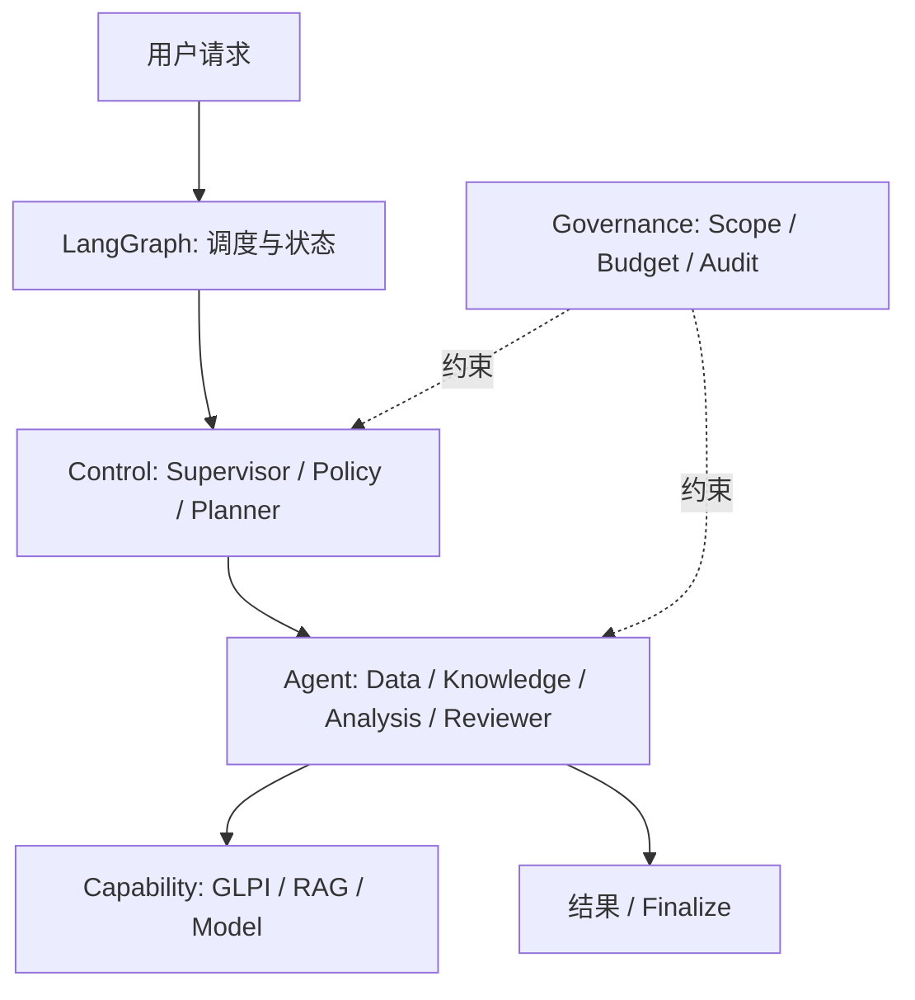

---

## B02 · 六个最小概念：State / Node / Edge / Command / Send / Interrupt

### 总

- `State`：这次 Run 的公共工作数据。
- `Node`：读取 State 并执行一个步骤。
- `Edge`：定义节点间的连接。
- `Command(update, goto)`：一次返回同时更新状态和指定后继。
- `Send(node, input)`：动态把一项任务输入发送给某节点，可有多个并行分支。
- `interrupt()`：暂停当前执行，等待外部恢复值。

### 正常流程：最简单的例子

```python
from langgraph.graph import StateGraph, START, END

graph = StateGraph(MyState)
graph.add_node("read", read_node)
graph.add_node("analyze", analyze_node)
graph.add_edge(START, "read")
graph.add_edge("read", "analyze")
graph.add_edge("analyze", END)
app = graph.compile()
```

这个例子不必调用模型：`read_node` 完全可以只是读取数据并返回 `{ "ticket_id": 2 }`。

### 关键设计

`Phase3State` 是 TypedDict。普通字段通常采用**新值覆盖**；列表中的 `trajectory`、`task_completions`、`agent_invocations` 等使用 `Annotated[..., operator.add]`，表示合并时**追加**；`data_evidence` 和 `knowledge_evidence` 用自定义 `_reset_or_append`，当更新值为 `None` 时**清空旧证据**，而 `[]` 只是追加空列表。

小例子：`trajectory=["route"]` 加上节点返回的 `["supervisor"]`，变成 `["route","supervisor"]`。但旧 `data_evidence=[E1]` 加上 `[]` 仍是 `[E1]`，要清除必须更新为 `None`。

### 必要失败边界

有 `Command(goto="finalize")` 的节点如果**同时还有指向不同后继的静态边**，LangGraph 可能调度额外的后继；因此 ServiceMind 多处通过 `_after_termination()` 的条件边避免重复路径。注意“两个后继不同”与“两个机制最终指向同一后继”并不相同，后者在 R2 审计中另有精确结论。

### 源码学习

```python
# state.py
trajectory: Annotated[list[str], operator.add]
data_evidence: Annotated[list[dict[str, Any]], _reset_or_append]
```

[State 定义](https://github.com/shark6438/servicemind/blob/19d9a377/src/servicemind/orchestration/state.py#L44-L105)；[_after_termination](https://github.com/shark6438/servicemind/blob/19d9a377/src/servicemind/orchestration/supervisor_workflow.py#L230-L240)。

### 小结

**Node 是“做什么”，Edge/Command/Send 是“接下来谁执行”，State 决定“运行携带什么”。**

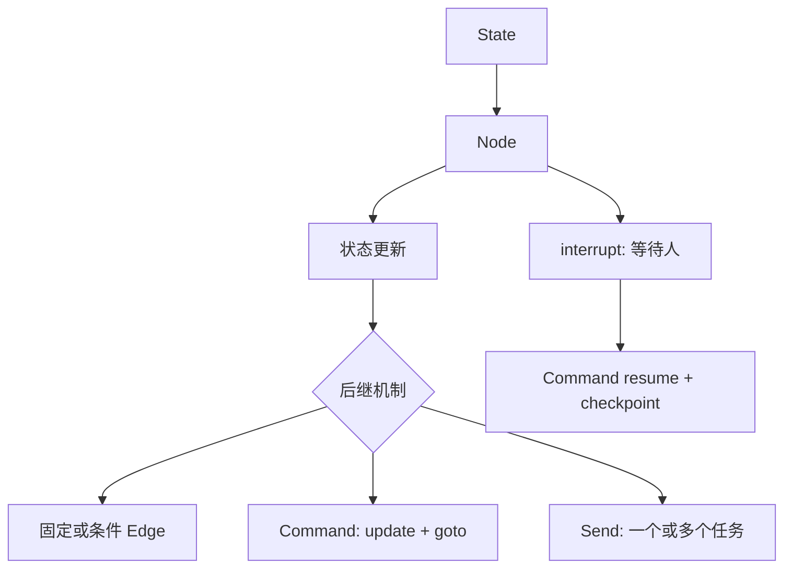

---

## B03 · Router：为什么简单问题不用完整 Multi-Agent？

### 总

`FastPathRouter` 是**确定性规则路由器**，不是调用 LLM 的 RouterAgent；它根据语言模式和 `request_write` 判断哪些请求可以走快捷路径。

### 正常流程与简单例子

| 请求                                     | RouteType              | 后续             |
| ---------------------------------------- | ---------------------- | ---------------- |
| “Ticket #2 当前状态是什么？”             | SIMPLE_DATA_QUERY      | `fast_data`      |
| “查找 VPN MFA 排障手册”                  | SIMPLE_KNOWLEDGE_QUERY | `fast_knowledge` |
| “VPN MFA 失败，我刚换手机，该怎么办？”   | COMPLEX_WORKFLOW       | `supervisor`     |
| “分析并准备写备注”（request_write=True） | COMPLEX_WORKFLOW       | `supervisor`     |
| “删除工单”                               | UNSUPPORTED            | `unsupported`    |

先检查禁止操作，再检查写请求、故障诊断、复杂请求、知识与数据规则，剩下的模糊请求进入完整审核流程。

> [!important] 路由示例的源码精度
> 冻结 `router.py` 中 `_RETRIEVE` 包含“查找”“找一下”，**不含单独的“找”**。因此“查找 VPN MFA 排障手册”可命中知识规则；“找 VPN MFA 排障手册”在没有其他匹配时反而落入默认 `COMPLEX_WORKFLOW`。这是当前正则的行为，并不是自然语言上“找”与“查找”应当具有不同含义。对应的确定性规则已按源码进行最小正则重现核对；**没有运行 ServiceMind 项目的 Router pytest**。可命中的完整检索动词还包括“找一下”“查询”，不能把它们泛化为所有近义动词。

### 关键设计

`fast_data` 直接读取 GLPI 并写 Run `SUCCEEDED`，**不经过完整 Reviewer**。`fast_knowledge` 获取知识证据后通过 `_unsupported_lookup()` 比较知识类证据的相关性分数和 `SERVICEMIND_RAG_ANSWER_FLOOR`。没有合格证据时设置 `lookup_declined`，转入 Supervisor 的完整路径，而不是装作已经回答。

### 必要失败边界

Top-K 检索总能返回一些候选，不代表任何候选足以回答问题。如果只有无关文本，返回 `lookup.declined`。**真实 RAG 可否检索到某文档属于运行结果，不由 Router 源码保证。**

### 源码学习

```python
# supervisor_workflow.py
route = RouteDecision.model_validate(state["route"]).route
if route is RouteType.SIMPLE_DATA_QUERY:
    return "fast_data"
if route is RouteType.SIMPLE_KNOWLEDGE_QUERY:
    return "fast_knowledge"
if route is RouteType.COMPLEX_WORKFLOW:
    return "supervisor"
return "unsupported"
```

[router.py](https://github.com/shark6438/servicemind/blob/19d9a377/src/servicemind/orchestration/router.py#L161-L227)；[fast_knowledge 节点](https://github.com/shark6438/servicemind/blob/19d9a377/src/servicemind/orchestration/supervisor_workflow.py#L430-L504)。

### 小结

**快速路径负责有限任务；不够回答时必须回到审核路径。**

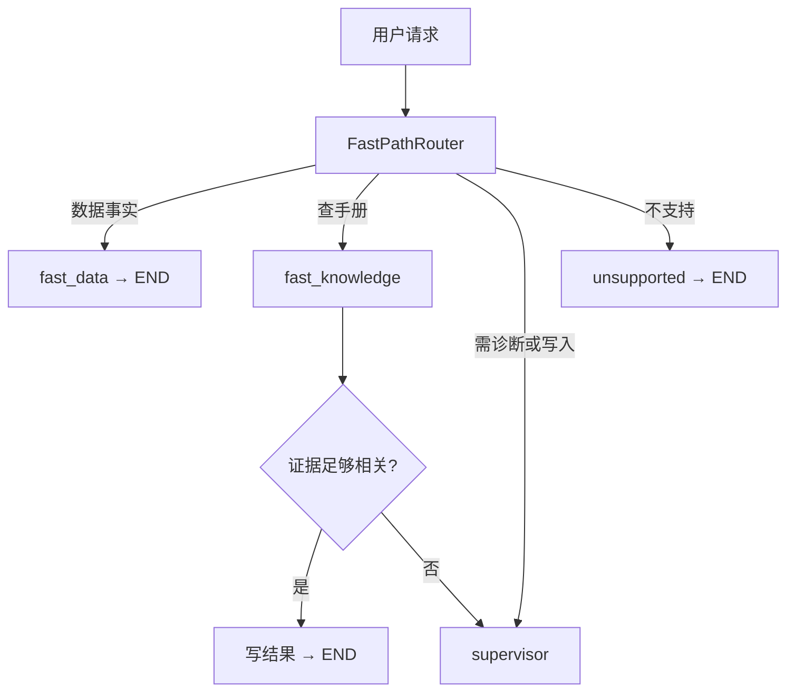

---

## B04 · Supervisor 与 Policy：模型只能提议合法的下一步

### 总

SupervisorAgent 是 **Control Plane 的 LLM 角色**；它没有直接的 GLPI 写工具。`SupervisorPolicy` 从 `Phase3State` 计算合法动作，并在 `Command` 跳转前验证。

### 正常流程与简单例子

任务 T1(Data)、T2(Knowledge) 已成功，T3(Analysis) Ready。Supervisor 收到 `legal_actions`、`ready_tasks`、预算等信息后，返回结构化 `SupervisorDecision(action="analyze", selected_task_ids=["T3"], ...)`；Policy 确认任务恰好一个、T3 是 Ready 的 Analysis Task 后，`Command(goto="analysis")` 才会执行。

### 关键设计

决策链：`supervisor_view(state) → SupervisorAgent.decide(LLM) → SupervisorDecision(Pydantic) → SupervisorPolicy.validate → Command(update,goto)`。

**再往前一层：领域对象本身也有不变量。** `ReviewResult.passed_review_must_be_clean()` 规定，当 `decision=PASSED` 时，`degraded=True` 或出现 `severity=error/critical` 的 finding 都会导致 Pydantic 验证失败。例如 Reviewer 不能合法构造 `PASSED + degraded=True`。这与 `SupervisorPolicy` 的职责不同：**领域契约防止构造矛盾的审核结论，Policy 判断在当前流程状态下能否选择 HANDOFF_ACTION**。

```python
# domain/review.py:69–76
if self.decision is ReviewDecision.PASSED and (self.degraded or blocking):
    raise ValueError("A degraded or blocking review cannot be marked passed")
```

[领域契约](https://github.com/shark6438/servicemind/blob/19d9a377/src/servicemind/domain/review.py#L69-L76)。

在一次 `supervisor_node` 访问中，Policy 非法决策最多有三次**累积反馈修正**；**模型调用自己抛异常**则不会用同一循环盲目重问，而是准备失败终止。这个“三次”不是整次 Run 的 Supervisor 总调用上限。

重要合法动作示例：

| 状态                                  | 合法动作（源码）                    |
| ------------------------------------- | ----------------------------------- |
| 没有 TaskPlan                         | `PLAN / ESCALATE`                   |
| `evidence_dirty=True` 且无 Review     | `JOIN_EVIDENCE / REPLAN`            |
| Reviewer PASSED、只读                 | `FINALIZE / REPLAN`                 |
| Reviewer PASSED、写请求、Action Ready | `HANDOFF_ACTION / REPLAN`           |
| Reviewer RETRIEVE_MORE                | `RETRIEVE_MORE / REPLAN / ESCALATE` |
| Reviewer REPLAN                       | `REPLAN / ESCALATE`                 |
| Reviewer ABSTAIN                      | `FINALIZE`                          |
| Reviewer degraded                     | `ESCALATE / FINALIZE`               |

### 必要失败边界

如果 Reviewer 尚未 PASSED，模型仍提出 HANDOFF_ACTION，则校验拒绝；如果三次策略修正仍不能选合法动作，终止为 `supervisor_policy_failure`，走 Finalize。预算上限的检查粒度与这个策略循环的关系另见 B16。

### 源码学习

```python
candidate = await svc.supervisor.decide(
    supervisor_view(state), policy_feedback=feedback
)
svc.policy.validate(candidate, state)
# 通过后：Command(update={...}, goto=target)
```

[Supervisor 模型](https://github.com/shark6438/servicemind/blob/19d9a377/src/servicemind/agents/supervisor.py)；[Policy](https://github.com/shark6438/servicemind/blob/19d9a377/src/servicemind/orchestration/supervisor_policy.py)；[supervisor_node](https://github.com/shark6438/servicemind/blob/19d9a377/src/servicemind/orchestration/supervisor_workflow.py#L584-L755)。

### 小结

**LLM 产生候选决策，确定性 Policy 才是工作流的合法动作门。**

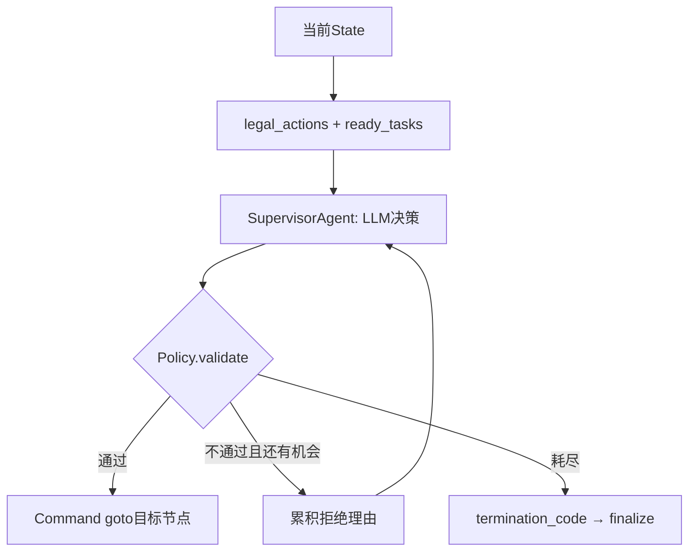

---

## B05 · TaskPlan：动态业务 DAG 与固定 Graph 不一样

### 总

主 Graph 是预定义的**程序节点网络**；Planner 产生的是随请求变化的**业务任务 DAG**（有向无环图）。一个主节点 `data_task` 可以在不同任务批次执行多个 Data Task。

### 正常流程：四任务例子

| Task | Agent     | 依赖   |
| ---- | --------- | ------ |
| T1   | Data      | 无     |
| T2   | Knowledge | 无     |
| T3   | Analysis  | T1、T2 |
| T4   | Reviewer  | T3     |

T1、T2 可并行，T3 要等两者完成，T4 再审核。若 `request_write=True`，必须包含 Action 且处于 Reviewer 之后。

### 关键设计

`DynamicPlanner.create_plan(LLM)` 只生成 `PlanProposal`；`compile_proposal()` 把它转换为 `TaskPlan`、配上 budget/deadline、做确定性补全，并经 `DagValidator.validate()` 检查：Agent 和 task_type 是否匹配、是否有环/缺依赖、Reviewer 是否有 Analysis 祖先、Action 是否有 Reviewer 祖先等。

初始提议中如果有证据任务却漏掉 Analysis/Reviewer，`_complete_evidence_pipeline()` 会按策略补上；不要说“模型遗漏就必定直接失败”。

### 必要失败边界

`T1 depends_on T2` 同时 `T2 depends_on T1` 是环，校验返回 `CYCLIC_DAG`。`Action depends_on Data` 而没有 Reviewer 祖先，则违反 `ILLEGAL_ACTION_FLOW`。

### 源码学习

```python
# dispatcher.py 的关键语义（按实际代码简化）
ready = [
    task for task in plan.tasks
    if task.status in {TaskStatus.PENDING, TaskStatus.READY}
    and set(task.depends_on) <= successful_ids
]
```

`ready_tasks()` 问“依赖满足没有”；`available_slots()` 问“当前还有几个并发名额”，二者不能合并。

[Planner](https://github.com/shark6438/servicemind/blob/19d9a377/src/servicemind/orchestration/dynamic_planner.py)；[DagValidator](https://github.com/shark6438/servicemind/blob/19d9a377/src/servicemind/orchestration/task_dag.py)；[Dispatcher](https://github.com/shark6438/servicemind/blob/19d9a377/src/servicemind/orchestration/dispatcher.py)。

### 小结

**Planner 生成任务，DAG 校验合法性，Dispatcher 判依赖和推进任务状态。**

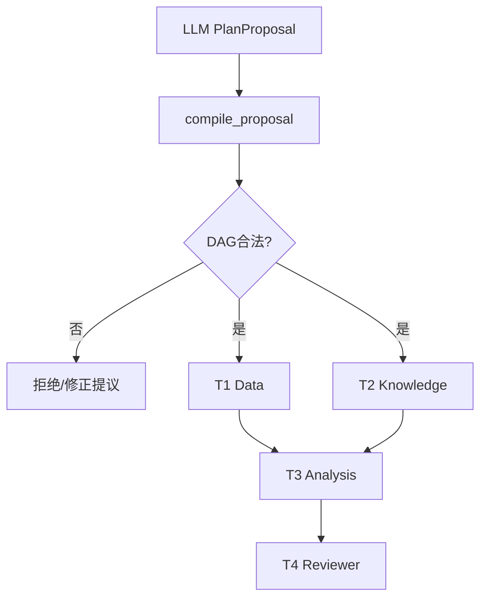

---

## B06 · Send 与 Barrier：并行任务如何真正汇合

### 总

Supervisor 选中 `DISPATCH`，`dispatch_node` 用 `Send` 为本批任务分别构造输入；LangGraph 可并行调度 Data/Knowledge；`dispatch_barrier_node` 合并**当前批次**的完成记录，并更新 TaskPlan。

### 正常流程与简单例子

T1=读取 Ticket #2；T2=检索 MFA Runbook。它们无依赖，可以分别发送 `Send("data_task", payload_T1)` 与 `Send("knowledge_task", payload_T2)`。两条分支输出 `TaskCompletion` 和 Evidence；Barrier 再逐项将 Task `RUNNING → SUCCESS/FAILED`。

### 关键设计

- `dispatch_batch_id` 区分不同检索轮次。
- `task_completions` 用 `operator.add` 累积所有批次记录。
- Barrier 先过滤当前 `batch_id`，还要求对应 Task **仍是 RUNNING**；避免权限收窄后旧 Completion 污染已重新打开的计划。
- Data 内部可能又并行多个只读 ToolCall，**两层并行不是一回事**。

- **计数口径 ≠ 状态迁移口径**：先按当前 `batch_id` 过滤出 `completions`，再按任务仍处于 `RUNNING` 得到 `applied`。Task 的 `SUCCESS/FAILED` **只根据 `applied`** 更新；但 `control.total_steps`、`tool_call_count`、`model_call_count` 分别按 `completions` 统计，哪怕其中某项已不符合 RUNNING 条件。代码见 [Barrier L1089–1115](https://github.com/shark6438/servicemind/blob/19d9a377/src/servicemind/orchestration/supervisor_workflow.py#L1089-L1115)。

### 必要失败边界

假设 B1 的 T1/T2 已完成，新计划 B2 重新查询 T5/T6。Reducer 保留旧 Completion，如果 Barrier 不查 `batch_id` 与 RUNNING，可能把旧结果重复应用到新计划；本实现做了双重过滤。

再举一个更细的例子：Barrier 收到本批 T1 的 completion，但权限收窄已让计划中的 T1 回到 `PENDING`。**T1 不会被标记为 SUCCESS**；不过该 completion 仍计入本批 `control.total_steps`（及其报告的 model/tool 计数）。不要将 Control 的统计值解释为“本次成功应用的 Task 数”。

### 源码学习

```python
# dispatch_node
sends.append(Send(node, payload))
return Command(update={"dispatch_batch_id": batch_id, ...}, goto=sends)

# dispatch_barrier_node
completions = [
    item for item in state.get("task_completions", [])
    if item["batch_id"] == batch
]
running = {task.task_id for task in plan.tasks if task.status is TaskStatus.RUNNING}
applied = [item for item in completions if item["task_id"] in running]
```

[dispatch_node](https://github.com/shark6438/servicemind/blob/19d9a377/src/servicemind/orchestration/supervisor_workflow.py#L820-L869)；[dispatch_barrier_node](https://github.com/shark6438/servicemind/blob/19d9a377/src/servicemind/orchestration/supervisor_workflow.py#L1089-L1142)。

### 小结

**Send 负责分发，Reducer 负责合并，Barrier 负责只认本批合法 Completion。**

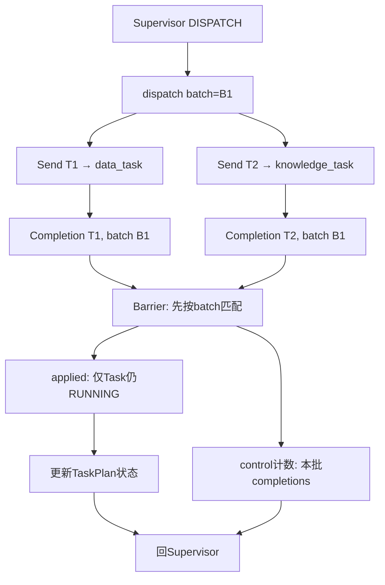

---

## B07 · Data / Knowledge：外层 Node 与内部 Graph 的区别

### 总

主 Graph 的 `data_task` 和 `knowledge_task` 是**调用 Agent 的外层包装节点**；每个 Agent 还可能执行自己的内部 LangGraph。不能把内部节点直接画成主 Graph 的静态出边。

### 正常流程与简单例子

Data T1 读取 Ticket #2：`data_task_node → DataAgent.run → 内部 plan → execute → normalize → Evidence → TaskCompletion`。

Knowledge T2 检索 VPN MFA：`knowledge_task_node → KnowledgeAgent.retrieve → 内部 retrieve → Knowledge Evidence → TaskCompletion`。

实际内部节点数量：**Data 3**，**Knowledge 1**。

### 关键设计

DataAgent 的 `plan` 可使用模型提议只读调用，`_compile_plan` 再限制 Tool 名称、Ticket ID、capability 和预算；`execute` 通过 `TenantGlpiReadGateway` 调用工具；`normalize` 将 GLPI 内容变成带来源信息的 Evidence。KnowledgeAgent 的核心是 RAG / baseline runbook 检索；查询改写是否调用模型取决于 RAG 与调用预算配置。二者都不是写入 GLPI 的 Agent。

### 必要失败边界

DataAgent 的模型规划异常可以降级到权限允许的最小只读计划，**但外层数据调用仍可能失败**。Knowledge 的检索失败会生成 FAILED Completion 并被 Barrier 消费；若 `_assembled_context` 在调用前拒绝构造上下文，它走的是另外一条终止路径（详见 B15）。另外，知识 ACL 支持 profile 维度，不代表标准 HTTP Run 已提供完整 profile 身份接线（B18）。

### 源码学习

```python
# agents/data.py
graph = StateGraph(DataAgentState)
graph.add_node("plan", self._plan_node)
graph.add_node("execute", self._execute_node)
graph.add_node("normalize", self._normalize_node)
graph.add_edge(START, "plan")
graph.add_edge("plan", "execute")
graph.add_edge("execute", "normalize")
graph.add_edge("normalize", END)

# agents/knowledge.py
graph = StateGraph(KnowledgeState)
graph.add_node("retrieve", self._retrieve_node)
graph.add_edge(START, "retrieve")
graph.add_edge("retrieve", END)
```

[DataAgent](https://github.com/shark6438/servicemind/blob/19d9a377/src/servicemind/agents/data.py)；[KnowledgeAgent](https://github.com/shark6438/servicemind/blob/19d9a377/src/servicemind/agents/knowledge.py)。

### 小结

**主 Graph 管跨 Agent 的任务调度，内部 Graph 管每个 Agent 自己的步骤。**

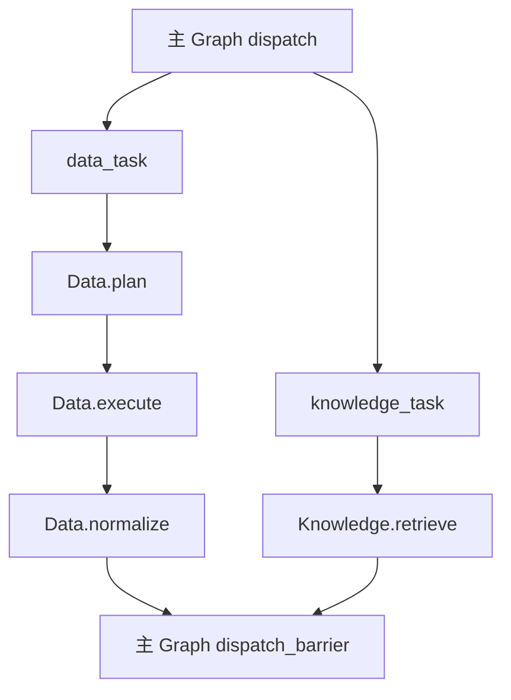

---

## B08 · Analysis / Reviewer：分析结论与独立审核如何闭环

### 总

AnalysisAgent 回答“证据支持怎样的分析”；ReviewerAgent 回答“分析本身是否有充分依据”。**生成结论与审核结论是不同职责。**

### 正常流程与简单例子

给定工单“更换手机后 VPN MFA 失败”和 Runbook“检查认证器绑定”，Analysis 可产生 MFA 相关假设与 Evidence 引用。Reviewer 检查是否出现“没有证据却断言防火墙故障”这样的过度推论。

Analysis 内部 3 节点：`draft → check ↔ revise`（受修订次数限制）。Reviewer 内部 3 节点：`rule_gate → semantic_judge → adjudicate`，若确定性 rule_gate 已产生结论则直接结束。

### 关键设计

`AnalysisResult` 不是 ReviewResult。Analysis 失败后可能返回 `DEGRADED` 结果；外层 Analysis Task 却已经正常交付并标为 `SUCCESS`。Reviewer 再依据 `AnalysisResult.status` 拒绝对降级分析放行。**Task 成功 ≠ Agent 质量合格 ≠ Review PASSED**（详见 B13）。

Reviewer 构造函数的参数默认 `enable_semantic_review=False`，但**ServiceMind 应用 singleton** 为 `reviewer_agent = ReviewerAgent(enable_semantic_review=True)`。不能根据类的默认参数误判主调用的审核强度。

### 必要失败边界

Analysis 内部修订是“重写当前草稿”；主 Graph 的 Replan 是“重新组织证据任务并重新审核”，完全不是同一个循环。还有 Context 治理：Reviewer 应依据**真正交付给 Analyst 的证据集合**作判断，而不是利用 Analyst 未看到的新证据批评分析。

### 源码学习

```python
# agents/analysis.py
graph.add_edge(START, "draft")
graph.add_edge("draft", "check")
graph.add_conditional_edges("check", self._after_check,
                            {"revise": "revise", "finish": END})
graph.add_conditional_edges("revise", self._after_revise,
                            {"check": "check", "finish": END})

# agents/reviewer.py
graph.add_edge(START, "rule_gate")
graph.add_conditional_edges("rule_gate", self._after_gate,
                            {"finish": END, "semantic": "semantic_judge"})
graph.add_edge("semantic_judge", "adjudicate")
graph.add_edge("adjudicate", END)
```

[Analysis](https://github.com/shark6438/servicemind/blob/19d9a377/src/servicemind/agents/analysis.py#L90-L107)；[Reviewer](https://github.com/shark6438/servicemind/blob/19d9a377/src/servicemind/agents/reviewer.py#L278-L300)；[应用 Reviewer singleton](https://github.com/shark6438/servicemind/blob/19d9a377/src/servicemind/agents/reviewer.py#L1165-L1171)。

### 小结

**分析输出 AnalysisResult；Reviewer 输出 ReviewResult。二者既不共享职责，也不共享内循环。**

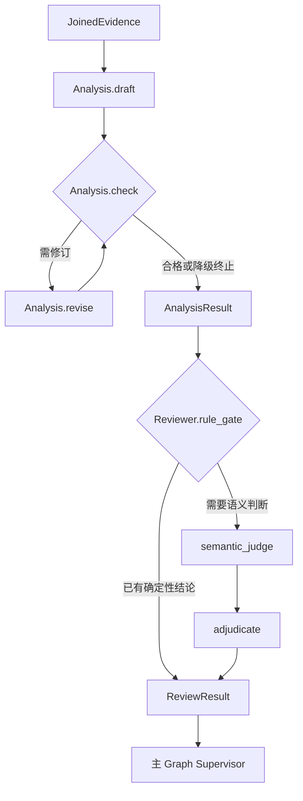

---

## B09 · 审核如何驱动主 Graph 回环：Retrieve More、Replan、Escalate、Abstain

### 总

Reviewer 只生成审核结论，**不会直接任意调度后续节点**；Supervisor 根据当前 ReviewResult 和 Policy 选择合法动作。

### 正常流程与简单例子

VPN 故障证据不足，Reviewer 返回 `RETRIEVE_MORE`：

`reviewer → supervisor → retrieve_more → revise_plan → 新 Knowledge/Data 任务 → 新 Analysis → 新 Reviewer`。

其他常见结果：`PASSED`（只读可 finalize、写请求可 Handoff）、`REPLAN`（重构计划）、`ESCALATE`（人工 review interrupt）、`REJECT`（取消接受结果）、`ABSTAIN`（停止编造、明确弃答）。

### 关键设计

- `retrieve_more_node` 调用 `revise_node(retrieve_more=True)`，增加 `retrieval_round`。
- `replan_node` 调用 `revise_node(retrieve_more=False)`，增加 `replan_count`。
- `revise_plan()` 必须保留既有已完成任务，增加新证据任务与 Analysis/Reviewer；写请求还需 Action，RETRIEVE_MORE 还需 Knowledge。
- 重新规划继承原预算和 deadline，不能无条件延长运行。

**状态层面的关键动作：** `revise_node` 在 `revise_plan()` **成功返回新 TaskPlan 时**，马上更新 `analysis_result={}`、`review_result={}`，使先前分析和审核不能作为**当前有效结果**直接被复用。此时新增的 Knowledge/Data Task **还未执行**；不能误写成“拿到新证据后才清空”。

```python
# supervisor_workflow.py:1467–1474，省略无关字段
return {
    "task_plan": revised.model_dump(mode="json", by_alias=True),
    "analysis_result": {},
    "review_result": {},
    "evidence_dirty": False,
}
```

**反向边界**：若计划修订失败并返回 `critical_error`，源码刻意**不清空**旧 `analysis_result/review_result`，让失败 Run 保留此前的分析和审核供追溯。[两种分支源码 L1434–1478](https://github.com/shark6438/servicemind/blob/19d9a377/src/servicemind/orchestration/supervisor_workflow.py#L1434-L1478)。

### 必要失败边界

**预算终态不能混称 FAILED**：BudgetExceeded 的 `termination_code` 若为 `budget_exceeded / deadline_exceeded / replan_limit_exceeded / loop_guard_triggered`，当前 `finalize_node` 会将其映射为 **Run `CANCELLED`**（不是用户点击“取消”的语义）。`critical_error`、`supervisor_policy_failure` 等才在明确的 FAILED 集合中。完整状态见 B11。

此外，Reviewer 的 `ABSTAIN` 会最终令 Run `SUCCEEDED`，但审核仍是 **ABSTAIN**，并未 PASSED，更不代表执行 GLPI 写入。

### 源码学习

```python
async def retrieve_more_node(state):
    return await revise_node(state, retrieve_more=True)

async def replan_node(state):
    return await revise_node(state, retrieve_more=False)
```

[revision 实现](https://github.com/shark6438/servicemind/blob/19d9a377/src/servicemind/orchestration/supervisor_workflow.py#L1360-L1485)；[ReviewDecision](https://github.com/shark6438/servicemind/blob/19d9a377/src/servicemind/domain/review.py#L8-L20)。

### 小结

**ReviewResult 是审核事实，Supervisor 负责将事实变成合法的下一步。**

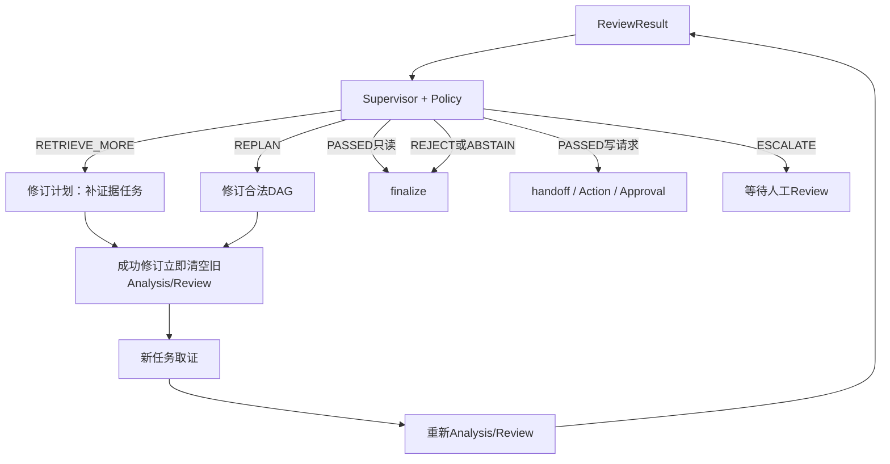

---

## B10 · Interrupt / Checkpoint / Resume：为什么人能隔一段时间再批准？

### 总

`interrupt()` 让 Graph 暂停，Checkpointer 用 `thread_id` 保存可恢复状态。**LangGraph checkpoint 不是 ServiceMind 的 Approval 数据库记录。**

### 正常流程与简单例子

ActionAgent 将“给 Ticket #2 写私有 followup”编译为具体 ActionIntent，动作落库并把 Run 设为 `WAITING_APPROVAL`。`approval_node` 执行 `interrupt({"type":"approval_required", "action_intent":...})`。人从 API 提交 `expected_action_hash` 和 APPROVE。API 在写 Approval 前重验原 Requester 有效权限；落库后通过 `Command(resume=..., update=...)` 恢复 checkpoint。Graph 把控制权交给 Harness，之后 `execute_node` 再查一次即时权限。

### 关键设计

| 对象                  | 主要职责                        |
| --------------------- | ------------------------------- |
| LangGraph Checkpoint  | 暂停、恢复 Graph 控制流和 State |
| AgentRun              | 业务 Run 的状态和最终结果       |
| ActionIntent          | 被审批的确切动作与 hash         |
| Approval              | 具体的人类决定                  |
| RunEvent / AuditEvent | 可解释的事件与审计记录          |

`thread_id` 用来寻找同一条 Graph 的 checkpoint。FastAPI lifespan 会根据配置初始化 Saver，并将它配置到 `supervisor_graph`；此源码事实**不意味着生产一定使用 PostgreSQL Saver**，要看 `DATABASE_TYPE` 的实际配置。

另一种 interrupt 是 Review Escalation：`type=review_escalation`、允许人工 `continue/stop`。它不是 Action Approval，也不会直接写 GLPI。

### 必要失败边界

不能把 Approver 的更大权限借给原 Requester；权限收窄时证据与派生结论失效，待审批 ActionIntent 撤回并重新推导。Resume 检查通过到执行前仍有时间窗口，所以 Execute-time `require_still_held()` 必须再次确认。

### 源码学习

```python
# runtime.py 的精简表示
await supervisor_graph.ainvoke(
    Command(resume=resume_payload, update=scope.update),
    config=run_config(run, scope.effective),
)
```

[Runtime 恢复](https://github.com/shark6438/servicemind/blob/19d9a377/src/servicemind/orchestration/runtime.py#L443-L503)；[Approval interrupt](https://github.com/shark6438/servicemind/blob/19d9a377/src/servicemind/orchestration/supervisor_workflow.py#L1595-L1635)。

### 小结

**Interrupt = 停；Checkpoint = 记住停在哪；Approval = 人决定什么；Resume = 按当前合法身份恢复。**

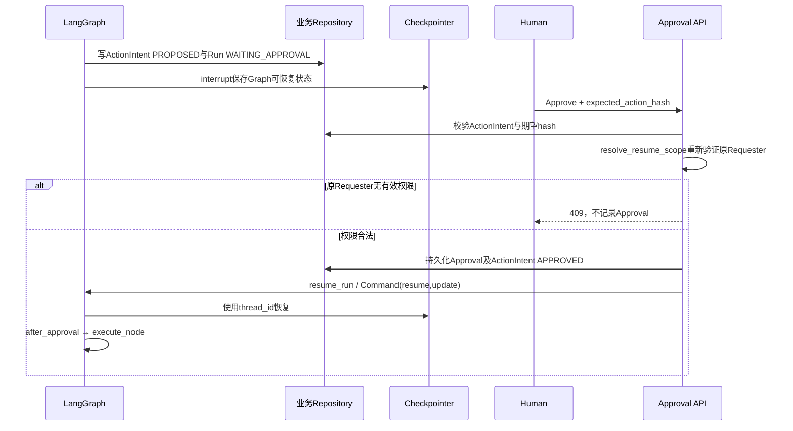

---

## B11 · Finalize / Run 状态 / Recovery：Graph END ≠ 业务成功

### 总

LangGraph 到 END 仅表示程序执行结束。**进入 `finalize_node` 的完整工作流**由它负责保存业务终态；快捷路由和 HTTP API 的部分处理具有各自的独立持久化入口，不能一概把所有终态归给 Finalize。

### 正常流程与简单例子

**终态写入者清单**（其中 RunEvent 与 AuditEvent 是不同记录流）：

| 执行入口                   | 条件                     | Run 状态                       | 事件/审计                                                    |
| -------------------------- | ------------------------ | ------------------------------ | ------------------------------------------------------------ |
| `finalize_node`            | 主 Graph 通过它终止      | 按 `failed/cancelled` 谓词决定 | RunEvent `run.succeeded` / `run.failed` / `run.cancelled`；特殊语义可覆盖为 `run.abstained`、`run.escalation_accepted` |
| `fast_data_node`           | 直接事实查询成功         | `SUCCEEDED`                    | RunEvent `run.succeeded`                                     |
| `fast_knowledge_node`      | 检索证据足以支持快速回答 | `SUCCEEDED`                    | RunEvent `run.succeeded`；不满足门槛时转 Supervisor 而不直接结束 |
| `unsupported_node`         | Router 拒绝不支持的操作  | **`CANCELLED`**                | **RunEvent `run.rejected`**；直接 `END`，不经过 `finalize_node` |
| API `_process_webhook_run` | Graph 异常逃出           | `FAILED`                       | RunEvent `run.failed`                                        |
| API `cancel_run`           | 合法主动取消             | `CANCELLED`                    | **AuditEvent** `run.cancelled`；此处理没有 `append_event` 写 RunEvent |

特别注意：`unsupported_node` 在返回的 **Graph State** 中填入 `termination_code="unsupported"`，但它直接连到 `END`，因此这个值**并不进入 `finalize_node` 的状态判定**。这说明“State 存在字段”不等于“实际调用链使用了这个字段”。

| 结果                                                         | 冻结源码的业务状态                        | 不能误读为                       |
| ------------------------------------------------------------ | ----------------------------------------- | -------------------------------- |
| Reviewer PASSED，正常只读结束                                | `SUCCEEDED`                               | “一定写了GLPI”                   |
| Reviewer ABSTAIN，且没有其他失败/取消条件                    | `SUCCEEDED`，有 `run.abstained`           | “Reviewer PASSED”                |
| Human escalation 选择 continue，且没有其他失败/取消条件      | `SUCCEEDED`，有 `run.escalation_accepted` | “获得Action审批”                 |
| 人拒绝 ActionIntent                                          | `CANCELLED`                               | “远端已执行”                     |
| Reviewer REJECT                                              | `CANCELLED`                               | “已执行写操作”                   |
| `critical_error / supervisor_policy_failure / supervisor_decision_failure / context_assembly_failure / evidence_unavailable` | `FAILED`                                  | “用户主动取消”                   |
| `budget_exceeded / deadline_exceeded / replan_limit_exceeded / loop_guard_triggered` | `CANCELLED`                               | “运行没有预算问题”               |
| 其他经过 `finalize_node`、且**不属于上述五个 FAILED 名称**的非空 `termination_code` | `CANCELLED`                               | “只有四种预算终止才会 CANCELLED” |

**普遍规则：只要执行进入 `finalize_node`，非空 `termination_code` 会使 `cancelled=True`，但在五种明确 `failure_terminations` 中时优先映射为 `FAILED`。**

`final_state_verified=True` 在当前实现中仅由 `status is RunStatus.SUCCEEDED` 计算，**不能把它一概解释为外部 GLPI 业务副作用已验证**。

### 关键设计

Graph checkpoint、业务 Run、Run Event、Audit Event、AgentInvocation、trajectory 各负责不同事实。`finalize_node` 先写业务终态，再尝试可选的 post-run Memory；后者出错会记录 `memory.post_run_failed`，不会因此抹掉已经保存的 Run 结果。

启动 `recover_incomplete_runs()` 扫描 `PENDING / RUNNING / WAITING_APPROVAL`；对 `WAITING_APPROVAL` 没有 Approval 的 Run 跳过，有持久化 Approval 的才可以尝试恢复。`WAITING_REVIEW` 不在启动扫描集合，但有独立的 `/runs/{run_id}/review-resolution` API。详细说明见 B17。

### 必要失败边界

若 Graph 异常逃出而未经过 `finalize`，`_process_webhook_run()` 会记录 `run.failed` 和错误原因。又因为恢复逻辑与 GLPI 副作用跨不同持久化边界，**“有 Recovery”绝不能推出所有崩溃窗口实现 exactly-once**。

### 源码学习

```python
# finalize_node，简化但保持真实条件
failed = termination_code in failure_terminations
cancelled = (
    state.get("termination_code") is not None
    or (state.get("approval") or {}).get("decision") == "rejected"
    or (state.get("human_review") or {}).get("decision") == "stop"
    or (state.get("review_result") or {}).get("decision") == "reject"
)
# 以下两个布尔值不参与上面的 status 三元判定；
# 它们用于特殊事件名，并参与剩余 Task 的取消处理。
abstained = (state.get("review_result") or {}).get("decision") == "abstain"
escalation_accepted = (state.get("human_review") or {}).get("decision") == "continue"

status = RunStatus.FAILED if failed else RunStatus.CANCELLED if cancelled else RunStatus.SUCCEEDED
# 事件优先选择 run.abstained / run.escalation_accepted；
# 否则选择 f"run.{status.value}"。
```

[Finalize](https://github.com/shark6438/servicemind/blob/19d9a377/src/servicemind/orchestration/supervisor_workflow.py#L1708-L1834)；[Recovery](https://github.com/shark6438/servicemind/blob/19d9a377/src/servicemind/orchestration/recovery.py)；[可恢复 Run 查询](https://github.com/shark6438/servicemind/blob/19d9a377/src/servicemind/persistence/repository.py#L237-L252)。

### 小结

**Run SUCCEEDED、Review PASSED、ExecutionResult.verified 是三个不同层次的成功，不可替代。**

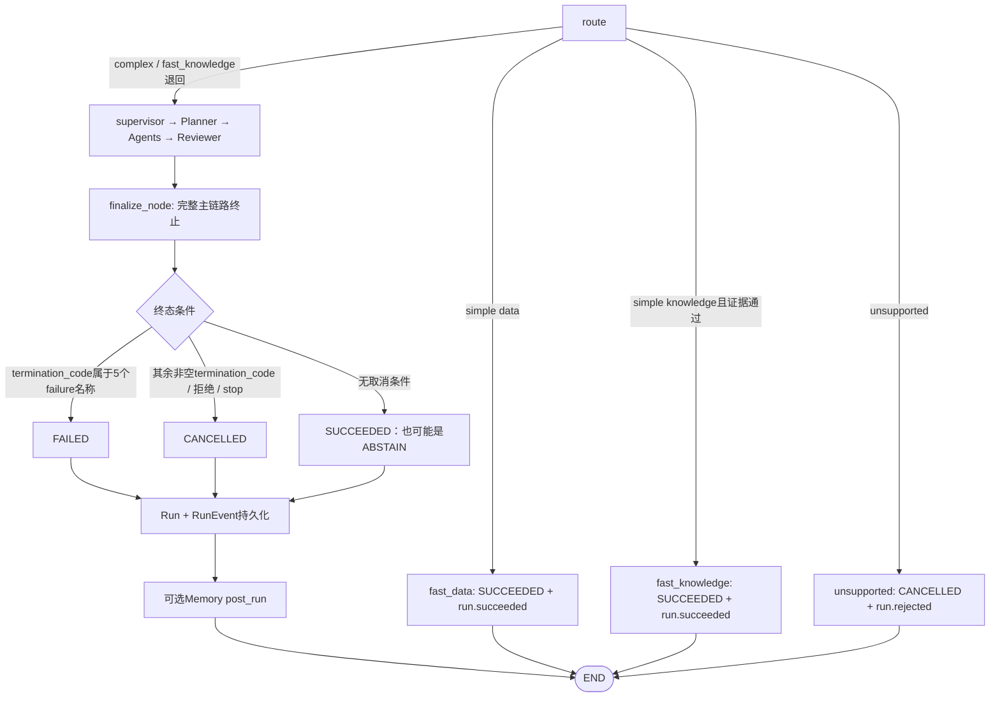

---

## B12 · Whiteboard #1：一张图说清主 Graph 的 21 节点

### 总

这是本 Master 的综合验收：**将 21 个注册在同一主 Graph 中的节点按功能组织，完整画出一条只读分析路径和一条需要人审批的写路径。** 不要求背行号，也不应把 4 个 Agent 内部 Graph 的 10 个内部节点计入主图。

### 正常流程与简单例子

只读路径（教学示例）：`route → supervisor → plan → supervisor → dispatch → data/knowledge → barrier → supervisor → join_evidence → supervisor → analysis → supervisor → reviewer → supervisor → finalize → END`。

写路径在 Reviewer PASSED 后：`supervisor → handoff → action → approval interrupt → Human Approve → execute → finalize → END`。

### 关键设计

21 个节点分组：路由 4（route/fast_data/fast_knowledge/unsupported）；控制计划 5（supervisor/plan/dispatch/retrieve_more/replan）；任务执行与汇合 4（data_task/knowledge_task/dispatch_barrier/join_evidence）；分析审核 2（analysis/reviewer）；写路径人工控制 4（handoff/action/approval/execute）；升级终止 2（escalate/finalize）。

### 必要失败边界

图中的箭头不是全都由 `add_edge()` 定义；主图混用了固定边、条件边、`Command(goto)` 与动态 `Send`。特别是 Supervisor 的 `Command` 不等于任意自由跳转，前面已经经过 Policy。

### 源码学习

注册与出边见 [supervisor_workflow.py:1836–1906](https://github.com/shark6438/servicemind/blob/19d9a377/src/servicemind/orchestration/supervisor_workflow.py#L1836-L1906)。

### 小结

**Graph 控制图、TaskPlan DAG、Agent 内部 Graph、外部工具执行链是四种不同的图。**

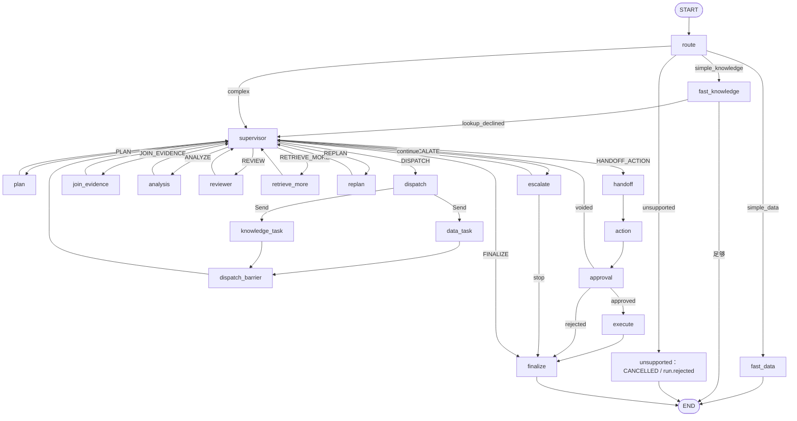

> [!note] 图形边界
> 为保证图可读，B12 未逐个画出 `plan/analysis/reviewer/replan/...` 的所有终止时条件边；它们在发生 `termination_code` 时可转向 `finalize`。完整源码以 Graph 注册区为准，图只作为白板学习展示。

---

## B13 · 四套状态体系不能合并

### 总：目的

同一次请求需要分别回答“任务完成了吗”“Agent 给出了什么质量的结果”“Reviewer 是否接受结论”“整次 Run 最终如何”。因此存在不同状态系统。

| 对象                         | 问题                     | 示例                                                         |
| ---------------------------- | ------------------------ | ------------------------------------------------------------ |
| `TaskStatus`                 | 某项计划任务是否完成     | `PENDING/READY/RUNNING/SUCCESS/FAILED/SKIPPED/CANCELLED`     |
| `AgentResultEnvelope.status` | Agent 的执行结果质量如何 | `SUCCEEDED/DEGRADED/FAILED`                                  |
| `ReviewDecision`             | 审核对结论的判断         | `PASSED/RETRIEVE_MORE/REPLAN/REJECT/ESCALATE/ABSTAIN`        |
| `RunStatus`                  | 整次请求状态             | `PENDING/RUNNING/WAITING_APPROVAL/WAITING_REVIEW/SUCCEEDED/FAILED/CANCELLED` |

### 正常流程：最小例子

工单 #2 的 Analysis 模型失败，但 AnalysisAgent 使用可追溯证据形成一个 `DEGRADED` 输出并正常返回。

`analysis_node` 收到输出后，依然把 **Task 状态**更新为 `SUCCESS`（任务交付动作结束），但 Reviewer 会根据 **AnalysisResult 的 status** 判断是否可接受；如果并未经过可信模型分析，则按 `replan_count` 决定 `REPLAN/ESCALATE`。

### 关键设计

`Task SUCCESS` ≠ `Agent SUCCEEDED` ≠ `Reviewer PASSED` ≠ `Run SUCCEEDED`。这种分层是为了区分执行结束、质量、审核和最终业务完成四种不同事实。

### 失败边界

对于 Data Agent 的降级计划，外层 `data_task_node` 只要正常返回 `envelope` 且未触发预算错误，completion 的 `status` 可能仍是 `success`，即使 envelope `status=degraded`。如果返回空 Evidence 且之后没有其他证据，Join 可能因 `evidence_unavailable` 终止；不能由 Task SUCCESS 推出证据充足。

### 源码学习

- `domain/task.py:56-80` Task 状态定义
- `runtime/contracts.py:11-52` AgentResultEnvelope
- `domain/analysis.py:20-24` AnalysisStatus
- `supervisor_workflow.py:1242-1256` 外层 Analysis 节点交付
- `agents/reviewer.py:431-475` 对降级 Analysis 的规则检查

### 小结

**最需要记住**：不同状态属于不同责任层，跨层判断必须看实际消费代码。

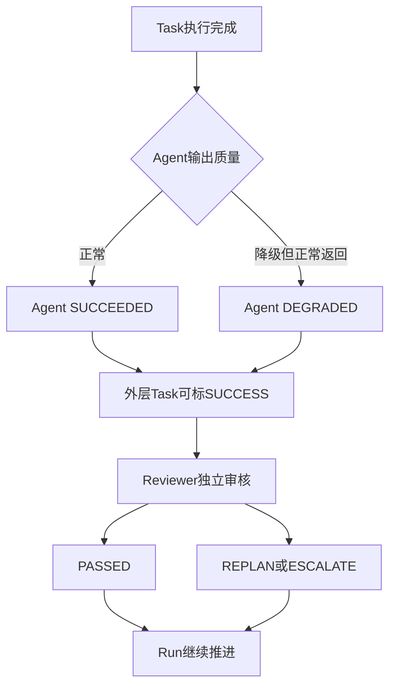

---

## B14 · control_owner、active_agent、Graph 当前节点

### 总：目的

把**控制权**与**谁执行了一步**分开，防止因为 Analysis 或 Action 节点运行过，就误认为它有权自主决定下一步。

### 正常流程：最小例子

`analysis_node` 返回 `control_owner="supervisor"` 与 `active_agent="analysis"`。含义是：Analysis 刚交付结果，控制权交还 Supervisor。`active_agent` 是 State 中的一项标签，不是 Graph 执行器的实时程序计数器；部分节点不更新它。

典型阶段：

| 阶段                      | 控制权标记   |
| ------------------------- | ------------ |
| Supervisor 正常决策       | `supervisor` |
| Handoff 交给 Action       | `action`     |
| Action 编译后等待人类     | `human`      |
| Approval 通过后确定性执行 | `harness`    |
| Execute 结束              | `none`       |

### 关键设计

Supervisor 是控制平面 Agent；`Action` 与 `Harness` 的差别已在 M5 说明：前者生成不可随意改动的 Intent，后者执行已批准的副作用。

### 失败边界

不能用 `active_agent == "analysis"` 断言此刻正在执行 Analysis 函数；应结合 LangGraph 状态、trace、trajectory、节点进入/退出事件判断。

### 源码学习

- `domain/supervisor.py:8–13` ControlOwner
- `supervisor_workflow.py:1249-1261` Analysis 返回的两项标记
- `supervisor_workflow.py:1487-1527,1577-1583,1624-1687` Handoff、Action、Approval、Execute

### 小结

**控制权不是函数名；谁能做决定与哪个节点刚执行完毕是两件事。**

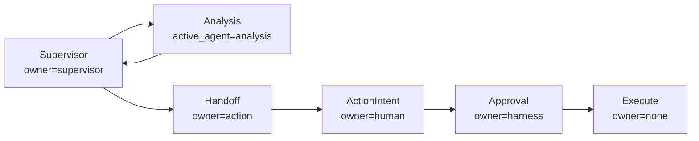

---

## B15 · Context 构建失败按真实调用者分流

### 总：目的

同一异常类型，不同调用位置可以产生不同的控制结果。不能以公共辅助函数存在来推断所有节点都使用它。

### 正常流程：最小例子

当 Context 超出预算，`analysis_node` 使用 `_assembled_context()`；它能把 `ContextAssemblyError` 转换为 `termination_code=context_assembly_failure`，随后通过 `_after_termination` 的条件边进入 `finalize`。

而 `data_task_node` 是在其 `try` 中**直接**调用 `svc.phase5.build_context()`：异常落入 `except Exception`，产生 `failed` TaskCompletion，再由 Barrier 决定后续 Replan 语义。

### 关键设计：源码差异

| 调用者                | Context 调用方式            | 结果                                                         |
| --------------------- | --------------------------- | ------------------------------------------------------------ |
| `data_task_node`      | 直接 `phase5.build_context` | 异常 → completion failed → Barrier                           |
| `knowledge_task_node` | `_assembled_context`        | 终止码 → 静态后继 Barrier → Supervisor 根据终止码只允许 Finalize |

**额外控制细节：**Knowledge 的 `_assembled_context()` 若在真正检索前返回 refusal，`knowledge_task_node` 会直接 `return refusal`，该分支**没有正常的 TaskCompletion**；静态出边仍会使其到达 Barrier，终止码留在全局 State 中，再由 Supervisor 进入 Finalize。不能误称 Barrier 记录了这一次知识任务的普通失败 Completion。
| `analysis_node` | `_assembled_context` | 终止码 → 条件后继 Finalize |
| `reviewer_node` | `_assembled_context` | 终止码 → 条件后继 Finalize |
| `action_node` | `_assembled_context` | 终止码 → 条件后继 Finalize |
| `fast_knowledge_node` | `build_fast_knowledge_context` | 独立快速路径，不可套用上表 |

### 失败边界

Data 的普通 `run` 路径因为 `hasattr(svc.data, "run")`，外层 `attempts_allowed` 通常为 1；这里不能把内层 Data ToolCall 的 2 次 HTTP 错误重试与外层 Data Task 的重试次数混为一谈。

### 源码学习

- `supervisor_workflow.py:268-330` `_assembled_context`
- `supervisor_workflow.py:871-965` Data 任务
- `supervisor_workflow.py:967-1087` Knowledge 任务
- `supervisor_workflow.py:1195-1298,1529-1544` Analysis/Reviewer/Action 入口
- `supervisor_workflow.py:1880-1905` 出边

### 小结

**失败语义是实际调用链的属性，不是函数名字的属性。**

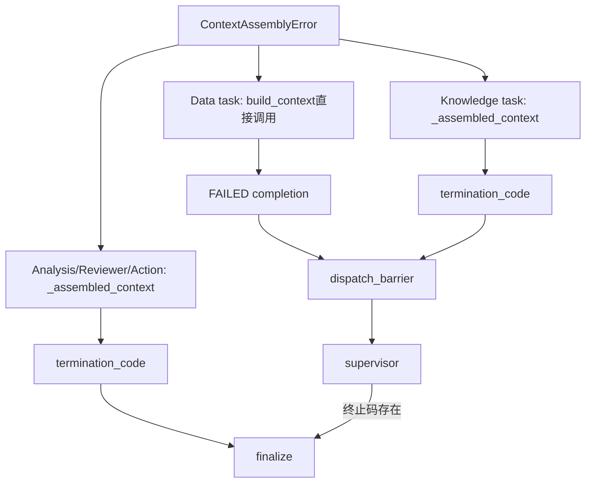

---

## B16 · Budget 的实际检查粒度

### 总：目的

预算存在不等于每个可能的底层调用均有一张独立的、精确预留的令牌。

### 正常流程：最小例子

`supervisor_node` 在已有 `task_plan` 时先检查一次 Budget；接着最多进入三轮 `policy_attempts`。每轮在调用模型之前把 `control.model_call_count` 加一，但本循环内部没有重复调用 `BudgetController.check()`。

如果 `max_model_calls=80`、进入节点前 `model_call_count=79`，且三个 Policy 决策均被拒绝，则该计数**有条件地**可达到 `82`。这是 SOURCE FACT 级别的控制流推导，不是生产观测。

### 关键设计

- **Run Budget**：在关键节点检查是否可继续。
- **AgentInvocation Budget**：为分派 Task 限制模型、工具额度。
- **模型网关治理**：约束单次模型请求、超时、成本等。

三者有关联，但不能直接解释成每个模型网络请求都被一个全局事务级计数器精确拦截。

**不同节点的最大尝试次数并不相同：**

| 节点中的局部循环                         | 最多总尝试次数 | 最多额外重试次数 | 源码                             |
| ---------------------------------------- | -------------: | ---------------: | -------------------------------- |
| `supervisor_node` 的非法 Policy 候选修正 |              3 |                2 | `policy_attempts=3`，L629–630    |
| 初始 `plan_node` 规划                    |              2 |                1 | `for attempt in range(2)`，L760  |
| `revise_node` 重新规划                   |              3 |                2 | `planner_attempts=3`，L1403–1404 |

这里的“3/2/3”是**允许进入循环的总次数**，不是失败之后还可额外重试 3/2/3 次。Supervisor 遇到**模型调用异常**会提前跳出；其三次主要用于有明确 Policy 反馈的非法候选修正。初始 Planner 连续两次失败会以 `critical_error` 结束，而不会自动进行第三次。

[Supervisor](https://github.com/shark6438/servicemind/blob/19d9a377/src/servicemind/orchestration/supervisor_workflow.py#L607-L665) · [初始 Plan](https://github.com/shark6438/servicemind/blob/19d9a377/src/servicemind/orchestration/supervisor_workflow.py#L756-L818) · [Replan](https://github.com/shark6438/servicemind/blob/19d9a377/src/servicemind/orchestration/supervisor_workflow.py#L1390-L1435)。

### 失败边界

预算边界需要单独测试 `max-1`、`max`、`max+1` 以及同节点多次 Policy 修正；Replan 的 `> max_replans` 也是特殊的计数语义，不应擅自换成 `>=`。

### 源码学习

- `orchestration/budget.py:20-42`
- `supervisor_workflow.py:584-665`
- `supervisor_workflow.py:820-869` 对分派 Task 的预算切分

### 小结

**预算规则既取决于阈值，也取决于检查时机与调用计数口径。**

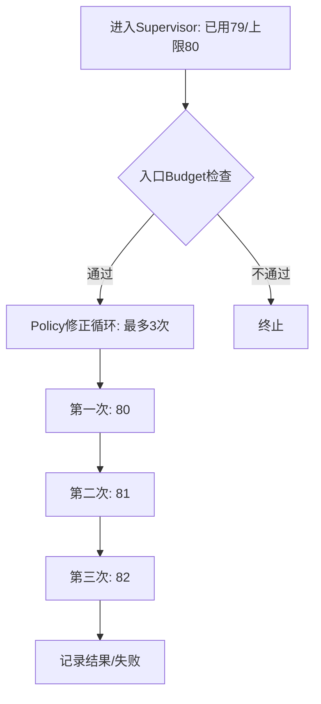

---

## B17 · Recovery 的实际扫描范围

### 总：目的

分清“Graph 能恢复”和“启动恢复会主动扫描哪些业务 Run”。

### 正常流程：最小例子

`ServiceMindRepository.list_recoverable_runs()` 只查询：

- `PENDING`
- `RUNNING`
- `WAITING_APPROVAL`

在 `recover_incomplete_runs()` 里，`WAITING_APPROVAL` 且**没有持久化 Approval** 的 Run 被跳过，继续等待人类。

如果已有 Approval，Recovery 可以读取其决定，然后使用 `resume_run()` 走权限重验证与恢复流程；这不是 Recovery 擅自替人审批。

`WAITING_REVIEW` **不在上述扫描集合**，但其人工恢复有单独的 `POST /runs/{run_id}/review-resolution` 路径。这两件事不能混为一谈。

### 关键设计

- **系统重启恢复**：扫描可恢复 Run、确认身份、继续已有工作。
- **人工审批恢复**：响应真实审批决定。
- **人工 Review Escalation**：响应 `continue/stop`，通过独立 API。

### 失败边界

`recover_incomplete_runs()` 如果遇到 `ResumeBlocked`，保持 Run 暂停；其他异常可能把 Run 标记 `FAILED`。本次读取源码不足以证明所有中途崩溃窗口都能可靠完成，尤其是外部 GLPI 写入。

### 源码学习

- `persistence/repository.py:237-252` 扫描集合
- `orchestration/recovery.py:37-119` 恢复分支
- `orchestration/runtime.py:403-503` 继续/Resume/Review Resume
- `api.py:463-531` 人工 Review Resolution

### 小结

**恢复能力、恢复扫描范围、审批权限是三个独立问题。**

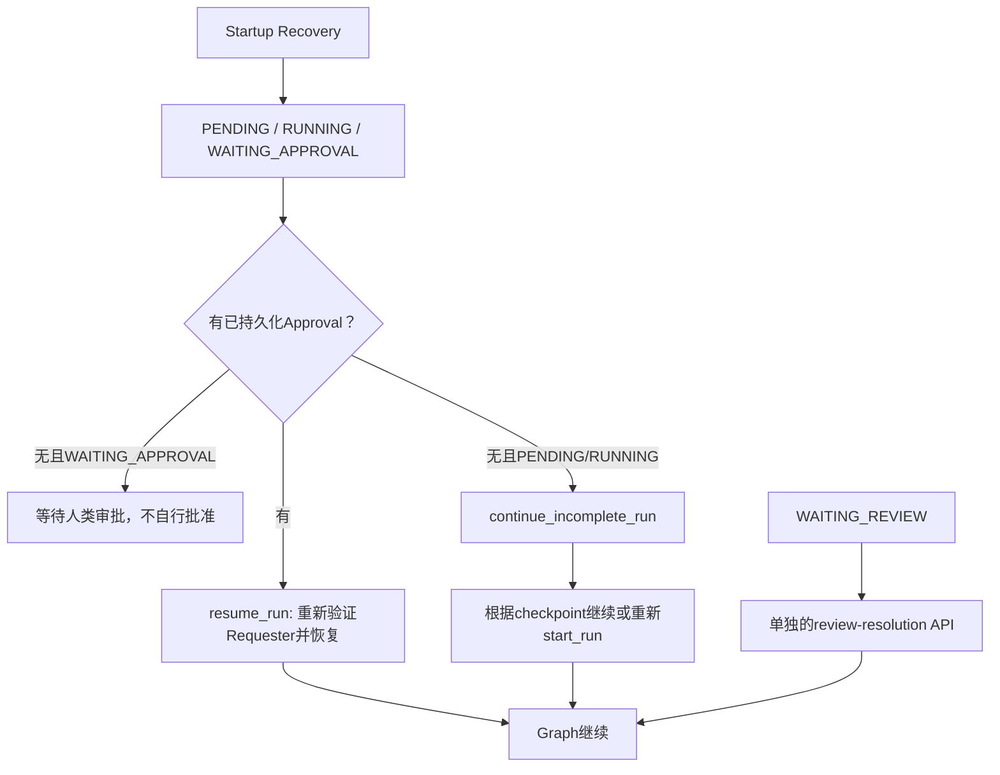

---

## B18 · Knowledge ACL 的 Profile 身份链路边界

### 总：目的

不能把“类型里写了一个安全字段”误认为“真实 HTTP 入口一定赋值了该字段”。

### 正常流程：最小例子

假设某知识文档 ACL 要求 `profile_ids={7}`。合法读取此文档的 RetrievalPrincipal 必须具有与 `{7}` 相交的 profile 集合。

当前 `KnowledgeACL`/`RetrievalPrincipal` 支持 `profile_ids`，`knowledge_task_node` 也会传递 `state.get("profile_ids")`，但本轮核查的标准 Run 链路是：

```text
OIDC claims → TenantContext(roles/entities/groups)
    ↓
start_run(): Phase3State(roles/entities/groups)，不写profile_ids
    ↓
knowledge_task_node(): state.get("profile_ids") or ()
    ↓
RetrievalPrincipal(profile_ids=空集合)
```

若文档确实限制 `profile_ids`，这个空集合不能满足 ACL 交集；结果是**不返回该文档（fail-closed）**，而不是扩大权限。这是条件性的代码事实，生产是否包含 profile-restricted 文档尚需数据与配置验证。

### 关键设计

Schema 中字段存在 ≠ OIDC 提取了字段 ≠ TenantContext 携带了字段 ≠ State 初始化了字段 ≠ RetrievalPrincipal 收到了非空值。

还有一处独立的 consumer 边界：主 Graph 的 `_context(state)` 只从 State 重建 tenant、user、roles、entity 和 `group_ids`；**并不读取 `profile_ids`**。因此不仅标准 `start_run()` 没有填充这一维度，后续 **State → TenantContext** 的重建也不消费它。见 [supervisor_workflow.py L88–100](https://github.com/shark6438/servicemind/blob/19d9a377/src/servicemind/orchestration/supervisor_workflow.py#L88-L100)。这并不意味着发生越权；不完整身份坐标在当前路径主要导致 profile-restricted 资源无法匹配。

### 失败边界

在没有完整接线的情况下，不可声称标准 Run 入口已支持 profile-restricted 文档对持有对应 profile 的用户正常可见。此处仅作学习中的 `AUDIT ONLY`，不擅自修改冻结项目。

### 源码学习

- `security/auth.py:53-60,109-144` TenantContext 与 OIDC Claims
- `orchestration/runtime.py:36-70` start_run 字段
- `orchestration/state.py:44-56` Phase3State 声明
- `orchestration/supervisor_workflow.py:985-991` Knowledge Task 转发
- `agents/knowledge.py:76-96,114-140` RetrievalPrincipal 构造
- `domain/knowledge.py:246-294` profile ACL 交集

### 小结

**从身份 Claim 到模型/检索使用点的每一次赋值都要沿调用链核实。**

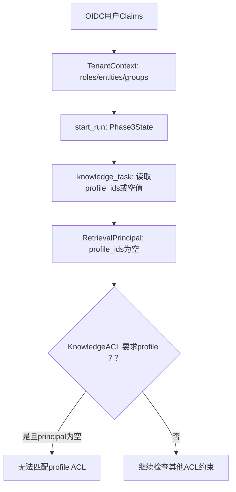

---

---

# M6 SOURCE AUDIT / FREEZE-READY 审计附录

> [!info] 本附录如何使用
> B01–B18 是由浅入深的**学习主线**，已经为每块提供「总 → 正常流程/简单例子 → 关键设计 → 必要失败边界 → 源码学习 → 小结 + Mermaid」。下面属于 `SOURCE DEEP / AUDIT ONLY`，用于审计和面试时追问源码，**不要求闭卷默写文件行数、枚举或所有字段**。
>
> **审计范围**：冻结源码 `19d9a377`，主 Graph、运行与恢复、内部 Agent Graph、Policy/Planner/Dispatcher、相应领域契约、相关单元/替身测试，以及 LangGraph `1.2.9` 的必要执行语义。**未执行生产环境负载测试、真实 GLPI 端到端故障注入或部署配置核验。**

## A01. 文件索引、来源、阅读深度

下表行数按冻结 commit 的**实际文本行数**统计：结尾换行不额外算作一行；`SERVICEMIND-ADDED` 为项目专用模块，`UPSTREAM-MODIFIED*` 为上游脚手架文件上继续集成 ServiceMind，`*` 表示**尚未做逐行上游 diff，不得据此计算个人原创比例**。路径未写 `src/` 前缀时，统一从 `src/servicemind/` 开始。

| 文件（路径）                           |     行数 | 代码来源           | 深度                                      |
| -------------------------------------- | -------: | ------------------ | ----------------------------------------- |
| `orchestration/supervisor_workflow.py` |     1913 | SERVICEMIND-ADDED  | **DEEP**                                  |
| `orchestration/runtime.py`             |      517 | SERVICEMIND-ADDED  | **DEEP**                                  |
| `orchestration/state.py`               |      105 | SERVICEMIND-ADDED  | **DEEP**                                  |
| `orchestration/router.py`              |      227 | SERVICEMIND-ADDED  | **DEEP**                                  |
| `orchestration/supervisor_policy.py`   |      169 | SERVICEMIND-ADDED  | **DEEP**                                  |
| `orchestration/dynamic_planner.py`     |      465 | SERVICEMIND-ADDED  | **DEEP**                                  |
| `orchestration/task_dag.py`            |      141 | SERVICEMIND-ADDED  | **DEEP**                                  |
| `orchestration/dispatcher.py`          |      101 | SERVICEMIND-ADDED  | **DEEP**                                  |
| `orchestration/budget.py`              |       45 | SERVICEMIND-ADDED  | **DEEP**                                  |
| `orchestration/registry.py`            |      141 | SERVICEMIND-ADDED  | STANDARD                                  |
| `domain/task.py`                       |      173 | SERVICEMIND-ADDED  | **DEEP**                                  |
| `domain/supervisor.py`                 |       69 | SERVICEMIND-ADDED  | **DEEP**                                  |
| `domain/routing.py`                    |       21 | SERVICEMIND-ADDED  | STANDARD                                  |
| `domain/review.py`                     |       76 | SERVICEMIND-ADDED  | STANDARD                                  |
| `domain/invocation.py`                 |       40 | SERVICEMIND-ADDED  | STANDARD                                  |
| `runtime/contracts.py`                 |       52 | SERVICEMIND-ADDED  | STANDARD                                  |
| `agents/supervisor.py`                 |       63 | SERVICEMIND-ADDED  | **DEEP**                                  |
| `agents/data.py`                       |      490 | SERVICEMIND-ADDED  | STANDARD                                  |
| `agents/knowledge.py`                  |      168 | SERVICEMIND-ADDED  | STANDARD                                  |
| `agents/analysis.py`                   |      614 | SERVICEMIND-ADDED  | STANDARD                                  |
| `agents/reviewer.py`                   |     1171 | SERVICEMIND-ADDED  | STANDARD                                  |
| `agents/action.py`                     |      124 | SERVICEMIND-ADDED  | AWARENESS（M5 已深入）                    |
| `orchestration/phase5_governance.py`   |      943 | SERVICEMIND-ADDED  | AWARENESS（M8 深入）                      |
| `orchestration/recovery.py`            |      119 | SERVICEMIND-ADDED  | STANDARD                                  |
| `orchestration/workflow.py`            |      186 | SERVICEMIND-ADDED  | AWARENESS（旧 Phase2）                    |
| `api.py`                               |      556 | SERVICEMIND-ADDED  | STANDARD                                  |
| `src/service/service.py`               |      577 | UPSTREAM-MODIFIED* | STANDARD                                  |
| `src/memory/__init__.py`               |       40 | UPSTREAM-MODIFIED* | AWARENESS                                 |
| `src/core/settings.py`                 |      517 | UPSTREAM-MODIFIED* | AWARENESS                                 |
| `src/servicemind/security/auth.py`     |      224 | SERVICEMIND-ADDED  | AWARENESS（M20 深入；已复核源码行数）     |
| `src/servicemind/domain/knowledge.py`  |      369 | SERVICEMIND-ADDED  | AWARENESS（M12/M20 深入；已复核源码行数） |
| `pyproject.toml` / `requirements.txt`  | 依各文件 | 项目依赖声明       | AUDIT ONLY                                |

> [!warning] 来源与文件计数约束
> `UPSTREAM-MODIFIED*` 是仓库历史层面的审计标记，**不等于已完成文件内每个函数的上游归属判断**。对于后续的 M29（贡献边界），必须另做上游原仓库对照。`domain/invocation.py`、`security/auth.py`、`domain/knowledge.py` 均重新读取了完整源码计算行数；不将末尾空字符串计作源码行。

> `SERVICEMIND-ADDED` 同样仅代表**文件层面的引入事实**，不是“每个函数均为原创”的证明。已核对提交 [`ec391407`（2026-09-06）](https://github.com/shark6438/servicemind/commit/ec391407c2c615873ee684d5f15512bdcb11ae1e) 及其父提交 `fe3b2dcc` 的树：父提交不含 `src/servicemind/`，已有另外的 `src/agents/` LangGraph 示例；到 `ec391407` 才引入 ServiceMind 项目目录。**并未进行逐函数内容相似性或来源 diff**，故不将历史文件新增等同于作者贡献比例，也不未经逐文件搜索断言“恰好 10 个”上游 Graph 使用者。该问题交给 M29。

### 逐文件职责、调用者、下游与失败边界

| 文件/子系统              | 被谁调用（入口）                                             | 调用谁 / 改变什么                                     | 最重要的失败边界                                  |
| ------------------------ | ------------------------------------------------------------ | ----------------------------------------------------- | ------------------------------------------------- |
| `api.py`                 | `POST /runs`、审批和 review-resolution HTTP                  | Repository；`start_run/resume_run/resume_review_run`  | Token 权限、哈希一致性、Run 状态、ResumeBlocked   |
| `src/service/service.py` | FastAPI lifespan                                             | 初始化 Saver/Store；配置 Graph；启动恢复              | 持久化初始化失败、后台 Recovery 的接线            |
| `runtime.py`             | HTTP/API、Recovery                                           | `supervisor_graph.ainvoke`、Scope 交集、Checkpoint    | 无 checkpoint、身份不可建立、权限收窄             |
| `supervisor_workflow.py` | `runtime.py` 主 Graph 调用                                   | 21 节点：Route/Plan/Dispatch/Review/Approval/Finalize | 非法决策、超预算、终止边、双重持久化              |
| `state.py`               | 所有主 Graph 节点、Resume                                    | Phase3State + Reducer                                 | 并行冲突、旧证据清理、追加/覆盖混淆               |
| `router.py`              | `route_node`                                                 | 返回 RouteDecision                                    | 错走 fast path、禁止操作识别                      |
| `supervisor_policy.py`   | `supervisor_node`                                            | `legal_actions/validate`                              | 无 READY Task、Handoff 越界、非法 DISPATCH        |
| `agents/supervisor.py`   | `supervisor_node`                                            | 受治理的模型 structured output                        | 模型/Schema 异常、Policy 拒绝                     |
| `dynamic_planner.py`     | `plan_node/revise_node`                                      | LLM PlanProposal → TaskPlan → DagValidator            | 缺失必要任务、修订提议不合法                      |
| `task_dag.py`            | Planner 编译过程                                             | 检查依赖、拓扑序、Agent/TaskType                      | 环依赖、越过 Reviewer 的 Action                   |
| `dispatcher.py`          | Supervisor Policy、Dispatch、Barrier、Action/Analysis/Review | Ready、Slots、Task 转移和 Invalidate                  | 未满足依赖、非法状态迁移                          |
| `budget.py`              | Supervisor、Replan                                           | BudgetController.check/snapshot                       | 步数、重规划、deadline、循环等边界                |
| `registry.py`            | Policy / Planner / Invocation                                | Agent 契约、capability 范围                           | 未注册 Agent/能力（不等于生产调用过）             |
| `domain/task.py`         | Planner、Dispatcher、各节点                                  | 任务、计划和运行预算契约                              | ID、deadline、字段范围/任务合法性                 |
| `domain/supervisor.py`   | Supervisor/Policy/Graph                                      | SupervisorAction、Decision、ControlOwner              | 不合法动作、不合法字段                            |
| `domain/routing.py`      | Router/route_node                                            | 路由契约                                              | 不支持操作不能误转复杂写入                        |
| `domain/review.py`       | Reviewer/Policy/Handoff                                      | ReviewDecision、ReviewResult                          | PASSED 与 degraded/blocking finding 不能同存      |
| `domain/invocation.py`   | `_invocation`、Agent / ModelCallContext                      | 每任务 identity、deadline、budget/capability          | 无权工具、过期 invocation                         |
| `runtime/contracts.py`   | Sub-agent / 外层任务节点                                     | AgentResultEnvelope/metrics                           | 质量降级 != Task 失败，契约不匹配                 |
| `agents/data.py`         | `data_task_node`                                             | 内部 `plan→execute→normalize`，GLPI 只读              | 模型规划失败、工具调用失败、空 Evidence           |
| `agents/knowledge.py`    | `knowledge_task_node/fast_knowledge_node`                    | 内部 `retrieve`，RAG/baseline                         | RAG 不可用、低相关、ACL 过滤                      |
| `agents/analysis.py`     | `analysis_node`                                              | 内部 `draft→check↔revise`                             | 分析不支持证据、模型异常/降级                     |
| `agents/reviewer.py`     | `reviewer_node`                                              | `rule_gate→semantic_judge→adjudicate`                 | 禁止无证据放行、语义审核故障                      |
| `agents/action.py`       | `action_node`                                                | 确定性 ActionIntent 编译                              | 无 PASSED Handoff、不合法写类型（详见 M5）        |
| `phase5_governance.py`   | 各 Agent 外层节点、Finalize                                  | ContextEnvelope / post_run Memory                     | 上下文不可组装、Memory 非阻断失败                 |
| `recovery.py`            | 启动过程                                                     | 从 Repository 选择 Run → Runtime 恢复                 | 无法确认原 Requester、未被扫描的状态              |
| `workflow.py`            | Checkpointer 配置；历史 Phase2 API 设计                      | 6 节点旧 Graph                                        | 存在 != 当前 Run API 已 wired 到它                |
| `security/auth.py`       | HTTP 授权依赖                                                | OIDC Claims → TenantContext                           | 身份长度、roles/entities/groups；profile 尚未接线 |
| `domain/knowledge.py`    | RAG/ACL 构建、检索器                                         | KnowledgeACL、RetrievalPrincipal                      | ACL 条件交集与文档可见性                          |
| `src/core/settings.py`   | 服务启动、所有运行模块                                       | 读取配置缺省值                                        | 缺省值 != 生产值                                  |

---

## A02. B01–B18 逐块审计矩阵与定点复核

此矩阵的 `PASS` 只表示**块级关键学习主张**与当前已检查源码一致，不是该块内所有示例均经过运行。**Router 示例等确定性行为必须单独与具体匹配规则核对**；不能以块级 PASS 替代逐例检查。本轮 B03 原示例已按源码作定点修正，但没有运行项目内 Router 测试。

| 学习块 | 核验要点                                                     | 源码证据                                                     | 复核             | 分类                         |
| ------ | ------------------------------------------------------------ | ------------------------------------------------------------ | ---------------- | ---------------------------- |
| B01    | 主 Graph 21 节点；四平面为教学模型                           | [主 Graph 1836–1906](https://github.com/shark6438/servicemind/blob/19d9a377/src/servicemind/orchestration/supervisor_workflow.py#L1836-L1906) | PASS             | SOURCE/WIRED                 |
| B02    | State Reducer、Command、Send、Interrupt                      | [state.py](https://github.com/shark6438/servicemind/blob/19d9a377/src/servicemind/orchestration/state.py) | PASS             | SOURCE                       |
| B03    | 确定性路由、Fast Knowledge 低相关回主管；“找”与“查找”示例已按源码复核，最小正则核对不等于项目 pytest | [router.py](https://github.com/shark6438/servicemind/blob/19d9a377/src/servicemind/orchestration/router.py)；[fast_knowledge](https://github.com/shark6438/servicemind/blob/19d9a377/src/servicemind/orchestration/supervisor_workflow.py#L430-L504) | PASS             | WIRED                        |
| B04    | Supervisor LLM → Policy → Command；非法决策重选              | [supervisor_workflow.py L584–755](https://github.com/shark6438/servicemind/blob/19d9a377/src/servicemind/orchestration/supervisor_workflow.py#L584-L755) | PASS             | WIRED                        |
| B05    | 动态 TaskPlan DAG ≠ 主 Graph；校验依赖                       | [planner](https://github.com/shark6438/servicemind/blob/19d9a377/src/servicemind/orchestration/dynamic_planner.py)；[task_dag](https://github.com/shark6438/servicemind/blob/19d9a377/src/servicemind/orchestration/task_dag.py) | PASS             | SOURCE                       |
| B06    | Send、Reducer、batch ID、RUNNING 双条件                      | [dispatch/barrier L820–1142](https://github.com/shark6438/servicemind/blob/19d9a377/src/servicemind/orchestration/supervisor_workflow.py#L820-L1142) | PASS             | WIRED                        |
| B07    | Data 3 节点、Knowledge 1 节点的内部 Graph                    | [data.py](https://github.com/shark6438/servicemind/blob/19d9a377/src/servicemind/agents/data.py)；[knowledge.py](https://github.com/shark6438/servicemind/blob/19d9a377/src/servicemind/agents/knowledge.py) | PASS             | SOURCE                       |
| B08    | Analysis 3 节点、Reviewer 3 节点；singleton 启用语义审核     | [analysis.py](https://github.com/shark6438/servicemind/blob/19d9a377/src/servicemind/agents/analysis.py)；[reviewer.py](https://github.com/shark6438/servicemind/blob/19d9a377/src/servicemind/agents/reviewer.py) | PASS             | WIRED                        |
| B09    | REVIEW → Supervisor 合法循环，Budget 超限业务状态映射        | [Policy](https://github.com/shark6438/servicemind/blob/19d9a377/src/servicemind/orchestration/supervisor_policy.py)；[Finalize](https://github.com/shark6438/servicemind/blob/19d9a377/src/servicemind/orchestration/supervisor_workflow.py#L1708-L1748) | PASS（已修订）   | SOURCE                       |
| B10    | `interrupt` + checkpoint + resume + requester scope          | [runtime.py](https://github.com/shark6438/servicemind/blob/19d9a377/src/servicemind/orchestration/runtime.py) | PASS             | WIRED                        |
| B11    | `Run SUCCEEDED` ≠ `Review PASSED` ≠ 外部写已 verified        | [Finalize L1708–1834](https://github.com/shark6438/servicemind/blob/19d9a377/src/servicemind/orchestration/supervisor_workflow.py#L1708-L1834) | PASS（已修订）   | SOURCE                       |
| B12    | 21 节点全图；Command/Send/条件边不可混称                     | [Graph 注册 L1836–1906](https://github.com/shark6438/servicemind/blob/19d9a377/src/servicemind/orchestration/supervisor_workflow.py#L1836-L1906) | PASS             | SOURCE                       |
| B13    | Task / Agent / Review / Run 四层状态                         | [task.py](https://github.com/shark6438/servicemind/blob/19d9a377/src/servicemind/domain/task.py)；[contracts.py](https://github.com/shark6438/servicemind/blob/19d9a377/src/servicemind/runtime/contracts.py) | PASS             | SOURCE                       |
| B14    | `control_owner` 是控制角色；`active_agent` 是标签            | [分析节点 L1242–1259](https://github.com/shark6438/servicemind/blob/19d9a377/src/servicemind/orchestration/supervisor_workflow.py#L1242-L1259) | PASS             | SOURCE                       |
| B15    | Data 直接 build_context，Knowledge/Analysis 等由包装器处理   | [上下文调用 L268–330](https://github.com/shark6438/servicemind/blob/19d9a377/src/servicemind/orchestration/supervisor_workflow.py#L268-L330)；[Data L871–933](https://github.com/shark6438/servicemind/blob/19d9a377/src/servicemind/orchestration/supervisor_workflow.py#L871-L933) | PASS             | WIRED                        |
| B16    | Run Budget 检查时机；局部修正循环计数可能越界                | [Budget](https://github.com/shark6438/servicemind/blob/19d9a377/src/servicemind/orchestration/budget.py)；[Supervisor L584–665](https://github.com/shark6438/servicemind/blob/19d9a377/src/servicemind/orchestration/supervisor_workflow.py#L584-L665) | PASS（条件路径） | SOURCE；生产 TO VERIFY       |
| B17    | 启动扫描不包含 `WAITING_REVIEW`；Review 有单独 API           | [repository L237–252](https://github.com/shark6438/servicemind/blob/19d9a377/src/servicemind/persistence/repository.py#L237-L252)；[review API](https://github.com/shark6438/servicemind/blob/19d9a377/src/servicemind/api.py#L463-L531) | PASS             | WIRED                        |
| B18    | Profile ACL schema 存在；标准 Run 入口未填充                 | [auth.py](https://github.com/shark6438/servicemind/blob/19d9a377/src/servicemind/security/auth.py)；[runtime](https://github.com/shark6438/servicemind/blob/19d9a377/src/servicemind/orchestration/runtime.py#L36-L70)；[knowledge.py](https://github.com/shark6438/servicemind/blob/19d9a377/src/servicemind/domain/knowledge.py#L246-L294) | PASS             | SOURCE/WIRED；数据 TO VERIFY |

**跨块一致性五条红线（已落实在课程内）**：

1. B01/B12 都只把 **21** 计为主 Graph 节点；Data/Knowledge/Analysis/Reviewer 内部的 **3+1+3+3** 不混入主图。
2. B04/B09/B12：ReviewResult 不直接拥有流程跳转权；Supervisor 在 `SupervisorPolicy` 允许范围内提出合法动作，LangGraph 执行。
3. B05/B06/B13：`TaskPlan` 的任务 SUCCESS 是完成态；`AgentResultEnvelope` 的 DEGRADED 是质量态；Reducer 的 Completion 与业务 Run 终态不混用。
4. B09/B11/B16：预算终止码在当前 `finalize_node` 中映射为 `RunStatus.CANCELLED`；单独的 `critical_error` 等才是 FAILED，ABSTAIN 可是 SUCCEEDED 但不等于 PASSED。
5. B10/B11/B14/B17/B18：Checkpointer/业务库分层；Requester 不借 Approver 权限；`control_owner` 不等于当前节点；有 profile schema 不代表标准入口已 wired。

---

## A03. 定点争议与上游 LangGraph 版本复核

### D01 · `Command(goto)` 与静态边、条件边：哪些情况真会双 `finalize`？

**先区分已发生过的历史缺陷与当前代码，不能把两者合并。**

1. **历史缺陷（第一方源码注释和回归测试记录）**：一个可终止节点同时保留了通向 Supervisor 的**静态边**，又返回 `Command(goto="finalize")`。这会产生两个**不同目标**的控制转移：Supervisor 和 Finalize 都被调度，造成终态事件重复。`_after_termination()` 的 docstring 与 `test_replan_double_failure_finalizes_without_raw_runtime_error` 记录了这个修复背景。
2. **冻结版本的当前形态**：`revise_node` 在 BudgetExceeded 时返回 `Command(goto="finalize")`，而 `replan` / `retrieve_more` 已注册 `_after_termination` **条件边**。因为 `termination_code` 非空，条件边返回的也是 `finalize`。

对照 `requirements.txt:442` 固定的 **LangGraph 1.2.9**，源码机制是：

| 转移写法                                  | 当前情况下的目标 | 源码机制                      |
| ----------------------------------------- | ---------------- | ----------------------------- |
| 历史静态后继 `add_edge(node, supervisor)` | `supervisor`     | 写 `branch:to:supervisor`     |
| 当前条件边 `_after_termination()`         | `finalize`       | 写 `branch:to:finalize`       |
| 节点返回 `Command(goto="finalize")`       | `finalize`       | 写同一个 `branch:to:finalize` |
| `add_node(..., destinations=...)`         | 仅声明可能目标   | **不是独立运行时出边**        |

LangGraph 的 `EphemeralValue(guard=False)` 允许同一通道在一个 step 收到多次同目标写入；`prepare_next_tasks()` 对候选目标节点去重。因此，**当前条件边与 Command 同目标不能仅凭语法判成双 Finalize**。`Command(goto="finalize")` 在这两条当前分支上还存在功能冗余，因为条件边已经知道应当进入 Finalize。

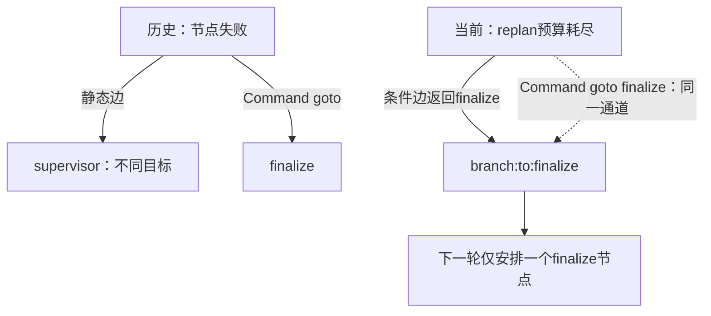

**证据层级：**

- SOURCE FACT：ServiceMind 原始节点/边定义与历史注释：[supervisor_workflow.py L230–240](https://github.com/shark6438/servicemind/blob/19d9a377/src/servicemind/orchestration/supervisor_workflow.py#L230-L240)、[L1360–1382](https://github.com/shark6438/servicemind/blob/19d9a377/src/servicemind/orchestration/supervisor_workflow.py#L1360-L1382)、[L1897–1901](https://github.com/shark6438/servicemind/blob/19d9a377/src/servicemind/orchestration/supervisor_workflow.py#L1897-L1901)。
- UPSTREAM SOURCE FACT：LangGraph [1.2.9 state.py](https://github.com/langchain-ai/langgraph/blob/1.2.9/libs/langgraph/langgraph/graph/state.py) 与 [Pregel _algo.py](https://github.com/langchain-ai/langgraph/blob/1.2.9/libs/langgraph/langgraph/pregel/_algo.py) 的控制通道与下一任务调度。
- TEST DEFINITION：现有 `test_replan_double_failure_finalizes_without_raw_runtime_error` 覆盖**Planner 失败的终止分支**，**不是** `BudgetExceeded` 分支。
- **TO VERIFY**：该特定 BudgetExceeded 状态通过实际 `graph.ainvoke()` 执行后是否产生恰好一次终态事件；本轮未运行项目 Graph。

不能将用户附带审计所述其本地 `.venv` 版本检查当成本次执行记录：这里以冻结仓库依赖声明和读取的 1.2.9 上游源码作为独立证据。

### D02 · Supervisor Budget 有没有逐次硬性计数？

`supervisor_node` 有 `task_plan` 时在局部循环**之前**调用一次 `BudgetController.check()`；在三次候选决策循环中执行 `control.model_call_count += 1`，循环内不再次检查。因此例如入场计数 79 / 上限 80 且三轮均被策略拒绝，计数可推进到 82（条件性 SOURCE FACT），不是生产实测。初始还没有 TaskPlan 时，不会经过该开头的 `if state.get("task_plan")` 预算检查。 这一判断也与冻结源码 `supervisor_node:607–627` 对“局部知情修正循环”的第一方注释一致，但注释不能替代调用次数实测。

同样要注意**计数口径不等于网络调用真实次数**：`plan_node` 在全部提议失败后返回 `critical_error` 前未把 `attempts_used` 加进 `control.model_call_count`；`revise_node` 在所有提议均失败时也先返回 `critical_error`，未走成功分支的计数更新；`knowledge_task_node` 用 `attempts_used` 估算某些模型调用指标。这些都是控制字段的源码语义，不是“模型后端总请求数”的高精度账单指标。

相关来源：[plan L756–818](https://github.com/shark6438/servicemind/blob/19d9a377/src/servicemind/orchestration/supervisor_workflow.py#L756-L818)、[knowledge L967–1086](https://github.com/shark6438/servicemind/blob/19d9a377/src/servicemind/orchestration/supervisor_workflow.py#L967-L1086)、[replan L1360–1478](https://github.com/shark6438/servicemind/blob/19d9a377/src/servicemind/orchestration/supervisor_workflow.py#L1360-L1478)。

### D03 · Context 失败处理是否完全统一？

不是。Data 任务直接在 `try` 中调用 `phase5.build_context`，异常可转为 FAILED Completion，经 Barrier → Supervisor；Knowledge、Analysis、Reviewer、Action 使用 `_assembled_context()`，可将 `ContextAssemblyError` 转为 `termination_code=context_assembly_failure`。Knowledge 走 Barrier 再到 Supervisor，而 Analysis/Reviewer/Action 的 `_after_termination` 直接指向 Finalize。因此在概念课不能概括成“所有 Context 失败都从 Agent 直接 Finalize”。

### D04 · Recovery 是否自动恢复 `WAITING_REVIEW`？

不是。Repository 的 `list_recoverable_runs()` 只查询 `PENDING` / `RUNNING` / `WAITING_APPROVAL`。`WAITING_REVIEW` 的人工处理由 `/runs/{run_id}/review-resolution` API 负责。这里分别是“启动扫描集合”与“人工恢复入口”的 WIRED FACT；不能推断启动 Recovery 一定会主动恢复 `WAITING_REVIEW`。

### D05 · Profile ACL 是否真正端到端接线？

Knowledge ACL 与 RetrievalPrincipal 支持 `profile_ids`，但当前标准 OIDC `TenantContext` 不包含该坐标，`start_run()` 也不为 `Phase3State` 初始化它。Knowledge Task 读 `state.get("profile_ids") or ()`，在该标准入口条件下得到空集合。**非空 profile ACL 无法匹配是 fail-closed 的源码推论；部署中是否真的有相关文档、是否触发用户投诉，均 TO VERIFY。**

### D06 · Checkpointer 与业务 Repository 是否可视作同一原子事务？

不可以。`initialize_database()` 定义于 **`src/memory/__init__.py:13–25`**（而不是 orchestration 包），负责按 `DATABASE_TYPE` 选择 LangGraph Saver；`ServiceMindRepository` 使用独立业务 SQLAlchemy 存储。这能证明它们的代码持久化职责不同，但不能从这里推导跨所有崩溃窗口的原子事务承诺。M6 只讲控制流；M5/M22 再审外部副作用恢复。

---

### D07 · 业务状态判定与终态事件名的两个优先级

`finalize_node` 首先通过 `failed/cancelled` 判定 `RunStatus`，再独立地按照：

```python
"run.abstained" if abstained else (
    "run.escalation_accepted" if escalation_accepted else f"run.{status.value}"
)
```

选择 RunEvent 名。**这个事件名选择表达的是语义标记，不是重新判定 RunStatus。** 因此单靠 `run.abstained` 事件字符串不能在所有假设性状态组合中证明 `RunStatus.SUCCEEDED`；应同时读取 Run row 中的 `status`。例如若在人工审核/弃答结论保留的同时又出现 `termination_code`，终态判断优先考虑 termination_code，而事件名称仍可能优先选 `run.abstained` / `run.escalation_accepted`。这种特殊组合的**真实 Graph 可达性和生产日志尚未验证**，属于 AUDIT ONLY / TO VERIFY。

证据：[finalize_node L1711–1747](https://github.com/shark6438/servicemind/blob/19d9a377/src/servicemind/orchestration/supervisor_workflow.py#L1711-L1747) 与 [L1799–1815](https://github.com/shark6438/servicemind/blob/19d9a377/src/servicemind/orchestration/supervisor_workflow.py#L1799-L1815)。

## A04. Source Fact Baseline 与证据状态

| ID    | 可接受结论                                                   | 证据类型                         | 分类                        | 证据点                                                       |
| ----- | ------------------------------------------------------------ | -------------------------------- | --------------------------- | ------------------------------------------------------------ |
| SF-01 | Graph 注册 21 个节点，配置了主状态与出边                     | E1                               | SOURCE FACT                 | `supervisor_workflow.py:1836–1906`                           |
| WF-02 | `POST /runs` → `start_run` → `supervisor_graph.ainvoke`      | E1                               | WIRED FACT                  | `api.py` + `runtime.py:36–70`                                |
| WF-03 | FastAPI lifespan 注入 main Graph Checkpointer                | E1                               | WIRED FACT                  | `service/service.py:96–167`                                  |
| SF-04 | Router 为确定性路由                                          | E1                               | SOURCE FACT                 | `router.py:161–227`                                          |
| WF-05 | Supervisor 模型决策经过 Policy.validate                      | E1                               | WIRED FACT                  | `supervisor_workflow.py:584–755`                             |
| SF-06 | Planner 编译与验证业务 DAG                                   | E1                               | SOURCE FACT                 | `dynamic_planner.py`、`task_dag.py`                          |
| SF-07 | Send 动态并行、Barrier 按 batch 与 RUNNING 过滤              | E1                               | SOURCE FACT                 | `supervisor_workflow.py:820–1142`                            |
| SF-08 | 内部 Graph Data 3、Knowledge 1、Analysis 3、Reviewer 3       | E1                               | SOURCE FACT                 | `agents/*.py` 的 StateGraph 注册                             |
| WF-09 | Reviewer singleton 为 `enable_semantic_review=True`          | E1                               | WIRED FACT                  | `agents/reviewer.py:1165–1171`                               |
| SF-10 | `TaskStatus` 与 `AgentRunStatus` 各有不同语义                | E1                               | SOURCE FACT                 | `domain/task.py`、`runtime/contracts.py`                     |
| WF-11 | Action 写路径经 Handoff → Action → Approval → Execute；人工批准后交 Harness | E1                               | WIRED FACT                  | `supervisor_workflow.py:1487–1687`（handoff/action/approval/execute 四个函数的连续区间） |
| SF-12 | `RunStatus.SUCCEEDED` 不等于 Reviewer PASSED                 | E1                               | SOURCE FACT                 | `finalize_node:1708–1747`                                    |
| SF-13 | 上述四类预算终止码在当前 Finalize 映射为 CANCELLED           | E1                               | SOURCE FACT                 | `budget.py` + `finalize_node`                                |
| SF-14 | Run Budget 校验不是逐次模型调用前全局预留                    | E1                               | SOURCE FACT（条件路径）     | `supervisor_node:584–665`                                    |
| WF-15 | 启动 Recovery 没有扫描 WAITING_REVIEW                        | E1                               | WIRED FACT                  | `repository.py:237–252` + `recovery.py`                      |
| WF-16 | 标准 Run 初始化未填充 profile_ids                            | E1                               | WIRED FACT                  | `auth.py` + `runtime.py:36–70`                               |
| SF-17 | 使用 `requirements.txt` 声明 langgraph==1.2.9                | E1                               | SOURCE FACT（依赖文件）     | `requirements.txt:442`                                       |
| SF-24 | `unsupported_node` 直接写 CANCELLED、RunEvent `run.rejected`，不经过 Finalize | E1                               | SOURCE FACT / WIRED FACT    | `supervisor_workflow.py:506–525, 1879`                       |
| SF-25 | 对于**经过 Finalize** 的非空 termination_code，只有五类明确失败码优先映射 FAILED，其余可映射 CANCELLED | E1                               | SOURCE FACT                 | `supervisor_workflow.py:1711–1748`                           |
| EV-18 | 仓库存在覆盖 Router、Supervisor、DAG、Budget、Resume 的测试  | E3                               | TEST EVIDENCE：测试定义存在 | `tests/servicemind/test_*.py`                                |
| TV-19 | 部署实际使用 PostgreSQL Saver                                | 无本次部署快照                   | TO VERIFY                   | 需环境与启动记录                                             |
| TV-20 | 生产开启 RAG、Memory、Context                                | 无本次实际环境配置               | TO VERIFY                   | 需部署配置与 runtime trace                                   |
| TV-21 | Replan BudgetExceeded 特定合流真实运行仅一次                 | 上游源码推导、缺分支实测         | TO VERIFY                   | 需定点 Graph 运行                                            |
| TV-22 | 并发与崩溃窗口端到端 exactly-once                            | 无完整故障注入                   | TO VERIFY                   | 见 M5/M22                                                    |
| TV-23 | Profile Restricted 文档实际存在且导致用户缺失                | 无本次数据                       | TO VERIFY                   | 需文档 ACL 与检索记录                                        |
| TV-26 | `run.rejected` 是否被仓库外/部署侧消费者使用                 | 仅已确认写入点；未核对外部监听者 | TO VERIFY                   | 需要对消费者服务及指标系统查证                               |

**证据优先级**：E1 当前冻结源码 > E2 配置/部署工件 > E3 测试定义 > E4 机器生成评估 > E5 README > E6 历史文档。当前本轮没有新增 `RUNTIME OBSERVED`；GitHub 中存在测试不等于本轮运行通过。

---

## A05. Retraction Ledger：已撤回或修订的旧说法

| 旧说法                                           | 最终应学习的正确口径                                         | 处理                               |
| ------------------------------------------------ | ------------------------------------------------------------ | ---------------------------------- |
| “M6 主图是 19 节点”                              | 注册 **21** 个节点；四 Agent 内部 10 节点不能混入主图        | RETRACT                            |
| “每一个 Graph node 都是 Agent”                   | Router/Dispatcher/Barrier/Join/Approval/Execute/Finalize 是其他职责 | RETRACT                            |
| “模型输出 SupervisorAction 就能直接跳转”         | Model 提候选 → Policy.validate → Command 路由                | RETRACT                            |
| “TaskPlan DAG 与 LangGraph 是同一张图”           | 动态业务依赖与固定执行结构不同                               | RETRACT                            |
| “Task SUCCESS 代表 Agent 合格并被 Review PASSED” | Task / Agent / Review / Run 为四种事实                       | RETRACT                            |
| “ContextAssemblyError 所有节点直接 Finalize”     | Data 直接异常 → FAILED Completion；其他节点按实际接线        | REVISE                             |
| “BudgetExceeded 一律 Run FAILED”                 | 当前 `finalize_node` 对所列预算终止码映射 CANCELLED          | REVISE                             |
| “有 BudgetController 就一定逐网络调用精确硬限制” | 检查与计数位置取决于节点，某些失败尝试不计入 control         | REVISE                             |
| “replan 的 Command + 条件边必然双 Finalize”      | **历史静态边 + Command 指向不同目标**确实造成双路径；当前使用条件边且与 Command 指向同一 `finalize`，按 1.2.9 调度语义合并；特定预算分支待运行测试 | RETRACT（误因）/ TO VERIFY（实测） |
| “RAG/Context/Memory 默认 False 即部署关闭”       | 默认值不能替代运行环境                                       | RETRACT                            |
| “旧 Phase2 graph 有 checkpointer 就是当前主链”   | 当前 Run API 追踪至 supervisor_graph；旧 Graph 只是存在且被配置 | REVISE                             |
| “有 Recovery 就会恢复 WAITING_REVIEW”            | 启动扫描只含 PENDING/RUNNING/WAITING_APPROVAL；人工 review-resolution 单独处理 | REVISE                             |
| “Profile ACL 字段存在说明端到端接线”             | 当前标准入口没有填充 profile_ids；不能宣称端到端支持         | REVISE                             |
| “所有终态都由 finalize 产生 `run.{status}` 事件” | `fast_data`、`fast_knowledge`、`unsupported` 可直达 END；其中 `unsupported` 独立写 `CANCELLED + run.rejected` | RETRACT                            |
| “Graph END / Run SUCCEEDED = GLPI 实际写入成功”  | 成功/通过/verified 三种层次不同                              | RETRACT                            |

---

## A06. 12 问失败场景：按核心子系统审计

本节使用同一组 12 个审计问题，先横向比较 5 类主控制子系统，再对 M6 的 SOURCE DEEP 专题 **S6 Context Assembly** 进行完整 12 问定点审计。每列都必须以实际调用路径为准，不可把不同节点的异常处理合并。

- **S1 Router/FastPath**：知识检索得到低相关材料；
- **S2 Control/Planner**：Supervisor 连续选择非法动作，或 PlanProposal 反复不合法；
- **S3 Dispatch/Evidence**：Knowledge Task 超时、Barrier 合并失败分支；
- **S4 Analysis/Reviewer**：分析 DEGRADED，审核 RETRIEVE_MORE/ABSTAIN；
- **S5 Interrupt/Recovery**：人审批时 Requester 权限收窄或身份无法建立。

| 12 问              | S1 Router / Fast Knowledge     | S2 Supervisor / Planner                             | S3 Dispatch / Evidence             | S4 Analysis / Review                        | S5 Interrupt / Recovery                                      |
| ------------------ | ------------------------------ | --------------------------------------------------- | ---------------------------------- | ------------------------------------------- | ------------------------------------------------------------ |
| 1. 失败是什么      | 仅有无关检索结果               | 非法动作 / 非法 DAG                                 | 工具超时、任务失败                 | 结论降级或证据不足                          | 原 Requester 当前权限不能确认                                |
| 2. 属于哪层        | Control + Capability           | Control Plane                                       | Capability/Agent Plane             | Agent + Governance                          | Governance Plane                                             |
| 3. 如何检测        | `_unsupported_lookup` 评分门槛 | Policy.validate / DagValidator                      | timeout / TaskCompletion / Barrier | rule_gate / semantic_judge                  | `revalidate`、scope 交集、step_shortfall                     |
| 4. 已有外部副作用? | 可有只读检索；无 GLPI 写       | 可有模型请求、RunEvent；无 GLPI 写                  | 可能已访问只读 GLPI/RAG            | 可有模型调用；Review 不写 GLPI              | 可有审计与审批状态；执行前不写 GLPI                          |
| 5. 状态能确定什么  | `lookup_declined` 而非成功答案 | `termination_code` 或修正决策                       | FAILED Completion、TaskPlan 进展   | DEGRADED/REPLAN/ABSTAIN                     | WAITING、VOID、BLOCKED 等边界                                |
| 6. 可以重试吗      | 完整审核流程可重新检索         | Policy 修正有限；Planner 修正有限                   | Knowledge 超时有限重试             | Analysis 内部有限修订；外层 Replan          | 身份未建立时保持暂停；不能绕过授权                           |
| 7. 决策动作        | 转 Supervisor                  | 修正 / FINALIZE                                     | Barrier → REPLAN / 终止            | RETRIEVE_MORE / REPLAN / ESCALATE / ABSTAIN | block、withdraw、rederive、safe resume                       |
| 8. 用户可见结果    | 不输出不相干的直接成功回答     | 失败/取消终态与原因（依终止码）                     | 可能延时、重规划或最终失败         | 解释不足、弃答或升级                        | 审批 409 或继续等待，不默许写入                              |
| 9. 持久化什么      | `lookup.declined`、后续 Run    | `plan.validated`、决策/错误事件、Run                | `agent.completed`、TaskPlan/结果   | `analysis_result`、`review_result`、轨迹    | Approval/撤回/Resume Block Audit（依实际分支）               |
| 10. 审计留痕       | 检索得分与 floor               | 决策拒绝和 Planner 拒绝理由                         | Agent 失败 detail、TaskCompletion  | Review finding / reason_codes               | `run.resume_blocked`、`run.scope_narrowed`、`action.withdrawn` |
| 11. 如何恢复       | 新检索任务或新的合法请求       | 受限重规划；终态不是自动重试保证                    | 重新规划、补证据（有预算限制）     | 基于新证据重推导，不伪造 PASSED             | 验证 Requester 当前授权，按原 checkpoint 恢复                |
| 12. 测试或运行证据 | Router 单测；无本轮运行        | Supervisor/DAG/预算单测；特定 budget 分支 TO VERIFY | dispatch/Context 替身测试          | Analysis/Reviewer 契约及路径测试            | Principal invariants 与 recovery 测试；真实部署 TO VERIFY    |

### S6 · Context Assembly：独立 12 问（B15 SOURCE DEEP）

| 12 问                   | 真实源码口径                                                 |
| ----------------------- | ------------------------------------------------------------ |
| 1. 失败是什么？         | Agent 上下文中的必需内容超过预算，或 Context 组装无法满足契约，抛出 `ContextAssemblyError`；其他未知异常要另行分类 |
| 2. 属于哪一层？         | Capability / Governance 的 Context 组装边界，影响 Agent Plane 的调用输入 |
| 3. 在哪里检测？         | `_assembled_context()` 捕获 `ContextAssemblyError`；Data Task 则是在直接 `phase5.build_context()` 调用外层的 `except Exception` 中捕获 |
| 4. 是否已有外部副作用？ | 可能已有先前的只读检索、模型调用和 RunEvent；此失败处理本身**不证明**发生过 GLPI 写 |
| 5. 当前状态能确认什么？ | 包装器路径产生 `termination_code=context_assembly_failure` 与 `control.errors`；Data 路径生成 FAILED Completion 而非这一终止码 |
| 6. 可否重试？           | `_assembled_context` 返回拒绝时本节点**没有自动重试 Context 组装**；Data 失败则可能由 Barrier / 后续 Replan 再处理 |
| 7. 采取何种动作？       | Analysis/Reviewer/Action 经 `_after_termination` 进入 Finalize；Knowledge 经静态边到 Barrier 再到 Supervisor；Data 经 FAILED Completion → Barrier |
| 8. 用户可见后果？       | 包装器终止若正常进入 Finalize → Run FAILED，`agent_runs.error` 记录终止码及已记录原因；Data 任务是否最终 FAILED 取决于后续控制流程 |
| 9. 持久化什么？         | `context.assembly_failed` RunEvent、`control.errors`、最终 Run 结果（当 Finalize 到达）；**不能保证失败时已有完整 `context_artifacts` 记录** |
| 10. 审计是什么？        | 对 `ContextAssemblyError` 有 `context.assembly_failed` 事件；Data 普通异常主要进入 TaskCompletion/Agent 事件，不能误写成同名审计 |
| 11. 如何恢复？          | 包装器失败按终态处理，没有证明同一 Run 会自动重新组装成功；Data 任务可由合法的后续任务修订重新执行 |
| 12. 测试和运行证据？    | `test_a_context_that_cannot_be_assembled_finalizes_instead_of_crashing_the_graph` 测试 Reviewer 包装器路径；不等于 Data、Knowledge 所有分支和真实生产均已跑过 |

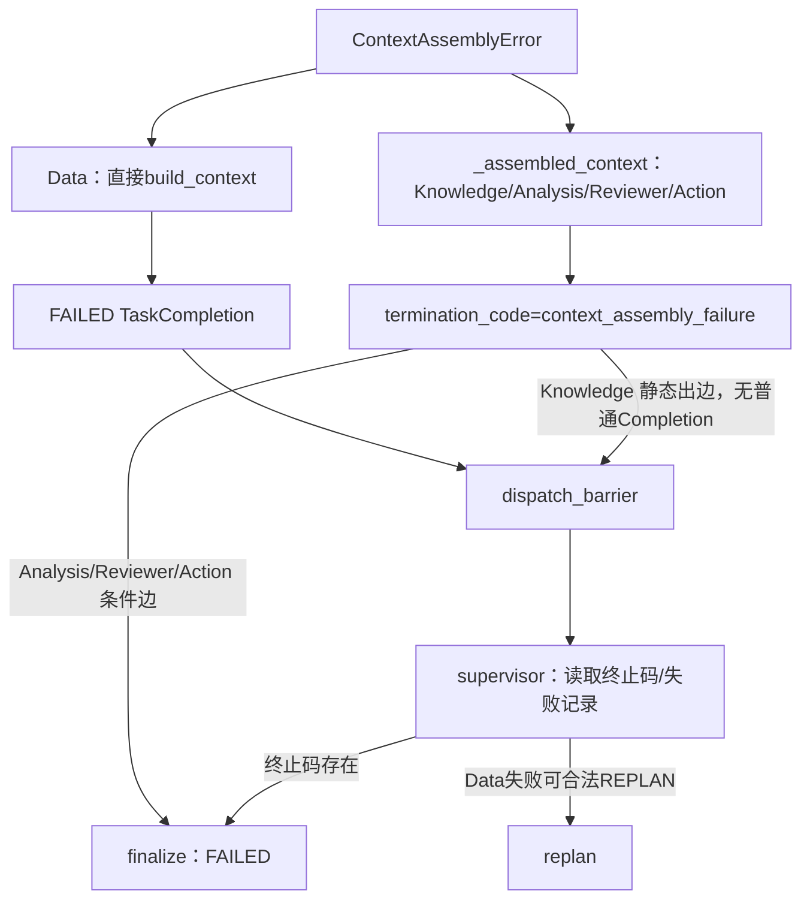

> [!note] 额外审计界限
> B16 的 Budget 处于 AUDIT ONLY，已由 B16、D01/D02 覆盖机制与运行验证缺口；S6 是 B15 源码深读模块，因此必须有正式 12 问矩阵。

> [!important] 本表的阅读方法
> 这不是“五个子系统都能统一重试”的主张。S1 是回退到审核，S2 是知情修正，S3 是有限工具重试 / Replan，S4 是审核与弃答，S5 是权限不可绕过的 fail-closed。**遇到实际异常必须以触发分支的代码为准。**

---

## A07. 真实开发问题与回归测试证据

### 源码与测试记录的典型历史问题（不冒充本次重新复现）

| 工程问题                         | 原始失败现象                                                 | 当前解决机制 / 学习价值                                      |
| -------------------------------- | ------------------------------------------------------------ | ------------------------------------------------------------ |
| Supervisor 非法决策循环          | 模型在两项 Policy 拒绝之间来回跳                             | 累积 policy_feedback；有限重选                               |
| Replan 修正失败擦除结论          | 丢掉已存在的 Analysis/Review 内容                            | 失败结束保留既有派生结论，带 `critical_error`                |
| 静态后继 + Command               | 历史上同一次运行同时进入 Supervisor 和 Finalize，导致重复 `run.failed` | 改为 `_after_termination` 条件出边；目标不同会产生不同通道，当前条件边与 Command 同目标则汇合 |
| Fast Knowledge 误答              | Top-K 即使完全不相关也记成功                                 | `_unsupported_lookup` 门槛，未满足时回受审核路径             |
| 并行完成信息陈旧                 | 已收窄 scope 后旧 Completion 可能污染重建计划                | Barrier 过滤 batch_id 与 RUNNING Task                        |
| Reducer 无法撤回证据             | `[]` 对 list reducer 只是空追加                              | 使用 `None` 触发 `_reset_or_append` 清空                     |
| Analysis/Reviewer 证据范围不一致 | Reviewer 使用 Analyst 没被交付的片段                         | `analysis_evidence_ids` 追踪交付集合                         |
| Context 输入过大                 | 节点异常逃出，缺乏明确终止记录                               | `_assembled_context` 产出终止码，保存详细审计                |
| 任务 output_ref 过长             | 直到重新校验 TaskPlan 才出现 ValidationError                 | `_bounded_output_ref` 保证完整 ID 边界                       |
| Run FAILED 原因不明              | `agent_runs.error` 为空                                      | `finalize_node` 将最后可信 reason 写入 error                 |

### 本轮实际审阅的测试定义

| 测试及位置                                                   | 能支持什么                                                   | 不能声称什么                                   |
| ------------------------------------------------------------ | ------------------------------------------------------------ | ---------------------------------------------- |
| [`test_real_supervisor_node_drives_dynamic_loop`](https://github.com/shark6438/servicemind/blob/19d9a377/tests/servicemind/test_supervisor_runtime.py#L495-L511) | 主 Graph 动态 Supervisor 控制路径                            | 真实企业部署每次均按此顺序                     |
| [`test_handoff_changes_control_owner_and_enters_existing_harness`](https://github.com/shark6438/servicemind/blob/19d9a377/tests/servicemind/test_supervisor_runtime.py#L685-L724) | 控制权与 interrupt/resume 测试路径                           | 全部外部写崩溃窗口闭环                         |
| [`test_replan_double_failure_finalizes_without_raw_runtime_error`](https://github.com/shark6438/servicemind/blob/19d9a377/tests/servicemind/test_supervisor_runtime.py#L1103-L1139) | Planner 反复失败以 `critical_error` 终止且测试期望一次 run.failed | BudgetExceeded + Command 同目标合流已单独验证  |
| [`test_a_context_that_cannot_be_assembled_finalizes_instead_of_crashing_the_graph`](https://github.com/shark6438/servicemind/blob/19d9a377/tests/servicemind/test_supervisor_runtime.py#L1198-L1240) | Reviewer Context 无法组装时经业务终止码结束                  | Data 的直接 build_context 与全部分支都同样处理 |
| [`test_budget_limits_terminate_deterministically`](https://github.com/shark6438/servicemind/blob/19d9a377/tests/servicemind/test_phase3_budget.py#L29-L75) | BudgetController 边界条件                                    | Supervisor 局部循环的最终 model_calls 硬上限   |
| [`test_recovery_hands_over_identity_and_nothing_else`](https://github.com/shark6438/servicemind/blob/19d9a377/tests/servicemind/test_recovery.py#L78-L97) | Recovery 不自行创造权限                                      | 生产 Keycloak 一定可用                         |
| [`test_a_paused_run_is_neither_recovered_nor_failed`](https://github.com/shark6438/servicemind/blob/19d9a377/tests/servicemind/test_recovery.py#L111-L129) | ResumeBlocked 时保持暂停                                     | 所有 RunStatus 都在扫描集合里                  |
| [`test_a_paused_review_resolution_writes_nothing`](https://github.com/shark6438/servicemind/blob/19d9a377/tests/servicemind/test_phase7_principal_invariants.py#L1533-L1554) | Review 决策在 ResumeBlocked 前不持久化                       | Startup Recovery 自动扫描 WAITING_REVIEW       |

**本轮新增的定点回归建议（不是现存通过结果）：** 针对 `unsupported` 直接终止写入 `RunStatus.CANCELLED` 和 `run.rejected` 增加测试；针对 `replan/retrieve_more` 在 `BudgetExceeded` 时同目标路由仅产生一次终态事件增加 `graph.ainvoke` 测试。仅看 `test_replan_double_failure_finalizes_without_raw_runtime_error` 不能替代后一条专门测试。

**本次测试执行声明：**仅审核 GitHub 仓库已有测试源码，没有在该项目依赖/服务环境里运行上述测试。因此测试存在 ≠ 本轮 `pytest PASSED`。GitHub commit status API 未提供可用的该提交 CI 状态（返回空状态集合），也不能据此推导 CI 通过或失败。

---

## A08. Mastery Ledger、闭卷问题与 Whiteboard #1

### 学习分级（不考字段默写）

| 层级        | 必须掌握                                                     | 如何验收                                                     |
| ----------- | ------------------------------------------------------------ | ------------------------------------------------------------ |
| MUST KNOW   | B01–B06、B09–B12 的整体路线/正常流程/关键设计/必要失败边界，B13/B14 的状态与控制权区别 | 脱离源码讲清楚、画出完整图                                   |
| SOURCE DEEP | B02 Reducer，B04 Supervisor/Policy，B05 Planner/DAG，B06 Send/Barrier，B07/B08 Agent 内部 Graph，B10 Checkpoint/Resume，B15 Context 真实分流 | 打开冻结源码，能定位符号、追 caller/callee，解释一条成功/一条失败分支 |
| AUDIT ONLY  | B16–B18、D01–D06、特殊失败码/历史 bug/极端并发               | 知道风险、边界与证据，遇到追问时能按源码核实                 |

### 12 道闭卷问题（**不附答案**）

1. LangGraph、SupervisorAgent、SupervisorPolicy、TaskPlan 分别解决什么问题？
2. 为什么主 Graph 不是 19 节点？为什么 Agent 内部 Graph 节点不计入它？
3. FastPathRouter 怎么判断是否进入完整审核？Fast Knowledge 何时主动回退？
4. 一个合法的 SupervisorDecision 怎样从 LLM 输出变成可执行 `Command`？
5. TaskPlan DAG 与 LangGraph 主控制图有什么区别？`ready_tasks` 与 `available_slots` 分别判断什么？
6. `Command`、`Send`、固定边与条件边有何区别？在主 Graph 哪些位置出现？
7. Data 和 Knowledge 并行时，Reducer 与 dispatch_barrier 分别负责什么？为什么还要 `batch_id`？
8. 分别概括 Data/Knowledge/Analysis/Reviewer 的内部 Graph，举一个最小失败例子。
9. 为什么 Task SUCCESS、Agent DEGRADED、Reviewer PASSED、Run SUCCEEDED 不能混称？
10. Review 触发 RETRIEVE_MORE、REPLAN、ESCALATE、ABSTAIN 时分别怎么推进？
11. Approval Interrupt、Checkpointer、业务 Approval row 和 Resume 的关系是什么？为什么恢复不用 Approver 的更高权限？
12. 为什么当前 BudgetExceeded 可能是 Run CANCELLED？为什么 Recovery 存在不等于所有外部 GLPI 副作用 exactly-once？

### Whiteboard #1 · M6 全链路闭卷画图要求

在白板上画：

- 用户请求 → HTTP Run 创建 → `start_run` → `route`；
- Fast Data / Fast Knowledge / Unsupported / Complex 四条路径；
- 21 节点按路由、控制、分发、分析审核、写入、人类升级、终态分组；
- Supervisor 的 LLM 候选 → Policy → `Command`；
- PlanProposal / TaskPlan DAG / Dispatcher；
- `Send(data_task)` 与 `Send(knowledge_task)` → `dispatch_barrier` → `join_evidence`；
- Analysis/Reviewer 的内部 Graph、Review 后回环；
- Human Approval `interrupt` → `resume` → Harness → `execute` → `finalize`；
- 正确标注 `control_owner`、模型调用和 GLPI 写副作用位置；
- 明确区分 `Graph END` / `Run SUCCEEDED` / `Review PASSED` / `ExecutionResult.verified`。

> [!tip] Whiteboard 考什么
> 考是否能“**说对调用链、控制权、关键状态、失败语义**”，不考你能不能背 1,913 行文件或所有 error code。

---

## A09. 面试提炼（用于复述，不替代源码审计）

### Q1：为什么选 LangGraph？

> ServiceMind 不是把一个大模型当成万能的流程控制器，而是利用 LangGraph 维护有状态的执行图。Supervisor 通过结构化输出提出下一步，由确定性 Policy 判断合法动作；TaskPlan DAG 负责业务依赖，Dispatcher 与 Send 支持证据任务并行，Reviewer 决定是否需要补证据、重规划或升级。需要写 GLPI 时，走单独的 ActionIntent、人工审批及受控 Harness。

### Q2：怎样证明是多 Agent，而不是堆了很多 Graph Node？

> 我区分 Control Plane 与 Agent Plane。Data/Knowledge/Analysis/Reviewer 有独立职责、输入输出契约，部分各自有内部 StateGraph；Router、Dispatcher、Barrier、Finalize 等是控制或执行节点，不能机械地叫 Agent。多 Agent 的价值来自任务分工、证据交接和治理约束，而不是图上方框数量。

### Q3：如何限制模型的自由度？

> SupervisorDecision 需要结构化契约和 Policy 校验，PlanProposal 必须编译、验证 DAG 和依赖；Dispatcher 根据任务实际状态推进，不采信模型口头说已完成。Human Approval 批准的是具体持久化 ActionIntent，不是给予模型无限执行权限。

### Q4：Checkpoint 是否天然意味着生产可靠恢复？

> 不是。Graph Checkpoint 负责控制流状态，ServiceMind 业务库负责 Run、Approval、ActionIntent 和事件，GLPI 是外部副作用系统。源码有权限重验证、Recovery 和幂等/读回机制，但跨持久化和网络边界的崩溃窗口需要单独故障注入验证。不会把“有机制”说成“所有窗口已完成 exactly-once”。

---

## A10. R5 最终审计门控与 FREEZE-READY 判定

### 完整性门控

| 门控项                                      | 结果                               | 依据                                                         |
| ------------------------------------------- | ---------------------------------- | ------------------------------------------------------------ |
| 固定 teaching baseline                      | **PASS**                           | `19d9a377fb98e1c3f56edc59be40b374013bc08b`                   |
| HEAD 漂移检查                               | **PASS**                           | 本轮 GitHub Compare identical，ahead=0/behind=0              |
| 主 Graph 21 节点逐项核实                    | **PASS**                           | 源码注册 21 个 `add_node()`                                  |
| B01–B18 每块按教学顺序                      | **PASS**                           | 全部含总/流程与例子/设计/边界/源码/小结/Mermaid              |
| 四类 Agent 内部 Graph 边界                  | **PASS**                           | Data 3、Knowledge 1、Analysis 3、Reviewer 3                  |
| 入口、调用者、装配的证据分级                | **PASS**                           | 有 SOURCE/WIRED/TO VERIFY 与来源链接                         |
| BudgetExceeded 终态修正                     | **PASS**                           | 文档统一 CANCELLED，不误写 FAILED                            |
| LangGraph 版本与分支机制复核                | **PASS（静态）**                   | `requirements.txt:442 == 1.2.9`，按 1.2.9 上游源码复核 `branch:to:<node>` 和 next-task 去重；**本环境未导入该包运行 Graph** |
| 状态/权限/恢复跨块一致性                    | **PASS**                           | B10/B11/B13/B14/B17/B18 分离业务含义                         |
| Router 示例逐条一致性                       | **PASS（冻结正则的最小重现）**     | 四组词形已在等价第一条 KNOWLEDGE_PATTERNS 上核对；**未执行项目 Router pytest** |
| Unsupported 独立终态及事件                  | **PASS**                           | B11/B12/A04 统一 `CANCELLED + run.rejected`，直连 END        |
| Context 子系统 12 问                        | **PASS**                           | A06 补 S6；Data/Knowledge/Analysis 分支分别表述              |
| Runtime Graph 分支实测                      | **TO VERIFY**                      | LangGraph 1.2.9 在当前容器未安装，仓库集成测试未执行         |
| Source DEEP/AUDIT ONLY 分层                 | **PASS**                           | 不要求死背字段及枚举                                         |
| 测试证明层级                                | **PASS**                           | 测试定义已核，明确无本轮 pytest/生产运行                     |
| 精确上游代码归属逐行 diff                   | **非 M6 blocker / TO VERIFY**      | 留待 M29 贡献边界                                            |
| `replan` BudgetExceeded 真正 Graph 定点运行 | **非课程事实 blocker / TO VERIFY** | 不宣称分支已实测                                             |
| 生产 RAG/Saver/ACL 配置与真实 GLPI 故障注入 | **非 M6 blocker / TO VERIFY**      | 留待对应 Master 与部署证据                                   |
| GitHub 仓库原件修改                         | **未进行**                         | 仅生成学习 Markdown，不改冻结仓库                            |
| 审计输入说明                                | **已收到并逐项对照**               | 已检查用户上传的两轮 Claude Code 修订 1–16（含其自身勘误），并与已修的 R4 逐项核对；不将未独立执行的测试写作本轮通过 |

### R4 → R5 合并修订记录

| 复核点                                               | 结论                                      | 处理                                          |
| ---------------------------------------------------- | ----------------------------------------- | --------------------------------------------- |
| B03 中文知识检索示例                                 | 原例与实际正则不符                        | **已修订**，并解释“找/查找”的源码差异         |
| `unsupported_node` 的独立 CANCELLED / `run.rejected` | 原文重要遗漏                              | **已补 B11/B12/SF 表**                        |
| Finalize 的普遍状态谓词                              | 原 Mermaid/表格过于局限预算名             | **已补任意非空 termination_code 的一般判断**  |
| Context 组装 12 问                                   | 原 A06 缺 S6                              | **已补独立表，且区分 Data 与 Knowledge 路径** |
| D01 历史静态边缺陷 vs 现行条件边                     | 原解释未充分区分历史与现在                | **已修订两种形态与 LangGraph 版本证据**       |
| B10 人工审批图                                       | 原图把 Human 指向 DB，省掉了 API 权限验证 | **已改为 Human → API → DB → Resume**          |
| Source 索引的“行数未统计”注记                        | 与已经列出的实测行数自相矛盾              | **已修订**                                    |
| 用户附带审计中的 `fast_knowledge_node:425`           | 与冻结源码不一致：函数定义位于 **L430**   | **未盲目采纳**；链接使用 L430–L504            |
| 实际 `graph.ainvoke` / 完整测试运行                  | 本轮未执行                                | **保留 TO VERIFY，不制造运行证据**            |

### 审计边界与后续顺序

`FREEZE-READY` 在此只表示：**M6 的教学覆盖、源码事实表述、跨块一致性、误述更正及文档质量已满足冻结前审查要求**。它不表示上述 TO VERIFY 已通过运行验收，更不表示仓库产品“没有可靠性问题”。

不将 `TO VERIFY` 偷换成 `SOURCE FACT`；不因确有一个 Provider/Graph/Adapter 就断言当前生产完整接线；不把测试源码存在等同于本次测试运行通过；不把功能层能到达等同于生产流量真实走到。

> [!success] 最终门控
> **M6：FREEZE-READY（学习材料层，R5 双轮外部审计对照修订）**
>
> **尚未 FROZEN。** 只有用户明确确认后才能更新 Master 状态。M7「入站事件路径」在本轮不展开。


---

## A11. Claude Code 两轮审计（修订 1–16）对照与采纳记录

> [!info] 对照规则
> 两份用户提交的 Claude Code 审计针对的是不同修订阶段的 M6。**本表以已经存在的 R4 完整文档为起点**，而不是把每一条历史建议都当作 R4 尚未解决的 Blocker。只有重新核对冻结源码后，才将建议并入 R5。`已在 R4` 不代表这个问题不存在过，而是它无需再次修改。

| 编号 | Claude Code 意见                            | R4 检查结果                               | R5 处理                                                      | 当前证据                                                     |
| ---- | ------------------------------------------- | ----------------------------------------- | ------------------------------------------------------------ | ------------------------------------------------------------ |
| 1    | B03 “找”误判知识检索                        | **R4 已修**成“查找”                       | 保留正确例子和词形边界；做最小正则重现，不冒充项目 pytest    | `router.py:93–123,161–224`                                   |
| 2    | B02 `Phase3State` 引用终点越界              | R4 仍指向 L106                            | **修为 L44–105**；Claude 首次声称起点 L43 是错误的           | `state.py:44–105`                                            |
| 3    | B06 `completions` 与 `applied` 计数口径     | R4 未说明该区别                           | **新增机制、例子和流程图**，含 total/model/tool 三类计数     | `supervisor_workflow.py:1089–1115`                           |
| 4    | B09 修订后清空旧结论                        | R4 未写状态清空                           | **补充准确时序**：Plan 修订成功立即清空，**不是取到新证据以后才清空**；失败保留旧结果 | `supervisor_workflow.py:1434–1478`                           |
| 5    | B11 补 `abstained` / `escalation_accepted`  | R4 表格已有两种特殊事件，但代码示例未解释 | **补源码简化片段**；指出二者不改变 FAILED/CANCELLED/SUCCEEDED 三元判定 | `supervisor_workflow.py:1718–1808`                           |
| 6    | B16 三种局部循环尝试次数                    | R4 仅讲 Supervisor                        | **补 3/2/3 总尝试次数表**，区分“总尝试”与“额外重试”          | `supervisor_workflow.py:629,760,1403`                        |
| 7    | A01 来源标签不能推断原创性                  | R4 已有部分免责声明                       | **补文件引入史**：父提交无 `src/servicemind/`；未逐函数对比，不采信未复核的“10 个”精确数量 | `ec391407` 和父提交树                                        |
| 8    | B04 Review PASSED + degraded 领域校验       | R4 只讲 Supervisor Policy                 | **增加 Pydantic 领域不变量**，解释契约与路由 Policy 的职责不同 | `domain/review.py:69–76`                                     |
| 9    | D01 区分历史静态边与当前条件边              | **R4 已完整纠正**                         | 保留 R4 同目标通道结论；BudgetExceeded Graph 定点执行仍 TO VERIFY | LangGraph 1.2.9 + `supervisor_workflow.py`                   |
| 10   | A05 Retraction 纠正旧 Bug 的归因            | **R4 已修**                               | 无需重复修改                                                 | A05                                                          |
| 11   | A07 解释 `branch:to:<node>` 机制            | **R4 已修**                               | 无需重复修改                                                 | A03、A07                                                     |
| 12   | B11 `unsupported` 独立终态和 `run.rejected` | **R4 已补**                               | 保留 `CANCELLED + run.rejected → END`，与 `finalize` 严格分开 | `supervisor_workflow.py:506–525,1879`                        |
| 13   | B11 终态规则应是通用谓词                    | **R4 已补**                               | 不把 CANCELLED 缩写为“仅四种预算码”                          | `supervisor_workflow.py:1711–1747`                           |
| 14   | A06 Context Assembly 专属 12 问             | **R4 已增 S6**                            | 保留 Data vs Knowledge/Analysis 不同失败链路                 | A06、`supervisor_workflow.py`                                |
| 15   | A02 PASS 应有示例核对范围；A10 执行证据     | **R4 已限定**                             | 再注明最小正则重现不等于完整 Router pytest；上游源码阅读与本地安装运行不可混称 | A02、A03、A10                                                |
| 16   | D02 预算注释、D06 initialize_database 位置  | **R4 已补**                               | 保留 `src/memory/__init__.py:13–25` 和预算计数语义           | `supervisor_workflow.py:607–627`、`src/memory/__init__.py:13–25` |

### 两份外部审计意见自身需要纠正的地方

1. **Markdown 链接转义损坏**：上传文本中多处 `](https://...` 被重复嵌入，不能原样复制进 Obsidian；R5 统一使用正常 Markdown 链接。
2. **行号起点勘误**：`Phase3State` 定义从第 44 行开始，并非第 43 行；当前文本文件实际终止于第 105 行。
3. **时序勘误**：“补证据成功才清空旧结论”不精确，实际发生于 **成功接受新计划** 时。
4. **重试次数口径**：Supervisor 3 / Initial Plan 2 / Revision 3 都是**最多总尝试次数**；模型抛异常等情况会提前终止。
5. **`context_artifacts` 不可无条件承诺**：上下文组装失败并不一定已有完整 artifact 持久化，A06 明确区分。
6. **审计对象版本不同**：外部意见中的部分所谓 P1 在 R4 已修复，因此在 R5 不会重复记为新 blocker。

### 尚未通过的运行时验证（不因材料 FREEZE-READY 而自动通过）

- `replan/retrieve_more` BudgetExceeded 分支：按实际项目和 LangGraph 1.2.9 执行 `graph.ainvoke()`，断言终止事件恰好一次、终止后不再回 Supervisor。
- 真实依赖下的 Router 完整单元测试与多种中文/英文词形边界回归。
- 生产环境的 Checkpointer、RAG、Context、Memory 配置与 ACL 数据证据。
- `EXECUTING` 残留状态及 GLPI 外部副作用的跨崩溃恢复/对账验证（M5 / M22 范围）。

> [!success] R5 材料层结论
> **M6 可保留 `FREEZE-READY`（学习内容 + 静态源码事实）**，但 `frozen: false` 不变。源码结构和测试定义已复核；尚未运行的项目测试与生产故障注入保持 `TO VERIFY`，不会称作完成验证。

<!-- End of M6: source-first Obsidian course / R5 Claude Code dual-round cross-audit / user confirms FROZEN only. -->