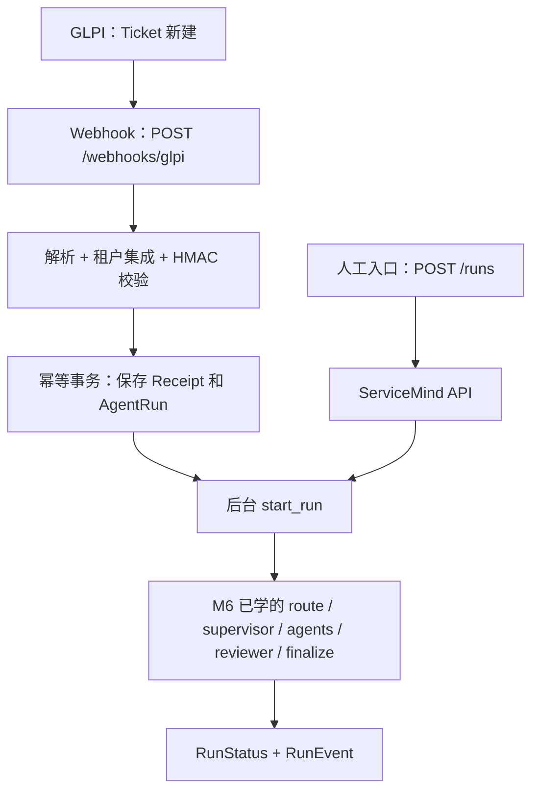
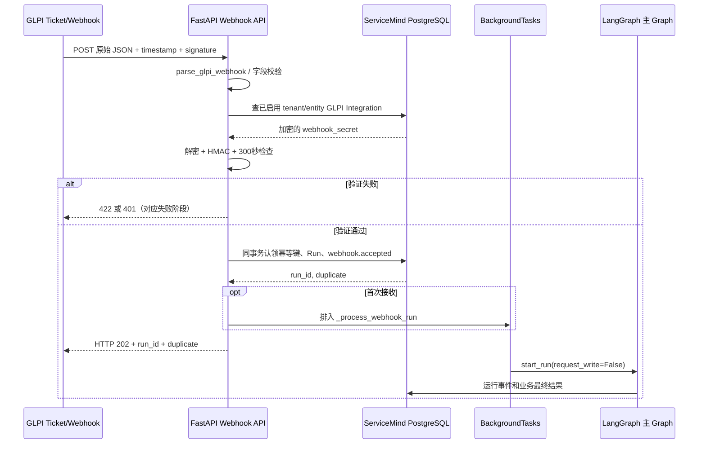

# ServiceMind M7 · 入站事件路径：GLPI 为什么可以自动触发 Agent？（R4 完整教材 · 源码与依赖协议定点复核版）

> [!important] 本 Master 的定位
> 本讲接续 M4（用户主动发起读任务）、M5（受审批的写任务）、M6（主 Graph 控制流），研究**另一个发起工作流的入口：GLPI 自己发送 Webhook**。从零开始，逐块衔接：**事件是什么 → GLPI 如何配置 → HTTP 如何接收 → 如何识别租户并验证签名 → 如何去重并建 Run → 如何启动 Graph → 失败、重试和恢复 → 现场验收**。
>
> 本文先审阅冻结源码，再写学习材料。凡项目源码可直接证明的，标记 `SOURCE FACT`；完整调用接线可确认的，标记 `WIRED FACT`；代码中写有测试但本轮未执行，标记 `TEST DEFINITION`；生产系统、GLPI 原生投递行为或崩溃窗口未亲自观测的，标记 `TO VERIFY`。**源码事实不自动升级为运行事实**。
>
> 文档状态：`CANDIDATE · R4 全面静态源码审计修订`（供学习与逐块审计；不是 `FREEZE-READY`，更不是 `FROZEN`）。此文**直接在 M7 R3 的 15 个学习块及 A0–A9 源码审计区之上增删改查**，不是抛弃旧稿重新设计大纲；不改项目源码、不读取 `.env`、不接触真实密钥、不启动或重启任何容器。

## 先看全景：M7 究竟解决什么问题？

在 M4，你学的是“人点按钮并提出问题，服务创建 Run”；在 M7，我们换成“工单系统发生事件，不必有人点按钮，就能让 ServiceMind 创建 Run”。**Webhook 是触发器，不是 Agent，也不是 Graph 的新节点。**



学完应能独立回答：谁发送事件、请求数据长什么样、为什么没有用户 JWT 仍能验来源、什么叫重复投递、Run ID 如何产生、HTTP 202 说明什么、什么时候真的运行 Graph、服务崩溃后由谁恢复，以及哪些事实还需要实测。


## 零基础导航 · 先认识这六个词，再正式进入 B01

| 词语                    | 可以暂时怎样理解                                 | 首次深入学习位置 |
| ----------------------- | ------------------------------------------------ | ---------------- |
| GLPI                    | 管理 IT 工单的外部系统                           | B01–B02          |
| HTTP POST               | 一个系统向另一个系统提交数据的网络请求           | B03              |
| JSON / Body             | HTTP 发送的结构化正文                            | B03–B04          |
| Tenant / Entity         | 企业隔离范围 / GLPI 内部业务实体范围             | B05              |
| HMAC / Secret           | 借助双方约定的密钥检查消息来源与完整性           | B06              |
| 幂等 / Run / Checkpoint | 防止同一投递重复认领 / 业务任务 / Graph 状态存档 | B07–B11          |

**本书怎么读：** 每块首先理解“这东西是什么、为什么存在”，再跟随 **Acme / GLPI Ticket #5 / entity 1** 这条固定案例理解数据如何变化，之后才看源码调用与必要失败边界。每块最后的微型自检只用于验证是否理解，不是突然引入新的深奥知识。

**一条贯穿全书的可验证因果链：** 事件是否发生、HTTP 是否到达、Body 是否合法、租户和签名是否可信、认领是否成功、Graph 是否启动、Run 最终什么状态——每个判断都有不同的负责人，不能由后一个判断替代前一个。

> [!note] 课程讲授中的“例子”
> 所有 `Ticket #5`、示例时间戳、示例密钥都是**教学情景**，不等于对真实 GLPI 机器的观测。精确的生产接线、配置密钥和实际签名 Header 的有效性仍需要现场验证。本教材把 SOURCE FACT/WIRED FACT 与 TO VERIFY 分开列在 A3。

## B01 · 最初的三个概念：Event、Webhook、Run（MUST KNOW）

### 总：先理解为什么要 Webhook

- **Event（事件）**：某件事发生了，例如 GLPI 创建了一张工单。
- **Webhook（事件通知）**：GLPI 主动向事先配置好的 ServiceMind HTTP 地址发送一条 POST 请求，告诉它事件发生了。
- **Run（业务运行）**：ServiceMind 为这条通过校验的事件创建一次自己的 AgentRun，然后把它交给已学习的主 Graph 处理。


#### 先补三个前置概念：消息从哪里来、发给谁、最后由谁处理？

初学者可以把一次 Webhook 想成“门铃通知”。**事件**是有人到访；**Webhook** 是门铃向手机发提醒；**Run** 是你收到提醒后登记并处理的一件事。门铃响不代表你已经开门、更不代表事情处理完。

再区分三个经常混用的词：`GLPI` 是事件生产者（producer），`POST /webhooks/glpi` 是 ServiceMind 的接收端点（endpoint），`AgentRun` 是 ServiceMind 内部可以查询、审计和恢复的工作记录。它们分别在**业务系统、网络边界、业务数据库**三个位置。

从 M6 衔接过来：主 Graph 已经知道如何处理“分析一张工单”；M7 关心的是**没有人主动点按钮时，谁来把这件工作创建出来**。因此 Webhook 不需要也不应该被误画为第 22 个主 Graph 节点。


### 正常流程与最小例子

假设客服在 GLPI 中创建 Ticket #5。没有用户向 ServiceMind 的聊天框发消息，GLPI 也可以通知它：**“实体 1 中出现了工单 #5，事件是 new。”** ServiceMind 随后生成一次只读分析 Run。


#### 把 Ticket #5 的故事一步步走完

1. 某员工在 GLPI 创建 Ticket #5。这是事件，不是 ServiceMind 中的 Run。
2. GLPI 按自身 Webhook 配置构造 JSON 消息并准备发送。此时 ServiceMind 还不知道事件存在。
3. ServiceMind 的 HTTP 端点**可能**接收到该消息，但只有经过后续校验才会认领它。
4. 经过格式、租户和签名检查后，业务数据库创建 `AgentRun`，最初状态为 `PENDING`。
5. 后台函数把这个 Run 交给之前学过的 LangGraph 主 Graph；稍后才可能出现 `SUCCEEDED/FAILED/CANCELLED`。

用最短时间线记忆：`事件发生 → 消息投递 → 接收校验 → Run 认领 → Graph 工作 → Run 终态`。

如果 GLPI 根本没有发请求，那么不会凭空出现一个 Webhook Run；如果只完成第 4 步，业务工作也还没完成。


### 关键设计

这里有两种**不同的触发渠道**，不要混淆：

| 人工创建 Run                            | GLPI 自动创建 Run                                   |
| --------------------------------------- | --------------------------------------------------- |
| `POST /v1/servicemind/runs`             | `POST /v1/servicemind/webhooks/glpi`                |
| 用户提供 goal、ticket_id、request_write | GLPI 提供 tenant_id、event、item.id、item.entity.id |
| 依赖用户 Bearer Token / `analyst` 角色  | 依赖已配置的租户共享密钥与签名                      |
| 新建两个随机 UUID（Run/Thread）         | 依据已验证签名构造确定性的 Run/Thread 标识          |
| 可以请求进入受控写路径                  | Webhook Run 强制 `request_write=False`              |


#### 为什么不是“GLPI 直接调用 AnalysisAgent”？

一种看似简单的方案是让 GLPI 直接调用 AnalysisAgent 函数。但这会让 GLPI 必须了解 Python 进程位置、Agent 接口、任务状态，以及如何重试失败。当前设计把这些职责分离：GLPI 只负责通报事件；API 负责判断消息能否接受；Repository 负责记账；Graph 负责完成分析。

这也是**边界清晰**的意义：事件系统可能与 Agent 系统分别部署、分别重启，靠 HTTP 与持久化记录解耦。这里的“解耦”并不等于完全可靠——B09、B11 会看到当前后台任务仍依赖本进程。


### 必要失败边界

“工单发生了事件”并不等于“分析已经完成”；“HTTP 收到通知”也不等于“通知可信”。接下来的 B02–B08 会把这些关卡分开讲。


#### 最小反例：有 Ticket 不等于有 Run

设 Ticket #5 已创建，但 `bootstrap_webhooks.php` 未实际运行。GLPI 业务表能找到 Ticket，不代表 ServiceMind `agent_runs` 有这次任务。排错应先检查**发送端是否配置、是否发出消息**，而不是检查 Reviewer 质量。


### 源码学习

读 [`api.py L216–295`](https://github.com/shark6438/servicemind/blob/19d9a377fb98e1c3f56edc59be40b374013bc08b/src/servicemind/api.py#L216-L295)：寻找两个 `@phase2_router.post`，并观察两条入口最终都可能调用 `_process_webhook_run`。


#### 第一次源码精读：先看两条入口在哪儿分流

只看 API 中三个事实就够：`@phase2_router.post("/runs")` 表示人工任务入口；`@phase2_router.post("/webhooks/glpi")` 表示机器事件入口；两者在业务入库后都可能调用 `_process_webhook_run(run, context)`。

读这段源码时，每看一个函数问自己三件事：**输入是谁提供的？此处是否已经可信？输出是 HTTP 响应、业务对象，还是 Graph State？** 在 B01 中不必背 HMAC 公式，先建立链路上的责任归属。

**微型自检：** “GLPI 通知成功”和“AnalysisAgent 分析成功”是一回事吗？为什么？预期解释应包含 HTTP 接收和业务执行两个阶段。


**小结与衔接：** M7 是“怎样启动 M6 那张主图”的问题。知道触发方式后，下一块去看 GLPI 要发送什么。

## B02 · GLPI 端究竟配置了什么？（MUST KNOW）

### 总：Webhook 首先是一份发送端配置

项目提供 `deploy/glpi/bootstrap_webhooks.php`，用于在 GLPI 中配置事件通知。它不是 Python Agent；它是 GLPI 环境的部署/初始化脚本。


#### 从零理解“配置”与“程序”不是同一件事

Webhook 要正常发生，GLPI 必须知道：**监控哪种业务对象、什么时候触发、往哪里发、发什么内容、用什么密钥**。这五个问题并不是 ServiceMind 的 Graph 来回答的，而是在 GLPI 发送端预先配置。

`bootstrap_webhooks.php` 是管理/初始化程序，作用是把配置写给 GLPI；之后实际发送由 GLPI 系统负责。**脚本文件在仓库中 ≠ 脚本已执行 ≠ 发送成功**。源码里设置了 `is_active=1`，也只说明它想创建一条启用的规则。


### 正常流程与最小例子

冻结脚本为两个演示租户配置 Webhook：Acme（实体 1）与 Globex（实体 2）；目标是 `Ticket`，触发配置为 `event='new'`，也就是创建工单。发送 payload 是带模板占位符的 JSON：

```json
{
  "tenant_id": "11111111-1111-4111-8111-111111111111",
  "event": "new",
  "item": {
    "id": 5,
    "entity": {"id": 1}
  }
}
```

这段是**教学中的替换后示例**；GLPI 中实际保存的 `payload` 带 `{{ event }}`、`{{ item.id }}`、`{{ item.entity.id }}` 模板，不是在 PHP 脚本内把 ID 永远写死成 5。


#### 先认识三个最容易误认的配置字段

假设你在 GLPI 的后台创建通知规则：

| 配置问题   | 当前冻结脚本                                                 | 对 Ticket #5 的影响              |
| ---------- | ------------------------------------------------------------ | -------------------------------- |
| 谁的事件？ | `itemtype='Ticket'`                                          | 只把目标定位为工单对象           |
| 什么时刻？ | `event='new'`                                                | 教学例子是新建工单触发           |
| 发到哪里？ | `url='http://host.docker.internal:8080/v1/servicemind/webhooks/glpi'` | 通知目标是 ServiceMind HTTP 接口 |

发送正文模板中的 `{{ item.id }}` 并不是 Python 格式字符串；它由 GLPI 运行时替换为当前工单 ID，例如 5。`{{ item.entity.id }}` 替换为当前实体 ID；这里的实体不是 PostgreSQL 的数据库实体表，而是 **GLPI 的业务组织/数据可见范围标识**。

代码先 `json_encode()` 构造 JSON 模板，再将需要保持数字类型的模板占位符去掉 JSON 双引号。学这个步骤的重点是**输出的 JSON 数值类型**，不是记 PHP 的 `str_replace` 语法。


### 关键设计

1. `bootstrap_webhooks.php` 为不同租户读取对应的环境变量 `SERVICEMIND_ACME_WEBHOOK_SECRET` / `SERVICEMIND_GLOBEX_WEBHOOK_SECRET`，不应把真实密钥放在脚本里。
2. 配置的接收地址是 `http://host.docker.internal:8080/v1/servicemind/webhooks/glpi`。
3. 配置中有 `sent_try=3`、`expiration=300`、`is_active=1`。这表明脚本**意图**配置重试次数、过期时间和启用状态，但真实 GLPI 11 的运行调度与签名实现尚须实际投递验证。
4. `local_define.php` 只将上述 URL 放入 GLPI 服务端 URL 允许列表；**允许访问这个 URL ≠ 它一定可达，更不等于签名一定匹配**。
5. `deploy/glpi/compose.yaml` 仅为 GLPI 服务挂载 `local_define.php`；`README.md` 明说这份 Compose **不会启动 ServiceMind API 或前端**。因此不能由 Compose 存在推断接收端已经在线。


#### 为什么两个租户要分别配置？

仓库示例中，Acme 预期绑定 GLPI entity 1，Globex 绑定 entity 2；每条规则还读取不同的 `SERVICEMIND_*_WEBHOOK_SECRET` 环境变量。这样接收端在 B05 才能根据租户、entity 查到对应共享秘密。

配置里的 `sent_try=3`、`expiration=300` 是 GLPI 端发送策略字段。它们**不是** ServiceMind 的请求重放验证逻辑；即使两边都写了数字 300，也不能自动认定两者的实现语义相同。后者在 B06 明确使用绝对时间差验证。

`custom_headers=[]` 也值得标注：**它并不意味着缺少签名 Header**。本轮从 ServiceMind 冻结 `deploy/glpi/compose.yaml:24–25` 所声明的镜像版本出发，交叉读取 **GLPI 上游 `glpi-project/glpi@11.0.8` 的真实源码**：`src/Webhook.php:1238–1242` 会自动生成 `X-GLPI-signature` 和 `X-GLPI-timestamp`，即使 `custom_headers` 为空。`getSignature()` 在同文件 `L1079–1082` 实现 `hash_hmac('sha256', data, secret)`。所以“这两个 Header 在 11.0.8 上游实现中是否生成”的**静态实现问题已经核清**；尚不能据此声称现场镜像摘要、已生效规则或投递运行成功。

#### 从 GLPI 内部队列到 HTTP：为什么开单后不一定立刻到达？

先补一个 B02 原稿遗漏的**基础概念：队列（Queue）**。GLPI 可以在新建 Ticket #5 时先保存一条“待发送通知”，随后由 `queuedwebhook` 自动动作调度真正的 HTTP 请求。这样开单操作不必一直等待 ServiceMind 分析。

```text
GLPI Ticket #5 新建
  → Webhook.php 根据 event/entity 渲染 Body
  → 同时计算 timestamp 与签名 Header
  → QueuedWebhook 持久化 url/body/headers
  → GLPI queuedwebhook 自动动作调用 sendById()
  → 读取已保存的 Body/Headers，经 URL 安全检查后 POST
  → ServiceMind FastAPI
```

**关键的版本源码证据（外部依赖，不是 ServiceMind tracked 文件）：**

- [`glpi-project/glpi@11.0.8/src/Webhook.php L1220–1242`](https://github.com/glpi-project/glpi/blob/11.0.8/src/Webhook.php#L1220-L1242)：按实体匹配、渲染 Body、生成 timestamp 和两个 Header。
- [`Webhook.php L1260–1303`](https://github.com/glpi-project/glpi/blob/11.0.8/src/Webhook.php#L1260-L1303)：把 `body` 和 `headers` 一并写给 QueuedWebhook，而不是直接调用 ServiceMind 的 Python 函数。
- [`QueuedWebhook.php L173–205、L250–266`](https://github.com/glpi-project/glpi/blob/11.0.8/src/QueuedWebhook.php#L173-L266)：从队列读取 URL、已存 Header 和 Body，尝试发送；[`L620–633`](https://github.com/glpi-project/glpi/blob/11.0.8/src/QueuedWebhook.php#L620-L633) 是自动动作扫描入口。

**Ticket #5 最小案例：** 如果开单已成功、GLPI 队列有一条待发记录，但自动动作尚未执行，ServiceMind 可以完全没有相应 Run。这不必然是 HMAC 或 Agent 故障；应先检查 GLPI 队列/自动动作状态。当前课程仅做版本源码核对，没有读取真实队列。

**可选 CRA Challenge 边界：** 同一 GLPI 11.0.8 的 [`QueuedWebhook.php L194–205`](https://github.com/glpi-project/glpi/blob/11.0.8/src/QueuedWebhook.php#L194-L205) 表明，如果全局强制 CRA 或该规则启用 `use_cra_challenge`，GLPI 会在投递前做 Challenge-Response。冻结 ServiceMind 的 Webhook 端点仅注册 `POST`，没有为该路径实现 GLPI 的 `GET ?crc_token=...` 应答。**只有启用 CRA 的条件成立时才是协议阻断**，不能说所有 GLPI Webhook 都必经 CRA；现场开关及是否实际启用仍是 `TO VERIFY`。


### 必要失败边界

如果 Webhook URL 端口与真正的 API 端口不一致，GLPI 可能发不出去；如果 GLPI 服务端 URL allowlist 没匹配，可能在 GLPI 内部就被阻止；如果 GLPI 与 ServiceMind 的租户密钥不一致，则会被后端拒绝。这三种故障发生在不同位置。


#### 给初学者的三个定位例子

- 规则不存在：通常连请求都不会发送；检查 bootstrap 有没有执行。
- URL 与允许列表不同：GLPI 可能在出站请求阶段阻止，ServiceMind 未必能看到任何日志。
- URL 可达但签名协议不同：ServiceMind 有可能收到 HTTP 请求，却在 B06 认证阶段返回 401。

以上是不同故障阶段，不能把全部情况归因于“Agent 没响应”。


### 源码学习

- [`bootstrap_webhooks.php L10–70`](https://github.com/shark6438/servicemind/blob/19d9a377fb98e1c3f56edc59be40b374013bc08b/deploy/glpi/bootstrap_webhooks.php#L10-L70)
- [`local_define.php L3–7`](https://github.com/shark6438/servicemind/blob/19d9a377fb98e1c3f56edc59be40b374013bc08b/deploy/glpi/local_define.php#L3-L7)
- [`deploy/glpi/README.md L1–7`](https://github.com/shark6438/servicemind/blob/19d9a377fb98e1c3f56edc59be40b374013bc08b/deploy/glpi/README.md#L1-L7)


#### 源码精读顺序：先理解值，再理解如何写入 GLPI

打开 `bootstrap_webhooks.php`，顺序阅读 `definitions`（两租户基本信息）、`payload`（模板）、`fields`（目标规则）、`getFromDBByCrit`（存在则更新，否则新建）。同时对照 `local_define.php` 的 `GLPI_SERVERSIDE_URL_ALLOWLIST`。

易混点：`bootstrap_webhooks.php` 中的 `url` 是**通知发送地址**；`local_define.php` 中的 allowlist 是**GLPI 允许出站访问的地址模式**。后者不是 ServiceMind 的身份认证，也不能代替 HMAC。

#### 留给 B12 的一个问题：`:8080` 究竟是谁规定的？

`bootstrap_webhooks.php` 和 `local_define.php` 都出现 `:8080`。初学者先把它理解为“GLPI 发送消息的目标端口”，**不要马上判定它是旧配置，也不要判定它已经在线**。B12 会把 ServiceMind 默认监听端口、根目录 Compose 的端口映射、GLPI 的独立 Compose 以及 Linux 下的容器域名解析放到同一张图中。

**微型自检：** 脚本中把 `event` 写成 `new`，能否推出接收端不支持 `updated`？不能。B04 会看到接收端只检查长度与非空，没有严格事件名称白名单。


**小结与衔接：** GLPI 负责按配置向目标 URL 发消息，但能否被 ServiceMind 接受，还取决于 B03 的 HTTP 接口。

## B03 · 从 HTTP 请求到 Python 函数：API 怎样接收消息？（MUST KNOW）

### 总：先学习 POST、Body 和 Header

HTTP POST 可以粗略理解成一封信：**URL 是收件地址，Body 是信件正文，Header 是信封上的元数据**。Webhook 并不是调用一个本地 Python 函数，而是通过网络 POST 到 FastAPI。


#### HTTP 入门：API 不是直接被“调用函数”，而是收到网络请求

一次 HTTP 请求大致包括：`方法 + URL + Headers + Body`。`POST` 告诉服务器“我在提交数据”；URL 的**主机与端口**确定把数据送往哪个网络进程，路径 `/v1/servicemind/webhooks/glpi` 确定由哪个业务接口处理。Headers 是附加元信息，Body 是消息正文。

例如浏览器地址中的 `127.0.0.1` 意味着**当前机器本身**；当 GLPI 在容器内时，它的 `localhost` 指 GLPI 容器自己，不是宿主机。`host.docker.internal` 在支持该名称的 Docker 环境中用于访问宿主机方向，因此要从发送容器的视角判断 URL，而不是看自己电脑浏览器能不能打开。


### 正常流程与最小例子

```http
POST /v1/servicemind/webhooks/glpi
X-GLPI-timestamp: 1760000000
X-GLPI-signature: <64位小写十六进制摘要>
Content-Type: application/json

{"tenant_id":"...","event":"new","item":{"id":5,"entity":{"id":1}}}
```

上面的 `timestamp` 和签名是格式教学占位，不是可发送的有效签名。不要把这里的示例当成现成凭据。

接收函数的核心结构：

```python
@phase2_router.post("/webhooks/glpi", status_code=202)
async def receive_glpi_webhook(
    request: Request,
    background_tasks: BackgroundTasks,
    x_glpi_signature: str = Header(alias="X-GLPI-signature"),
    x_glpi_timestamp: str = Header(alias="X-GLPI-timestamp"),
):
    body = await request.body()
    ...
```

项目的 `phase2_router` 前缀是 `/v1/servicemind`；`src/service/service.py:create_app()` 将它挂载到 FastAPI。这是完整的**路由接线事实**。


#### 逐字读懂一封 Webhook 请求

```http
POST /v1/servicemind/webhooks/glpi HTTP/1.1
X-GLPI-timestamp: 1700000000
X-GLPI-signature: aaaaaaaaaaaaaaaaaaaaaaaaaaaaaaaaaaaaaaaaaaaaaaaaaaaaaaaaaaaaaaaa
Content-Type: application/json

{"tenant_id":"11111111-1111-4111-8111-111111111111","event":"new","item":{"id":5,"entity":{"id":1}}}
```

这里的签名全是 `a`，仅用于展示 64 字符的形状，**不是有效签名**；时间戳也是历史演示数值，不能用于当前真实请求。

FastAPI 中 `Header(alias="X-GLPI-signature")` 的意思是：把 HTTP Header 取出来交给 Python 参数 `x_glpi_signature`；`await request.body()` 表示异步读取 Body 的原始 `bytes`；`BackgroundTasks` 是后续安排执行的容器，不是刚收到请求就完成 AI 分析。

举一反三：一个请求即使 Header 完整，Body 也可能格式错误；Body 是合法 JSON，也可能没有有效签名。HTTP 收到数据与业务接受数据是两个判断。


### 关键设计

- 用 `await request.body()` 获取**原始字节**，而不是先用 Python 对象重新序列化，因为签名验证绑定的是这些原始字节；JSON 意义相同但空格、字段顺序不同，字节就可能不同。
- 两个自定义 Header 分别提供消息时间戳和签名。
- 端点声明 `202 Accepted`，成功响应是 `{"accepted":true,"duplicate":false,"run_id":"..."}` 等结构。
- **202 的语义只是本次事件入口接受并持久化了 Run，不保证 Graph 已完成。** 真正执行在后续 `BackgroundTasks` 中。


#### 为什么请求体一定要保留原始 bytes？

下面两段 JSON 表示相同业务数据，但字节不同：

```json
{"id":5,"event":"new"}
```

```json
{ "event": "new", "id": 5 }
```

密码学签名通常对字节串计算，不是对“JSON 含义”计算。接收端如果先 `json.loads()`，再以不同空格顺序 `json.dumps()` 重组，新的字节可能与发送方签署的不同，造成错误拒绝。当前代码先读取 raw body，既交给 B04 的解析器，也交给 B06 的 HMAC 验证器，保证比较的字节一致。


### 必要失败边界

缺失必填 Header 会受到 FastAPI 参数校验约束；无效正文将被 Webhook 解析器拒绝。HTTP 层成功不能取代后面的身份、签名和持久化检查。


#### HTTP 层失败和业务失败要分清

- 缺少必填签名 Header：由 FastAPI 参数校验拒绝，通常是 422，不进入 `receive_glpi_webhook` 的正常完整流程。
- Body JSON 缺必要字段：端点捕获 `WebhookValidationError` 返回 422。
- 租户不匹配或 HMAC 校验失败：端点有对应的 401 处理。
- 完成接收且未重复：返回 202；这个状态不等于 M6 的 Run `SUCCEEDED`。

这些是源代码中可辨别的响应边界，不应假定数据库宕机也自动被转换成同一个 422/401。


### 源码学习

- [`api.py L52–55`](https://github.com/shark6438/servicemind/blob/19d9a377fb98e1c3f56edc59be40b374013bc08b/src/servicemind/api.py#L52-L55)（路由前缀）；[`L216–225`](https://github.com/shark6438/servicemind/blob/19d9a377fb98e1c3f56edc59be40b374013bc08b/src/servicemind/api.py#L216-L225)（Endpoint）；[`L268–270`](https://github.com/shark6438/servicemind/blob/19d9a377fb98e1c3f56edc59be40b374013bc08b/src/servicemind/api.py#L268-L270)（后台安排和返回）
- [`service.py L554–574`](https://github.com/shark6438/servicemind/blob/19d9a377fb98e1c3f56edc59be40b374013bc08b/src/service/service.py#L554-L574)


#### 源码精读：四个具体位置

1. `phase2_router = APIRouter(prefix="/v1/servicemind")`：记住公共路径前缀。
2. `@phase2_router.post("/webhooks/glpi", status_code=202)`：拼出最终的 POST URL。
3. `Header(alias=...)`：Header 名称如何映射到参数。
4. `service.py:create_app()` 的 `include_router(phase2_router)`：**注册**后，HTTP 请求才会进入此函数。这是 `WIRED FACT`，而非只找到函数定义就说线上已经启动。

**微型自检：** 为什么 `POST /runs` 与 `POST /webhooks/glpi` 不能使用完全相同的鉴权？前者带人类 Bearer Token，后者是机器签名，二者身份来源不同。


**小结与衔接：** 一封信送到了 HTTP 端点，接下来必须先看正文是否符合格式约定。

## B04 · Payload 解析：不是合法 JSON 就能进入 Agent（MUST KNOW）

### 总：什么是“数据契约”？

数据契约是服务对消息字段的要求。`json.loads()` 只负责把字节转换为 Python 数据结构，不负责保证 `ticket_id` 合法、租户 UUID 正确或事件名称长度合适。


#### 先分清“语法正确”和“业务合法”

JSON 是一种结构化文本格式。`json.loads(body)` 只负责把原始 JSON 字节解释成 Python 对象，例如字典与整数；它不能判断工单编号是否超出数据库能存储的范围。

这里的**数据契约（contract）**，就是开发者明确规定：这条消息必须有哪些字段、字段转换成什么类型、取值上下限是什么。校验越早，错误越容易定位，也越不会污染后面的任务系统。


### 正常流程与最小例子

`parse_glpi_webhook(body)` 把正文解析为：

```python
GlpiWebhookEvent(
    tenant_id=UUID(...),
    ticket_id=5,
    entity_id=1,
    event="new",
)
```

它读取 `payload["tenant_id"]`、`payload["item"]["id"]`、`payload["item"]["entity"]["id"]`，事件名缺省时使用 `"updated"`。解析异常包装成 `WebhookValidationError`，API 统一返回 `422 Invalid GLPI webhook payload`。


#### 用四份小消息理解解析层的工作

| Body 内容                                                    | `json.loads` | `parse_glpi_webhook`   | 原因                           |
| ------------------------------------------------------------ | ------------ | ---------------------- | ------------------------------ |
| `{"tenant_id":"有效UUID","item":{"id":5,"entity":{"id":1}},"event":"new"}` | 能解析       | 视 UUID 等值合规而成功 | 字段齐全且长度合法             |
| 少了 `item.entity.id`                                        | 能解析       | 失败                   | 必填嵌套字段缺失               |
| `item.id=2147483648`                                         | 能解析       | 失败                   | 超过数据库 32 位范围           |
| `event` 是 5000 字符                                         | 能解析       | 失败                   | 生成 Run goal 后将超出统一上限 |

另外，`event` 字段如果完全缺失，源码会使用默认字符串 `"updated"`。但**真正的发送端 bootstrap 配置的是 `new`**；不要把接收器的缺省值误说成部署事件类型。


### 关键设计

- `ticket_id` 在 `1..2_147_483_647` 范围，避免超出 `agent_runs.ticket_id` 的 32 位整数数据库列。
- `event` 必须非空，最大长度由 `GOAL_MAX_LENGTH=2000` 与 `"Analyze GLPI webhook event {event}"` 模板共同推导（当前是 **1973** 个字符）。这是避免过长事件名进入 Planner 后才失败。
- 实现主要检查**格式与长度**，并没有用一个严格的 `new/updated/deleted` 枚举白名单；真实部署脚本配置的是 `new`，不能据此说 API 只接受 `new`。


#### 追踪每个字段为什么存在

| 解析后的字段 | 来源                     | 后续用途                                     |
| ------------ | ------------------------ | -------------------------------------------- |
| `tenant_id`  | JSON                     | 选择正确租户业务数据与集成密钥；此时仅是声明 |
| `entity_id`  | `item.entity.id`         | 与该租户已启用集成所允许的实体对比           |
| `ticket_id`  | `item.id`                | 创建 AgentRun，主 Graph 取证时定位工单       |
| `event`      | `event` 或缺省 `updated` | 拼接 `Analyze GLPI webhook event {event}`    |

`event` 的最大长度不是随便硬编码一个固定数字，而是从 `GOAL_MAX_LENGTH - len(模板固定部分)` 算出来。这使将来调整 goal 上限或模板时，输入边界自动跟随变化。**接收器没有严格只接受 new/update/delete 的白名单**；因此事件语义是否合法以及 Router 会怎样分类，还要看后续阶段。


### 必要失败边界

例 1：`ticket_id=2147483648`，直接 422，而不是等插入 DB 时才炸。例 2：event 有 5000 个字符，在入口被拒绝，而不是创建 Run 后才在 TaskPlan 中因为 goal 超长失败。例 3：JSON 格式正确但少了 `item.entity.id`，同样拒绝。

注意：**解析通过只是“格式可以看”，不是“来源可信”**。正文中的 tenant_id 仍是未经验证的声明，下一块才开始建立信任。


#### 检查失败会不会产生 Run？

在当前端点的调用顺序中，`parse_glpi_webhook(body)` 位于查集成、验证 HMAC 和持久化认领之前。所以解析阶段抛出捕获的 `WebhookValidationError` 时，该请求不应通过这条路径创建 AgentRun。

但不要把“解析会拦住一些异常输入”扩大为“它严格限制了所有字段类型、所有长度或请求体总大小”。例如 `entity_id` 这里使用 `int(...)` 转换，并没有与 `ticket_id` 一样的数值上界门控；允许的 entity 最终还需 B05 的集成记录匹配。更底层的输入边界应放到审计层，不必在入门块里死背。


### 源码学习

- [`harness/webhooks.py L11–69`](https://github.com/shark6438/servicemind/blob/19d9a377fb98e1c3f56edc59be40b374013bc08b/src/servicemind/harness/webhooks.py#L11-L69)
- [`domain/task.py` 的 GOAL / TICKET 上界](https://github.com/shark6438/servicemind/blob/19d9a377fb98e1c3f56edc59be40b374013bc08b/src/servicemind/domain/task.py#L13-L53)
- [`api.py L225–229`](https://github.com/shark6438/servicemind/blob/19d9a377fb98e1c3f56edc59be40b374013bc08b/src/servicemind/api.py#L225-L229)


#### 源码精读：把四行 Python 翻译成人话

```python
payload = json.loads(body)
tenant_id = UUID(str(payload["tenant_id"]))
ticket_id = int(payload["item"]["id"])
event = str(payload.get("event", "updated"))
```

- `json.loads`：字节 → JSON 所表示的 Python 数据。
- `payload["tenant_id"]`：缺失就触发错误；`UUID(...)` 用于格式检查/转换。
- `payload["item"]["id"]`：先进入嵌套 `item`，再取 `id`。
- `payload.get("event", "updated")`：字段不存在时给默认值，与 `payload["event"]` 的强制必填行为不同。

以上是与真实解析器对应的**解释性摘录**，真正的函数还包含 `GlpiWebhookEvent` 封装、异常捕获和字段范围校验。请核对 `webhooks.py L45–69`。

**微型自检：** 一条 JSON 能成功 `json.loads`，能否说明它一定能创建 Run？不能，后续还有格式范围、租户、签名与数据库步骤。


**小结与衔接：** 消息形状正确之后，真正困难的问题才开始：它声称来自 Acme，我们凭什么相信？

## B05 · 租户和机器身份：没有用户 JWT 怎么建立信任？（MUST KNOW）

### 总：两个概念一定要分清

- **租户（tenant）**：企业或隔离单位；不同租户的业务数据不能互相读取。
- **身份（principal）**：谁以什么授权范围发起工作。这里没有某个分析员的 Bearer Token，服务使用 Webhook 机器身份，并依赖消息签名来验证发送者掌握该租户共享密钥。


#### 先弄懂三个常混淆的身份概念

**租户 Tenant** 是 ServiceMind 中需要互相隔离的企业边界；**GLPI Entity** 是 GLPI 内部的组织/实体范围；**Principal** 是具体执行者的身份及权限集合（可以是用户，也可以是受控的服务身份）。它们不是同一个 ID。

在人工 `POST /runs` 中，用户通常携带 Bearer Token，系统经 OIDC 校验得到 `TenantContext`。在 Webhook 中，没有登录到前台的人把 JWT 发过来；消息里直接包含 `tenant_id`，而它最初只是请求方提供的**未认证数据**，不能因为字段名叫 tenant_id 就信任。

理解关键是两个先后：**先用声称的 tenant/entity 定位应该使用哪一份密钥，再通过正确的签名证明发送者持有那份密钥**。不能把“先查了哪份租户数据”误当成“已经完成身份认证”。


### 正常流程与最小例子

假设收到 `tenant_id=Acme`、`entity_id=1`。API 构造：

```python
TenantContext(
    tenant_id=webhook.tenant_id,
    user_id="glpi-webhook",
    username="glpi-webhook",
    roles={"viewer", "analyst"},
    allowed_glpi_entity_ids={webhook.entity_id},
)
```

但**此时刚构造 Context，还不能把它叫作已认证身份**。接着 `ServiceMindRepository(tenant_id).get_glpi_integration()` 查询本租户已启用的集成，比较数据库中的 `integration.entity_id` 是否与消息一致，取出加密保存的 `webhook_secret_encrypted` 并用 `CredentialCipher` 解密，然后才校验 HMAC 签名。检验都通过后，才允许创建 Run。


#### Acme/Globex 的最小例子：同一张数字编号也可能来自不同租户

设 Acme 的 GLPI entity 是 1，Globex 的 entity 是 2。一个请求写 `tenant_id=Acme, entity_id=1`：API 从 Acme 的租户会话中查询启用的集成，数据库记录需要同时匹配 entity 1，然后取 Acme 的 encrypted secret。

如果攻击者直接把 JSON 改成 `tenant_id=Globex, entity_id=2`，就算格式合法，也不能复用 Acme 的签名。接收器会用 Globex 关联的秘密重新计算签名；没有这个秘密，校验不匹配。

此时构造的 Context：`user_id="glpi-webhook"`、`roles={"viewer","analyst"}`、`allowed_glpi_entity_ids={1}`，是一份**代码指定的服务主体身份**，不是 GLPI Ticket #5 的创建人本人。它也没有通过这次请求获得 `approver` 角色。


### 关键设计

1. 来源不是用户 OIDC：端点函数没有 `TenantContextDependency`，不能误称“Webhook 由用户 JWT 验证”。
2. 租户和 entity 必须与**已启用的集成记录**匹配；无匹配返回 `401 Unknown webhook tenant scope`。
3. `CredentialCipher` 使用 Fernet 对共享密钥加密存储（由独立密钥 `SERVICEMIND_CREDENTIAL_KEY` 解密）。**加密存储是保护静态秘密，HMAC 是验证请求来源和正文完整性，二者不同。**
4. `tenant_session` 在 PostgreSQL 事务内设置 `app.tenant_id`，迁移对 `glpi_integrations`、`agent_runs`、`idempotency_records` 等启用并强制 RLS。Tenant ID 不是“筛选一张普通表”这么简单，它还参与数据库级访问隔离。
5. `scripts/seed_phase2.py` 给 Acme / Globex 写入租户和加密后的 GLPI 集成信息；GLPI 端 `bootstrap_webhooks.php` 使用相应的**同名环境变量**。两侧值是否实际一致属于运行配置验收。

补充一个与 M8 权限检索衔接的细节：Webhook 机器 Context 只显式设置了 `allowed_glpi_entity_ids`，没有从实际开单人的 OIDC Token 继承 group 权限。`TenantContext.allowed_glpi_group_ids` 默认是空集合，`start_run` 再将这个空集合写入 Graph State 的 `group_ids`。因此不能假定自动触发的分析与某个人类分析员拥有完全一样的知识库可见范围；是否真的丢失某份组限制文档，还需要现场 ACL 和语料事实验证（`SOURCE FACT`/`TO VERIFY` 分开）。


#### Fernet、HMAC 与 RLS 是三道不同的边界

- **Fernet 加密存储**：`seed_phase2.py` 先用 `CredentialCipher.encrypt` 保存 webhook secret；API 读取后用 `decrypt` 恢复密钥。这保护数据库中的静态秘密，但单靠“存在加密字段”不证明入站消息可信。
- **HMAC 消息鉴别**：使用刚取出的租户密钥，验证请求方是否掌握这份秘密，同时检测消息字节是否被篡改。具体算法下块 B06 再拆开。
- **PostgreSQL RLS**：业务 Repository 使用 `tenant_session(tenant_id)`，在事务内设置 `app.tenant_id`，数据库中的 Row-Level Security 按租户约束行可见性。它隔离业务数据，但不能替代 HMAC。

要注意**权限粒度不同**：Webhook 构造的 Context 只显式给了 entity，group 权限默认为空。若知识文档带 group ACL，它在 M8 中的可见性可能不同于真实登录分析员；具体影响必须结合真实文档 ACL 验证。


#### 机器 Webhook 的 TenantContext 到底长什么样？

不要只背 `user_id="glpi-webhook"`。冻结源码在 `api.py:231–237` 明确构造：

```python
context = TenantContext(
    tenant_id=webhook.tenant_id,
    user_id="glpi-webhook",
    username="glpi-webhook",
    roles={"viewer", "analyst"},
    allowed_glpi_entity_ids={webhook.entity_id},
)
```

逐个理解：`tenant_id` 来自收到的事件，但**此刻还是一个待校验声明**；`user_id/username` 是平台赋予该机器入口的固定标签；`roles` 被显式设置为 `viewer` 与 `analyst`，**不是 Keycloak 为真实开单人颁发的角色**；entity 范围来自事件，后续必须和启用中的集成记录匹配并通过 HMAC 才能建立可信来源。`allowed_glpi_group_ids` 没有传入，因此沿用默认空集合。

**Ticket #5 例子：** 某普通员工在 GLPI 创建 Ticket #5，不意味着这条 Webhook Run 就以该员工的个人 OIDC Token、群组或高权限执行。这里的机器身份与 M4 的“分析员携带 Bearer Token 调用 `/runs`”是两种不同的信任建立方式。即使它拥有代码中设定的 `analyst` 角色，Webhook 新 Run 仍固定 `request_write=False`，不能由机器事件自动走审批写路径。

### 必要失败边界

如果攻击者只改 JSON 内的 `tenant_id` / `entity_id`，他并不会自动得到另一个租户的密钥；签名验证仍需通过。相反，如果主密钥不可用、集成记录没有创建或已禁用，Webhook 无法完成验证。源码对后两者的 HTTP 映射并非都相同：无匹配集成明确 401，解密配置/数据库异常未被此处同一个 `WebhookValidationError` 分支捕获，不能随意宣称全部都是 401。


#### 为什么“查不到集成”与“密钥解不开”不是一个故障？

源码对“没有已启用集成 / entity 不匹配”明确返回 HTTP 401；对签名不匹配或过期也明确返回 401。它们同属拒绝请求，但原因不同。

而 `CredentialCipher()` 主密钥缺失、解密失败或者业务数据库不可用，可能在其他异常路径发生。当前 Webhook API 并没有把这些错误全都归并为同一个 `WebhookValidationError`，所以不能宣称它们全是 401。排错时应区分**无权/不匹配**与**系统配置/依赖故障**。


### 源码学习

- [`api.py L231–251`](https://github.com/shark6438/servicemind/blob/19d9a377fb98e1c3f56edc59be40b374013bc08b/src/servicemind/api.py#L231-L251)
- [`repository.py L254–260`](https://github.com/shark6438/servicemind/blob/19d9a377fb98e1c3f56edc59be40b374013bc08b/src/servicemind/persistence/repository.py#L254-L260)
- [`security/crypto.py`](https://github.com/shark6438/servicemind/blob/19d9a377fb98e1c3f56edc59be40b374013bc08b/src/servicemind/security/crypto.py)
- [`persistence/database.py L21–29`](https://github.com/shark6438/servicemind/blob/19d9a377fb98e1c3f56edc59be40b374013bc08b/src/servicemind/persistence/database.py#L21-L29)
- [`seed_phase2.py L16–57`](https://github.com/shark6438/servicemind/blob/19d9a377fb98e1c3f56edc59be40b374013bc08b/scripts/seed_phase2.py#L16-L57)


#### 源码精读：重点观察顺序

```python
context = TenantContext(tenant_id=webhook.tenant_id, user_id="glpi-webhook", ...)
integration = await repository.get_glpi_integration()
if integration is None or integration.entity_id != webhook.entity_id:
    raise HTTPException(status_code=401, detail="Unknown webhook tenant scope")
secret = CredentialCipher().decrypt(integration.webhook_secret_encrypted)
verify_glpi_signature(body=body, timestamp=..., signature=..., secret=secret)
```

这是保留关键调用的**解释性摘录**。先查 `GlpiIntegration` 不是信任终点；真正允许新 Run 入库的前提是校验走完。反向看 `seed_phase2.py`: Secret 从环境配置读取，Fernet 加密，保存 `GlpiIntegration`；再回看数据库模型的 `enabled` 和 `entity_id`。

**微型自检：** 为什么有 `user_id="glpi-webhook"` 仍不能说“通过了 Keycloak 用户登录”？它是这条机器入口手动构造的身份标签，并未通过 `TenantContextDependency`。


**小结与衔接：** 现在知道了“应该拿哪一个租户密钥”，下一块才回答“如何用密钥验证这封信没有被伪造”。

---

## B06 · HMAC：服务怎么确认“确实是持有租户密钥的一方发送的”？（MUST KNOW）

### 总：先不要背公式

如果只靠 HTTP Body 中的 `tenant_id` 字段，任何人都能写上“我是 Acme”。HMAC 的思路是：**合法发送方和接收方预先知道同一个秘密，发送方根据消息与秘密计算校验码，接收方独立计算并比较。** 没有秘密的一方不能仅凭公开消息轻易算出正确校验码。


#### 先讲清 Hash、密钥、HMAC 三件事

**Hash（哈希）**是把任意长度字节映射成固定长度摘要的函数，例如 SHA-256 产生 32 字节。它适合检测变化，却不能证明“消息来自谁”：任何人都能计算 `SHA256(body)`。

**共享密钥（secret）**是双方预先安全配置好的秘密字符串；只有合法系统应该知道。**HMAC** 是把消息字节与秘密一起输入标准消息认证算法，得到消息认证码（MAC）。别人可以看到消息、算法和签名，但如果不知道 secret，就不应能轻易伪造其他消息的有效认证码。

此处不需要先学复杂密码学，只需要分清：`SHA256(body)` 是不带秘密的摘要；`HMAC-SHA256(secret, body||timestamp)` 才能用于这条入口的消息鉴别。它也**没有加密 Body 内容**，明文可能仍通过 HTTP 暴露；传输加密应另由 TLS/网络部署方案处理。


### 正常流程与最小例子

本项目签名的字节顺序明确是：

```python
expected = hmac.new(
    secret.encode("utf-8"),
    body + timestamp.encode("ascii"),
    hashlib.sha256,
).hexdigest()
```

假设正文里有 `"id":5`、时间戳为 `1760000000`，发送方使用同一个 `secret` 对**原始 body 字节 + ASCII 时间戳字节**求 HMAC。接收方收到两条 Header，拿租户对应密钥重新计算。两者一致才接受。**不是只对 body 做普通 SHA256，也不是拼接“timestamp + body”。**


#### 一步步模拟发送方和接收方

假设双方约定演示密钥 `demo-only-secret`，消息 Body 字节是 `b'{"id":5}'`，时间戳字符串是 `"1700000000"`（仅做旧时间演示）。

```python
import hashlib, hmac
secret = "demo-only-secret"
body = b'{"id":5}'
timestamp = "1700000000"
message = body + timestamp.encode("ascii")
header_signature = hmac.new(secret.encode("utf-8"), message, hashlib.sha256).hexdigest()
```

发送方计算 `header_signature` 放在 Header；接收方从数据库取相同 secret，对接收到的**原始 Body 和 timestamp**重新计算。

- Body 的 `5` 改成 `6`，签名预期会变。
- Body 不变，timestamp 改了，签名也会变。
- 换成 Globex 的另一个 secret，即使 Body 一模一样，也算出不同的签名。

所以服务端既要验证**数据的字节完整性**，又要验证**来源持有相应秘密**。


### 关键设计：三个不同检查

1. **形状先验**：时间戳必须是 ASCII 数字；签名必须匹配 `^[0-9a-f]{64}$`，即 64 位小写十六进制。理由是非 ASCII 字符可能让编码或比较函数抛出异常。不能把未认证输入变成随意的服务端错误。
2. **时间窗口**：要求 `abs(now - int(timestamp)) <= 300`。这表示请求时间距服务端当前时间不能超过 5 分钟，过早和过晚都不行；不是“消息创建以后永久有效”。
3. **消息鉴别**：`hmac.compare_digest(expected, signature)` 比较计算出的期望值与 HTTP Header 中的值。`compare_digest` 用于避免普通比较潜在的时间特征；源码中没有用 `==` 代替。


#### 为什么是“先检查格式 → 再检查时间 → 再计算 HMAC”？

格式检查避免不可信输入直接造成字符串编码或比较器异常：签名必须匹配 `^[0-9a-f]{64}$`，因为 32 字节 SHA-256 MAC 转十六进制正好是 64 个小写字符；时间戳必须由 ASCII 十进制数字字符组成。

时间检查使用 `abs(now-int(timestamp)) > 300` 拒绝。它允许当前时间前后 300 秒的窗口，主要缩小可重放的时间范围，但**不等于单凭窗口就让重放彻底不可能**：有人在窗口内再次发送相同合法消息，HMAC 仍会有效。为什么还需要 B07 的幂等？就是为了处理合法重投。

`hmac.compare_digest` 比普通 `==` 更适合比较认证码，因为它旨在降低某些基于比较耗时差异的泄漏风险；但不能因此宣称系统在任意部署上“绝对不存在侧信道”。


### 必要失败边界

- 改写一个空格或字段顺序：原始字节改变，旧签名不再匹配。
- 同一个签名但时间已经过期：先被 300 秒窗口拒绝，不会进入数据库去重。
- 非 ASCII 数字或大写摘要：源码在签名计算前拒绝。
- **已复核的外部依赖源码事实：** 与该冻结部署镜像版本相同的 `glpi-project/glpi@11.0.8/src/Webhook.php:1079–1082,1238–1242` 自动设置 `X-GLPI-signature` 和 `X-GLPI-timestamp`，签名数据按 **`body + timestamp`** 排列，算法是 `hash_hmac('sha256', ...)`；这与 ServiceMind `harness/webhooks.py:94–98` 的 Python 算法在源码层对应。**仍为 TO VERIFY：** 实际容器镜像和配置是否与所查版本相符、发送/接收密钥是否一致、真实报文是否到达且通过认证。仓库 PowerShell 脚本仅模拟发送，不能冒充现场端到端测试。


#### 四个真实会区分出的校验失败

| 输入变化                    | 拒绝原因              | 主要保障        |
| --------------------------- | --------------------- | --------------- |
| timestamp 为阿拉伯-印地数字 | 不满足 ASCII 数字要求 | 头部格式安全    |
| 签名包含 `é`                | 不满足小写 hex 规则   | 比较前规避异常  |
| timestamp 距今 301 秒       | 过期                  | 限制重放时间    |
| 改 Body 后沿用旧 HMAC       | 签名不匹配            | 来源/完整性校验 |

**边界提醒：** Python 纯函数本身不知道发送端来源；本轮额外对照了 **GLPI 11.0.8 上游源码**，因此可说“源码层协议签名公式与 Header 名称对应”，不能升级为“当前真实 GLPI 环境已投递成功”。如果 GLPI CRA 开关生效，还需独立满足 Challenge 接口，不能由 HMAC 一致推出整条路径连通。


### 源码学习

- [`harness/webhooks.py L72–98`](https://github.com/shark6438/servicemind/blob/19d9a377fb98e1c3f56edc59be40b374013bc08b/src/servicemind/harness/webhooks.py#L72-L98)
- [`test_webhooks.py L68–125`](https://github.com/shark6438/servicemind/blob/19d9a377fb98e1c3f56edc59be40b374013bc08b/tests/servicemind/test_webhooks.py#L68-L125)
- [`scripts/verify_phase2.ps1 L98–113`](https://github.com/shark6438/servicemind/blob/19d9a377fb98e1c3f56edc59be40b374013bc08b/scripts/verify_phase2.ps1#L98-L113)
- [`GLPI 11.0.8 Webhook.php L1079–1082, L1238–1242`](https://github.com/glpi-project/glpi/blob/11.0.8/src/Webhook.php#L1238-L1242)（外部依赖源码，非冻结仓库文件）


#### 源码逐行翻译：不要只背公式

```python
if not timestamp.isascii() or not timestamp.isdigit(): ...
if _SIGNATURE_PATTERN.fullmatch(signature) is None: ...
if abs((now if now is not None else int(time.time())) - int(timestamp)) > 300: ...
expected = hmac.new(secret.encode("utf-8"), body + timestamp.encode("ascii"), hashlib.sha256).hexdigest()
if not hmac.compare_digest(expected, signature): ...
```

以上各行做了教学性排版，**原函数的时间转换顺序请以 `webhooks.py L77–98` 为准**。三个新对象必须分清：`timestamp` 是 Header 中的字符串；`now` 是接收端当前 Unix 秒数；`signature` 是请求方声称的认证码。测试中传 `now=1000` 是为了精确控制时间，避免自动跟随当前系统时钟。

**微型自检：** 攻击者知道 `body` 和 SHA256 算法，能否直接算出有效的 HMAC？不能，因为还缺对应 secret。


**小结与衔接：** 经过签名检查之后，ServiceMind 才认为该请求来自持有对应秘密的一方。但网络消息可能被合法发送端**重复投递**，下一块解释如何避免重复启动相同 Run。

## B07 · 幂等性入门：为什么相同 Webhook 发送两次，不能创建两个 Run？（MUST KNOW）

### 总：先把“请求重试”和“业务重复事件”分开

网络可能超时：GLPI 发送消息，ServiceMind 已经成功接收，但 GLPI 没收到响应，于是重试。这里的需求是：**同一条已签名的投递，重发时返回同一个 Run**。这叫接收阶段的幂等。


#### 先认识“网络重试”为什么是正常现象

假设 GLPI 把 Ticket #5 的事件发出去，ServiceMind 已把任务保存到数据库。但响应在网络中丢失，GLPI 以为没成功，再发一次。如果接收端第二次又创建一个 Run，就可能出现重复分析、重复模型费用和多份记录。

**幂等（idempotency）**指对同一“被定义为同一操作”的请求重复处理，不应无限重复产生新效果。难点在于：必须先讲清**系统用什么标准判断两条消息相同**。


### 正常流程与最小例子

```text
首次请求：相同 body + 相同 timestamp + 相同 signature
    → accepted=true, duplicate=false, run_id=R

原封不动再发：相同 body + 相同 timestamp + 相同 signature
    → accepted=true, duplicate=true, run_id=R
```

ServiceMind 有三个容易混淆的值：

| 字段        | 实际来源                                                     | 负责什么                                   |
| ----------- | ------------------------------------------------------------ | ------------------------------------------ |
| `signature` | HMAC-SHA256(body + timestamp, secret)                        | 验证来源与消息字节                         |
| `body_hash` | `sha256(body).hexdigest()`                                   | 数据库里核对同一个幂等键是否被配上不同正文 |
| `run_id`    | `uuid5(NAMESPACE_URL, "servicemind:{tenant}:glpi-webhook:{signature}")` | 为同一租户、同一签名构造稳定的业务 Run ID  |

入口的幂等键是：

```python
idempotency_key = f"glpi-webhook:{x_glpi_signature}"
deterministic_run_id = webhook_run_id(webhook.tenant_id, x_glpi_signature)
thread_id = f"glpi-webhook-{deterministic_run_id}"
```

注意这个区别：**M7 的 webhook Run ID 是确定性 UUID5；M4 的手动 `POST /runs` 使用随机 UUID4。** Webhook 的 `thread_id` 也不是新生成的随机 UUID，而是固定前缀加这个确定性 Run ID。


#### 把四个 ID/摘要放在一张小纸条上

```text
Body = Ticket #5 event new
Timestamp = t1
Secret = Acme 的共享密钥

Signature = HMAC(secret, Body || t1)
BodyHash  = SHA256(Body)
IdempotencyKey = "glpi-webhook:" + Signature
RunID = UUID5(固定命名空间, "servicemind:" + tenant + ":glpi-webhook:" + Signature)
ThreadID = "glpi-webhook-" + RunID
```

| 这次请求                 | 签名 | 结果                                        |
| ------------------------ | ---- | ------------------------------------------- |
| 第一次发送 Body+t1       | S1   | 创建 R1、`duplicate=false`                  |
| 完全原样重发 Body+t1     | S1   | 复用 R1、`duplicate=true`                   |
| 同一业务事件换 t2 重新签 | S2   | 可能创建 R2，当前逻辑不是按 Ticket 语义去重 |

这张表的核心不是计算 UUID 的具体文本，而是理解：**稳定 ID 依赖哪些输入**。UUID5 只是确定性映射，不代替签名校验，也不是密码学授权凭据。

#### 对照 GLPI 11.0.8：队列重试和重新产生事件不是同一回事

GLPI 11.0.8 上游实现将 `body/headers` 在**建队列记录时**保存；`QueuedWebhook.sendById()` 之后读取队列中已存的 Header 和 Body 发出请求，而不是每次发送前重新执行 `getSignature`（`Webhook.php:1262–1303`；`QueuedWebhook.php:250–266,287–315`）。因此，**同一 QueuedWebhook 记录的典型重试会复用原 timestamp/signature**，恰好落在 ServiceMind 的“同签名投递幂等”范围内。

但 GLPI 若**为同一 Ticket 又生成了一条新的队列记录**，它会再计算时间戳和签名，ServiceMind 仍可能创建新 Run。队列中旧请求超过接收端 ±300 秒时，即使 HMAC 本身匹配也会被拒绝。结论必须分三级：GLPI 11.0.8 的**版本源码**有复用队列 Header 的机制；没有本轮真实重试/超时记录；不能把接收阶段按签名去重升级为整个 Ticket 业务 Exactly-once。


### 关键设计

- 幂等记录由 `(tenant_id, idempotency_key)` 唯一约束，因此即使两个租户出现同样的签名字符串，也不会因为去重记录互相污染。
- Run ID 是 UUID5；数据库记录中的 `id` 不是“签名自动转成自增数字”。
- 后续查看 Run 时，通过业务 `run_id` 找到关联的 `thread_id`，再交由 LangGraph Checkpointer 查询状态。这一点直接衔接 M6 B10。


#### 为什么 `run_id` 与 `thread_id` 仍然都存在？

你在 M6 已问过这个问题：`run_id` 管业务记录，`thread_id` 管 Checkpointer。人工 Run 的两个值分别来自 UUID4 随机生成；Webhook Run 需要同一个已签名投递反复重试时取到同一业务 Run，因此采用依赖签名的 UUID5，并把 Thread ID 做成 `glpi-webhook-{run_id}`。这保留了不同职责，同时为重试提供稳定关联。

数据库还有独立的幂等记录 ID（随机 UUID 主键），不要误以为所有 ID 都是 webhook_run_id。真正控制投递冲突的是 `(tenant_id, idempotency_key)` 唯一约束。

另外 `body_hash` 用于核对**已有幂等键绑定的正文是否一致**；它并不承担发送方认证，认证已在前面完成。


### 必要失败边界：非常重要的“幂等范围”

**相同签名 ≠ 相同业务事件。** 因为 HMAC 包含时间戳：如果同一张 Ticket、相同 event 和正文，在另一个时间戳被**重新签名**，新 HMAC 通常会不同，进而得到新的 idempotency key 和 run_id。

因此当前源码证实的是**按签名标识的投递幂等**，不是“GLPI 的某个 Ticket 创建事件，无论重签多少次，永远只有一个 Run”。也不能把这种入口级幂等直接称作外部 GLPI 写操作的 exactly-once。


#### 幂等的边界：三个“不等于”

- **同一个 Ticket ID ≠ 同一次投递**：一个工单可以有多个事件。
- **同一个业务事件 ≠ 同一个签名**：如果 timestamp 改变，签名通常改变。
- **接收只创建一个 Run ≠ 整个 Graph 保证只执行一次所有副作用**：后台执行和外部系统不在 B08 的事务里。

如果一条旧消息超过 300 秒，即使签名从数学上匹配，也会在 B06 被拒绝，并不会进入“查幂等记录”的步骤。


### 源码学习

- [`webhooks.py L40–42`](https://github.com/shark6438/servicemind/blob/19d9a377fb98e1c3f56edc59be40b374013bc08b/src/servicemind/harness/webhooks.py#L40-L42)
- [`api.py L252–270`](https://github.com/shark6438/servicemind/blob/19d9a377fb98e1c3f56edc59be40b374013bc08b/src/servicemind/api.py#L252-L270)
- [`models.py L264–278`](https://github.com/shark6438/servicemind/blob/19d9a377fb98e1c3f56edc59be40b374013bc08b/src/servicemind/persistence/models.py#L264-L278)


#### 源码精读：为什么 uuid5 的字符串中包括 tenant？

```python
def webhook_run_id(tenant_id: UUID, signature: str) -> UUID:
    return uuid5(NAMESPACE_URL, f"servicemind:{tenant_id}:glpi-webhook:{signature}")
```

`uuid5(namespace,name)` 根据同一个命名空间与相同名称得出同一个 UUID。加入 `tenant_id` 使不同租户即使拥有相同 `signature` 字符串，也不会被映射成同一个 Run ID。注意 UUID5 生成的稳定性并不保证业务事件天然唯一，其唯一的粒度已经由 `name` 字符串里的签名定义。

对照 `api.py L252–270` 的 `body_hash`、`idempotency_key`、`deterministic_run_id`、`thread_id` 四行，试着从请求 Body 回答每一个值是怎么来的。**微型自检：** 同一个 Ticket #5 如果一分钟后又发生新事件，是否应该强行复用旧 Run？不应该假定，它不是同一次签名投递。


**小结与衔接：** 已知怎样计算“这是同一次投递”，但在两个 HTTP 请求**同时到来**时，仅靠 Python 里 `if key not in dict` 不可靠。下一块看数据库事务如何实现。

## B08 · 原子持久化：Receipt + AgentRun + RunEvent 为什么要一起落库？（MUST KNOW）

### 总：原子事务的直观含义

一次投递要完成几件事：记录“这条消息已经收到”、创建业务 Run、写一个入站事件。如果只写第一条记录就崩溃，下一次重试可能看到“已经收过”却找不到对应的 Run。**原子事务的作用，是把这些步骤尽量作为同一组提交操作。**


#### 从零理解“数据库事务”和“并发竞争”

一次数据库事务可以把多条写操作视为一组提交：**要么这组变更成功提交，要么在失败时回滚**。这解决的是**数据库内部**的一致性，不是把外部网络请求、后台 Graph 和 GLPI 都放进同一个事务。

再理解并发：GLPI 的两次相同重试可能几乎同时到达两个 API Worker。两个 Worker 都先执行“查询是否已有”，如果都查到没有，就都可能尝试创建。只有数据库层唯一约束和正确的并发控制才适合承担这道门槛。


### 正常流程与最小例子

接收端调用：

```python
run, duplicate = await repository.claim_webhook_run(
    idempotency_key=idempotency_key,
    action_hash=body_hash,
    run_id=deterministic_run_id,
    thread_id=f"glpi-webhook-{deterministic_run_id}",
    ticket_id=webhook.ticket_id,
    goal=glpi_webhook_goal(webhook.event),
    event_payload={...},
)
```

仓库中的事务内主要执行：

```text
BEGIN（tenant_session）
  1. INSERT idempotency_records ON CONFLICT DO NOTHING
  2. SELECT 幂等记录 FOR UPDATE，并核对 body_hash
  3. INSERT agent_runs ON CONFLICT DO NOTHING
  4. SELECT 刚才对应的 AgentRun
  5. 如果是新 Run，INSERT run_events（webhook.accepted）
  6. 更新 receipt.result={run_id}、receipt.completed=True
COMMIT
```

以上是为教学简化的调用序列，精确 SQL 条件与 RLS 见源码。


#### 用两个并发请求 A/B 理解这段事务

```text
请求 A ──┐
         ├→ 都携带 (tenant=Acme, signature=S1)
请求 B ──┘
      ↓
数据库唯一约束 (tenant_id, idempotency_key)
      ↓
只有一个请求可以认领为新 Receipt
      ↓
相应事务中建立 AgentRun R1 + webhook.accepted
      ↓
重复请求取得 R1，duplicate=true
```

注意数据库实现并不是凭“某个 Python 全局字典记住曾经收到”的方式实现。这在多进程、多副本、进程重启时都不可靠。

**Receipt** 可以通俗理解为“收件登记”，在真实代码中承载于通用的 `IdempotencyRecord` 表，而不是一个叫 `WebhookReceipt` 的专门 ORM 类。字段包括幂等键、action_hash、completed 和 result。


### 关键设计

- `tenant_session` 是 `async with session_factory() as session, session.begin()`；离开作用域正常提交，抛异常则事务回滚。
- `INSERT ... ON CONFLICT DO NOTHING` 和 `(tenant_id, idempotency_key)` 唯一约束处理重复插入的竞争；随后 `SELECT ... FOR UPDATE` 锁定记录，避免并发处理错乱。
- 相同幂等键但 `action_hash` 不同，抛出 `RuntimeError("Idempotency key was reused with different action content")`。**这条 `RuntimeError` 没在 Webhook HTTP 入口被转换为特定 4xx；不要随意称它一定是 409**。
- `RunEvent('webhook.accepted')` **只在新 Run 创建时写一次**；重复请求复用旧 Run。
- Receipt 的 `completed=True` 指“接收/认领记录已完成”，**不是 AnalysisAgent 的 Run 已 SUCCEEDED**。
- `IdempotencyRecord` 这张表在其他写操作路径也被复用；Webhook 的键前缀为 `glpi-webhook:`，不同于写执行器使用的 `glpi:` 键空间。


#### 逐步理解四个数据库原语

1. **唯一约束**：不允许相同 `(tenant_id, idempotency_key)` 存两行。
2. **`INSERT ... ON CONFLICT DO NOTHING`**：如果键已经有人插入，就不再次创建，避免把普通重复投递误当成唯一键异常。
3. **`SELECT ... FOR UPDATE`**：锁定当前记录，避免两个请求在后续核对/更新同一条数据时互相踩踏。
4. **一个 `tenant_session` 事务**：创建/查询 Receipt、插入 AgentRun、首单 RunEvent、填回 receipt.result/completed 标记，彼此一致地提交。

如果 `receipt_created is None`，意味着此次没有新插入 Receipt，返回的 `duplicate=True`。请注意数据库主键冲突与业务异常是两件事：同一键如果配上不一致的 body_hash，会抛运行错误，当前 API 没将其特别翻译为 HTTP 409。

RLS 通过 `tenant_session` 配合 PostgreSQL 行级策略限定当前租户可见的记录。其他租户是否已有同签名，并不应泄露或合并到这个租户中。


### 必要失败边界

如果创建幂等记录后、创建 Run 前抛异常，事务应回滚，不应留下没有 Run 的“成功接收”记录。另一方面，**这个数据库事务到提交为止，并没有把 LangGraph 后台执行也包进去**。所以它只解决**接收认领阶段**的一致性，不能替整个工作流担保 exactly-once。


#### 不要把 `completed=True` 理解成 Agent 完成

接收阶段事务最后设置：`receipt.completed=True`，其含义是**认领这条消息的数据库记录完成了**。这时 `AgentRun.status` 可能还是 `PENDING`，后台 Graph 甚至还没开始。

崩溃时序比较：

| 崩溃位置               | 数据库预期                             | 谁来补救                   |
| ---------------------- | -------------------------------------- | -------------------------- |
| 事务提交前             | 这组写入没有完整提交                   | 依赖发送端重试             |
| 事务提交后、后台开始前 | Receipt 和 Run 已落库                  | 条件满足时启动 Recovery    |
| Graph 执行中           | Run 和部分 Checkpoint/事件可能已经落库 | 使用恢复机制，结果仍需核验 |

这三种窗口绝不能用一句“有幂等就全都安全了”带过。


### 源码学习

- [`repository.py L53–126`](https://github.com/shark6438/servicemind/blob/19d9a377fb98e1c3f56edc59be40b374013bc08b/src/servicemind/persistence/repository.py#L53-L126)
- [`database.py L21–29`](https://github.com/shark6438/servicemind/blob/19d9a377fb98e1c3f56edc59be40b374013bc08b/src/servicemind/persistence/database.py#L21-L29)
- [`models.py L126–167`](https://github.com/shark6438/servicemind/blob/19d9a377fb98e1c3f56edc59be40b374013bc08b/src/servicemind/persistence/models.py#L126-L167)（Run/RunEvent）；[`L264–278`](https://github.com/shark6438/servicemind/blob/19d9a377fb98e1c3f56edc59be40b374013bc08b/src/servicemind/persistence/models.py#L264-L278)（IdempotencyRecord）
- [`0001_phase2_enterprise_core.py L18–28`](https://github.com/shark6438/servicemind/blob/19d9a377fb98e1c3f56edc59be40b374013bc08b/migrations/versions/0001_phase2_enterprise_core.py#L18-L28)（RLS 表集合）；[`L186–206`](https://github.com/shark6438/servicemind/blob/19d9a377fb98e1c3f56edc59be40b374013bc08b/migrations/versions/0001_phase2_enterprise_core.py#L186-L206)（幂等约束/RLS）


#### 源码精读：沿着 Repository 的语句顺序读

打开 `repository.py:53–126`，不要上来读所有 SQLAlchemy 细节，先找这六件事：

```python
async with tenant_session(self.tenant_id) as session:
    # 1. 认领 IdempotencyRecord
    # 2. 查回并锁定该行
    # 3. 对比 receipt.action_hash
    # 4. 创建或查回 AgentRun
    # 5. 首次创建时写 RunEvent(event_type="webhook.accepted")
    # 6. 将 Run ID 存入 receipt.result，设置 receipt.completed=True
```

这段是教学性**步骤伪代码**，不应当冒充原始函数完整代码。真正的 `agent_runs` 新记录固定 `user_id="glpi-webhook"`、`request_write=False`、状态 `PENDING`。

**微型自检：** 为什么不能先提交 Receipt，再另开一个事务创建 Run？因为若在两次提交之间崩溃，后续收到同一消息可能只能看到“已处理”，却找不到可恢复的 Run。


**小结与衔接：** 现在一条可信投递已有业务 Run，但这只完成“办事登记”。下一块才正式启动 LangGraph。

## B09 · 从 Run 到主 Graph：后台执行到底在哪里发生？（MUST KNOW）

### 总：HTTP 处理与 Agent 执行是两段

FastAPI 的 `BackgroundTasks` 让接收端先返回 HTTP 响应，再调度应用进程内的后台函数。它不是 Kafka、Celery，也不是凭这一行代码就拥有**独立的持久化任务队列**。


#### “接收消息”和“开始干活”中间隔了什么？

在典型 Web API 中，接收端可以选择一直等任务执行完才响应，也可以先承认已收下工作，再异步处理。ServiceMind 的 Webhook 路径采用第二种方式：**持久化认领后返回 HTTP 202，把执行安排给 FastAPI 的 `BackgroundTasks`**。

先区分三个新词：`BackgroundTasks` 是 FastAPI/Starlette 响应之后在应用进程内运行的任务；`start_run` 是 ServiceMind 初始化一次 Graph 的入口函数；`ainvoke` 是 LangGraph 执行 Graph 的异步调用。三者不是同一个层级。


### 正常流程与最小例子

```python
if not duplicate:
    background_tasks.add_task(_process_webhook_run, run, context)
return WebhookAccepted(accepted=True, duplicate=duplicate, run_id=run.id)
```

新 Run 走：

```text
background_tasks → _process_webhook_run(run, context)
                   → start_run(run, context)
                   → Phase3State( ... request_write=False ... )
                   → supervisor_graph.ainvoke(state, config=run_config(...))
```

`run_config` 放入 `thread_id=run.thread_id`，以便 Checkpointer 跟踪这次 Graph 执行。若 `_process_webhook_run` 捕获未被 Graph 内部处理的异常，会记录 `run.failed` 并把业务 Run 更新为 `FAILED`。


#### 逐行追踪 Ticket #5 怎样进入 Graph

```python
if not duplicate:
    background_tasks.add_task(_process_webhook_run, run, context)
return WebhookAccepted(accepted=True, duplicate=duplicate, run_id=run.id)
```

在**第一次**有效投递时，API 在 DB 认领成功后安排后台工作；如果检测到是重复投递，就返回同一 `run_id`，不再安排第二个 `_process_webhook_run`。

后台执行时：

```text
_process_webhook_run(run, context)
      ↓
start_run(run, context)
      ↓
把 AgentRun + TenantContext 转成 Phase3State
      ↓
run_config 中放入 thread_id / tenant / user
      ↓
supervisor_graph.ainvoke(state, config=...)
```

这就是与 M6 的桥梁：**M7 负责把可信外部事件变成一次业务 Run，M6 负责让 Graph 内部完成它**。


### 关键设计

- Webhook 的业务目标由模板构造：`Analyze GLPI webhook event new`，不是直接把外部 JSON 当作一段可以任意执行的 Agent prompt。
- `claim_webhook_run()` 强制 `request_write=False`。这只限制**本 Run 不能通过 ServiceMind 的 Action 写 GLPI**；RunEvent、模型调用记录、可选 Memory 等平台内部持久化仍可能发生。不能简单说“零副作用”。
- 目标字符串以 `Analyze` 开头。冻结 `FastPathRouter.COMPLEX_PATTERNS` 包含 `analy[sz]e`，因此像 `... event new` 这种常见示例会进入 `COMPLEX_WORKFLOW`，让 Supervisor/Planner/Agents/Reviewer 处理；**这不是新增一个专门的 webhook Graph**。
- Webhook Context 中的 `user_id='glpi-webhook'` 是已签名机器投递路径中的服务身份，不是发起这条 GLPI Ticket 的真实员工 ID。不能把机器身份误记为用户的 OIDC 主体。


#### 这里最值得记住的四项 State 字段

| 字段            | 来自哪里                             | 起什么作用                                     |
| --------------- | ------------------------------------ | ---------------------------------------------- |
| `run_id`        | 业务 AgentRun                        | 关联业务事件、Run 状态和日志                   |
| `thread_id`     | 与 Webhook Run ID 关联的稳定字符串   | 供 LangGraph Checkpointer 匹配执行历史         |
| `goal`          | `Analyze GLPI webhook event {event}` | Graph 所处理的分析目标                         |
| `request_write` | Webhook 认领时固定 False             | 限制不能按普通写请求路径自动进行 GLPI 业务写入 |

例如 `event=new` 时目标是 `Analyze GLPI webhook event new`。它命中 `FastPathRouter` 的复杂分析模式（`analy[sz]e`），因此通常进入 `COMPLEX_WORKFLOW`，继续 Supervisor/Planner/Agents/Reviewer。这里没有“为 Webhook 另造一个 Graph”。

**必要的细节：** Router 首先检查 forbidden patterns。如果某个被签名但不常见的 `event` 文本包含被禁止的完整词形，可能先被判为 unsupported。所以不能由模板以 `Analyze` 开头推出所有合法字符串都必经复杂审核；对演示中的 `new` 可以按源码确认进入复杂路径。


### 必要失败边界

HTTP 202 先返回，而 Graph 后续仍可能因取证失败、预算耗尽、模型故障等原因结束为 FAILED/CANCELLED。若后台任务在尚未真正执行时进程就退出，必须依赖后面的 Recovery 设计，不能说 HTTP 202 保证最终执行成功。


#### 为什么 `BackgroundTasks` 不是可靠消息队列？

`BackgroundTasks` 要由当前 API 进程执行。进程刚返回 202 就意外退出时，**它不是已经被 Kafka/Celery 之类的独立 Broker 持久化的任务**，不能只靠 `add_task` 保证后来一定自动执行。

ServiceMind 因此把 Run 先持久化，并在 B11 提供有限条件的恢复扫描。还要记住：`_process_webhook_run` 捕获逃出 Graph 的异常，会试图写 `run.failed` 和 `AgentRun=FAILED`；但 Graph 内部正常走 `finalize` 的失败终态，是 Graph 自己负责写入。


### 源码学习

- [`api.py L186–213, L252–295`](https://github.com/shark6438/servicemind/blob/19d9a377fb98e1c3f56edc59be40b374013bc08b/src/servicemind/api.py#L186-L295)
- [`runtime.py L25–70`](https://github.com/shark6438/servicemind/blob/19d9a377fb98e1c3f56edc59be40b374013bc08b/src/servicemind/orchestration/runtime.py#L25-L70)
- [`router.py L161–224`](https://github.com/shark6438/servicemind/blob/19d9a377fb98e1c3f56edc59be40b374013bc08b/src/servicemind/orchestration/router.py#L161-L224)


#### 源码精读：五个函数名一次串好

1. `api.py:receive_glpi_webhook`：认领成功后执行 `background_tasks.add_task(...)`。
2. `api.py:_process_webhook_run`：`try: await start_run(...)`；只有逃逸异常进入 `except`。
3. `runtime.py:start_run`：把 Run 信息和有效身份放入 `Phase3State`，初始化证据列表、控制标记等。
4. `runtime.py:run_config`：把业务 `run.thread_id` 放入 `configurable.thread_id`，供 Checkpointer 使用。
5. `supervisor_workflow.py` 的 Graph：从 `route` 起步，决定后续 Agent 流程。

学源码时可以先忽略 `Phase3State` 的几十个字段，只追 `run_id、thread_id、goal、request_write`，再回头看其他字段。**微型自检：** 为什么 202 返回时不能立即认为 `analysis_result` 已经存在？因为后台 Graph 尚未保证跑到 Analysis 节点。


**小结与衔接：** 业务 Run 开始执行之后，“收到通知”和“最后结果”如何被观察？下一块讲两种状态记录。

## B10 · 可观测性：202、RunStatus、RunEvent 不能互相替代（MUST KNOW）

### 总：为什么用户或运维要看到两段结果？

Webhooks 通常是系统和系统通信：GLPI 只需要接收端确认“投递有没有接收”，但业务人员关心“分析最终成功没、证据是否足够”。这两种问题需要不同接口和记录。


#### 先给三种“记录成功”的词各归各位

最容易混淆的是 HTTP 成功码、业务 RunStatus 和事件日志。**HTTP 202** 是一次网络请求的结果，回答 GLPI“接收器是否接受这条投递”；**RunStatus** 是业务数据库当前对整个 Run 的判断；**RunEvent** 是沿途发生的动作记录。

举例：在邮局寄挂号信，窗口说“已收寄”相当于 HTTP 202；物流系统显示“运输中/已签收/异常”相当于 RunStatus；每一站的物流扫描记录相当于 RunEvent。三者不能互相替代。


### 正常流程与最小例子

```text
投递当下：HTTP 202 → accepted=true, run_id=R
数据库：agent_runs.status=PENDING（新 Run 的初始状态）
数据库：run_events[1].event_type='webhook.accepted'
随后 Graph：route → ... → finalize → agent_runs.status=SUCCEEDED/FAILED/CANCELLED
```

**HTTP 202 = 入站承诺；RunStatus = 后续业务状态；RunEvent = 过程事件流**。M6 B11 已讲 Graph END 也不能自动等于业务成功。


#### Ticket #5 的三个时刻

| 时间点                       | HTTP 视角                     | `AgentRun` 视角              | `RunEvent` 视角            |
| ---------------------------- | ----------------------------- | ---------------------------- | -------------------------- |
| t0：收到新有效签名并提交事务 | 返回 202                      | 新 Run 可为 `PENDING`        | 写一条 `webhook.accepted`  |
| t1：后台执行中               | 原 HTTP 请求早已结束          | 可能为 `RUNNING`             | 可出现路由、Agent 过程事件 |
| t2：工作流结束               | 不会自动修改之前那次 HTTP 202 | `SUCCEEDED/FAILED/CANCELLED` | 可新增相应终态事件         |

如果第二次**原封不动**发送，同一签名在有效时间窗口内被识别为重复，会返回同一个 Run 的 ID 和 `duplicate=true`。它不表示该 Run 的终态一定是成功；若旧 Run 已失败，同签名重投也不会天然重新创建业务 Run。


### 关键设计

- `GET /v1/servicemind/runs/{run_id}` 返回 `RunView`（状态、结果等），但**调用此用户查询 API 需要正常的 `TenantContextDependency`**。Webhook 自身无 Bearer Token，不表示任意匿名人可以查询所有 Run。
- `GET /v1/servicemind/runs/{run_id}/events` 返回 `text/event-stream`，逐条输出已保存的 RunEvent，接收 `Last-Event-ID` 游标。
- 这个实现会读取数据库中**当时已存在的事件并发送一个 end**；不能直接凭 SSE 字样宣称该请求会无休止地实时监听后续事件。
- `webhook.accepted`、`route.completed`、`run.failed`、`run.succeeded` 语义不同。记住：`webhook.accepted` 并非 `run.succeeded`。


#### GET Run 和 SSE Event 是不同的读接口

`GET /v1/servicemind/runs/{run_id}` 用于查看当前状态、结果和错误；`GET /v1/servicemind/runs/{run_id}/events` 则把已有 `RunEvent` 格式化成 SSE（Server-Sent Events）文本。

SSE 在 HTTP 上的形状大致是：

```text
id: 1
event: webhook.accepted
data: {"sequence":1,"type":"webhook.accepted",...}

event: end
data: {}
```

当前这个 API 实现是**查询数据库已有事件，然后发送 end**；不能因为响应类型叫 `text/event-stream` 就断言它一直订阅未来每一条实时事件。正常用户读取这两个接口仍需要 `TenantContextDependency`，知道某个 UUID 并不赋予匿名访问其他租户任务的权限。

Checkpoint 属于第四种记录：它主要让 Graph 恢复 State 和执行位置，不应拿它替代业务 RunStatus 或 RunEvent。


### 必要失败边界

如果 Webhook 首次请求返回 202，但稍后检查到 `RunStatus.FAILED`，不能把入口改判为“当时没有接受”；也不能把 `HTTP 202` 当成业务成功的指标。相反，前端查询 Run 状态时如果使用错误租户的令牌，也不应因为知道 run_id 就看到他人数据。


#### 一次真实的定位推理

- 收到 HTTP 202，但没有 `webhook.accepted`？需确认是否查对租户/Run，以及认领数据究竟是否提交；不能只盯前端 UI。
- 有 `webhook.accepted`，Run 一直 PENDING？优先核对后台启动和 Recovery 条件。
- Run 已 FAILED，但 GLPI 收过 202？两者完全不矛盾：接收成功，后续任务执行失败。
- 同租户认证的用户尝试读取其他租户 Run？数据库 RLS 和查询范围应限制访问；需要区分不存在与不可见。


### 源码学习

- [`api.py L104–122`](https://github.com/shark6438/servicemind/blob/19d9a377fb98e1c3f56edc59be40b374013bc08b/src/servicemind/api.py#L104-L122)；[`L299–306`](https://github.com/shark6438/servicemind/blob/19d9a377fb98e1c3f56edc59be40b374013bc08b/src/servicemind/api.py#L299-L306)；[`L534–556`](https://github.com/shark6438/servicemind/blob/19d9a377fb98e1c3f56edc59be40b374013bc08b/src/servicemind/api.py#L534-L556)
- [`repository.py L53–126`](https://github.com/shark6438/servicemind/blob/19d9a377fb98e1c3f56edc59be40b374013bc08b/src/servicemind/persistence/repository.py#L53-L126)
- [`persistence/models.py L126–167`](https://github.com/shark6438/servicemind/blob/19d9a377fb98e1c3f56edc59be40b374013bc08b/src/servicemind/persistence/models.py#L126-L167)


#### 源码精读：三个真正要点

```python
# 认领时：首次创建才写入 RunEvent
event_type="webhook.accepted"
# 后台异常逃逸时：另一条业务事件
await repository.append_event(run.id, "run.failed", {...})
# 用户查询时：读取已持久化状态
run = await repository.get_run(run_id)
```

**再向下追一层错误记录。** `api.py:186–213` 的 `_process_webhook_run` 只负责捕获**逃出 Graph** 的异常，并尝试追加 `RunEvent("run.failed")`。事件载荷包括 `error_type`、由 `model_error_code(exc)` 得到的 `error_code`、`reason` 和 `stage="workflow"`；随后 `update_run(..., RunStatus.FAILED, error=reason)` 把受界限裁剪的原因写入 `agent_runs.error`。

因此，排错时不要只看状态字符串 `FAILED`：**RunEvent 的 error_code 用于细分故障类别，AgentRun.error 提供业务列表可直接查看的错误原因**。Graph 内部通过 Finalize 正常落终态的情况不属于这条逃逸异常分支。

另请看 `stream_run_events`：它调用 `repository.list_events(run_id, after)`，依次 yield，每个事件自带 `sequence`，最后 yield `event: end`。这与你可能听说的“永远保持订阅”的 SSE 模式不同。

**微型自检：** `webhook.accepted` 能否用来计算 AnalysisAgent 准确率？不能。它只说明接收阶段有一条被认领的入站投递。


**小结与衔接：** 我们已经能确认一条投递被收下、Run 后来走到了什么状态；如果就在二者之间服务器崩溃，下一块解释恢复边界。

## B11 · Recovery：事件已经落库，但后台 Graph 没跑完怎么办？（MUST KNOW）

### 总：把故障放进明确的时间轴

想象 ServiceMind 做完 B08 的数据库事务，返回 202 后，进程突然退出。数据库里已有 AgentRun，但 `BackgroundTasks` 不是一条永不丢失的外部队列。系统需要一个后续检查流程找出尚未完成的 Run。


#### 先区别“重试投递”“恢复工作”“重放 Graph”

这三个词非常容易混：**投递重试**是 GLPI 再发同一 HTTP 请求；**Recovery** 是 ServiceMind 扫描数据库中未完成的业务 Run 并尝试续跑；**Resume** 是 LangGraph 根据 Checkpointer 的 State 恢复被暂停或中断的执行。

它们不是同一个动作，触发人和数据来源不同：投递重试看 signature；Recovery 看 AgentRun/Approval/状态；Resume 用 `thread_id` 找 checkpoint。**有 Recovery 也不意味着必然成功恢复所有任务**。


### 正常流程与最小例子

当前 `recover_incomplete_runs()` 会**先遍历租户，但仅对存在已启用 `GlpiIntegration` 的租户继续查询可恢复 Run**（没有集成记录就 `continue`）：

```text
PENDING / RUNNING / WAITING_APPROVAL
               ↓
根据已有 Approval / Checkpoint 决定如何处理
               ↓
有 Checkpoint → 在重新验证身份与权限后继续
没 Checkpoint → 重新建立已验证的发起身份，再启动 Run
```

如果是 `WAITING_APPROVAL` 且没有 Approval，恢复扫描会跳过，继续等待人类。Webhook 本身创建的 Run 为 `request_write=False`，并非直接进入审批写路径。


#### 三种崩溃窗口，实际处理为什么不一样？

| 崩溃时刻                                  | 可能留下什么                       | 合理的后续动作                            |
| ----------------------------------------- | ---------------------------------- | ----------------------------------------- |
| A：事务提交之前                           | 此次认领不完整，可能回滚           | 依赖 GLPI 重新投递                        |
| B：Receipt + Run 提交之后、Graph 启动之前 | `PENDING` Run，无 Graph checkpoint | Recovery 若能重新验证主体，可以尝试启动   |
| C：Graph 运行到部分节点后                 | `RUNNING` Run，可能有 Checkpoint   | Recovery 若能找回并验证主体，可以尝试续跑 |

再对照一个不同场景：写请求进入 `WAITING_APPROVAL` 且没有持久化 Approval 时，系统**不应该自己替人批准**，Recovery 会跳过它。虽然后者主要来自 M5 写路径，理解这个边界有助于分清恢复执行与授权行动。


#### Recovery 是“一次启动检查”，不是常驻的定时巡逻

先想象系统管理员开门后整理昨天未完成的工单。**在冻结源码的 FastAPI lifespan 里**：

```python
async def recover_in_background():
    recovered = await recover_incomplete_runs()
    # 省略日志和异常处理

if settings.DATABASE_TYPE == "postgres":
    recovery_task = asyncio.create_task(
        recover_in_background(), name="servicemind-startup-recovery"
    )
```

这里并没有 `while True`，也没有 `sleep(60)` 或定时重复调度。`asyncio.create_task` 只是在该次应用启动生命周期中启动一项**后台一次性扫描**；`recover_incomplete_runs` 执行完，任务就结束。**这是当前接线可证实的行为，不是一个周期性的数据库扫描守护。**

**Ticket #5 时间线：** 假设 API 在 09:00 启动时完成一次 Recovery；09:05 又出现一个已认领但后台未启动的 `PENDING` Run。若服务没有重启、也没有别的恢复调用，它不会因“09:00 的扫描任务还常驻”而自动在 09:06 被再次扫描。**`recovery.py:104` 注释的 `next pass` 并不等于“此任务内部下一轮周期循环”；按本版本已证实的生产接线，通常要等下一次符合条件的启动扫描，仓库外是否还有额外调度仍属 TO VERIFY。后来若 API 重启，新的 lifespan 才可能再次触发启动扫描；仍需满足 `DATABASE_TYPE == postgres`、启用中的 GLPI 集成与合法身份等前提。

重要区别：`BackgroundTasks` 为**本次 HTTP 请求**安排的工作，`recover_in_background` 为**服务启动**安排的工作。两者都不自动变成分布式持久化任务队列。

### 关键设计

- **实际启动接线条件**：`src/service/service.py` 只有 `settings.DATABASE_TYPE == "postgres"` 时才在 lifespan 中创建后台 `recover_in_background()` Task。这是数据库类型配置门控，**不是由 Saver 实例类型直接决定**；`recovery.py` 函数存在 ≠ 任何部署都会自动扫描。
- 对已经在 Graph 中跑过的 Run，`continue_incomplete_run()` 会用 `run.thread_id` 查询 Checkpoint，先重新验证原始主体权限，必要时更新 State；没有 Checkpoint 时，不能虚构旧权限，要重新确认身份才能首次启动。
- Recovery 本身不携带用户登录令牌。它只从业务 Run 记录获取主体标识，重新从身份系统确认有效权限；确认不了则抛 `ResumeBlocked`，保持 Run 暂停而非擅自继续。
- **Webhook 特别边界（TO VERIFY）**：Webhook 的记录主体是 `glpi-webhook`，恢复逻辑尝试重验证这个主体。必须核对实际身份验证器是否能为该机器主体建立有效权限；不能因为源码里写了 recovery 就断言线上 Webhook Run 一定能恢复。


#### Recovery 依赖三个前提，缺一个都不能承诺成功

**前提一：存在适当的扫描接线。** `recover_incomplete_runs()` 函数存在是 SOURCE FACT；在 `service.py` 生命周期里，当前代码仅对 `DATABASE_TYPE == postgres` 配置后台恢复扫描是 WIRED FACT。其他数据库配置不能据此推断同样自动扫描。

**前提二：能确定原始执行主体和合法权限。** 恢复没有人的 Bearer Token，不能随便借管理员身份。`continue_incomplete_run` 从 Checkpointer 查状态，有就重新验证并相交权限；没有就必须为原 Run 重新建立可验证的主体权限。若身份提供方不可用，不应擅自继续。

**前提三：恢复位置可判定。** 如果有 Checkpoint，Graph 可以尝试在记录的进度继续；若没有 checkpoint，则走重新初始化流程。并不能把这一机制表述为“任意代码执行到半行都能无损续写”。

对 Webhook 特别重要：`AgentRun.user_id='glpi-webhook'` 是自建机器标签，不能未经运行验证就假定 Keycloak 中一定有相应主体能被 entitlement verifier 查到。这是 M7 的真实待验证边界。


#### 恢复过程会留下什么审计记录？

`recovery.py:70–101` 会根据是否存在 Checkpoint 标记 `principal_source`（`recorded_checkpoint` 或 `verified_current_grants`）；成功处理后，向 **AuditEvent** 写入 `event_type="run.recovered"`、原 RunStatus 与 principal_source。

如果在恢复入口无法重建可信身份，`runtime.py:391–400` 的 `_record_block()` 会写 **AuditEvent** `event_type="run.resume_blocked"`（带 reason/detail），Recovery 捕获 `ResumeBlocked` 后保持运行暂停，而不是把它当成普通模型错误立即标为 FAILED。

#### SOURCE DEEP：Recovery 的 `try` 究竟包住了哪些步骤？

一个容易在宽泛描述里遗漏的控制流事实：[`recovery.py L57–75`](https://github.com/shark6438/servicemind/blob/19d9a377fb98e1c3f56edc59be40b374013bc08b/src/servicemind/orchestration/recovery.py#L57-L75) 在进入逐 Run 的 `try` **之前**，先执行 `list_tenant_ids()`、`get_glpi_integration()`、`list_recoverable_runs()`、`get_approval()`，还调用 `get_checkpoint_state()` 计算 `principal_source`。如果这些步骤之一抛出未处理异常，**不会进入同一个 Run 的 `except Exception → update_run(FAILED)` 分支**；异常可越过 `recover_incomplete_runs()`，再由应用生命周期外围的 `recover_in_background` 记录异常，且该次启动扫描可能提前结束。

这不是声称线上已发生，而是控制流顺序的 `SOURCE FACT`。因此教学与审计附录统一采用更窄说法：**只有进入 L75 的 `try` 后、且不是 `ResumeBlocked` 的抛出异常，才会走此函数内把对应 Run 标为 FAILED 的分支**（`recovery.py:114–118`）。它也说明一次性 Recovery 缺少逐 Run 的全面隔离，属于 `SOURCE DEEP / AUDIT ONLY`，不是初学者第一遍需要背下来的事故。


**最小例子：** `PENDING` 的 Ticket #5 有业务数据库记录，但恢复时身份服务不可用。排查者应该找 `run.resume_blocked` 说明“权限无法确立”，而不是误以为 GLPI 没有投递。注意 `run.recovered` / `run.resume_blocked` 在这里是 **AuditEvent 类型**，不能直接说“它们就是 RunEvent 的 `run.failed`”。

### 必要失败边界

- **提交事务前崩溃**：没有有效认领结果，依赖发送端重试。
- **提交事务后、Graph 开始前崩溃**：留下 PENDING Run；在具备启动接线、权限与数据库条件时，Recovery 有机会接续。
- **Graph 运行中崩溃**：可通过 Checkpoint 尝试恢复，但必须处理权限有效性。
- **Run 已 FAILED 后同签名再投递**：入口幂等逻辑仍返回旧 Run，并不天然创建一个新任务来“重试失败的业务”；应区分 GLPI 投递重试和平台业务恢复。


#### 为什么“原签名重发”不能自动救回失败 Run？

假设一条 Webhook 签名 S1 第一次创建了 R1，后来 Graph 模型异常，R1 最终 FAILED；接着 GLPI 重发完全相同的 S1。接收端只是查出“这是同一投递”，返回 `duplicate=true, run_id=R1`，不会因为 R1 的状态是 FAILED 就生成 R2。

而如果 GLPI 生成新 timestamp 重签为 S2，可能创建 R2，但这不是平台对 R1 的正式恢复机制。**入站幂等与业务失败后的重试策略分开设计**。另外，外部 GLPI 副作用也不与 Checkpoint 形成原子事务；不能从有 Recovery 推出所有场景 exactly-once。


### 源码学习

- [`recovery.py L37–119`](https://github.com/shark6438/servicemind/blob/19d9a377fb98e1c3f56edc59be40b374013bc08b/src/servicemind/orchestration/recovery.py#L37-L119)
- [`repository.py L237–252`](https://github.com/shark6438/servicemind/blob/19d9a377fb98e1c3f56edc59be40b374013bc08b/src/servicemind/persistence/repository.py#L237-L252)
- [`runtime.py L403–440`](https://github.com/shark6438/servicemind/blob/19d9a377fb98e1c3f56edc59be40b374013bc08b/src/servicemind/orchestration/runtime.py#L403-L440)
- [`service.py L160–166`](https://github.com/shark6438/servicemind/blob/19d9a377fb98e1c3f56edc59be40b374013bc08b/src/service/service.py#L160-L166)


#### 源码精读：从扫描范围读到机器主体

```text
recover_incomplete_runs()
  → list_tenant_ids()
  → 对每个 tenant 查启用的 GlpiIntegration
  → list_recoverable_runs()（PENDING / RUNNING / WAITING_APPROVAL）
  → WAITING_APPROVAL 且 Approval 不存在则跳过
  → continue_incomplete_run(...) 或 resume_run(...)
```

`list_recoverable_runs` 不包含 WAITING_REVIEW；它另有独立的人类 Review Resolution API。`recover_incomplete_runs()` 在其**逐 Run 的 try 内**遇到 `ResumeBlocked` 会留下暂停的 Run；该 try 内其他异常按当前分支标记 FAILED；**try 之前**的数据库/Checkpoint 查询异常不适用该结论。

阅读 `recovery.py` 时，结合 `runtime.py:403–440` 看 checkpoint 是否存在以及如何重验证权限。**微型自检：** 为什么不能用平台服务管理员的权限来恢复 Webhook？因为恢复应当保持原 Run 可验证的主体范围，不能把谁启动恢复流程当成谁拥有业务权限。


**小结与衔接：** 代码具备入口与一定恢复机制，但“外部 GLPI 真的连到 API 了吗、错误可复现吗、测试覆盖到哪里？”必须在下一阶段把静态事实和运行事实分开。

---

## B12 · 部署接线：为什么文件存在，不代表线上真的能收到 GLPI 消息？（MUST KNOW）

### 总：引入“配置存在”和“实际生效”的区别

此前我们看了 Python 接收端，这次从发送端反查。即使代码全部正确，GLPI 配置的 URL 错了、脚本没有实际执行或两侧 secret 不一致，也不会发生真实投递。


#### “代码里配置了地址”距离“真实网络通了”还有几步？

开发者容易把配置文件与实际运行混淆。典型发送链路包括：**脚本是否执行 → GLPI 规则是否真的存入数据库并启用 → GLPI 是否触发 → 出站目标是否被 allowlist 放行 → 容器能否解析/连接目标地址 → API 端口是否有人监听 → Header 协议是否一致**。

这些关卡有一处失败，Python 端点就可能一条消息都收不到。因而部署验收不能只凭源码中出现了 URL。


### 正常流程与最小例子

假设 GLPI 在容器内调用：

```text
http://host.docker.internal:8080/v1/servicemind/webhooks/glpi
```

这个地址的意思是从 **GLPI 容器视角**访问宿主机网关上的 API 端口；它不是 `localhost`，也不是用户浏览器访问 GLPI 的 `127.0.0.1:18088`。GLPI 容器自己的 Web UI 端口和 ServiceMind API 接收端口是不同服务的地址。


#### 一开始别急着猜端口：先看两份不同的 Compose

冻结仓库中**确实存在两份用途不同的 `compose.yaml`**：

| 文件                       | 里面与 M7 相关的服务                                         | 初学者该怎么理解                                             |
| -------------------------- | ------------------------------------------------------------ | ------------------------------------------------------------ |
| 仓库根目录 `compose.yaml`  | `agent_service`，`ports: ["8080:8080"]`，构建自 `docker/Dockerfile.service` | **包含 ServiceMind API 服务定义**，它不是 GLPI 的 Compose    |
| `deploy/glpi/compose.yaml` | `glpi`、MariaDB、ServiceMind PostgreSQL、Keycloak 等基础设施 | 这份 **没有包含 ServiceMind API**，GLPI 对外映射 `127.0.0.1:18088:80` |

**对 `8080:8080` 的零基础解释：** Docker 端口映射左边是宿主机端口，右边是容器内端口。根 Compose 计划让宿主机的 8080 转到 `agent_service` 容器内的 8080。GLPI 的 `127.0.0.1:18088:80` 则是把宿主机本地 18088 转到 **GLPI 容器**的 80，方便人访问 GLPI 网页；两者方向和服务不同。

这两个 Compose 若分别启动，默认不能因为都叫 `compose.yaml` 就认定它们处于同一个 Docker 网络、彼此自动发现。这里采用“GLPI 容器 → 宿主机端口 → API 容器”的示例路径，实际可达性依赖部署情况。

#### `8080` 从何而来？是源码默认值，不应直接叫“旧端口”

冻结源码中有三层相互对应的定义：

```python
# src/core/settings.py:88–89
HOST: str = "0.0.0.0"
PORT: int = 8080

# src/run_service.py:27–31
uvicorn.run(
    "service:app",
    host=settings.HOST,
    port=settings.PORT,
    reload=settings.is_dev(),
)
```

根目录 `compose.yaml:18–30` 用 `agent_service` 的 `8080:8080` 发布端口，`docker/Dockerfile.service` 的最后一行是 `CMD ["python", "run_service.py"]`。所以 **`:8080` 是默认应用监听端口，并在根 Compose 里获得相应端口映射**；GLPI Webhook URL 也写 `:8080`，从静态配置上说有一致的设计意图。

#### 为什么版本内同时出现 `:8080` 和 `:18080`？先分清两套部署模式

先把两类证据放在一起，而不是把 `18080` 简单当成一次未经定位的历史口述：

| 部署模式                      | 已确认的版本内证据                                           | 能推出什么，不能推出什么                                     |
| ----------------------------- | ------------------------------------------------------------ | ------------------------------------------------------------ |
| **根目录 Compose 的容器 API** | `settings.py` 默认 `PORT=8080`；根 `compose.yaml:18–30` 的 `agent_service` 发布 `8080:8080`；`docker/Dockerfile.service` 运行 `python run_service.py` | 证明这是一套以 8080 为默认监听/发布端口的**配置路径**；不能证明现场已启用该 Compose |
| **Linux 用户级 systemd API**  | `deploy/systemd/servicemind-api.service:8–10` 的 `ExecStart` 是安装的 `servicemind-api`；`pyproject.toml:84–85` 映射到 `run_service:main`；[`LOCAL_DEPLOYMENT.md:40–47`](https://github.com/shark6438/servicemind/blob/19d9a377fb98e1c3f56edc59be40b374013bc08b/LOCAL_DEPLOYMENT.md#L40-L47) 明确写该部署的 `127.0.0.1:18080` **来自 `.env`** | 证明**冻结仓库的部署文档确实记录了该模式与配置来源（E5）**；不能证明当前进程仍采用同一配置、正在监听 18080 |

README 也交叉记载同一件事：英文 [`README.md:223–225`](https://github.com/shark6438/servicemind/blob/19d9a377fb98e1c3f56edc59be40b374013bc08b/README.md#L223-L225) 说明 systemd 部署用 `127.0.0.1:18080` 而非默认 `8080`；中文 [`README.zh-CN.md:182–183`](https://github.com/shark6438/servicemind/blob/19d9a377fb98e1c3f56edc59be40b374013bc08b/README.zh-CN.md#L182-L183) 给出相同结论。**这三处是冻结提交内的 E5 部署文档事实，不应降格成 E6 历史审计记忆。**

`servicemind-api` 与 `run_service.py` 的关系也可以从源码直接追下去：systemd 单元 `ExecStart` → `pyproject.toml` 的 Console Script 映射 → `run_service.main()` → `load_dotenv()` 与 `uvicorn.run(..., host=settings.HOST, port=settings.PORT)`。`PORT=8080` 是 Settings 默认值，**文档记录的 `.env` 配置可以将其覆盖成 18080**，但本轮没有读取任何 `.env`，也没有运行 `systemctl` 或 `ss` 去确认当前实际进程。

**给初学者的 Ticket #5 例子：** 如果 GLPI 目标仍写 `host.docker.internal:8080`，而真正提供 ServiceMind API 的仅是文档所述 `127.0.0.1:18080` systemd 进程，那么它们不是同一个目标。不能只因为仓库有一个 `8080` 的 Compose 就认定 API 已经在那个端口服务，也不能把文档里的 18080 当成实时监测结果。

这里还有一道常被遗漏的**监听地址边界**：`127.0.0.1` 是宿主机本机回环地址，而 `host.docker.internal` 通常解析到宿主机对容器可达的网关地址。**即使把 GLPI 目标改成 `host.docker.internal:18080`，如果 API 实际只绑定 `127.0.0.1:18080`，容器经网关地址访问仍可能失败。** 还须依据实际环境检查网络代理/端口转发/监听接口；不得仅凭端口数字相同宣布连通，更不应在未审查访问控制时盲目放宽 API 对外监听。

因此 U6 的正确问题不是“8080 过期了吗”，而是：**当前机器使用哪套 API 部署方式？实际生效的监听地址与端口是什么？GLPI 从容器中能否到达该地址，并通过真实签名验证？**

#### `host.docker.internal` 是什么？为什么原生 Linux 更要检查？

这不是普通的互联网域名；它通常用于让**容器访问宿主机上的服务**。GLPI 规则的目标是：

```text
GLPI 容器
   ↓ DNS 解析 host.docker.internal
宿主机网关地址:8080
   ↓ （若根 Compose 的 agent_service 已启动并正确发布端口）
ServiceMind API 容器:8080
   ↓
POST /v1/servicemind/webhooks/glpi
```

Docker Desktop 通常自动提供 `host.docker.internal`；但**原生 Linux Docker Engine 不能直接把 Docker Desktop 的自动解析当成默认保证**。Docker 官方 Compose 文档给出的常见解决方法是在发送请求的容器上声明：

```yaml
# 仅为解释配置方式，不代表原仓库已经采用，更没有在此修改仓库
services:
  glpi:
    extra_hosts:
      - "host.docker.internal:host-gateway"
```

冻结版 `deploy/glpi/compose.yaml:24–43` 的 `glpi` 服务**没有 `extra_hosts`**，因此它在原生 Linux 上是否能够解析这个地址，必须看实际 Docker/hosts/DNS 配置，**不是凭这一文件就可以断言“生产一定失败”**。Docker 官方证据：[Compose Networking · extra_hosts](https://docs.docker.com/compose/how-tos/networking/)；[Docker Engine host-gateway](https://docs.docker.com/reference/cli/docker/container/run)。

最小只读排查（由具备授权的运维在实际环境执行，本轮没有执行）：

```bash
# 在宿主机上检查容器侧是否能解析目标名字
docker compose -f deploy/glpi/compose.yaml exec glpi getent hosts host.docker.internal

# 宿主机检查实际监听端口；看到 8080 或 18080 时也要确认对应进程
ss -ltnp | grep -E ':(8080|18080)\b'
```

`getent` 失败提示先检查**名称解析**；名称能解析但 TCP 连不上，则检查**API 实际绑定地址（特别是 `127.0.0.1`）、端口映射或网络策略**；TCP 可达但返回 401/422，则回到**HMAC/Header 或 Payload**。这三步完全不同，不能混成“Webhook 调不到 Agent”。对于仓库文档描述的 systemd 场景，具备权限的人还可执行只读 `systemctl --user status servicemind-api.service`，但本轮未在用户服务器上执行。

#### 为什么 18088、8080、18080 不能互换？

| 端口    | 在当前材料中的含义                                           | 证据级别                                                |
| ------- | ------------------------------------------------------------ | ------------------------------------------------------- |
| `18088` | GLPI Web UI 发布到宿主机本地的端口                           | `deploy/glpi/compose.yaml` 配置事实                     |
| `8080`  | ServiceMind API 默认监听端口、根 Compose 的发布端口、GLPI 固定目标端口 | 冻结源码/配置事实                                       |
| `18080` | 冻结仓库部署文档记载的 Linux systemd + `.env` 监听 `127.0.0.1:18080` | **E5 版本内部署文档事实**；当前进程状态仍 **TO VERIFY** |

因此 **U6 不是“确认发现过期端口”，而是“必须证明当前真实部署中 GLPI 发出的 URL、容器 DNS、宿主机端口、API 监听以及签名协议一致”**。只要少核对一步，都不能宣称真正投递成功。

### 关键设计

- `bootstrap_webhooks.php` 在 GLPI 表里配置 Webhook；它带有按名称“存在则更新、不存在则添加”的逻辑。**源码存在 ≠ 脚本已在真实 GLPI 容器执行过**。
- `local_define.php` 放行 `:8080` 这一固定路径；如果将接收 API 改成别的端口，两端配置都需要符合真实部署环境。
- **`deploy/glpi/compose.yaml`** 负责给 GLPI 容器挂载这个 allowlist，但没有在该 Compose 文件里自动运行 `bootstrap_webhooks.php`；**根目录 `compose.yaml`** 才定义 `agent_service`。
- GLPI 使用 `glpi/glpi:11.0.8`；**`deploy/glpi/compose.yaml`** 列有 PostgreSQL、Redis 等基础设施，但不启动 ServiceMind API；根目录 Compose 则另有 API 服务定义。**Redis 的存在与本次 Webhook Receipt 存储无关；Receipt 是 PostgreSQL 业务 ORM。**
- `scripts/seed_phase2.py` 是 ServiceMind 一侧的租户集成初始化；`bootstrap_webhooks.php` 是 GLPI 一侧的 Webhook 配置，两侧相互对应但不能互相替代。


#### 发起端与接收端有两套不同的准备工作

发送端：运行 `bootstrap_webhooks.php`，让 GLPI 保存事件规则、payload 模板、URL 和 secret；配置 `local_define.php` 放行目标。

接收端：运行 `scripts/seed_phase2.py`，保存 tenant 与 `GlpiIntegration`，包括加密密钥、entity 对应关系；启动 ServiceMind API，并确保数据库迁移和运行期配置可用。

这是**双向配置一致性**问题：两个脚本都引用同名 secret 环境变量，并不能证明两个容器进程在真实运行时读取的是同一个值。还要确认 GLPI 的实际签名 Header、字段顺序与 ServiceMind 接收器的协议一致。项目脚本 `verify_phase2.ps1` 会使用项目约定自己模拟签名，但不替代真实 GLPI 出站。

#### 新增两道部署证据门：GLPI 容器拿到 secret 了吗？CRA / 队列条件允许吗？

1. **运行时环境注入**：`bootstrap_webhooks.php:15,21,26–28` 用 `getenv()` 读取两租户密钥，缺少就退出。`deploy/glpi/compose.yaml:30–38` 的 `glpi.environment` 只显式列出了 GLPI DB 与安装项，**没有直接列出这两个 `SERVICEMIND_*_WEBHOOK_SECRET` 键**；仅把变量写在供 Compose 插值使用的 `.env` 中，并不自动保证 PHP 进程能 `getenv()` 取到。部署人员可能用 `docker compose exec -e ...`、其他受控注入或脚本方式提供，因此只能列为**待核对的条件配置门**，不能宣称现场已经缺密钥。
2. **队列与 CRA**：GLPI 11.0.8 将通知保存到 QueuedWebhook 后由 `queuedwebhook` 自动动作发送；如果调度未执行，ServiceMind 根本不会看到 POST。若 CRA 被强制或被该规则启用，`QueuedWebhook.php:194–205` 会先做 Challenge；ServiceMind `api.py:216–224` 目前只暴露该路径的 POST，没有实现同一路径的 GLPI Challenge GET。该开关是否生效仍待实际 GLPI 配置证据。
3. **只分清三类验证**：已经静态证实的是“GLPI 11.0.8 生成的原生 Header 算法与 ServiceMind 的验签公式一致”；尚未证实的是“PHP 配置脚本真的成功运行”、“队列投递真的到达并通过 HMAC”和“实际环境未被 CRA / DNS / 监听挡住”。


### 必要失败边界

**TO VERIFY / U6：真实环境的 URL、端口、DNS 和投递证据**。冻结源码默认 `PORT=8080`，根 Compose 配置 `8080:8080`；另一方面，**版本内 E5 文档明确记录 systemd + `.env` 以 `127.0.0.1:18080` 监听**。`deploy/glpi/compose.yaml` 的 GLPI 服务没有显式 `extra_hosts`，且如果监听真的只在回环地址，改成 18080 也不足以确保容器可达。本轮没有访问用户机器、运行进程或 GLPI 投递日志，因此不能宣布 U6 已解决，也不能因缺 `extra_hosts` 就断定某个现场一定无法解析。

上游 **GLPI 11.0.8 `Webhook.php:1079–1082,1238–1242`** 和冻结 ServiceMind `webhooks.py:94–98` 的静态对照，已经证实了两个 Header 名称及 HMAC 数据顺序的源码级匹配；**真实发送端进程/镜像、secret、队列、CRA、DNS、端口与最后的 HTTP/业务响应**仍需现场验证，这才是未完成的生产接线验收。


#### 最小无破坏排查顺序（先想清楚，不要求你现在运行）

1. 发送端：GLPI 中是否有启用的 Webhook，实际地址是什么？
2. DNS/网络：GLPI 容器能否解析 `host.docker.internal`？是否配置了额外 hostname 映射？能否访问目标主机与端口？允许列表有没有匹配？
3. 接收端：先区分根目录 API Compose 与 **systemd + `.env`** 两种部署，再核对进程、`settings.HOST/PORT`、**监听地址（127.0.0.1 还是容器可达网卡）**、容器端口映射与实际生效命令。不能只改 URL 中的端口数字就认定容器能连通；请求最终返回什么？
4. 安全：两侧同租户 secret 与签名协议是否相容？
5. GLPI 队列：是否已产生 QueuedWebhook、自动动作 `queuedwebhook` 是否执行？CRA 是否启用且通过？
6. Secret 注入：PHP `getenv()` 是否获得两租户密钥（不显示值）？两侧的租户集成是否已启用？
7. 数据库：是否留下 `webhook.accepted` 和 AgentRun？
8. 业务：若已认领，才查后台 Graph 与 Recovery。

这不是让你修改线上配置的操作建议，真实部署的日志、密钥和租户数据只有得到授权后才能检查。当前版本的 U6 仍是 `TO VERIFY`。


### 源码学习

- [`bootstrap_webhooks.php L25–76`](https://github.com/shark6438/servicemind/blob/19d9a377fb98e1c3f56edc59be40b374013bc08b/deploy/glpi/bootstrap_webhooks.php#L25-L76)
- [`local_define.php`](https://github.com/shark6438/servicemind/blob/19d9a377fb98e1c3f56edc59be40b374013bc08b/deploy/glpi/local_define.php)
- [`deploy/glpi/compose.yaml L24–43`](https://github.com/shark6438/servicemind/blob/19d9a377fb98e1c3f56edc59be40b374013bc08b/deploy/glpi/compose.yaml#L24-L43)
- [`deploy/glpi/README.md`](https://github.com/shark6438/servicemind/blob/19d9a377fb98e1c3f56edc59be40b374013bc08b/deploy/glpi/README.md)
- [`src/core/settings.py L78–90`](https://github.com/shark6438/servicemind/blob/19d9a377fb98e1c3f56edc59be40b374013bc08b/src/core/settings.py#L78-L90)
- [`src/run_service.py L12–34`](https://github.com/shark6438/servicemind/blob/19d9a377fb98e1c3f56edc59be40b374013bc08b/src/run_service.py#L12-L34)
- [`根目录 compose.yaml L18–30`](https://github.com/shark6438/servicemind/blob/19d9a377fb98e1c3f56edc59be40b374013bc08b/compose.yaml#L18-L30)
- [`docker/Dockerfile.service L1–21`](https://github.com/shark6438/servicemind/blob/19d9a377fb98e1c3f56edc59be40b374013bc08b/docker/Dockerfile.service#L1-L21)
- [`LOCAL_DEPLOYMENT.md L40–47`](https://github.com/shark6438/servicemind/blob/19d9a377fb98e1c3f56edc59be40b374013bc08b/LOCAL_DEPLOYMENT.md#L40-L47)（E5：systemd + `.env` 记载的 18080）
- [`README.md L223–225`](https://github.com/shark6438/servicemind/blob/19d9a377fb98e1c3f56edc59be40b374013bc08b/README.md#L223-L225)；[`README.zh-CN.md L182–183`](https://github.com/shark6438/servicemind/blob/19d9a377fb98e1c3f56edc59be40b374013bc08b/README.zh-CN.md#L182-L183)（E5 双语交叉印证）
- [`deploy/systemd/servicemind-api.service L6–10`](https://github.com/shark6438/servicemind/blob/19d9a377fb98e1c3f56edc59be40b374013bc08b/deploy/systemd/servicemind-api.service#L6-L10)；[`pyproject.toml L84–85`](https://github.com/shark6438/servicemind/blob/19d9a377fb98e1c3f56edc59be40b374013bc08b/pyproject.toml#L84-L85)（E2/E1：启动接线）


#### 源码精读：两行配置也能包含四层假设

```php
'url' => 'http://host.docker.internal:8080/v1/servicemind/webhooks/glpi',
'secret' => $definition['secret'],
```

第一行假设 GLPI 容器能解析目标域名、访问宿主机、对应端口存在服务、路由路径正确；第二行假设它拿到的 secret 与 ServiceMind `glpi_integrations` 里加密存储的相同。它们都不是写在配置里就自动成立。

再找 **`deploy/glpi/compose.yaml`** 的 `glpi` volume 挂载：`local_define.php` 以只读方式挂到 GLPI 容器。**源码里没有在这里自动运行 `bootstrap_webhooks.php` 的 Compose 命令**。

**微型自检：** GLPI Web 页面在 `18088` 正常打开，能否证明 GLPI 能 POST 到 ServiceMind `8080`？不能，这是两个不同方向的网络链路。


**小结与衔接：** 此刻我们已知道源码“想怎样连”。真正检验实现和部署的差距，需要理解 B13 的测试分别证明什么。

## B13 · 测试分层：单元测试写了，不等于真实 GLPI 投递通过（MUST KNOW）

### 总：三种证据等级

请把“代码写了”“测试代码存在”“我刚在真实部署测过”严格区分。否则学习时会把可能性误说成生产事实。


#### 学会区分“我看到了测试代码”和“我跑过测试”

工程学习中，**测试定义**是仓库中写了 `test_*` 函数及其预期断言；**测试运行结果**是这一次在某环境真正执行后得到的通过/失败；**生产观测**则需要真实部署与外部 GLPI 的请求记录。这三层证据逐级不同，不能互相替代。

例如你看见 `assert ... duplicate`，只能说明开发者准备检查这一行为。如果没有运行日志或环境记录，不能写成“本轮已验证部署幂等成功”。


### 正常流程与最小例子

`tests/servicemind/test_webhooks.py` 在冻结版本里定义了 **9 个命名测试函数**，覆盖：

| 测试主题                   | 说明                                          |
| -------------------------- | --------------------------------------------- |
| Payload 正常解析           | `tenant_id/ticket_id/entity/event` 可提取     |
| Body+timestamp+secret 绑定 | 匹配签名通过，错误签名被拒绝                  |
| 非法 Header 形状           | 参数化覆盖非 ASCII、摘要长度、大小写、空串等  |
| 时间过期                   | 超出 300 秒窗口拒绝                           |
| 过长事件名                 | 在转换为 Run goal 前拒绝                      |
| 超大 Ticket ID             | 在数据库插入前拒绝                            |
| 最大合法 Ticket ID         | 上界本身仍允许                                |
| 事件名上界与 TaskPlan      | 最长合法 event 组成的 goal 满足 TaskPlan 契约 |
| UUID5 确定性/租户区分      | 同租户同签名相同 ID；换签名/租户不同          |

另外 `scripts/verify_phase2.ps1 L98–113` 构造真实 HTTP 请求所需的签名和 Header，按同一个 URL POST 两次，并断言同一个 `run_id` 和第二次 `duplicate=True`。这是**测试脚本的意图和逻辑**，不是本轮已执行的测试结果。


#### 先从一个三行测试入门

```python
def test_parse_glpi_webhook():
    event = parse_glpi_webhook(BODY)
    assert event.ticket_id == 5
```

这段测试的意思非常直白：给解析器一份固定的 Body，期望提取出的 ticket_id 是 5。它并未启动 GLPI 容器，也未走 HTTP 网络、租户数据库、真实签名或 Graph。

再升级一个层级：PowerShell 脚本构造签名后连续向 API 发两次请求，断言返回 `run_id` 相同、第二次 `duplicate` 为 true。这覆盖的是**按项目约定构造 HTTP 报文的模拟投递**；如果真在正确环境执行过，才形成相应运行证据。


### 关键设计

- **TEST DEFINITION**：仓库存在测试及断言。这里只能说“定义了这些测试”，不能说“本次已通过”。
- **SOURCE FACT**：从源码能推导签名、去重、RLS 和路由机制。
- **RUNTIME OBSERVED**：要在正确 API、业务数据库、GLPI 容器上得到实际响应与事件日志。**本次没有新增这一层证据。**
- 对真正的并发认领、服务崩溃恢复、GLPI 原生签名互通和重复投递语义，不能用单纯的 9 个函数测试代替端到端实测。


#### 为 M7 建一座四层证据金字塔

| 层级                               | 本次能证明什么                            | 不能证明什么                   |
| ---------------------------------- | ----------------------------------------- | ------------------------------ |
| SOURCE FACT（源码）                | 函数如何计算签名、构造 Run、处理异常      | 生产请求已真的到达             |
| TEST DEFINITION（仓库断言）        | 哪些行为有相应测试设计                    | 测试这次已通过                 |
| LOCAL OBSERVATION（单机/集成运行） | 该环境、该版本、该用例真实输出            | 全部外部故障窗口都正确         |
| REAL DELIVERY（GLPI 原生投递）     | GLPI 发送端实际 Header/URL/响应与后端相容 | 未覆盖的部署环境与所有未来运行 |

冻结 `test_webhooks.py` 有 9 个**命名测试函数**，其中有参数化测试，pytest 实际收集的用例数未必等于 9。覆盖重点是 parser、签名、头部形状、时间窗、event/ticket 边界、UUID5。它并没有用 9 个函数证明完整 GLPI 原生 Webhook 连通性。

**本轮新增第五类证据，但它不是一次测试结果：`DEPENDENCY SOURCE`。** 以 `glpi-project/glpi@11.0.8` 为版本锚点读取上游 `Webhook.php` 和 `QueuedWebhook.php`，可以比较 Header、HMAC、队列字段与 CRA 条件的**实现契约**。这比只看 ServiceMind 的假发送脚本强，却仍低于真实运行包、真实网络和生产配置验证。别把“两个仓库的源代码彼此兼容”改写成“真实两个容器已经通信”。


### 必要失败边界

不能把项目中的 `print("PASS ...")` 当成本轮验收结果；也不能把纯 Python 调用 `verify_glpi_signature()` 的测试解读为“GLPI 原生 Webhook 一定按此签名”。


#### 三句不能乱写的“测试结论”

- “仓库有 `test_webhooks.py`”——这是静态事实。
- “9 个测试都通过”——没有本轮 pytest 输出，不应断言。
- “真实 GLPI 原生 Webhook 协议已经通过端到端验证”——需要实投与报文/日志证据，不能由本项目自己构造签名的脚本替代。

后续如需要动真实环境，应该先获得授权并保护凭据，保持只读验证优先；本次不读取 `.env`、不启动服务、不触碰生产请求。


### 源码学习

- [`test_webhooks.py L1–214`](https://github.com/shark6438/servicemind/blob/19d9a377fb98e1c3f56edc59be40b374013bc08b/tests/servicemind/test_webhooks.py)
- [`verify_phase2.ps1 L98–113`](https://github.com/shark6438/servicemind/blob/19d9a377fb98e1c3f56edc59be40b374013bc08b/scripts/verify_phase2.ps1#L98-L113)
- [`test_recovery.py`](https://github.com/shark6438/servicemind/blob/19d9a377fb98e1c3f56edc59be40b374013bc08b/tests/servicemind/test_recovery.py)


#### 源码精读：从测试中学需求，不从测试里脑补环境

重点阅读 `test_webhooks.py` 的三类断言：

1. `test_signature_is_body_timestamp_and_secret_bound`：证明测试期望 HMAC 同时绑定三样输入。
2. `test_a_malformed_signature_header_is_a_clean_rejection_not_a_500`：证明开发者专门针对非 ASCII/非法长度的未认证请求设计负测。
3. `test_webhook_run_id_is_deterministic_and_tenant_scoped`：证明设计目标是同租户同签名稳定、跨租户不合并。

`test_recovery.py` 可看到恢复身份与暂停策略的测试定义；但对真实身份系统和数据库故障注入仍须额外证据。**微型自检：** 为什么 `assert webhook_run_id(...) == ...` 不能证明数据库并发认领成功？因为它没访问数据库。


**小结与衔接：** 知道哪些测试存在之后，再用一张故障矩阵看每个错误究竟在哪一层出现，才能快速定位原因。

## B14 · 故障定位：一个 Webhook 为什么会停在不同位置？（SOURCE DEEP）

### 总：按发生的先后顺序判断

同样是用户说“GLPI 自动分析没反应”，可能发生在 GLPI、网络、HTTP 格式、集成、签名、幂等、后台任务或 Graph。不要第一时间就怀疑 Agent 模型。


#### 排障先“定位哪一段”，再“猜原因”

用户只说“我在 GLPI 新建了 Ticket #5，但 ServiceMind 没有分析”，信息量还不足以判断是 LLM、网络还是数据库故障。正确方法是把链路切成**发送、到达、解析、认证、认领、后台、Graph、终态**，逐段寻找可以证实已经经过这一段的迹象。

这里重点练习工程师式推理：看到一个现象，先列出它能证明什么、不能证明什么，再决定下一步看哪类证据。


### 正常流程与最小例子

例如 GLPI 新建 Ticket #5，但 ServiceMind 从未出现 `webhook.accepted`。合理的排查顺序是：先看 GLPI 是否生成并投递请求 → 看接收地址能否到达 → 看 HTTP 是否 422/401 → 再看数据库是否有新 `AgentRun`。若 `webhook.accepted` 已存在但 Run 后来 FAILED，就转到 `_process_webhook_run` 和主 Graph，而不是回头重新检查网络端口。


#### 四个从浅到深的排错故事

**故事 A：GLPI 已开单，但 API 完全没有对应请求记录。** 优先查 GLPI 是否启用 Webhook、URL allowlist 与网络。不能凭“没有 Run”就断言 HMAC 失败，因为请求也可能根本没到。

**故事 B：API 收到 422。** 看是否缺必填 Header、Body 不合法、event 或 ticket_id 超界；尚未走到 Graph。

**故事 C：API 返回 401。** 已经落在租户实体匹配或签名校验附近；可用非敏感日志识别是 `Unknown webhook tenant scope` 还是 `Invalid/Expired webhook ...`，切勿在日志中打印 secret。

**故事 D：API 返回 202，Run 最终 FAILED。** 此时入口认领已经成立。应查 `RunEvent`、业务 error、Graph 节点失败和恢复记录，而不是继续怀疑 POST URL。


**故事 E：默认 8080 配置都一致，但 GLPI 依然连不上。** 在 Docker Desktop 上，`host.docker.internal` 往往直接可解析；在原生 Linux Docker Engine 下，这个名称通常需要宿主机映射或额外 DNS 配置。冻结 `deploy/glpi/compose.yaml` 的 `glpi` 服务未显式声明 `extra_hosts`。因此先在 GLPI 容器内**只读检查 DNS**，再测 TCP，最后才查签名。不能仅凭应用端口默认值正确，就跳过容器内部的名称解析。

**故事 F：GLPI 的地址从 8080 改成 18080，仍然无法到达 API。** 冻结版本的 E5 部署文档写 systemd 模式绑定 `127.0.0.1:18080`；但 `host.docker.internal` 解析出的通常是宿主机网关地址，而不是宿主机回环地址。**名称解析成功、端口数字一致，也不代表请求能到达只监听回环地址的服务。** 应依次核对当前实际运行模式、监听接口、容器到宿主机的路由及可能存在的代理/转发。文档并没有证明现场一定如此，故保持 `TO VERIFY`。

**故事 G：GLPI 队列内已有 Ticket #5 的通知，但没有 202。** 先确认 `queuedwebhook` 自动动作是否实际发送；若启用了 CRA，可能在正式 POST 前的 GET Challenge 阶段失败；若 PHP 初始化脚本未注入 secret，则规则甚至没有正确建立。依赖源码证实这些关卡存在，但哪个关卡在现场被触发必须凭发送日志判断。

### 关键设计：故障分层表

| 位置         | 现象 / 源码边界                                              | 应看哪类证据                                                |
| ------------ | ------------------------------------------------------------ | ----------------------------------------------------------- |
| 发送端/队列  | 规则未配置、未启用；QueuedWebhook 未被自动动作发送           | GLPI 规则、QueuedWebhook 状态、`queuedwebhook` 自动动作日志 |
| CRA（可选）  | 启用 Challenge 后在正式 POST 前失败                          | GLPI CRA 开关、挑战请求状态；ServiceMind 当前仅有 POST      |
| DNS（容器）  | `host.docker.internal` 解析失败（在原生 Linux 上尤其需要核对） | 容器内 `getent hosts`、实际 hosts/DNS 配置                  |
| 网络         | 名称可解析但目标端口不可达；根 API Compose 未启动、systemd API 仅监听 `127.0.0.1` 或端口不匹配 | 容器到宿主机连接、实际部署模式、监听接口/端口、代理/转发    |
| HTTP 入站    | JSON 缺字段、非法 Ticket ID、event 太长 → 422                | API 状态码、Webhook parser                                  |
| 租户集成     | 无启用集成或 entity 不符 → 401                               | glpi_integrations 对应关系                                  |
| 签名         | Header 形状错、过期、HMAC 不匹配 → 401                       | 不泄漏 secret 的服务日志                                    |
| 幂等认领     | 相同签名 → duplicate=true / 同 Run                           | idempotency_records、agent_runs                             |
| 持久化异常   | 数据库/主密钥不可用、事务失败                                | DB 错误、配置连通性；**不保证固定 401**                     |
| 后台启动     | 202 已返回，进程退出、Graph 没启动                           | PENDING Run、后台日志、Recovery                             |
| Agent 工作流 | Graph 内部失败或终止                                         | RunStatus、RunEvent、checkpoint、trace                      |


#### 什么是“第一条有用证据”？

对于 M7，第一条强的 ServiceMind 业务证据通常是 `RunEvent('webhook.accepted')`，它证明认领阶段成功创建了事件记录；随后 `AgentRun` 的 `status` 指出后台业务进展。但没有该事件时，仍要确认是否是重复投递（重复不会插入新事件）以及是否查对租户。

跨阶段判断：

```text
GLPI 发送日志 → HTTP 返回码 → Webhook Accepted / duplicate
→ AgentRun 当前状态 → RunEvent 时间线 → Graph/Checkpoint/Recovery
```

这条顺序优于上来只看模型日志，因为大部分 M7 故障可能发生在模型调用之前。


### 必要失败边界

有一个安全审计边界不要强行当成已证实的生产 bug：`verify_glpi_signature()` 校验时间戳是 ASCII 数字后直接执行 `int(timestamp)`；对于异常长的纯数字字符串，Python 解释器的整数转换限制等行为可能导致非 `WebhookValidationError`。**这属于静态可疑边界，需版本匹配的定点负测；本轮不能写成线上已复现。** 同样，源码没有在该函数里限制 HTTP body 大小，不能由此断言整体网关层没有请求大小限制。


#### 审计边界：不要将可疑代码直接称为已复现漏洞

冻结源码用 `timestamp.isascii()` 和 `isdigit()` 过滤字符，但对**极长的 ASCII 数字串**，后续 `int(timestamp)` 在特定 Python 版本/配置下可能触发不属于 `WebhookValidationError` 的异常。这里可以作为 `AUDIT ONLY / TO VERIFY` 的负测问题，不能未经匹配版本运行就断言线上一定可远程打出 500。

同样，看见函数里没有 `max_body_size` 参数，不等于整个外部代理、Web Server 没有任何 Body/速率限制。要审计的是完整部署链，而不是仅凭局部函数猜全局。


### 源码学习

回看一条连续路径：[`api.py L216–270`](https://github.com/shark6438/servicemind/blob/19d9a377fb98e1c3f56edc59be40b374013bc08b/src/servicemind/api.py#L216-L270) → [`webhooks.py L45–98`](https://github.com/shark6438/servicemind/blob/19d9a377fb98e1c3f56edc59be40b374013bc08b/src/servicemind/harness/webhooks.py#L45-L98) → [`repository.py L53–126`](https://github.com/shark6438/servicemind/blob/19d9a377fb98e1c3f56edc59be40b374013bc08b/src/servicemind/persistence/repository.py#L53-L126)。


#### 源码精读：故障码从哪里来？

- `api.py:225–229`：解析异常转 HTTP 422。
- `api.py:238–251`：未知租户实体和签名验证异常转 HTTP 401。
- `repository.py:53–126`：DB 认领与冲突核对，部分异常没有特定 4xx 映射。
- `api.py:186–213`：Graph 逃逸异常后尝试写 `run.failed` 和业务 FAILED。
- `recovery.py`：重启后对未完成 Run 按条件尝试恢复。

**微型自检：** 同一条签名再次 POST 返回 202 且 `duplicate=true`，是否应该出现第二条新的 `webhook.accepted`？按认领实现不应该。


**小结与衔接：** 至此各个节点已串起来。最后一块用一张总图复述全链路，并把应掌握的源码路径固定为一张学习索引。

## B15 · 一条事件从出生到终态：完整复述（MUST KNOW）

### 总：现在把所有知识点放到同一次请求里

你不需要重新背 M6 的 21 个节点。M7 的新知识在于：**怎样将“GLPI 一条真实外部消息”转化为一个可信、幂等、可恢复的业务 Run，然后交给 M6 控制图。**


#### 最后一块不要背定义，练习“从外到内”的讲述能力

如果现在有人问“ServiceMind 为什么 GLPI 开了单就会自动分析”，好的回答不应该直接从 LangGraph 的 `supervisor_node` 讲起。必须先说明**GLPI 如何触发事件、HTTP 如何接收、如何验证来源、怎么保证重复投递不会无限创建 Run**，最后才是 Graph。

把前面 14 块缩成七个问题：**谁通知？通知什么？凭什么相信？如何防重？什么时候落库？谁开始分析？失败怎么办？**


### 正常流程与最小例子



例如 Acme 的 Ticket #5 创建：合法消息进入 API；entity 1 与 Acme 集成匹配，密钥解密和 HMAC 验证通过；生成签名关联的 UUID5 Run ID；新签名只创建一次业务 Run；异步开启只读分析；Graph 后续将状态写为成功、失败或取消之一。第二次完全相同的已签名投递，只查回相同 Run，不额外启动一次后台 Graph。


#### 一张 Ticket #5 的完整“值流转表”

| 时刻    | 谁掌握数据              | 重要数据                                | 产生的下一步             |
| ------- | ----------------------- | --------------------------------------- | ------------------------ |
| 1. 新建 | GLPI                    | ticket=5, entity=1, event=new           | 准备模板消息             |
| 2. 发送 | GLPI                    | raw body、timestamp、signature          | POST 到服务端 URL        |
| 3. 解析 | FastAPI                 | `GlpiWebhookEvent` 四字段               | 校验输入契约             |
| 4. 认证 | API + Integration       | tenant、entity、共享 secret             | 验 HMAC                  |
| 5. 认领 | PostgreSQL              | key、body_hash、uuid5 run_id、thread_id | Receipt/Run/Event 同事务 |
| 6. 应答 | HTTP                    | 202、duplicate、run_id                  | 让发送方知道认领结果     |
| 7. 执行 | BackgroundTasks + Graph | Phase3State, request_write=False        | 分析并审核               |
| 8. 终态 | Repository              | RunStatus、RunEvents                    | 供用户后续查询           |
| 9. 异常 | Recovery（条件满足）    | 原 Run、Checkpoint、可验证主体          | 尝试续跑或保持暂停       |

特别对照三个最容易丢的字段：`tenant_id` 从入站声明开始，只有签名校验成功后才可用于可信认领；`run_id` 连接业务记录和用户查询；`thread_id` 连接 LangGraph Checkpoint。


### 关键设计：白板讲解的七个边界

1. **事件边界**：GLPI 发生 Ticket 事件。
2. **网络边界**：Webhook 通过 HTTP POST 到正确 URL。
3. **输入边界**：解析 Body、限制字段形状与范围。
4. **信任边界**：租户集成匹配，使用共享密钥核验 HMAC。
5. **一致性边界**：在 PostgreSQL 事务中认领 Receipt + AgentRun + RunEvent。
6. **异步边界**：HTTP 202 后，进程内 BackgroundTasks 开始 `start_run`。
7. **执行与恢复边界**：M6 主 Graph + Checkpointer + 按条件 Recovery；结果由 RunStatus 和事件流体现。


#### 模拟面试官连问三个为什么

**问：为什么 Webhook 不直接发给 Agent？** 答：HTTP 入口需要先处理输入、安全和认领，再把持久化 Run 提交给可控的主 Graph，避免把网络来源和 Agent 执行紧耦合。

**问：为什么收到 202 还要存 AgentRun 和 RunEvent？** 答：202 只是原 HTTP 请求的响应，不能让后来的人追踪运行结果；Run 记录与事件时间线才是业务状态与审计载体。

**问：为什么 Recovery 已有代码还要现场验收？** 答：后台扫描接线、身份重验证、Saver 配置和实际部署连通性有独立前提，特别是 `glpi-webhook` 机器主体能否获得验证，需要实际证据。

把这些答案连起来，比背 15 个标题更接近完整的企业系统解释能力。


### 必要失败边界

答题时别说“通过 HMAC 就保证终端一定成功”，也别说“数据库幂等就让整个服务 exactly-once”；更不能混淆签名、body_hash、UUID5 Run ID 三个值。


#### 验收前最后的语义红线

1. `signature` 证明持有共享秘密方对特定原始消息字节的认证，不等于业务事件本身天然唯一。
2. `receipt.completed=True` 是接收事务完成，不等于 Graph 完成。
3. `request_write=False` 禁止本 Webhook Run 走 GLPI 写业务意图，并不代表数据库、审计和 Memory 没有内部写入。
4. `RunStatus.SUCCEEDED` 是平台业务终态，不直接等于 Reviewer PASSED 或外部 GLPI 副作用 verified。
5. 两套**版本源码**的 HMAC 公式静态相容，不等于真实 GLPI 投递已成功；队列、CRA、URL、secret 和当前运行镜像仍需独立验收。


### 源码学习

推荐最后按这一精确顺序自己读一遍：

1. [`deploy/glpi/bootstrap_webhooks.php`](https://github.com/shark6438/servicemind/blob/19d9a377fb98e1c3f56edc59be40b374013bc08b/deploy/glpi/bootstrap_webhooks.php)
2. [`src/servicemind/harness/webhooks.py`](https://github.com/shark6438/servicemind/blob/19d9a377fb98e1c3f56edc59be40b374013bc08b/src/servicemind/harness/webhooks.py)
3. [`src/servicemind/api.py L216–270`](https://github.com/shark6438/servicemind/blob/19d9a377fb98e1c3f56edc59be40b374013bc08b/src/servicemind/api.py#L216-L270)
4. [`src/servicemind/persistence/repository.py L53–126`](https://github.com/shark6438/servicemind/blob/19d9a377fb98e1c3f56edc59be40b374013bc08b/src/servicemind/persistence/repository.py#L53-L126)
5. [`src/servicemind/orchestration/runtime.py L25–70`](https://github.com/shark6438/servicemind/blob/19d9a377fb98e1c3f56edc59be40b374013bc08b/src/servicemind/orchestration/runtime.py#L25-L70)
6. [`src/servicemind/orchestration/recovery.py`](https://github.com/shark6438/servicemind/blob/19d9a377fb98e1c3f56edc59be40b374013bc08b/src/servicemind/orchestration/recovery.py)
7. [`tests/servicemind/test_webhooks.py`](https://github.com/shark6438/servicemind/blob/19d9a377fb98e1c3f56edc59be40b374013bc08b/tests/servicemind/test_webhooks.py)


#### 最终源码路径复习，不再孤立背行号

把七个文件按**真正执行顺序**重读：

```text
bootstrap_webhooks.php（生产者配置）
  → api.py:receive_glpi_webhook（HTTP + 校验接线）
  → harness/webhooks.py（解析、HMAC、UUID5）
  → repository.py:claim_webhook_run（事务认领）
  → api.py:_process_webhook_run（后台入口）
  → runtime.py:start_run / run_config（Graph State）
  → supervisor_workflow.py（M6 主图）
```

需要恢复时，再单独接 `recovery.py → runtime.py:continue_incomplete_run / resume_run`。此时如果你可以**不看文字，从事件发生讲到 Run 的终态，并说出每道边界谁负责**，说明已经理解 M7 主链。

**微型自检：** 用三十秒解释为什么 GLPI 第一次投递和第二次重复投递可以返回相同 `run_id`，却不能得出“所有同 Ticket 事件都共用一个 Run”。


**小结：** M7 的主线是 **外部事件 → 可信校验 → 持久化幂等 → 创建 Run → 后台主 Graph → 结果记录与条件恢复**。后续 M8 才系统学习 Graph 内部的 Evidence / Context / Handoff 对象，不在 M7 偷跑所有内部实现细节。

---

# 源码审计与 Master 交付区（学习主体之后阅读）

> [!note] 为什么把这一部分放在后面？
> 如果一上来就是几十个文件名、数据库约束和安全术语，会很难学习。B01–B15 已把正常路径讲清楚；下面再从“这本书里的每一个结论由哪一行源码支撑”审计，不改变前面的入门顺序。


## A0 · R4 定点证据修订台账（保留 R3 / R2 逐次修改历史）

R3→用户提交的 R4 主要修改 R3 静态复审指出的 18080 证据降级、`IdempotencyRecord` 两处链接不一致和 `settings.py` 范围分歧，并补充由这三点直接影响的教学与审计表述。**不删除 B01–B15、A1–A9、失败场景或验收题，不擅自改变 CANDIDATE 状态。**

> [!important] 本次全面审计与版本来源（2026-10-10）
> 已读取真正的 R3 原稿（2,113 行）与本轮提供的 R4（约 2,165 行）；本文件以**用户提交 R4 为文本母版**，只在核对冻结源码及 GLPI 11.0.8 依赖源码后作定点修正。R3→提交 R4 的历史更改保留在 A0.1；本次 R4 审计新增项见 A0.0。**不得把本轮静态核对写成用户本机 git status、pytest 或真实 GLPI 的运行观测。**

### A0.0 · 本轮 R4 全面审计增量（相对用户提交的 R4）

| 核对项                                       | 影响位置               | 本轮处理                                                     | 证据性质                                                     |
| -------------------------------------------- | ---------------------- | ------------------------------------------------------------ | ------------------------------------------------------------ |
| U-01：原稿认为 GLPI 原生签名机制仍完全未知   | B02/B06/B12/A3         | 读取 GLPI **11.0.8 版本源码**，证实原生两个 Header 与 `HMAC-SHA256(body+timestamp)`；收窄现场 TO VERIFY | 外部依赖 `Webhook.php:1079–1082,1238–1242`；非实时观测       |
| U-02：遗漏 GLPI Queue 作为发送与重试前置条件 | B02/B07/B12/B13/B14/A3 | 补 `Webhook → QueuedWebhook → queuedwebhook`、存储签名重试与事件重新产生之间的区别 | 外部依赖 `Webhook.php:1262–1303; QueuedWebhook.php:173–266,620–633` |
| U-03：未覆盖 CRA Challenge 的可选阻断        | B02/B12/B14/A3         | 明确只有 CRA 需要时才要求额外 GET 协议，原 ServiceMind 端点目前只注册 POST | 外部依赖 `QueuedWebhook.php:194–205` + 冻结 `api.py:216–224` |
| U-04：Recovery 异常归类过宽                  | B11/A3/A4              | 区分进入 try 前的查询/Checkpoint 异常与 try 内标 FAILED      | 冻结 `recovery.py:57–75,102–118`                             |
| U-05：PHP 容器环境变量注入只看了变量名       | B12/A3                 | 标出 Compose `glpi.environment` 未直接列租户 secret，初始化时仍需受控注入 | 冻结 `compose.yaml:30–38`, `bootstrap_webhooks.php:10–29`    |
| U-06：历史 bug 的已持久化状态来源矛盾        | A6                     | 将事故细节降为“测试/注释所述历史”，不宣称已独立复现          | `domain/task.py:14–20` 与 `test_webhooks.py:128–136` 的叙述不完全一致 |
| U-07：源码链接锚点可读性和证据层级           | B03/B08/B10/A1–A9      | 统一完整冻结 Commit URL、校对 EOF、拆开部分多范围但只链接单范围的引用 | 31 个冻结仓库文件（已检索核对行数）                          |

**说明：** R3 旧稿与提交 R4 的全部 B01–B15 / A0–A9、12 个 F 场景、12 个闭卷题继续保留。本轮不修改 `masters/m7.md`，不执行运行或故障注入，不更改 Master 状态。


### A0.1 · R4 定点修订记录

| 操作 | 位置               | 经冻结源码核对的改动                                         | 为什么                                           |
| ---- | ------------------ | ------------------------------------------------------------ | ------------------------------------------------ |
| 改   | B12 / A3           | `18080` 从“历史审计观察”升级为 **E5 版本内部署文档事实**，引用 `LOCAL_DEPLOYMENT.md:40–47`、双语 README | 修正证据等级，不混淆“版本内文档”和“当前真实运行” |
| 增   | B12 / A1 / A2 / A3 | 追踪 `deploy/systemd/servicemind-api.service → pyproject.toml → run_service.main → settings` | 解释 18080 在 systemd + `.env` 部署模式中的来源  |
| 增   | B12 / B14 / A3     | 明确 API 若只绑定 `127.0.0.1:18080`，容器通过网关地址通常无法直接连接；应检查监听接口、网络与转发 | 避免“只改 8080 为 18080 就会成功”的错误推断      |
| 改   | B07 / B08          | `models.py:264–277` → `264–278`                              | 覆盖 `IdempotencyRecord` 最后一行闭合语句        |
| 改   | A1 / B12 / SF-19   | `settings.py:78–90` 统一锚点                                 | 与实际 HOST/PORT 源码范围一致                    |
| 增   | B11                | 解释源码注释中的 `next pass` 不等于周期循环                  | 消除“一次启动扫描”和“持续守护”的理解冲突         |
| 改   | A3 / A4 / A7       | 把两套部署的证据等级与 U6 待验条件同步回写事实表、撤回项和掌握度表 | 确保跨块一致性                                   |
| 不做 | 全文               | 不读取 `.env`、不运行服务或测试、不执行真实 GLPI 投递、不替用户更新本机 `masters/m7.md` | 不越过源码审计作用域                             |

### A0.2 · R3 定点修改记录（历史完整保留）

R3 不重新设计教学大纲：保留 B01–B15 全部 15 块、A1–A9 审计结构、12 道失败场景和 12 道闭卷题。在用户提交的四路审计报告基础上，R3 独立复核冻结源码后修订原 R2；历史审计所称“工作树 clean、1,388 tracked 文件”只是用户提供的审计记录，本轮**没有登录用户本机执行 git 命令**。

| 操作 | 位置                   | 核对后的改动                                                 | 目的                                      |
| ---- | ---------------------- | ------------------------------------------------------------ | ----------------------------------------- |
| 改   | B08                    | `receipt.result/confirmed` → `receipt.result/completed`      | 与 ORM 的 `completed` 字段一致            |
| 改   | A1                     | 10 个文件的末尾 `split("\n")` 误计行数统一 -1；去除两处末行计数 hedge | 保证行数与完整源码文本一致                |
| 改   | B02/B05/B09/B10/B13/A3 | 修正源码链接范围、EOF 越界与覆盖不全锚点                     | 阅读者按链接能找到实际代码                |
| 增   | B05                    | 明确机器 TenantContext 的 `viewer/analyst` 角色、entity 范围和空 group | 让 A8-Q2 有足够教学依据                   |
| 增   | B10                    | 异常逃逸时的 `error_code` / `agent_runs.error` 落点          | 完善“状态与可观测性”知识                  |
| 增   | B11                    | Recovery 仅在指定配置下于启动期间扫描一次，跳过无启用集成的租户 | 纠正“后台一直扫描”的误解                  |
| 增   | B11                    | `run.recovered`、`run.resume_blocked` 是审计事件及其触发条件 | 帮助从审计账本排查恢复行为                |
| 增   | B12                    | `settings.PORT=8080`、`run_service.py` 和根 Compose 的 `agent_service:8080:8080` | 说明 8080 是默认值，不是当然的过期配置    |
| 增   | B12/B14                | Docker Desktop/原生 Linux 的 `host.docker.internal` 差异、GLPI Compose 缺少 `extra_hosts` | U6 具体拆成 DNS、端口、HTTP、签名四道关卡 |
| 改   | A1/A2/A3/A4/A5/A7/A8   | 增补根 API Compose 与默认端口证据，明确 `deploy/glpi/compose.yaml` 的范围；修正 Q11、标明 Q12 开放题 | 事实账本、教学和考题口径统一              |
| 不做 | 全文                   | 不读密钥、不运行项目、不改仓库、不升级为 FREEZE-READY/FROZEN | 坚守证据层级和版本冻结纪律                |

### A0.3 · R2 教学增补历史（完整保留）


以下保留 R2 当时的增补历史，供对比回溯；**R3 是在 R2 基础上的定点修订，R4 继续做证据精度修订**。**R2 是原稿的增量修订**，保留原 15 个学习块与原 A1–A9 审计/验收区，按以下方法做了核对。**本节表格仅记录 R2 当时的教学状态，不代表现行 R4 的证据结论；若有冲突，以 B01–B15 与 A3 的最新核对事实为准。**

| 类型 | R2 本轮具体处理                                              | 为什么修改                                                  |
| ---- | ------------------------------------------------------------ | ----------------------------------------------------------- |
| 增   | 加入零基础词汇导航；B01–B15 每块补“概念/真实值流/设计取舍/失败最小例子/源码精读/微型自检” | 原稿多处只有一句结论和源码链接，学习者需要反复追问          |
| 增   | B03 增加原始 bytes 与 JSON 语义区别；B05 增加三道信任边界；B06 增加完整 HMAC 教学；B07–B08 增加幂等/并发事务分步示例 | 基础概念必须先解释再进入实现                                |
| 增   | B09–B11 增加 202 → 后台 → RunStatus → Recovery 崩溃时序；B12–B14 增加部署分层与证据等级 | 跨块串联，不把“接收成功”误当“任务成功”                      |
| 改   | 统一使用 Acme / Ticket #5 / entity 1 作为贯穿案例；插入每块的上承下启和微型自检 | 避免例子与知识点脱节                                        |
| 改   | 更正“签名是 SHA256(secret,body)”一类易误解的缩写为 `HMAC-SHA256(secret, body || timestamp)`；明确 SHA256(body) 另作入库的 body_hash | 防止把普通摘要与 HMAC 混成一种东西                          |
| 改   | 修正原稿的 B05 小节标题粘连、B15 后审计标题与分隔线粘连、部分转场语言 | 保证 Obsidian Markdown 正常阅读                             |
| 保留 | 15 个 B 学习块、A1–A9、22 个 R2 源码文件清单（R3 增加至 26 个；R4 增加至 31 个）、原事实账本、12 个失败场景、历史 Bug Ledger、12 道闭卷题 | 原稿的审计覆盖仍有价值，避免返工造成知识丢失                |
| 不做 | 不改 ServiceMind 源码、不读 `.env`、不运行真实 GLPI、不声称 pytest 通过、不标为 FROZEN | 保持 SOURCE FACT/WIRED FACT/RUNTIME OBSERVED/TO VERIFY 边界 |

### B01–B15 教学覆盖矩阵（不等于运行验收）

| 块   | 原稿核心主张保留             | R2 必须讲透的新增基础与实例                                  |
| ---- | ---------------------------- | ------------------------------------------------------------ |
| B01  | Event → Webhook → Run        | 门铃类比；生产者/端点/业务对象；整条顺序                     |
| B02  | GLPI Webhook 脚本和模板      | **当时 R2 口径：**模板字段、原生 Header 未证实；**现行 R4 已补 GLPI 11.0.8 版本源码证据** |
| B03  | FastAPI 接收入口             | HTTP 方法、主机/端口、Header、Body、bytes、202               |
| B04  | Payload 契约与长度           | JSON 语法 vs 业务校验；四字段逐个解释；422                   |
| B05  | 租户、机器身份、集成密钥     | Tenant/Entity/Principal；Fernet/HMAC/RLS 职责                |
| B06  | 签名与五分钟窗口             | SHA 与 HMAC 差别；每个 Python 参数；时间窗口和重放           |
| B07  | 签名级幂等和 UUID5           | 同签名/新签名时间线；hash/key/run/thread 四者                |
| B08  | Receipt+Run 原子事务         | 唯一约束、ON CONFLICT、行锁、事务崩溃窗口                    |
| B09  | BackgroundTasks 和 LangGraph | 202 之后何时调用 ainvoke；Phase3State 的关键字段             |
| B10  | Run 状态与事件               | 202/RunStatus/RunEvent/Checkpoint；SSE 非永久流              |
| B11  | PENDING/RUNNING 恢复         | 三种崩溃窗口；**启动时一次扫描**；启用集成过滤；身份重验与审计 |
| B12  | GLPI 和 API 的部署边界       | **R2 历史重点：**根 Compose、8080、Linux host-gateway；现行 R4 的静态签名/队列/CRA 证据见 B02/B12 |
| B13  | 测试分层                     | 简单 pytest 断言 → HTTP 模拟 → 真实投递                      |
| B14  | 故障定位                     | 四个分层小故事；第一条有用证据                               |
| B15  | 端到端白板复述               | 值流转表；三轮“为什么”追问；语义红线                         |

### 版本与审计诚信边界

- **SOURCE FACT / WIRED FACT：** 本文使用冻结提交的真实源码与函数接线建立静态事实，源码链接沿用原稿，并对核心路径重新核对。
- **TEST DEFINITION：** 存在测试代码、验收脚本与断言；本次没有运行实际项目的 pytest/PowerShell 集成验证。
- **RUNTIME OBSERVED：** 本轮没有真实 GLPI 投递、当前端口和线上身份系统的观测证据。
- **TO VERIFY：** 当前实际 API 部署模式/端口和 U6 投递路径、实际 GLPI 镜像/规则/出站队列与服务端的**运行互通**、真实密钥一致性、可选 CRA、`glpi-webhook` 主体恢复身份、各类极端崩溃窗口继续保持待验证；**GLPI 11.0.8 的 Header/HMAC 版本源码公式已核对，不再列作静态未知。**
- **FREEZE 门控：** 此文为 CANDIDATE R4，已根据 R3 静态复审进行证据与一致性定点修订；教学主体审计通过不代表完成真实运行验收。需完成定点复核并由学习者决定是否 FREEZE-READY；明确确认前不写 FROZEN。

## A1 · 文件索引、阅读范围、掌握深度

源码基线是 `shark6438/servicemind@19d9a377fb98e1c3f56edc59be40b374013bc08b`。**行数为冻结 GitHub 源码按末尾换行正确处理后的实际文本行计数，分类按学习需求而非源文件重要性。** 本表覆盖 M7 入站 Webhook 所直接使用、影响部署判断及必须关联的文件，不把 M31 的全仓 1,388 文件阅读计划误称为本 Master 已完成。

| #    | 文件路径（均为仓库相对路径）                         | 行数 | 学习深度                                  | M7 对应位置                                       |
| ---- | ---------------------------------------------------- | ---: | ----------------------------------------- | ------------------------------------------------- |
| 01   | `src/servicemind/harness/webhooks.py`                |   98 | MUST KNOW                                 | B04/B06/B07：字段校验、签名、UUID5                |
| 02   | `src/servicemind/api.py`                             |  556 | MUST KNOW：L186–295                       | B03/B05/B07/B09/B10：Webhook API                  |
| 03   | `src/servicemind/persistence/repository.py`          |  580 | MUST KNOW：L53–126；SOURCE DEEP：L237–260 | B05/B08/B11：认领事务与查询                       |
| 04   | `src/servicemind/persistence/models.py`              |  755 | SOURCE DEEP：关键表                       | B07/B08/B10：AgentRun、Receipt、事件              |
| 05   | `src/servicemind/persistence/database.py`            |   40 | SOURCE DEEP                               | B05/B08：PostgreSQL 租户事务                      |
| 06   | `src/servicemind/security/crypto.py`                 |   21 | MUST KNOW                                 | B05：Fernet 加解密                                |
| 07   | `src/servicemind/security/auth.py`                   |  224 | SOURCE DEEP：TenantContext/OIDC 边界      | B05：机器与用户身份不同                           |
| 08   | `src/servicemind/orchestration/runtime.py`           |  517 | MUST KNOW：L25–70；SOURCE DEEP：恢复      | B09/B11：start_run/checkpoint                     |
| 09   | `src/servicemind/orchestration/recovery.py`          |  119 | SOURCE DEEP                               | B11：扫描及恢复                                   |
| 10   | `src/servicemind/orchestration/router.py`            |  227 | SOURCE DEEP：L161–224                     | B09：Analyze 目标进入复杂链                       |
| 11   | `src/service/service.py`                             |  577 | MUST KNOW：L554–574；SOURCE DEEP：L96–166 | B03/B11：Router 接线与启动恢复                    |
| 12   | `deploy/glpi/bootstrap_webhooks.php`                 |   76 | MUST KNOW                                 | B02/B12：GLPI 推送端                              |
| 13   | `deploy/glpi/local_define.php`                       |    7 | MUST KNOW                                 | B02/B12：GLPI URL allowlist                       |
| 14   | `deploy/glpi/compose.yaml`                           |  274 | SOURCE DEEP：GLPI/API 边界                | B12：部署拓扑                                     |
| 15   | `deploy/glpi/README.md`                              |   42 | SOURCE DEEP                               | B12：部署工件说明                                 |
| 16   | `scripts/seed_phase2.py`                             |   92 | SOURCE DEEP                               | B05/B12：租户和密钥入库                           |
| 17   | `scripts/verify_phase2.ps1`                          |  125 | SOURCE DEEP                               | B06/B13：HTTP 签名与重试脚本                      |
| 18   | `migrations/versions/0001_phase2_enterprise_core.py` |  213 | SOURCE DEEP                               | B05/B08：表和 RLS                                 |
| 19   | `migrations/versions/0002_tenant_webhook_secrets.py` |   23 | SOURCE DEEP                               | B05：密钥列的迁移历史                             |
| 20   | `tests/servicemind/test_webhooks.py`                 |  214 | MUST KNOW（理解断言）                     | B04/B06/B07/B13                                   |
| 21   | `tests/servicemind/test_recovery.py`                 |  129 | SOURCE DEEP                               | B11：恢复测试定义                                 |
| 22   | `src/servicemind/domain/task.py`                     |  173 | SOURCE DEEP                               | B04：Ticket ID 和 goal 契约                       |
| 23   | `src/core/settings.py`                               |  517 | SOURCE DEEP：L78–90                       | B12：`HOST` / `PORT` 默认值                       |
| 24   | `src/run_service.py`                                 |   38 | MUST KNOW：L12–34                         | B12：`uvicorn.run(..., port=settings.PORT)`       |
| 25   | `compose.yaml`（仓库根目录）                         |   82 | SOURCE DEEP：L18–30                       | B12：`agent_service` 与 `8080:8080`               |
| 26   | `docker/Dockerfile.service`                          |   21 | SOURCE DEEP：最后一行                     | B12：镜像启动 `run_service.py`                    |
| 27   | `LOCAL_DEPLOYMENT.md`                                |  110 | MUST KNOW：L40–47（E5 部署文档）          | B12：systemd + `.env` 的 18080 说明               |
| 28   | `README.md`（仓库根目录）                            |  553 | SOURCE DEEP：L223–225（E5）               | B12：英文交叉证据                                 |
| 29   | `README.zh-CN.md`（仓库根目录）                      |  468 | SOURCE DEEP：L182–183（E5）               | B12：中文交叉证据                                 |
| 30   | `deploy/systemd/servicemind-api.service`             |   18 | SOURCE DEEP：L6–10                        | B12：systemd 的 API 进程入口                      |
| 31   | `pyproject.toml`                                     |  194 | SOURCE DEEP：L84–85                       | B12：`servicemind-api` 与 `run_service:main` 映射 |

**额外交叉核查的上游依赖（不计入 31 个 ServiceMind 文件，也不计入项目冻结的 1,388 tracked 文件）：** [`glpi-project/glpi@11.0.8/src/Webhook.php`](https://github.com/glpi-project/glpi/blob/11.0.8/src/Webhook.php)（源码中验证 HMAC、Header、构建队列）；[`glpi-project/glpi@11.0.8/src/QueuedWebhook.php`](https://github.com/glpi-project/glpi/blob/11.0.8/src/QueuedWebhook.php)（发送队列、CRA 与已保存 Header 重试）。这是**依赖源码阅读**，并不证明实际 `glpi/glpi:11.0.8` 容器镜像已校验到同一源码构建。

**来源归属（`UPSTREAM` / `UPSTREAM-MODIFIED` / `SERVICEMIND-ADDED`）**：当前轮已完成这些文件在冻结仓库中的内容与调用链核对，**没有独立执行“与上游原始仓库逐文件 diff”的贡献归属审计**。本项统一标记 `TO VERIFY（归 M29 Contribution Boundary）`，不凭文件名将全部声称为本人原创。若以后要将 M7 标成 `FROZEN`，需按原课程契约处理这项归属证据。

说明：上表的 `MUST KNOW / SOURCE DEEP / STANDARD` 描述学习深度；历史计划中的 `DEEP / STANDARD / AWARENESS` 与这里的对应关系是 `MUST KNOW≈DEEP`、`SOURCE DEEP≈STANDARD/DEEP（视职责）`、其余为 `AWARENESS`。**不是建议背下每个文件的全部 500 多行**。

## A2 · 逐文件职责与调用链（简洁审计表）

| 文件                                     | 做什么                                                       | 谁调用它 → 它调用谁                                        | 重要失败后果                                              |
| ---------------------------------------- | ------------------------------------------------------------ | ---------------------------------------------------------- | --------------------------------------------------------- |
| `harness/webhooks.py`                    | 解析、HMAC、goal 和稳定 ID                                   | `api.receive_glpi_webhook` → 标准 `json/hmac/hashlib/uuid` | WebhookValidationError；边界外异常需单测                  |
| `api.py`                                 | HTTP 接收、身份接线、异步启动                                | FastAPI → Webhook helpers、Repository、BackgroundTasks     | 422/401、后台执行失败、异常映射差异                       |
| `repository.py`                          | 在数据库认领签名、创建 Run 和事件                            | API/Recovery → `tenant_session`、ORM                       | 并发冲突、事务异常、重复认领                              |
| `models.py`                              | AgentRun、IdempotencyRecord、RunEvent 数据表契约             | ORM / Repository                                           | 唯一键、列范围、状态错误                                  |
| `database.py`                            | 业务 PostgreSQL 引擎和 tenant_session                        | Repository → SQLAlchemy                                    | 数据库配置、RLS 访问或连接失败                            |
| `security/crypto.py`                     | 加密和解密 GLPI 集成密钥                                     | seed/API → Fernet                                          | 主密钥缺失、密文无法解密                                  |
| `security/auth.py`                       | TenantContext 和正常用户 JWT 依赖                            | 用户 HTTP 路径；Webhook 手动构造 Context                   | 用户 OIDC 不可用、角色不足；不能和签名鉴别混用            |
| `runtime.py`                             | 创建 Phase3State 并执行主图；提供恢复工具                    | `_process_webhook_run` → `supervisor_graph.ainvoke`        | 图异常、恢复权限不足                                      |
| `recovery.py`                            | 对有启用 GLPI 集成的租户扫描可恢复 Run（当前 lifespan 一次触发） | FastAPI lifespan（仅 postgres 配置）→ Repository/Runtime   | 没有权限则暂挂；异常分支可记失败                          |
| `router.py`                              | 用规则为自动生成的 goal 分流                                 | 主 Graph `route_node` → `FastPathRouter`                   | 目标被拒绝或进入复杂审核                                  |
| `service.py`                             | 应用启动时挂载业务路由、Saver 和 Recovery                    | FastAPI 应用组装 → `phase2_router` 等                      | 路由未挂载、Saver 初始化失败、恢复未接线                  |
| `bootstrap_webhooks.php`                 | GLPI 端初始化两租户 Ticket 新建事件通知                      | 管理员部署脚本 → GLPI `Webhook` 对象                       | 环境变量缺失、配置写入失败、URL 错误                      |
| `local_define.php`                       | 限制 GLPI 可访问的服务端目标 URL                             | GLPI 容器配置文件                                          | 新端口/域名未加入 allowlist                               |
| `deploy/glpi/compose.yaml`               | 定义 GLPI 与配套基础设施，挂载 allowlist；不含 ServiceMind API | Docker Compose（GLPI 栈）                                  | GLPI 在线不能证明 API 已启动；GLPI 服务缺显式 extra_hosts |
| `deploy/glpi/README.md`                  | 说明 GLPI 栈 Compose 范围、端口和初始化                      | 部署人员                                                   | 把 GLPI 基础设施与根目录 API Compose 错当成一个文件       |
| `seed_phase2.py`                         | 创建租户和加密存储集成凭据                                   | 运维初始化 → Tenant/GlpiIntegration                        | 两端密钥不同、租户未创建                                  |
| `verify_phase2.ps1`                      | 定义手动签名投递及重复投递断言                               | 手动执行脚本 → HTTP/数据库核查脚本                         | 依赖环境/端口/密钥；未运行不等于通过                      |
| `0001_phase2...`                         | 创建表与 FORCE RLS                                           | Alembic 迁移链                                             | 表或租户策略未正确部署                                    |
| `0002_tenant...`                         | 添加并约束加密 Webhook 密钥列                                | Alembic 迁移链                                             | 迁移未完成或旧数据未正确初始化                            |
| `test_webhooks.py`                       | 验证纯函数、边界及 UUID5                                     | pytest → `harness/webhooks.py`                             | 只覆盖定义中的行为，不代替真实投递                        |
| `test_recovery.py`                       | 验证恢复者不借用调用方权限等                                 | pytest + fakes → Recovery                                  | 测试不等于真实外部权限系统在线                            |
| `domain/task.py`                         | 定义最大 goal / ticket ID 等共同契约                         | Webhook parser / TaskPlan                                  | 过长目标和数据库整数越界                                  |
| `src/core/settings.py`                   | 定义应用 `HOST=0.0.0.0`、`PORT=8080` 默认值                  | `run_service.py` → Pydantic Settings                       | 实际环境覆盖配置可能与部署映射不同                        |
| `src/run_service.py`                     | 以 `settings.HOST/PORT` 调用 Uvicorn 启动 API                | `docker/Dockerfile.service` CMD → `service:app`            | 监听端口与 Compose 发布端口不符                           |
| `compose.yaml`（仓库根目录）             | 定义 `agent_service`，发布 `8080:8080`                       | Docker Compose（根项目）→ Dockerfile                       | 根 Compose 未启动则该端口映射只是静态意图                 |
| `docker/Dockerfile.service`              | 构建 API 镜像，执行 `python run_service.py`                  | 根 Compose 的 `agent_service.build`                        | 镜像与实际进程/端口不匹配                                 |
| `LOCAL_DEPLOYMENT.md`                    | 记录 Linux systemd 用户服务部署和 `.env` 设置的 `127.0.0.1:18080` | 部署维护人员 → 用户级 systemd                              | 文档记载可能与此刻实际进程发生漂移，需单独验证            |
| `README.md`                              | 以英文说明 systemd API 用 18080 代替默认 8080                | 部署/学习者 → LOCAL_DEPLOYMENT.md                          | 把文档证据误说成实际运行监测                              |
| `README.zh-CN.md`                        | 以中文交叉说明本机 systemd API 监听 18080                    | 部署/学习者 → LOCAL_DEPLOYMENT.md                          | 中英部署事实口径漂移                                      |
| `deploy/systemd/servicemind-api.service` | 指定用户级服务入口 `servicemind-api`                         | systemd → 安装好的 Console Script                          | 单元启用状态未知，不能据此断言已启动                      |
| `pyproject.toml`                         | 注册 `servicemind-api = "run_service:main"`                  | Console Script → Python `run_service.main`                 | 实际安装/入口版本若漂移需要现场核对                       |

### 外部依赖追加（不属于 ServiceMind 冻结 tracked 文件）

| 外部代码路径                                     | 职责与上游接线                                            | M7 审计影响                                                  |
| ------------------------------------------------ | --------------------------------------------------------- | ------------------------------------------------------------ |
| `glpi-project/glpi@11.0.8/src/Webhook.php`       | Ticket 事件 → body/签名/Headers → `QueuedWebhook`         | B02/B06/B07：签名规范有依赖源码证据，不再只靠推测            |
| `glpi-project/glpi@11.0.8/src/QueuedWebhook.php` | 自动动作 → 读取持久化 URL、Body、Headers；可选 CRA → POST | B02/B12/B14：队列调度与 CRA 不是 ServiceMind Python 内部步骤 |

## A3 · Source Fact Baseline / Provenance Ledger

证据层：E1=冻结源码；E2=版本内配置/迁移工件；E3=测试定义；E4=本轮实际执行或评估产物；**E5=冻结版本内 README / 部署说明文档（包含 `LOCAL_DEPLOYMENT.md`）**；E6=历史课程/审计记录；**ED=外部依赖 `glpi-project/glpi@11.0.8` 的源代码，仅能说明对应 tag 的实现，不代替用户实际容器镜像和投递记录**。**本轮没有 E4 新增运行观察，不能把静态结论写成 RUNTIME OBSERVED**。尤其 `LOCAL_DEPLOYMENT.md:46` 证明“冻结版本文档这样记录”，不是证明“2026-10-10 当前机器进程仍监听 18080”。

| 编号  | 已确认事实（源码版本内）                                     | 证据等级 / 状态                                              | 关键锚点                                                     |
| ----- | ------------------------------------------------------------ | ------------------------------------------------------------ | ------------------------------------------------------------ |
| SF-01 | 入口是 `POST /v1/servicemind/webhooks/glpi`，接收 raw body + 两个 Header | E1 / WIRED FACT                                              | `api.py:52,216–225`, `service.py:554–574`                    |
| SF-02 | `GlpiWebhookEvent` 提取 tenant、ticket、entity、event        | E1 / SOURCE FACT                                             | `webhooks.py:27–69`                                          |
| SF-03 | Event 最大值来自 `GOAL_MAX_LENGTH`，Ticket ID 有 32 位上限   | E1+E3                                                        | `webhooks.py:11–20,60–69`; `test_webhooks.py:128–206`        |
| SF-04 | Webhook 不使用用户的 OIDC 依赖；构造 `glpi-webhook` Context  | E1 / SOURCE FACT                                             | `api.py:219–241`; `security/auth.py:151–184`                 |
| SF-05 | 用已启用 GLPI 集成匹配 entity 并解密共享密钥                 | E1 / SOURCE FACT                                             | `api.py:238–249`; `repository.py:254–260`                    |
| SF-06 | HMAC 为 HMAC-SHA256(secret, raw body + ASCII timestamp)，窗口 ±300 秒 | E1+E3 / SOURCE FACT                                          | `webhooks.py:72–98`                                          |
| SF-07 | 入口 body_hash 与签名是不同值，签名产生幂等键                | E1 / SOURCE FACT                                             | `api.py:252–259`                                             |
| SF-08 | `uuid5` 根据 tenant+signature 产生确定性 Run ID；Thread ID 派生于它 | E1+E3                                                        | `webhooks.py:40–42`; `api.py:254–259`                        |
| SF-09 | 接收认领事务写 Receipt、Run 和一次 `webhook.accepted`        | E1+E2 / WIRED FACT                                           | `repository.py:53–126`; `models.py:264–278`                  |
| SF-10 | Webhook Run 明确 `request_write=False`                       | E1 / SOURCE FACT                                             | `repository.py:93–109`                                       |
| SF-11 | 只有非 duplicate 才交给 BackgroundTasks                      | E1 / WIRED FACT                                              | `api.py:268–270`                                             |
| SF-12 | 后台入口是 `_process_webhook_run → start_run → supervisor_graph.ainvoke` | E1 / WIRED FACT                                              | `api.py:186–213`; `runtime.py:25–70`                         |
| SF-13 | `Analyze ...` 目标可匹配复杂分析路由，而不是新建专用 Graph   | E1 / SOURCE FACT                                             | `webhooks.py:13`; `router.py:26–33,161–224`                  |
| SF-14 | 启动后台 Recovery 的 lifespan 条件为 `DATABASE_TYPE == postgres` | E1 / WIRED FACT                                              | `service.py:160–166`                                         |
| SF-15 | `GET /runs/{id}` 与 `/events` 为用户查询路径，有独立 TenantContextDependency | E1 / WIRED FACT                                              | `api.py:299–306,534–556`                                     |
| SF-16 | GLPI 配置脚本设定 Ticket 新建事件、静态接收 URL、300 秒 expiration | E2 / CONFIG FACT                                             | `bootstrap_webhooks.php:30–62`                               |
| SF-17 | **`deploy/glpi/compose.yaml`** 只起 GLPI 与基础设施，不含 ServiceMind API；不可泛称整个仓库的 Compose 都不含 API | E2+E5 / CONFIG FACT                                          | `deploy/glpi/compose.yaml:24–43`; `deploy/glpi/README.md:1–7` |
| SF-18 | `test_webhooks.py` 定义 9 个命名测试函数；本轮未执行         | E3 / TEST DEFINITION                                         | `test_webhooks.py:61–214`                                    |
| SF-19 | ServiceMind 默认 `HOST=0.0.0.0`、`PORT=8080`；`run_service.main` 将 `settings.PORT` 传给 Uvicorn | E1 / SOURCE FACT                                             | `src/core/settings.py:78–90`; `src/run_service.py:12–34`     |
| SF-20 | 根目录 `compose.yaml` 的 `agent_service` 发布 `8080:8080` 并由 Dockerfile 启动 `run_service.py` | E2 / CONFIG FACT                                             | `compose.yaml:18–30`; `docker/Dockerfile.service:1–21`       |
| SF-21 | `deploy/glpi/compose.yaml` 的 `glpi` 服务未声明 `extra_hosts`；是否真实解析 `host.docker.internal` 仍要环境验证 | E2 / CONFIG FACT；DNS 为 TO VERIFY                           | `deploy/glpi/compose.yaml:24–43`；[Docker Compose Networking](https://docs.docker.com/compose/how-tos/networking/) |
| SF-22 | FastAPI lifespan 在 `DATABASE_TYPE == postgres` 时创建一次后台恢复 Task；此调用没有周期轮询循环 | E1 / WIRED FACT                                              | `src/service/service.py:102–112,160–166`                     |
| SF-23 | Recovery 先跳过没有启用 `GlpiIntegration` 的租户；成功时写 **AuditEvent** `run.recovered`，受阻由 Runtime 写 **AuditEvent** `run.resume_blocked` | E1 / WIRED FACT                                              | `recovery.py:57–65,90–113`; `runtime.py:391–400`             |
| SF-24 | Webhook `TenantContext` 明设 `user_id/username="glpi-webhook"`、`roles={viewer,analyst}` 和事件 entity；机器主体并非个人 OIDC | E1 / SOURCE FACT                                             | `api.py:231–237`; `security/auth.py:53–59`                   |
| SF-25 | `agent_runs.thread_id` 唯一；`glpi_integrations.tenant_id` 唯一且只查询 `enabled=True` 集成 | E1 / SOURCE FACT                                             | `models.py:100,134`; `repository.py:254–260`                 |
| SF-26 | Graph 异常逃逸时追加 `run.failed`（含 `model_error_code(exc)`），并将错误原因写入 `agent_runs.error` | E1 / WIRED FACT                                              | `api.py:186–213`                                             |
| SF-27 | 冻结仓库 **E5** 文档明确记录 Linux 用户级 systemd API 的 `127.0.0.1:18080` 来自 `.env`，而不是一次仅存于 E6 的口述；双语 README 证实这是区别于默认 8080 的部署路径 | E5 / VERSIONED DEPLOYMENT DOCUMENTATION；**不是 RUNTIME OBSERVED** | `LOCAL_DEPLOYMENT.md:40–47`；`README.md:223–225`；`README.zh-CN.md:182–183` |
| SF-28 | 版本内用户级 systemd 单元以 `servicemind-api` 启动；项目脚本入口映射为 `run_service:main`，其后使用 Settings 启动 Uvicorn | E1+E2 / SOURCE/WIRED FACT（静态接线）                        | `deploy/systemd/servicemind-api.service:6–10`；`pyproject.toml:84–85`；`src/run_service.py:12–34` |
| SF-29 | GLPI 固定目标 `host.docker.internal:8080`、根 Compose 8080 与 E5 systemd 文档 18080 不保证同时生效；监听 `127.0.0.1` 与容器网关可达性属于独立检查项 | E1+E2+E5 / CONFIG COMPARISON；**是否实际可达：TO VERIFY**    | `bootstrap_webhooks.php:54`；`compose.yaml:18–23`；`LOCAL_DEPLOYMENT.md:40–47`；`deploy/glpi/compose.yaml:24–43` |
| SF-30 | GLPI 11.0.8 上游 `Webhook.php` 自动生成原生两个 Header，使用 `hash_hmac('sha256', body + timestamp, secret)`；与当前 Python 端源码公式对应 | ED + E1 / DEPENDENCY SOURCE MATCH；**非 RUNTIME OBSERVED**   | GLPI `Webhook.php:1079–1082,1238–1242`；ServiceMind `webhooks.py:94–98` |
| SF-31 | GLPI 11.0.8 将 Body 和 Headers 写入 `QueuedWebhook`，其 `sendById()` 从已保存字段发出，`queuedwebhook` 是自动动作调度入口 | ED / DEPENDENCY SOURCE FACT；不证明实际调度已执行            | GLPI `Webhook.php:1262–1303`; `QueuedWebhook.php:173–266,620–633` |
| SF-32 | GLPI 11.0.8 发送路径在全局强制 CRA 或规则启用 CRA 时先做 Challenge；当前 ServiceMind Webhook 只注册 POST | ED + E1 / CONDITIONAL PROTOCOL LIMIT                         | GLPI `QueuedWebhook.php:194–205`; ServiceMind `api.py:216–224` |
| SF-33 | 在 Recovery 的逐 Run try 之前调用 Checkpoint/Approval 等查询；其异常不能归为同一 `except Exception → FAILED` 分支 | E1 / SOURCE FACT                                             | `recovery.py:57–75,102–118`；`service.py:104–112`            |
| SF-34 | GLPI Compose 的 `glpi.environment` 未直接传两租户 secret；PHP bootstrap 自行 `getenv()`，需其他运行时注入方式 | E1+E2 / CONDITIONAL CONFIG FACT；注入是否已做为 TO VERIFY    | `deploy/glpi/compose.yaml:30–38`; `bootstrap_webhooks.php:10–29` |

### TO VERIFY / UNKNOWN 分栏（不能偷换成已确认）

> [!note] 本轮新增但未封闭的配置 / 风险项
> **TV-13**：GLPI 11.0.8 的 `queuedwebhook` 是否在实际环境调度并及时投递；**TV-14**：GLPI CRA 是否被全局/单规则启用，需要 `GET ?crc_token`；**TV-15**：PHP bootstrap 的两个 `SERVICEMIND_*_WEBHOOK_SECRET` 是否已在运行时受控注入。以上是静态源码已定位到的条件，不是声称真实环境已有故障。

| 编号        | 项目                                                         | 为什么仍要验证                                               |
| ----------- | ------------------------------------------------------------ | ------------------------------------------------------------ |
| TV-01（U6） | 当前 GLPI 目标 URL、DNS 解析、API **部署模式/监听地址/端口**及签名投递是否一致 | **SOURCE/CONFIG FACT：** 默认/根 Compose 使用 8080；**E5 DOC FACT：** `LOCAL_DEPLOYMENT.md:46` 记载 systemd + `.env` 使用 `127.0.0.1:18080`。**仍待观测：**当前实际由哪套服务承载、GLPI 容器能否解析并连接该地址（回环绑定尤其关键）、请求是否通过 HMAC。 |
| TV-02       | **已解决源码层**：GLPI 11.0.8 上游自动生成与服务端匹配的 Header/HMAC；**仍待实投**：部署镜像、真实密钥、模板渲染、网络和 HTTP 通过情况 | `ED + E1` 已建立静态协议证据；实际行为仍无 `RUNTIME OBSERVED` |
| TV-03       | 真实租户两端共享 secret 一致、已启用、能够解密               | 未读取实际 `.env` 或真实数据库凭据                           |
| TV-04       | 真实服务是否运行在正确 commit、部署模式、PORT/HOST、DATABASE_TYPE、Saver 和迁移状态 | 冻结仓库 E5 文档记录过 systemd 模式，但未读取当前 `.env`、进程参数、实际 systemd 状态或 Compose 启动状态 |
| TV-05       | Webhook 机器主体 `glpi-webhook` 是否能通过 Recovery 的当前权限验证 | 恢复函数重验主体，但身份提供方实际记录未核对                 |
| TV-06       | **已解决上游源码行为**：同一 QueuedWebhook 记录重试读取已保存的 Body/Headers；**仍待现场**：真实自动动作调度、超时重试及不同队列记录的业务去重语义 | GLPI 11.0.8 `Webhook.php:1262–1303`, `QueuedWebhook.php:250–266`；真实日志未查 |
| TV-07       | 宕机位置、并发多副本、跨系统持久化的端到端语义               | 未执行故障注入或真实 GLPI 投递                               |
| TV-08       | 特长纯 ASCII 数字 timestamp 的解析边界是否按预期安全失败     | 源码中 `int(timestamp)` 非 WebhookValidationError 保护，需定点负测 |
| TV-09       | HTTP 网关、反向代理是否存在请求体大小/请求速率限制           | 当前 Webhook 函数未直接给出外层配置                          |
| TV-10       | 完整上游贡献归属分类                                         | 当前未与项目上游基线逐文件比较，归 M29                       |
| TV-11       | 原生 Linux Docker Engine 的 GLPI 容器实际是否解析 `host.docker.internal` | GLPI Compose 未显式设置 `extra_hosts`，但宿主机其他 DNS/hosts 配置未知；不能从源码证明必定不解析 |
| TV-12       | 已被启动时扫描遗漏的后续 `PENDING` 是否有仓库外的调度器补扫  | 本轮仅证实此 lifespan 是一次任务；未获取部署外部守护/调度配置 |
| TV-13       | GLPI 11.0.8 真实容器是否运行 `queuedwebhook` 自动动作、出站队列是否及时送达 ServiceMind | ED 源码已证实队列/发送入口，但没有真实队列或调度日志；与服务端 ±300 秒签名窗口交互仍需观察 |
| TV-14       | 真实 GLPI Webhook 是否启用 CRA Challenge（全局强制或单规则），且是否存在兼容的 Challenge 响应端 | `QueuedWebhook.php:194–205` 存在条件分支；冻结 ServiceMind 只在该路径提供 POST；开关状态没有观测 |
| TV-15       | GLPI PHP bootstrap 执行时 `getenv()` 能否得到两租户专用 Webhook 密钥，以及与 ServiceMind 加密存储值是否匹配 | Compose `glpi.environment` 未直接显式注入这些密钥；其他受控注入方式可能存在，实际环境未读取 |

## A4 · Retraction Ledger：这一 Master 必须撤回的错误说法

| 容易产生的旧说法或误述                                  | M7 适用的准确说法                                            |
| ------------------------------------------------------- | ------------------------------------------------------------ |
| “Webhook 和用户 POST /runs 都是带个人 JWT”              | Webhook 是带签名的机器入口，构造 `glpi-webhook` Context，不调用用户 Bearer 鉴权依赖 |
| “tenant_id 放在 JSON 里就证明是 Acme”                   | tenant_id 先只是声明；需查已启用集成、匹配 entity、验证 HMAC |
| “签名就是 sha256(body)”                                 | `body_hash` 是普通 SHA256；HMAC 使用 secret、原始 body、timestamp |
| “只要是同一工单事件，重发都会去重”                      | 入口按签名去重；重新签名可能得到不同 Run                     |
| “UUID5 一定是数据库自增”                                | UUID5 是确定性映射，非自增                                   |
| “202 代表分析成功”                                      | 202 只代表入口认领成功；Graph 后台继续执行                   |
| “请求受理时业务数据库已保证 Graph 跑完”                 | 认领事务不包括 Graph 执行                                    |
| “Webhook 只能接收 new 字符串”                           | GLPI bootstrap 配置 `new`，后端 parser 允许其他合规 event label |
| “Redis 保存 webhook 幂等记录”                           | 此路径的 `IdempotencyRecord` 是 ServiceMind PostgreSQL ORM 业务表 |
| “仓库所有 Compose 都不启动 API”                         | **`deploy/glpi/compose.yaml`** 不含 ServiceMind API；但**根目录 `compose.yaml`** 定义 `agent_service` 并发布 `8080:8080`。两份作用域不能混讲 |
| “只要有 Recovery 就一定恢复所有 Run”                    | 当前是 PostgreSQL 数据库类型门控的**启动时一次扫描**；还受 Run 状态、已启用集成、身份权限与 Checkpoint 限制 |
| “测试脚本打印 PASS，就能断言我这次跑过了”               | TEST DEFINITION ≠ RUNTIME OBSERVED                           |
| “Webhook 修复完成，所以生产投递已经验证”                | 接收实现已具备静态机制，GLPI 11.0.8 源码层 Header/HMAC 相容已核实；U6 的队列、CRA、配置与真实投递仍是 TO VERIFY |
| “代码里的 :8080 一定是过期端口”                         | `settings.PORT=8080` 是默认值，根 Compose 发布 `8080:8080`；**E5 版本内文档明确记录另一条 systemd + `.env` 的 `127.0.0.1:18080` 模式**。只有当前生效模式和监听端口需要运行时证据，不能将文档事实降级成“过去有人说过” |
| “GLPI Compose 没有 extra_hosts，所以所有环境都无法投递” | 仅能确认 GLPI 服务没有显式映射；Docker Desktop/其他 DNS 配置可能可用，原生 Linux 则需要重点核对 `host-gateway` |
| “Recovery 一直后台扫描 PENDING”                         | 此 FastAPI lifespan 创建的是一次性 Task，而非周期性扫描守护  |
| “GLPI custom_headers=[] 表示没有 X-GLPI 签名”           | GLPI 11.0.8 上游自动构造两个签名 Header；custom_headers 为空不妨碍原生 Header |
| “新建 Ticket 后 GLPI 立即调用 Python 函数”              | GLPI 先保存 QueuedWebhook，由自动动作发送 HTTP；队列调度另有验收条件 |
| “GLPI 每次对同一队列记录重试都重新签名”                 | 11.0.8 实现读取已保存的 headers/body；新的队列事件才可能重新生成签名 |
| “Recovery 只要出现异常就标记当前 Run 为 FAILED”         | 仅适用进入 `recovery.py:75` 逐 Run try 的非 ResumeBlocked 异常；前置查询异常可能终止扫描 |
| “HMAC 源码兼容就证明 CRA 和网络已经通过”                | CRA 可选且另需 Challenge API；运行镜像、DNS、监听、Secret 和 HTTP 投递都独立待验 |

---

## A5 · 12 个失败与边界场景（每题附面试追问）

下表的“源码预期”指**按冻结实现可推得的行为**，不代表本轮真实部署已逐条跑通。每题都用一个最小场景练习定位。

| #    | 最小场景                                                     | 源码预期 / 判断                                              | 面试追问                                      |
| ---- | ------------------------------------------------------------ | ------------------------------------------------------------ | --------------------------------------------- |
| F01  | POST 的 JSON 缺失 `item.entity.id`                           | `parse_glpi_webhook` 抛 `WebhookValidationError`；API 422；不应入库 | 为什么解析先于查 tenant？                     |
| F02  | Ticket ID 为 `2_147_483_648`                                 | 超过 32 位上界，入口 422                                     | 为什么不等待 ORM 自动报错？                   |
| F03  | Acme tenant 声称 entity=2，集成记录只允许 1                  | 匹配失败，API 401；不能只信 JSON 自称                        | 多租户边界首先在哪里收紧？                    |
| F04  | Timestamp 用非 ASCII 数字字符，签名表面长度正常              | 形状检查拒绝，走 WebhookValidationError → 401                | 为什么 `isdigit()` 本身不足以保证安全编码？   |
| F05  | 正文被改了一处空格但保留原签名                               | HMAC 不一致，401                                             | 为什么要签原始 body 而非重新格式化后的 JSON？ |
| F06  | 有效签名携带 301 秒之外的时间戳                              | 超出 ±300 秒，401                                            | 时间窗口解决什么，为什么还需要幂等？          |
| F07  | 同 tenant、同 body、同 timestamp、同 signature 重投          | 首次 202 / duplicate=false；重复 202 / duplicate=true；同 run_id | 幂等键和 run_id 分别由什么构造？              |
| F08  | 同 tenant、同 body，但第二次使用新 timestamp 重算签名        | 新签名通常产生新 UUID5 / 新 Run；不是按 ticket 全局去重      | 为什么“业务事件去重”和“签名投递去重”不同？    |
| F09  | 两个请求同时认领同 tenant 的同一签名                         | DB 唯一约束 + 冲突忽略 + 行锁 + 同事务路径设计为复用同 Run；真实高并发仍需实测 | 如果仅在 Python 内存中 `if not seen` 会怎样？ |
| F10  | HTTP 已回 202，随后模型服务异常、Graph 未处理成功            | `_process_webhook_run` 捕获逃逸异常，记录 `run.failed` 并更新 `FAILED`；但不是每种业务终态都靠该异常分支 | 202 和 RunStatus 是不是同一个“成功”？         |
| F11  | PostgreSQL 提交 Receipt 后、后台启动前进程退出               | Run 可停留 PENDING；**仅下一次满足条件的启动扫描或其他明确恢复调用**有机会继续，当前不是定时守护；逐 Run try 前错误还可能提前终止扫描 | Recovery 是否每分钟巡逻？                     |
| F12  | GLPI 配置 `host.docker.internal:8080`，而部署可能实际使用 E5 文档所述 `127.0.0.1:18080`；或原生 Linux 无法解析域名、签名协议不匹配 | 先查 GLPI 规则/队列/可选 CRA、DNS、TCP/端口，再查 401/422 与签名；**上游 11.0.8 HMAC 公式静态相容已核实，实际投递仍为 TO VERIFY** | 为什么要在 GLPI 容器里查 DNS，而非先看模型？  |

进阶自问：如果 `idempotency_records` 中同一键保存了不一致的 `body_hash`，`claim_webhook_run` 会抛 RuntimeError；它未在该入口被统一映射成 409。**不要把所有数据库冲突简单说成“HTTP 409”。**

## A6 · 开发期 Bug / Fix Ledger（基于源码注释与测试的历史事实）

| 历史问题                                                     | 源码/测试中记录的故障机理                                    | 冻结源码的修正                                               | 证明边界                                                     |
| ------------------------------------------------------------ | ------------------------------------------------------------ | ------------------------------------------------------------ | ------------------------------------------------------------ |
| H01 · Header 非 ASCII 曾使未认证请求造成 500                 | 非 ASCII 签名交给 `hmac.compare_digest`，或 timestamp 编码阶段抛 TypeError/UnicodeEncodeError | 先验证 timestamp ASCII + digit、签名 64 位小写 hex 形状      | `webhooks.py:80–90`; `test_webhooks.py:87–114`；测试定义存在，未本轮执行 |
| H02 · 超长 event 的旧问题由测试/源码注释记载，落库阶段不可独立还原 | event 拼入 goal；旧版可能在更后阶段被 TaskPlan 拒绝，但源码注释对是否已留下 Run 记述不一致 | `_MAX_EVENT_LENGTH` 从 GOAL_MAX_LENGTH 和模板推导，入口拒绝  | `webhooks.py:11–20,60–63`; `test_webhooks.py:128–147`        |
| H03 · 超大 ticket ID 曾迟至数据库驱动层失败                  | HTTP 参数来自正文，没有以前端 `CreateRunRequest` 的 `ticket_id` 校验保护 | webhook parser 统一按 `TICKET_ID_MAX` 拒绝                   | `webhooks.py:64–69`; `test_webhooks.py:149–179`              |
| H04 · 幂等认领和 Run 创建的崩溃窗口                          | Receipt 与 Run 如果不在同一数据库事务中，可能出现“有认领无 Run” | `claim_webhook_run` 同事务处理键冲突、Run、Event，代码注释明确说明 | `repository.py:53–126`；未做本轮多副本故障注入               |

> [!warning] 历史记录≠本次运行
> 上述事故原因来自仓库现存注释及测试，不把这些注释里记录的往昔故障当作本轮独立复现。另有 `TV-08`（超长 ASCII timestamp）属于未完成定点审计，**不是已证实线上漏洞**；`U6` 是真实部署接线待核实问题，不是“源码不能解析 Webhook”的证据。

**历史证据冲突（H02，AUDIT ONLY）：** `tests/servicemind/test_webhooks.py:128–136` 的注释提及超长事件形成已认领 Run；`src/servicemind/domain/task.py:14–20` 的源码注释则提及 “no run record”。它们均是历史描述而非当时运行数据库快照，不能据此对旧版事故到底有没有保留 Run 下唯一结论。真正已核验的冻结行为是 `webhooks.py:60–63` 在 API 入库前拒绝超长 event。此项**不会改变当前实现的字段边界结论**。

## A7 · Mastery Ledger 增量（待学习者答题后更新）

| 能力                                                         | 题目/块 | 目标等级    | 当前记录     |
| ------------------------------------------------------------ | ------- | ----------- | ------------ |
| 讲清事件与人工 Run 的差别                                    | B01     | MUST KNOW   | NOT ASSESSED |
| 看懂发送端模板、GLPI Queue/原生签名 Header、allowlist、CRA 与 API 端口 | B02/B12 | MUST KNOW   | NOT ASSESSED |
| 独立画出 HTTP 入口和字段校验                                 | B03/B04 | MUST KNOW   | NOT ASSESSED |
| 解释没有 JWT 时的机器信任和租户边界                          | B05/B06 | MUST KNOW   | NOT ASSESSED |
| 区分 HMAC、body_hash、idempotency key、UUID5                 | B06/B07 | MUST KNOW   | NOT ASSESSED |
| 理解认领事务、唯一约束、RLS 和 RunEvent                      | B08     | MUST KNOW   | NOT ASSESSED |
| 说明 202、BackgroundTasks、Graph、RunStatus 的顺序           | B09/B10 | MUST KNOW   | NOT ASSESSED |
| 说清 Recovery 的启动时一次扫描、集成过滤、身份与审计边界     | B11     | MUST KNOW   | NOT ASSESSED |
| 分清两份 Compose、默认 8080、**E5 文档中的 systemd + `.env` 18080**、容器网关与回环监听，以及静态配置/部署文档/实际运行三个层级 | B12/B13 | MUST KNOW   | NOT ASSESSED |
| 按故障顺序定位并说明不确定性                                 | B14/A5  | SOURCE DEEP | NOT ASSESSED |
| 生产队列/CRA/端口/并发故障注入/来源归属                      | A3/A6   | AUDIT ONLY  | TO VERIFY    |

**M7 Candidate R4 门控说明**：本轮已经对 M7 范围内的主要调用链、GLPI 11.0.8 依赖实现与教材各块进行源码核对、定点增补及静态结构复核；但**这不是实际运行验收报告，也不代表学习者已完成掌握度测评**。后续若有来源不足或现场验证新增事实，还须继续修正相应 blocker 并定点复核；完成冻结门评估且获得用户明确确认后，才可讨论 `FREEZE-READY/FROZEN`，本文件仍为 `CANDIDATE`。

## A8 · M7 闭卷验收题（12 题，不附答案）

> [!tip] 作答说明
> 尽量用自己的话回答，不要求记住行号；每题至少给出一个简单例子。讲不清的地方写“不确定”，比编造实现正确。你回答后再逐题核对源码和反馈。

1. Event、Webhook、AgentRun 分别是什么？为什么 Webhook 不等于主 Graph 的一个新节点？
2. 为什么 `POST /runs` 需要用户 Bearer Token，而 `POST /webhooks/glpi` 没有用户 JWT 也可以验证来源？这里构造的 `glpi-webhook` Context 与真实人类用户有什么区别？
3. GLPI bootstrap 配置了哪个事件、什么 Ticket 模板、什么 URL？为什么不能凭脚本存在就说线上已发送成功？
4. Webhook 请求的 Body、timestamp、signature 分别提供什么信息？`parse_glpi_webhook` 在入口验证哪些字段边界？
5. HMAC 的输入字节顺序是什么？为什么签原始 body？为什么既要 300 秒窗口又要 `compare_digest`？
6. `signature`、`sha256(body)`、`idempotency_key` 和 `webhook_run_id()` 有什么区别？请举一次重复投递例子。
7. 如果 GLPI 对同一业务事件换了一个 timestamp 重签，当前去重是否仍然把它视为相同 Run？为什么？
8. `claim_webhook_run()` 为什么需要唯一约束、`ON CONFLICT DO NOTHING`、行锁、同一事务？`webhook.accepted` 在什么时候插入？
9. Webhook Run 的 `request_write` 是什么？自动生成的 `Analyze GLPI webhook event new` 大致进入什么路由？它是否有权自动写 GLPI followup？
10. HTTP 202、`AgentRun.status`、`RunEvent('webhook.accepted')`、Graph Checkpoint 分别证明了什么、不能证明什么？
11. 若 202 已返回但服务器立即退出，何时可能被启动 Recovery 找回？为什么不能假设**任何部署或数据库类型**都自动扫描？这次扫描是否周期性执行？Webhook 机器主体身份还有什么待验证？
12. **（开放题）**真实 GLPI 没有触发 ServiceMind 时，请依次给出你的最小排查顺序，并解释：哪部分可以靠冻结源码确认，哪部分必须看真实投递日志或运行环境？

## A9 · 最后停在这里

这一 Master 的闭环顺序是：

```text
SOURCE FACT BASELINE（本轮已建立）
  → CANDIDATE（当前文档）
  → 逐块源码审计
  → 教学 blocker 修正
  → 定点复核（含 TO VERIFY 边界的明确状态）
  → FREEZE-READY（待审）
  → 用户明确确认后才 FROZEN
```

**现在不自动进入 M8，也不将上述 12 道闭卷题的答案附在正文后面。** 等你学习完 M7 并提交作答，再按冻结源码逐题批改；若发现当前教材的事实错误，先修课程而不是让你背错误知识。

### 本次复核后对冻结条件的意见（不替用户改状态）

- **教材静态准确性门**：B01–B15、A0–A9、12 个失败场景、12 题闭卷题均保留；本轮已补齐 GLPI 11.0.8 依赖源码、Recovery 的异常作用域和 Secret/CRA/Queue 条件。可作为进一步 `FREEZE-READY` 定点验收的候选文本。
- **实际集成证明门**：U6、TV-01/03/04、TV-13–15 等尚无当前现场证据；不能将项目“GLPI 开单后稳定触发 AI”写成 `RUNTIME OBSERVED`。**教材可以冻结其确定的 SOURCE/依赖源码知识与明确的未知边界，但不能冻结未观测的生产性能承诺**。
- **状态门**：文档仍为 `CANDIDATE`。如用户之后明确接受“来源事实 + 明确 TO VERIFY”的教材冻结口径且完成最终答题/教学质量复核，再单独批准 `FREEZE-READY/FROZEN`，不可由本次文件生成自动升级。


---

*源码引用锚定冻结 Commit `19d9a377fb98e1c3f56edc59be40b374013bc08b`；GLPI 11.0.8 仅作为外部依赖源码对照。完整保留 B01–B15、A0–A9 和验收内容。未修改 ServiceMind 项目、未运行项目测试、未读取 `.env`，也未声称真实 GLPI 已完成投递。文档仍是 CANDIDATE。*